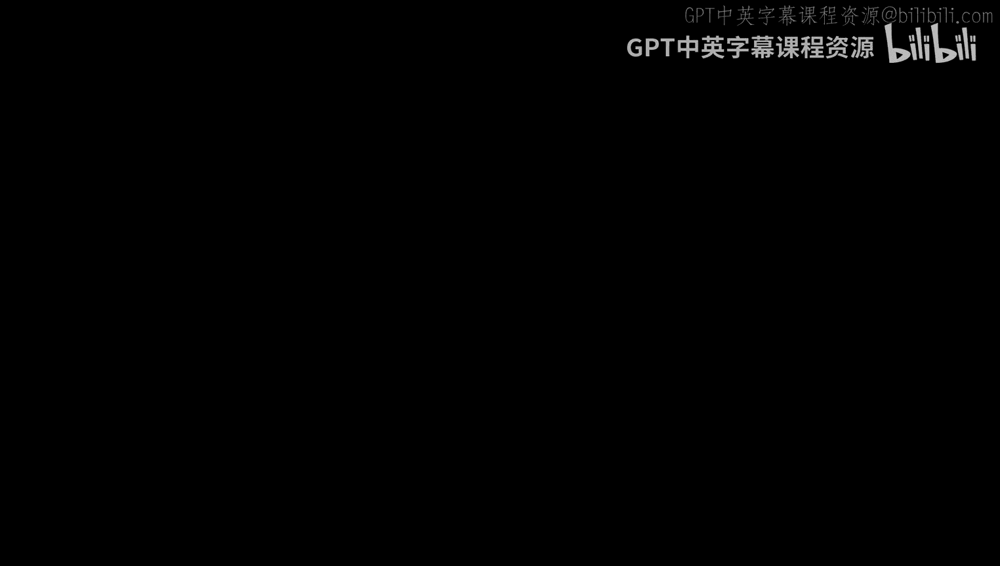
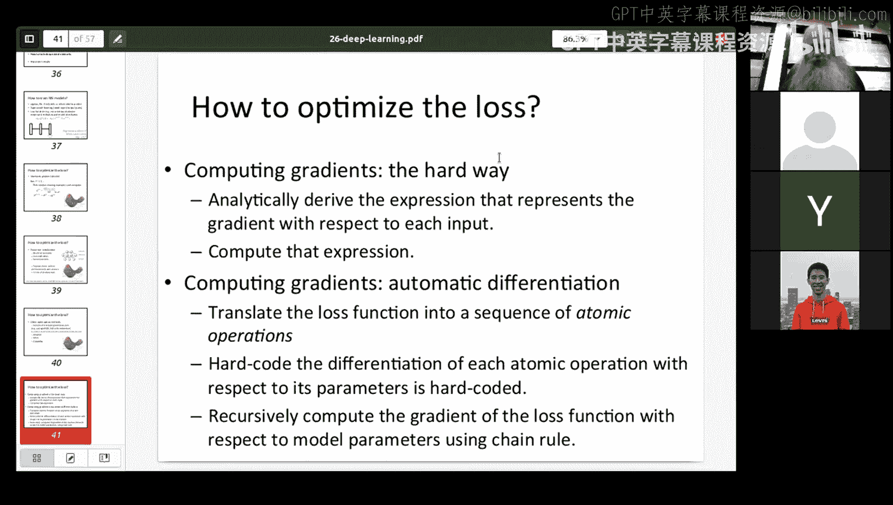
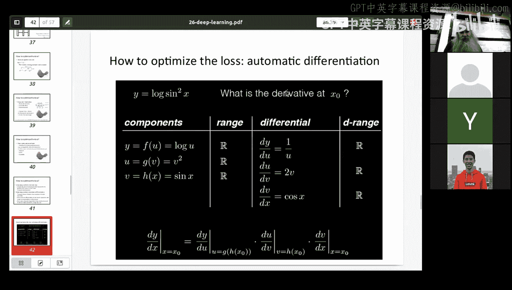
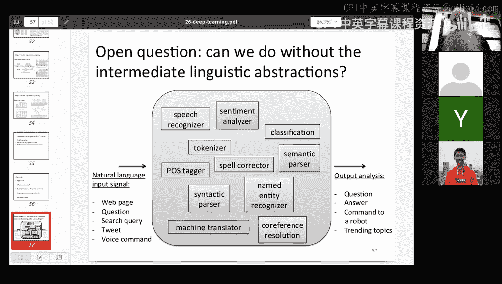

# 15：深度学习概述

## 1. 深度学习简介

在本节课中，我们将简要介绍深度学习在自然语言处理中的应用。深度学习是一种强大的机器学习技术，它通过模拟人脑神经网络来学习数据中的复杂模式。

### 1.1 深度学习与自然语言处理

深度学习在自然语言处理（NLP）中发挥着重要作用，因为它能够处理复杂的文本数据，并从中提取有用的信息。以下是一些深度学习在NLP中的应用示例：

* **文本分类**：将文本数据分类到预定义的类别中，例如情感分析、主题分类等。
* **机器翻译**：将一种语言的文本翻译成另一种语言。
* **语音识别**：将语音信号转换为文本。
* **问答系统**：回答用户提出的问题。

### 1.2 深度学习的优势

与传统的机器学习方法相比，深度学习具有以下优势：

* **强大的特征提取能力**：能够自动从数据中提取有用的特征。
* **处理复杂模式**：能够学习数据中的复杂模式。
* **无需手动特征工程**：无需手动设计特征，从而节省时间和精力。

## 2. 深度学习的基本概念

### 2.1 神经网络

神经网络是深度学习的基础。它由多个相互连接的神经元组成，每个神经元都负责处理输入数据并产生输出。

**公式**：

$$
y = f(W \cdot x + b)
$$

其中：

* $y$ 是输出
* $W$ 是权重
* $x$ 是输入
* $b$ 是偏置
* $f$ 是激活函数

### 2.2 激活函数

激活函数用于将神经元的线性组合转换为非线性输出。常见的激活函数包括：

* **Sigmoid**：将输出值压缩到0和1之间。
* **ReLU**：将输出值设置为正值或0。
* **Tanh**：将输出值压缩到-1和1之间。

### 2.3 反向传播

反向传播是一种用于训练神经网络的算法。它通过计算损失函数的梯度来更新权重和偏置。

**公式**：

$$
\frac{\partial J}{\partial W} = \frac{\partial J}{\partial y} \cdot \frac{\partial y}{\partial W}
$$

其中：

* $J$ 是损失函数
* $W$ 是权重
* $y$ 是输出

## 3. 深度学习在NLP中的应用

### 3.1 文本分类

文本分类是将文本数据分类到预定义的类别中。以下是一些常用的深度学习模型：

* **卷积神经网络（CNN）**：用于提取文本中的局部特征。
* **循环神经网络（RNN）**：用于处理序列数据，例如文本。
* **长短期记忆网络（LSTM）**：用于处理长序列数据。

### 3.2 机器翻译

机器翻译是将一种语言的文本翻译成另一种语言。以下是一些常用的深度学习模型：

* **序列到序列模型**：将输入序列转换为输出序列。
* **注意力机制**：用于关注输入序列中的特定部分。

### 3.3 语音识别

语音识别是将语音信号转换为文本。以下是一些常用的深度学习模型：

* **循环神经网络（RNN）**：用于处理序列数据，例如语音信号。
* **卷积神经网络（CNN）**：用于提取语音信号中的局部特征。

## 4. 总结

本节课简要介绍了深度学习在自然语言处理中的应用。深度学习是一种强大的机器学习技术，它能够处理复杂的文本数据，并从中提取有用的信息。随着深度学习技术的不断发展，它在NLP领域的应用将会越来越广泛。