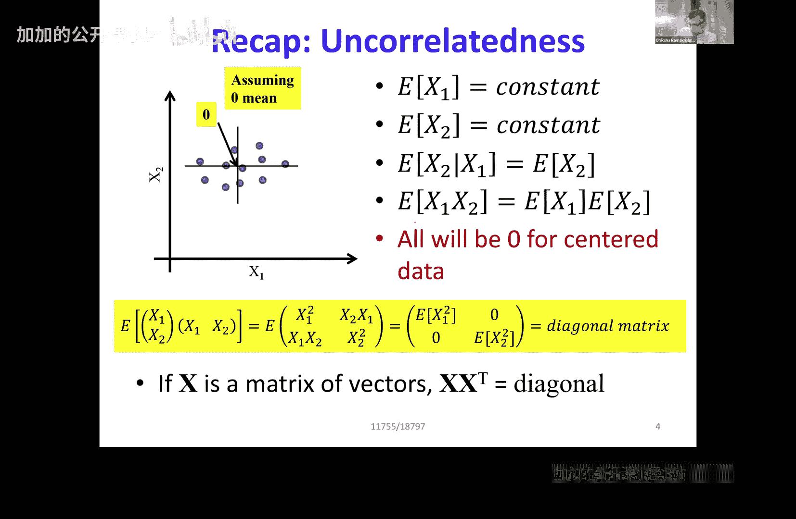
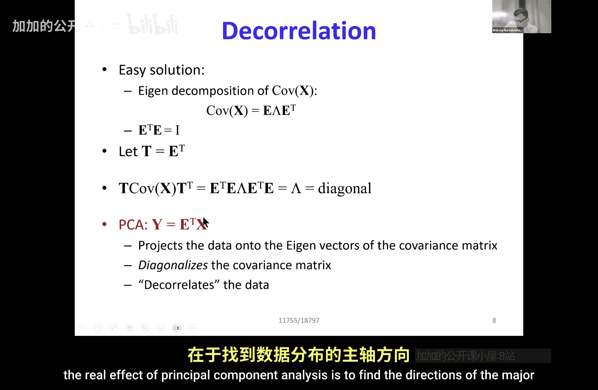

# 卡耐基梅隆大学【中英⚡机器学习与信号处理｜2024 11-755 Machine Learning for Signal Processing】 p01 P1 11 - Independent Component Analysis -BV1TfSqBGE8C_p1-

All right， everybody， I'll wait another 10 seconds and I'll begin。Yeah。嗯。Okay。

Let me begin so can you hear me， can everybody hear me。要。Perfect。😊。

Today we're going to be talking about independent component analysis， but first。A quicklycap。

So we saw in the last class what we meant by correlated variables。

 So if two variables x and y are correlated， though then knowing the then at any x value value of x。

 the y value is going to depend on x so here in this example。

 I have a scatter for for a set of bivariate data points。

 our example was burger consumption and penguin population。

And the expected penguin population when burger consumption is B1 is different from the expected penguin population when burger consumption is B2。

 So these are correlated variables， the expected value of y。Given x varies with x。

If the variables are uncorrelated， then knowing x does not tell you what the average value of y is。

 So in this example， both at B1 and B2， the expected value of y is exactly the same。

 these variables are uncorrelated。And so uncorrelatedness has all of these properties。

If you have two variables x1 and x2。Then the expected value of x1 is going to be something。

 the expected value of x2 is going to be something。

But the key point is that the expected value of x2 given x1 is always going to simply be the expected value of x2。

 so regardless of what x1 is the expected value of x2 is the same。Also， the expected value， you know。

 as a consequence and we can prove this， the expected value of the product of x1 and x2。

Is going to be the product。Of the expected value of x1 and the expected value of x2。

 so if the data are centered， meaning if their means are0。

 then the expected value of x1 and the expected value of x2 are going to be0。

 so all of these terms are going to be 0。Now， when we have。啊。Multivated data of this kind。

 I can write the whole thing in this manner。I could write x1 and x2 as a column vector。

And so we can define the correlation matrix as the expected value of the outer product of。

The data vector and its transpose。And that's simply going to be the expected value of this matrix。

 where the diagonal elements are x1 squared and x2 squared。

And the of diagonal elements are x1 x2 and x to x1。And if。

The two variables are uncorrelated and if they are0 mean， then this term。

 the expected value of x2 x1， as we saw is going to be 0。 and so this。

Correlation matrix is going to be a diagonal matrix now this is an expectation。

 but this is also going to hold of averages so if I have this this matrix big x which consists of a large number of data vectors。

Then so you know， let me use my pointer to explain what I mean by this。

So X over here is going to be something that will come on。

I'm sorry。X over here is going to be something like x1 x2 and so on， these are all data vectors。

 So if I have a lot a data vector of this kind。呃。Data matrix of this kind。

Then the outer product of x and x transpose is simply going to be the average of the outer products of the individual vector in the matrix。

And are rather the sum of the orderer products of the individual vectors in the matrix。

And if X E and if the。Components of these vectors are uncorrelated。

 That means this outer product is also going to be diagonal。So that's what uncorrelatedness means。

And we also saw in the last class how we could make a pair of variables that are correlated。

Uncorrelated， sorry this should have been x2 not y over here。

 So if I have x1 and x2 which have a scatter of this kind， then I can transform the data vectors。啊。

In， in some manner。this equation is off， this should be x1 prime x2 prime equals。Trans。T times x1 x2。

 so I can transform x1 x2 to x1 prime x2 prime， such that。

The scatter of x1 prime x2 prime is aes aligned in this manner and the expected value of x2 prime becomes independent。

Of the value of x1 prime， this is the correlation。And we also saw how we could do this。

If big x is the matrix of correlated data vectors。Then when the data vectors are correlated。

 then each component。Of this。This matrix， each row is going to tell us about the trend of the other components。

 the other rows， and if you want to derelate the data you want to transform T such that Tx pi equals tx is going to be a collection of vectors。

And the correlation matrix， the data， if the data zero mean， then that's also the covariance matrix。

Then the covariance matrix of the transform data is going to be done。

 so y times y transpose is diagonal。And this is basically what the correlationlation means。

 and we found that when we perform principal component analysis。

 this transform T is going to be the transposed matrix of eigenvectors of the。

Covariance matrix of xx transpose， so we saw how that worked out too， right？

If x is the matrix of correlated data vectors。Then I want some transform T such that Tx is uncorrelated。

Which means if y equals Tx， you want y times y transpose。To be a diagonal matrix。

And that means tx times x transpose t transpose is going to be a diagonal matrix。

 but this inner term over here， xx transpose is simply proportional to the covariance matrix of x。

And so we saw again。Then the covariance matrix of x can be decomposed usingigen eigen decomposition into some e lambda e transpose where E are the eigenvectors of the covariance matrix。

And Lambda is the matrix of eigenvalues。And we know from the properties of eigen decomposition that the eigenvectors of a symmetric matrix。

 such as a covariance matrix。Are going to be orthogonal to one another。

 which means that E transpose E is going to be an identity matrix。 So going back here。

 if I let this transform T simply be。That transpose of my eigenvector matrix。

 Then you can see that T times the covariance of x times t transpose is going to be e transpose E lambda E transpose E E transpose Es identity。

 this E transpose E's identity。 So this whole thing is just a diagonal matrix matrix。

 So in other words， if I， when I compute the。The eigenvectors of the covariance matrix and transform the data。

With the transpose of the eigenvector matrix， that results in a bunch of。

Uncorrelated data and but then。What does PCA do？PCA's principal component analysis is actually performing。

This operation。It's projecting the data X。Onto my。On to the eigenvectors of the covariance matrix so。

This one is basically diagnoalsizing the covariance matrix， but the key the。

