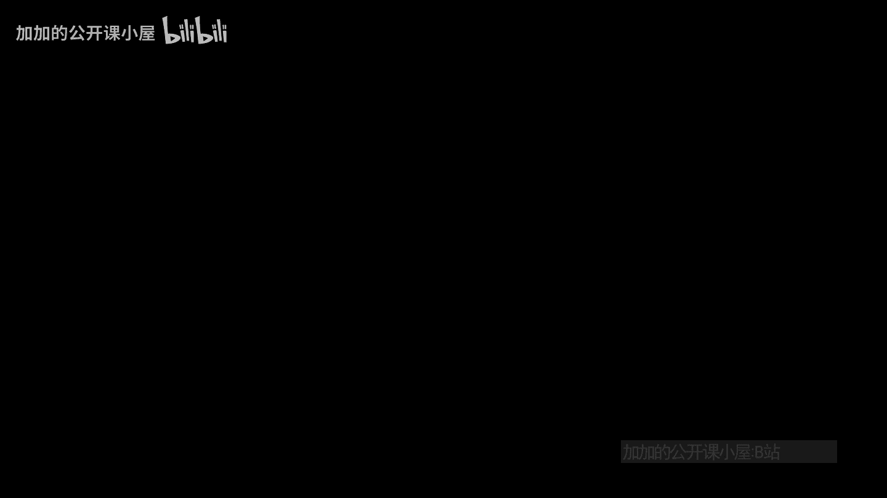
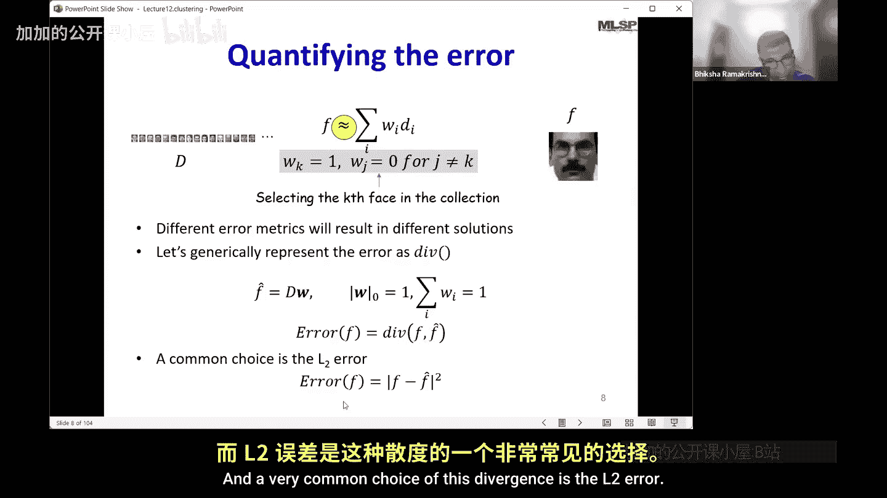

# 卡耐基梅隆大学【中英⚡机器学习与信号处理｜2024 11-755 Machine Learning for Signal Processing】 p02 P2 12 - Clustering -BV1TfSqBGE8C_p2-

Let me wait another minute and then until it again。All right， let me begin。

So today's lecture is going to be on。Quantization and clustering。Now， so far。

 we mean looking at decomposition algorithms。Basically essentially matrix decomposition algorithms where we were trying to decompose the matrix into bases。

And their weights。And the whole idea there was that if you learn the bases properly。

 then the weights could be used to represent the data。Now。

What does clustering have to do have to do with。Mattrix decompositions， So let's see。

So here was our problem。You were given a collection of data tag。

And the problem was to find a set of bases P such that each vector here can be expressed。

As a weighted combination of the bases。And this decomposition eye must be exact。

 but when it was inexact， we wanted the error between the two to be as small as possible。Now。

 why was this important？With the right set of bases over here。

The weights represent the data more effectively， for example， if we were decomposing music。

Or the spectrograms for music if the bases ended up that we discovered ended up being nodes。

Then these wavess would basically tell us how the notes were played。

So also when we are analyzing phase data， if the bases give us essential facial structures。

 then the manner in which they are combined makes a lot of sense。And so with the right set of base。

 the weights can represent the data very effectively。Also， if the bases are agreed upon。

 then we can communicate the information about the data more efficiently because if you and I agree upon what base we are using to represent the data。

 then I just have to send you the weights。So once you got the weights。

 you could combine the bases with those weights and reconstruct a pretty good facton related to the original data。

 so for example we could just transmit eigenface weights。So long as you and I。

Had agreed upon what eigenfaces to use。 and then once you got the weights， you could。

Combine your eigenfaces with those weights and reconstruct the face。

Or notes are universal versus everybody knows what notes are。

 which means we're able to write down the score。And the score is sufficient fine you want to recreate music。

Getting the right set of bases is very important。Given this。

 what is the most accurate way to represent data？If I want to have a representation which guarantees that I transmit the least amount of information to you。

 the smallest set of numbers。And at the same time。You are able to reconstruct everything very accurately。

Then the most accurate way to represent data is for me to have。A dictionary of all possible data。

If you had every， if you and I had a huge catalog of every face in the world。

Then when I wanted to send you a picture of somebody's face， I won't send you the picture。

 I just say it's catalog number 763。And so once you got once you knew that you just pull up the face。

 you have the reconstruction Now if I wanted to think of this in algebraic terms I would have a dictionary of faces。

 these are these DIs are my dictionary entries。And you would be。Reconstructing。

YourThe data as a weighted sum of dictionary entries。

 except the weights are going to be zero for all of these dictionary entries except the target phase。

And for that target piece alone， the weight would be one。So， W。Would be a sparse sweater。

It's going to have only one entry， which is one， the rest are zero。And in fact。

 it's a one hard factor because the one non zero entry is also going to be one。

Did this make sense to you guys？Yeah yeah， right。So given this。

What would be the problem with the representation of this kind， anybody？

What would you you can't possibly collect all the instances of a。Data， so for the faces， for example。

 you can't have a collection of all。Possible faces。

That's right it's infeasible to construct a dictionary of every possible data instance。

 you would need infinite entries。Also， this is not really efficient because if I have infinite entries in my dictionary。

 then the index is going to need infinite bits to represent so you know this is not going to be very useful right？

And if I say that my training data is going to be finite。

 you would still need to store the entire training data。

But then if you had to represent a face outside the training set。

 you're not going to be able to represent it。So that doesn't work。

So can we have a solution around it？Instead of story， everything。Can I instead construct a smaller。

 finite dictionary？Says that all data are not now no longer exactly reconstructed。

As awaited some of the dictionary entries， but approximately reconstructed。

The rest is still the same。Im still going to reconstruct the phase as a weighted sum of dictionary entries。

 the weights are still going to be one hot， meaning zero for all but one entry and one further for the one remaining entry。

And what did and。What has changed is that instead of saying that this face is exactly the seventh phase of the dictionary。

We're going to change that to saying the face that I'm sending you looks a lot like the seventh face in the dictionary。

When I send you a weight re with a one in the seventh position。

 I'm just telling you that this phase that I'm trying to convey to you is very similar。

 extremely similar to the seventh phase in the dictionary， so what do we mean by looks are lot like。

Or as extremely similar to and。How do we construct this dictionary。

 such status approximation error is minimized？So let's look at these two questions。

 but is the problem statement here making sense？What I just said， yes。对。What about the rest of you？

But that makes sense。ok。So。For this first， let's see。

How do we what do we mean by looks a lot like this means by quantifying the error。

And so this term is what we are trying to quantify。You're going to get some approximation。

 you have the original phase， you want to minimize the error between the two。

And you can choose different error metrics to quantify the difference between the two。

Let me just generically represent this aromametric as this term da， which means divergents。

My reconstructed phase， this one here can be written as d times w。

 where d is a dictionary containing all of these faces and w is a one hot vector。

And so my way of representing one heart is the same as saying that the zero norm of w is1。

 which means there's only one entry in w， which is nonzero。

 and that the sum of the entries of w is also one， so these two together specify that thes the weight vector is all0 except for a single entry whose value is one。

So my approximation f is de w， where w satisfies these constraints。

 my error is going to be the divergence between the actual phase and this approximation。

And a very common choice of this divergence is。

