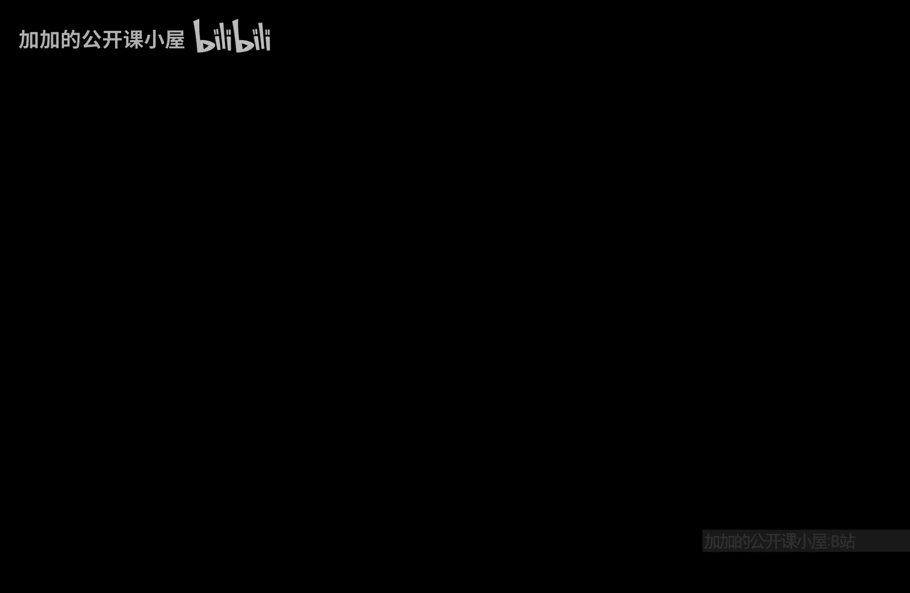
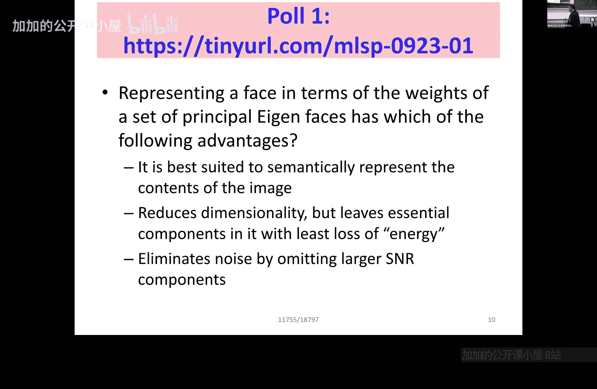

# 卡耐基梅隆大学【中英⚡机器学习与信号处理｜2024 11-755 Machine Learning for Signal Processing】 p03 P3 9 - NMF -BV1TfSqBGE8C_p3-

And。You got your name tags out because I still don't remember your names。

It's unlikely that I'll remember all your names by the end of the semester， but I'll keep trying。Yes。

Thank。嗯。So， David。There's that end showing up on those screens。And not。Okay。Right， folks。Thank you。

 Aansha。Since I don't know your name， it's very important that name type。Thanks。

You actually got a name tag。That's beautiful。Okay。Eputo， who' has your name tag？All right guys。😊，ち。

Magic。Okay， so first before I begin， this is my we're going to be talking about yet another form of decomposition today。

 non negative matrix factorization。😊，Many of the slides and almost all of the examples on these slides are actually due to my good friend Paris Merras who。

May now be at MIT， I don't know he's a professor in。U areU。

So but this is from when we did work to when we worked together。So。Here's a quick recap， right？😊。

This was the problem that we actually looked at when we were performing a decomposition or the Carhanlo transform when we were trying to find bases。

For data so we found eigenfaces what were these eigenfaces the eigenfaces were bases we have some data matrix in that example our data matrix was a matrix of fs。

😊，And then are we。Tried to find a set of bases B such that every vector over here could be expressed in terms of these bases now you could just use your standard or panal bases and it would work just fine。

 but then we wanted to come up with a different set of bases。And in those cases。

 we were looking at eigenphaases as our base。Now， what could the purpose be to actually want basis of this kind？

So for this again， the problem of finding this base， there were two problems here。

 of course the first was finding the bases in the case of faces it would be finding our typical faces or eigenfaces if youre working with music。

Then these could be you know trying to find the notelike structures that compose the music and then once you found the bases the next problem was actually figuring out how those bases combined to generate each data point like in the case of the faces how did you mix your eigenfaces to generate any given data instance and then going back to our problem why do we want those bases why do we even bother with doing this now if you'll remember I mentioned even when we were talking about linear algebra that？

The biggest problem in。Machine learning are one of the biggest problems is finding the appropriate representation for a data。

So finding the bases that best capture the space， the manifold that the data living。

And what would the benefit of this be？Most importantly。

 this is going to give you a better representation。If your bases are properly defined。

 then your representation is going to have some kind of semantic to it， for example。

 if notes are my base， then I can just write a score。

 a human being could read this score and they know what the music is。😊，So。

In the case of other kinds of compositions， if my bases were parts of faces。

 I could just describe a face and you could kind of visualize what the face looked like so having the right set of bases gives you a semantic characterization。

😊，Or。The data and having semantic characterization makes this much better suited for statistics。

 some kinds of statistical methods， so this was one reason for wanting a different set of bases。😊。

The other reason was dimensionalityity reduction where we saw for example that if you got your bases just right the first few bases captured most of the information or most of the energy in the data and so even if you didn't try if if I had a。

😊，Howous dimensional data then。In the naive representation I'd have to give you  a thousand numbers to characterize the data fully。

 but if I use the appropriate bases， I could maybe get away with just 15 numbers because whatever is there in the remaining subspaces is not really very much I'm losing some information some energy but then we want to find our base such that an amount of information lost the amount of energy lost is leastd and if we do that then I could just use a lowerdial characterization of my data so in our eigenfaces example if I just got or in a music example that we saw in the linear algebra class for that particular section of music。

😊，Just five unique combinations of notes we created the entire music。

 so I didn't need to give you a 1000 dimensional vector for each vector I could have just given you five numbers and you you'd have gotten the music right back just fine。

 right。And there's also the third aspect we mentioned when we were talking about bases as denoising。

 that if you find the appropriately organized set of bases。

 then the early bases capture all the most important information。😊，And then maybe the later bases。

 which carry the least amount of energy。😊，mostly carry information about noise like in the image of the how corrugated sheet that I showed you the fluctuations of the sheet could be viewed as noise so these are the three reasons we want to compute。

😊，Good bases and we saw one method of doing this。Finding eigenvectors of the correlation matrix。

 this was the current endl transform or preP which finds the eigenvectors of the covariance matrix and in P。

😊，Satisfy most of our requirements， I gave you three requirements to satisfy most of them。

What do I mean by most， what am I missing， can anybody guess？

What would I do the eigenbass have an energy compaction property？

Do they get represent most of the information and the least number of numbers yes or no sometimes theyre good for setic capturing they're not good for semantics eigenbass capture most of the information in the smallest number of bases right smallest number of numbers also if I were using eigenbass then you can sort of imagine that the trailing end of the bases capture noise。

But then they lose semantics or do I mean by losing semantics let's go back and look at this example look at images two and three right so one of the characterizations of eigenbass is that they are。

😊，Are talking to one another。And here is a rule。That if I have。

A set of orthogonal vectors in any number of dimensions。

Then no more than one of these vectors can be unipolar。

What I mean by any are where all the components have the same sign。

So if I can have one vector which is all positive or all negative and every other vector must by math have some positive and some negative components there's no other way they can all be orthogonal otherwise because components must cancel each other this is math and so you end up with the second and third bases over here the second and third eigenfaces。

😊，They have negative components。But these are composing images， what does a negative Excel imply？

If I'm looking for semantics， what is a negative image？

Or this is perhaps more poignantly brought across when we think about sounds。

If I'm looking at a spectrum with energy， then。You know if I'm trying to learn notes from music。

Also's a negative no。It doesn't make any sense right so the thing with orthogonal and with eigenbases is that the cap have the energy compaction property or they're lacking this essential aspect of。

😊，Semantics， right？So。I the book。个。Thank。Okay。是。

