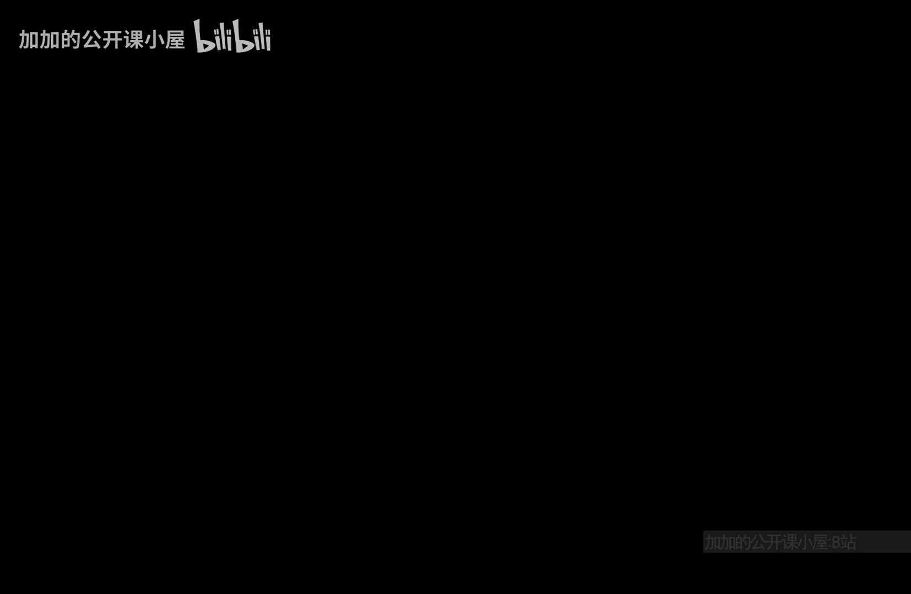
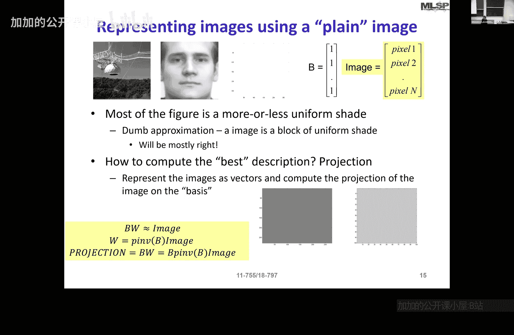

# 卡耐基梅隆大学【中英⚡机器学习与信号处理｜2024 11-755 Machine Learning for Signal Processing】 p04 P4 5 - Deterministic Representations -BV1TfSqBGE8C_p4-

Bf， we can hear you。The topics for the day， we're going to talk about representing signals。

 basis based representations， are bases， per bases。And spectrograms and DCTs for sounds and images。

 the last topic Gausian and lapplace pyras are something we won't cover in fast。Prof。

The class is muted。All。David， can you hear me？嗯。So the class should not be muted。O。Guys。

 can you hear me on Zoom？Yes， yes， yes， okay， so all right。And so。

This poem goes and talks about six blind men who try to describe an elephant and each of them describes it differently depending on which part of the elephant gave oh my good card。

啊啊。Look bad。And and when we begin representing signals。

 we are much in the same situation as these six line men， depending on our perspective。

 depending on what we view the signal we're going to come up with very different descriptions so here are a bunch of pictures can you describe them what do you see？

Anybody else， what do you say， human faces all right？These things。Trees， are they all trees？

Some multiple trees there's also a sky which there's a bird in one tree for imaginary trees some imaginary trees if you wanted to describe the collection of images。

 what do you call them the stuff on top and the ones at the bottom？😊，So。

And just to make things more interesting， here's a bigger set of images。

 how would you describe these？Okay。So anytime I ask you to describe these images。

When you begin describing them to me， you're trying to give me a content based description。

 a semantic description of sorts。And clearly that kind of description is not going to work when I just give you a collection of faces。

 you said faces， if I gave you something that looks like looked like trees。

 you said trees until there was a street going through the trees。😊，And then with this collection。

 it gets even harder。So， clearly。Content based descriptions are infeasible。

 you you're not going to be able to they don't scale。And at the same time。

 there's a different way of describing these images。

 which is 100% non loss if you convey this description to the next person。

 they would be able to reconstruct the。Signal perfectly and that is to convey the value give them the value of every single pixel saying pixel 1 is you know 0。

25 pixel2 is 3。😊，But the second kind of description is completely uninformmatical。

 it doesn't tell you anything about what's in the data。And so。Same thing with sounds。

If I look at a sound signal and looks something like this。

 it's just a sequence of numbers when you plot it it looks like a blob if I ask you to describe this。

😊，You know， how we going to describe this picture it's a blob。

 sounds of blobs or sounds and numbers or if I ask you to describe。You know。

A piece of music and you begin telling me 36， 42， 68， and you begin giving you the sample values。

Are those going to actually convey the impression of music not at all right so we have this issue of representation representation is description。

😊，You need compact representation。But you must describe the most salient characteristics of the data。

 whatever is most important。Here are two images， are they the same image？

Do they represent the same thing there you go right both of them represent the same。Concept。

 the character A。But then if you began comparing them pixel by pixel， how far apart of it？

As far apart as it can possibly be， if a white in one pixel is a black and the other pixel， right？So。

Representations must be numerical， numeric， you need numeric representations。

Yet they must convey some information about the content。

 they must allow identification comparison storage reconstruction the whole lot。

 so there are many things that that a decent representation must do all at once。

And that's a challenge， right， so let's go back to this one。😊。

If I asked all of you without looking at the slide。

 what is the most common feature of all of these images？Anybody？Black pixel， black pixel， How bad。

Anyone else？Sees like。Their rectangles， lovely， something else。Fixels are okay。

So here's the thing if I begin describing images in terms of their most salient content。

The most common aspect of all of these images is the background。

Pretty much every photograph you will ever take is going to be mostly background right and what is background。

 a background is just a uniform shade。😊，Of some color。So。

If I want to describe these pictures in terms of just the most salient aspect of the picture。

 I'm going to describe them as you know。In terms of the background。

What is a background what is a uniform shade a uniform shade is just just a collection of once it's all once and so my closest representation for this guy is going to be。

三。Constant times a picture of once， so what would I be doing when I'm describing the data in that manner？

This uniform shade， this collection of ones。Is essentially a vector in a vector space where a vector is a vector of all one。

And when I'm describing this image in terms of just this once， the most salient characteristic。

 what am I doing？What would I be doing？自己。Projection I will be projecting the image onto this vector of one right and how would I project this image onto the vector of ones this image is going to be some vector of pixels。

the basis。This uniform shade of ones， I'm going to call it my basis， that's a vector of ones。

 and I'm approximating my image as some scaling of this。

Basis vector and so if I were to write the equation down。That's going to be this。

I have my image and it's going to be my basis vector times approximated by the basis vector times the times of weight。

😊，And given this， we saw this in the last class。let talk about anytime， all right。You know， image。

Approximates b times w， and I've given you B and I've given you I。How do you compute W？

W equal for so W is going to be。B pseudo and versus I。

And so your approximation is going to be B times。BC do inverse。I。Which I can write as B times。

P pseudo inverse times I and this。As my projection matrix it projects the image onto the basis right and so I have the projections I have tried describing two different images。

 one is the telescope rather as the face in both cases the majority of the image the most salient characteristic is the uniform shade。

😊，But when I project them onto to this most salient characteristic。

 this is what the first image looks like， does it look like a telescope？😊。

And does this look like a face， right， but you did capture the most。

Important salient characteristics so what am I missing？嗯。

This is I'm still trying to represent it when I describe the approximated as this one。

 what am I missing？😊，这 one。

