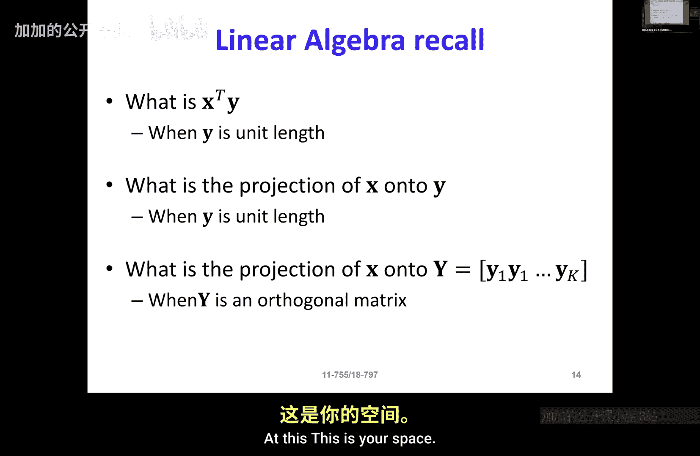

# 卡耐基梅隆大学【中英⚡机器学习与信号处理｜2024 11-755 Machine Learning for Signal Processing】 p05 P5 6 - Data Driven Representations -BV1TfSqBGE8C_p5-

W。

Yeah。Yeah。Okay。多少。Yeah。Okay。Okay。Okay。Yeah。嗯。Yeah。Thank。It。Yeah。嗯。是。Nothings。Next。Yeah。对。懂。Okay。Okay。

你可以。If。2。Yes。Okay。Yes。Okay。Okay。拜吧。H。Okay。In。Okay。No。S。Yes。H。No。我就想了。ち。Yes。そす。你看。Okay。

My tears are missing so my poles are missing。嗯。那这个。I'll have the pulse。Okay， so folks。

Since we did not， my tears。Ca yes， they have some work to the career fair or something of that kind。

We haven't set up the polls。This means that we have a happy occasion where I'm going to individually pick on you by name。

And ask you for answers if you have never answered a last question today， we are missing。

A couple of playing people。lu西啊刚下，喂啊。I'm looking for people who should be here。

Stay your names out guys， all right， so let's begin。We've so far we've gone through。The basics of。

But what a signal is we've gone through some linear algebra we've gone through some optimization and in the last class what was it we at Ha a deterministic representation so what was what was special about deterministic representations essentially no matter like what data set you're using they'll always like look the same as long seems to find it in a certain way so in the deterministic representations the basic units that we use to define our obtain our representations did not change with the data。

😊，And so there was no learning per se in it。Use these bases。

 we had some principles to define the bases， what were the principless that are。autoous。

 each basis must。This must capture some aspect of the data that the other bases did not。

 and then we had some you know。Are desirable principles that they must be ordered according to importance。

 but we didn't actually specify this。It just so happens that in most real life data。

And if you order things by some notion of frequency。

 the low frequency components are the most energetic。😊，That's to do with the fact that in real life。

 most of the time nothing happens， whether it's across space or whether it's across time and so the low frequencies are the most important and the most energetic and the highest frequencies are the most rare and。

So have the lowest tenity。Today we are going to be looking at data driven representations， but first。

😊，A little recall if I have the inner product of two vectors x and y and。Why is unit land？

Then I'll be say what is x transpo y？嗯。Yeah。What was it？Is a just tax？嗯。So what does that mean？So。

Yeah。It's the length of the projection of x and y， correct I。Computed x transpose y。

If y is unit length？This is why。Or this is X。This is。X transpose y this way， this length。

As x transs y。And what is this vector itself， the vector from here to here？😊，What would that be？

I to x cosine the angle between， but what is the vector？Oh。So this vector is panel to y， correct？

And whats the length of the vector？Come on guys， we just saw what is the length of this vector？

X transpose y， so this vector over here。Which is the projection of this one here is going to be x transpose y。

 which is a scalar ms y。Everybody with me。You'll see， makes sense。Johnenny， okay。So what is so？Now。

This is the projection of xon to y， right？A to？When by is unit length it's x transpose y is the length of the projection。

 x transpose y times y is the projection itself。That's on。Now， if I have some vector x。

And I have a collection of。Other vectors， y1 y2， y3， and so on。

 except I'm just giving you the simplification。😊，So y is a matrix which comprises。Y1， Y2。来 three。

What is the projection of x and y？What does it mean for me to say I'm projecting X and y？Anyone？

Have a shake。What thanks the direction。Guys after after the entire you know。

 two weeks of lecturex after two weeks of lecturexs， you have to give me a better answer。

What does it mean？To say， what am I doing when I'm projecting X on v？

Projecting onto the space span button I'm projecting it onto the space span by the vectors y right。

 so these vectors y。You know， we can think of this， is there a sheet of paper。

 may I borrow a sheet of paper from somebody？All right， thank you。

So if I just draw two two lines on this or three lines on this or four lines on this。

 regardless of how many lines I drew， so long as at least two of them are not colonar。

 those lines are going to represent the page。Together they would compose the page， right。

 and so when I stick this。Page here at any angle and if I were to。

Ask you what is the and if I had a light coming off at 90 degrees to the page。

And if I were to ask you， what is the shadow of this chalk on the page， how would you compute it？

How would you compute the shadow of the chalk on the page？

Projection right so what do we mean mean by projection again？At this。

