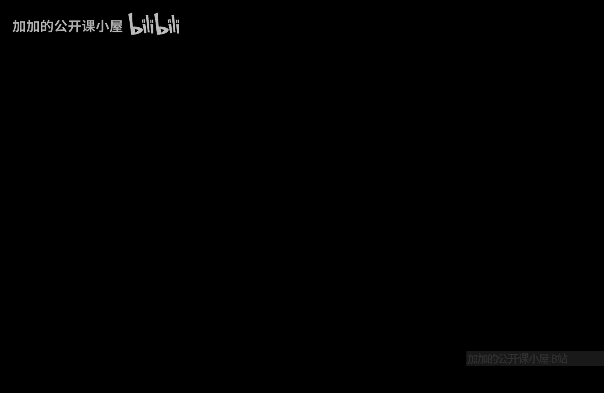
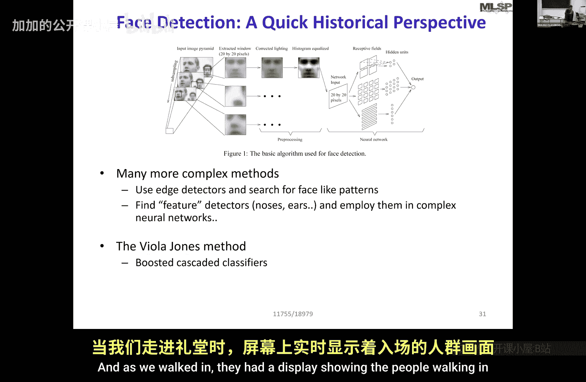

# 卡耐基梅隆大学【中英⚡机器学习与信号处理｜2024 11-755 Machine Learning for Signal Processing】 p06 P6 7 - Classification and Metaclassifier -BV1TfSqBGE8C_p6-

But he does it at the same time。

Then it means that you and all the people you are seeing the same moon at the same time and so you're connected。

It's a beautiful tradition。So if you want some mooncakes， have three of them。

 eat your moon cakes and think of your loved ones today raise your fans。Did I get that right， Kevin？

喂喂。So can we get this screen off。It。Okay， all right。So let's begin。Today and in the next class。

We're going to be looking at。Add a boost。哎呀。We're sort of switching topics slightly from pure signal processing and machine learning techniques related to signal processing。

 we will link things back in the next class in the next class we will also present the projects we have a choice of three projects for you guys to pick from it'll present these to you we pick some things that we think are fun。

But then whether they are fun or not will depend on you how we do it。But first。This week。

 it's all about trying to detect faces and images。Now we know from the last lecture how to describe a face。

 we started off with a typical face which captured in some sense the essence of face。

This was our what was this our principle eenplace， and then every case in the world。😊。

Could be approximated as a scaled version of this image。

 and it will still look like a phase you get most of。

What was the most important thing of a face image that it is a face？And so。

If I had many such eigenfaces， many such typical faces。

 then each of them captured details that the previous one did not and so you could express each face as a weighted combination of all of these typical faces and the more you added okay。

😊，Cleaner the reconstruction God。And if you use the eig decomposition。

 then these typical faces where。😊，Very face like， they represented what looked like faces。

In this in so doing， we introduce a notion of a typical phase now I can use a typical phase too。

Construct phases。 What else can I use it for？Store store。Sap proof。

 but if I have a notion of what a face looks like， what can I do it， what can I use it for？😊。

I can detect faces and images， can I not？So because it tells me what faces are like。

 So we're going to be looking at detecting faces and images I like to begin with。😊。

This picture here as an Indian is one of my favorite pictures。😊，This is a famous。

Conence in the 1930s， I think。And almost every single person in this picture got Nobel Prize in physics。

The one prominent person here who didn't get a Nobel Prize happened to be Indian。

The guy who discovered the boson。Anyway， suppose I wanted to detect。All the faces on this image。

How would I do it？A simple solution， I know what a typical phase looks like。

I can go looking for the typical faces in my image， so if I started for instance。

 with this image here。😊，You know， this is a 400 cross 200 image。

 I have a notion of what a typical face looks like in a standard。Pic Jeff from Seinfeld。

I'd begin scam firstly。The picture is larger than the typical face or didude and it's in color so maybe I convert it to gray scale by averaging the colors out。

 I have my typical face which is also gray scale。😊。

I make sure that the two are scaled so that the faces in the image。

Roughly match the typical face in my。That I've constructed from my data。And then I can。

Begin trying to match my typical face at every position over here。Until。

I find the locations where my typical face matches the image， and so I get some notion of what。

 where in the image I can find the faces。When I do this， I'm scanning with my typical phase。

 so to what is the purpose of the scan at each location place the typical phase on top of a corresponding region of the image。

And I found a match。Between my typical phase and the region of the image beneath it so how would I compute this match and inner a product right and so。

That's what I'd be computing。Express the region of the image。Behind that square as a vector。

 your typical face is also a vector， the inner product is simply going to be computing component wise products and then summing over the lot。

And you know， this is going to be maximum， when is it going to be maximum？😊，When they're the same。

And when they're close， you know， you're going to get a map like this， you get a heat map。😊。

So there are those three regions where it found faces and of the three of them George apparently is most most face like。

 but then it also。放啲。Pace where there was not on path， right， a ghost face。So that's a false enough。

Easy enough。But this wouldn't work all that way because， you know， as you can see。

 one little image it's very clean， I begin to get close。😊，So this and false alarms， you know。

 you can always find a false alarm， sometimes you can express express a put an appropriately pictured fishbowl。

But the face。B。Okay。What。Right。Yeah。是。She。一。So two false similar questions， all of you are done。Masa。

 what's the answer to the first question？What's the answer to the first question？True。And Kate。

 what about the second one？Right for a normalized typical phase。

 the scanning method of phase detection is just checking on the。

Lengentth of the prediction of the typical face on every same size patch of the image。

And false positives occur because the dot product。Of a path that looks nothing like a face can also be large。

没。The sink I showed in my a lecture。So this business off。

Detecting faces gets to be challenging and sliding windows solve only above only the issue of location。

What about scale， this used to be a very popular image。

For phase detection experiments back in the day is Judy bats。啊。Add and poster， and it has five faces。

 each of them are a different size。So if all I gave you was the typical phase。

 how would you find all five faces？I can scale this thing a bunch of different times。

This keeps scaling my typical phase up and down and then scan or I can scale my image up and down。😊。

Scanand with my typical phase and what to our cr。But then that doesn't capture everything， no。

 it doesn't capture head tilt， head orientation and so if you want to do this。

You'd have to go back and find every possible orientation of your typical face and scan and every possible size it's a painful thing so does business even the simple mechanism that I just showed you。

And get challenging。And so this business of finding faces and images was a big deal for the longest time。

There are many very complex math methods in the early 2000s， late 1990s， the best techniques。

 CME was the place you came to if you wanted to find build the face detector。

 Andrewiddaman had the most accurate。Systems in the world。And they worked okay。

 actually they worked quite nicely considering all things considered， there was only one problem。

That you could submit a picture。Do the algorithm and then go have tea and then have dinner。

 then go out on a date you know those all the rest of those things and come back next week and maybe you'd get an answer so it took a lot of computation。

A lot， a lot， a lot， and then something amazing happened。

And this happened in the lab that I happened to be in。

Paul Whelow was a colleague of mine and he and I didn't get along too well because he basically grabbed。

 I'd set up a 500 processor cluster and used all of it for the system。And so mean now， I'm kidding。

 say he's the friend， but yeah。😊，Yes。That's what they did they had all kinds of things and so the what Wla Joe Paul Wheer and Mike Jones did was they sent this notice out to the entire lab one fine and they said just you know we're having a demo please come to the auditorium and so everybody walked into the auditorium。

😊，And as we walked in， they had a display。

