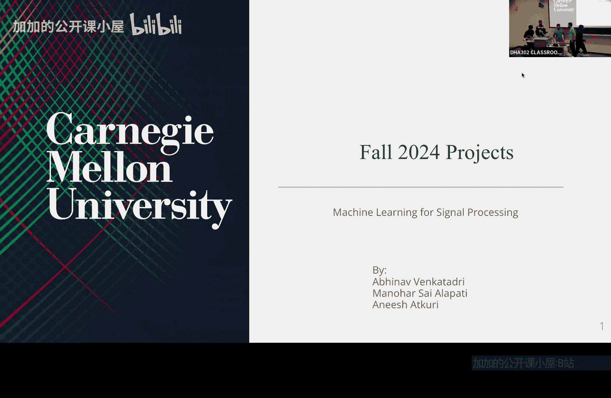

# 卡耐基梅隆大学【中英⚡机器学习与信号处理｜2024 11-755 Machine Learning for Signal Processing】 p07 P7 8 - Face Detection -BV1TfSqBGE8C_p7-

this。

I you个 amic啊 did don十mic。You might speaking the I know you're going to have to go to the board to talk right。

 but I mean like you don't have the mic it's not get very good audio of。近。😊，頼だ。

Thank。这样都是。Yeah。俾个你经买出。Right。Yeah。Yeah。我这边做一这。So question。嗯。not painting。It's not secure。你咋个。あり。全后他是。

It这。一存在。Goodol。please。Rection。You didn't access I give audio access。I office。几千蚊钱嘅。Okay。即即目都到嘛。可。

Thank。去。Yeah。ちっとき们。What。你在转出去。She。Okay。Thank。Next。this is not。你说你三。

You guys guys go with your wrap up for the slides or you have to mess up on the wise。Black。

Not showing on。Oh。Good， sharing talk about you can see like it should sharing make progress I mostly done。

Unfortunatelyly I had in smaller for。Like playing classes I'm taking a real semester you share my laptop？

Yeah， just I don't know why that that's sharing okay。Exbsly。Sorry， I don't know why that's not shown。

啊。Yeah。Co。Yeah， and the right bunch articles。Oh yes， you guys have HDMI。Yeah，what say？

I actually did more of the written programming I've been my programming efforts at Mon all my algorithms。

I read late yesterday I threw all that I love tonight。All about that my words。Okay。

All the pattern labs should be done in one thing and' just a lot of EC lectures I just feel the fact why this is not。

Yeah likes presentation。😊，Semester ask。大。你 can你 check个。对对对。谢谢。所以这上还没办法。チくしま。那样 I think one。Cha for。

Video' carry record going places， regular visit couples。

if you are attaching they probably count for 10% of those。都话我。对对。Yeah。

Like are they in class windows yeah they tend to be more for attendance or anything you essentially like a couple you see classes do this it's their person of having appointment appointment oh their visit or other。

some of you older yeah so I thought they usually count for things that are similar to a yeah if that stuck for the individual every lecture that's 28 at this two that's like both French should represent yeah。

What。To nine cases like that as well where they have what coincides in church they play what we say out loud。

 like this is basically just going to be your attendance because theyre I said the reason the big thing is I you here to see use materials materials really using right now。

Yeah。Like you're up to lecture I think you to be stuff you should know more for but。

Just go ahead and just share， I'll just film the screen correct it's not paying attention I'm。

If should be and I had classes hard and if you're not like if you don't have that you're slide weird。

Like you just un this work。But the council so。But that don't have me so much fun。

 I haven't done at dont Web， I just didn't even matter。So I I made a3 I was。

 but I was like how to do it about but find uses of two red and it's like it was mostly me just try develop no sound because it was material。

 but I don't want to see how we want to optimize。So I trying to build a add like log in and little bit。

you like坐。I go ahead going to search for someone elseshop actually。because this guy goes anyway。

 he's like， yeah a absolutely nothing just。it's un upsett I've I can email him and have space to ask and say。

 hey， I'm on enroll this class， but I would like to do project。一つ。You see professors hear slide。

today's。t everybody I certainly don't mind I mean its I think' I right I don't know if can trust I can trust you to do your part of work especially because it's open set up a regular Thursday the I think that。

