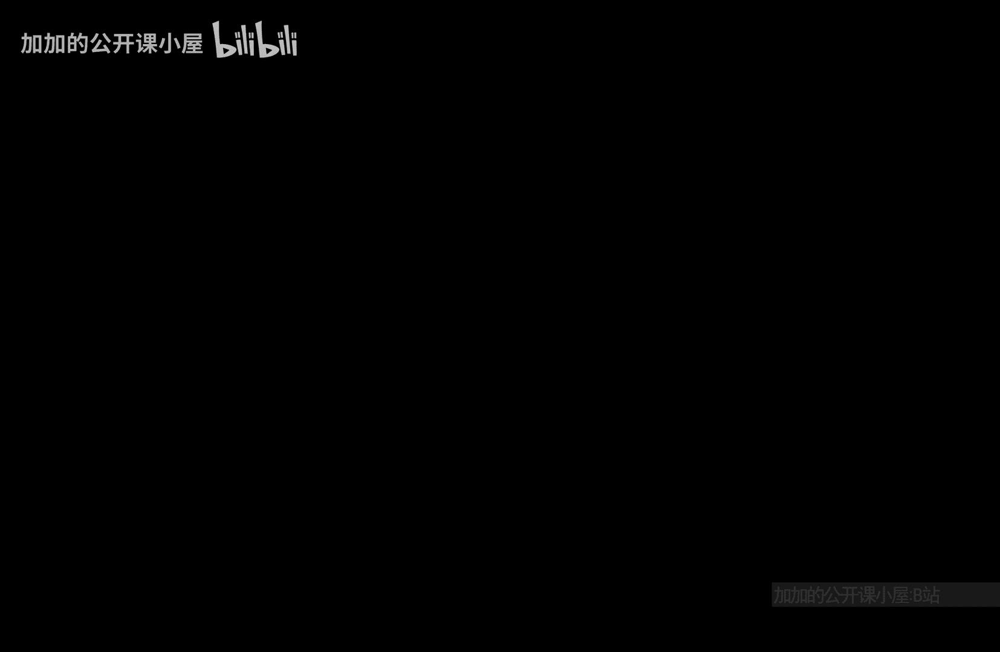
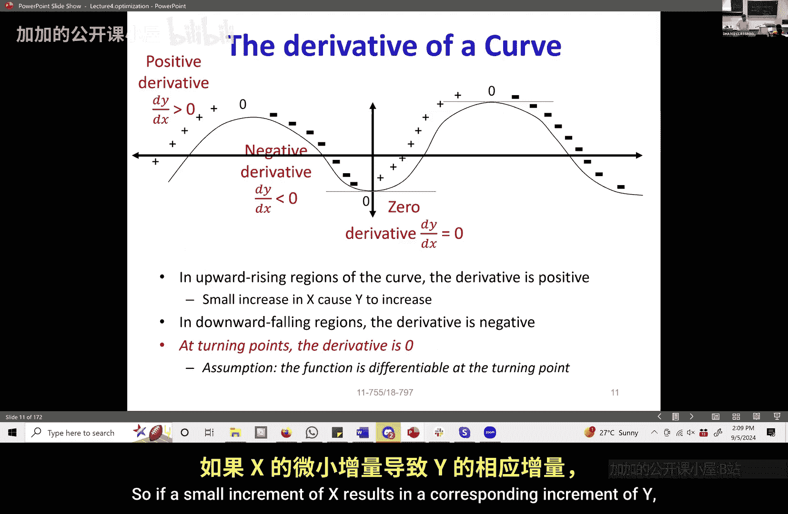

# 卡耐基梅隆大学【中英⚡机器学习与信号处理｜2024 11-755 Machine Learning for Signal Processing】 p08 P8 4 - Optimization -BV1TfSqBGE8C_p8-

Okay。All right， folks。I shall power up for another 60 seconds。Out of me？OhOkay。这个。こ。Very。そです。correct。

So。All right。It is time。Oh。对完就这个。Books。Rightly settle down laptops。Fign leisure stuff。And。

Get your name tags out， if you will。And别，ok。So。In the past couple of lectures。

 we went over the basics of linear algebra。Today is the last of the lectures on。Fundamentals。

And today specifically， we're going to go over concepts of optimization。😊，Oh。

 problem of optimization， what we mean by direct optimization， gradient descent， at disent methods。

 Newton's method， gradient descent， online optimization。

 constrained optimization methods and regularization the last topic likeang Dus and convictx optimization is something that I will not be covering in today's lecture because we will run out of time but they are on the slides and I'm happy to answer any questions on Piazza。

😊，Now， once again， all of these are topics that you guys have probably encountered before and you're probably very comfortable with them。

😊，Nonetheless。We will go through a brief revision now again。As one of the basic topics。

 it's going to be a boring topic。😊，I had to bring myself coffee to make sure I don't fall asleep while talking。

Which means you guys have to stay awake much harder than I do。

So we'll begin with the problem of optimization itself， we have encountered optimization previously。

😊，with他 unwitting it。Where。Here's a problem we recently solved。When we were trying to project。

Music onto a bunch of notes and the way we did it， we multiplied the music。

Mattrix by a projection matrix。But then the projection matrix had a very specific property。😊。

And what was that？Anybody to remember？Animized。So the projection matrix had this property that。

The it。Projects。The data。Onto the space of the basis， in our case， the notes。

Which means that the projection matrix actually is composed of the notes itself。

 so what we really do when you're performing this projection is that。Given the music。

We are determining an alternate music， which is this guy here。😊，Where。

Each music vector MI has been projected。Using the projection matrix P。

And we want to do this in a manner so that the change in the music is not very much we want to perform。

 we want to change it the least that we can while also projecting it using the projection matrix so what we were really doing was minimizing the square error。

Between original music。😊，And the projected music。But in that the same time。

 we also had an extra constraint， namely that the projection matrix itself was。

Some combination of the notes and so the problem that we solved without actually explicitly stating it as such。

😊，Is。Finding a matrix P。That minimized。The squared norm of the error between。M and PMm。

While having the constraint that the projection matrix had the form in time C。

 the projection matrix itself was a composition of the nodes。😊。

And we wanted to minimize the square error between the original music and the projected music。

 so this is a constrained optimization problem。 you are optimizing P and you had constraints on。😊。

That makes sense to everybody right so we've seen this before。😊。

So this is an instance of optimization， optimization in general is the problem of finding the best value of a function。

 so any function f of x。😊，And the best could be maybe the global minimum or the global maximum and in the process we also want to find the x at which this function is minimum。

 so you might have some function of this kind。😊，And he want to find。The lowest value are。

More explicitly you want to find the value X at which the function takes its lowest value and also find the lowest value this is the optimization problem now this is a scalar function of a scalar variables so there's an f of x and x is a scalar but then of course in real life functions tend to be functions of multiple variables there multi multivariate and so you'd have problems of the kind maybe you have a function of the kind this is a function of two variables you want to find the the argument where the function values may or maybe it's more complicated a more complex function of the kind and once again you want to find the value the value X at which。

😊，The function is lowest。So that's the problem of optimization。

And almost every last one of you has encountered this in school。换 we are there。

Gss how you have done it。You're given some function and you're asked to。

Find this lowest value of the function now one property that we have always used is that the minimum of a function is always a turning point what is a turning point a turning point is a point where the function changes its direction so as you approach the minimum you're going down。

Then you hit the turning point and then you begin to go up。So minima are always turning points。

The function increases on either side。And so our problem， the way of。

Optimization in this particular case， minimization is that of finding the turning point。😊。

So how did we find the turning point before we get to that？Do we have chalk here， I'm sure we do。

Right so。How does how do we define derivatives？Aksha if I have y equals f of x。

WhatWhat does the derivative of y with respect to x mean？Does the slope？Yeah呀。buy。s。

So literally the derivative both of you are right。😊。

The derivative of a function basically quantifies。How much。

The value of the function changes in response to a very small change of the argument。

 so it's a scalar， it's a multiplicative term。That multiplies。

The increment delta x to give you the corresponding increment delta y when delta x is small enough。

 this is the only way to define a derivative that alpha x over there。

 that is the derivative that' is how it is defined。😊，But then when x is a scalar and y is a scalar。😊。

In that case。You can always write， you know， you can write this derivative as Dy over Dx and in that case。

 in that case alone because。😊，1 over dx dx is going to be a scalar， it's a small increment in x。

 and you can always divide by a scalar。For then it's more appropriately written as f prime of x rather than de over dx and why would that be the more appropriate？

😊，Notation， anyone？Yeah。It be multiple apps or it be it might be a vector。It's。

It's a function of x at different x's， this derivative is going to be different。😊。

Right and so you want to notate the fact that the derivative itself is a function of x and so that's why we like to write this is f prime of x but。

😊，Regardless of how you think about it， the derivative。😊，is the alpha。The function effects as that。

B right。Equals alpha X。B x at whatever x， that's how it is defined。On。

Maybe you want to write it like so Delta y。Its alpha x。Delta x。

 this is the only definition of a derivative。And so now we can use the derivatives to find the max or the minimum。

 the derivative tells you how much y changes。😊，In response to a small increment effect so if a small。

