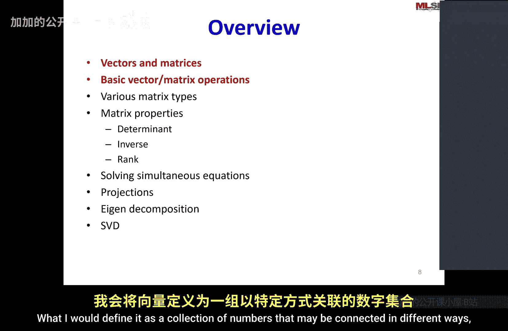

# 卡耐基梅隆大学【中英⚡机器学习与信号处理｜2024 11-755 Machine Learning for Signal Processing】 p09 P9 2 - Linear Algebra-I -BV1TfSqBGE8C_p9-

Wait a minute and then we'll begin。Hopefully I can play the on。Okay， folks。

 I have a request for all of you， please and on zoom type in your actual names so。

I know who is in the class and I may just call out to you。

So instead sort of having just your Andrew ID。Please have your。I think you can change your。

ID on Zoom itself。All right， let's begin。Again， just to confirm， everybody can hear me correct？

 I can hear you all right， so when I when I ask you questions， do me a favor。

 please at least give me a thumbs up or thumbs down so I can watch for your responses。

And I know if you're understanding you're following along。

This is kind of important for me to be able to know how well the class is going。Also。

 do voice your questions if you can。Otherwise put them on chat， I have the chat box open and。

I should be able to follow it， right？Okay， let me begin it so again picking up where。

We were last yesterday， we are going to be going over the basics of linear algebra because。Most。

 if not all of MLlSP is linear algebra now all of you have almost certainly gone through lots of linear algebra in your college。

Syllabus and in high school。So much of what we will be talking about in today's lecture and。

In the next lecture on Tuesday is probably not going to be remarkably new so we won't be posting poll links I'll just ask you questions during the lecture it is unfair to be posting poll links when in a makeup class。

So anyway。The I hope the hope here is that in going through this lecture on linear algebra。

 you will nevertheless learn something new on how to think about。

Some of these things that you have previously encountered in your academic work。So。Let's begin。

The book that we will follow。The book that I highly recommend everybody looks at is the fundamentals of Lineard algebra by Gilbert Strang。

 if you can， please also go look at his lectures。😊。

They are up there on MIT Open courseurse where it's very important to be comfortable with linear algebra for not just this course。

 but in general in life。And so， you know it appears repeatedly in the form of Fiigen analysis。

 single value decomposition， just solving simultaneous equations and what have you in pretty much every。

Problem where any kind of mathematics is applied。In today's lecture。

 we're going to go over a bunch of definitions， which is。Essentially。

 a small subset of everything that is typically used。In machine learning and data science。

 But it's an important subset。 And the intention is that。

You will recollect things that you might already know or maybe learn something that you didn't。

So before I begin， do we have any questions？Any questions？冇， okay。

So why do we use linear algebra Line algebra is about manipulation of。

Of data of vectors and we encounter these everywhere now there's nothing special about vectors they're just on matrices and such like they just ordered collections of numbers so why do we like to use linear algebraic notation and think about it in algebraic terms。

For multiple reasons。That simplifies notation like we show over here up here。

 trying to have this double summation summation J， Y J， submission I， X I， AIJ， this is ugly。

If I were writing this in linear algebraic terms， I just write extra transposing y it' so much simpler。

And that also translates into in a much simpler code。

But the real magic of linear algebra is that it gives us intuition。

 It tells us ways to look at things that you couldn't。😊。

Intu by looking at this multiple looped equation right here。

And there are lots of things you can do in linear with algebra。 so consider this。喂咪你啊啊。

Not able to do this。 I should be able to。For some reason， this pointer is not letting me。嗯。Okay。

 so consider this little video， right？It's showing a very colored object rotating。

Believe it or not that entire operation is just linear algebra and algebra can capture things like rotation。

 projection scaling perspective， it allows you to manipulate data。

 extract information from data here's an interesting decomposition here's a piece of music。

Did you hear it？你哋开车咧。We hear yeah， okay， so it's a little bar from box fugen G minor。

 it's got five nodes。🎼Of which one note repeated twice。

And just a very simple linear algebraic manipulation。

Well tell you that this little bar is composed of these four building blocks。first not。🎼。🎼嗯。

Second one。🎼Yeah。And believe it or not。You know， this。

 the fact that the four notes in this musical bar were the four that we just played。

Including the fact that the second note was played twice。

All of this was extracted through pure linear algebra without any reference to any music or any prior knowledge of music all we did was algebraic manipulation of a bunch of numbers。

That are shown by this visualization， which is a spectrogram over here。

 so that's the power of linear algebra。And so。We're going to。

So we're going to learn how to do all of that later in the course。

But for today we're going to look over vectors and matrices what these things are。

 what kinds of operations you can perform various types。

 we're going to look at some properties of matrices， determinants inverses and so on。

 and in the next class we'll look a little more at south solving simultaneous equations。

 what it means to project what is eigen decomposition and single value decomposition again。

All of these may seem familiar to you。But then again， at the end of this class。

 I do believe that you might think that you've learned something new because you're looking at it different differently。

From the perspective of。Data right and signals， so let's begin with vectors and matrices and some basic matrix and vector operations。

What is， even before I do this， let me ask you a question。What is a vector。

 Does anybody want to answer what a vector is？So Aisha， what do you understand by what a vector is？

Does that me。Now that that was a I shall know。啊唔使。即嗯。So I think when we say a vector。It's like。

Kind of like a representation in。A certain space。So anybody else want to， yeah。

 that's a pretty good definition。まma Alpha。Do you have an answer。

 do you have any definition for this？I just joined。

 so I'm not sure what the question is I being how do you understand what a vector is？

I would define it as a col。

