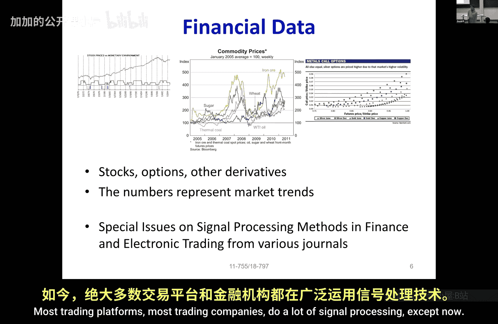

# 卡耐基梅隆大学【中英⚡机器学习与信号处理｜2024 11-755 Machine Learning for Signal Processing】 p10 P10 1 - Introduction -BV1TfSqBGE8C_p10-

For the recorder。

Yeah， the one for the room should not be so important because I speak loudly。

 this is not a very big room。是。This should be good。I assume everybody can hear me at the back。打开。

Pass me the pen。到这里。で候。supposed to get about40 people in the class。By the end of the semester。

 there will be barely 15。One of the problems。Recording these things， and broadcasting it is。

People pretend they're actually watching over Zoom， they don't really。

And it gives them an excuse to not turn up。Nothing showing slides。Yes， so just。Yeah。

Can you kill that turn up volume thing on top？And also。If you just want to see the slides， Yeah。

 yeah。Pold the paper like so。You fold it in halves and the halves again inside。So。

How many do you going to do better than that？ I want something like this。This was。And guys。

 don't forget to bring your name tag with you every time you come to class。这好的。Oh yes， thank you。嗯。

And Adrian， can you have your name tag point database。

 so I don't have to come this way to find out who you are。Thank you。Fold it in four so you know。

 you can make a little pyramid and then write your name on。So that mic is just for the。

Wat be't be protected so this is fine just so the people on zoom are clear this is good。

 this is good。The other mic is just will here。就在来我日本包过。See个？They should be able to。

 if you're sharing on Zoom on here， they should be able to see the slide。使よ的。

You can just send the chat and we were just send a chat message。Oh you want the one。Yeah that screen。

 please。Yeah， take a piece of paper， one of these sheets。And a pen to make use of an name tank。

F it in halves and the hves again and half。All right， guys， slides up。Thank you。Okay， thank you。

 Paul， So have you all set up。So good afternoon， everybody。

We are supposed to have 40 people in class， I don't see 40 people in class as in others will turn out。

But welcome to this latest edition of machine learning for signal Pro。I'm Bsharaj。That's me。

I'm the instructor。My Ts are sitting up front out here。

 this is Abinna Manohar and Anish she will get used to them I have another person Alex Sagi Chaba is sitting over in Kigali that's for the students in Kigali。

So话。The course itself， before I begin， do you have any questions for me before I start？anyone。No。

 so this is just the introductory lecture。Why is this not working？对。Okay， got it。

Let me jump right into the subject。 The course is titled Machine Learning for Sign Processing。

 It has many little parts， it has machine learning， it has signals and it has processing。

 so let's try to deconstruct a little bit。Folks coming in。

 just pick up a sheet of paper and write a name on it。Makeake name tags。Like this。

And take those black pants。Now， let me ask some of you my own。When I use the term signal。

How do you interpret it， what according to is a segment？Anything that conveys information。

Are you guys。Do you guys all agree？That is， in fact， very true。

So a signal is a mechanism for conveying information， gesture， traffic lights， semaphoes。

 You know what a semaphore is。😊，Anybody。What is a se？How many of you actually code？Okay。

 what's a semopho？呃。Ex分。这播。I guess like out of them。Semapho is a way of signaling guys。

 by the way shut your laptops， please all of you， so all of my classes are dumb classes。

 your shared laptops and phones must be。😊，Those。Except to answer books， okay？So in the good old days。

 semaphos were just gestures。If you had like this guy over there with the two flags。

 this is how people would signal to trains or traffic which way to go and so these were semaphos nowadays when you're actually programming。

 semaphos are semaphos are ways of conveying information from one module to another so these are all signals and electrical engineering currents and voltages of signals。

And in digital data， which is what we are going to be working working with。

 signals are ordered collections of numbers that convey information。😊。

Typically from a source to a destination。And sometimes the source and destination might just be yourself。

For example， if you're storing something on disk。Who are you conveying that information to？

To yourself in the future， right， So those are signals still。

 and they' are typically about a real world phenomenon。 Let's look at some examples of signals。

Like an audio signal， a speed signal。If you look at it， it's just a collection of numbers。

If you plotted an audio signal， that's going to look like the figure to the left。 if you zoomed in。

Make yourself an name tag， please。Let me get you another sheet。If you zoomed in。

 you're just going to see a sequence of numbers， a time series。

But the sequence of numbers represents a real world phenomenon。 It represents a perceivable sound。

 Now， it's not a collection of numbers。 It's ordered。

 If you change the order in which these numbers are presented。

 going it's not going to represent the same thing。So also an image。

 an image is a rectangular arrangement of numbers or sets of numbers。And。If you visualize an image。

 you're going to see something like this， but each pixel。

Actually is just a visual representation of one of these numbers。

 if you're looking at a black and white image， the number would be binary0 or1。

 if you're looking at gray scale images， it's going to be a value continuous value between 0 and 1 or0 and 2 55 if it digitized。

😊，If you're looking at colored images， you're going to have three such。Numbers one for each color。

 But eventually， it's just a rectangular arrangement of numbers。 If you change the arrangement。

It's going to represent an entirely different image， so。The ordering is important。Right。

 or you can have other things。It it may， it may actually represent something in a transformed domain。

 Everybody is familiar with what an MRI is。A magnetic resonance image is not just an ordered collection of numbers that represents the pictures that you see。

This is a collection of numbers that are obtained in what is called a transform domain we'll talk more about it later from which these images can be derived。

 but that collection of numbers ordered collection of numbers is also a signal or other things like EGs。

 ECGs， optical。What from。Coherence tomography， right？그 아。ultraltrasound echocardiogram。

 all of these are signals which in this case represent bodily readings。😊，And financial data。

 These two are signals。 These are just ordered arrangements of numbers。

 which represent something that's happening in the market。

 like a stock price or like the value of an index。 and they represent market trends。

The techniques that we use for processing signals are often applied to financial data of this kind。

 And， in fact， there are many special issues on signal processing methods in finance and electronic trading。

 most。

