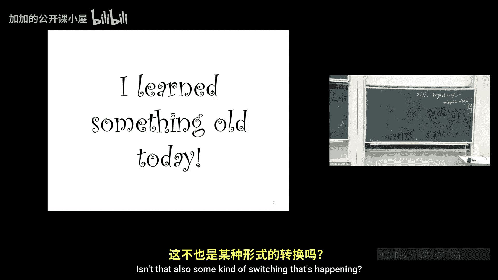
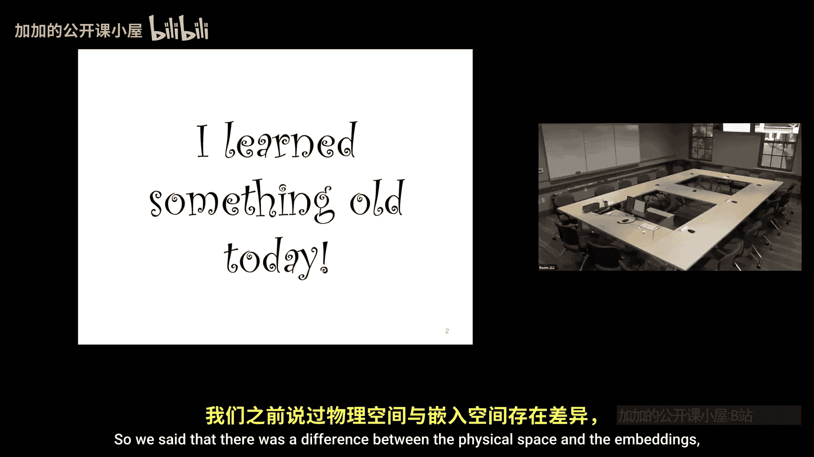
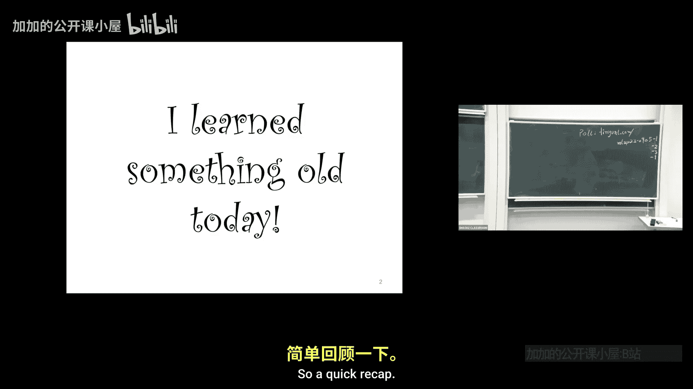
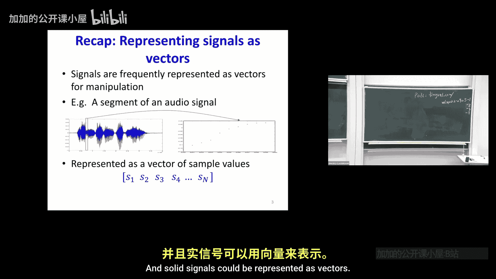
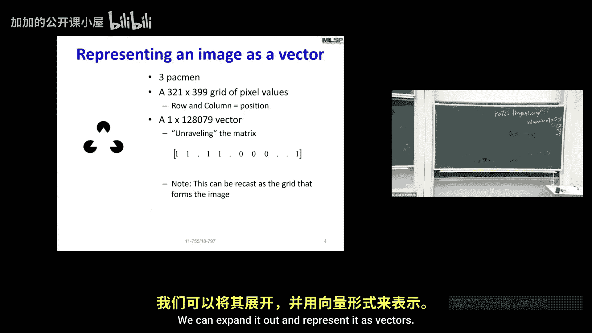
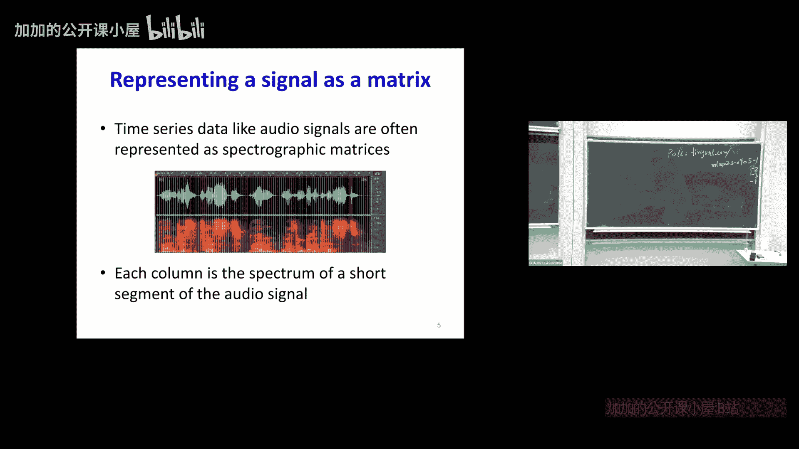
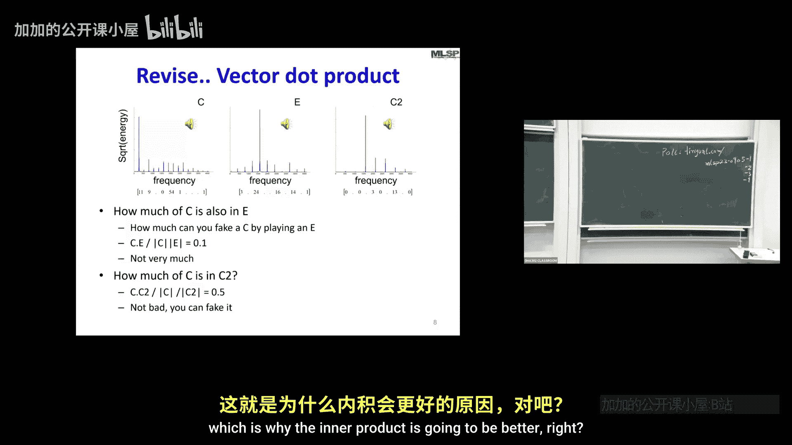
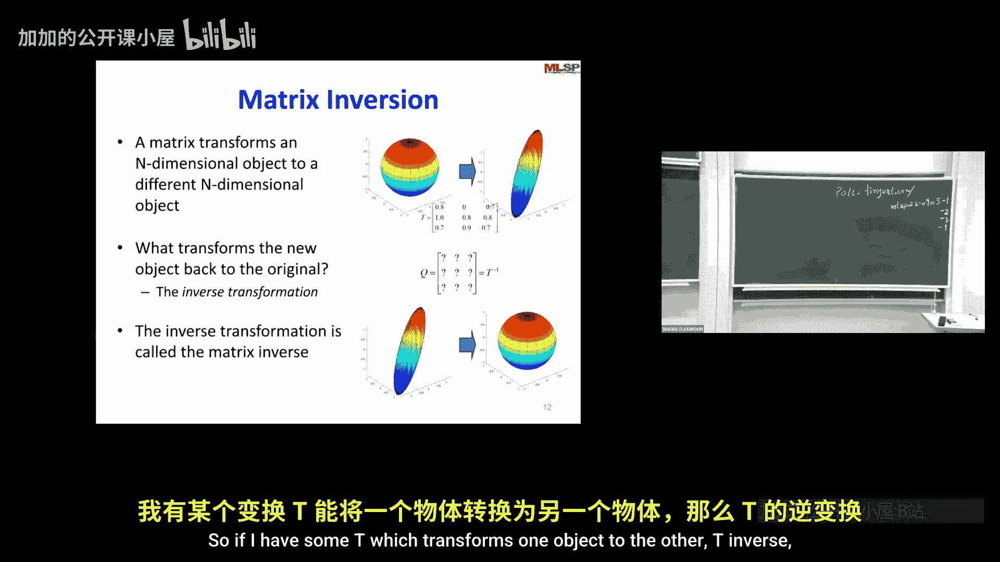
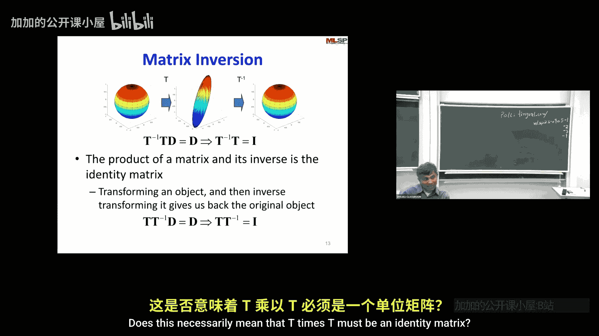

# 卡耐基梅隆大学【中英⚡机器学习与信号处理｜2024 11-755 Machine Learning for Signal Processing】 p11 P11 3 - Linear Algebra 2 -BV1TfSqBGE8C_p11-

Please settle down what this really means is that I'm not going to to everything that I to power that this is still we are still that its scheduled revision of。

被 하子。And the classes that we have， the voting half and the that growing up。

And it talk of bit delay just trying to get the book。So。

We willt have polls ask the polls for the polls。A many there going to be online say Google Forms。

There are URLs for input。Your laptops will be shut in glass every last one of your laptops will be shut in class。

 except for the holes。Your thoughtss will be for shock。Unless you're using it for the folks。

The costs。It's why behavior that by way。In to the， 80% of uses per purposes， between notes。

 and there's one person in the corner within in a acute tube。Our Facebook， our tri。

 and that one person is disturbing everyone around themselves。😊。

And come this will be a dumb classroom， everything about this except the lecture is going to be done。

And so only time you get to use your devices is for the post。

So without furtherdo let me begin any questions from the last class or the other。可的。那。

A way to ask you questions as we walk to pandemic on yes。

I had a question the guardian but thates how they are included transformation so if we have a three by three matrix and let's say let's say we have a we have a city measure and that'。

😊，Were playing it by to across the mainways we discuss that equi is pushing it。Intoward reduce。

let's see we have a shape that were multiplying mytropy matrix that' going to squishing it so how different from multiplying it with a Cropy matrix which has a dominant0 isn't that also not sort of squishing that actually is so if we said it this difference between the physical space and energy remember and so way is multiplying it by2 proy matrix it's going to end up in a two dimension curve。

😊。

its rank gets too， the physical and engineering space for the result and matricies are still。

TheIf you multiply by a right to because C matrix， the resultant is going to begin a3D series。

 so there's actually going to be two dimensional variance that' what。So会配单。

I think we learned a few things， we learned what vector we revised what network and basises are and solid signals could be represented as factors。

 images that are often represented can be expanded out and represented as。

We哥。At time series these data sequence the vectors we stack together and that' the matrix they pick up a sheet of paper these make us a eye。

There's a pen on the floor， there's a pen。And images are major surroundings。The we saw that。

Mrices can have three different interpretations， one of them is as a transfer。

They operate on a vector and generate a new vector so they transform the vector more generally they operate on a space and generate a new space。

 which they transform the space。But then we also saw that there are data container I have a whole bunch of vector per it's a data container and other properties of the matrix tell me something about the data and then finally we saw that we can begin mixing up the columns or the rows of the matrix and generating pair spaces so matrices are space generators we looked at various products of matric here operations of matrices and vector one particularly important one that's going in place is the inner product between two vectors and we how how we define what it did。

The similarity between two the similarity between two vectors right how much of one vector is how much of one vector the other one is place and so we saw that we have three node represented a spectra。

 the C， the E and the C the next。Then。Which of the two are going to pass when he was by？

Any the C and the IO， the C and the hi C， because the you physically speaking。

 the frequencies are going to align。Whereas if you look at C the frequencies very few of the frequency would actually lineup as to why the inner product is going to be back right so again trying to give you a physical interpretation of fors。

You your very firstqui。系啊。I'm going to you5 seconds。My my my moment。Okay。嗯。在个。嗯。

10 seconds don't the me the URL or the mail URLs is the same through the lecture， not the pattern。

That's MLSP23， right， that's the course。The dateate 0905 and full number one。Okay。Yeah。是。Yeah。对。

And seconds good。Except okay I'm not going to for these things right anyway so do we want to answer the question which of the poll is true of the matrix？

And be感ful home。be the elect is based on。嗯。And if we never in a vector case can a matrix be a we solve photo be right What about a second what is true of matrix multiplication it can be expressed as the sum or outer products of columns of the first matrix matrix that corresponding grows with the second matrix I that true true。

Yes so it can be expressed as the matrix of inner products of the rows of the first matrix。

 matrix and the columns of the second matrix is that true？YesYes， the third one。

 the rank of the products is not greater than the lower of the ranks of the two matrices。

 is that true？Why is that true？It cannot increase in that you cannot if anyone shrinks the dimension the next one cannot back over the dimension right so the rank is always going to be no greater than the rank of the lower of the kmatoes and if both mat are word matrices are square square then。

Is the determinant of the product the product of the determinant？Yes some serious why。不。

Because can it's just scaling the the wall， it doesn't matter which order you scale the volume in the net effect on the volume is going to be the same the result in shape may not be the same but the result in volume is always going to be the same so this is what we solved it's not as square matrix then once the volume to be。

What's a。What is the volume of？This's be so。Thank right， you're going to question that。はい。So。Okay。

 so we're going to look at matrixs inverses。Projections。

 siggan decomposition and singular value decomposition。

 the most one bit is SVD and where to keep it until the very end。😊。

Im hoping you're going to get through all the way through it， a rush to the rest of it。

 a matrix transforms an endal object into a different end dimensional object。

 it could start with a sphere， it makes it and makes it an average side。😊。

What plants wants the episode back to the script？the inverse of the matrix right it is an inverse transformation so if I have some T which transform one object to the other T inverses it's going to transform it right back and so here's what you would have。

I can transform a sphere with a matrix， it becomes an eopide。

I can transform the e side with the inverse of the matrix it's going to become a sphere again。

If I transform so what is the thing what is a net operation what happened when I performed one after the other identity identity nothing happens right so t times D convert the sphere to a matrix develop side teenverse times the sub converted it back to a sphere so Everse times t must be an identity matrix right？

Does this necessarily mean that？

