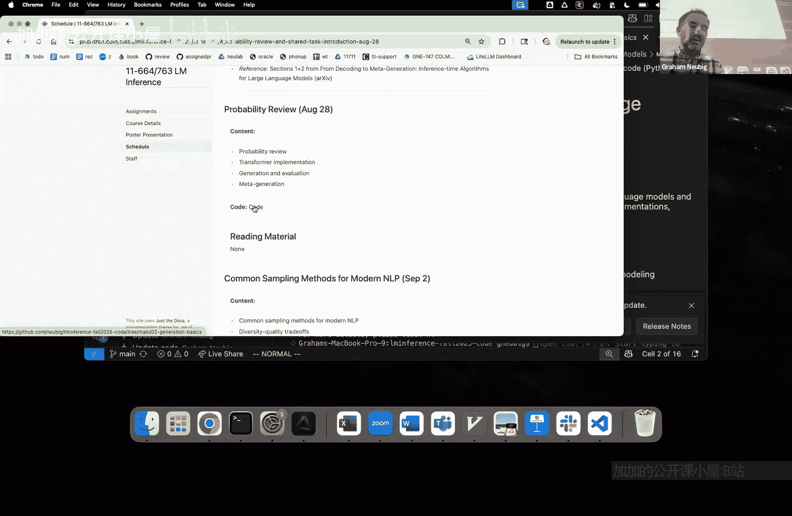
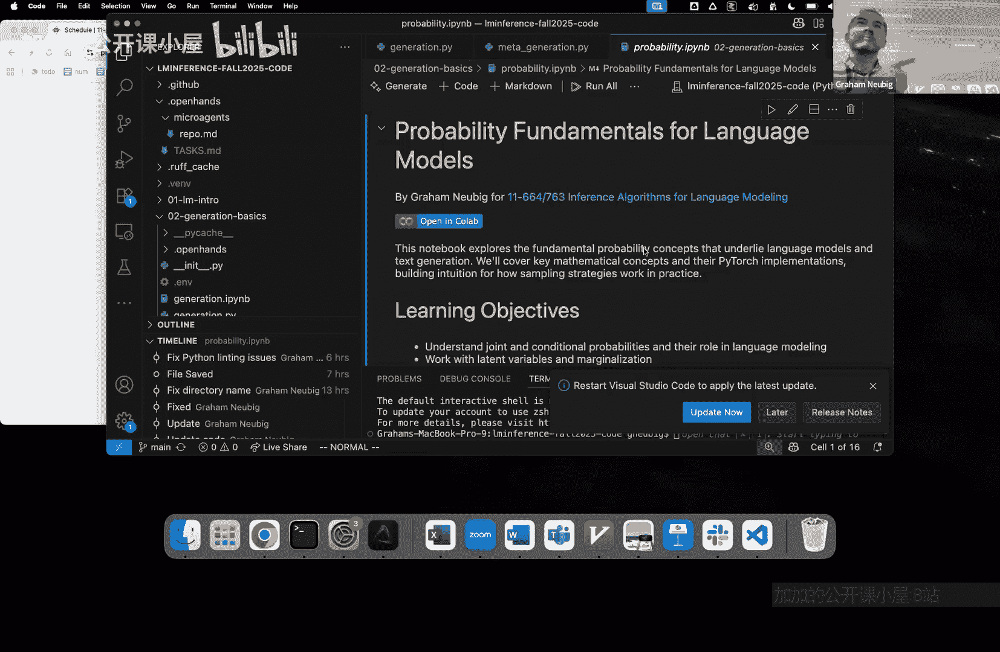
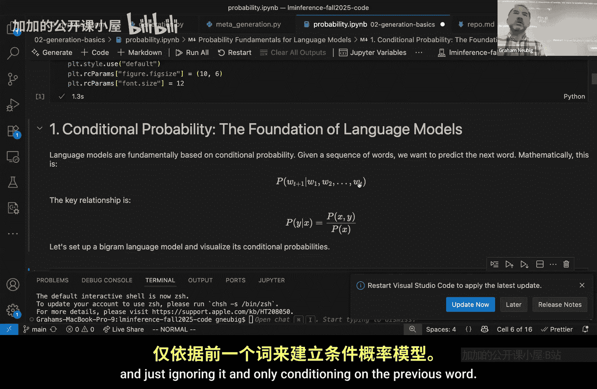
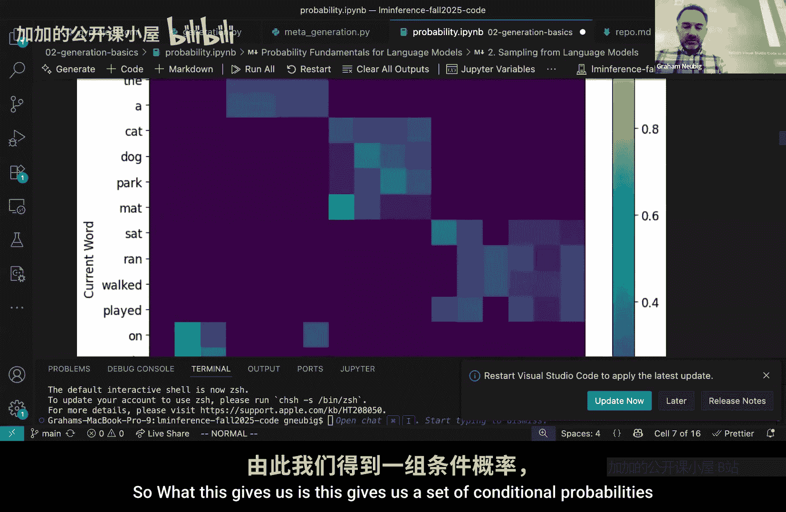

# 卡内基梅隆大学【中英⚡LLM推理算法｜11-763 Fall2025 CMU Inference Algorithms for Language Mode】 p02 P2 Probability Review and Code Examples -BV1QdSrBfE9v_p2-

Okay hellello everyone I'd like to get started so the first thing I'd like to point out is on the class schedule until two minutes ago there was nothing for this lecture now there is something for this lecture so you can you can go here it has the code link here and this time I'm not going to be going through slides I'm going to be going through like demonstrating some stuff and I Ju putter notebook so there's no slides link for today but you can click through and run it yourself。

The reason why I want to do this is I want to show like a very minimal example of some of the like algorithms that we're going to be using this time to set everything up so that you can use it properly。

嗯。So I oh yeah and actually before that let me do some logistics announcements。

 which is number one starting next week we will have office hours the Ts are and I are arranging everything but that will be posted on Piazza all of the class videos will try to post on Piazza as soon as we can。

The homework is not out yet， but it will homework one will be out soon any any other questions have people had about general logistics things。

Or a wheel set。

Okay。😊，Cool， so let me go ahead with this。嗯。And so some of this may be。

Some of this may be relatively elementary to everyone， but to some people。

 but one thing I've noticed is that actually a lot of these concepts are not as universally held as I may originally thought so I just want to make sure that we get everybody on the same page。

And so today is a four part is in four parts， the first thing I want to talk about is some probability fundamentals。

And these are going to go into like basically everything we do so we'll talk about that first the second thing I'm going to do is just going to show a very basic implementation of a transformer model again I assume that most people have dealt with this before but this implementation may also be useful if you want to try it out in future work so I'll just go through it quickly and then after that I want to show some generation algorithms and how we can evaluate models using language models as a judge and then finally I want to talk a little bit about metageneration algorithms which are like reranking algorithms that allow you to pick the best output。

And not everything's in the code， I'm going to go off track a little bit some of the time and also please feel free to ask any questions。

嗯。So yeah， let's get started。So the first thing that I want to talk about is probability fundamentals and so I'm going to go through some basic concepts and I would definitely encourage you to go walk along with the code。

 you can run it locally if you click opening CoLab you can run it on CoLab but you'll have to like copy paste in the library files so it might not be super convenient。

The first thing we do is just set up our environment with torch andump and mapplot lab and import everything。

 so this is not interesting。嗯。So the first thing I want to talk about is conditional probabilities and the reason why I want to talk about conditional probabilities is because we are dealing with autoregressive language models。

 mostly and autoregressive language models are based on conditional probabilities where we predict the probability of the next token。

嗯。Have people learned of any variety of language models other than transformers？Yes。😊。

Okay word embedding word embeddings so that's a good point is word embedding a language model？

According to our definition last week。Anyone remember what the definition of a English run last week was？

It's not a trick question yet。Right essentially make one specific token。

 given like the token that you very yeah， model that predicts the next token。

 given the previous token。 yes， that's specifically an autoregressive language model。

 So if we go even broader。It's a model that。Yeah， gender。That generates text yes。

 it should have the ability to generate text， that's actually not how I defined it on Tuesday though。

Yeah， generic sequences of tokens sequences of tokens， yes。

 but that's also not how I define the last to say Yes assign probability sequences So and then specifically autoaggressive models assign probabilities to sequences by predicting the next token and so when we predict the next token that's a conditional probability it's the probability of the next the next token given all of the previous tokens or you know the probability of y given x where x is X is the previous tokens。

😊，So now going back to the question， is word tove a language model？If so， yes， if not， why not？

Any ideas？ Who knows where to V， by the way。😀呵。😊，Maybe not everybody it yeah。It's aiteYeah。

 so work to for people who aren't familiar， I can draw it quickly on the board Basically。

 it's it's a way of learning embeddings for for tokens， but。

What it does is Word is actually a software toolkit it's not any individual method it's either of two methods where。

Basically。Based on the surrounding tokens。You're predicting the tokens in the center or based on the token in the center you're predicting the surrounding tokens and then you use that to learn you use that to learn embeddings。

 but this actually violates the principle of going from left to right and so it can't be an autoregressive model and。

If you work really， really hard， you can kind of turn it into a language model that actually predicts the probability of sequences。

 but it's like。Not designed for that purpose。so any other ideas， bird is also similar， by the way。

 bird is a it's called a masked language model， but it's actually really hard to get it to assign out probability sequences。

Any others？Diffusion models， yes， very good， but that's not the one I'm looking for。

Recurrent neural networks。 Yeah， that's a very good one。

 Did anyone take a kind of old school N LP class。What did you learn as language models here？BM 25。

 BM 25 is more of a await thing。Yeah， Ngra models。 Yeah， there we go。

 So Ngra models are are maybe not not taught so widely anymore。

 but they're a good illustrative model that we can we can work with And Ngra model。

 basically what it is is it predicts the next the next word based on the previous n minus one words and。

😊，嗯啲。In this particular case， I set up a bigram model which is a two gram。

 so it predicts the next word based on the previous one word。

 the next word based on the previous one word。I came up with a fake andgram model where I just kind of assigned probabilities to this very small vocab of beginning of sentence the cat dog park mat at ran walked played on in too quickly slowly and end of sentence symbol。

I or more accurately， Claude came up with these probabilities for each of the tokens here。

 so given the beginning of the sentence。What is the next possible word like the Kaat dog park？

Given the what is the next possible word， cat dog park， et cetera， et cetera。

 And so this definitely satisfies this。This equation here， but it。Also， additionally。

 who mentioned the Markov assumption last time， yeah so this has a Markov assumption。

 which means that we are only paying attention to a certain number of previous words and so we're basically lopping off everything except the immediately previous word and just ignoring it and only conditioning of previous word。

So。What this gives us is this gives us a set of conditional。

