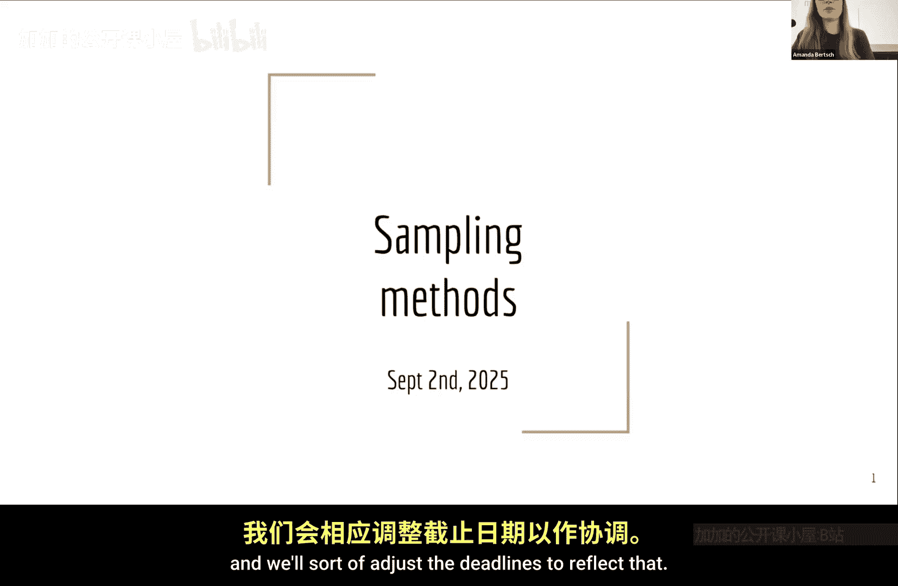
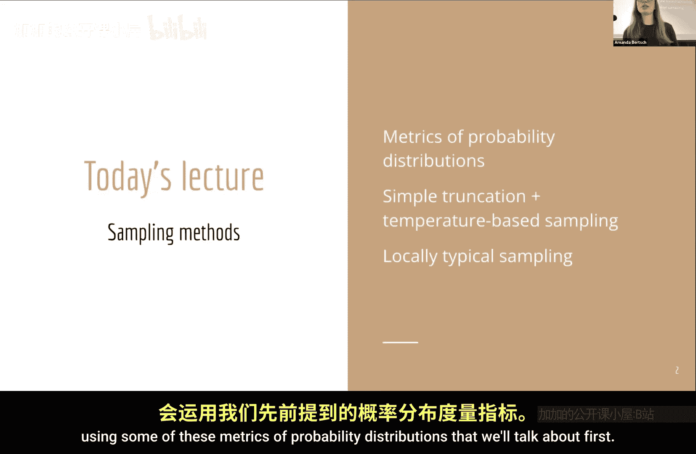
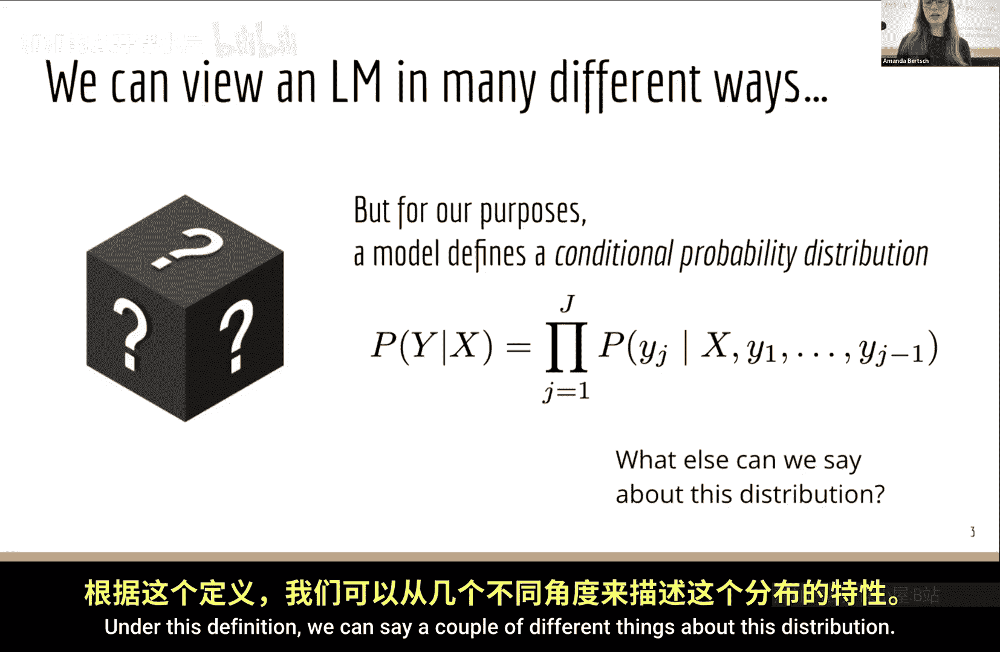
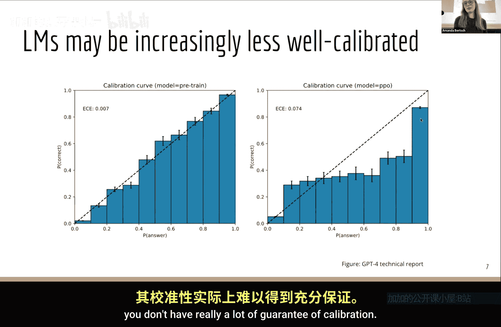
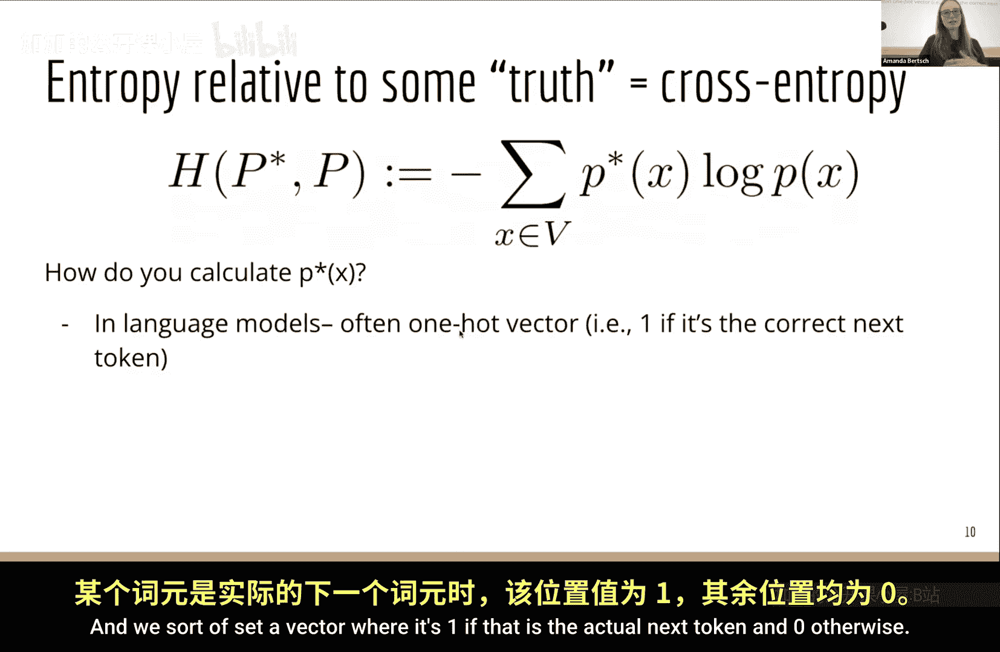

# 卡内基梅隆大学【中英⚡LLM推理算法｜11-763 Fall2025 CMU Inference Algorithms for Language Mode】 p03 P3 Common Sampling Methods -BV1QdSrBfE9v_p3-

Cool， hey folks welcome back just as a reminder I'm Amanda I'll be giving the next couple of lectures and today we're going to be talking about sort of the first class of algorithms for sampling from a model so we're going to start with this week with sampling and some other sort of classical decoding methods and then we'll move past there into more modern inference algorithms that require reasoning over multiple decod tokens at once instead of sort of these token by token decoding。

😊，And just as a heads up， I know the website says that homework one is coming out today。

 that will actually be out probably Thursday and we sort of adjust the deadline sort reflect like that。

So today we're going to be talking kind of exclusively about sampling。

 we'll talk a little bit about models as probability distributions and some metrics we can use to reason about that and then we'll use that to talk about sort of two different groups of sampling methods。

 the first sort of simple and truncation and temperature based ones and then a more sort of complex or nuanced method using some of these metrics of probability distributions that we'll talk about first。

So as we talked about in the very first class we could think about a model in a couple of different framings。

 but the framing that we're sticking with at least for today is that a model is just a conditional probability distribution。

 we're not particularly concerned today with how we arrived at that distribution。

 we just know given some input and the prior output tokens at each step we have a distribution over the vocabulary space for the next token。

And under this definition， we can say a couple of different things about this distribution。

The first is that the models that we'll be talking about today are locally normalized what this means is that at each step we are going to get a distribution over tokens for that individual step rather than getting something at each individual step that may or may not be a distribution and then having to sort of normalize at the end of decoding。

So one way to think about this is that our scores will be monotonically non-increasing right we talked about this in the first class where if you're multiplying by a number between0 and1。

 your probability will decrease with each additional token this also means that if you start with a prefix that maybe doesn't look that good there's no way to add probability mass back in later so in this example if you were decoding the US president in 2023 was and you sort of get this start this continuation does the top or the bottom look like a better output so far。

The bottom I see people pointing out excellent yeah。

 so the US president in 2023 was Joseph Biden looks like a reasonable output。

 but then maybe if you like the sentence sort of wrapped back around Barack Obama's former VP we would want to have sort of a higher total probability than Joseph Biden's daughter does this mean that in a locally normalized model the top could never have higher probability in the bottom No right models learn distribution over all kinds of sentences。

 it's entirely possible that this sort of construction is a pretty common way to talk about Joe Biden and so it's possible that this actually winds up with a higher score。

 especially because daughter might have a very low weight。

 but there's no way once you ascribe a relatively low probability mass here for this end up with high probability mass later。

 it might be higher than this other relatively low probability output。

 but there's no way to sort of backtrack and say actually I think this should have more probability mass maybe the beginning was a little misleading。

And we can see that as well with this visualization where the top here is how our models our locally normalized models work where these two outputs A and B and each beam are getting assigned probabilities that will sum to one in a globally normalized model you get a score at each step instead and these scores can be much greater than one so here a gets a score of 3。

1 so this like uplifts a over the other candidates in a way that is sort of not possible with a locally normalized model we do local normalization for a number of reasons for one it's very easy and fast to train you sort of don't have to worry about these constraints on a sequence level but the sort of flip side of that is that when you want to impose global constraints at inference time。

 you need to do a little more thinking about how to do that and in fact a lot of the methods that we'll talk about for the rest of the semester will be ways of trying to impose global constraints on a model that was only trained sort of with these local normalization。

If you're interested in globally normalized models。

 this figure is from a paper that I've linked at the bottom of the slide， which is a good。

 if a little bit older reference on how to do this for sequence models， you can also take PGMs。

 which has a lot of information about how to do this for graphical models。

 which is a sort of more common setting。What else can we say about a probability distribution we also care about some other features of the distribution and one that we'll touch on a little bit here is calibration so you may have seen a plot kind of like this before we say a model is calibrated if the model's confidence score is well correlated with the probability of correctness so if we have a multiple choice question the model puts 50% of the probability mass on outputting B we would like that B to be the correct answer about 50% of the time and this is useful because then you can take a look at the logicdges and use that as sort of a direct measure of confidence I this a property that our model is normally have does anyone know。

Yeah。They're pretty reasonable， I think now， but I think out of lecture。Makes your burst open。

 I think it makes it better。And then it used to be pretty bad。

The earlier mark it could be like the could be but the actual performance Yeah so they used to be worse。

 they're better now but RLHF does something to the calibration Yeah exactly so this is actually this graph is Bt and you can see this is sort of the reasonable calibration this is GPD4 on MMOU in particular and this is a really nice calibration curve this is the model before RLHF。

😊，This is the model after RLHF。So yeah， so our pretrained models， if they're relatively strong。

 if they're trained over a good data， the likelihood corresponds reasonably well with the truth or the likelihood of that being the true answer when we do these post-training steps which are super useful and which generally give us better outputs they mess with this property of the distribution so if you're looking at a model that is post-trained you don't have really a lot of guarantee of calibration。

Another feature of probability distributions is that we're generally putting non-zero mass on a pretty wide variety of things in particular in these sort of situations where we have a semi- obviousvious ground truth we're putting at least some probability mass on incorrect outputs so your model is not putting 100% probability on two plus2 equals4 this is this can be good。

 this can be bad there's some interesting ML theory work on whether this is possible to eliminate entirely and the answer here is that if you want your model to also have this property being calibrated it is not possible to also to eliminate this sort of。

Putting some mass on things that are not that are not factual and this is a there's a sort of like detailed theory result behind this。

 which I'll just sort of point you at the paper for here。

So those are a couple of properties of our distribution。

 we'd now like to compute maybe some statistics about the distribution and these will be useful for the methods that we talk about later。

So the first and one that I think you've probably likely seen before is the entropy of a distribution。

 which we're just going to do generally at a single step and decoding。

 so over the vocabulary space at a single time step by computing the sum of the probability multiplied by the log probability。

If this is relatively high， does anyone know if we have a sort of perfectly uniform model distribution。

 would we expect entropy to be relatively high or relatively low？好系。we got both answers。

High entropy means that we need this is entropy in sort of the information theory sense Shannon's entropy and so high entropy means that we need more bits to encode the information that there's sort of less of a prior or a bias towards what the most likely outcome would be so if the distribution is perfectly uniform we would need a lot of bits to sort of specify any individual thing in the distribution so entropy would be high if entropy is really low it means that there's the distribution is really peaky so for instance if the distribution was 100% of the probability mass on one token and 0% on anything else you could specify sort of your outputs of that distribution very in like a very brief representation because you could say it's always token X and so that would be very low entropy。

We care sort of not about entropy just in the abstract。

 we also care about entropy relative to some ground truth。

And here when we say truth we usually mean we're looking at some kind of self-supervised objective or semi supervised objective。

 excuse me and so here we calculate something called cross entropy。

 which is entropy relative to some true distribution what do we mean by the true distribution in language models we're usually looking at next token prediction and so we look at what the actual next token was in whatever document that we're training on and we look at the。

We sort of said。

