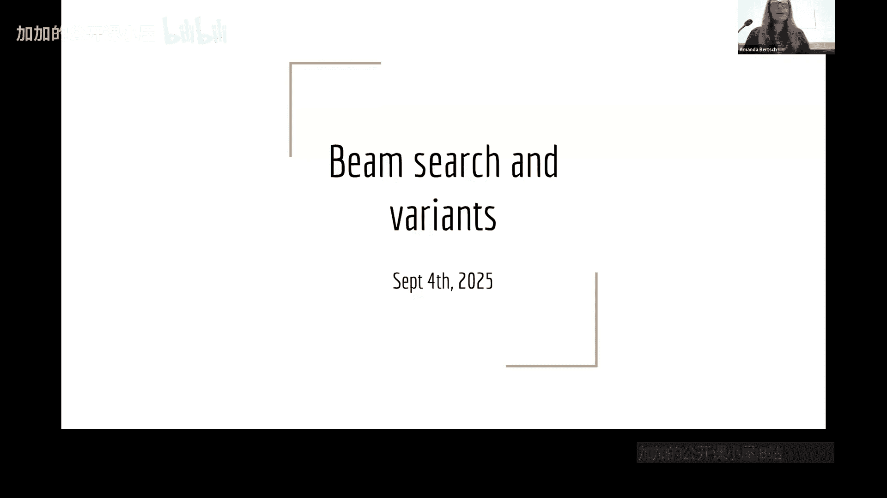
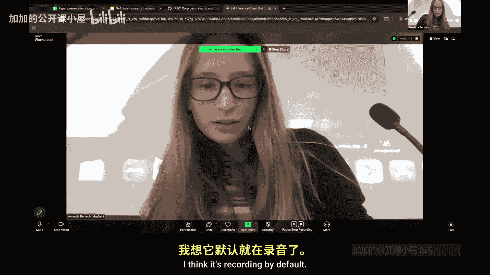
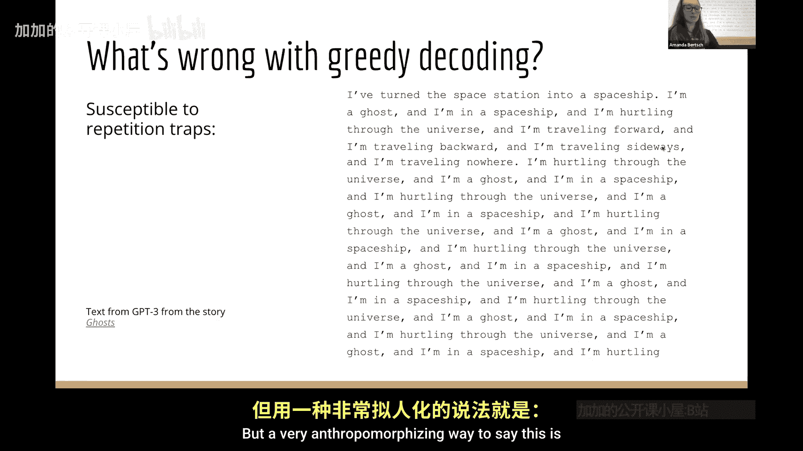

# 卡内基梅隆大学【中英⚡LLM推理算法｜11-763 Fall2025 CMU Inference Algorithms for Language Mode】 p04 P4 Beam Search and Variants -BV1QdSrBfE9v_p4-

And with that， we can get started。So today we're going to be talking about sort of beam search and a number of variants in the same family。

Yeah， I think so。 it's， I think it's。

Recording by default， yeah。But thank you for double checking。

So today we'll be talking about beam search and some variants in the same family。

 we'll talk a little bit about what it means to do a mode seeking search。Thanks yeah。

 so we'll talk a little bit about what it means to do a mode seeking search。

 we'll talk about beam search in kind of its original form and a number of variants。

 and then we'll talk about some properties of beam search including the kind of ominously named curse of beam search。

So when we last talk on Tuesday， we were talking about a variety of methods that all look like sampling from some distribution。

 whether that's the original model distribution or some modification we've made that might change at each step。

 for instance， if you're doing a top K， the k tokens in your distribution might change over time。

So this is a pretty broad class of methods， but today we're going to look at the problem of decoding from a slightly different perspective。

 which is a little more optimization flavored so we want not just a good output from our model but the single most likely output given the distribution that we've learned over the parameters。

 so given our evidence and the prior that we have from this model。

 we want the single most likely sequence and so this is what we'll call mode seeking search and what is sometimes also called map decoding map being for a maximum a priori。

Now this is the mode of the distribution over outputs and if we're sampling just a single token from our language model。

 this is actually really easy to find right if we want to look at this distribution at a single time step you can take the max by just doing an aG max over your logics and we're done where this is exactly what we want for a single token output。

But if we're interested in decoding more than a single token at a time from our model。

 if we want a sequence， then this is a little bit more complicated， right？

And so this is sort of the baseline that we'll be comparing yesterday is greedy decoding where we just take the single most likely token at each individual time step。

 this is super trivial to compute， but it has a number of sort of problems as we go from sampling or from decoding a single token into decoding multiple tokens。

嗯。The first of these is that we're not necessarily getting the highest probability output right so if we take the sequence that is greater than life one and we' trying to find the we're trying to use greedy decoding to find the true mode。

 maybe this works's okay for the first couple of tokens and then we reach a slitting point and here this is a little bit of an artificial example。

 but you could imagine you have two tokens that are relatively similar probabilities at some time step so here we have eats and Cs。

And then。The one that has the higher probability at time step T has no particularly high probability completions happening at time step T plus1。

 so here the most probable token at T plus1 has a probability of 01。

Whereas the thing that is slightly less probable at time step T could have a really high probability completion at time step T plus1。

 and so if you actually multiply this out， you end up with a sequence that you would get from greedy decoding on the top that is substantially lower probability than the sequence in the bottom which may or may not even be the true mode of our distribution。

So this isn't good if we're trying to optimize we're not doing a very good job。

 but greedy decoding can also produce text that looks a little strange so this is an example from GBT3 and if you kind of werere playing around with models at the time period the GBT3 was a sort of frontier or frontier adjacent。

 you're probably familiar with text looks a little bit like this this particular example is from a really interesting short story written with some like input or collaboration from GT3 called ghosts which I've linked here if you're interested in kind of like collaborative writing but this starts as a sort of reasonable statement or two of turned the space station into a spaceship and then it startss getting a little bit circular I'm traveling forward I'm traveling backward and I'm traveling sideways and then if you let it continue it's sort of completely falls off the rails until you're trapped in this week of just repeating the same 10 or 15 tokens over and over again。

Does anyone have a sense of why this might happen with greedy decoding？

Or anything about greedy decoding that would make this problem worse。

So imagine you start in like a space where you you've trained your model over a number of texts。

 some of which are good， reasonable looking writing and some of which are really degenerate things like just the same character repeated over and over again or some like really poorly formatted Xmls gray from a website or something when you start getting into a space that is maybe a little bit repetitive like I'm traveling forward and backward and sideways。

 you're sort of getting closer and closer to a space of where you've learned the repetitive texts you saw in through training right you've sort of learned that once you see something that starts repeating generally it starts repeating for and once you so maybe once you've seen this I've hearddling through the universe and I'm a ghost and I'm in spaceship once there's a number of things that are likely completions but once you've seen it twice in a row。

 the most likely thing is to see it a third time and then a fourth time and then a fifth time。

Maybe if you were sampling stochically， you could or if you were sampling if you were doing a stochastic decoding method。

 you could sample something that's a little bit different from what you had before and you could break out of this trap。

 but if you're always taking the a max， you're kind of reinforcing this repetition and once you' repeated it twice you're going to repeated a third time and once you' repeated a third time it becomes more and more likely it'll be repeated a fourth time。

 and so this is what we call the repetition trap。And particularly for older or smaller models。

 this is a really common thing to see when you do greedy decoding。

And one other comment is this is like particularly frequent in。

Like pace models that we're trained with my on with it's a little bit less frequent in instruction through models it's even less frequent than reinforcement learning models because if a reinforcement learned model samples these repitive things it'll get a low score and so like you actually have an explicit bias you against repeating yourself so there are ways to fix it through training but like as I said in the first lecture。

 you can fix things through training or you can fix them through inference so if you have a model that's susceptible to this you want to like you want to use that model then you're only choices to do it。

对我就说我真是。不好思。I mean， I don't know the training data of GP3， so I can't say for sure。

 but I don't have any like strong reason to believe。神马按照呢个四个。To you3。

 So after assuming it repeated twice， is it likely that it will repeat third times。

Because like in the original training Gi， the next sentence will be something else。

You're saying like if you trained GT3 on a whole bunch of versions of the sequence that had like two repetitions and then a thing after。

 would it continue repeating？I think that's a great question， I think it would depend on how。

Like if you're training it on this exact sequence， I bet you would wind up like teaching it that there should be something of following after two completions because it would memorize like this two completions plus something else structure。

I don't know if you could train generally on that kind of data as a way to escape repetition。Yeah。

 it quick work， I don't know。And we curious is the how of probability the condition on the changes of presentation like。

Do the logics where the repetition token is become increasingly pictures and the repetitions。对。Yeah。

 this is a great question so it if as you start repeating does the conditional distribution change to become like peakier on the logic of the thing that would be the next token in the repetition I think almost always the answer will be yes but I didn't actually like visualize it for this。

系。know as this taxes from G3 for the G virtuals channel。

LikeIf you were to use recording on those would like the chance of like probably falling into the reputation trap be lower because of like the the that would it just like probably give you a similar Yeah。

 would better and newer model be as likely to fall into this trap I think they would be less likely for the reason that you name that because they have like RLHF and instruction to and also because models that are。

Better trained or trained on more data or larger I think are less likely to run into this repetition trap to begin with if you started them on some repetitive text。

 they would still start repeating， but they're like a very。

