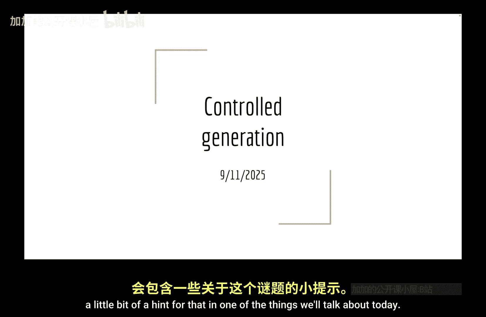
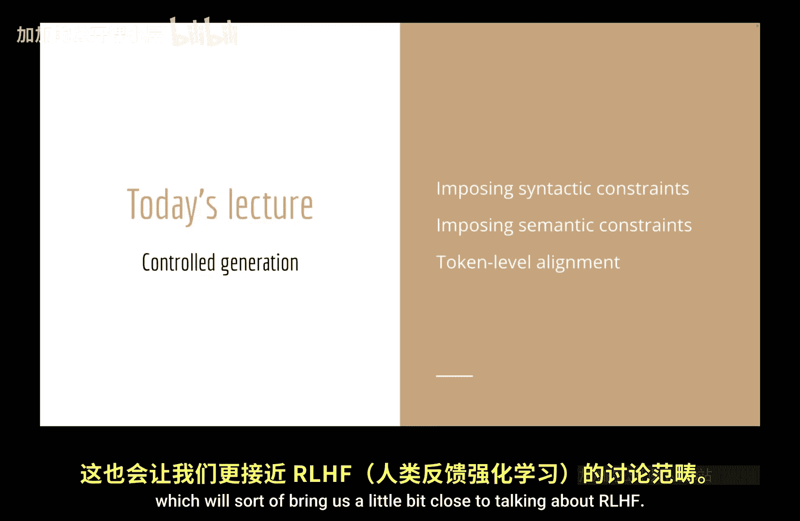
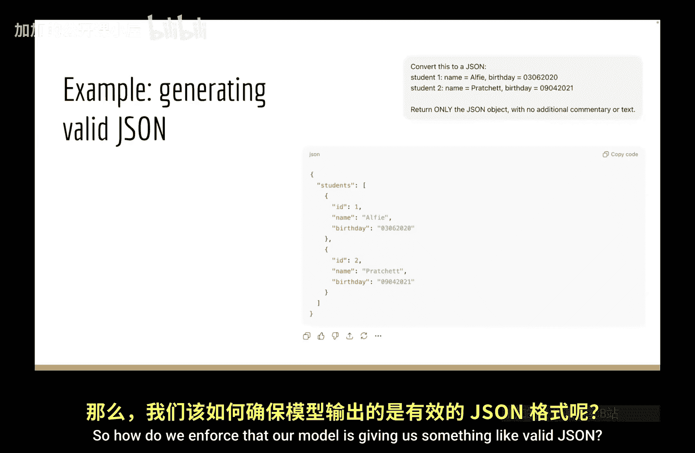

# 卡内基梅隆大学【中英⚡LLM推理算法｜11-763 Fall2025 CMU Inference Algorithms for Language Mode】 p06 P6 Other Controlled Generation Methods -BV1QdSrBfE9v_p6-

うん。And give a room kind of sec。Great， so today we're going to be talking about kind of a continuation of what we started talking about at the very end of Tuesday's lecture。

 which is various ways to control or to constrain generation and I'll use these more or less interchangeably throughout。

Also just as a note I'm sure almost everyone saw but homework one came out at the end of last week we've seen a number of questions on Piazza about it so that's great feel free also to come to office hours and in particular there's been kind of a number of questions about the questions the beamM search puzzle and there will be I think a little bit of a hint for that and one of the things we'll talk about today so keep an eye out for that。

And with that in mind today we're going to talk kind of about two different broad sets of constraints。

 we're going to talk about these syntactic constraints。

 constraints that are very easy to write down as sort of a list of allowable or unallowable tokens and then we'll talk about some more semantic constraints that are a little bit harder to define in that way and we'll make a connection between that and between like a token level notion of alignment which will sort of bring us a little bit close to talking about RLHF。

So over the last two lectures in both beamM search and a star and best first search we've kind of talked about ways of constraining output already。

 and this comes in the form of taking a search score that is not exactly the log of probabilities out of the model so we adjust our search scores for length when we apply a length penalty we adjust our search scores to penalize similarity or encourage different difference from other partial outputs in diverse beamM search。

And we can factor in some additional heuristic for expected reward。

 which is kind of where we left things off on Tuesday with neurourlogic A Star ask。

We are going to continue on this theme today talking about constraints that aim to produce an output that is high probability and satisfies some additional criteria on X on what x is will change kind of over the course of the lecture。

 but here we're no longer assuming that the best way to do this is through some kind of search although that might certainly be the answer we're also going to consider first just modifying the probability distribution and then resampling from it。

So in that process we'll talk about kind of a couple of different types of constraints we're going to start with constraints that are what I'm saying in kind of a maybe sort of loose sense of the term verifiable which here defining for the purposes of today that you can write some deterministic function to check up the constraint was satisfied at the end of generation you could sort of make a list of all of the things that are allowable and we also care not just about if something is verifiable at the end of generation。

 but about whether it is verifiable at each individual token so you could imagine something like the output must be exactly 10 tokens long that's obviously verifiable it's very easy to check if that is true at the end of generation。

 but if in the course of generating that output youre not you don't have confidence at each step that the choice you're making is going to lead to that output that constraint being satisfied。

 it's sort of not tokenwise is verifiable whereas if you your constraint with some。

Like every token needs to start with a space or every thing I output needs to be in Chinese or everything I am writing needs to be。

 for instance， Baad Json， this is something that you can determine if you're diverging from that constraint at any individual step of generation。

And so of course， this is like a little bit easier to measure。

So the kind of tiebacks of the last lecture， I've taken this constraint directly from the neurologic Asterque paper。

 the constraint is to write a sentence with these concepts， car， drive and snow。

 and in the context of this work， this functionally means write a sentence that includes these three words。

The this is clearly verifiable， the final output is a success if we have these words in it。

 but it's not token wise verifiable right if you start from the token the there's no guarantee that you're going to wind up generating car or drive or snow。

The intuition that we kind of talked about on Tuesday is that ACRS tries to estimate this heuristic likelihood of satisfying the constraint by the end of the。

By the end of the generation and so if we have the start of our completion。

 I drive my car during the we already satisfied two of our three constraints。

 maybe we have a couple of options for our next token if we generate the next token summer that's a reasonably high probability completion I drive my car during the summer is a valid sentence。

 but that might make it a little bit harder for us to get to the concept snow by the end of the generation whereas winter maybe slightly lower probability I don't like driving in the winter but much more likely to wind up with generating the token snow at some point right so we have this inition that maybe the probability of summer is slightly higher than the probability of winter conditioned on this prefix。

 but if we do some type of look ahead。And here we're doing look ahead with AS starRS。

 we can see that one of these is much more likely to lead to satisfying our constraintsstraint than the other。

 and so we apply some kind of reshaping or we chooseose the path that is more likely to satisfy our const。

Right， and this is。This is like the idea behind a lot of these inputs。

So we're going to set that aside for a second and start with a easier case。

 which is a case where we can tokenwise verify if we've satisfied our constraint and this is a sort of like tempmatic generation so you could imagine you have some requirement for the outputs of your language model like every time you talk to the user you should start your message with Ho or you should always end every output with thanks for chatting with me or something like you should always output valid JON。

Could you train a model to satisfy this constraint？You see some nos。

 yeah like you could do some kind of you could give it a ton of training data that always has this at the beginning of everything。

 you could give it training data that always ends with this would you be guaranteed that it would always do that though？

No， right， there's always some chance， especially if you're sampling that you wind up in a space of the probability distribution where your output ends strangely or maybe it's too long and it gets cut off。

And particularly there's a wide space of ajason and it could write something really weird Also what if you wanted to change your your constraint over time。

 if you wanted to change hello to Bonjour for a week。

 maybe the Olympics are in Paris or something would you want to retrain your model entirely to do that？

Probably not right so these are things that are possible to fine tune the model to do。

 but because they are so relatively simple to enforce at inference time。

 these are things that are probably better to do as like an inference time modification or as a constraint on generation。

We're going to spend some time on Val JO， but for these first two。

 does anyone have a sense of how you would enforce these at inference time？

Maybe just maybe for hello。Yeah。😊，So was it。でまて。To big必要别。Yeah。

 just like a pen hello at the very beginning of the exactly yeah。

 and for thanks for chatting with me at the end。Exactly， you could just append the output at the end。

 even outside of your sampling for the model。These are the kinds of things that are relatively easy to do if you have control over like a system。

 right if you're receiving inputs for an API。How however are we going to get the model to always output valid JSON I think the reasonable thing in 2025 to ask first is can you just ask the model to do this and so I passed a GPD5 this morning just convert this to a JSON for me and of course G5 knows what JSON format looks like but the sort of default here is that it also gives you a lot of little additional text on the sides you know it says hi I've done this thing for you I made this change which is probably reasonable do you want me to keep this format so if you were calling this is like an API call and you were expecting valid JSsonN as a result this would be maybe not the output you were looking for。

Of course， if we give our models more clear instructions。

 they're generally capable of following them， so then asked for just the object with no additional commentary or text。

And。Fronier model is perfectly capable of doing this why are we then going to spend so much time today talking about JO I think for two reasons so first。

These are kind of reasonable default choices， right ID name and birthday。

 maybe this is a format that looks kind of reasonable to me。

 but if I'm working in some kind of production environment and I have a specific format that all of my data is formatted in and I'm not going to go like rename a key in my database because GP5 decided that birth sounds better than like date of birth or something right so the ability to into interplay neatly with another format。

It would be nice to have some kind of guarantee and then similarly。

 while I think you're unlikely to ever get an output from G5 that asks for valid JO that's like catastrophically bad if you're maybe doing a million of these generations。

 you could get an output that looks a little weird or you could get an output that is like I'm sorry you've exceeded your rate limit。

 you want some kind of like validation if you're especially if you're using this in a larger scale operation that you're going to actually get valid JON out every time because the alternative is to get an output and then send it through a JSON checker anyway。

So how do we enforce？

