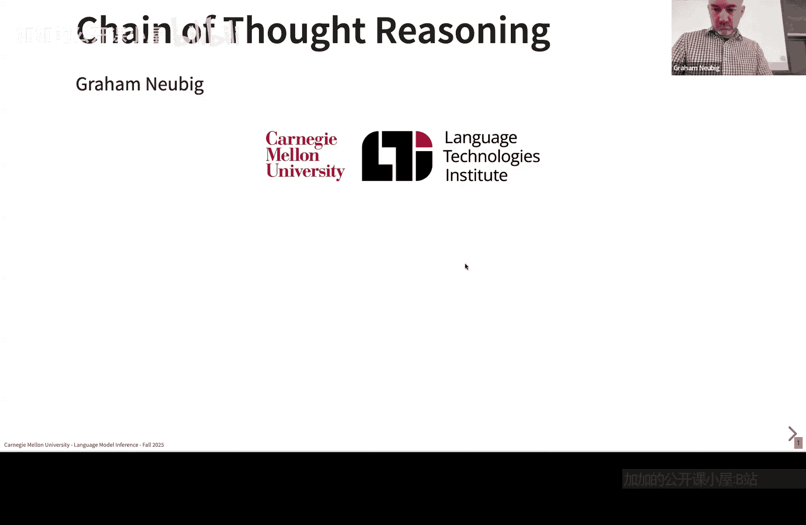
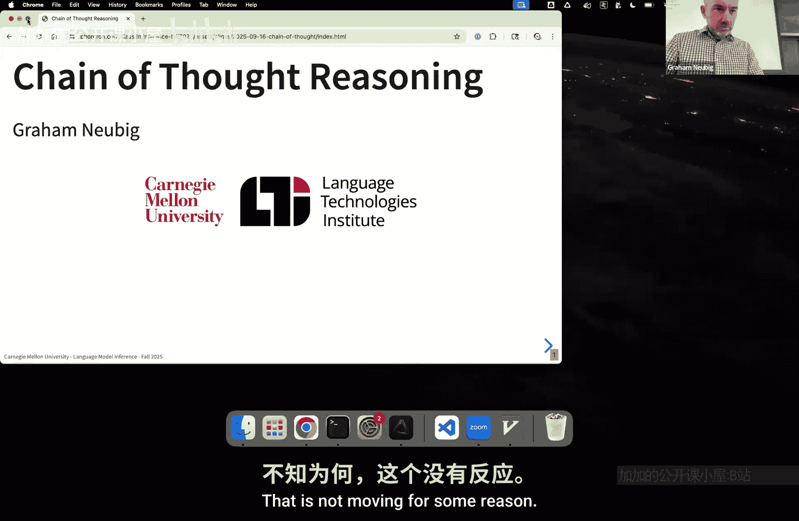
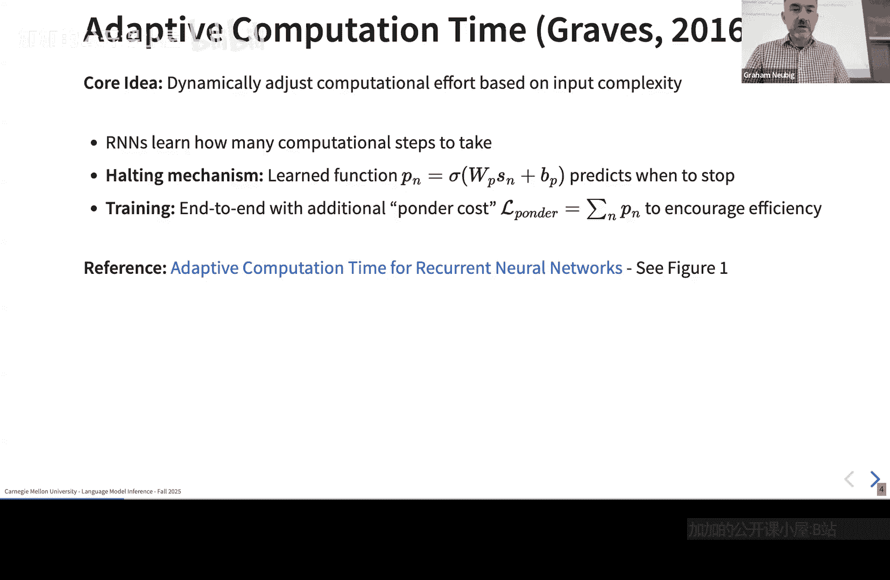

# 卡内基梅隆大学【中英⚡LLM推理算法｜11-763 Fall2025 CMU Inference Algorithms for Language Mode】 p07 P7 Chain of Thought and Intermediate Steps -BV1QdSrBfE9v_p7-

Okay， hi， everyone。It it's time， so I guess I'll get started。

Are the people who are presenting today here？Okay， great thank you we have two people I guess so I'll leave plenty of time at the end and if we have more time after that I might talk about a few other things that aren't on the sidess。

 but I'll make sure to leave time for you。So this time I would like to talk about chain of thought reasoning and this is kind of like a fundamental thing that we use in most models nowadays。

 but it has some kind of like interesting properties that we definitely want to know about if we're going to be building models that do inference and this will build into reasoning models which are you know like one of the most important technologies that we're working on now reasoning models and chain of thought models are basically I mean。

 reasoning models use chain of thought but they're explicitly trained to be very good at using chain of thought so you can kind of think of it as an extension of what we're going to be talking about today。

Oops。Oh。

Sorry， one second that is not moving for some reason。

So you need to figure out how to remove this zoom annotate then yeah。😔，Okay， there we go。Okay， great。

 So our motivation for chain of thought is。We want to do complex reasoning tasks and this is an example of a complex reasoning task that I wanted to do for this class。

 so what is the fastest in H100 GPU could possibly generate 100 tokens for MaMma 38B？

Anyone have an idea of how you insult this？How would you start answering this question？

Any brave person want to， I'm not asking you to answer it， I'm asking you how to start to answer it。

Yeah， I mean you probably figure out how long it takes to Bhoia。

Figure out how long it takes for one token and how would you figure out the like lower bound of how long it would take for one token？

I think you place this great。Oh， do it empirically， Okay， empirically is not the lower bound， though。

 because there's all kinds of things that could， you know。

Interferre with that like if you're using Pytorch， maybe you have overhead from Pytorch and if you use something faster that was written in rust。

 maybe it would be maybe you'd be able to do it。And yeah。Yeah。

 determine the number of computations and you can all you know the number of computations that an H 100 GPU could do from the GPU spec and then you could calculate the number of floating point operations that are necessary for one token and。

Having one token would not tell you the whole story。

 like why would having one token and then multiplying it by 100 not tell you the whole story？

Any ideas？Yeah attention takes longer yeah because attention has quadratic computation time so yeah that's true and then this is still a lower bound and there's actually upper bounds because you're not like fully utilizing the GPU because when you generate one token at a time you have to wait and then generate the next token and stuff which is also why encoding is faster than decoding and we'll talk about all that during the efficiency but。

So if if you ask a language model to do this， it will have to do a lot of things like you did here。

 so it'll have to recall what the flos of an H100 are or search it on search it on the internet Another tricky thing is depending on your floating point precision the flos stiffer on an H100。

 but you know we could ignore that for now， and then what's the size of Lama38B for each of the layers。

It would have to think about how it could set up a computation。

 so it would have to think about like how do you calculate the flos given the size ofll Lama 38B。

And then it would have to perform the actual computation itself。

 And so it could either perform the computation by like having the language model do the computation or it could run a program that does the computation for you write write a program and then run a program that does the computation for you。

 So we're going to talk about reasoning models that are capable of doing that computation on their own in about like two classes and then we're going to talk about the running a program for you part in about like maybe three or four or more classes so。

😊，You know， all of this we will be talking about in the future。But the fundamental challenge here。

Is that not all problems are created equal So the problem that I just gave you is a really hard problem for probably everyone in this class like you probably could do it if you really put your mind to it。

 but it's not you know， an easy one。 On the other hand。

 I very much hope that this is an easy problem for everybody in this class。

 otherwise you're in the wrong class。嗯。😊，This one probably is also easy for most of us and this one you know is easier than the GPU problem。

 but it's you know you'd have to think about it a little bit and maybe pull out a piece of paper and stuff like that。

So one another thing is the simple problems you should be able to solve very quickly by just thinking in like you might not even really feel like you need to think if I tell you two plus3。

 you just say five， you don't like need to work through it for the medium and complex ones here。

 you probably would need to think about it and like kind of write out the equations in your head around paper and solve them。

 and that's the same for language models。嗯。So。A key question is。

 how can we allocate computation based on problem difficulty And like another way to think about it also is。

There are problems that like just fundamentally could not be solved by feeding in an equation and predict predicting the output because they are more computationally complex than all of the computations that you do in predicting a single token in the language model。

 so like it's theoretically impossible to solve all problems with a single step of a language model。

 but。That's not usually the problem， usually you still have enough computation in the single step of the language model。

 calculate the number of flos that you use when you calculate like the next token in you know Lama 370 B and it's a huge number of flos。

 so it's more just that language models are not particularly accurate or efficient at solving computation problems。

😊，Cool， is that clear any questions or？Okay， so before we go into like transformer language models。

 I'd like to point out that this is not an idea that has you know just suddenly popped up overnight。

 there's an idea of adaptive computation time， which for example。

 was put out in recurrent neural network language models by graves in 2016。

And the idea was that you dynamically adjust computational effort based on the input complexity。And。

The way they did this was they taught recurrent neural networks to learn how many computational steps to take。

And so they basically had a halting mechanism， and the way the halting mechanism worked was if you had the hidden state of a recurrent neural network。

 you would run it through basically an MLP not MLP。

 you would run it through like sigmoid cell predictor that would then predict I should stop or I should not stop。

And then after you ran that， you would then decide whether to stop or not。

And they also trained it with something they called the Poer cost。

 which was basically how many steps， you know， a continuous approximation of how many steps you took to encourage efficiency and they demonstrated that this worked on a variety of problems back then。

 you can see this and see figure one in the paper if you'd like to see how they created the network and stuff。

