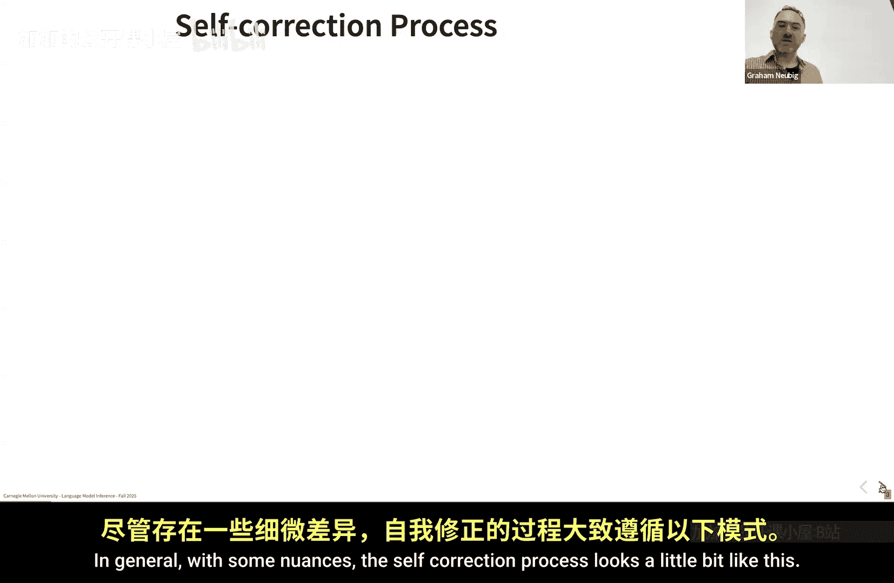
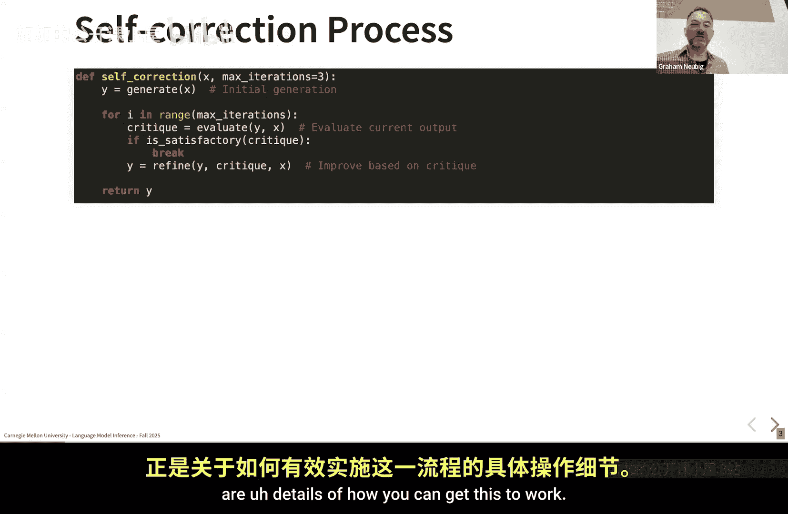
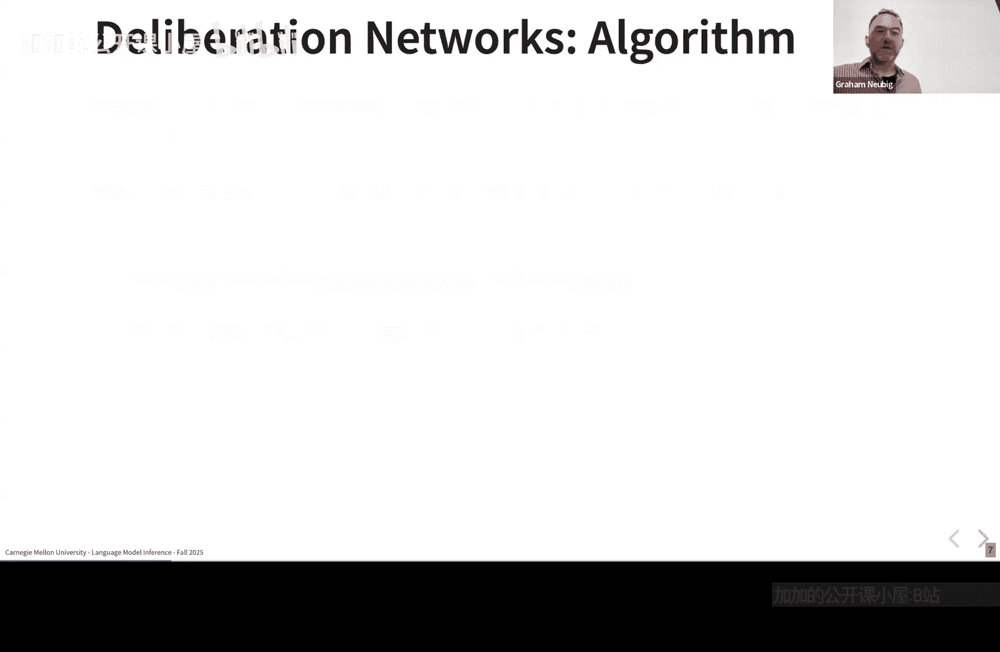
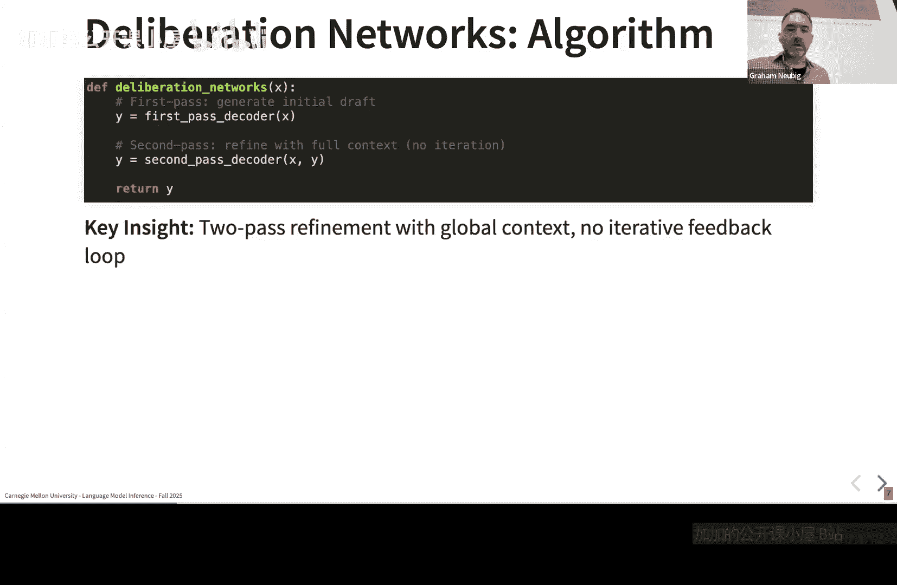
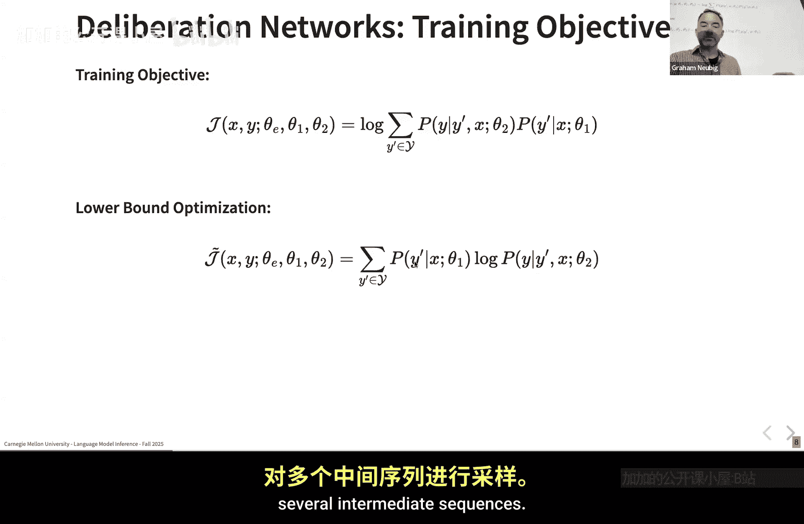

# 卡内基梅隆大学【中英⚡LLM推理算法｜11-763 Fall2025 CMU Inference Algorithms for Language Mode】 p08 P8 Self-Refine and Self-Correction Methods -BV1QdSrBfE9v_p8-

I think I saw that we have three student presentations today or is everyone here for that？1 two。

对 maybe必要什么是都月。Okay， but that's a lot of presentations and I actually have a fair number of slides so maybe I will get started and I think more people will come in as they walk over。

嗯。So this time I want to talk about self refinefinment and self correction methods and these are kind of like the more explicit self refinement and self correction methods and。

Last time we talked about chain of thought， next time we're going to talk about reasoning models and I kind of view reasoning models is like sticking self- refinement and self- correctionrection and chain of thought like together。

 but these are more explicit ways of doing things and they still can be very useful in a number of scenarios。

So LM generation is typically done in a single pass from left to right。

 and it's susceptible to errors in long or complex outputs。

And then if we contrast this to human iterative writing。

 you know very often you will write your essay or your code or whatever like that and then go in and you know refine and fix the details and so these methods are methods to help you do that。

In。In general， with some nuances， the self correction process looks a little bit like this。

 So it's basically。

You have a self correction loop and you have a certain number of maximum iterations and you have a stopping criterion and you generate your initial generation。

 you step over the maximum number of iterations and you'll usually have a hard stop here so that you don't do this forever。

You have some evaluation of the input with you some nuances about exactly how you do this or sorry of the output and you have some nuances with exactly how you do this。

 then you have your stopping criterion where you basically judge whether your critique said the output was satisfactory or not。

And then if you didn't say it was satisfactory， you refined that like this。Nothing。

 nothing you know that complex， but of course the details matter here and most of the methods I'm going to introduce in this class are details of how you could get this to work。

So in particular what I want to talk about is several design decisions。

 the first is for your critique， whether it's an explicit critique or an implicit critique and by explicit critique I mean you explicitly prompt the model or explicitly train the model to decide whether the output is good or not。

Implicit means that this isn't done explicitly， it's only done by having the language model itself。

 you know maybe not generate any changes and when the language model doesn't generate any changes。

 then we judge that the output is already good enough and we don't need to make any more changes in the refinement set。

Another thing is training， so whether we explicitly train the model to be good at self refinement or we don't do this。

Another thing is what we condition the refinement step on so we can addition this on the input。

 we can addition this on the output and we can condition this on the critique itself and different methods use different varieties of this。

And finally， you can use external tools and so some of the critique methods just rely on the language level。

 some of the critique methods rely on external tools to judge whether the output is good or not。

And I'm going to be introducing seven different papers today。

 six of them are kind of self refineant methods， another one is maybe related。

 but not exactly the same。And they are these papers。We have this table here。

 I might come back to this table at the end， but basically you can see that some of them don't explicitly critique。

 some of them do， some of them train the models， some of them don't。

 they condition on various different things， they either use tools or do not， et cetera， et cetera。

So the first one I want to talk about is very simple， this is a paper that was done in 2017。

 so this was you know back when like neural neural models for language generation were very fresh and new basically。

 but the basic idea here is that you don't want to generate a single output。

 but you want to generate an output and then you want to go in and refine it。

And what they did here is they did two pass decoding with quote unquotedeliberation in refinement。

And so the first pass output， first pass generation generates an initial draft sequence。

 and then the second pass refines with global context of what the output might look like。

And so the algorithm is as simple as this。

's not very interesting， there's not even a ford loop in it。

 but the important thing is they demonstrated that you can actually train models to be good at self refineement。

And the way they did this is they had a training objective where basically they expressed their objective as being the log probability of the final output conditioned on the intermediate output。

 so y prime is the intermediate output and why is the final output。

And they sorry they have theta E here， this is the theta for the like encoder model because they were using encoder decoder models back then you can kind of just ignore this for now but so then you have parameters for the first model and parameters for the second model you can also like nowadays I think you wouldn't actually train two different models I think you'd train a single model to be good at both these tasks but that's what they did in 2017。

So anybody have an idea what's wrong with this training objective here？

Why would this not be feasible？It conditions on the intermediate input。 Well。

 this is actually conditioning on the initial input and the intermediate input when it's calculating this here。

Any other ideas？几个表职点。诶。Good point， can you compute the gradient is a good question to be asking。

 can you compute this function？What is the space of whitepre？It is discrete， this is， oh yeah。

 actually here， maybe I should say x is your input sequence and y is your output sequence。

So how big would be the space supply pre？Infinitely large yeah so you don't want to be solving this sum right so that that is a big problem and so we need to find an alternative way of doing this the reason why it's infinitely large is it's the space of all sequences yeah。

Oh yeah， sure。 So this is a model that takes in an input sequence and generates an output sequence and you have an infinite number of possible input sequences。

 right？And so or at least like let's say your sequences could be of length up to 100。

 it would be V to 100 V to the 100 so you can't enumerate over that。

So what's our standard way of solving this problem？

SYeah yeah exactly sampling So you sample a smaller model a smaller number of outputs and basically the way they did this is they they reformulated this。

 they sampled over the over the inputs here and then they generate the outputs and if you sample a number greater than one here。

 you can actually see which intermediate state results in a higher probability here or a lower probability here and you can bias the states。

To do this in 2025 terms， this is basically GRPO if people have heard of GRPO it's a you know way it's not exactly the same as GRPO buts it's an idea where you sample multiple outputs and you up the ones that give you a better reward or a worse reward where your reward is essentially this this log probability here yeah did you of the inputs。

So you sample several intermediate states and then several intermediate。

