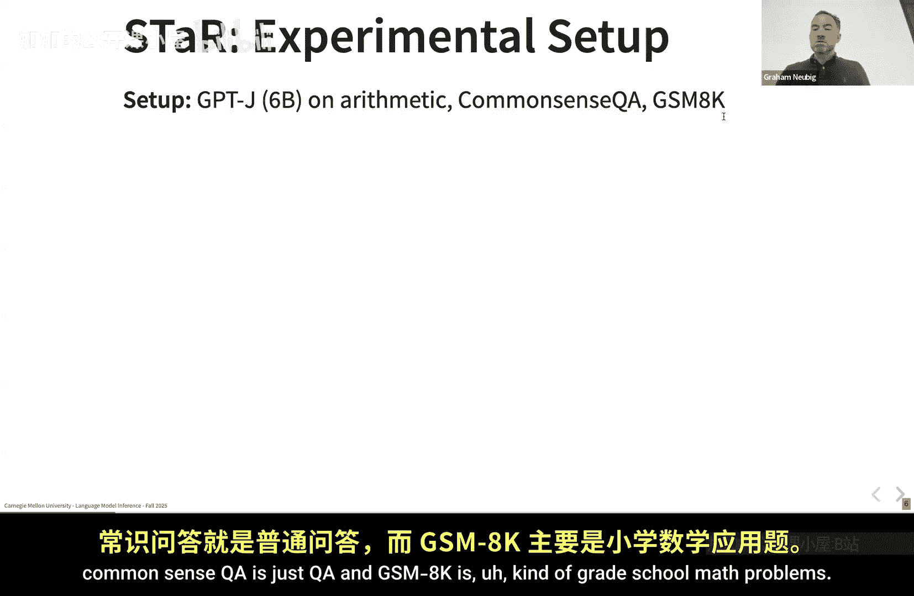
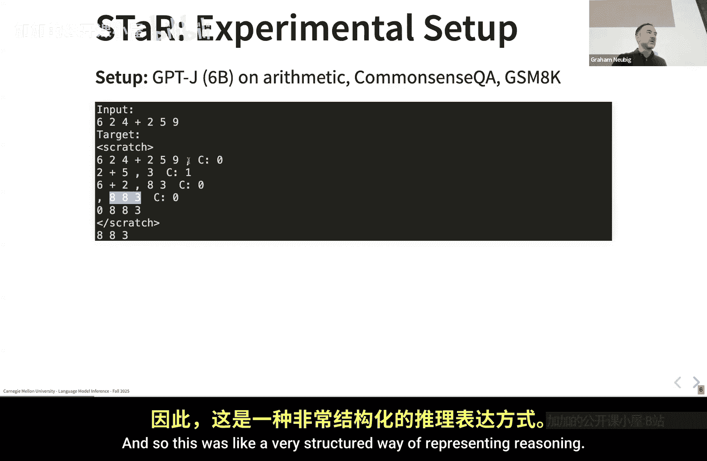

# 卡内基梅隆大学【中英⚡LLM推理算法｜11-763 Fall2025 CMU Inference Algorithms for Language Mode】 p09 P9 Reasoning Models -BV1QdSrBfE9v_p9-

hi everyone， sorry， we were a little late， we were discussing homework two and had to have some discussion items。

Cool， are there any questions about homework one at the moment I know we're getting close to it being finished。

对。It is what？Extension， I mean you have three days to extend if you' would like， so yeah。嗯。

deadlineYeah， I mean， you have permission to extend the deadline by one or two days by using your late days。

😀No。So any other ones？Yeah， last one but to the graph past findings。

 do we have to pass pass the when since like as far0 having case query does not to call school。

 or do we have to use something like query agent real？嗯 you。

It shouldn't have to use an external library you can use。呃。

Like we talked about a number of ways of doing constrained decoding if you need to。

 you could also output'll put it in JSON if you'd like， so you can be creative there if you can't。

If you can't do that， I think it should be okay to also just parse the output and feed it out。Yeah。

Yeah it's annoying isn't it that we that's why we need inferencefr algorithms so like some of the stuff we some of the stuff we talked about here would would help solve those problems。

But for water。All questions you have after submit more in like what are just tracking the results of。

Yeah， so for the problems where you submit the code like。

you you specify the format right everything the other so likes say 2。32。

4 because nothing mentioned except just a prompt like do have something for that or do I just see。

If it asks for goal to note your code， I think。So that's the phase that's so much important。

 no other phrase。I mean if if you're not sure I can submit it just in case Yeah yeah and basically if it says submit your code you need to submit your code like honestly we're probably going to be looking at the code this time and not actually running it when we will be running the codes especially for the very last assignment and so like you need to be building up to the last assignment but we want to make sure that we have like proof that you actually did the thing so that that's why we'll have you submit the code and we'll browse through it but probably won't be running it ourselves。

Generally， if you're not sure it's a good idea。是电了。

You don't need to submit like models or stuff like that。

 so please don't please don't upload 132B or stuff like that together with your code。

 but we would like to see the code。Cool， any other things？Okay， cool。

 So now I'd like to talk about reing models。 So yeah， let's get started。

So what do I mean when I say reasoning models？Essentially。You could argue about definitions。

 but the definition that most people use nowadays is a model trained usually using reinforcement learning to leverage long chains of thought。

 to perform better on particular tasks， and these long chains of thought the it's not just that they're long。

 but they have。particular properties and I'm going to talk specifically about those particular properties later in the class。

 but their extended reasoning sequences， they have traits like self correction。

 so it's like going back and reexning previous you know assumptions。And in general。

 with reasoning models， longer sequences are correlated with better performance。

 and so I talked about even short chains of thought you know longer sequences tended to be correlated with better performance。

 but that correlation is you even more pronounced for reasoning models。And typically， but again。

 not always these are trained with verifiable rewards， and I'll you know。

 talk about the difference between that in a second。

So the first paper that did this kind of from the point of view of LMs is a paper called star and this and all of these are in the references。

 but basically the idea of star and you know other similar models is that you have a question you run it through the language model you generate a rationale in an answer。

 and the rationale is essentially your chain of thought。And given the answer。

 you run a verifiable reward and check whether it's correct or whether it's wrong。

And the most typical verifiable reward is either math or code。 And in the case of math。

 this means that you extract the answer to the math problem。 you know。

 often it's written in the latex like boxed， you know。Command and you check whether it matches。

This is。Generally pretty simple， but it also can be tricky like what if you say 500 centimeters or 5 me。

 you know those are equivalent， but you would need to know that in order to check to make sure it's correct。

 but in general， you know it's much simpler than checking whether free form text is correct。And then。

One thing that they did in star， which isn't necessarily done in other reasoning models is you have a wrong answer。

 If you get a wrong answer， it would then give a hint， So it would basically give the correct answer。

 You would run that through the language model， And then the language model would generate a rationale that matched with the answers。

 So this is an extra thing that was added in star， but actually is an added in all language models nowadays。

So I kind of went through this already， I guess， but like generate answers in rationals。

 filter correct chains based on reward， if correct， keep the full chain， if incorrect。

 generate a rationale given an answer， and then you fine tune on the filtered data。

So this is kind of reinforcement learning， it's you know very close to reinforcement learning or even maybe a particular variety of reinforcement learning where you roll out。

 you get results in U。So another way to think about it is through a policy gradient objective。

 do has everybody heard a policy gradient or some people？Maybe， maybe most people。

 but basically the way the way a policy gradient works is you。You get a reward。

And based on the reward， you essentially multiply the。

The gradient of the log likelihood of the output by that reward。And so this is。

The general form of policy gradient algorithms and the most famous one is reinforce。

 there's a lot of variance on this。 You could almost argue that GRPO is also a variant on this And we'll talk about GRPO in a second。

 but this is like the most simple version。 It's basically like if it's correct。

 you get a reward of one。 if it's incorrect， you get a reward of 0。

And so this will discard gradients for incorrect reasoning shades。So this is you know really simple。

 but they demonstrated that even you three years ago or so this works。

 and so they tested a relatively small model GPTJ 6B and arithmetic common sense QA and GSMAK so arithmetic is an arithmetic data set Common senseense QA is just QA and GSMAK is kind of grade school math problems。

And the format that they took here was kind of interesting。

 they basically started out with a small amount of examples in this format。

So the input looked like this and the target looked like this and they had this scratch pad and so for the scratch pad basically they took this。

They checked how much you would carry。 so basically this is9。9 plus4 is3 carry1。

 and then you would have two plus5， which is the one in the middle。

 and so2 plus5 plus carry1 is8 and then you would have0 and do this and then 8 plus8 plus3 or 883 is the final answer。

