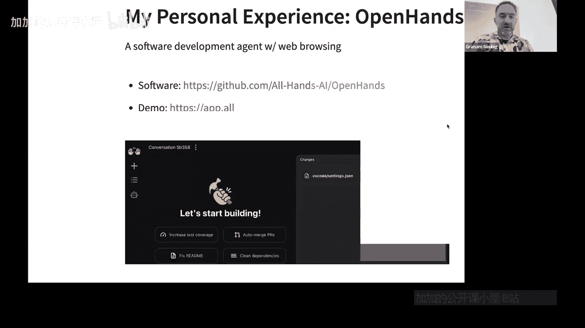
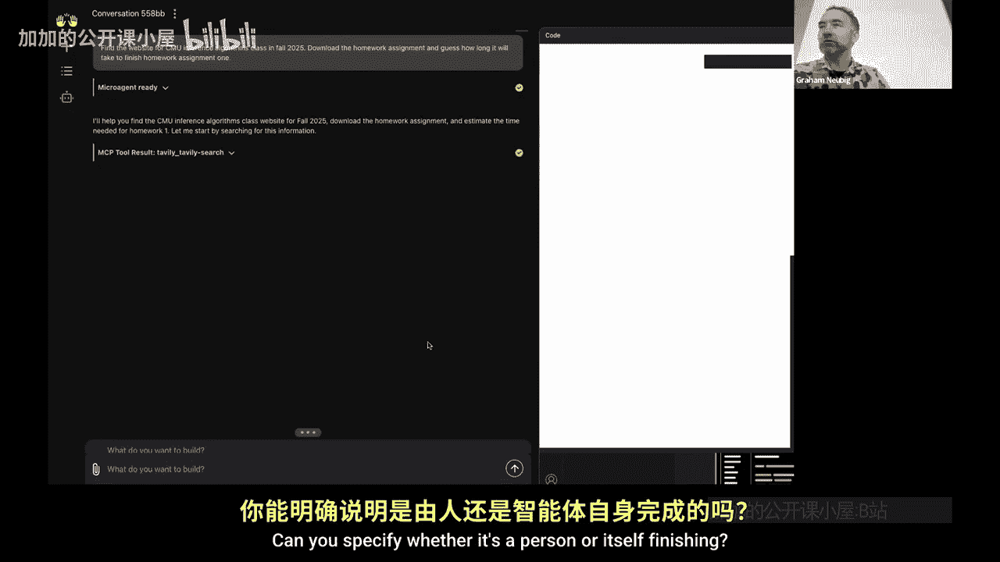
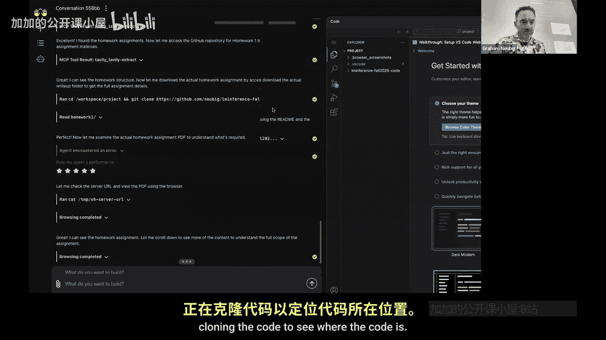

# 卡内基梅隆大学【中英⚡LLM推理算法｜11-763 Fall2025 CMU Inference Algorithms for Language Mode】 p11 P11 Agents and Multi-Agent Communication -BV1QdSrBfE9v_p11-

俾嗯。Hi everyone I have two homework related announcements before we get started so the first one is homework two is probably going to be released today and by today I mean today anywhere on Earth so it will it will be out by hopefully the time you wake up tomorrow and then。

Number numberumber two is that we would love to have feedback on homework one。

 like some people said it was taking a long time or like certain parts were difficult and we'd like to make sure that we're trying to make the you know the homeworks。

You know， not easy but like informative and helpful to learn about the things we talked about in class and so we have a feedback form we're trying to incorporate some game theory and how we're grading the feedback form which is if 50% of the people in the class fill in the feedback form everyone gets a free quiz so it's an anonymous feedback it's an anonymous feedback form and if everybody fills it in you will get an extra three out of three on your quiz grade so that will make it a little bit easier to get a quiz grade but that only happens if half the people in the class fill it out so you can bug your friends to try to get them to fill it out。

And the reason why we're doing this is we want to get anonymous feedback。

 but we want to get anonymous feedback， but we want people to give us feedback。

 so this is our way to encourage people to give feedback while still being anonymous。Cool。

 any questions？Okay， if not all'll get started， we have two presentations today。

 I think here here who else was presenting okay great。上诉人。

So I would like to talk about agents and I'm not going to talk much about training or designing agents in order to improve。

Accuracy through architectural changes or language model changes。

 but rather focus mostly on the things that are related to doing inference in agents because this is an inference class。

 but there's kind of like no way around some of the you know the architecture stuff。

 so I'll be talking a bit about that as well。But basically an agent is a system that iteratively uses tools to achieve a task。

 so it's not just one shot tool use， but it's using tools over and over again。

Almost all agents nowadays are powered by large language models。

 there are possibly some agents that are not powered by large language models still anybody have an idea what those might be。

What was an example of an agent that was that existed like。Three years ago or five years ago。

Syria and Corana are good examples。 Yeah， and they're maybe mostly not powered by。

By large language models now， any other ideas？What about the ones you use to get customer service when you call your favorite airline or something those are other ones that are basically based on on trees you know like if if this and classifiers and stuff and those you know you still use。

 but now all the newly developed agents， mostly people are using LOMS。嗯。

Agents are interesting because they pose unique inference challenges in a number of ways。

 the first one is reasoning and planning。And because of this。

 you have to do extra steps that require inference over them。Environment representation。

 so like how do you represent all of the output from the tool calls that you get？

Long context modeling， so agents are probably one of the biggest long context use cases nowadays in addition to things like summarization or question answering。

Evaluation， I'm going to talk a little bit about this in case people want to use agents and evaluate them。

Another thing that we've been working on you know， kind of more from my personal experiences critic models and critic models are models that are essentially similar to the reward models that we're going to talk about later。

 but I'd like to talk about them now because this is only agent class and then you can remember them when we cover reward models later。

And also multi agent delegation， and I'm not really going to cover this in that much detail。

 but I'll talk about it a little。Cool， so the first thing is some use cases for agents。

 hass anybody like built an agent to do something。Yeah。

This one to simulate so users on a search engine so actions like could what user click and what's the next action game users going okay simulate users and a search engine that sounds good any other。

Interesting use cases。Okay， well thank you for accidentally volunteering to talk about your agent。

 we have a bunch of different use cases， one of the biggest ones nowadays is software development so code generation debugging and testing there's kind of popular examples like cloud code byanthropic codex and also open hands which is an open source agent that I'm developing that I'll talk about a little bit。

😊，Also web automation， so things like data extraction， form fillinging testing and things like this。

 and there's closed source things like open AI agent mode if anybody has used this。

 and then there's open source ones that you can download and use in research like browser use is a very popular example of this。

Things for research and analysis so kind of by default a lot of the you know chat bot interfaces like chatt GP or Cla now support things like information gathering and report generation there's also things like perplexity Pro there's open source versions of things like this like openDe research and there's like seven different openDe researches so you can find one and pick your favorite one。

And then there's also interactive environments like games， simulations and robotics。

 so you know things that play games like Minecraft and Bocott robots。

So I have been actually building an open source agent called Open hands is kind of it originally is an open source tool and then is part of a startup that I work with and because of this a lot of my best examples are from my experience with this basically it's a software development agent that also supports web browsing and other varieties of tools it's available here。

 I'd like to show a little example。

So you can click through and create a conversation。嗯。Anybody have something interesting I can do。

 I usually try to pick something that I。That I want to do recently。嗯。Okay， here's one bind。第五。

Find the website for CMU In Alris class in fall 2025。

 download the homework assignment and guess how long it will take to finish homework assignment one。

Okay， so let's see how accurate this is。Oh， sorry， this is using GP 5 and inference on GP 5 is really slow。

 So I'm going stop doing that and and use Claude because I'd like it to finish before the class finishes。

1Yeah， we just haven't updated the interface yet， so。嗯。So like GP5 has。

 we run it with the like reasoning effort high and the high reasoning effort takes a long time。

 but it's really good， so it doesn't make as many mistakes。

 but yeah do you specify whether it's like a person we' itself finishing。

ThatThat's good point。 If I ask it to guess how long software engineering tests will take。

 it usually says like much longer than it actually takes。

 So it'll probably say like two to three weeks or something but anyway。

 like because this is a demo I'd like to just show you what it's doing。

 So here it's calling a search engine tool。😊，It's calling a search engine tool to try to like find like search for this class。

 it found it taught by me and Amanda and then it see there's an assignments page it's going to that and extracting the information from the page and then it's cloning。

Cning the code。

