# CMU《机器学习实践｜17-691 Machine Learning in Practice 2023》中英字幕 p01 [P1]Lecture 01- What are we doing here-_2.zh_en [BV18TUQBJEfH_p1]

How's everybody doing Wee to Min four。 My name is Isaac and I am going to be。

Your instructor for the next seven weeks and we're gonna be talking about machine learning and practice so this is the second year that I've taught this course I had an old mentor of mine that used to say when you teach a course for the first time nobody learns anything and then when you teach it for the second time the instructor actually learns the material and then the third time the students finally learned so this is the second time so bear with me we're gonna to be making some adjustments as we go had a really fun time teaching it last year the goal here in this course is for you to leave with a good understanding of what it means to build a machine learning product so when I say practice that's what I mean I don't necessarily mean。

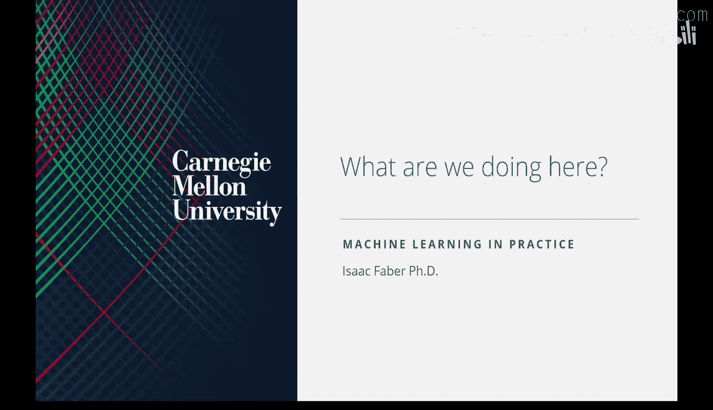

You know what are the mechanics of machine learning and choosing different model types。

 but how do you actually put machine learning in front of people who don't do machine learning and when those would be the areas that we'll touch。

 we will cover some technical stuff and we'll get into this around product architecture and how and when you should evaluate models and how you can set systems up but most importantly the goal is going to be are you providing value with machine learning to people't who don't know what it is？

And we're going to do this in a number of different ways。

 the most important is you're going to build your own product and that's what you'll present at the end of the semester。

 so this course has no exams。And but we do have homework and so the way that this is going to work is that the homework is going to support concepts that I'll expect to see you integrate into your product at the end。

 the homework is all tied together it's one long case study where you'll work as a machine learning engineer building something for a business。

You'll also see recitations we didn't do recitations last year we will do them this year you'll see another thread there where we'll walk through tools that will be useful as you're building your product so you should see it in kind of three different ways right while you're building your own through the homeworks and then with the lectures and recitations how we cover these topics so you'll also see that the lectures I only plan to lecture for a portion of the class most of the class is intended to be interactive。

There will be readings that I will expect you to have completed before you come to class。

And I'll get into the grade breakdown here in a second。

 but a significant portion of the grade will be based on how you participate during the class time。

 so it'll be much more interactive than a typical just receive from a teacher talking。Okay。

 here's what we're going to cover today。In terms of first class。

About me we'll talk about course objectives， background motivation。

 talk a little bit about the assignments， current status of machine learning products and then questions and close out so pretty painless first first class but hopefully we'll do a good job setting the stage as to why this is useful so I got my PhD from Stanford in the management science and engineering department my dissertation was on artificial intelligence in cybersecurity specifically using AI for warning systems。

I am not a full time instructor adjunct faculty my full time job is as a chief data scientist and the director of AI development for the Army's artificial intelligence integration center lots of words part of the United States Army that's doing AI so in that capacity I work everything from autonomous vehicles to large language models for。

AI generation techniques so lots of products also some industry experience co founded a venture back company when I was at Stanford that built a work benchnch for doing data science and AI development。

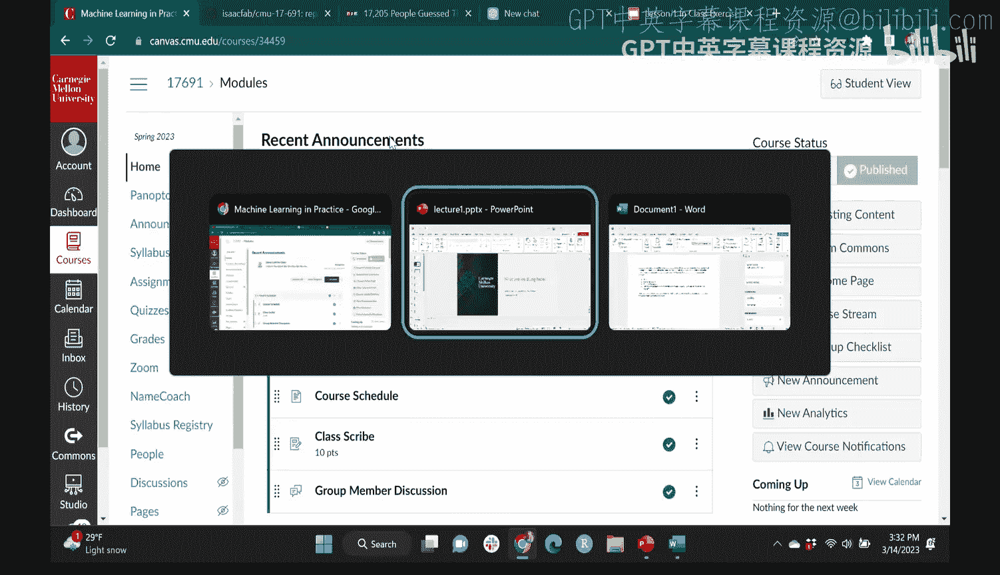

I serve on the board of a number of startups as well right now I think it's like a Pittsburgh thing。

 but lots of folks who've asked me to serve on boards is like in the medical space。But。Interesting。

 so your product can really range from。You know back in 2015 everybody was talking about self-driving cars and we're almost there at least in some places and now you see almost everything is NLP or in the language space so lots of things have evolved in that time period and then just last anecdote I am active on social media in 2019 I was named one of LinkedIn's top voices data and analytics so lots of。

Posting online。Okay so here's what we're going to do just a quick overview purpose of the course is to cover topics relevant to building a machine learning system deployed into operations such systems have technical requirements including data management model development of deployment however business and organization impacts must be considered it's not enough to just build a machine learning model deploy it you have to justify the expense and the resources that are required to do such a thing so this is going to be one of the things that you should get from this class to understand that there's a tradeoff right like if you're going to do a large investment in infrastructure can you justify that investment with the value that you're going to create from having the product deploy。

And we will， it'll be the third section we go into。

 but I will give you some tools to be able to make those calculations explicitly。Okay。

 so a couple of related contexts here， the goal here is， is that。We want to focus on。

Not just machine learning techniques and approaches。

 that's typically what you would get if you take any machine learning class here at CMU。

Because machine learning has been really popular， its popularity has been driven a lot by the low level mechanics of like。

 you know， what's the neural architecture that we're concerned about。You know， latelyate。

 it's been around。Reinforcement learning with human feedback like you know those。

Are very important considerations at some level， but we want to make sure that as we're understanding those small nuances in architectural considerations for model development that we also pay attention to organizational considerations and so that's what we're doing there are a number of related courses so and I'll reference them as we go along as far as I can tell there's probably now between。

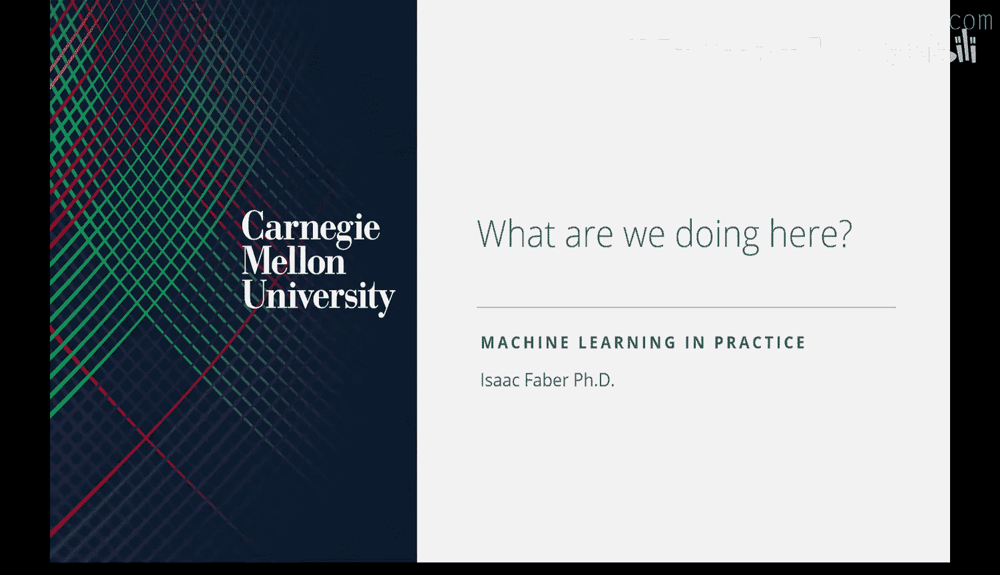

The last year at CMU you could take a similar course here。

 machine learning and data science at scale， but it will focus more technically on product architecture for computer science but the flavor of like are you building a product that's useful I think it's a pretty unique course there are two other courses not at CMU that I think will be similar and I'll reference them there's one at Stanford and one at Berkeley and I'll talk about the book that we'll use here in a second。

 but one of the authors of the book that we'll use runs the course at Stanford so。

You will see both of those courses linked as references in your first assignment。

 which is to come up with a proposal for what product you plan to build。So people are doing this。

 it just is fairly new to be asking these types of questions because machine learning has been moving so fast。

Okay， here's the learning objectives of the course。

 if we can accomplish this by the time you guys leave in seven weeks。

 we will have been successful as a class， can you deploy products with machine learning and AI components？

If you understand how to implement data pipelines and data engineering systems that support those products。

 can you calculate the approximateximate value a machine learning brings to an organization in dollars。

 understand how to continually assess the value and quality of the deployed machine learning system。

So I mentioned this at the very beginning， but just a touch base group focused。

Groups of two to four I know just as I was watching people come in it looks like a couple of folks came in connected already with people you know so you can form your own groups if you don't have a group handy herer who's our TA will help us get set up there is a group discussion on Can which i'll show you here in a second or you can touch base and connect with folks if you're looking for a group so but if you have if you're having an issue just reach out to myself or herer and。

We will make sure that you can connect them and put into a group more hands on philosophy case study than than theory。

 so we will do a couple of exercises in class， but typically the way it'll work is you know i'll do。

30 minutes or so discussion and then you guys will do a group activity where in the same group that you're doing in your product you'll go over the readings for the day and give me a summary and then we'll discuss the summary as a class and that usually takes us through to the end and then I think hopefully this is pretty straightforward classes Tuesdays and Thursdays everybody knows。

330 to 450 and then recitation on Wednesday at 5 pm。I plan to be here in person。

 but just sometimes I get called away to travel， but I will hold class。

Even when that happens it will just be on zoom but you'll get plenty of advance notice。

 but there may be some class periods that end up being on zoom last year it was only one class but it may happen so just be aware and then the recitations will be recorded on zoom as well like I said 5 o'clock on Wednesdays or 5 pm on Wednesdays and then they'll be available we plan to you know we'll plan to do them live but on Wednesdays you won't be required to attend but you will find them very useful in building the products that you。

End up presenting as your group presentation。Okay， here's the grade breakdown 60% will be a group project grade that's actually broken into two things your proposal。

 which is a small percentage of your grade and then the actual group presentation it's a group presentation the presentation does involve basically two things it's a slideshow。

And it's a demo。And that's all the documentation I'll be expecting and you'll get more guidance on that as it comes in class participation。

😊，I expect folks to be active in discussions and what I mean by that is I know some people don't like to speak in public so I'm not going to be asking you to be active unless you want to。

 but we will document using a live Google slide that you'll see because we'll do it today is to kind of work through it but as we have in- class activities and everybody participate。

20% on assignments there's three homework assignments like I mentioned it will be case studies and then one other thing is that we will assign starting next class a class scribe so you'll take notes for that class and then you'll push the notes to the class Github。

Site through a poll request， so let's look at that。Okay， so the class has a。

GitHub site that just describes the breakdown of the course first thing I want to point out is that the course does have the textbook。

 its says book design designing machine learning systems。

It's actually not required most of what's in the book is available online but the book is a much more mature version of the information that would be available online it's pretty cheap it's $30 I have a couple of copies so if that's too much money for you or if you don't want to buy it you can borrow it but I highly highly recommend purchasing the book it's a great resource for what we're doing in this class。

And when we do the reading assignments， there will be articles and in sections out of the book that we'll read。

Okay， what else is in the repo？Information that you'll need for your homework assignments。

SoThere's a SQLite database that you'll see you'll need and then some data when we're going to。

Train machine learning。System you also have everything from last year， so these are all the notes。

 for example， all the class scribes that took notes last year you can go in and look and see what。

It might have looked like for。Other folks that take notes and there's going to be some obviously some slightly different content。

 but we'll cover a lot of the same things there's also。Last year's。

Group project presentations are in here as well， so if you're curious to look through those as you're looking for inspiration for ideas。

 not everybody did well so。Everybody did good， not everybody excelled so at your own peril from looking at some of the group projects you'll be able to tell which ones are higher quality than not。

😊，Okay， that'll make sense okay， so when you're assigned to ascribe you will go into this year's folder。

 let's say there's whoever's assigned for class two and we'll make these assignments you'll know beforehand you know。

Fork this repo and then take the notes and then as a poll request push the notes back to the repo。

 we'll accept them。Okay， all right canvas I run the whole course off of canvas so I don't have a secondary system I'll grade on here you'll get feedback on here all your assignment submissions will be here and the way that I have it set up。

Let me go here into the student view。Is the modules for each are set up by week and each week they will become available so you won't have necessarily。

Access to things that are head you'll be able to see what the topics are。

 but you only have access to the things that are active in the moment that。

That way you don't get overwhelmed with。Working too far ahead。

 but for the week you'll see there will be two modules per class so what are we doing here is today and what's a good ML product is on Thursday and then we'll be adding something here for the recitation as we go forward。

A couple of things the group product proposal assignment is live right now so when you get in a group you have until the 28th that's two weeks to develop the proposal and submit it anytime between now and then the classscribe assignment is up and then as I mentioned there's a group member discussion so you can come here。

If you're looking for a group to chat with people and connect。Okay， that all make sense。Okay。

 so let's look at what。We're doing here today。There will be a section here in a second where I'll have you guys go here。

 at least in preliminary groups。These are the examples of the type of required reading youll have today there's four articles。

 which we willll read in class and then。

You will go to the group slides here， which are just an open。诶。

Google Slidedes Do and in class with your group you' you'll make a copy of this first slide and you'll answer these questions here in class through discussion and then we'll discuss what all of you guys' feedback are and thoughts are on the articles。

Allll make sense。All right， any questions so far？有。回不打。嗯。Yeah。So I think that's I think you're right。

 so choose wisely。Yeah， so I don't I think this is actually the only time that we have multiple HR articles and truth be told is。

The second two articles about Zillow will be more important because that's what's going to drive the discussion for today。

That's a good heads up I thought I thought CMU paid for no mate。This is a different publication。

Like if you access it from their website， but maybe not。Okay。

 let me know if it does get to be an issue。We can adjust okay， all right， any questions about。

The meta of the class。No， okay， all right， let's。Let's talk about the history and background of the course。

I put this together about a year ago generally speaking like how do we get to the point where're at now where we've seen this like really massive acceleration and adoption in machine learning systems over the last over the last couple of years and it's really been percolating I've been in doing data science professionally for a little over 10 years now when I first started out most data science was really just like applied statistical analysis it was a little bit of machine learning but it was it was very immature and and very interesting actually the first like cohort of data scientists would use R as a programming language and nows this are is like a minority language and almost everybody uses Python or some other variant but you can see that generally speaking like this started a long time ago several hundred years ago where we saw like the basis of。

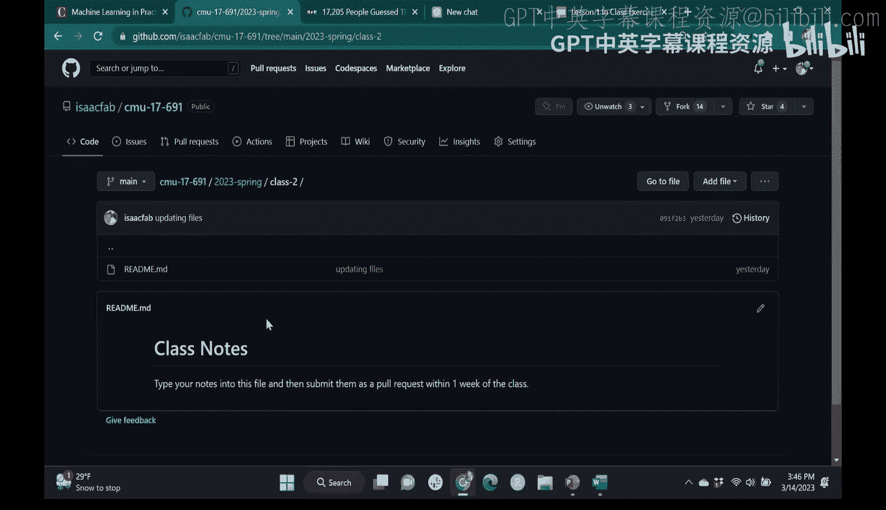

Early statistical methods， both the Bayesian and frequentist methods early on。

 those evolved into likelihood methods of estimation effectively。Can we collect data at the time。

 obviously the ability to collect data was very restricted。

 early data collection all was very manual。The first recorded history of collection of data。

It is actually if you think about it like the first time humanity collected data was the dividing line between prehistory and history right so history is like the extent to which humankind has been collecting data about themselves so you know the first set of data that was collected that we know about was etched into stone and you know fast forward several thousand years and we start to say hey。

 if we collected data。We can start to answer interesting questions about that data that tell us a little bit more about the universe and of course from there it evolves we see with the advent of turninguring machines around World War II with Vallan Turing。

 which we'll talk about here in a moment and then of course the personal computer。

 machine learning as a discipline begins in the 1950s and 1960s。

This is actually about the time when the first。Artificial neural network or the perceptron was invented and neural networks get invented alongside of a number of other techniques that were popularized that aren't as in vogue anymore。

 things like support vector machines，Other ways of fitting models to data and then in about 2000。

 there was this boom in data management so sort of unrelated directly to machine learning and artificial intelligence。

 but in order to do things at larger scales it required you to get access to more data。

 And so I think everybody in this room knows how quickly the。

Expansion of the personal computer and computing power in general group at the same time we saw a significant reduction in the cost of storing data and the data being produced。

 so as it sits today it is not uncommon for organizations to produce petabytes of data。

Just by being an insurance company， for example， whereas in the past this would have been pretty rare so we sit at the confluence of basically these three things right you have techniques。

 algorithmic techniques you have the expansion of computing power and you have the availability of data and that's what makes this course timely right is is that these things are coming together in a time where we can build products that we literally could not build 10 years ago which is pretty exciting so there's lots of open questions about how we do that。

 why we do it what's a good way to go about it and I want to spend the next couple of slides kind of justifying like that this is a useful thing to do right like these three things coming together can actually provide value and they're not just a novel academic pursuit。

So I want to start with a story from Aristotle so fails of my latestus is an interesting guy anybody ever heard this statement like this quip that says if you're so smart。

 why aren't you rich， have you ever heard anybody say that？So this is like。

Thalles was told this by a contemporary and it got recorded for all of history by Aristotle and the way the story goes likely apocryphal Tes goes look I could be wealthy anytime I want to and I'll prove it to you so he went and the way it's written by Aristotle is that they said he。

Dived of the stars， so he looked up at the stars and he said， okay。

There's going to be a bumper crop of all of us this year。

And with that information from diving the stars， he went out and he。

Purchase the option to use all of the olive presses in the towns that they were in and at the time of harvest everybody had this big bumper crop of olives and the person who had access to all of the presses was saless and he said no problem you can use it all you have to do is pay this really significant premium to use the olive presses so without ever growing an olive he made a whole bunch of money by quote unquote divining the stars so at a high level this is。

Effectively what I want you guys to think about here， right？In our world， we're collecting data。

 which is the information coming off the stars， we're developing a model which is generating insight from that data。

RightAnd that model is telling us hey there's going to be something that happens in his case specifically with olives and then we're translating that into an action right and in his case the action was I'm going to purchase these options for these olive presses so it's not just the interesting nuances of the stars it's not just the insight from what the stars are telling us it's the entire cycle of collecting the data。

Building the insight and then turning that insight into a product that later on you can profit from right that you can generate value from for yourself and for an organization。

So is this true this is maybe apocryphal can you actually tell about olive crops from the stars。

 I have no idea it don't know very much about stars or olives。

 but I'll take his word for it because it's Aristotle， I do know， however that in other settings。

We see this start to echo in historical setting so Sir Francis calledton famous statistician if you do any science historical science if anybody brings into that domain you will absolutely run across him he actually had an interesting observation other than。

Creating many of the statistical foundations that are used even in our machine learning techniques today。

 he was at an affair in England。And there was this competition to guess the weight of an ox and so I would imagine Sir Francis Galton。

 this would have been like in the 17th， 18th century so an ox would be like a prized possession today I don't know what you would do with an ox if someone gave it to you if you didn't have a farm。

But what he did notice was data was being collected in this process， right。

 andal it was incidental to the question。People would guess the weight of the ox and whoever guessed the closest weight to the ox got the ox like wanted and so you had an incentive to try to be accurate on your guess and thousands of people。

Gssed the weight of this ox and what he noticed as a statistician was that the average of the guesses was very。

 very close to the actual true value of the weight of the ox so like why is that why is it that when you collect data that data contains information that's incidental to the purpose of the data being collected so there's like。

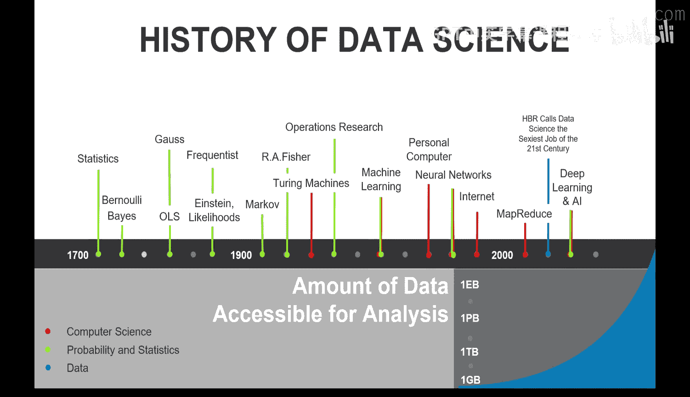

Information that you can be used that can be used to exploit or generate value that the people who generate the data may not even recognize so again。

 this may seem apocryphal， but let me prove to you that this is。This is true。

So NPR did the same thing。They had 17，000 people guess the weight of a cow。

I don't think they gave him the cow， though but。It was pretty interesting and this is the histogram of the guesses。

And you could see from 18，000 people， this solid line here。Is 1300 pounds。

 and then the do line here is 1287 pounds。 So the average guess was like a small。

Variation away from the actual weight of the cow。So the cool thing here and we take it for granted when we say that we're going to be doing machine learning is is that。

Like data is pretty special， it contains information and insights that you don't even know it contains until you explore it。

And。What's been so incredible to see the last couple of years is that we've got better and better models that are allowing us to extract more and more interesting insights out of information that you wouldn't have thought was even there in the first place of course we're seeing that with a lot of products that are available now and we'll talk about a few of those here in a second but you can see this isn't even deep learning right this is just like an average so if we can start extracting insight even from like you know summary statistics you know what more could we do with more powerful tools。

So。Everybody knows who Alan Tring is。We're getting a little closer， so we went fails。

 Sir Francis Galton and now Alan Turing， so obviously the inventor of the Turing machine。

 most famous today， probably one of the most important computer scientists of the last1 hundred0 years。

 likely the most important computer scientist disease。

Instrumental in the creation of many techniques that are still used today。

 probably most famous for the Tring test does anybody know what the Tring test is or could explain it？

Good ability to differentiate between the。That's exactly right so the tuuring test is can a human reasonably differentiate between the entity that they're interacting with is it a machine or is it a human and the point at which you cannot differentiate is the point at which a machine has passed the Turing test so it's very ambiguous and 10 years ago most computer scientists would have told you this is probably impossible like even at that point like when data science first started to kick off this isn't like now I would say not only has it been passed like we're like it's like trivially simple to generate entities that can accomplish this so the。

Most famous right now is Cha GT。Everybody heres used chat TPT。Only for。Good， right， not for evil。

So yeah， I'm sure nobody in this room， but I do know that several admission essays have been submitted to the department that were definitely created with much with not very much。

Additions so。Let's go check it out。So this is an example of a product。

That has machine learning baked into it like very popular it went from like no users to like00 million something crazy like that now and we can obviously ask it anything so let's ask get something fun create a。

Some point。是。嗯。All right。So let's see how close I came。Okay， oh， we're not going to use any calculus。

But you're welcome to。Yeah。Okay， I'm not sure how long it's going to go， the tokens pretty large。诶。

But actually， this should be pretty close except we won't go too down into the weeds on。

On some of the components。And then a lot of the things actually it's asking us to do will be。

Things that you have already covered。是。Okay， I think。These references are all real。

Does anybody own any of these， I think I have the first one。Yeah。

I didn't know Andre had published a book in 2020， though he did the 100 page machine learning book。哎。

Collette was the one who published or is the primary author of Car。Okay， so pretty cool， all right。

And if we go back to， I think we will head actually most of the model deployment monitoring。

 deep learning techniques。Unsupervised， supervised。Data preparation machine learning， okay。

 we're pretty close okay so。What makes this product valuable？

Let me add something spicy to that question before you answer it。So everybody know who Jan Lacoon is？

So if you can see this， okay， so he was hot and I think still is about how everybody loves Cha GT。

This is his tweet， to be clear I'm not criticizing Open AI's work nor their claims。

 I'm trying to correct the perception to by the public and the media who sees chat UBT as this incredibly new innovative and unique technological breakthrough that's far ahead of everyone else。

 it's just not。And then Scott Wner。Who is a guy I don't know who he is because it's Twitter he can respond to beyond directly and yeah you've released nothing like it it's incredibly useful you've been sitting on that and that's on meta so ya is currently like the head of AI at meta right now so we get to see like these interactions because that's just the day and age that we live in so。

😊，why， first of all， like Jan clearly thinks that what they're doing at meta is equivalent。

 but why is chatt GT so valuable if it's something that Google or Me could do if they wanted to？

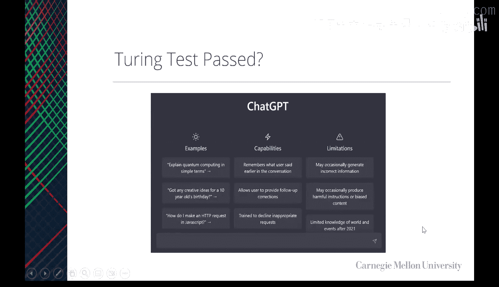

So like you could replace s。

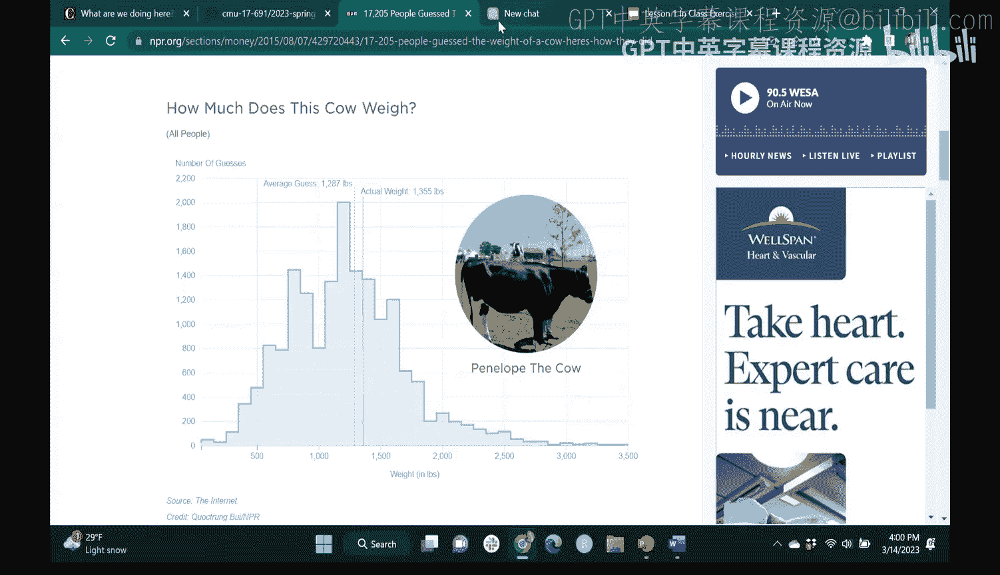

Custom like your base level customer service。Get of speed。行好。Weout for easy。You you handle stuff。

 And then now you're only take this。Oh guess I。Theyre likeYeah。

So there's clearly like business use cases that are just super obvious like right out of the gate。

Okay， so you said you've used。Chad JbT before。This is correct。What would you use it for？Yeah。

 I like to use it for brainstorming， but I found that you rely on it the facts。

Findine out of the 10 things I might give you will be useful。

 but you still have to know enough to weed out the one out of 10。这个 way I see了下T。

Averaging a lot of sources and it's really good at stitching ideas together。そ东。

Grate some types of novel ideas。So me my exception， but part from that。People able to back。

So you know， so this is absolutely true and it will be the thing that we talk about the class。

If you if your job is to produce software。Before machine learning。

 like the vast majority of time that you spent learning to do software development was learning to make sure that your application did exactly what you wanted it to right that like when you put A and B came out and nothing else came out。

When we introduced technologies like this， you introduced uncertainty。

 like the very thing the software engineering field tried to get rid of and we even know it like doesn't work like we're not even confident that all the sources that we saw were actually real。

 but still。Incredibly useful right like it gets inside of your cycle where you can use it for this process。

 so what about it makes it useful for that。Let me encourage a couple of thoughts would you agree that？

It's super easy to access。The user interface is deceptively simple。

 yet produces really interesting results。It has access to relevant information。

And the language models perform it， meaning that when you type something in。

 you get something back in a reasonable period of time。Right， so what's what。

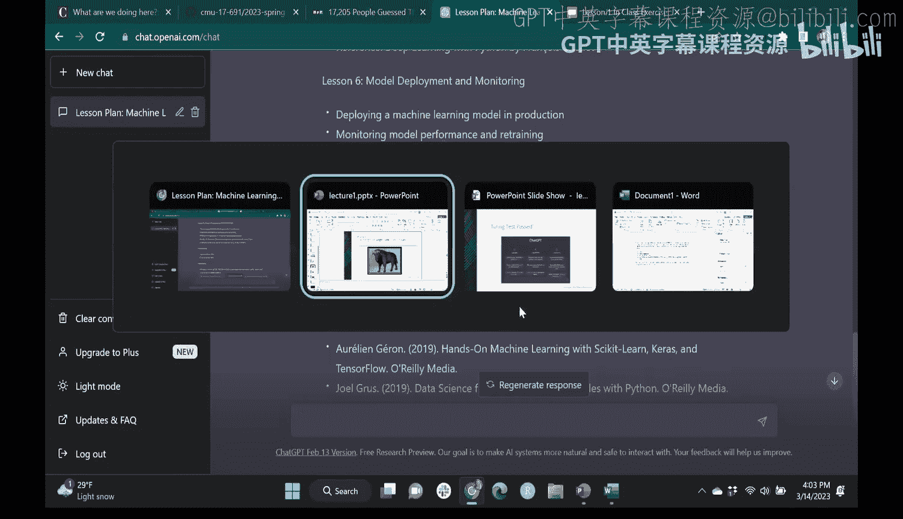

And I don't want to put words into about what Janwn doesn't appreciate is， is that。The model。

Developing the model。Is not always the hard part the hard part is turning the model into a product and if you do that you get to be。

Worth $100 billion dollars as opposed to。Just a guy doing AI meow that's。Clearly unhappy。

Now that there's anything wrong with it beyond。That's where I want you guys to think about when we're thinking about products。

The model can be something as simple as a regression as long as you're clear that it's providing value to somebody and that that value can be captured。

You're on the right road to thinking about productizing these technologies。Okay。

So we're going to now jump into class discussion。I'm going to asking you to break up generally into groups right now。

If。You're not close to somebody， just jump over two， four， go to Canvas。Read the last two articles。

And then go to the slides and in your group。Copy the second slide and put your answers to the questions on the slide。

And I'll give you。About 20 minutes。嗯。Okay。So again， on Canvas。In today's。Class module。

 what are we doing here？That's where you'll find the articles。And then in supplemental materials。

 you'll see the ink class group slides just click on that and it'll take you to the。Slides。

Copy this slide and then answer the last couple of questions。

You could go ahead and wrap up what you got in the next minute or two and i'm just going to set the stage here and we'll chat through this so obviously we're talking about Zillow right now。

Zillow was a super interesting company in that they actually are a combination of two companies。

 Zillow and a company called Trulia， thing that merger happened a while ago now。

Almost ancient history， but they basically own their space， which is like。

Consumer information about houses for sale and of course， the idea is is if if you。

Collect information about houses for sale you should have a giant pile of high quality data to make determinations about houses for sale so what's the most famous thing that Zillow is known for。

This estimate right yeah we're going to predict how much your house is it historically it's we know it's notoriously unreliable。

 but you still want to know like oh you really want to know like。😊。

The fact that they just had offered that number initially drove。

 I think a lot of their early adoption， but it was interesting that their business model didn't rely on that number。

 it just relied on providing that number。So obviously you have a machine learning process。

 you're making a prediction on the house， using the data that comes in。

 the way that you're creating value initially is Zillow。

Is driving traffic to their site and then they're selling that traffic back to real estate agents and that's their primary business model so they make a prediction and they don't actually use the value of that prediction directly to generate value they use it as a consumer product so similar to the olive presses another company came in and said Zillow if you're so smart why aren't you aren't you using this number to like buy houses and and resell them so open door showed up and did exactly that I think actually in the last year so this is about 18 months ago when this all unfolded and the last years there's been a number of shakeups but open door their policy is to do this they predict the price of a house and then they buy houses and then they sell them and they have a market cap that I think is something very equivalent to zillow so same machine learning。

Model。Totally different mechanisms in which they generate value。

Zillow saw this threatened by the competitor and started the Ibuyer program so let's talk about that now what went wrong？

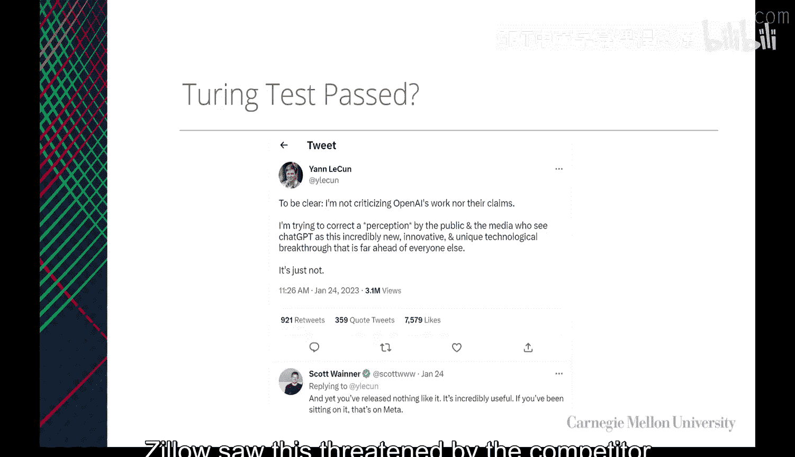

Let's start with。系咧。This you guys okay。All right， what do you have， what do you think？

So like one of the reasons was the predictions made by the model were quite uncertain about it。

 like we couldnt predict the prices correctly say six months from this time。

 we don't know what the demand demand at that time would be。

So but still there was a need to account for an uncertainty there and also the data that was being used to predict those prices。

 sometimes it could be flawed and that also us to better。

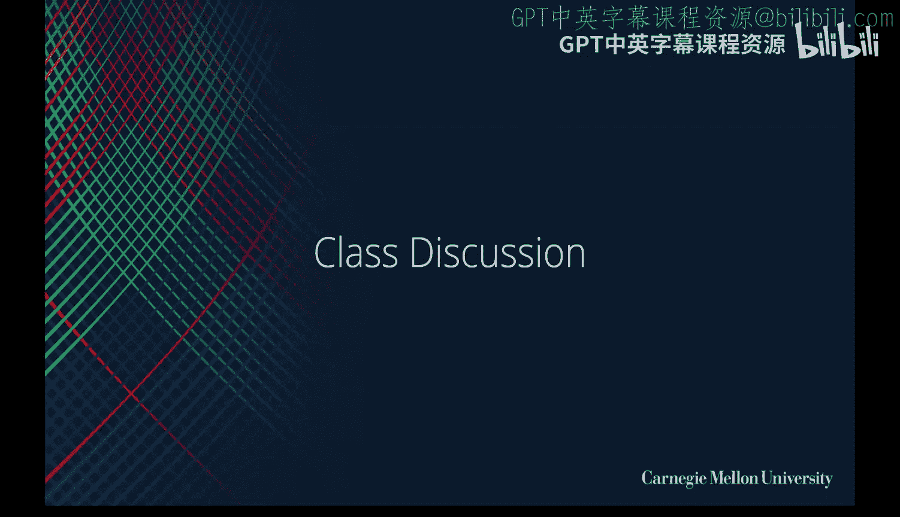

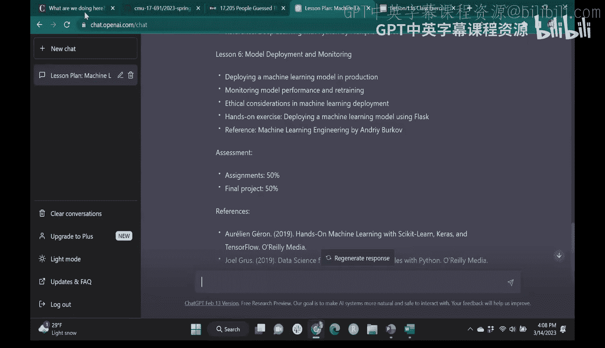

Yeah that's absolutely the case right so the model itself maybe had some issues could have been more accurate even given the data。

 but really there was like an underlying issue of like your model could only be still good if you're feeding bad data。

Or inaccurate data。R Louu and Shuul。嗯。Focus on， like。

What Zlow started as estimate for the task price prediction。

 but that that doesn't necessarily fit like the mom。Peopleble to select which houses might be good。

So it's like you're trying to push。A specific task to do something slightly different。

 so you might not get the results to expand。So maybe buyers are more interested in other metrics that they aren't collect。

So that contrast the starting point， which they didn't really encounter any market conditions。

 they're just comparing。Hous is on a set of features that are pre。

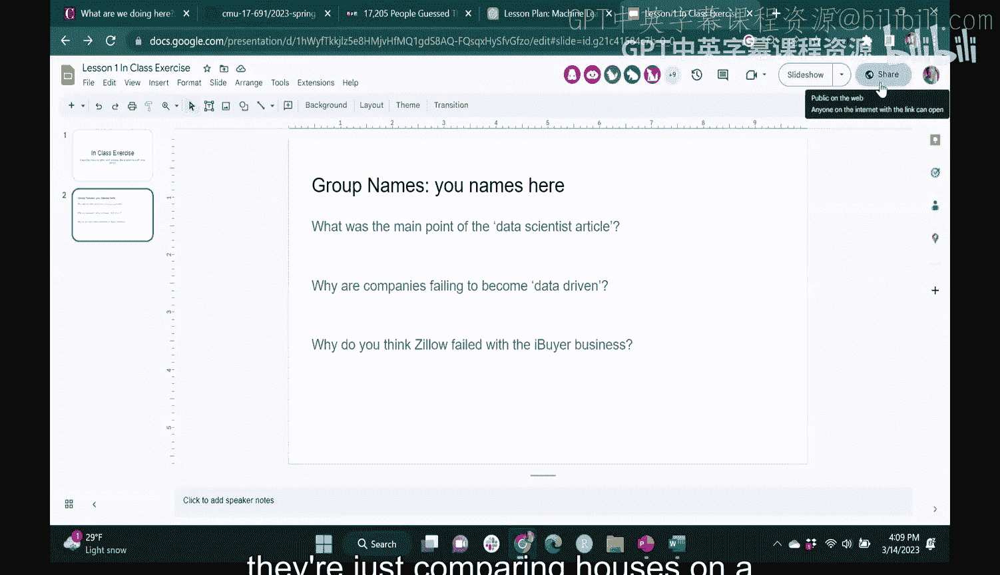

And so maybe it's hard to quantify market conditions， maybe it needs to bring in。

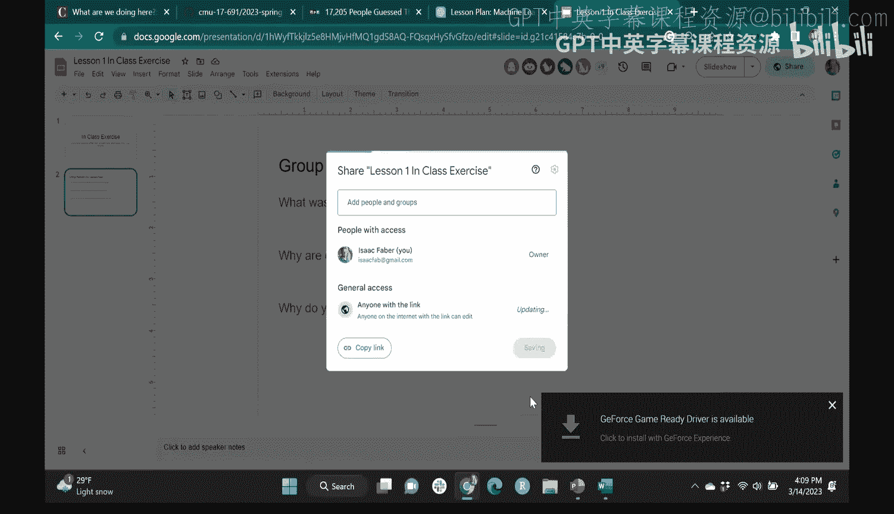

できます。And then。One of the articles talked about。How the model became less precise at the time。

 so maybe they need to improve like monitoring system set up。啊。Could change them so often。Okay。是是。

AndAnother example of。Someone who's thinking about the value of their house。

So' an indicator that the model is not good at that。Responding to variance。Great point。

 so model mismatch， the reason to which why the initial model had been created。

Doesn't directly apply to this new use case this happens very often right especially in these like modern deep learning frameworks where you'll the model will be trained very specifically on a certain set of data captured in a certain environment and any changes to that will end up creating instability in what's coming out also。

Bying a house is an auction right predicting the price at which it will sell is very different than predicting what price you should offer in an auction setting or very different settings and so yeah great things external conditions and no experts in monitoring I would kind of put these in like this are you collecting the right data at the right time and updating at the right frequency and so those questions around like if we were really good at predicting in 2000 to 2010 that doesn't necessarily mean we're going to be great at 2020 to 2022。

Great points。I you guys。We focused on work possible all levels take no qualityship data to the model。

 So especially this was useful for。 I mean， this was very relevant。Take a small change。

 Take a small error to the shop I like the high house。

And another thing was like when there was insufficient human intervention in the algorithm there much focus on algorithm itself。

 So。There wasn't enough focus on whether the algorithm is providing what the business really requires。

The the third point came up course the test focus on the buyer。Most more。 So there's no yeah。

 no bar because to make sure that。what they are。Yeah。

 so there' the broader system is more than just building the model right and so it's a great insight this idea of like。

The model needs to be tuned from expert opinions happens in almost every setting like I mentioned it like we just looked at chat GPT like what makes chat GPT actually work is like human feedback like that's like the last step of like curating with an expert of what what people expect to see that is the case in all of these settings so great insight。

Okay， Joseph Elliot。So。They rapidly expanded their。But it's more and more cases， which。

Like least their costs a ton without like。I get to talk about even and the multiple external market。

Some of the data they included in their model is like。In that sense， don make you prediction。

Somebody else estimate， so when somebody lists the price of their home。

 that's an estimate of what they think the value。对。That data is what you making us。Issue。

 and then we talked about the mismat。The estimate is。It's predicting today's value。

Then you're going to sell it。驳回。But， that's not。Right。

's all that's all great insights I think especially this idea of rapid scaling the eye buyer business I think they brought on。

 I can't remember the exact number but it was something like1 thousand0 data scientistss。

 it was some crazy hiring action how are you going to put that many people to use like there is a way to put that many people to use but you would hope that like you wouldn't like scale so quickly that and when it happened if you look at the and the external resources I had put the Reddit thread where like and Reddit's just savage so it'll just like say whatever like is obviously wrong and they were like posting Reddit was posting the job advertisements for the data scientists at Zillow and the requirements were basically like know how to use these like three Python time series prediction packages and they were like oh I wonder why you lost billions of dollars。

But yeah， this is the question like are we are we scaling appropriately right like sometimes you know you need to be prepared to scale right like when Cha GP goes from zero to 100 million users overnight。

 but this is a different thing than。This business， their scale meant that they were going to potentially like you had said。

 be pouring money down the drain if they get it wrong， which is。For， what ended up happening。When。

Yes。Yeah， so I think a lot of things you will mention how coffee and coffee shelves and that data bought model。

 So something that stuck with me was。know that Alex here share around data with a big D。

 So people are doing Mls too data centric as opposed centric inadequate data inadequate preparation is thinking on this assessment scenario analysis and having a plan when things go wrong。

 which feeds into bridge， So when models go wrong， What do you do and how do you react to them and and not having a subject matter expert。

 There so no human intervention who's able to。Getin the brakes and say hold on。

 This isn't going well。 We should stop。Yeah yeah that's right and I mean like we mentioned a couple times and and we'll come back to it but models don't get developed for their own purposes right they get developed inside of larger ecosystems that's the difference between Jan Lacoon and Sam Altman right like one launched a product that everybody uses and the other says they could have done it didn't because it's much harder to launch the product。

And easy to get it wrong， so there is a fair statement there right Ray and。Yeah boss。

Also about the the horn issues。That lawyer。Because a lot。では。20秒老。看や的。Also discuss about。W。

What try to。So without cu from a buyer's perspective。LikeThey have to。About fire motion。啊，你。

あ、そうですかした。It's people who。You knowow how this font works。They can provide some bias data。好。Itsか。是啊。

是的。No。So this is actually a real problem that's come up this year， this idea of poison data sets。

That you know even with the even what's happening with the large language models they're pulling in these like large corpes of data and it doesn't take a lot of like manipulation of what the machine learning model is learning underneath the hood that changes its performance so it is the case that if you had a competitor to zillow。

They could。Impact the corpus of data their models are being trained on potentially and if they did it in a way that like I don't know ensured that they。

Had the wrong prediction in like。A very expensive neighborhood in like I don't know Palo Alto。

 California or like Manhattan that could potentially like wreck their whole business。

 So if they could yeah so it's interesting to think about like last year I。

We didn't talk about this much。It is the case that that is happening and it's something that you've got to security in your data pipelines is now an important thing to consider。

A you getting reliable data in right it is related to quality but usually data quality has to be like is around like am I collecting an appropriate corus of information I cleaning it are people entering it correctly and now I think you also have to worry about is somebody intentionally manipulating the data to give me a prediction that's unreliable。

Yeah， so super interesting point。And I think we got one more group。

They was focusing on how complex the problem is， because。

As mentioned before the equality plays part because the Constitution plays part。

The results that the model is not very comment。excuse the risk of having like a。

 even though this data is like statisticalally insignific。You。So this' re on just that。

Conservative kind。Seeing the data science project or machine learning project is one。对以。Yeah， no。

 that's great。Yeah， I think generally speaking， the problem complexity， right？

Deploying a product isn't just about the components of the product。

 it's about the problem that it's solving。Okay， so you guys did an awesome job that was quickly going over the couple of articles。

 you captured everything that I would have said in a typical machine learning class。

 how many of these topics do you cover？Right， so like。

I asked that thely because I know the answer probably a couple you know like there's some very talented people teaching them but usually this is these aren't the things that you focus on and when you go to do this in practice these are the problems you run into right so these are going to be the things that I'm going to look for you to address and learn about as we go on the way I've organize this is。

The class is basically done in four sections foundations which will be the first week where we'll just cover like we did today like you know why are we doing what we're doing and then we'll talk about MLOs for two weeks and then we'll go into value how do you actually assess value and calculate value and then experience will bring in a couple of guest lectures that do this in the real world and then your project and。

These seven weeks I think you're going to go by quick and so that's all i've got for you today you'll get an email from me just as a reminder recitation tomorrow at five and then when you come to class next time just have the articles read before you come in and then we can go through this process and these discussions so this is what class will feel like for the rest of the semester so。

Hopefully you guys are excited about it， let me know if you have any questions。

 but that's all I got for you today。Thanks， everybody。

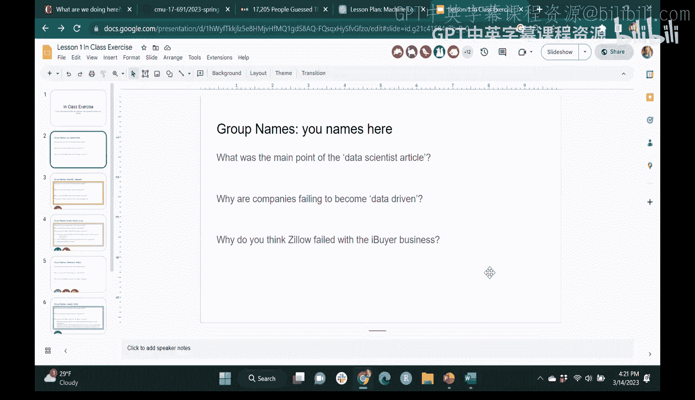