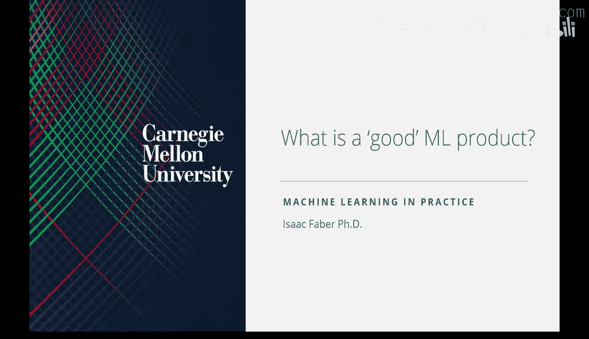
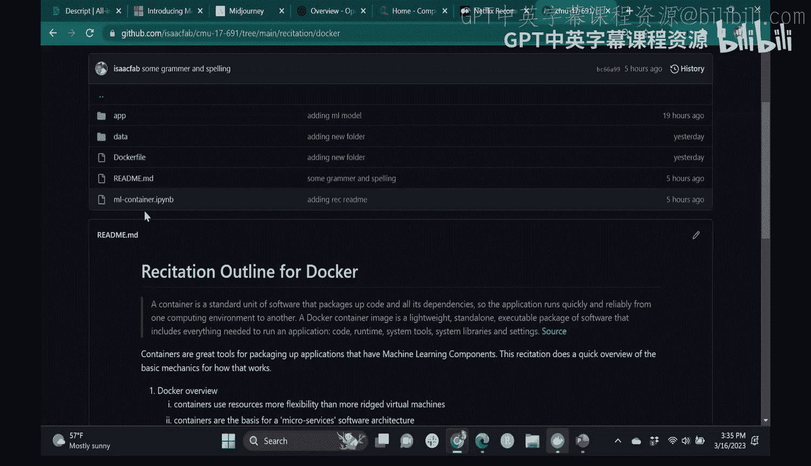
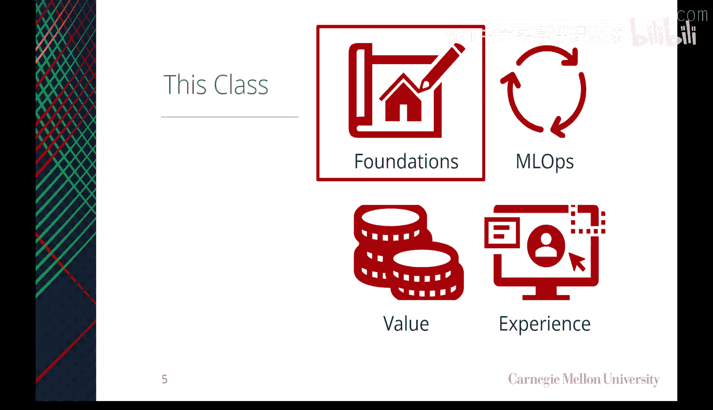
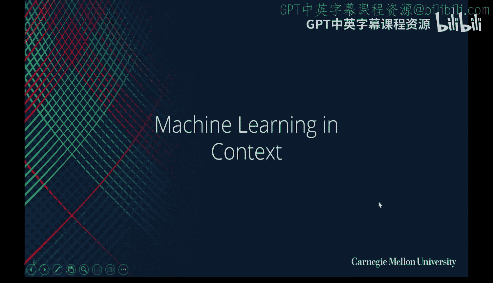
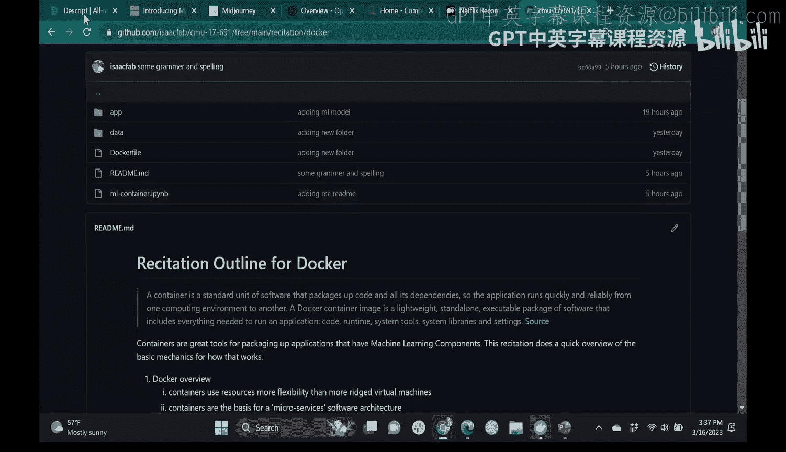
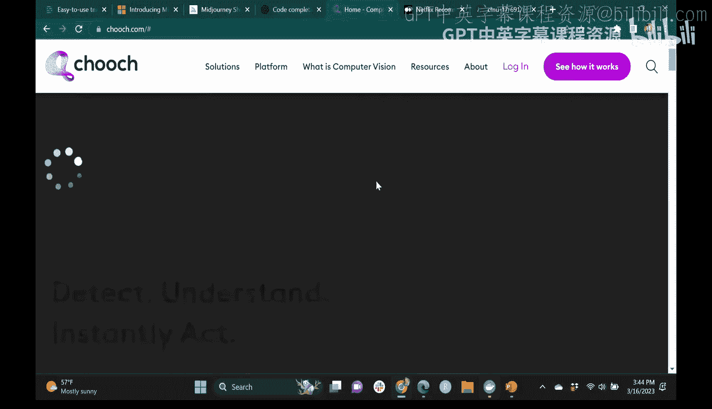
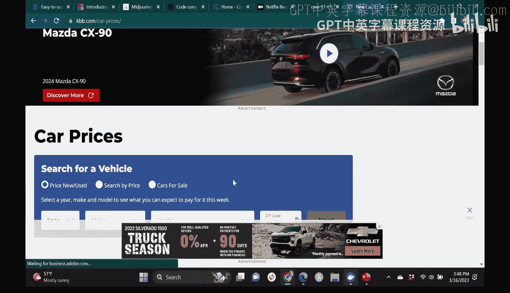
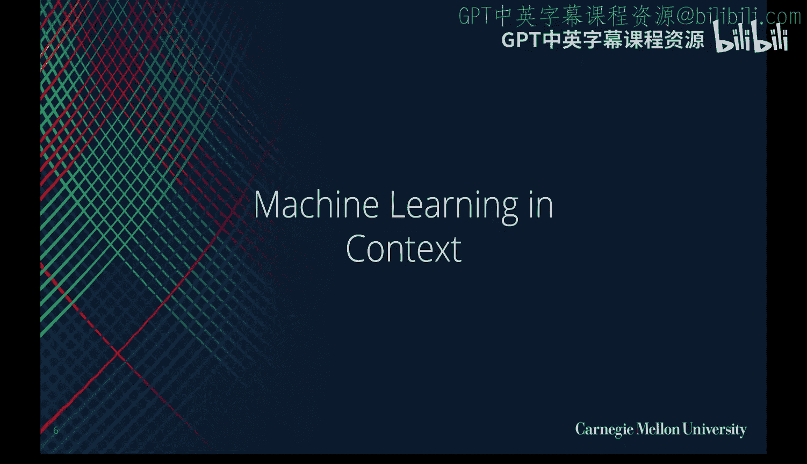

# CMU《机器学习实践｜17-691 Machine Learning in Practice 2023》中英字幕 p02 [P2]Lecture 02- What is a good ML product-_2.zh_en [BV18TUQBJEfH_p2]

All right， let's get started。How was everybody's Wednesday when？Right Wednesdaydday。

 half of Thursday。Hopefully good。I appreciate the few of you that joined us late for the recitation on Wednesday we will try to not make that a habit just a little bit of house cleaning that I'll cover real quick at the beginning here as we're。

Getting everything settled for the course hopefully everybody got my email this morning if you didn't just kind of clarifying a few things go back and take a look at it but here's what we're going to cover today just madmin stuff to start then we're going to talk about machine learning and context and that is in context of a product and then we're going to talk about product characteristics specifically what are the characteristics of a good machine learning product。

Okay， so scribe assignment， you will be given a scribe assignment starting on Tuesday of next week。

 you'll be notified beforehand don't worry about the second bullet that's actually not the case yeah that's not the case I'm going to adjust a little bit because the groups are a little different。

Sscribe notes should be submitted the day before the next class starts right so if you are a scribe on Tuesday you should be submitting your scribe notes before the class on Thursday starts and if youscribe on Thursday before the class on Tuesday starts group assignments you。

Should have seen on my email that I hope you guys are forming groups a little less than two weeks now until your group project proposal is due the assignment and the requirements for the assignment are already up on Canva you can take a look at it the discussion is in the first module on Canva if you need to coordinate with the group partner if not let myself or Har ornu no and we will we'll get you assigned and then the proposals are due like I mentioned about two weeks。

One thing to keep in mind the group project will have peer review grading so you'll get an assignment a grade assigned to the project and then as a group I will let you distribute the grade amongst your group according to how the group feels how everybody contributed so that will be coming so just a little bit of encouragement to make sure that you're contributing to your group in equity equitable way I mentioned it that already but the recitation notes are're up on the GiHub in class I do want to bounce over real quick and show you what that looks like。

This is typically what we'll do for the recitation so you can go back and take a look at it just notes on like what I walk through relevant links for things that we covered you know when we。

For example， there was a notebook where we trained a very simple model where that came from where it's at and all of the files that are relevant to it are be are going to be on the repo as well so for your example in the first homework assignment we'll be asking you to do a little bit with Docker and won't be out of the scope of what we cover in the recitation so you can go back to the recitation and look see how we did things there so you can apply it to the way you do things in your homework assignment I don't want this class to be about like the technology want to be more about the product development but it is a great benefit to understand the technology both get and Docker and how they work together。

Okay， so。I mentioned this at the end of last class we basically are going to cover four primary sections in the course and we start this week with foundation so last week on like。

What are we doing here that is？Is it even useful to look at data as a primary mechanism to provide value and I think you know not a big surprise because we're teaching a class on it。

 the answer to that question is yes， but the idea there is is that there's many ways to provide data from fairly simple approaches to very sophisticated things and just because your product is sophisticated or your model is sophisticated doesn't necessarily mean it's going to provide value。

So to that end we'll be covering these four sections and today will be the we'll wrap up foundations in terms of the underpinning about why we're doing。

 what we're doing and what direction we're going， and then we'll spend a couple weeks on MLOs。

 we'll spend a week on value and then we'll spend a couple weeks on experience that is group projects and then hearing from practitioners that are doing this in practice。

Okay， so this class is called what is what is a good machine learning product So I want to start about answering that question with machine learning in context like defining some like base terms about what we mean but before we get in there I want to show you a couple of products that I consider to be good machine learning products so you can kind of see like what a benchmark is for what a product would look like and this is a super exciting time because these products are like。

Showing up daily now we bounce over here and the first one I want to start out is a new video editing company so this is a startup i'm not sure how long the script has been around but like。

Maybe two years and they are already threatening like Adobe and final cut Pro for how easy it is to do video editing so I want to show you some of the cool things that they do that are just really interesting ways in which they're integrating AI so there's a whole bunch of things that they can do they go like your standard like transcription and I think they're just using pretty confident they're just using open AIs API and as they get access to the more sophisticated APIs their product gets better so they can do transcription and then from transcription they can do things like remove likeums and Oz like in your video so it makes it like really fluid and know stuff like background removal that's standard transcription like I mentioned。

This text to speech is actually。Pretty amazing， This is a product that's integrated。

 you talk into it。And then record your voice and then you type and whatever you type。

 it will generate you speaking that text instead of you having actually record the audio。

 which for some of us is ideal so you can sort of think like hey I have a baseline of my of my voice now I can use the chat function and chat GPT to generate a narrative and I can use this technology to actually make myself say it right so you can scale yourself like。

100 times thousand times potentially with these sorts of technology。

 so pretty cool and I I actually have it here I won't walk you through that product。

 but it's super easy to use。 They clearly spend a lot of time on on user interface we've also seen。😊。

This is pretty straightforward right so Bing has now integrated GT4 into right into Bing you have to be on edge so you'll be on Microsoft's products so kudos to Microsoft are pushing you over there but I would say like from my experience they effectively just kind of cloned like the goodness of chat GT and then put it here in Bing but it's not quite as capable sort of my two cents I think that the things that I've tried to do on chat GT or in the open AI playground that I'll show you here in a minute you don't get as much out of here。

 but what is awesome so for example。This is something I just tried to do a couple days ago。

 this is like an older person problem， I have an RV。是。

And I want to use a recreation a vehicle for those of you who aren't familiar。

And I want to use an external。Proane tank。在嗯。嗯。And I asked that。

Give me instructions to make this modification。か。And pretty similar experience that you have a chat GPT that you have by。

You know a chat experience that goes out says I'm going to search this thing and then it's going to respond and then give me the directions for what I'm asking for what's cool about this that's different that's different than chat JPT is it gives you references so this is tied into the big product directly so I say okay this sounds good but is it really good and instead of like wondering where it came from it will take me right to the internet source that it used to create this text so pretty clever in the way that was tied right into the product so you can see these things are as these products are built they're woven together in a cool way that keeps you coming back。

Just today this not ready for demo right March 16th Microsoft announced the similar capability that we'll be launching in their office products in Office 365 so you'll be able to just go in and say you know prepare a slideshow for machine learning and practice group proposal and here's all of my code and it will like make your slideshow for you seems like a good idea so that that's kind of the world of text I think hopefully obviously you can see how the merit of them and how easy it is to get access to it we look what's happening in images。

Mid journeyney's been the company that has been kind of at the forefront of image generation since Dolly got published last。

Saaving last year right it's like been less than a year since Dolly was published。

 but mid journeyney has been pretty impressive in the way that they've。

Done their product launch their product is just a discord server they didn't even bother like make their own user interface so you like you go to their Discord server and then on their Discord server。

 you go to one of the channels and you just type in prompts and willll give you the image back in the channel so。

They're clearly going after a specific group of folks who are comfortable doing that and the images that they can generate now are like。

Absolutely phenomenal。IThe all is impressive， but what mid journeyns been able to do。

 like it's like indistinguishable。You know you don't have any of the issues that we had with Dlly early on with like the eight fingers or like a lot of those tweaks have been made so again really interesting product this is obviously more developer focused so you like paper per image so they' they're trying to find folks who are going to make a lot of images。

So speaking of developer focus that's the way open AI works open AI's business model is to give these tools to people hopefully like you guys that are making that are making end products so there's a bunch of things that are built on top of open AI most people don't realize how many things you can build。

You know， there's tons of you know， tons of ideas that they give you with templates on their website。

 code completion， this is like， you know if you wanted to build your own copilo。

And tutorials and implementations for implementing these codeexes。And from a developer perspective。

 the open AI website is itself a great product because it's clearly like look this isn't a consumer product and it narrows right down onto the people who want it so GPT4 launch happened during class on Tuesday actually which is pretty pretty interesting that's how fast things are moving and in in the launch that I watched after I got out of class you could tell and I think the YouTube video by the time I watched it had half a million views on already that's half a million。

Developers right like folks who are building products so pretty impressive in terms of folks they get to sign up Okay so that's a bunch of stuff in the cloud so'll show you a couple of other things what about going to the edge。

Which we'll talk a little bit about in this class in terms of like when you're deciding your application what you're going to do with your application from an edge perspective ch is a great demo so i'm going to。

Show you their application here， which is also free I think。嗯。So do you stop sharing。嗯。清。嗯。嗯。Okay。

All right， so it's called image chat。And。I can。嗯。Okay。Let's go back。嗯。

I'm going to point this way so nobody has to actually be in the picture if you don't want to let's point it up here So this is like a combination vision text application where you take a photo。

😊，And you can do a couple things taking a photo will automatically start a chat with chuch which again is a large language model based approach it will tell you what's in it and then you can have a conversation about the image or images it also has annotation so if I want to if I want to take a。

A photoho and then annotate it there's an option to do that as well so how many people are in the room。

A few people。Super helpful。All right， yeah， that doesn't seem very difficult to build。😊，Yeah。Good。对是。

Okay。All right， so I think。Hopefully。That is pretty impressive in terms of what people can do so everything I showed you up to that point up to this point are deep learning based models right whether they're text or images which again can be sophisticated you don't insert that to build these technologies like with ch you actually you can use ch's vision engine to power your own application and in some of the。

Reitations we're going to show you examples about how you might wrap these APIs to use your products。

 or you can obviously use a model that you specifically develop yourself I do want to show you one more thing that actually creates。

Just as much value and has nothing to do with deep learning。How many people here own a car？

About half， okay。How did anybody buy their car used？So。

 I'm going to pick on you because what card do you have？He does。It。Nice。

 did you buy it from a dealer or from a private party how did you know you were getting a good deal？

It怎多。So。Okay， yeah I tell you what nobody knows how to drive manuals these days actually I've been married for it will be 20 years next year I don't know if I look like it。

 but I've been married for a while maybe I do look like it and I just found out like literally this year that my wife has no idea how to drive a manual transmission and it was came as a big shock you think you know someone you do not。

Okay， so this is cool and you can see the business model is a little bit different here。

 but I'm here on Kelly Bluebe， you'll immediately see what the business model is as I go through this。

 which is pouring on a huge number of ads， but I will show you my older family car that we have right now。

 which is a Honda pilot。😊，That's currently in the repair shop because it's very old and I actually live up in the north Hills。

呵。

That looks about right actually， that is not right I have。2009。Yes， much better。Itscle。Okay， so。

I can do the build price and we have the touring model。喂。YeahIt's so。Okay， anything else。

Buy from a dealer， buy from a private party。And we'll say it's in good condition。

Okay so what I think is also pretty cool you can see that the business model here obviously is opposed to paying for like fee for service and APIs and a based model。

 but in the background it has a regression model that is a machine learning model that is constantly updating and what I did is I just created the features that they fed into this model to make this prediction and the visualization you know if you're shopping for car actually for me is like pretty comforting like I can go in and say like okay this is what I could possibly sell my car for or I could look at this and say okay what's a reasonable fair market value so a lot like Zillow。

When you're going to buy a car Kelly Blueb will get a ton of traffic and for that benefit of getting the traffic they steer some of that traffic to dealers or people who provide car insurance or whatnot and so you can see a different business model but still even though you might not think about it this is a great machine learning product this is the product the product is the prediction of the price of the value of the car that's all it is if they remove this no one would go to Kelly Blue Book。

Okay， so let's。Let's get back to talking about this context now that we have kind of an idea of what good products look like and what do we mean like under the hood when we're saying machine learning a machine learning product and some of those definitions so first principles the idea here is the machine learning's role。

Machine learning has a role in data ecosystem and a machine learning product is a part of a category of products that we would call a data product again this is my term so take it or leave it I think it's useful but it's a product where the primary value is realized through data and machine learning is one level of abstraction right where you extract insight out of that data and then you serve up the insight as opposed to just selling the data there are many products that are designed to just sell data Mach learning's role is you know is obviously unique in this paradigm that we're filtering or we' making sense or you know we're extracting value out of the data before we serve it back to the user。

When you look at different type of data projects， so step back from machine learning for a second you say I'm going to build a data product。

 what are the different types of products that you can sell and generally speaking they fall into these categories。

I've organized these categories over my career and have built products in each of these categories and what I would say is is that you almost never start with machine learning you almost always start with a simpler product that is served at a lower level so I'll give you an example so a descriptive。

Data product is something that just takes usually a single stream of information。

 and then it presents it back to a user right so you're going to say what what happened and。

You know， the most classic example of this would be like。

 I want to look and see what the S&P 500 is doing this week because of all of the。

You know the craziness that's happening with the regional banks right now so when I look that up。

 I get a view a stock price chart of a historical price fluctuation for the S&P 500 it's a data visualization。

 it doesn't do any math it just shows me the data of what happened in the past up from there you can do these diagnostic type products and this is where you take multiple data streams and you combine them together to tell a story right so now i'm not just going to show you the stock price chart I'm going to plot on the stock price ups and downs the news that happened for that day relevant to the stock price say the S&P 500 went down because here's when Silicon Valley was you know had the bank run happened last Thursday or here's when the price went back up because the Fed came in and said you know we're going to go ahead and save all of the banks so this is more like storytelling a diagnostic is stitching these things together and usually a diagnostic analytic manifest like a dashboard like a collection of things that you look at in one place again。

Still historical， so no math is being done。But it organizes all of your data。

 so you are starting to collect the data elements that will eventually become the features of your machine learning model。

 which is what happens next right so up from diagnostic or a predictive and in predictive we start to do math and we say。

 okay what's useful to predict how can I take these multiple streams of data and then create value out of them using a mathematical formulation right where I can build a model that model provides value through a prediction up from there is prescriptive。

So I have a reasonable quality prediction back to stocks again。

 maybe I predict what's going to happen with the S&P 500 based on all of the data coming in from the news on the bank runs and in prescriptive I actually make a recommendation。

I say， okay。I think the stock price is going to go down， that's a prediction。

A recommendation is you should sell or short sell right or some some recommended course of action and you can see as we're moving out this green bar is getting larger it means that the computer is doing more work you're using more computational power to get there and prescription prescriptive means you're moving a little bit into the human lane right what a person would typically do you know when we're doing diagnostic or predictive that's just a data point for the human to make a decision prescriptive is like saying hey。

 here's what you should do and if you don't do that here's what the risks are。

And then artificial intelligence that sits at the top of this is automation right so this is a trading bot that you let actually make the decisions to buy。

 sell or trade the stock at your own peril， obviously right to the value of the product。

Or the value of the prediction so in this class when you're thinking about building an application when I say machine learning product I'm expecting you to build somewhere in this spectrum right so a lot of times people will say well this is an AI product right like I showed you ch and we would say AI because it's computer vision but really a bounding box on an image is a prediction about what's happening in that image it's actually not making a decision right now if you said hey I see a human in this image and this is a security camera and that person shouldn't be there so then the system then alerts a security guard and tells a security guard to go you bumped up into prescriptive right or if maybe you have like automated security system that like sees a human and decides to turn on a floodlight right then now we're doing AI because you're making an intelligent decision based on that prediction so a little bit of semantics there but that's the way I'll look at it you can provide a ton of value with the prediction like we saw with the Kelly Blue book。

Example like they're not telling you to buy the car or sell the car we're just predicting what we think it'll be when we do when we do that and if you remember back to our zillow example it's a whole nother ball of wax that go from this is the predicted price of the house to here's the price that you should purchase the house at and when you should do it right so these models add sophistication as you move up this hierarchy of complication。

So the other thing that I'd see also is I then it's a bit small。

 the way these products manifest like what you actually build gets more sophisticated。

 the more you move down this line right so the first couple are usually like lightweight applications that you can build host and deploy very quickly and it' getting it's getting more sophisticated this way where it's much easier to do that you can do that in a couple of hours with most ideas now。

When you get to predict if it's a little bit more sophisticated usually you have to break things up like we saw in the recitation right like you'll want your machine learning component to be its own service in your application and then when you get to prescriptive and artificial intelligence your software stacks get pretty complicated at that point so there's usually a lot of stuff going on so as you move up these data product types you have to think about the way you're architecting your product so that it can scale as it gets larger。

嗯。Okay， some basics that I hope we're all tracking so now that we have an idea of the type of projects we're going to go after let's just define a couple things。

 So we're on the same page machine learning is I。Explain here is field of study concern with teaching a computer to learn through experience。

 experience is another word right now for data， which is another word for history。

Applied machine learning is using automated algorithms to deliver value through predictive prescriptive or artificial intelligent products again this is the process of moving from something that you're just running your Jupyter notebook right to something that's running online and actively providing value。

And then artificial intelligence filled a study concerned with teaching computers to perform tasks formally performed by humans again。

 the idea of performing a task is giving the computer agency over making a decision。

Which a decision can commit resources like in the trading bot example or driving a car。

And then deep learning， a branch of machine learning that applies large scale neural networks to models using large data sets like we're seeing what the large language models happen right now。

Okay， so when we talk about machine learning there is typically three different categories that are discussed there's you there's one more that's closely related to reinforcement learning not quite the same called active learning a little bit out of the scope for this class unless anybody wants to build a。

Like an automated AB testing machine which actually nobody's like really improved that process in like 10 years so that would be an interesting thing for folks to do but that's more in like the reinforcement learning active learning component where you're constantly probing a system trying to figure out what the best what the best policy or the best way forward it is what we usually see in products is the top two categories not as much unsupervised learning though it does show up periodically but I would say primarily its supervised learning right where we collect historical information we label that historical information we train a model and then we use that model to predict we continue to collect labels and our model improves over time that way and then we're in the you know we're in the world of features and labels that is like historical records and the outcomes associated with those historical records。

Now， last years。Projects nobody did anything that wasn't supervised learning so wasn't completely supervised learning there are a couple of things that we'll talk about briefly when we get into data pipelines where using unsupervised techniques can be helpful for improving your supervised learning process。

 but generally speaking you'll end in the supervised learning paradigm where there will be a process where you're going to collect and label data to continue to improve your your algorithm。

ok。In your groups。Go to canvas like we did last time open up the slides and you'll see three questions there and from the readings answer those three questions and take about 20 minutes to do that and all right go ahead and。

Go ahead and wrap up what you got and let's talk about it。对。So。Aita and。This you guys okay。

 make sure I say all rightita okay。You're up all right talk us through what were the main points from Leo's article real quick background on this article by the way。

 so this is like common this paper is commonly understood as the greatest argument for machine learning and it's like for us like relatively old the author was is not was but is a famous statistician from。

I think he finished his career out in California in Berkeley and and then was like UC Davis for a little bit A Leo Bman sense passed away and it wasn't always the case that machine learning was considered a good idea because that sounds ridiculous there was even what we would call an AI winter at one point so up until probably 2012 machine learning was kind of like a side subdispline in computer science like it would kind of interesting you would take it think you could predict the stock market lose a bunch of money and then not do it anymore and like that's that was kind of the state of play until deep learning started showing like really big promise in the computer computer vision space so prior to that and even still today these statistical methods were considered like the best way to interpret data and statistics like dominates the scientific landscape right so it still is the mechanism。

that we use to answer scientific questions like you're starting to see some machine learning creep its way into scientific inference。

 but it's a long ways away from unseing statistics so that's kind of the background here is is that you have this very famous powerful statistician。

You know， tens of of thousands of citations type of guy， you know。

 a chair of the American statisticaltistical Society come in and say， maybe there's a better way。

To interpret data and he wrote this paper called the Two cultures that basically described these two different very diametrically opposed groups and it even still exists today I mentioned not only even it very much still exists today。

 if you walked over to the statistics department here on campus。

You would see very different impressions about how you should handle data and the mechanisms that you should use to interpret data and they would be very opinionative about the way you do it as opposed to the computer science department where it's like。

Like total freewheing like let's just let's just throw a model of this data and see what happens and it was interesting to see that like the deep learning revolution didn't come out of the statistics departments it came out of a group that was tangentially related at best to the statistics department and those two communities still today they even use very different tooling if you go to the statistics department they'll be using are and they'll be talking about you know inference and you know biases and mechanics to make sure that you control for biases so you can make accurate scientific statements and if you go to the machine learning department it's about outcomes right like he how good am I what's my accuracy what's my prediction and those two worlds are still a bit ataughts and don't necessarily get along I see a lot of statistician friends of mine are very salty for how popular machine learning has gotten so there's like it's like almost cool in the statistics community like to talk down on machine learning and then in the machine learning community。

I think there's it's not it's not reciprocal I don't see people in the machine learning community say hey statisticss not a good idea I think they say you know the idea is like well I think it's too restrictive for what we' we're trying to do so anyway so this is the background of these two cultures and why it's important so when a statistician stood up and said this is a good idea and here's why it's a good idea and when it makes sense to use you know very。

Flexible models to potentially pull more information or more insight out of data than we could do with our more restrictive approaches everybody everybody paid attention so if you're doing machine learning if you haven't read this paper before。

Just being exposed to that paper is reason enough to take this class so all right with that setup what were the main points that you saw in the paper I of and I't would I of that。

E that a lot of the focus in statistics seems to be on improving the data model that cells not solving a problem。

And if the algorithmic approach gets you over the solution。

 then maybe that is the way to go and I think we also kept emphasizing on the act that we need to focus on solving problem sort of right。

I think machine learning is the other of approach。你知道。Yeah。

 so testing and everything you talk about the data marking the goodness of and everything except that that was the unviv。

 right？And so there's as you get into it definitely finish reading it as you get into it so Leo Bman actually was the inventor of the random For and so a statistician invented what is still one of the most powerful mechanisms that is nondeep learning it's actually it's still it outperforms deep learning in many settings especially with tabular data and it was invented by a guy who basically it was heresy when he created it for the statistics department because it's wildly unterpreable in many settings but works better okay what about what's the so what for machine learning is that kind of your take as well like yes yes I think I combined no no。

 it's okay。So。Lets's focus on。The model。And the approach of just treating it as a black box and seeing how accurate the prediction is as opposed to how good the model is。

 which seems to be good approach。Oh。What do you guys think about？Software 2。0。啊所你。

What I was software，1。 was kind of。That people following countries now and software quite always don to get to and hey。

 I get a program。Which is probably not something what we are used to programming in because it involves a lot of mathematics。

 maybe simple some simple some slightly complex I believe。

 but ultimately it's all about like defining certain macro sets that gets quantified as something to get some of them right so it's about like a software two point over is about getting that program to predict the outputs which are as close to the results that we expected and it's about minimizing distance between those。

So for that， rather than focusing on like how we are getting the results。

 we focus on feeding the program more data。Which trains it a lot better and then like tries to it tries to get the predictions。

So like already we have seen a lot of traction in ML and fields and then trickling down to almost every aspect of some may be critical some may arent be critical right now So going forward it is always be going to gain even more I feel like that is the Yeah I agree And you see the the connection here right。

 So flexibility pace。placecd on accuracy same view over here now there is some admission if you look at the date on when do you see who the author of the article was do you guys recognize the name yeah so he was the the AI lead at Tesla just got I mean super famous and he's now he just got hired on my open AI because。

Why not right and anyway， so this is like these two things are directly connected right they're saying like。

Basically he's never seen bug free software in the way that we do it now。

 so there's some admission that there's always going to be error and if we focus more on this machine learning result right where if we collect the data。

 label the data the best way we can we can build these models that will write the programs for us And when he wrote that I think it's like five or six years old now that was before he went to Tesla and now Tesla is full self-driving is pretty amazing you know in terms of leading that process and then we see what happens at open AI like we are very close to like natural language definitions that can help us write the programs for us now。

It doesn't mean that。The AI knows what program to write。

 so I do want to be like make sure I draw that distinction that a good program is a good programmer is still going to be a very valuable human being for the next。

Thous0 years the tools that you'll use will evolve to make you be able to build applications faster and it'll look。

Very much like more like this because when he wrote I mean it's I think it's one of the most popular articles on medium ever and when he wrote it I think a lot of people were confused back because this was like know we hadn't quite seen these happen but he had a little bit of peek behind the curtain I think at a couple of these things so it is interesting to seeing where it's at now。

ok。Good insight and tool Li Lou。Yes very character。嗯。Where would you like this to start over here。

 what were the main points of Leo's article in your mind， anything that we're missing？啊。

I thought this is the main thing for me was when you take the data modeling approach。

You kind of have to introduce some assumptions。You're gone on whatever task but you're looking。So。

 to。Like but in reality， a lot of your tasks don't fit into like a nice pair。Distribution， like。

So in those types of cases， algorithmic， monoally makes lot of sense。They're still like。

Some introduction of bias， but it's not on the human side。

That's a great that's exactly the right point and I think we'll see this keep coming up right that。

The relationships that exist in the data are always more complicated than the assumptions that you make in your restricted modeling。

 especially in the sense like， I mean， if you look at like。What happens。

 for example in the medical scientific literature almost all of that hypothesis testing is done on a linear basis and there's no way right like you just know there's no way that those reactions could be isolated to linear relationships so it requires huge corpes of data of studies before we can reasonably say something you know we did see。

Like in you know is the vaccine effective is it not effective how many people do you need to give it to before you can make that determination right so when your model has restrictive assumptions that the amount of data you have to collect this would be fairly large in order to make that determination so good point what's the impact on algorithmic or machine learning when that？

No one approaches。Like the data modeling approach is technical dealing machine learning。Yourgress。

This still falls on。But the important part is taking understanding of business contexts。

And using that to guide what type of approach the example that we gave there is like if you understand the data distribution or some attributes such as interpret is important to you。

Perhaps choosing the new modeling first。Yeah。You're lucky there's no statisticians in the group where when you said linear regression is machine learning so I think the big difference is is like in what he's talking about in terms of the restriction the restrictiveness of the model and the assumptions allow for a level of not quite causal but like meing out effect right the whole goal of statistics is saying did this happen because of an effect or did it happen because of random randomness and in machine learning we're not super concerned with that question so if you look at the way statistics are done。

 they're like done at a full level of abstraction further than what we see in machine learning like when I first looked in a machine learning I'd already been doing statistics for a while and that was the first thing I was surprised when I was like oh they only care about accuracy they don't care about like analysis of variance right and like setting up for confounders and like all the things that like the statisticians want to go into say like a we removingm bias does this affect。

really exist does it not or should I collect more data so the mechanisms of the surface right where maybe you'll do like ordinary least squares for regression which will give you the ability to predict a regressiongressor for ordinary regression the main difference is that in machine learning they just stop there like here's a prediction how good was it show me my R squared and the sta discipline the mechanics of ordinary least squares allows for this whole level of interpretability that doesn't necessarily exist in like your random forestrous regressor for example。

But good point， okay， what about software 2。0？嗯。Yeah。嗯，So。Really， I think just to add。

So I think what kind cannot out for us with。This sort of he's kind of building a lot of hyp behind this neuralnets technology and it gives some general descriptions on some applications。

 but I think also for me like it kind of down place on some of like for example。

 costs of and some of like the side effects of when you're reducing the neuralnets like for example。

 who he's talking about if you want to improve the performance。

 just cut the like loop I have and train again。Slighty words addition。

 but thiss sort of like I think it's like lot there should be there could be like lot more costs and go to this whole optimization and this retraining process also when he's like kind of building this thing he's kind of describing it it can kind of solve everything like as a universal solution kind of not illusion I think that's where we're saying like no probably。

For today， you know， to think about the context the more。

 you know probably you who wants to constrain the program space a little more as well。

 not all problems can be reduced or can put out the phone like that。喂这边是。

Yeah right that's what we saw on Tuesday right when we asked the question like a good product there's a lot of things that go into it that aren't aren't the model that was sort of my take when I first read the article a couple of years ago I was like。

I don't think it's going to replace all of development。

 but you could see like large chunks of it evolving for sure， but yeah， that's a great insight。

 definitely not universal。Okay。This是 guys guy。佢系耶稣。What' on the。嗯我。

More on the assumptions and the data。project like focus on the best solution。

Collect the fish are to solve project。And like that is I yeah。

 So that that is more applicable to machine learning， which kind of combines。But I mean。

 as scientists are as problem solvers， you should always consider your both for。But。

And usually combining both the projects might be might provide a better solution time。Oh yeah。

 you just went took some like water。There's simple I， like what。Yeah。And yeah。

 but the software to I know what the kind of what we kind of I know what he said， basically it's not。

 it's not like a perfect solution， which。The author。We talking about。

But it is useful in certain scenarios where it might be difficult to。

Program explicit instruction So certain problems。 So in that case， it would be useful。

 And there are some robot。 also， obviously， but yeah， there are scenarios where it can useful so。

 but you shouldn't just like lean into it for a solution to any single problem we can encounter。

That's a great insight。So there really was and maybe we don't。Appreciate this as much right now as。

Just a couple of years ago， but there really was a point where。

There are distinct limitations on what you could do with traditional programming with the logic steps you know where effectively everything decomposes into and or statements at the bottom of a traditional programming language and when you had things that。

The number of alternatives that you had to choose were beyond the scope of what you could program like we kind of just like hedged around them and you know self drivingriving car is a good example of it or producing high quality text good example of them they those were not very well done using traditional explicit programming approaches so in this scenario I think you're right like there's going to be some balance here where like。

Traditional programming is always going to have a place。

And then the pieces that we couldn't solve before can now expand our applications to be even better。

 like the examples we saw today and the products。That's great insight。All right， this。So you guys。

 okay。All right。So， there are two culture。哎，好。So I'll be on following fine。嗯。

OnThe algorithm name all the way for the。Youing everyone。To make。The author basically suggest。

How the。Very。啊。Okay。Should。passport。Iplication of this arguments。We。I there any help with them。

I very effective as making。It has like resulted overtting in a lot of cases。嗯。Yeah。

 it may not be always appropriate or understanding。Therefore， it is spread from。

Like view this algorithms quickly and this here go be drink。啊。嗯。As for software。0。

 we think at 80 today since the。As there as other that the language。Those are。佢啲啊。It is。

It would be very effective。好嘅。by。That's a good point it really is the case right like。I think。Copit。

 Google or Google do。Gb GitHub。We'll get there。 We will get there Githubs co pilot integrated into VS code is is also pretty amazing。

 Are you guys allowed to use it for class is there like。😊，A mix like you depends on the class。

 you have professors like you will not use this and do you have professors are like you will use it。

Okay so my expectation is that you use it for your group projects， by the way。

 if you don't it's a little crazy when you get to well actually I could understand what you wouldn't if if you're learning first principles but but for product development it's like a superpower right you should get in you absolutely should use these tools to build the best product you can especially since you got a small team two to four people a couple of weeks like what you should be able to do now what these tools be will be pretty significant and I think that。

Just yeah， a year ago， 12 months ago， the answers to this question on this article were much more pessimistic about the difference between what software 2。

0 could do and what software 1。0 could do so the line definitely moved in the last 12 months was interesting to see how it keeps growing。

ok。When。Itsella， right。So this something big plaintiff already been touch on so assumption driven versus conduct pest versus algorithm driven which higher prices results where you put a factor in the create opportunity。

For so。Of。L panel models might not necessarily be interpretable cause of issues。啊。嗯啊。

And just combine the two methods together， so you having the rigor of statistical warninging with insights gather from the algorithm ribbon。

Ex。So you have this term here bad bad m what do you mean by that so not having good。

The but overcing consumer not having interpretability。

 So just a classic example of that is often in the medicalical literature of AI。

In a minute in that context is like check big chest extract rays that extrapolate from certain funds。

 so not necessarily looking at the images， but looking at the way that the fundss are laid out。

 So by not having interpretability， you're bound to make stupid errors。好。

I'm not sure that paper I mentioned methods like no no。

 it was very much before either those methods were developed all right yeah yeah do you have any more insights on what ML might？

So that's the reason ask a question so it is。So my reinforcement learning instructor at Stanford's name was Ben Benroy。

 he's like one of the original pioneers of a number of the early reinforcement learning methods he used to call it the dark arts so like's that's one of the reasons why the statisticians who by the way statisticians don't even agree on what good stats are all the time they get an arguments all the time and so。

There isn't consensus on what that term means so when we say it's bad the only time that i've seen people say that it's bad is some like。

After the fact determination about a missed prediction that may or may not have been part of the training set in the first place so you know your training set is never going to be comprehensive but you want your model to generalize to things that it doesn't see and that's you know when you say overfitting that's what we're talking about right like does the model generalized to out of sample data that it observes and。

So what does it mean to be bad right and so this is the question around like product design I think is where we're going answer this question when you build a product it's up to you as that product designer to manage the badness if you will what's the least impact that you can have when things go wrong when you havet have a sample prediction so like I don't know what the machinery model is for Kelly Blue Book but if I told you that this your car was worth substantively less than you could actually pay for it I could cost people thousands of dollars and would have legal liability so there very likely are some guardrails in there that aren't part of the model right that kind of like help like。

I would imagine would help that adjustment like similar to what we saw with with Zillow so you have to determine what model quality is。

we'll have an approach when we talk about baseline models next week in MLOs。

 like when you build your first model， the thing that you need to determine very early on is your definition is of quality for your product。

 so they will typically be very unique to your use case what you consider quality and it won't be something that you could necessarily just cut and paste sometimes but typically not to think you got to define yourself。

Okay， last but not least。It' on the back of the class。

 the first one talk focus on like solving the problem。好的。on accuracy over the goodness it。

And then I had like three principles， so like lots of models。It's simple。Yeah。Themotion。So。

The implications are if you're if you don't solve the problem。あてな。对。

And then averages are better than standalone models focusing on the actors。

And then adding more data slash dimension。Okay。Yeah。And then when we talk about Southport。

 we we talked about how like both kind of habit its elite and。

Which concept of you you should be telling。あそ。Thist great customization。Potenally。

 efficiency advantages。Especially if you need to do a simple， like be to trade in a tire。

You don't know have to correct a simple。One page a website versus somewhere。Like saw how that。Right。

不。Okay。Yes it's great and those are connected here right so when the twowor cultures paper was published this idea of adding more data and dimension to improve performance。

 especially in the statistical community is not necessarily considered interesting like we still we still talk about like statistical significance of 30 data points right very famously John von Neumman very famous mathematician said if you give me four parameters I can give you an elephant。

 if you give me five I can make its tailweg so five parameters are a five factor model that sometimes you would hear in finance what's considered a huge model like that is way too many factors and now。

I don't know how many how many parameters are in GP4 it's like 175 billion or something like that so that's clearly more than five right like this is like this is taken to an extreme in the the machine learning sense so very interesting to see that when we added more data and more dimension there was this emergent behavior in the models that Leo saw you know 10 years before it actually started to happen。

Kind of cool。Okay。Great insight so let's we got about 10 minutes left i'm just going to roll through a few more slides discussing this。

 so I think we did a good job of this。Yeah， this is like。Required reading。

 make sure you know it and then you can talk about it。When you're out of dinner with your friends。

 and they'll be very excited about it。Yeah Leo is pretty awesome key idea machine learning prioritize predictive performance of our model interpretability and that's really the goal here your product and I'll say this again to wrap us up here in a few minutes。

 your product has quality if it has a quality prediction and that quality prediction needs to be defined in context of how you're delivering value in your product。

诶。It used to be that we would do statistics for analysis that is you do your stats。

 you go out and you spend。You know two months writing a paper and then you spend a year trying to get published in a fancy journal and then it gets published and then you get celebrated as an academic and now we are moving we clearly are in this space now where automation application development your stuff ends up as a product almost more importantly than the than the academic achievement right so like what we're seeing with open AI like the best products in the world are being launched as products now and not necessarily just as academic exercises now there's a balance there obviously but。

The goal here is is to move them into active products。The basic components of a product。

 I'm not going to spend a lot of time on here， but just a little tease when we get into。MLOs。

 you really have to solve three problems you've got a data engineering problem right in order to do software 2。

0 you've got to be able to collect data。Label that data， make it available for algorithm development。

 develop algorithms， and then you got to be able to deploy it in an application that's user facing。

So data engineering， data science and software engineering。

 I'd encourage you in your groups to divide along these lines。

 you know two to four folks people shouldn't have shouldn't be doing all three of these。

 should have one person that does your data engineering。

 one that does model development and then one that's responsible for the application and then figure out how you balance the tools to do those three things together。

The idea here is that you're on a spectrum so with software 2。

0 right are we augmenting a human behavior or are we fully automating a task and this spectrum I think looks a lot like this where on one end you have augmentation so you take what a human typically does and you put a human in the loop like a GPS application the human actually decides which route that go based on the sets of recommendations and software 2。

0 the software uses the historical data to dictate what route you go on and then autonomous systems takes that dictated route and then actually executes the driving of the route right so you go from。

Human in the loop making the decisions all the way to the machine making the decisions and your product will be somewhere on this spectrum right you don't think you necessarily have to have a fully autonomous systems to provide value your ML product can be anywhere in here sometimes it just helps make a human a little bit faster at doing a task to provide a whole bunch of value。

诶。These are。Quick examples， human in the loop lane keepinging and following distance assist these are launched but these are capabilities that are now in every car that you get if you rent a new car it will have these very annoying features on it so if you go out of a lane it will beep and like jerky back in software 2。

 all conventions automated route navigation and then autonomous selfdriv car。

We're going to come back to this data flywheel concept。

 but like the product components I want to tease it。

 your product should improve and the way it improves is that it should collect the data from your users that generates more label training data that allows you to build better models that then makes your product better right you think of a search engine。

 you think of the feedback that open AI is getting you think about the feedback that Google gets from those clicks the product should get better and better over time and we call that process a data flylywheel or data network effects。

And。When you're building your architecture， these are your base requirements， it should be reliable。

 scalable maintainable and adaptable can you change as it grows and the demands of your product growth。

Is it going to fall over if too many users show up if it does fall over what happens。

 can it scale if you have a whole bunch of users show up？

One of the articles was the ML product design feedback from Apple。

 so Apple has a whole suite of plugins when you're building stuff on iOS to plug in AI components it's called core ML so I think one group last year did an app did an iOS product and it's pretty slick like if you have a Mac I see a number of you have Macs it takes full advantage of your processor if you have an M1 or M2 chip。

 you don't have to get it any extra acceleration you can do it all on platform there and but their product design inside is also pretty cool。

Is it critical or complementary that is talking about the ML component， is it private or public。

 proactive versus reactive， visible or invisible or static or dynamic？Okay。

 and then a couple of challenges。Performance is tied directly to data quality and the prediction being made must provide value to the user and state of the art models can be cumbersome in use but not necessarily in practice and I'm going to show you one last thing to wrap you up and get out of here。

And that is what happened in Netflix when they paid a million dollars。For a competition to。

To get a better recommender system this actually happened a few years ago in 2012 so close to 10 years ago now。

 which is interesting to see it's like crazy this spaces move that quick but when they launched it they got they ended up adopting result that wasn't the best result they ended up adopting result that was like a mid-ter submission and they used root means squared error as their quality metric so that's what they determined as quality and it was a combination it was basically this ensemble model that used matrix factorization SVD and a restricted Bmaning machine and those combined together and were better the actual grand prize that won $2 million。

Did not or a million dollars ended up not even going into production and this is why。

We evaluated some of the new methods offline， but the additional accuracy gains that we measured did not seem to justify the engineering effort needed to bring them into a production environment this problem still exists today it's very easy to over engineerineer an AI model so that it cannot actually be used in a product so when we talk about what is an ML product right it's a thing that can actually be used and given to an end user and here's the definition to leave with。

A good ML product provides value through accurate prediction， delivered via quality user interface。

 and it should always be improving。And that's what i'm hoping you guys learn as you guys are getting ready to scope what your projects are going to be so that's all I've got sorry for keeping you a minute over we will see you guys on Tuesday。

Yes。Oh。是不是。这是什么？呢边な。Chrisい。

