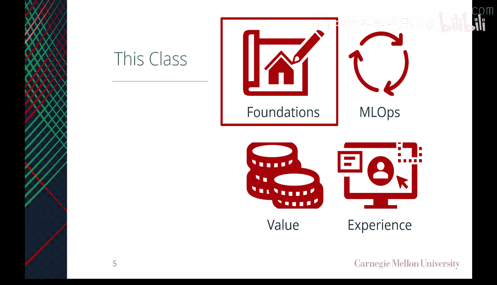
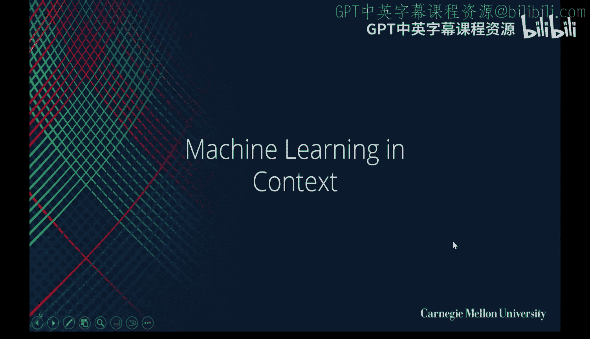
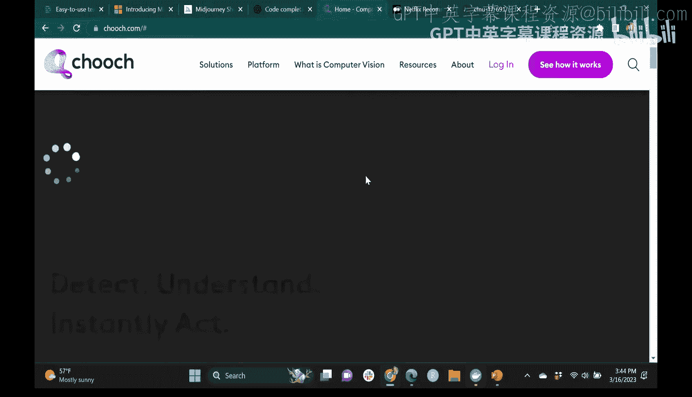
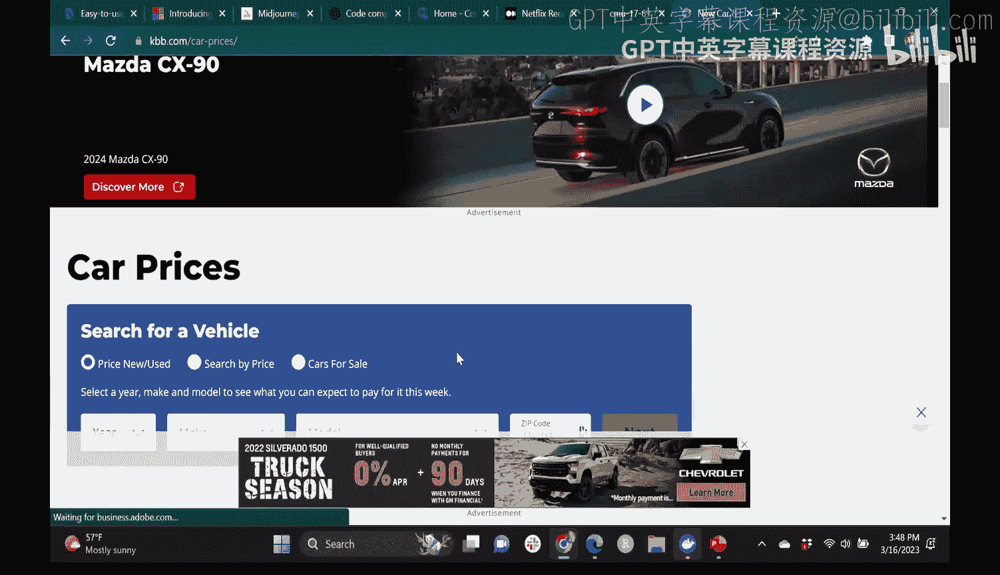
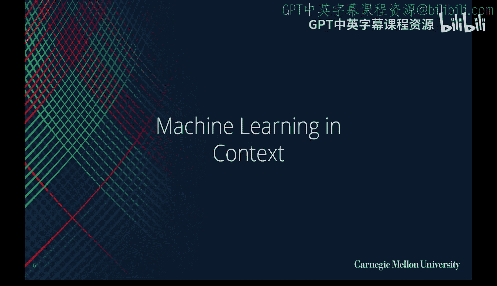

# CMU《机器学习实践｜17-691 Machine Learning in Practice 2023》：什么是好的机器学习产品？

## 概述

在本节课中，我们将探讨什么是好的机器学习产品。我们将通过分析一些成功的机器学习产品案例，了解其背后的原理和特点。

## 1. 机器学习产品的定义

**公式**：机器学习产品 = 数据产品 + 机器学习

**代码**：`MachineLearningProduct = DataProduct + MachineLearning`

机器学习产品是数据产品的一种，其核心价值来源于数据，而机器学习则是从数据中提取洞察并服务于用户的关键技术。

## 2. 机器学习产品的类型

以下是机器学习产品的几种类型：

* **描述性产品**：展示数据的历史趋势和变化，例如股票价格走势图。
* **诊断性产品**：结合多个数据流，讲述数据背后的故事，例如股票价格涨跌与新闻事件的关系。
* **预测性产品**：基于历史数据，预测未来的趋势，例如股票价格预测模型。
* **规范性产品**：根据预测结果，给出推荐或建议，例如股票买卖建议。
* **人工智能产品**：自动化执行任务，例如股票交易机器人。

## 3. 成功的机器学习产品案例

以下是一些成功的机器学习产品案例：

* **Adobe Premiere Pro**：一款视频编辑软件，利用机器学习技术实现自动剪辑、字幕等功能。
* **Bing**：将GPT-4集成到Bing搜索引擎中，提供更智能的搜索体验。
* **Midjourney**：一款图像生成工具，基于GPT-4模型，可以生成逼真的图像。
* **OpenAI**：提供各种机器学习工具和API，方便开发者构建机器学习产品。
* **Chuch**：一款图像聊天工具，可以识别图像内容并进行对话。
* **Kelly Blue Book**：一款汽车估值工具，利用机器学习模型预测汽车价格。

## 4. 机器学习产品的特点

一个好的机器学习产品应具备以下特点：

* **准确性**：预测结果准确可靠。
* **可解释性**：模型易于理解，用户可以信任模型。
* **用户体验**：界面友好，易于使用。
* **可扩展性**：可以处理大量数据和高并发请求。
* **可维护性**：易于维护和更新。

## 5. 总结

本节课中，我们学习了什么是好的机器学习产品，以及一些成功的案例。希望这些知识能够帮助你在未来的项目中构建出优秀的机器学习产品。