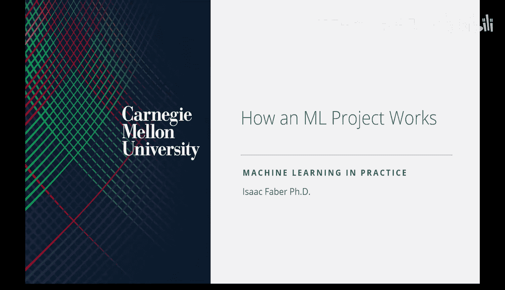
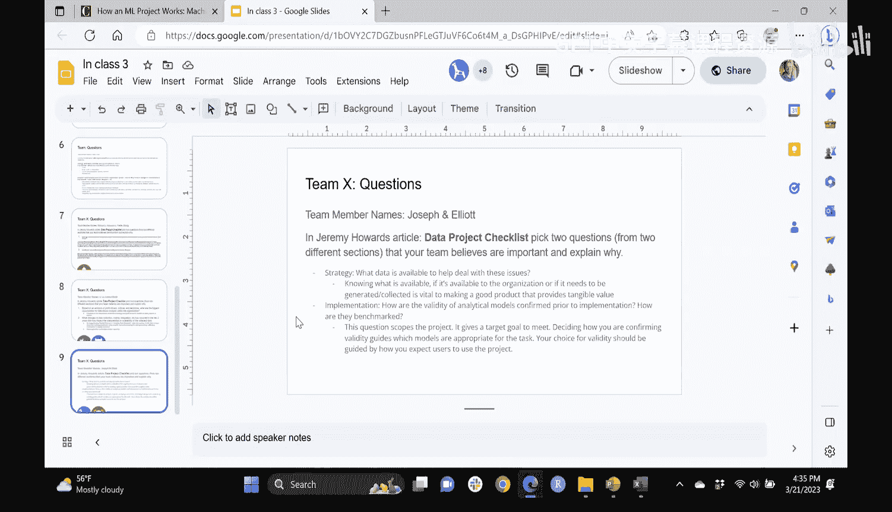

# CMU《机器学习实践｜17-691 Machine Learning in Practice 2023》中英字幕 p03 [P3]Lecture 03- How and ML Project Works_2.zh_en [BV18TUQBJEfH_p3]

All right， let's go ahead and get started， grab the door real quick。If you haven't done it yet。

 I emailed out today。不。A link to the。So a Google form。

 it's really simple just put the names of your group members in there and then answer whether or not you're willing to accept more members and we should have this settled at least by the end of the week so we Barty had a number of number of responses there so。

Go there and then do that before the end of class before we get out of here today would be great that way we can make sure that everything's settled。

Because we only have about a week before the project proposals are due。Okay， so today's lecture。

 we're going to talk about how machine learning project works。

And before we get into that we're going to do a little bit of house cleaning。

 we're going to revisit the topic from last Thursday about data focused projects。

 some considerations we moved a little quickly through the last couple of slides last week。

 so I want to spend a little time talking about some of those major topics。

 especially as they relate to machine learning projects which are a subset of data focused projects。

Okay， so。First group of scribes today so Saadesh and eliot you will be scribes for today here's how this works you guys will get together after this combine your notes and submit them as a pull request to the to the repo the expectation is that the notes are up and ready for everybody to view before before Thursday for next class and then the notes should include。

Topics we talk about here in the lecture and overviews of the required readings so you get a good summary there。

There is going to be， and this isn't within your group。

 so I'm taking basically two people at random and I'll let you know that you're going to be scribes before class。

Were the reason why I didn't do in the first couple of lectures is because there's just some settling to do like people drop and addd classes and I think now it's pretty stable so sorry this is a little bit of。

Surprise for Elott and Ceddessh。But it's good surprise。

 I think taking notes is probably a strong suit for folks like you。

 but I will post everybody's date on which what lecture that you'll need to cover beforehand。

 certainly before the day I'll get that out sometime later this week。Okay。

 and then last couple of things group assignments make sure you start communicating so when you submit your group obviously you got a proposal that will be due here on the 28th and if you need guidance on that submission please let me know it's not intended to be like a challenging assignment like what you just need to do is demonstrate that you've understood these high-level concepts that we've talked about in the first three or so lectures when we talk about what's a quality product。

 how are you defining it， how are you incorporating some of these concepts somebody just not。

It's exciting。Com on here，Sorry， it was just a little louder in the hallway。Okay。Okay。

 are any questions on any of that house cleaning stuff？Okay。

 we can expect next week the first homework assignment will drop and it will be in line。With。😊。

Lecture topics but also a little bit of requirements from stuff that's being covered in the recitations recitation tomorrow we're going to cover building data pipelines again very briefly only about 30 minutes I'm going to expose you to a couple of technologies that make building data pipelines easier to manage so hopefully you'll find that useful in the first homework assignment。

Okay and then one more note here just make sure that you're completing the readings before class so hopefully you've seen that by now it'll make it a lot easier to participate and answer the questions in a reasonable amount of time and I won't give you readings that I don't think are't very useful right so things that I have found like useful in building products myself so if you find that that's not the case or there's areas that you'd like to cover a little bit more in depth let me know but the readings should be pretty interesting。

 especially as you go through in relative to your own products。Okay， so we continue this week。

 this will be the the week that will wrap up foundations so we're talking about。

You know why are we using machine learning， what exactly are we doing here in terms of incorporating machine learning into a product and this week and next week we'll then today and Thursday we'll then lead to into into next week when we start talking about MLOps for a couple of weeks。

Okay so data focus projects like I said want to revisit this topic to some degree the idea here with the data project is is that it's a project whose effort has the primary feature of data。

 which is a concept that we talked about last time there's really broad range of complexity and you remember I gave you this。

I gave you this paradigm last time where I said there's different types of projects at the lower level you have these descriptive or diagnostic projects。

 which are usually ro。Data， a raw data defined it。All right and then obviously sitting at the top of this is artificial intelligence which we're defining as a product that makes a decision that is it commits resources you know so like a chatbot commits to a response or a trading robot commits to a financial transaction on your behalf and these are the things that we're going to be using machine learning in so。

We talked on Thursday about an article called Software 2。0， Andre Carpathti was the author of that。

 went on to run AI at Tesla。And he gave a talk， which actually probably should be。

Required reading in the class， but i'll link to a YouTube overview of the talk it's a little bit long so it would be a big commitment。

 but he shows this visualization or a variant of this visualization in his talk where he said。

His goal at Tesla was to move from software 1。0 to software 2。

0 and this was the paradigm that he noticed leaving the research land where blue here represents models and algorithms and red represents data so when he's doing his basic research almost all he thought about was model architectures and then what he got to Tesla the vast majority of what he thought about was data and data pipelines so you can see here that when you're thinking about moving a machine learning product into production。

 the prediction itself is obviously going to be fundamental but the prediction is mostly based on your ability to gain access to and leverage high qualityality data and this is true even at some scale。

 and he had some other visualizations which relevant to the software 1。0 and 2。

0 discussion which pretty interesting how much he thought at the beginning of Tesla's codebase was one versus the other and then what it was by the time he left in terms of evolution。

So with these base project types， we know that in order for us to achieve some reasonable quality。

 we need to be thinking about data。And so from there we know that data is important so when you have data what exactly are you doing and this is a report that was published actually in 2020。

 so its a couple of years old now， but the survey from an organization called Algothmia went out and asked varying sized companies what exactly are you doing in machine learning inside your organization。

And you can see that there's lots of interesting stuff here， you know。

 smaller things like filtering assets and content， building brand awareness。

 and then bigger things right generating customer insights and intelligence， reducing cost。

 predicting demand fluctuations， retaining customer customer churn， detecting fraud。

 internal processing automation， so has actually this has become a huge industry in the last couple of years。

And honestly， most of the generative AI technologies are in this space now。

 improving customer experience right， like where you're doing a lot of AB testing。

 more the statistical approach than the machine learning approach。And， you know， in。

Generally speaking， hopefully these all kind of make sense。

 there are like classic use cases so when you go in and say like what am I going to want to do with machine learning。

 for example， recommend their systems always pops up。

ButThis is pretty broad and its broadness should be a little comforting right and that your product can do a big range of things and still potentially provide value。

 but you can see this is where organizations are mostly focusing their energies when they' when they're collecting data so。

Fcusing on reducing costs or increasing revenue obviously fundamental to every you know to every product or every corporation that's required to earn a profit so those are generally big bubbles that align to a really diverse range of possible projects that sit underneath them so。

When you're collecting data， you're going to collect it relevant to these value centers right am I collecting data that has the potential to provide value if I can curate it and make a prediction in these areas。

So in order to do that， your organization should have a data strategy right and so this happens before you。

Sorry， it's going to be annoying to me this is going to happen before you。

Have a machine learning strategy right so your organization needs to know what data it has where those value centers are that it can provide you know useful contributions to and then collect data relevance to those areas so I put up here the Department of Defense data strategy that was published a couple of years ago I think it's a great example of this it's not a huge document something like five or six pages long do you have a question。

Yeah， it's actually I think seven pages like with memory services。

 but the idea is it lays out this vision for the organization that says here's the areas where we think the best use cases are and we're going to make a determined action to start collecting data in those areas before we know whether or not those areas can provide like good predictions right so before you even build a machine learning model you're already collecting data as an organization and so because you know that data is the thing that's going to provide the majority of the ability for you to make good predictions it's got to be something that's thought about before you decide how and when where you're going to actually do your predictive modeling。

So， you know， I would say personally I have gone through this like a little personal anecdote。

 I was the lead data scientist at the Army's cyber warfare unit in 20。

16 and it was kind of around the time when like Hadoop was like。

Becoming a little bit more mainstream that is so you could collect like you know much larger sets of data than you traditionally could and we invested many millions of dollars in basically promising that if we just collected all of this sensor data we would be able to make use of it later on so it was a big promise to like not necessarily know what or where the value was going to be provided so ended up being you know you had to make these like strategic decisions do I collect DNS data so DNS data on the。

Army'ies network， the Army give you an idea how big the United States Armys IT network is we are the largest Microsoft customer in the world。

Like several million users more PowerPoint slides are created by the Army than any other organization so this is a huge network it's globally distributed right and so it's got to be defended and defense typically been done like at pockets and so when we publish a data strategy basically said we know that we could do better at defense if we just collected this data so we create an ecosystem the goal was to suck up all this data and put it in one place here we are now about seven years removed from that from that event and I can tell you for certain it has paid for itself many times over so we were able to collect data and then when we had an important question that data was there for us to be able to build predictions against so you're going to collect data a prior as an organization so that you have this deep you this deep understanding of or this ability to deeply understand problems and not have to collect things from scratch collecting data will be the hardest part of your product it'll be the thing that you know if you can uniquely collect。

Data sets。It will make your ability to produce a valuable product much easier so if if your plan is just you know initially to build off of an open AI API right without much adjustment your product will be very easy to clone you know so in this class that's okay i'm just asking for first versions of the product but if you're going to build a generative AI technology you should be collecting documents that nobody else is collecting right so we talked a little bit about healthcare application right so。

What healthcare documents could you collect legally right that maybe nobody else would have access to that you could retrain your LLM on that would make it uniquely suited for that application and we have the same issue in the federal government as you'd have in the private sector I'll get into that a little bit more after we get through the class exercise。

 but the idea here is is that if you can collect that unique targeted sets of data and maintain it。

 the opportunity to make those predictions will come along eventually。Okay， so。

How does this process work from a project flow so you have a team。

You've submitted you two to four names for the group project and I told you you need to start collecting data and so what is the flow that you would go through to actually build a product so the first thing I want to show you and this is again this isn't machine learning specific this is specific to data projects in general is a paradigm called CRDM cross industry standard for standard process for data mining and data mining is a term we don't use much anymore early days before we said data scientists we used to say mining massive data sets that was like I think the name of the first book and class at Stanford that really kind of like move the ball forward and data science and eventually tipped into machine learning but this was the process it was co-developed by IBM and a couple of other industry partners and from a historical perspective it's hard it's hard to state how popular IBM was relative to how unpopular they are today maybe that's a little。

A little harsh， but you don't seem as active as they were， but in the early 200s。

 they built a predictive machine。Called it Watson and it was able to win jeopardy。

 which was like a huge event at the time。 and this is one of the methods that they credited for being able to do this and it basically is this iterative process right where we walk through like understanding what the problem is understand what data is available。

 Prepa the data do some type of modeling evaluate and then deploy and from your deployment you should be going back through this business cycle understanding right so youre understanding what you learned from that you're collecting better and more data。

 which allows for better preparation， better modeling better evaluations of better outcomes and this cycle should continue if you remember from your readings I'll mention again here in a few slides。

 this is called a data flywheel right the idea is there's a network effect associated with the quality of your product Google search is better because people are using Google search right and because Google is smart enough to collect all of the data from the searches to make their product better Now this is the same exact thing that's happening with。

GPT right now this product gets better because people are using it right so there's like some economies of scale where the use of your product allows you to generate data that increases the quality that you have an obligation to pour back into improving the prediction associated with the data you're collecting and this is all this does Chris Dm captures this in a high level description。

So I have a process that I I use internally internally so in my organization I present this process as a candidate for when I expect my teams to do projects so it is still a cycle I think there's a little。

I think there's a little。No， I think you see it okay this gray is just a little light but starts with the problem right business understanding and then you have core skills right so what we would call muning or sometimes you're here referred to as wrangling where you collect data you parse it filter it and then mine it for insights and then you have a modeling process and then a visualization or deployment process and there's different disciplines that cross different areas when you're going through this this cycle so at the beginning when you're going through acquiring to mining this is computer science data mining techniques statistics right like we're understanding what are the statistical mechanics exploratory data analysis associated with your corpus of data and then from mining representation refining you have data visualization and interaction know more software engineering type skill sets that allow you to move from you understand the data you have a model to then the model is in front of somebody else for for use。

And what's interesting is is that people will crop this into totally different areas like we talked about last week Jan Lacoun at metata was saying that they have models that can do just as good in this step here representation they have models that can perform just as well as GPT and they even publish llma in the last couple of weeks but with no user interface。

 no understanding of the corpus of data on what it was trained on right it's just like a narrow narrow middle point and what makes chat GT so much of a better product is they do this whole thing as a cycle they're constantly flowing through this process where they're learning more their models getting better and their user interface continues to improve and if you think through these cycles you can if you think through this process and you break them down into these stages you can attack them with different sized teams people can focus or specialize in specific areas frontend teams or modeling teams or data management teams that all have slightly different skill sets。

This can be simplified， so if you want to simplify it into the setting for your project。

 three really like different skill sets that I would recommend right and you can kind of go back and forth。

 but if you have to two to three four people in your group。

Somebody should be responsible for data collecting data where you're getting from how are you building your pipelines someone should be responsible for modeling who's building the predictive model and then someone should be responsible for the user interface how do you build the thing that you're going to interact with with that cyclical process so from like a startup point of view。

This is all you can do right like so I was listening to。

The all in podcast was it like two weeks ago they had a when the Silicon Valley bank run was going on。

 GPT launched on the same week， this was last week， a few weeks ago。

 so lots of craziness happening in the world right now。

But these two things kind of happened at the same time and one of the quotes from the podcast。

 know one of the VC said they had an entrepreneur call。

 the entrepreneur had their phone with them and he said here's what I want to do and they had built a simple mockup basically the level of complexity I'm asking you to build in this class on their phone scrolled down did some generative thing and the VC said because he knew them on the podcast was like okay。

 it sounds good how much you need the entrepreneur said they need about half a million dollars to build this out said okay as simple as that right like they had gone through this one process。

You know had a basic version of a product that you could show an investor and you know got capital and honestly like you know if that's kind of where your mind's at if you want to go into the startup world not enough people from CMU make startups by the way。

 let me just say that it's something like，If you go to CMU， you're like。

80% less likely to do a startup than if you are to Stanford so there's yeah you guys especially if you're anyways it's not this class this class isn't advocate to that thing but just to think about you guys are very talented and you could be successful in that area but this is all you need to do right build an application that proves the proof of concept and then you can you know potentially get researching to build and scale to the more complex system from there。

Okay， so let's go back to this idea of problem definition， so when I say it back let me。

See what I am talking about here。This whole process gets kicked off with a business question and we bounce back to the other processes in my more complicated when I called it a problem。

And in the crisp the end， they call it business understanding and so you have this sort of like nebulous like what are we doing like how do I know that I'm actually building something that's going to be useful？

And from my military background， I want to introduce a concept called the Fo of War。

So this is an old concept the term was coined in a famous military doctrine book by someone named Kowewitz and the base premises is that when you're a commander on a battlefield。

 you don't have any real crystal clear idea of what's actually happening on the battlefield so you have this like。

Level of uncertainty about everything and what you do have is you have scouts that are bringing you back small pieces of information and you've got to piece together those pieces of information and then make a good decision about what to do you know where to employ resources you know how to move you know these large complex organizations from place to place I'd like to advocate that this setting is effectively what we're trying to do for a business product right so。

The thing that makes decisions hard and we have a week where we will just talk about decisions but the thing that makes decisions hard is this right that there's a fog associated with decisions that fog is the product of uncertainty that you don't know the actual state of the world and so the way that we're going to provide value is we're going to find these decisions and the decisions that are the most foggy but the most valuable and we're going to apply resources against them in the form of collecting data and making good predictions and this lifts the fog right so you can make better decisions you have better clarity of action as we would say in decision analysis if you can reduce the uncertainty around decisions so lifting the fog is the goal and that's the goal of what your product should do。

Okay， a couple of things around problem definitions from a technical point。

 the goal of the data project is to reduce the uncertainty of decisions like I just said and when you're scoping a project。

 the idea here is is that you want to connect like a dollar value potentially not potentially a dollar value to a reduction in uncertainty right so up to this point you've taken a machine learning class so you understand like nuanced mathematical。

You know definitions of cost functions and how they relate to data to the you know so that the cost function could fit against you know a specific requirement for the way you want your model to perform what i'm going to show to you over the course of the next couple of weeks is is that we can do the same thing with dollars right so I can map precision and recall to a probabilistic value statement for an organization and that's our goal right our goal when we launch into the cyclical process is to know how much value from a financial standpoint that we're actually saving our organization。

In order to do that， your first step is actually not to pull out your spreadsheet and start doing finance。

 your first step is to do what we call user discovery。

The only real way you know if someone's going to use your product or if they need it is to go out and talk to people and I call this process user discovery。

My term。And maybe not I don't have a great resource for it， but I use it all the time。

 but the goal here is that you're going to go out and talk to people so how are you going to do that？

You have a number of different options。You can do interviews one on one， so for example。

 I'm going to pick on the medical example， right？You got to go talk to physicians， luckily。

You are a physician。Good。😊，That would be easy to find them right but you've got to talk to them and say like hey what are your problems walk me through a day in the life and show me where you get stuck on things and you won't find that information anywhere so that's where you're going to start on covering oh man a physician spends 15 minutes doing this one task that could be easy to automate someone's hoping focus groups are good too if you can collect people together a lot of times focus groups。

Are great if you have a group naturally occurring for your product you know maybe like you're going after marketing teams or business intelligence teams surveys a little bit broader and then sort of like the gold standards is an MVP with user testing and feedback so you can build a simple version of your product take it to these users and just say what do you think would this be useful to you if it's not how might I change it so it would be useful to you。

And the idea here is incredibly important failing to understand the user and the user system can result in product failure so even if you think you're providing value if your user doesn't agree with you and doesn't adopt your product you haven't answered the question correctly right so think through this this will be one of the things I'll ask on you know when you do your final product demo at the end of the semester。

Who's your user， you know， why are you confident that they would adopt your your product in some form and hopefully that you know you've got a reasonable answer to that question。

Okay， all right， head to Canvas and in your groups。

Go to the slides and we're going to talk about Jeremy Howard's article。You got， I'll give you。

15 minutes， this one should be pretty close as Kohen gets started。Right。So的。Wherere you guys at。

All right。Go ahead。嗯。So actually， before I ask， do you guys know who Jeremy Howard is？No。

 does anybody else does anybody know what Jeremy Howard is No really okay so he was famous because he was actually like an adjunct professor at the University of San Francisco but that's not really where he got famous he was like one of the first like premier Cale Grandmasters and he a number of years ago was like I don't think anybody realizes how big this deep learning thing is going to be and and he was a software development by trade and he now publishes one of the most popular curriculums for learning deep learning。

Just for free and it's called fast AI so if youos website Fast AI that's Jeremy Howard and so that's actually this is published on his blog on that list ands and he's fast too so like when Dolly was released then stable diffusion came out for image generation and he immediately had like tutorials on how to like make your own and transfer learning so it's a fantastic resource if you're looking to do your own model development for this course Fast AI has got a bunch of like you could do the whole course it's called deep learning for coders or just the piece if you want to do something in vision or texture whatever it's great great resource anyway so that's who Jeremy Howard is and he's very opinion on how to do。

Data stuff， so go ahead。The first question you picked was about analyzing fast projects in the organization。

The idea being that past performance is some of the best indicators of future performance。

So you could understand what problems were faced， how they were tackled before or how they were not tackled for。

啊。ね。Yeah I think what's amazing is inside of every organization of any significant size。

 especially to this point over the last 15 years， you're going to find like a ton of things have been tried when you get to your organization some good some bad so I think that's a great point some things could be revisited because maybe you hit like a technological wall or it was just too expensive for the organization to do at the time and now things have changed。

See。食十分你别佢企我傻。Estimated return of investment。The project。

So the first thing that we do before we kick start any project is to give a proposal。

 which explains why it is important， how it is going to going to add value to the company or whoever is taking up this project in terms of like it could directly lead to monetary benefits。

 which could be like seen immediately or else it can also lead to like improve something else。

 which can indirectly lead to like monetary benefits。

Yeah so I mean that gives an importance the Yeah， that's a good great point I mean it's exactly what I was talking about a couple minutes ago right the idea of like if you can explain in business terms how you're going to create value I'm going reduce this test time by so much I'm going to save us so much and cost expenditure our revenue will potentially increase by this much that becomes really clear and then that the technical details about how you're going to go about it become less you know less of a requirement that they aren't important but I think it's a great point okay。

All right， Ra， Isabeth and Ray。Yeah。えたい。没钱。question， how are the effectiveness of mind。关下 c有大市场。

So for the first reason， I think it's important is that problem。one of the core value of our option。

为什么。This see pick。So we really want to make sure the model。This is effective by monitoring it。是的。啊。

And second。Data can change over time。 So。Performs well in the early stage can become less effective afterwards because data is always changing and the。

The train。发咪。啊，可以。对。And the third reason is。喂诶。系呃会。On why。Sorry。Yeah。

 so surveys missed that training and machinery model consumes lot time。

By tracking the model effectiveness。understand understand。然后。Yeah。

 I think you said it really well I don't have a lot to add the only thing I would say and we'll look at this in about a month。

There is a point at which a model provides value。And quality below that point it's not worth even building the model and so that's the threshold you're going to have to know right like if I go ahead and undergo this effort at some level of accuracy I begin providing value to the corporation and then there's even another point where。

There is sometimes a place where a model getting any better than it currently is doesn't provide additional value。

So keeping in like some sort of band makes sense and you can only do that if you have these questions answered。

Okay， what is your second point here， our question is data is provide any information been？

By some overview。As an organization。 So we believe data actually is very， very important。 However。

 as maybe Connect development here， or of the universities machine learning related course didn't really pay attention to data。

 So actually， if you taken any of the machine learning course here。They。

 they will give you a very well established data sets and ask you to build a model。

 ask you to improve your accuracy。 But they， they actually didn't pay that attention to data。

 However， in in， in reality。 if we didn't pay attention to data。

 we may make efforts like the call app in the UK like the the another article set。

 So we believe the available of data is really important。 And most company do。

Do focus on the the data building。 So they have spark ahead of new storyoring and collect data。

 And also， there are regulation like GDPPR built to assure data accuracy and improve data pipelines。

 So we believe we need to actually。 So data is the foundations of all data projects。

We we think data availability is really good。Awesome。

 I totally agree yeah exactly what we were talking about earlier right like the quality of your data is going to drive the quality of your prediction and it's well put。

Okay。Ting it。Go ahead。Sure。I think for example， creep start with。wantant to spend our resources。

 Maybe like。今のそ。Stture the impact project don't want to spend something。一时一。

And the second one would be on the other percent of that。

 So its in other studies like the the start point and the other things like the implementation。

 is how valid the model is。 We want to make sure that there's the bias in terms of it。

ExiveBecause the just because something produce something doesn't mean that it is really working。

impact want the make of that。This system is working properly。We have some break more like a。咩啊。

Yeah that's awesome it's like the data strategy right like are you tied in with the direction of the organization is going and the areas you want to provide value because in a large organization there's going to be tons of places you can provide value but being focused on the areas that the organization is going I think one of the benefits is that it'll give visibility to your work right that like you'll be tied in with the rest of the organization and then obviously everything that you put so far。

Okay。嗯。Yeah， and second just mention about the got it better kind months before we。

Before we implement them。W to know that it was just working out because time friends to just。当是。嗯。是。

黑先计十个身。是。20。Yeah， absolutely and I think。Are you using the right model in the right way？Fray point。

Okay， when and Sean。Yeah so it。现来去我我。你个 what本。The goal of data scientists is to extract from the data in a cost effective。

And the reason why that important is because talked about putting for a uniqueizing composition with this competitor。

对不等哦。啊 one the things that俾到细。Thinkeaing about the sources of data that you guys have so acquiring external data。

 to all your info data said。And the second first question is the analytics tools within the organization and how they're selected compare and maintain。

 where the outcome is that you want or why it's important I want to have the AS science of the analytics engine quicklyI and that means that the like data litacy ispat up。

Your data science very success because you can ultimately come up with a good model that's not understood by the people within the board in their and it's something that this was funny to be come from the with graduate student descent where you have students doing early graduate students doing data science by setting manually training or tuning hip parameters so having poor quality control and data process having proper point line。

In case of La where often is technology start developing the model， but technologyknowled process。

workflowYeah that's right and we'll get to that when we in MLlops like how are you keeping track of the quality of your model your experimentation right like as a grad student。

Nobody cares you're like in a notebook and you're just like going to change parameters over and over again in production when you're going to move this thing out to provide value。

 you're going to keep track of what data set did you use and what were the parameters and treat it like a scientific experimentation like what was the output and then when you do more experimentation patterns start to reveal themselves more readily especially when the team is larger so it's a good point。

All。hy knew。小 one其。Go ahead。好。嗯，好。对。可以吃。嗯。哇。So。Okay对。It82。系。啊。嗯，对。对。啊可是。Yeah啊。Sure。Of。So。没看。

The school they of。喂， so。As you just mention。It action。是。对。Yeah。

 great and that think ties in closely with this ROI question。

 but these are different statements and that was a great way to time together the metrics of your model how you determine the quality of your model has got to be tied into the ROI。

The second second question with important is to learning to the。You how are。反正。

And they will change frequently。 And if this kind of change cannot be communicated correctly。

By the team。 So。L to the disaster to the whole data pipeline and effective。Of kind。对。For example。

 I think we got a dashboard ci。Detail process and monthly， so。

If the original the data changes such as the featuring editing or dropping without noticing the analysis with students their dashboard。

 So it would be So and the。The outcomes of this project will kind of。yeah， that's a great point。

You can't just build it and then leave it right like it's got to be continuing to maintain there's even circumstances where if you left it and it continues to do a bad prediction it creates harm to the organization i've seen this in a couple of cases where it wasn't necessarily communicated that the prediction wasn't great this happened early in coviId so we had。

Machine learning which was not a great use to do initial predictions for like where cases were going to be so I was on a team that was doing。

Predictions of cases at major military bases and。Because there was like no data early on。

 we just used these statistical mechanics， these system dynamics models called SR models and they just were like。

Not great， but it was like all we had when there wasn't a lot of data and probably about I think two months you know like March。

 April May like May timeframe， we had enough data that we could start using like lighter tree-based models but some people kept the SEr models and they just didn't do a great job predicting so there was like certain places where we had over allocationlocation of resources just because the the early on bad prediction persisted so you have to be careful to maintain because these things look like they're true right they're like oh I'm going to need 50 beds and we say well actually that's because I used the system dynamics model that said you know under these given assumptions so maintenance is important right like not just that like。

Hey we're retraining and we get new data， but the world changes right you learn more and your model gets improved and so having leaving accidentally leaving static predictions that are no longer accurate can have。

Adverse impact， so I think that's a fantastic point。Okay， Lilu， sure。First question。

So looks on strategy。Oh。Excr products surprise。That are not taken。

 They are taken without an understanding business context or。So。而呃。Okay。没有不是。Yes。

On an analysis of project director actions and decisions。

 what are the biggest opportunities for cleaning？So that's kind of understanding。So strategy。

 but what are the。On billing assets。You differentiators you have on your business。

 how can you utilize all those？It science project。Yeah。Yes。Concur yeah， I think again。

 we don't need to beat a dead horse， but。Yeah， tied into the organization's strategic priorities is hugely important。

Yeah I just told my second part of the kind of concerns about the data collection as well。

Think again， emphasis on the data collection and the sort of think about the data from the generating and the collecting mechanism mechanism also equally important。

 Again， right is you know， in a business context， sometimes the problem is not obviously a simple prediction。

 but you have to think about the causation and the control part of it。 So doing with。

The context of subject matter expertise or sort of work on the data exploration。

E analysis some data this just has。是。Yep， absolutely， again， same idea there。

Focusing on data collection is a primary component of your architecture and again。

 the most important component of your architecture that's going to drive the value you'll be able to produce so it's great insight there。

All right， and then last name here， Joseph and Elot。食唔使嘅中意啊。We also talked about data。

 the question was what data is available to help deal with these issues with the data being so to go to the product development。

 knowing if the data is available and like whether or not you can even get the data or if you need to collect it or generate it as an organization is really important to being able to create a product that produces tangible value。

It's like an integral art， not just the collection， but even doesn exists。

And rub all entire product cells。Yeah， there's in the real world。

 there's actually even one step further in that process。

 like it exists and will the person who owns it in your organization let you have it。

So this is like not a guaranteed thing So for example。

 the product owner in a company that owns the Salesforce instance is going to have a huge pool of data that's going to help you understand and drive revenue but getting access to the Salesforce API from the person responsible for maintaining it you know you're going to have to answer some more questions like well how are you going provide value this is sensitive data if you pull this out you'll have our whole customer list and how do I know you're not going to lose it or leak it right which we did consulting for a company that exact thing happen they put all of their leads in Salesforce and they gave access to all their leads to everybody and one of the developers downloaded the leads list and then quit and then what's work for a competitor so this is like you know we say hey。

 we want to get access to the data but there's these sensitivities that you've got to be cognizant of and that's organizationally like understanding like where and what？

And how you're going to be able to do that so update availability huge interesting point。

 like even just because it exists， you've got to think through how you're going to be able to safeguard it for the people who own it。

The second one we talk about was the implementation focusing on the validity of the analytics models because thiss like scopes that the size of your project give you a target goal that you're trying to the benchmarks especially give you a target goal that kept。

Objects， and then deciding how you're confirming validity， make sure you're using。Model tests。

 and it' also like guide how you like which model。P validity you' guided by how you expect your。Yeah。

 that's great， I think hit a couple of points of Art of been said。

Valt analytical methods are using the right model for the right task and are we measuring the right things？

All right awesome so hopefully that makes sense right we're hitting these points home that I started out with today。

 you can see data collection data availability right this is going to be a big part of your product。

I know your opinion towards the。Let's break。ち。嗯。I'm a big fan of web scripting from websites that allow you to do it。

So most websites will have a。Like a disclaimer。And think they usually call it like robots。

text or something like that that will give you the rules for scraping for that particular site。

And so I would highly encourage using web scraping from sites that allow it and so there's some sites that won't let you do it right like so。

Here's an example of a site that doesn't mind if you whip to create Yahoo finance so you can get finance data and this is also true for almost all crypto exchanges as well not that anybody needs to be in crypto but you can they'll have APIs where you can just legally pull whatever data historical or realtime you want right off the platform and Yahoo finances the same way they programmatically it's easy to get historical finance data from their API Morningstar。

Also a finance company does not let you scrape information and they actually have historically more and more in depth information than Yahoo so if your business model is built off of scraping Morningstar you might get in trouble right and so you usually just got to be cognizant about what the rules are for a particular website but web scraping in general is I think it's a core skill for data collection if you have data pipelines almost certainly you're going be pulling stuff off of the wild internet I mean everything from like text to stuff like so I told you about corpus document corpes like so。

There would be like these public press releases， so let's say that your're。

You're like a government contractor that does construction projects just like freeway projects。

 for example， you do roads so sort of what I thought would be an interesting tool to build would be like this generative technologies that like auto generates a proposal and you could scrape like。

Public press announcements from companies that had won proposals historically and that could become the basis for your corpus to train your language model on and those are all available now if you went to their websites and I don't know like had got access to their internal communications that would be that would be different but yeah highly recommend collecting open source data as long as it's allowed by the site。

I will say that a webcraper is the most brittle data pipeline you will ever build in your life and when you make it you will be fixing it all the time because that's like the nature so we're much better to have a documented API that you have access to than just content you know even Wikipedia like breaks all the time you'd be surprised at least like I want to say。

I had a scraper running for a project that was pulling down threat intelligence like open source like IP addresses and they did have an API they just published a table and and it was like a reputable source but that table changed all the time we had another like project where I was scraping。

EPN for fantasy sports because they would post like ESPN's predictions so you would go and I think ESPN just to be like me like literally like every couple of weeks they would change the format of their HTML and it would break break the scrap or so。

Do it if the website lets you， but just know it's going to require lots of maintenance。Good question。

 any other questions？嗯。All right。Let's talk about a few more things。So。

Good segue wrap between talking about data projects now to the niche of machine learning projects inside a data projects。

I mentioned this briefly last time if you're going to build a data product or a machine learning product you're going to have three components。

 youll have a data engineering component。which would be foundational right collecting data from the sensors。

 everything from webscrapers and APIs to you know historical data that you've collected or things internal。

 a data science process where you're doing your model development and then a software engineering process where you're actually building the user interface that folks will interface with。

If we expand this and we use the diagram from your first reading this week， you can see that like。

There's a natural flow and i'm not going to go into every box we'll actually revisit this a number of times the diagram is on MLlOs。

org and it just does a great job of capturing all the different things you're going to need to think about right you have data pipelines and we have this like ops you know。

Monitor for everything else so you have data ops which is like deploying your data pipelines and monitoring them you've got machine learning ops。

 which is training your models retraining them evaluating them and then you've got DevOs or Devs ops for your software build pipeline and they're all connected right so as you build your model your model is based on your data quality。

And then your model gets integrated into into your product。

 so when we talk about machine learning engineering we're talking about it in this context right it's not done for itself。

 it's done as a segue between data collection to product deployment。So when your team is doing this。

 simplify this process into these four steps， problem definition we talked about are you nested in the strategy and connect it to ROI and value。

 then you've got to collect data and label it which requires its own sets of tools and pipelines and labeling techniques。

 and then you build a model， then you deploy your model， monitor it， and revisit。

Is my model providing value and then this cycle is a cycle that continues so if we look at each one of these steps with a basic definition。

Does the project address a real problem with the real user right the user discovery and tie it to value？

How much data needs to be collected to realize value right if I think I need a massive corpus。

 you know that can get very expensive， especially if to do custom labeling。

And then model development how complex of a model will be required to realize value do I have to use deep learning can I get away with three methods or regression basic regression models and then the last does your model scale with with your use case so if I require millions of users on a sophisticated deep learning model that can get expensive really quick you've got to make sure that you understand if your architecture is appropriate for the scale you're trying to get after。

When weve turned to this idea we covered very briefly last week。

 but it is fundamental to this process right this idea of a data Flywheel or sometimes called a network effects like I mentioned if you use Google。

 Google gets better the more people to use Google， the better Google gets Facebook is the same way。

 the more people that use Facebook， the better the product Facebook gets because they have this data Fwheel。

 more users gives you more data， better algorithms。

 better product and this is the goal you want to set this up architecturally at the beginning of this process so if you do find something that provides a lot of value that it continues to improve as you go through this monitoring process right and the goal of this flywheel is this spins it gets bigger and better and better and eventually you have you creating a significant amount of value for your user base whether internally or you're building a standalone product。

So if you're entrepreneurial minded and you want to build your own product。

Understanding this concept is foundational to。Getting funding for your product if you can show investors like yes。

 here's a basic version of it， as you can see I have a flywheel and I'm going to be collecting very unique information by virtue of people using my application。

 which will be data sets that you own and control， which will allow you to have an edge in develop developing smarter algorithms。

Okay， so let's revisit the problem definition。Machine learning has the potential to reduce uncertainty in a quantifiable way right so I mentioned that our goal is to reduce the fog of war right to use data to reduce the uncertainty of decisions in the machine learning context the machine learning reduction of uncertainty allows for a quantifiable prediction that I can actually know in some bound of error how much the uncertainty has been reduced which is going to allow me to directly translate it eventually into an economic prediction。

So there's a book I have one of the articles is on this and we will actually use this canvas for your eventual product but there's a book that I would recommend not required called predictionction machines and it's called the simple economics of AI that walks through this process like if I can get high quality predictions at scale how do I turn that into economic outcomes and you can see here that the idea of a canvas is you have different boxes that you need to fill in like what are you predicting。

How do you value different outcomes and errors that is like depending on the quality of your prediction what are you trying to do based on this prediction outcome how do you measure the what's your metric of success based on this prediction tying it to ROI input right what data do you need training what type of models do you need and then feedback right the data flywheel concept so all of those pieces are kind of tied in here that we've talked about today in a really simple you know seven square canvas so when you present your product at the end of the semester you'll fill out this canvas and it will make sure that you're checking the block on all of the concepts that we talked about today。

U and is' also just a great way to like organize your thoughts on like， does this product make sense。

 is it even possible if it is possible， you know， what。

 how do I make sure that I have all these concerns taken care of？Okay。

 some challenges that we haven't talked about。嗯。Poor problem scoping。You can。

Try to tackle a problem that's too big。And so there was kind of a funny meme that was going around a couple of months ago that so some of the effect of like we don't do these things because they're easy。

 we do them because we thought they were going to be easy you can get into this really easily in machine learning right like I'm going to pick a problem and it turns out that problem requires like a million dollars of data labeling and that's okay right but we want to make sure that the first couple steps that we do will identify where those stick points are。

Access to reliable data and data labeling so data labeling is expensive right and so i'm not sure if we'll do it or not I had thought about doing a recitation on data labeling we may still do it it will be a couple of weeks but。

The the idea here is that it's a person right so we will if he confirms one of our speakers will come in and talk about his experience hiring data labeling teams for a professional sports team for a product that they were working on and it ended up being the hardest thing that they did the model development was actually pretty straightforward I wont steel center so I won't tell you how he did it but。

90% of his problem was hiring a labeling workforce and there was privacy concerns and there was quality concerns and they tried to do it on the cheap and that didn't work and then everything ended up being that the more they invested in the data labeling。

 the better their models got。Can you experience all in solar。食上。So there's。

When I talk about data labeling。There are now professional data labeling workforces and they will all use these AI based labeling tools so like envision systems that'll be called auto taggers like let's say you have a full motion video and you're going to start tracking an object so let's say you're doing a bounding box you draw a box around that object。

And then your labeling tool would go like the next 30 frames and try to guess that object。

 but it would still be on you to go in and adjust a bounding box across the way that and so the labeling workforce would would have access to those techniques and then the workforce themselves there's like an internal cycle for them to have quality control over what they're labeling or not labeling and just like any workforce there's like really good data labelers and not so great data labelers and so my experience so we have。

5。In my work， we have a bunch of different approaches to data labeling， but we require like。嗯。

You know， access to special networks to do data labeling and。

They're not cheap like a good data labeler is like earns pretty much what a good data scientist does in our world it's a very different workflow but yeah so。

There's lots of things that you can do if you have a labeled data set to enhance it or curate it in different settings。

 so some of those unsupervised techniques are super useful。

 but typically you're going to want an organization depending on your scale， if you can afford it。

 an organization is dedicated to generating a large corpus of data。

Which would include a lot of those techniques so active area of research like we we funded。

I think we funded like。F projects here at CMU on this problem and most of them are around。

Simulated data generation， so which is not。Not produced as much as we had hoped。

 but we'll see it's an active area of research。Okay。

 lack of architecture designed to support scale right so you do the grad student thing and you build a thing that can't support more than 100 users and then unaligned value proposition right that you're building something that doesn't match the organization's values。

Okay， let's wrap it up。Got three minutes。Data projects have unique considerations。ML projects。

 a subset of data projects have even more。Those considerations are focused around how do I collect high quality data then make it available。

 taking time at the beginning of the product to understand the business value that you're providing is critical。

And then in next week， when we get into the first。Clas on MLOs we'll talk about our how do you build baselines。

 how do you build a simple model first that can kind of prove out what you're doing okay。

 and then I will remind you of this but there will be a small coding tutorial to have done before then that will help with the discussion in the class specifically around developing heuristic models that is sometimes your first model doesn't even have to be a machine learning model。

Okay， that's all I got， thanks for coming the day， any questions。It will be for next week。

 but you'll have it'll be over the weekend so I'm just giving your heads up。

Okay。Go。必要の。