# CMU《机器学习实践｜17-691 Machine Learning in Practice 2023》中英字幕 p04 [P4]Lecture 04- Do you even ML bro-_2.zh_en [BV18TUQBJEfH_p4]

Alright。Let's go ahead and get started。It's not quite lot out there today so。

other folks join us they can jump in this is the last lecture in foundations and we're going to do a little bit more in class activity today than listening to me talk so I'm going to go over some kind of basic concepts up front here and typical house cleaning but we'll get right into some activities in about 20 minutes or so。

Okay， so。This lecture is called do you even M Elbro as in like。

Maybe the problem you're trying to solve doesn't require machine learning or there's ways to solve the problem with prediction that don't involve mathematical model building。

This leads to this concept of baselinelining， which we'll get to here in a moment。Okay。

 what we're covering today， house cleaning， go back over the idea of machine learning projects and workflows we talked about on Tuesday。

Get in the metrics baselines， which will be our key concept and I want' to talk a little bit about AutoMl to wrap things up。

Okay， so here's our two scribes for the day。And let me bounce over because we had our firstscribe submission that was actually。

Pretty good。Its their first one and it was pretty good。诶。Again， when youre ascribe。

You push notes to the class that we're in class four today and so the scribes from class three pushed their notes earlier today and you can go in and kind of get an idea of like the level in scope and covered what we talked about in the lecture you know they did some adjustment here on the images and then covered。

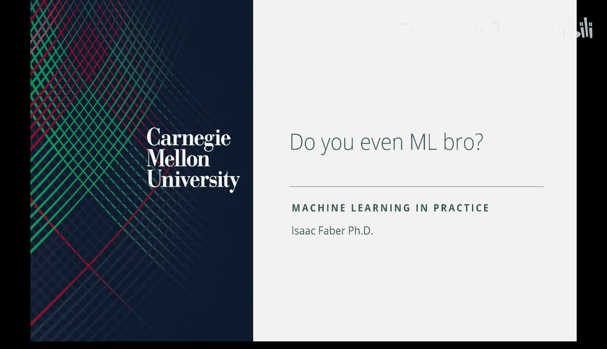

The points in our discussion in class and then summaries of the readings and so it's a great review Id encourage you after class to go back over the notes once they're posted I'll do a hopefully a good job of letting you guys know when that's going to be。

Okay， so， but here's our two scribes for the day。Adiita， am I saying that right？

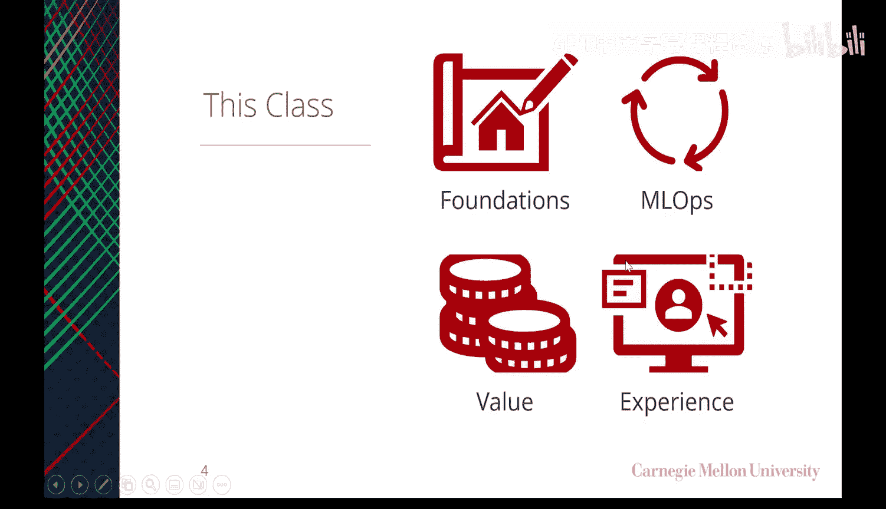

Yeah。Not in okay。I could be saying right then， we're just going to go with it and hugeke some。

Say that right close。da it， all right， okay， well we'll just say youre a scribe for today so and。

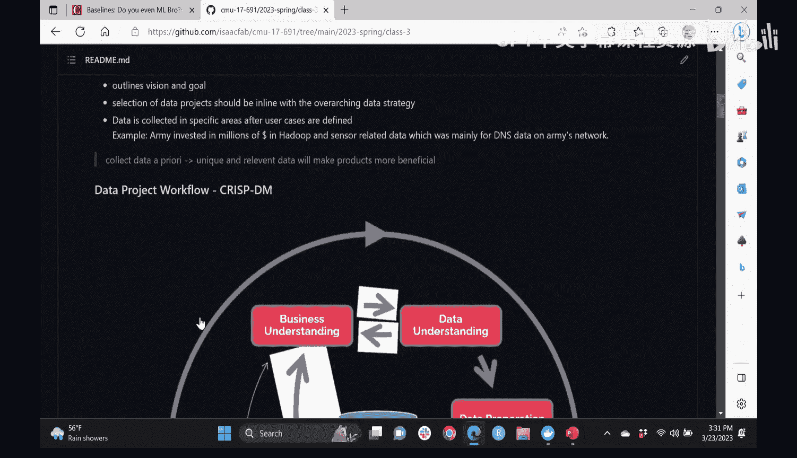

I'm in competent。Speaking all right so group proposals are due Tuesday and as far as I understand right now through the TA everybody's got a team。

 if that statement is not true and you're not assigned to a group let me know the groups should be notified。

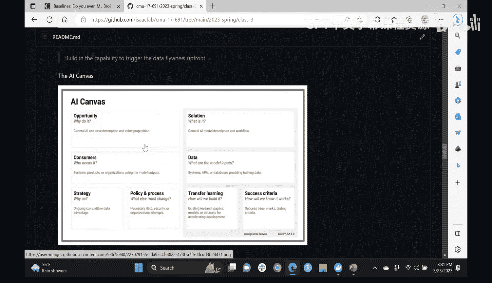

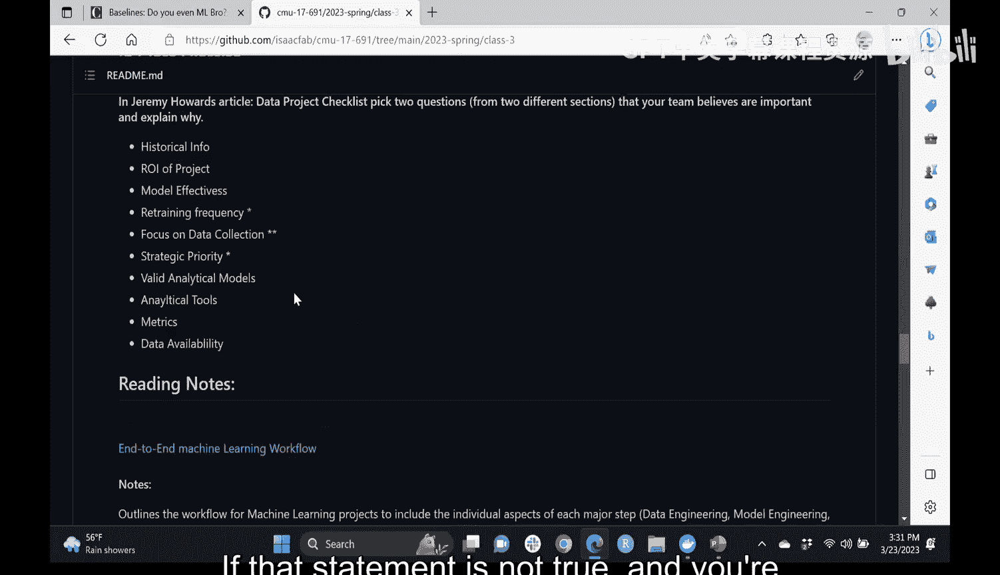

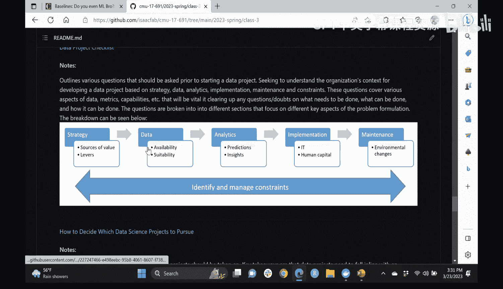

Or should be on track to submit your proposal on Tuesday。And again。

 so today's going to be the last day we talk about foundations and covering this idea of。

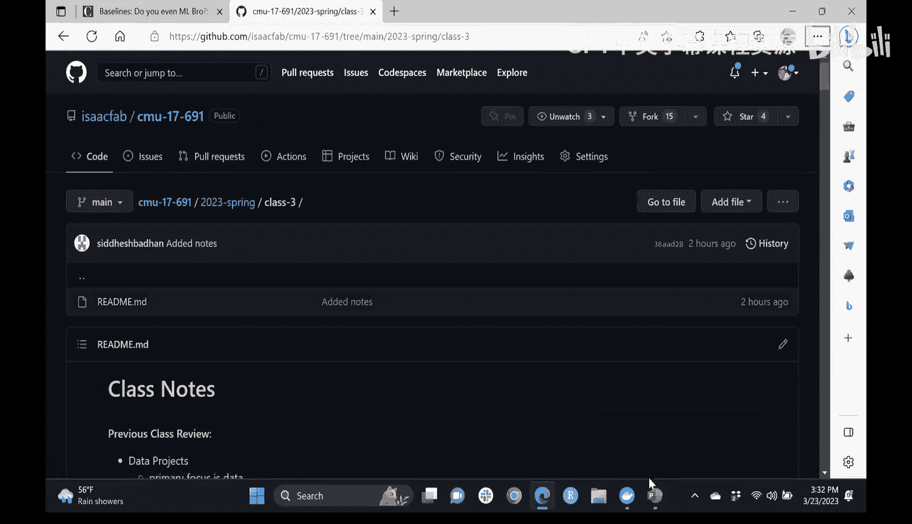

Performance evaluation and generating model baselines。Okay， I describe this case。死完。Rightright。Okay。

 so what we talked about on Tuesday is the idea of what's the cadence of a project if you're going to do a machine learning project？

And we started out with this statement that a machine learning product is going to have three basic components。

 data engineering， data science and a software engineering component someone asked at the end of class how much emphasis we will put on software engineering in this class and the answer is very little right so I'm not going to be expecting like a beautiful user interface as we get closer to product submission I'll actually give you a couple of good alternatives for easily mocking up the products so that you can focus on the green in the blue bubble and the idea on the recitation that we've talked about yesterday I showed you how to use a。

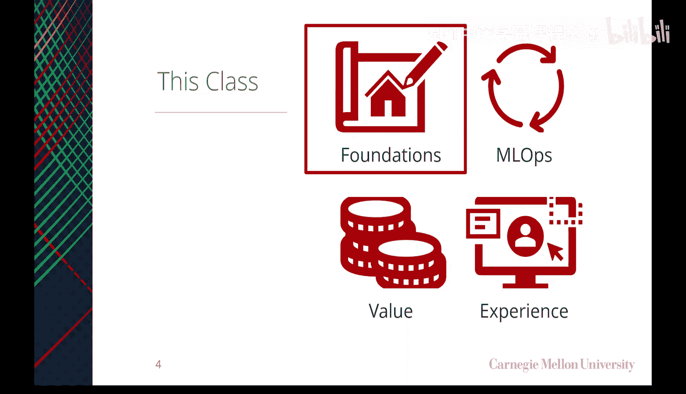

A product called airflow to manage data pipelines and how you can turn data pipelines that are in the form of Python scripts into something that you can monitor and orchestrate so we will see as we get into MLOs additional tools I think it's actually Tuesday where we're going to talk about all the tools that currently exist in the in the ecosystem for you to take advantage of。

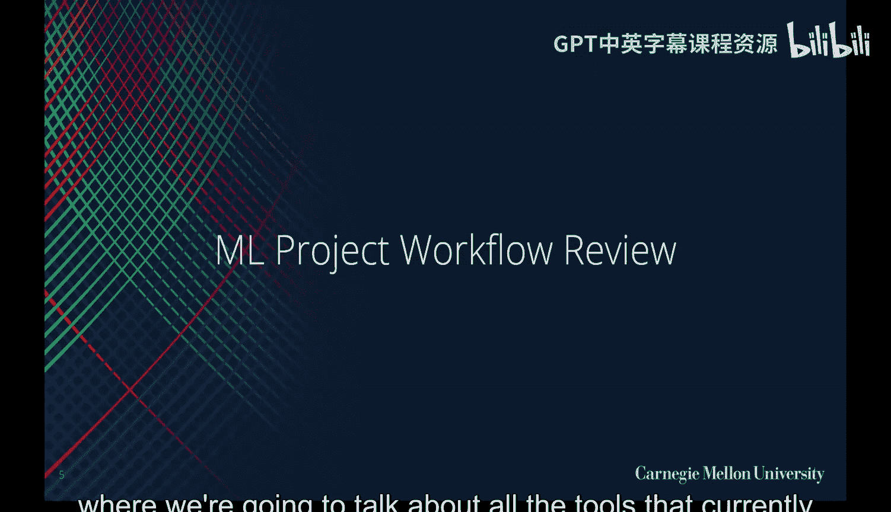

Of course， in each of these solutions you'll see as we go there's lots of different little things to go inside of them that answer different questions that make up a robust stack so that robust stack is going to be tied into every piece of process that you can see here on the diagram from MLOs。

org so breaking things down to data pipelines data management machine learning and software and what are all the different components and choices that you need to make architecturally to go from something very basic to potentially scale up to something very large。

The basic machine learning project work for looks like this。

 you start with the problem like we talked about last week that your problem should be rooted in a user defined consideration right that you go through this user discovery process where you talk to people。

 ask them about how they do their job and understand where you can best provide value。

 then from there you create data you curate data using your data pipelines， enrich it with labeling。

 then you go into the process of model development。

 and model deployment and monitoring and that cycle is a virtuous cycle that continues。Okay， so。

The virtualuous cycle only works if you're evaluating the quality of。

The value that you're producing right so if the metrics associated with your model。

Aren't tied directly into the value that you're producing for the expected outcome you've got to rethink what it is that you're measuring so this goes into the process of metrics and this is pretty interesting because。

What we're seeing right now with the big explosion in all the activity for products based in large language models is large language models were trained like classically initially。

 so like GPG from open AI was trained on like a cost function I'm sure it was a sophisticated cost function but cost function nonetheless and the outputs they were getting from the model weren't great and so they tuned the model on what they call reinforcement learning with human feedback RLHF and it's basically a process where you take。

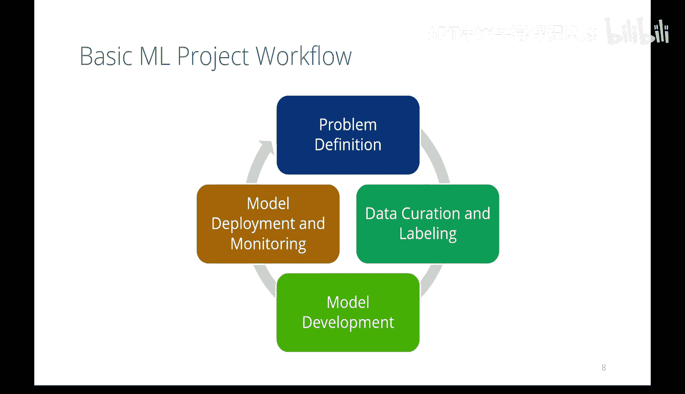

The output give it to a person and that person would adjust it right so this is a great example of like hey the metric isn't just your specific cost function the metric has to do with the perception of how the human views the output and it was actually like this last step which was different than like a hard coded mathematic function that made the magic of these chatbots work the way that they do so when we think about metrics it's not necessarily just going to be base metrics but we do need to know what the base metrics are。

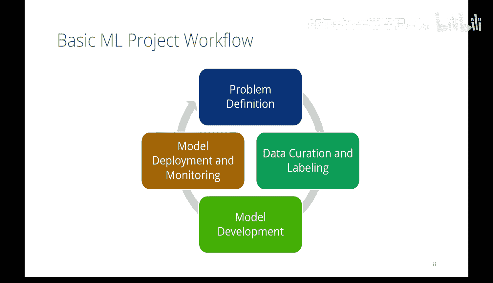

So when you build a model。Before you even decide on architecture or what approach you're going to take。

 this is what you should think about。Do I even need to do machine learning at all？

Right as opposed to like let me start with computer vision， have you gone through？

Problem definition and user discovery， are you comfortable that you're working on something that's going to provide value？

Have you looked at what people are currently doing to solve this problem in the literature or what current state of the art is。

 is that something that's within reach with the resources that you have？

Try to build a small model to to solve the problem initially。

 so I have a I have a friend who currently works。For a professional sports league and he now has a really big team with a bunch of like computer vision engineers。

 but initially it was just him and I think one other person when they started their data science team and they were working on this really big vision problem and this is what he did He went out and he gather gather I think it was like 100。

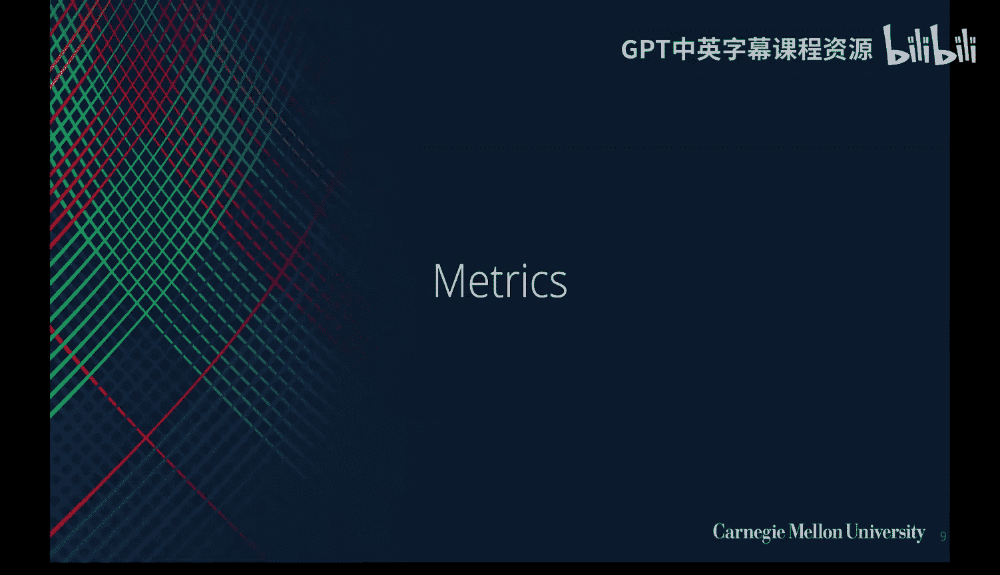

Images for this particular problem set labeled them himself trained a model and that gave him like a baseline performance to say like okay this is possible clearly this like basic model isn't going be the thing that goes into production but he could get to a reasonable or accuracy to then go back to the sports league and say this is worth spending millions of dollars on because I'm confident if you do I'll be able to increase this substively where is that initial baseline had been very poor the story may have been a little bit different and then from there you want to build an MVP what does the mockup look like can you show that to your user or they excited about the product even though it's in a basic form and then the last question again are you sure you need machine learning to solve the problem that you're after if machine learning is overkill and it can be solved much more simply you may be you may be looking for a。

A solution in search of a problem instead of trying to solve the problem and provide value。Okay。

 so when you go to pick metrics right and assuming that we've got a problem well scope。

 the idea of model quality is extremely important， but you've got to define how it is that quality is determined。

Is it accuracy， is it false positives false negatives you know in different settings these things matter differently overall accuracy is great and maybe like a business setting but overall accuracy where you have let's say maybe lots of false negatives in a self-driving car situation is not so great right where you know you have lots and lots of miles and if it misses pedestrians or misses things on the road and you have create accidents this is a bigger issue so you may want to tend for your metrics to pushed towards those things that are more valuable in the setting that you're in。

How sensitive is your model to outliers or sometimes you'll hear these refers to as edge cases this is still a problem that plagues the computer vision world was in。

Last night I was playing around with the。Video generation。

tools that have come out so there's a bunch of these like AI based like image like avatar generators and I I was just curious like are these really good and they're like not great like it's really obviously I think even though like the picture looks crisp it's clear that they're like fake still so there's like some ways to go and know that's okay if it's like just like a commercial like a spoke person commercial but what if like I don't know like what if you got here to CMU and then that was like your professor and you're like investing a lot personally in coming here and you got what clearly is like a fake person talking you probably wouldn't be happy in that setting anyway so that the reason why they're not great is because。

The way that your mouth moves is clear to me that those things aren't synced up because it's probably really hard to get like the nuanced things match so the edge cases around matching like lips to sound is probably very challenging you see the same thing in other other vision examples。

And then the last statement right are you using the right cost function when you're doing your machine learning process so you have lots of options for cost functions you know we'll go over kind of the basic here if you look in a classified learning basis you have a number to choose from。

Especially in deep learning there's like a whole art around how you manipulate your cost function to get the behavior that you want out of your model and these are just you know some some basics that you'll run into generally speaking you know even like regression like great example of difference between。

You know OLS like a ordinarily squared and like you know minimizing the sum of absolute values which is you know common difference and ordinarily squared you're going to tend to bias more towards the outliers then you are in absolute values so both of those models you're optimizing for a thing that looks very similar but the outcome from it is different so if outliers are a big have a big impact。

That's you probably want to go with OLS if outliers tend to not have a big impact you you probably want to go with summing absolute values and so how you craft the cost function I think I mentioned this term a couple of classes ago is a lot like a dark art right like the cost function is not like open up your textbook and this is the cost function I'm going to use for my project it needs to be rooted in like how am I how is this model providing value where am I okay with error where am I not okay with error？

So this is always the case in every model that I've ever built， everything's unique。

A snowflake so how models are wrong like no models perfect but they're all wrong in like slightly different ways and most folks I mentioned are very familiar with the confusion matrix about balancing between true positives and false positives what we'll do and just sort of like tipping a little bit to when we get into the value section is。

The confusion matrix does a great job of giving you an indication about the cost of things being wrong。

 so if you can assign values to when you're wrong and when you're right you can wait。To a degree。

 you know where you want to make errors or where you don't want to make errors and so。

You can take the confusion matrix and just predict things like accuracy， very straightforward。

 50% in this case， right， 15 plus 35 where you got true positives and true negatives。

Over 50 observations or 100 observations i'm sorry so 50 over 100 precision right 35 over 70 also 50% and then recall 70% so which of these very common metrics that you can pull right out of the confusion matrix matter the most right and the quality of the model and how you determine it you know these values can be interpreted very differently it's interesting that。

The FDA last year published guidelines for these values specifically precision and recall around medical devices。

 so if you're going to have like an AI enabled medical device there's like low line thresholds that you have to be able to cover and I think it's like it's not as high as you'd imagine I think a precision you have to be something like 70% and recall you ought to be like a 50% as like a minimum baseline and then can go from there and if you。

It's also a little interesting that your model has to be like frozen so in the medical industry so you have to be really confident in these numbers because once you deploy it you're not going to be able to constantly update it so there's a process in here where you've got to really know on your medical device which of these values you're going to lean into。

Okay， so here's three different models， three different precision accuracy and recall values on。

You know trained on the same data and they all have different top level values in each one of these categories so again this tradeoff which will happen consistently is you know which of these models is the best again it's very much determined by the setting in which the model is is generated and so almost always you'll see people that will lean into accuracy and I think i've even heard somebody refer to it as addiction to accuracy that the machine learning community for the I don't know maybe the last 10 years or so before。

2020 was like really driven by machine learning competitions I don't know if you guys still kind of feel that now。

 but it's not as。Pvalent as it used to be I used to get emails where people would like put their kggle rank on their email they would be like this is how good I am at machine learning competitions and then the ranks were never like super high either is I guess it's like 3000 like you could probably not put that in your email but。

But all of those competitions were mostly just based on accuracy there have been some like there's been a lot of relaxation of that recently。

 I think it culminated or not culminated really kicked off when Kagggel hosted that Netflix competitions that we talked about it last week where they awarded a million Netflix awarded a million dollar prize and it was purely based on accuracy and then Netflix ended up not implementing that solution mostly it was they said because of engineering challenges but。

Additional gains in accuracy clearly didn't outweigh and you know when we're saying， hey。

 what's good or what's not， these metrics matter。Okay， so you can also combine metrics。

 there's lots of ways to do this。Folks are probably familiar with that point score averages weighted averages thresholds。

 oftentimes there's industry defined thresholds， I'll mention this again down the road but just like I was saying with the FDA if you're going to go into a medical device application there's benchmarks and thresholds that you have to hit。

 the better than you do those thresholds that's great。

 but if you don't at least meet those thresholds you know you can't deploy your product or sell it to customers。

And yeah so industry requirements how important is the metric to creating value and then how do you baseline the model's performance so when you create a baseline an inexpensive baseline that gives you your basis threshold for you to pursue as you continue to improve your model down the road。

Okay， so let's talk a little bit about baseline model concepts。

 so I've used this term a couple of times， a baseline model is your first model right you've defined your problem。

And you've collected a little bit of data， not a lot。

 but a little and you're going to build your first model and you want this to be not incredibly intense。

 but enough that you can learn about the level of effort that will be required to achieve the results on the metrics that you want so you've defined quality in terms of your metrics you've collected a little bit of data and you've got a great problem now we're going to build our first model。

First question is how complicated does it need to be so just as a vision example right like does it have to be semantic segmentation or instant segmentation or are you okay with classification or localization of single objects right and so for your base model you're going to want to go to the you know to the simplest possible model and approach that allows you to test out that initial pipelines for your data collection so。

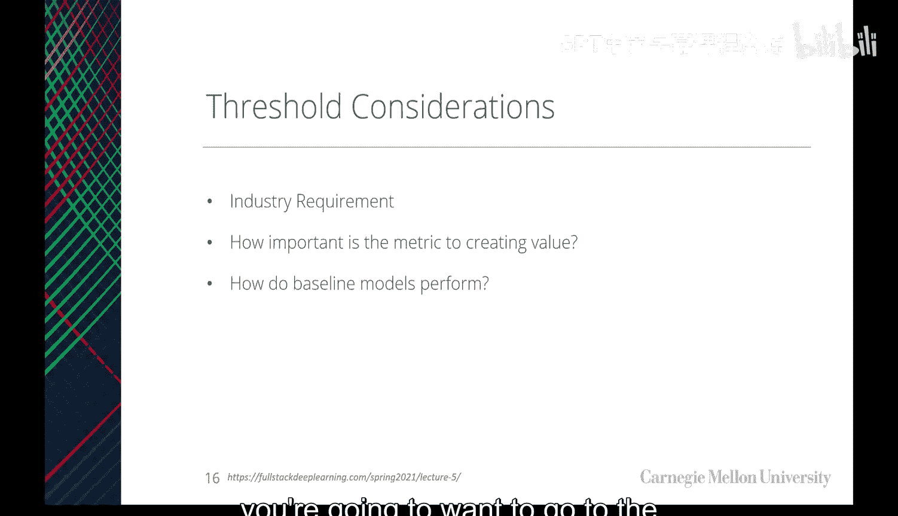

Probably not starting with the more sophisticated model types。The idea also is it's low cost。

Right now it looks like the large language model world requires gigantic amounts of resources to build these things from scratch。

 but we did see I think it was last week a team from Stanford took，Metas model。

 the Lama model and with a small amount of resource tweaked it and we're able to create a model called Alpaca admittedly I don't have any experience with yet。

 but they claim has similar levels of performance to g for about $200 in infrastructure costs so is there a way。

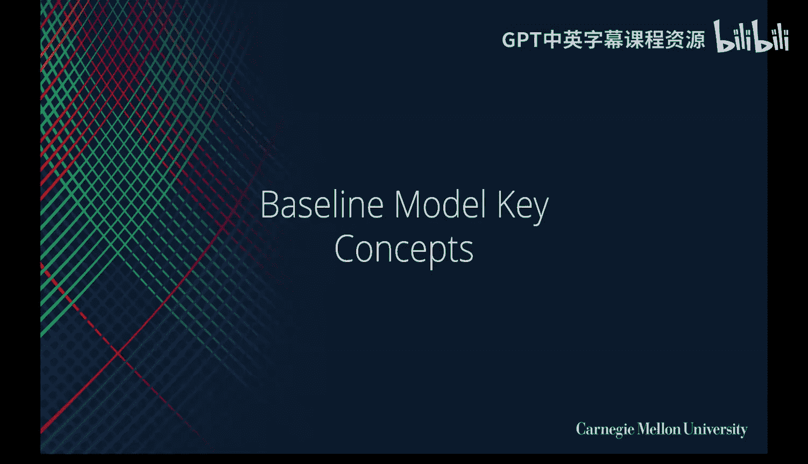

For you to take someone else's work， tweak it a little bit and prove your concept right that gives you that placeholder from which you can start building your analogs and product architecture on。

There's lots of ways that you can get baselines also that don't necessarily involve generating a model industry standards。

 like I mentioned with healthcare。Publish results， state of the art， those can be misleading。

 sometimes very difficult to replicate heuristics and rules， which we'll talk about。

In our in class exercise today。So I call this like little old lady antenna shoes so a lot of times if you get ask to solve a problem and you go into the organization to talk to people。

 you'll run into somebody who's been working in the organization that has been solving this problem for a long time and they will have like a rule of thumb that they use to make a prediction with like oh you know every Tuesday the market goes up so that's when we always buy our or that's why that's why we always sell our products on Tuesday there's know why it goes up on Tuesday but it does and that seems to work so heuristics are a great place to start for a baseline model if you've cold that information from from your user base because it's usually high quality because if it's worked in the past you want to start from that performance or human performance and improve so if your machine learning model can't beat the little old lady antenna shoes reasonably this is the question should you be doing M right did you get away with a simple rule of thumb and in many cases the answer is yes。

And then simple machine learning model from there， you know avoid deep learning solutions unless you're in a deep learning use case。

 you know use tree methods where possible for your initial baseline source as long as the API is similar and it's not going to require a lot of tweaks or changes to your product architecture and then the last case is AutoM right so if you are in a deep learning product to start with use an AutoMl solution to start instead of handcrafting your own architecture initially and that'll give you a great baseline。

right here。就是一样的。都比赛。这。Me。对。对。Yeah so it's that's a good question what it means is a logical。

Framework to answer the problem that doesn't involve training a machine learning model so we'll actually do it in class exercise here on the Titanic data set where we'll have you do a heuristic so the heuristic that I give you right now is that。

You've got to answer this question， what's the likelihood that you're going to survive the Titanic and a good heuristic would be your female。

If you're female。Then you'll survive that's my prediction and if you're not then you won't and it turns out that's actually a pretty good guess but the heuristic can be improved right and so clearly that required just like a little bit of understanding about what happened on the Titanic you know like a little bit of background knowledge and then I codified it in a logical statement that then can turn into a piece of code that just says。

You know， match with this particular characteristic in this column and then that's the the feedback。

 So it's just a rule at that point。ok。All right， so we're at it。In your group。

So we're going to do a couple of things here in。The repo， there is a folder called in class。And I。

Get the files from here and there's a notebook that has instruction on it。

And you can do it on your own。🤧Or in your group， but follow the directions there and I walk you through a heuristic。

The only nuance here is that I want you to do it in Docker。

 so from the last couple of recitations you've seen how to do this。Use this container。

Run that notebook in this container。WithWith the other files that are there as well， the data。

 get up and running and then let me know once you have a heuristic that does better than the one I've given you。

That should take you out。

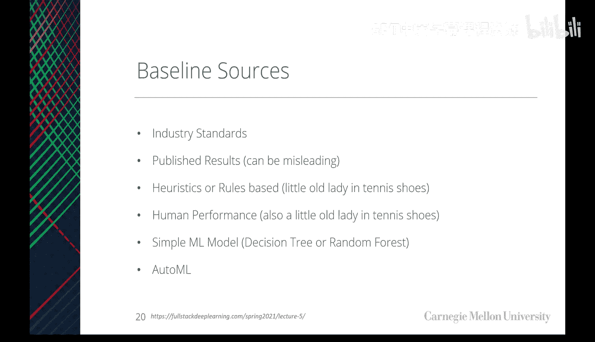

20 minutes。Okay。In the interest of using the last 15 minutes of class。

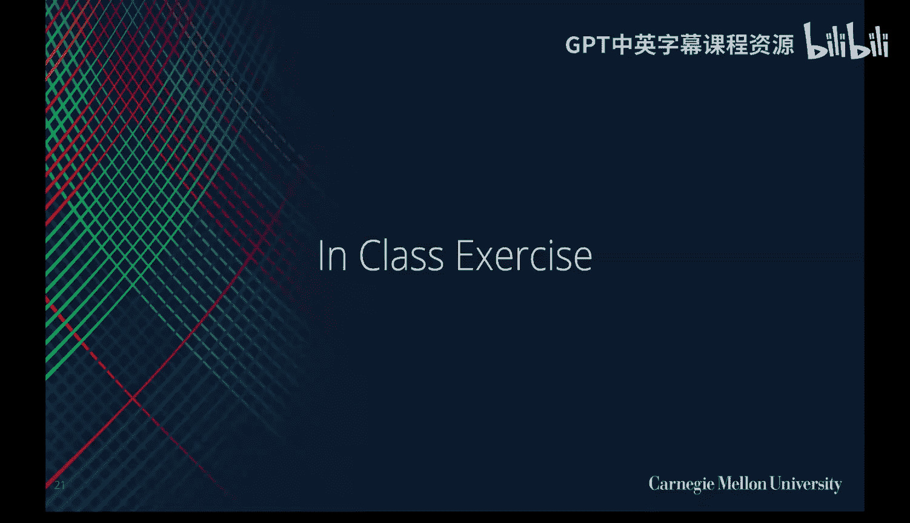

A lot of people learned how to use Docker just now， that was exciting。

Pay attention to the recitations because we'll be using as we go。

 would you mind showing us what you got how you got to your？3% improvement yeah。

 you want to come up and plug in。All right so。I was going to walk you through what he did。Yeah。

Those of you that didn't get things working， we'll get figured out as we go。

So basically what we did is pretty simple， we just kind of switched out the fair Are you guys see this okay？

Just control plus a little bit。对不对？So instead of going with like the class being like a higher class。

 like first class second class， we decided to do children or females。

So just make sure that like we got all the women and children。

And then we ran basically same code as what we previously had from just the fiction。

And then we got an activity of about 80%。Yes。No。错。All right so the nice thing awesome that I think is as good as you can do。

 I think if you tinker around a little bit of heuristic I think you can get it up to 82% but you've got to be like pretty clever and look a bunch of visualizations but you guys could see that you could take a rule set right encode that rule set into a Python function and then that Python function gets treated like a machine learning API and we can run our quality metrics against that heuristic rule which was really the basis of what we're doing so。

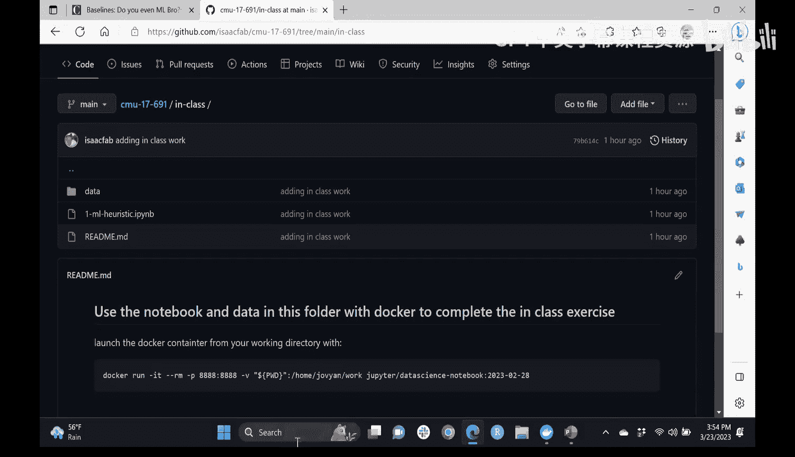

For those of you that didn't quite get finished， let me know we're going to figure out why Docker wouldn't work over here。

 but hopefully that general concept kind of makes sense now。

And the nice thing about using Docker for a thing like this， by the way。

 is that we all are working on。The exact same context so there's no doubt in my mind once you get to this point that we all have the exact same dependencies and we're working on the same library so if you have bugs in your code I know it's not because we have like different versions of psyic learn or different versions of human learn so。

This is why standardization is helpful， was great。Let's go ahead and wrap up talking about AutoML for the next couple of minutes and then after I'm done with AutoML for those of you that haven't quite gotten there。

 let's spend the rest of the time。

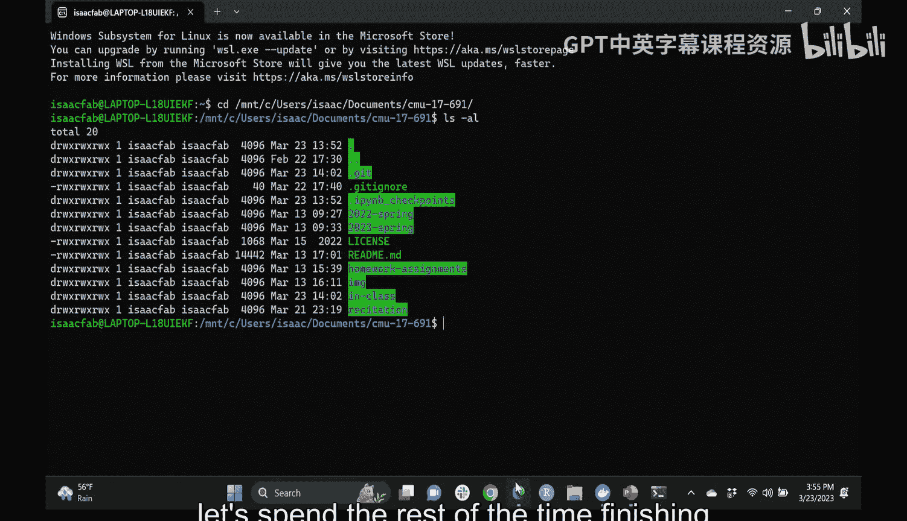

Finishing getting our stuff up and running， which will be very useful as you'll see for your homework。

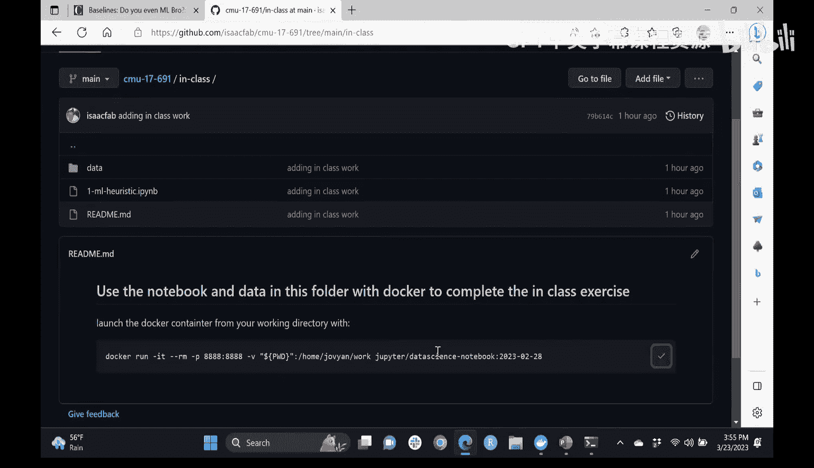

Okay， so AutoM， you should have seen in the readings today is basically a mechanism where you can generate model architectures without a lot of extra work。

 so it's like automating the architecture creation process。Historically。

 one of the articles that I had you read， this is often referred to in the deep learning spaces neural architectural search or NAS。

 and it's never quite as good as a handcrafted model if the practitioner is good at crafting model architecture。

 but it gets you a long ways towards building a model and usually is a great place to start for a baseline。

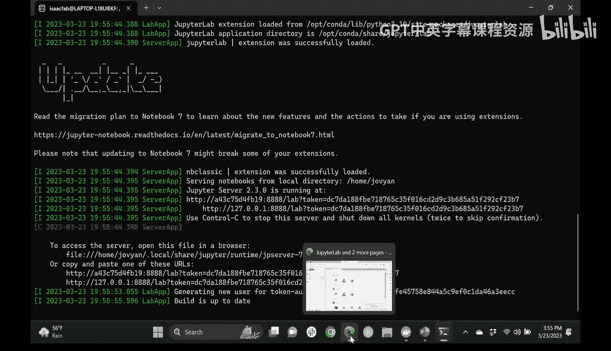

So again， maybe not。A great option if you're really clever and you've got things that you can pull off the shelf and then it's got a number of issues oftentimes it leads to bias or it sometimes doesn't create the best initial baseline。

This is actually the visualization from the article， what are the different components of AutoML。

 data preparation， feature engineering， the actual model generation process？

And then model evaluation， so the neural architecture search is the components that are there in dotted line so everything else you still have to do leading up to this point。

 but then you can use an autoMl or neural architecture search to actually do the architecture optimization and giving you those model quality feedback components。

Okay， and those are the major topics we wanted to cover today。

Once you have your problem defined and your user is validated that you've got a problem that is going to provide value if you can solve it。

You're going to ask the question， how do I build an initial answer to this question and you're going to do that through a baseline a great baseline is a heuristic but that heuristic needs to be codified into code right and the nice thing about the way that we looked at it today was is that if you do this you can drop right into any other machine learning framework and it won't be disruptive because the As for the way you're calculating your metrics are all the same so even if you go from this heuristic method with human learn you can go right to psyit learner the other deep learning framework without skipping a beat so that's all we have for today so we still have a few minutes left about 10 minutes left in class so if you're comfortable with the in-class exercise you're comfortable getting Docker up and running and that you are comfortable building that heuristic you're free to go if you want to stick around for the next 0 10 minutes I'm going to hang out and help anybody that wants help finishing get this stuff up and running which will be useful for your homework。

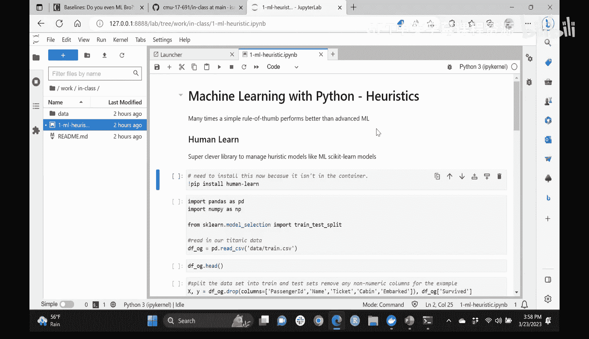

Coming up soon。