# CMU《机器学习实践｜17-691 Machine Learning in Practice 2023》中英字幕 p05 [P5]Lecture 5- (Teams) Tools and Infrastructure_2.zh_en [BV18TUQBJEfH_p5]

Okay。How was everybody's weekend now that we could start officially， yeah hopefully it was good。😊。

Wasn't as great of weather as two weekends ago， but nice and nice and busy。

 does everybody live on campus， everybody's close， where do you live？You're not on campus。

You're not on campus where are you at yeah okay， well that's close like so north of here there was like a hurricane like level windstorm to like knock out like all of the power in the North Hills and some people I think are still without power right now。

You wouldn't know it living down here in the city， but weather can get pretty crazy。

Like we to talk about weather， but。It's strange that like it could be just like normal day like this like sunny and you drive like 10 miles north and it's like an inch of snow。

The closer you get to the Great Lakes is。It's crazy， really。

 really interesting weather patterns here。Okay， all right。

 let's get after it today we're going to talk about tools and infrastructure。

 We start our four lecture block on MLlops talking about the high level。

Components of MLOps and you'll get an opportunity to put together a basic MLLO system in your homework and we'll talk about components of it during the recitation as well again as I mentioned at the beginning this is not an MLOps class so there's lots of places that you could go deep on I'll make sure you've got plenty of resources to be able to do that as you go but there are components in your product when you do your MVP demo that I'll be looking for that show that you're understanding what these concepts mean right that you're leaning in and you've got at least the space for the tooling to exist。

And we're going to start with that discussion today around tools and infrastructure tools and infrastructure discussion doesn't make sense unless we talk about team members who are actually on the teams and a little bit discussion about how team members collaborate in an MLLs project so with that let's get going。

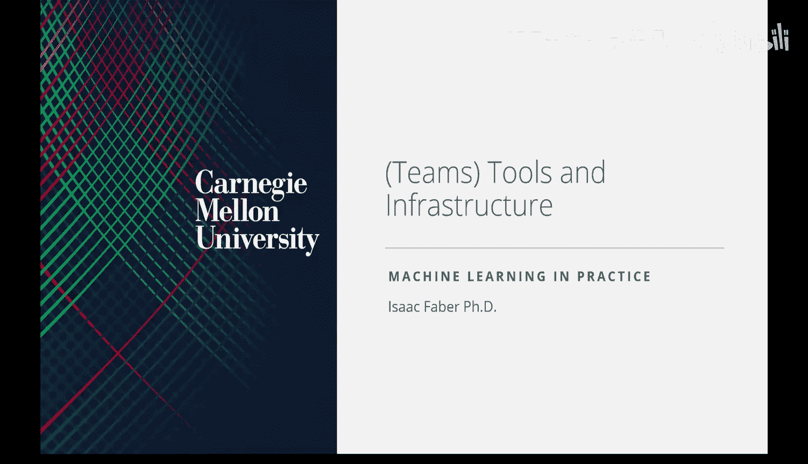

Okay we're going to cover a little bit of house cleaning admin stuff through MLOs overview which from your reading hopefully you're familiar with this concept pretty basic concept if you're familiar with DevOs or data ops talk about common workforce roles and collaboration tools for those workforces especially since the collaboration tools and machine learning are a little bit different than they are for software engineering and then we'll after our class discussion we'll talk a little bit about components of your infrastructure stack and the three bubble areas we talk about data management model development and software deployment Okay group proposals are due by midnight tonight so if you haven't submitted it make sure you get on canvas and submit it just one person needs to submit it and we'll make sure that as we grade at the grades will get assigned to your group members make sure your group members names are on all on the submission though so。

It just makes a little bit easier we know who you are but makes it a little bit easier okay and if you go to Canvas the first individual assignment was posted yesterday and you could take a look at it let me bounce over there and show you。

呃。So if you go to the this week's module， you'll see winemakerss dilemma part one。

You're going to need a couple of things that are all in here。

 the PDF is the actual homework assignment and where all the descriptions are and you just read through that and then the submission I'm expecting two things an ecosystem design。

Wwhich is a file where you're going to show me the architecture for this problem based on some of the tooling that we'll talk about today and then part of that architecture you'll see in the document there's like five questions I think you need to answer about considerations for data pipelines you are going to build a data pipeline in this homework assignment and it's going to be a Python script that needs to be able to run as a DAG inside of airflow which you learned about in the recitation from last week the data pipeline will be calling an external API and you'll need that API key to call that API it's pretty well documented but if you run into any issues or questions let me know so you got a week to do it。

Okay， and then。Again I mentioned it， but hopefully you guys all took a look describe assignments on or post on canvasva now so you can see where you're at for class it looks like El least says if now both the both of the notes from last week are up I think I just need to accept the poll request that just came through for。

嗯。Thursdays last week okay all right enough about admin so I do want to do a quick checkpoint because we're kind of moving through big module so we just finished the foundation module and as we go into MLop I just want to recap the things you should have learned the things that hopefully you remember after you leave this this class long after you forget how to build a docker container for some of you。

First is， that data can be leveraged to provide value。

Show that in the first the first class value is best delivered via software product which has a lot more considerations than just the model right so it's not just the machine learning model。

 there's a whole ecosystem around how you collect data， how you curate it， aggregate it。

 make sure that it's high quality， did you consider the use case in which it's being deployed in。

Then we started talking about products and we talked about data product in general。

 which is a really broad category， any product that provides value through data。

 and machine learning products are a special type of data product where they provide value by generating a prediction and that prediction is always undergoing constant improvement through that concept of a data flywheel。

You make predictions， you give those predictions out to your users， they react to those predictions。

 you collect more data， and that allows you to get better and better and better。

Product quality is only measured by how much value it generates。

 so you need to understand the user and make sure that you've got user adoption that you're actually getting folks to take advantage of the predictions that you're making。

If you have a high quality prediction， but no adoption， you aren't creating any value。Okay。

 and then the last thing， when you start building a machine learning product。

What we talked about on Thursday you want to start as simple as possible in some cases the problem you're trying to solve may not require a prediction at all and if it does require a prediction starting with a very basic model is a great way to start we showed some options in AutoMl through neural architecture search and those tools that are available through the cloud providers talked about leveraging open source tools briefly and then we didn't exercise where you actually implemented a heuristic model that again could be implemented with the same type of API as a more advanced machinery model but these basic models allow you to get a benchmark to understand how much value you can potentially create and give you an idea about how much work you may need to put in to continue to improve so now that you've got this right you've got a problem from the user。

You know that you're going to provide value， if you can provide a prediction。

 you've generated a simple model， your first one， and that simple model is being adopted through a software product。

Now you've got to go through the process of improvement right and that process of improvement is MLOs right so we don't even start MLOs until we've gotten to that point right where we have a reasonable expectation that we're doing something useful and that it's possible and that we've proved that out through a little bit of experimentation through our initial basic model and now the process of continuous improvement and all the plumbing and tooling that you'll need to do that is what we're going to talk about over the next four lectures。

Okay so here's a definition for a great working definition for MLOs。

 the extension of DevOs methodology to include machine learning and data science assets as a first class citizen within the DevOs ecology so this is like a circular definition where it just defines MLOs as a form of DevOs so what is DevOs DevOs is a set of practices that combine software development and IT operations Dev andOs sometimes you'll hear security sandwich in there and people will say Dev SeOs and it aims to shorten the systems deployment lifecycl to provide continuous delivery with high software quality you could think of this process and I would imagine for most people in this classroom just based on your age you probably have only been exposed to DevOs methods of development as you've gone through school but generally speaking it。

Connecting really closely the community of people who write the code and the community of people who maintain the application which historically were not the same group of people they were very different and oftentimes very antagonistic you would have developers build an application test in their environment package it up and they give it over to the IT shop who is then supposed to deploy it who would run into all sorts of issues when they deploy it DevOs combines those two disciplines so those two teams work very closely together and the testing harness the releasing of new features are tied in directly with the IT infrastructure so the operations team is closely monitor what the dev team does and the dev team has great feedback for when they do something that breaks in operations but it's this cycle that allows for really quick turn feedback for software development。

Working in this way requires high levels of automation so a lot of jobs that used to be manual or checks that used to be manual in a DevOs paradigm are now processes that are done either triggered through a code push for example or triggered by an action or an activity when we saw in the recitation last week in airflow showed you either the data sets feature and airflow is a great example of this and airflow if you create a data set and there's a change to that data set it has the ability to trigger a DAG which is like a data pipeline that then moves things through a process this is like the devOs or an airflows case the dataOs paradigm right where you have automatic triggers that are set up and those triggers are tied in with testing and validation and so this is the process with machine learning ops so if we collect new data。

 the main difference here is the mechanism is around the plumbing associated with machine learning which is model quality model retraining validation verification and then deployment of that model with feedback。

So the basic components that you'll need as we've talked about in a couple of places in order to do MLOs are the same as what we've mentioned for the product。

 you need data engineering components， data science components and software engineering components and we've seen this image a couple of times and now you've had a couple of articles under your belt discussing it。

 but you can see is we have one level of abstraction down there's a lot of components that you'll need in place in order to do this well and those components fall generally speaking into those three categories。

If we go back to our concept of this data flywheel this simplifies into like this basis basic process and every production application I've seen works exactly this way and so it's not necessarily that you have to do it this way it's that there isn't really a better or more intuitive way to do it right so you collect new data that data goes into your model training harness。

Your model gets improved， your algorithm gets changed。

 it gets deployed out into your software and your software gets deployed。

 and then your software gives you feedback because you deployed your model with logging or monitoring components and that feedback comes back into the modeling component So not in the same model but you'll have the ability to run tests on the data that's coming back to see whether or not it's behaving the way you expect it is and then if it's not that will drive new data collection and relabeling efforts which will continue this virtuous cycle and your model will continue to improve and improve improve。

 again， there's tools and infrastructure associated with this that will'll get to here shortly but。

No one is expecting。Anybody in this room to know how to do all of that？

Now some of you probably do and could do it well， but the idea here is is that this becomes a team-based approach where you have data engineers that are good at data。

 you've got data scientists and machine learning engineers that are good to model development and you've got software engineers that are good at the point code and like the DevOs framework。

 they all work together in this dance of feeding information back and forth with each other。

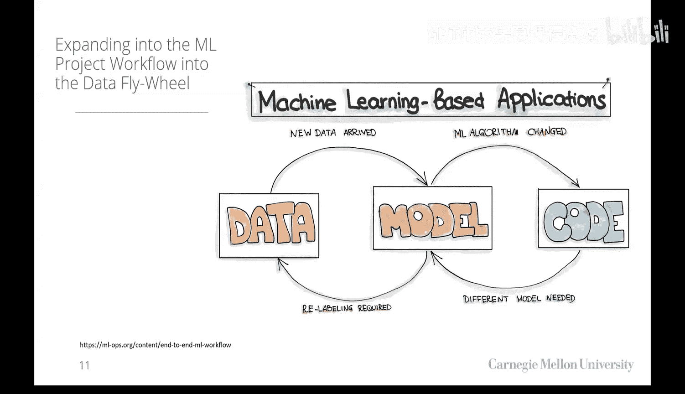

So let's talk about the workforce roles that you're going to run into so when I cover some of these roles i'm going to cover them from the top level like executive level。

So for many of you you know you may want you may be going through your master's program to get into like you know I wont say like a mid tier like developer like a senior developer role。

 but eventually right as you grow through and mature you guys will all be executives at some point and those executives were at one point former developers the CIOs and CTs as well as system owners so that's the group of folks that will usually make determinations about what are going to be required outcomes for how your model should perform or standards associated with how you deploy right and so。

We're going to cover the people that you will run into as you're building one of these products and organizations of various sizes。

 so let's start with the data owners。

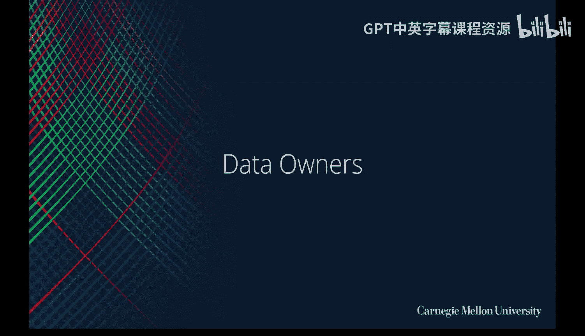

I think I mentioned it in one of the questions a couple of days ago。

 you will very rarely own the data for your model in an organization of any size。

 the data will come from some other system that will be owned by that third party so most of the data systems in an organization are owned by the CIO this is the person that oversees all of the technology and the IT processes in the organization so they are the ones responsible for deploying capabilities and then making sure that they work to provide value for the business。

Big salary range of CIO is a big deal in a large company。

 well into multiple hundreds of thousands and typical education is I've usually seen typically somebody with a STEM degree master's or sometimes a PhD。

And this is usually what they're responsible for right information system strategy access control policy manages the data ecosystem and it ensures compliance with legal and ethical standards。

 so if you do something in your MLOs lifecycle that potentially impacts ethical standards in the organization or legal compliance policy which can be easier to do than you might think will have a a class where we talk about regulations and ethics and it is actually not you that won't be the only one that gets in trouble ultimately it will be this individual that be responsible for so likely when you go to build a system like this there will be some guidelines that you'll have to follow usually set out by the CIO。

Now what we see is a lot of organizations have hired a chief date officer。

This is usually like a subordinate role to the CIO。

 responsible specifically for mechanisms inside the organization have to do a data aggregation and data management。

Similar pay range， these pay ranges came from Glassdoor。Thank there。Mostly accurate。

 but they're pretty。Broad maybe 60 ks， like if you work in like North Dakota。

 but if you were a CIO or CDO here in Pittsburgh with a major company。

 obviously it's an executable role。Again， similar education background that we would see with the CIO and then this persons typically responsible for the data strategy also ensures compliance if there's requirements for safeguarding data and information some organizations you'll see that the CDO will have like gatekeeper control over the data so if they aggregate it then you will have to comply with whatever requirements or environments there are to get access to the data that you need for your organization I've seen sometimes where the CDO will have everything from like if you want to do machine learning you have to use our environment where we know you can't egress data to sometimes they'll provide anonymization services where you can pull data out but it will be anonymized so if it gets leaked it's not a big deal so they're responsible for that accessibility of large organization。

There's lots of IT systems owners， so this is a broad term when I mean the person owns a system I think I mentioned this a couple classes ago。

 it's pretty common to find an IT owner inside of like a。

One of the other parts of a business that you're in or an organization or a government so like the entity that owns your salesforce instance is oftentimes in an itT person that works in the marketing department or the business development department which isn't usually directly under the ciIO so it can be weird in organizations。

 but that person will be responsible for whether or not you can have access to data you may need inside of that system so。

When I show you that basic like three bubble chart。

 there's this like set of sensors that are on the left side of the chart。

One of the reasons I just say sensor is because where your data originates from can be really flexible right。

 it could be an API like you'll see in your homework or web scraping。

 but most of the high quality data that you will receive if you're working in an organization will come from these types of systems because that's where all of your user behavior will be contained。

And this person' is responsible for making sure that system works So if you show up and say hey。

 I want to I want to use all the data that's in your salesforce instance this person's concern isn't going to be how good your model is it's going to be are you going to take down my salesforce instance by running a whole bunch of really heavyweight queries on my non optimizeimized database and bringing down the performance of the application so you can see different different points of view for folks who are going to own it product managers are another example sort of generally related to。

嗯。To itT product owners usually product managers are going to be the ones running an MLOs project。

 so if you're responsible for building a product internal to your organization a product manager will get it and they'll get access usually to a team a lot of times this person is in charge of like a matrix group of people to start until the product up picks up steam。

Itsary range really varied depending on where you're at similar education background。

 usually usually a little bit younger product manager is in my experience is somebody who's typically mid career spent a little bit of time as a developer and then we get put as a leave for a product development team。

They're the ones so when I say you need to like talk with a customer and ensure you're providing value the person who usually does that is the product manager they're usually the face of the product they interface with the end users get feedback make sure that they are getting what they need so not always is the product manager just that role sometimes they're also a developer on their team but they typically are the leader like from a nuts and bolts day to day。

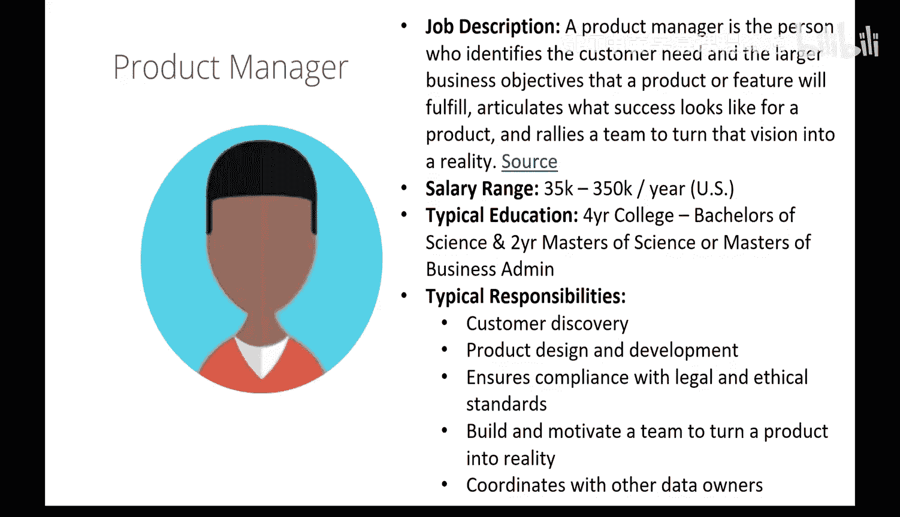

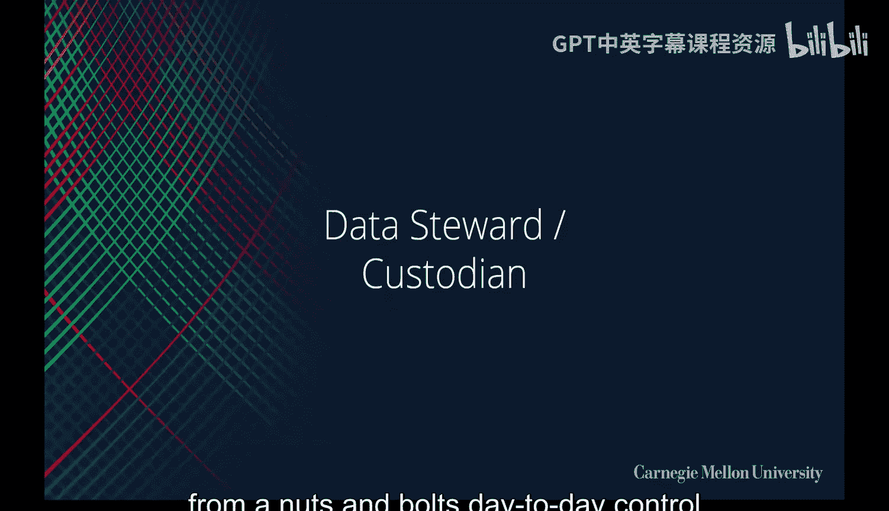

Control of the product development process。Okay， not quite a data owner but similar。

 a data steward or custodian。And so we looked at kind of the leadership different types of leadership levels from C suite all the way down to your product manager when you have a system owner。

 that person usually delegates the technical control of the system to an engineer and usually that person's called a data engineer there's a couple of flavors of it we say data engineer today and everybody knows that we're talking about it's interesting that term actually didn't have great use five years ago and now is extremely common but generally they build and maintain the data management systems a little bit tighter band on the salary range because this person's much more technical you know day today is building data pipelines this person would maintain the airflow instance for for the organization and monitor the daAGs as an example yeah usually for your degree to start typical responsibilities。

buildinging systems， everything from relational databases to big data platforms。

 builds data pipelines and connects things together。

This person usually is conversant in these things I've found usually a data engineer is typically a Java developer historically and I think that's because I think I don't think I know it's because the Hadoop was the original open source big data implementation of mapreduce and it's a Java implementation so a lot of the tools that got built on Hadoop or Java based so it's pretty common to run into data engineers who are mostly conversant in Java and then Python is pretty common I think if you're comfortable with Java Python' is easy to add and so you can see Python and Java end up being the primary languages that this type of person would use even today I see like a lot of the data parsers that are generally available are written in Java。

Sort of interesting， interesting background there。We also see sort of like the old school data engineer。

 the database administrator or DBA before we have these big data ecosystems。

 most large organizations and still do bought these really big relational databases super expensive and they bought them from either Oracle or。

Microsoft。And there's one more that I'm。Yeah， oracle Microsoft and。Mysql。And a few others。

 but the idea here is is that there was one big mainframe database that was available to the organization and it kept all of the organization's data。

This is amazingly is still the case in many organizations， even midsize organizations。

 the DBA sometimes will have access to all of the customer data because that's where it was stored on their central database and they maintain that system and so they're usually really really specialized so your DBA will be like a Microsoft SQL certified DBA and they'll go to like get specific certifications and this technology but they will be the keys like the data engineer。

 they will be the ones with the API keys to give you access to to the data and will be able to control what level of access that you have。

U。Yeah。Orracle MS equalQL Salesforce right typically they。

Control a large enterprise resource data management system。This person usually is not a developer。

 so most of these systems have graphical user interfaces， especially the Microsoft system。

 so they'll be conversant in SQL and then they'll be conversant in any vendor specific applications for that specific。

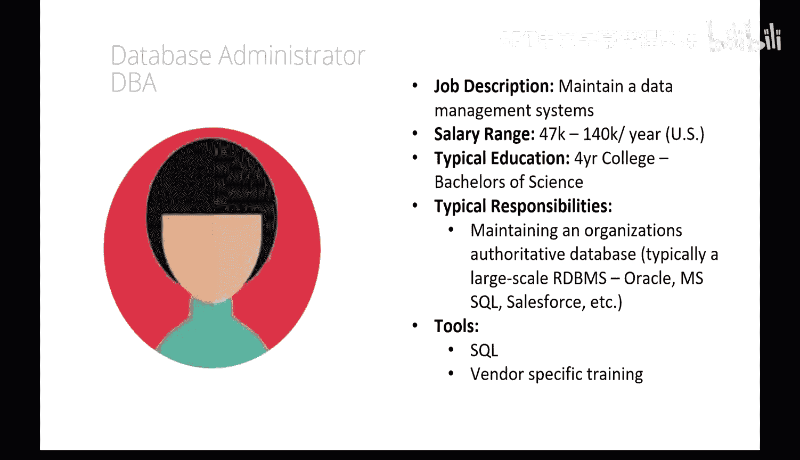

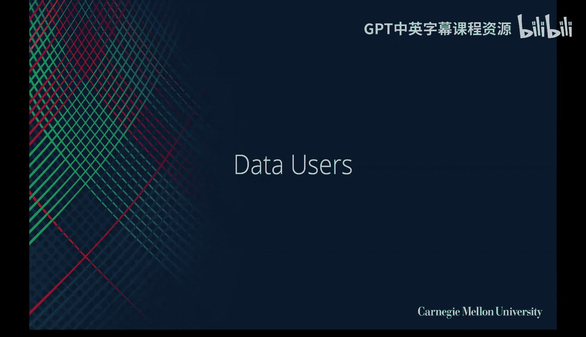

System so interesting person as a data scientist or machine learning engineer。

 these are the people you need to remember to bring candy to when you go to work。

They will either stop your project or help it。Okay， all right， let's talk about data users。

 this is a little bit more specific to our course here。

So you have your data analyst so you've gotten authorization from the leaders of the organization you've gotten the keys from the data custodians and now you ready to start to work to do work first type of person that has access to the system is a data analyst this is sometimes called the gatekeeper of the data meaning that like。

When you have a question， an executive has a question typically they'll have a data analyst able to answer it like hey。

 what were the sales in the third quarter in the store in Pittsburgh and they would be able to。

Go into the data warehouse and answer that question。

You can see the salary range for data analyst is a little bit lower still I've seen that like folks who do the data analyst job know more about the data in your organization than most everybody else because they're constantly touching it so as you're doing your discovery for a machine learning product these are great folks to talk to like hey why do we have three columns named last name and they'll be able to tell you the whole story about why they have three columns name last name and help you clean it up but they're typically usually business educated so these are like。

Finance， business administration type folks are not usually engineers by trade。

 but end up being relatively technical by the virtue of the job。

 but they view data through the business lens as opposed to more technical。

Lots of summary statistics， usually competent in business intelligence tools like Tableau or Power BI。

We have self serve data analysts i'll go through this a little bit quicker the idea with the self serve data analyst is that。

Many of the data lakes now provide environments where people who aren't formally trained can use natural language to ask questions of the data。

This approach， so there's companies like data robot。

 even Power BI has a little bit of this baked into it but。

It's like one of those like chicken and the egg approaches we'll see this with the data scientists as well。

If you knew how to do a data analyst job like you would just be a data analyst and so if you provide somebody with self-servve tools to do data analysis。

 they don't necessarily know what questions to ask so once you know what questions to ask then you're a data analyst then you don't have to use these self-servve tools so ultimately like you'll see this happen a lot where people will say why are we bothering with building a machine learning product why can't we just do give people self-serving machine learning tools and of course the answer is is that nobody knows how to do self-servve machine learning tools until you're a machine learning engineer and then you don't need self-serving machine learning tools so but you'll still run into this is pretty common where these tools will be democratized out in the organizations usually with low adoption。

Okay， data scientists， I like to use the term data scientist more generally， usually somebody。

Who provides insight so this can range and have a significant range。Historically， this is somebody。

With a PhD and now it's much more common for this person to have a master's degree。

 they usually work on statistical modeling， so as opposed to the data modeling though we talked about the difference between the two worlds this person is usually conversant in statistics does hypothesis testing decision support and they're usually part of a small team right so they work on low frequency high impact decisions。

This person isn't typically expected to produce software， though can participate in model developed。

Citizen data scientist is similar to self- serveve data analyst。

 this is a topic that you'll hear discuss at some length when you get into organizations it's never worked out well。

 it has never worked out well to give people who don't know statistics tools to do statistics and so。

All right that's that's my personal opinion， but you will still run into this where you'll see that your organization will want to provide tooling to this group of people and sometimes for your machine learning products。

 this is the type of person that would be your user。So keep in mind right。

 somebody not formally trained as a data scientist。

 but given automated tools to do data science type activities。Yes。

They call these low code or no code tools。Data robot's the most famous example of company trying and do this。

Dan robot did not have a good year this year。Unrelated all right and then more appropriate to this class now you have a machine learning engineer machine learning engineer is somebody who builds designs builds and productionize m models to solve business challenges。

 so similar to the data scientist using data to provide insight the difference here is is that with the data scientist the goal isn't necessarily to automate that insight whereas for a machine learning engineer your goal is to。

Walk away right to automate this process， put it in the hands of somebody else and it be able to provide value and they don't need to see any of what's happening underneath the hood。

Salary range as as of this writing a machine learning engineer has a little bit higher salary range than a general data scientist and then this has been evolving it will be interesting to see with all of what's happening in GP over the last month or so how these change but I see it probably changing very little just like with the citizen data scientist like unless you know what question to ask chat GPT it's not really that useful in building these systems so and somebody mentioned that before like I fully expect you to use these AI technologies and building your products theres no limitation there。

Just like when you would get out to work hopefully you'll use them there as well machine learning engineer historically been a PhD I've seen that back off a little bit in the last couple of years as well to now。

Halted folks with master's degrees that are focused。

 especially in computer science or other similar staler。

Able to walk right into machine learning engineering jobs。

small teams with the developers train models per to production。Okay。

 and they'll go over this quick software developer really broad term right someone who builds an application in deployst whether their mobile web or similar salary range is really broad because it depends on the type of application that you're doing a good software developer combined with a good machine learning engineer and a good data engineer is a really。

Awesome combination for a great product whether you're doing a startup or whether you're in an organization if you can balance these three talents it's pretty pretty awesome So developers are a little bit different in educational background and that like you don't necessarily need an advanced degree many talented software developers get started with just associate's degrees and I think the main difference why we saw more advanced degrees and data engineering and data science I think is because data science and machine learning require a little bit more in depth understanding of the mathematics behind the model which just require a little bit more time in school to get that whereas you could get out with some of these generalized frameworks and start developing software in high school even but true be told is the best software developers on average will typically have a little bit or the higher paid software engineering or software developers will typically have a little bit more advanced education。

But it won't be uncommon， right if wherever you go to work that you'll run into folks who did not do a master's degree or some in some cases didn't finish a four year degree。

 but still are good developers。

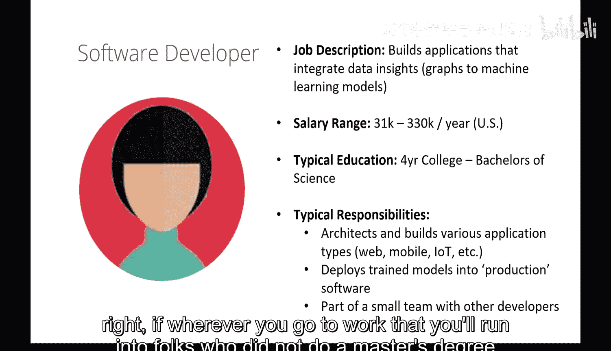

And that's also because software development has been happening for a while now。对。

Pret straightforward makes the software。Okay， let's talk a little bit now about collaboration so you saw the team members。

Leadership folks who actually control the data and then the technical folks that will populate the teams that will create the products。

 how do the teams that create the products collaborate if you're building a MLOs pipeline？

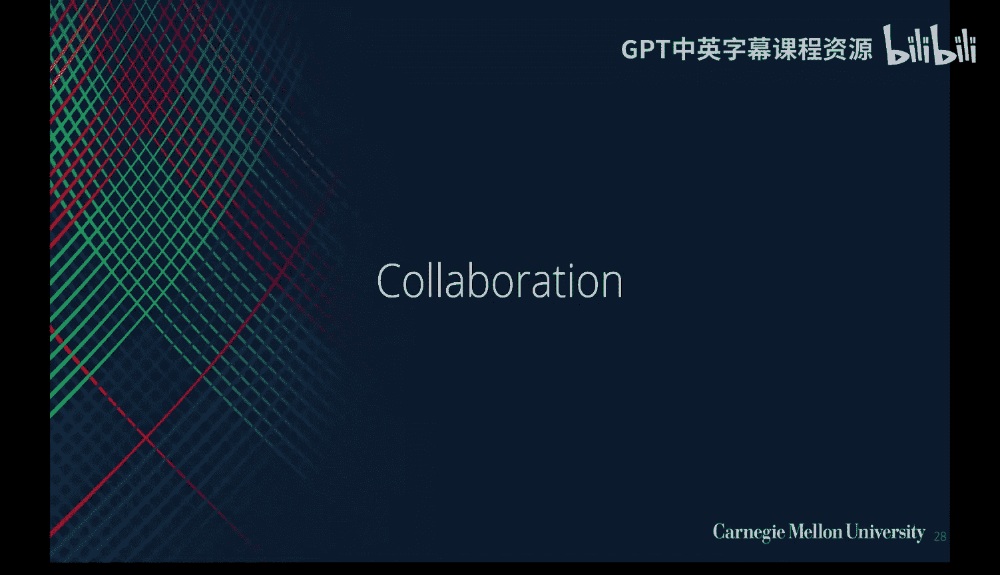

Enabling a machine learning project。A couple of main points here。

 the first is that most technical collaboration tools are specific to DevOs and so what I mean by that is that software engineering is just a much more mature process。

Process and data data science or machine learning engineering。

MLOs has only been around as a term for like two years maybe maybe three if you search back that is no time at all compared to how you know the decades that we've had under our belt to get software right so these teams that are doing MLOs start by adopting directly adopting DevOps tooling but they're not the same thing right and so a machine learning project is we saw on our articles it doesn't even it doesn't even operate at the same cadence as a as a software project with the software project you have Es the terminate code that can be turned into features that you can boil down into tasks that you can pull off a comm on board then you can sign to somebody and you're confident that that person can actually achieve that task we don't even know how good our model can get right so it's much more of a scientific process so the collaboration tools are naturally going be a little bit different the other thing is it primarily development is done in notebooks so in Jupyter notebooks and they do not work well with version control systems。

Jupyter notebooks are like JSO objects， so you've probably seen that in the couple that you've interfaced in this class if you haven't seen it before。

There are mechanisms now that have come out that have allowed for a little bit better approach to doing some type of version control with notebooks。

 a program called MB dev notebook dev has been popular the data that you're using to train your models also needs to be captured right and so there's mechanisms like DVC or data version control and then there's collaboration sites but they're all young or new or you have to piece together your own so the one I'm going to expose you to in this class is called DAGsHub and we'll see that。

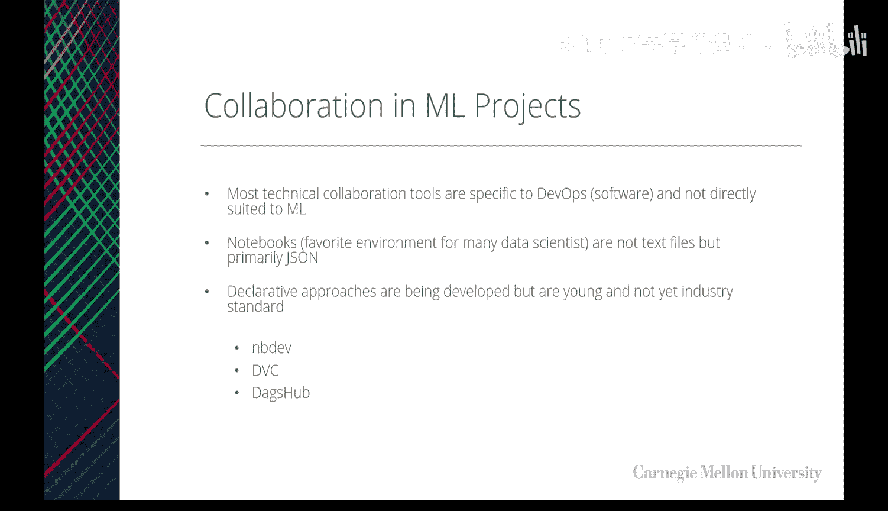

Next week very similar to GitHub， but the difference is it's got like all the collaboration components you need to do machine learning and not software so and it actually it integrates really well with GiHub。

So these considerations mean that the way that you collaborate is going to be different so I want to go over a little bit more of the three topics or the three tools that I just mentioned。

 so if you're working in notebooks taking a look at MB dev as part of is going to be part of the requirements in the class right go in and see how you can use this program to version Jupyter notebooks if two people were working on the same codeb hopefully for most of you it's clear how that works in a Git framework the way the MB dev works is that it pulls your JSON apart and it treats different components appropriately as you make changes to it so pretty cool again has been has been fairly popular it didn't even this library didn't even releases a stable version。

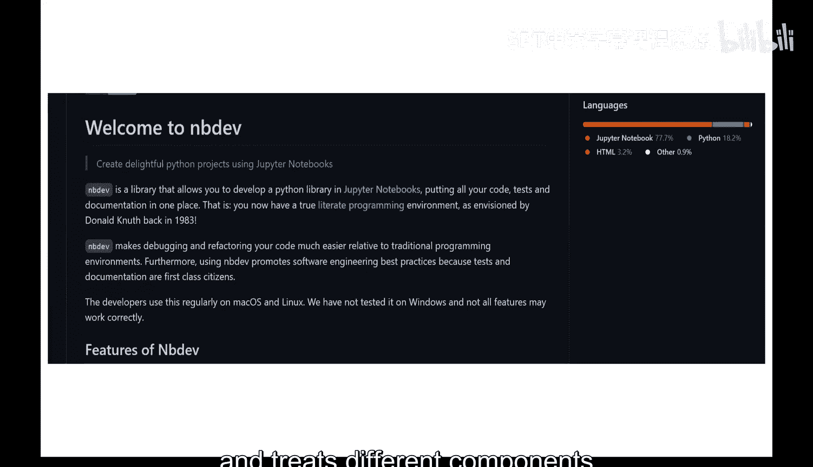

Are a stable capability until about 18 months ago， so this is kind of how new some of these technologies are。

DVC or data version control this is by far the most popular mechanism to version your data sets for machine learning it's open source on Gitthub as well maybe by a company called iterative they make a couple of other things as well that I'll mention as we get into the tools portion but it treats your data sets just like you would code so you can pull push and of course this is important as you're going through your cycle the quality of your model is determined on your data you need to make sure you know what data version you use to train what model so you can keep track of that provenance in in your cycle DVC is an example of a way to do this。

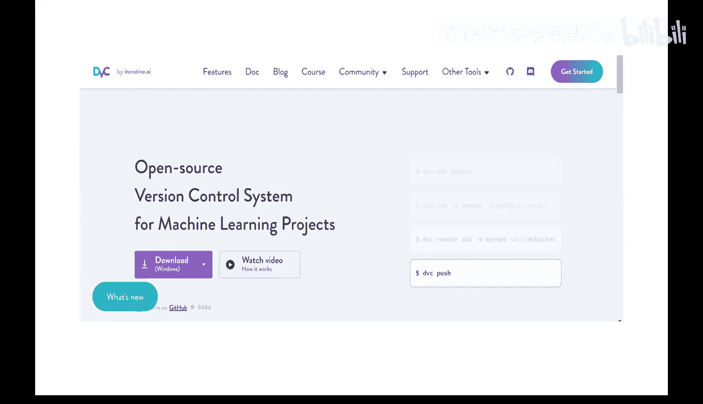

And then I mentioned DAGHub， we will use DAGsHub for your homework assignment， not this week。

 but I think the second one yeah。So in a couple of weeks we'll come back to it and I will cover Dg's hubub in a。

And a recitation in a couple of weeks。But in the back of your mind， be thinking。Oh my gosh。

 there's a whole otherher hub for doing collaboration that isn't GitHub for machine learning projects and hopefully by the time we're done with this you'll see why that's the case there's lots of tooling that you need to do this well and it's all I think captured pretty well here in Dgub。

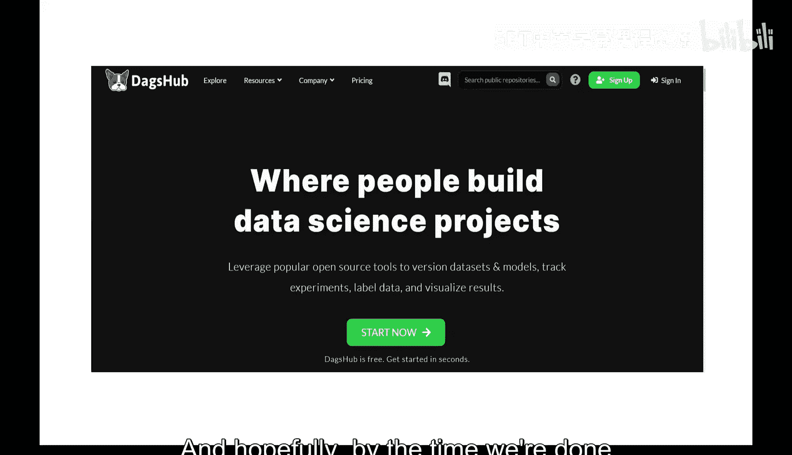

This is a new company， by the way， this is like a startup so this isn't。

It may not even be around next year so this could be like a one time learning opportunity we're going to use their compute anyways okay。

All right， this time， do with your groups。Look on Canva， answer the questions on the slide。

 and I'll give you about 20 minutes and then we'll come back together and talk about。Okay。

 and surely。This。知道。Cost consideration。Especially because a lot of the articles talk about tooling。

Ping she product。That not we see like。When the cost of training。对啊。larger models then at that point。

 you have to consider， you know， at the runtime level， the risk of training。So even heard it。

I make products have smaller models there is a font that add took over time。But。Yeah。

 that's a great point it's GP is an interesting use case I'm not sure how many of us are going to run into that。

 but they were like。The rumor is right now that they're training GP5 now。

And it'll be done in December。Like something something absurd like that right and I think' i'm not sure if that's just a rumor but i'm sure there's something along those lines。

 but without that relationship with Microsoft I think。

It would be difficult to match that cost so it's clearly going to be a major consideration and you could even see from the。

The primary point of the article is around cost， right？

Cloud was supposed to save money like I'm old enough that I remember that was the pitch that Amazon was always like you're spending too much money on hardware it would be super cheap and now we spend like four times on IT spend that we ever did before it's all in the cloud so this is a big consideration and these new applications have big workloads that are going to have cost。

So same thing with ETL。Like with large。Data transformations。Same thing with runtime yeah。O。All right。

Saedashia。Okay， same thing talking to me about cloud， what you see different than？First。Have。不。哦。好的。

被告。对。没有。The话。哦。And then there was this idea that we designed with the fossil that something。都你好。

If you don't do that， I have it make sure possible to the with。这个。

Yeah it really is like it this is a great point sorry to break here your stride there。

 but i've seen this at all levels from like a startup so here's what happens like if you're a startup and you get into incubator I think what' Alpha labbs is the one here right so let's say you guys are like this class is amazing i'm going turn this into a product and go get funding you'll go to Alpha labbs。

They'll give you a few tens of thousands of dollars and then Google and Amazon will say we'll give you $10000 in cloud credits and that's how they get you and so you get and you're like that it's amazing you know but they only last for like 12 months and you can't even spend that much because you don't have many users maybe some experimentation but when you get on you get like。

Their infrastructure is code their relational database like you start making these architectural choices that are difficult to migrate later on and so before you know it your whole product is then dependent on that specific cloud provider So thinking about that upfront instead of just like moving fast is a good consideration they strategically and they're smart right like。

Google Amazon actually very smart companies， they make their cloud services intentionally easier to adopt right so it's it's more difficult for you to you know set up your own stuff。

So but yes， if you could be cloud native and cloud agnostic。

 that's the ideal architecture for just about any product these days， is a great point。

Good point as well。I think。O。No that's same thing yeah that's important consideration you don't think about it early on there's funny there was a I saw a tweet the other day and someone was like I'm giving like $6。

41 the Amazon web services every month and I have no idea why it's like every month is credit card charged and that is happened to anybody that's used that you're like I don't there's probably some instance on in Germany that I actually turned on it and it's impossible to find through the user interface so imagine that like at scale like we have this problem in a big company where you give too many people the keys to your to your license and you could just spend really quickly。

We had。We had an interesting anecdote and we Microsoft had these things called stack Azure stack edge Pro so they're like devices cloud devices that you take but they're physical and they have connections back to the cloud so you can like provision stuff there and it can connect back to the cloud and。

You don't have to buy it。 And in my world， like leasing something is much better than buying it because when you buy it。

 you have to like。Maintain it and。Be commissionmission it eventually。

 so if you lease it and you can just take it and give it back。

But everybody in the organization found out you could lease these things just as part of your cloud account。

 You didn't have to like go out and like get an buy an extra device。

 So all of a sudden like one month I turn around and I was like why don't we have 10 Azure stack edge pros and it was because 10 people were like I think I need one of those and theyre like$3000 a piece so all of a sudden we had like 30 to $40000 in cloud costs from like leased equipment just because we we're paying attention and I guarantee you those things were not being utilized 100% Many of them satAT in closets for months and we were still paying for them So it's a hard。

Program that you think and especially as you're building your machine learning product。

 like thinking through those cost considerations early on will be significant benefit downstream。

All right， let's talk about the change log article。Sean， when， what would you guys get for that？被告在嗯。

对。好。啊。啊，可。查不到的。不。对。That was a good point I just。Elon Musk was being interviewed a couple of days ago and got a question asked about chat GPT。

 which I thought was insightful based on what you just mentioned that basically he was like。

ChadGbT just put a face on。Large language models that had been in existence for that period of time。

 certainly since 2020 right GPT3 and 3。5 have been around at least that long maybe 2019。

Open AIs was founded seven years ago。 And so like the actual modeling that we're doing right now is not is not substantively different。

 You know， we didn't have like a modeling breakthrough。 We had a data breakthrough。

 like how much data you could handle， how much you could process。 So certainly like。

Continues to be the theme， right？Okay， do that wing。Good好。我的方然是。Yeah。So base。不。对。Se。But。这个I你。喂。O。不是。

Good。Good。I do the same。是。就钱。走吧。Yeah。So yeah， that's the before I actually， but after I read that。

People doctor。Because。First first one is the cause， for sure。嗯。1。

You're expensive without shoes that you a account from with a compatible。这个话 is玩。

Just like software developing， I believe。Thank you。Intel paper， they call it fine training。对当期。Yeah。

So did black cycle be long。W。The infrastructure need。诶比个。The engineer。libraryy。Okay。After the。有。

都在中这听的抠门。嗯。The skilling。Good morning。So that didn't requires the build。好吗。嗯，就把上好好的说一。然后会同。

The fourth point of time。I think it has。There个。The last one is the factory。嗯You。Are you something出。

不 is穿。啊。Back in house。Then also。不。回复用。If very。I。Yeah。Yeah。没有没有。Yeah， great， that's great。Cool。

 thanks。Yeah， I don't have much to add。 I think that the notion that you said about scaling is hugely important。

 Can your cloud cloud provider keep keep pace with you， There was some point。

 I think things to open AI。 There is some point， I think last week that Microsoft ran out of GPU compute。

 which was， I don't think anybody thought was possible。 It's not like unlimited。 So now。

 I'm not sure that you'll get to that place， but there are like a ton of lower cost GPU providers。

 Now， I want to say that there was probably like two dozen of them last year。

 Maybe there's a few less Now companies like Pa space。

Comment I think they'll run their own GPU clouds so when the temptation there is which is true is if you know what you're doing youll get a lot cheaper compute it's a little bit more reliable。

 but there is a scaling issue right that if you get to some point you may exhaust the resources if you choose a。

Different size， so clear trade off there。Good answer。Okay。而fu。

So could you guys answer the second one， the change log？Right。啊，喂。The微。是。This' not。They continent。

For that。Reman by。The adjustment。呀。啊。可。The stays， because we。

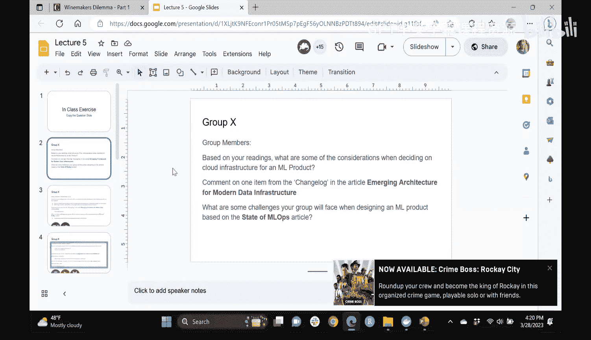

啊。は。Yes。对他。你。Yeah， so this is an interesting point。

You hear like every couple of every couple of years someone will come up with like a new database technology and it will never last like it'll lasts a year or two and then everyone will realize we should have just been using like relational data。

Bass the whole time。 so is it is impressive like how robust the core components have been and how。

You know， if something was a good idea， it lasts the test of time if it's lasted 10 years。

 it's probably still pretty good this is a good point。Okay， and then let's talk about， okay， Ray。

Can you guys answer the last question？ we are just three store。Bs。So。So。这す。高1。Yeah。Sorry。1多钱。

The child。Okay。That。That American China。All the related technical。

So we also need to learn by ourselves。How shall it is fire by。Yeah多。That is really dark， but true。

I mean， I mean get。 I mean we didnt catch up with the。And the last challenge。

To finish to finish the design of the product units， cooperations from all kinds of experts。でない。

Dlysis data the science。

so so。The cooperation between so many different people。Stucks baby child。

Maybe different people They have。Different perspectives to see the same same thing。

Yeah that I think those are all great points this middle one here right where the。

The MLOs is changing quickly。Man this has been so true the last couple of years like the the best whatever the best tool is gets like changed like every couple of months or like something new will come out or like there will be like a new technology and the stack that you'll feel like you have to learn and so it is challenging to keep up with but like。

You know， to this point， I think that there's some like core themes that if you can be comfortable with。

 the technologies can come and go， you don't necessarily feel like you have to feel like you have to keep up。

 but this like Cammbrian explosion of all of these like different things that you could do hopefully you saw that and。

Some an article I'll show you screenshot here it is a mess right it is a mess。

 but hopefully we'll see that like there's just some you know basic core features am I am I learning。

From my model being deployed， am I using those learnings to improve my modeling and how am I doing that you know those basic things as long as you've got those。

C control。Okay， all right， Joe Elot same same question for you guys what。

Whatd you guys think about for state of MLOps？So for our product to make it like truly practical that we can。

One of that problem。will kind of immature melo as like a process if the processes that we'll have to call on necessarily。

That software。Autom any deployments that。Yeah yeah you're right a lot of it will need to be customized to whatever your use case is and your model framework and you'll see that as we get into it as you run through your your first example。

 there's like really nice things that are set up around just deciding like how you're going to package a software product right you just sort of pick your stack and go from there。

And software changes a ton too right like you know I've been keeping a close eye on react as a framework over the last couple of years because we use it at work and just what something you would think if everybody uses changes so much I mean like yeah like they just move to a a new hosting side I think a couple weeks ago but in doing so like the way that they've like set up even like teaching like what you would consider like a core component has changed a lot so if front end is changing that much right ML like that isn't settled yeah this is going to be very custom and there's some goodness in there it means that it will also be unique right may be difficult to replicate if you solve a hard problem。

Okay， cool， all right。Let's go ahead and talk about infrastructure for the last 10 minutes or so。

The infrastructure stack， the stuff you need to choose。Okay。

 so there's a problem with machine learning systems that actually was teed up really well by this Imature process comment。

Systems are hard to design well， it's really easy to incur technical debt and models are often bespoke and not declarative。

 meaning that like models were trained by someone physically changing something in the notebook and then rerunning the cell as opposed to pushing a change in parameters that got recorded somewhere as an experiment。

Lots of other issues， this paper was published from Google a couple of years ago， had a famous image。

You can see here that the machine learning model is right here and all of these other components around it or all the other systems that you need in order to actually to support an MLOs process or at the time what we call a machine learning system so only a fraction of real world ML systems are composed of the machine learning code themselves and so maybe not to scale but you can see you need pieces that fit in each one of these boxes when you're preparing a product for deployment。

So this is what。The community has turned to so this problem exploded into like a million different startups and this is I think little less than 12 months old is an image this is a mess right like unfortunately you need you know something from every one of these and you can see there's a couple that we were already familiar with them sure if you can screen coabab was mentioned we're using Jupiter there's data version control that we're going to use you know cloud providers so I will handpick things out of this to show them to you and expose them to you because I think that they're good examples but it doesn't necessarily mean that you should feel like you absolutely have to use have to use the components that are that I present right you can use whatever you're more comfortable with。

😊，But there's a lot to choose from， right and a lot of competition in this space。

And you can't get away with ignoring any of these areas。

So basic components again though fall into these three categories I want to give a useful abstraction and this will be required a required slide on your group project you have to decide what goes in each one of these boxes for your product so these are what I think are like base minimum decisions of you have to decide。

From the bottom starts with infrastructure goes up into platforms in each of the categories and in some of the applications on top I give example technologies in this slide you don't have to use those example technologies in the class and the recitations in the homework my goal is to expose you to as many of these as I can and some of them you'll just have to go out and experiment on your own i'll let you know what those are but so for example right we already showed you airflow you'll get access or you'll get。

We already talked about Docker and a few other things on here I mentioned DVC but we'll see that a little bit down the road data generation of pipelines you've already seen Jupiter lab for development and then when we get into the next the next stage when we talk about some of the model monitoring we'll get exposed to some of those other tools as well but I think that this is a good what we would call a placemat right look lay this placementmat down and ask where you're doing each of these things for your product and that will give you a great head start on what your architecture should look like and if you don't fill one of these boxes know that's okay like but just know why you know like how are you going to deploy are you on the edge if you're on the edge that's going to drive how you're packaging your model。

And you're doing all of your preparation and so I think that it's it's a it's a pretty good framework for answering some of the questions about your your architecture and there isn't anything up here that's like。

Significantly crazy， right？When we say。Local development environments right or data lake or data warehouse。

Where you're holding your data？Or when we say on the other end of the spectrum right CicCD and testing。

 where are you holding your your code right one of the reasons why I want。

Your class notes are described to be able to pull request is to。If you haven't done before。

 most of you have， but if you haven't done before， what's it like to？Fork a project。

 make a change to it and merge it backhand， you'll have to do the same thing for your machine learning components as well。

Okay， and。The components in the data engineering。Cycle。Sensors， data pipelines。

 data pipeline orchestration， storage。Sometimes business intelligence， right。

 like if you have an analytics view into your data lake data labeling and then data versioning。

Okay and that's all I've got for today I think were finished a few minutes early so。

Hopefully that made sense， you see all the infrastructure components that are required。

 got a good view as to the trade offs that you're going to make from the readings and we will see you at the recitation tomorrow at five o'clock where we're going to cover open AIs APIs。

And we'll see that。そ。After the proposal， you'll get feedback。Yeah。

 so submit it today and you'll get feedback in before homework assignment is due。

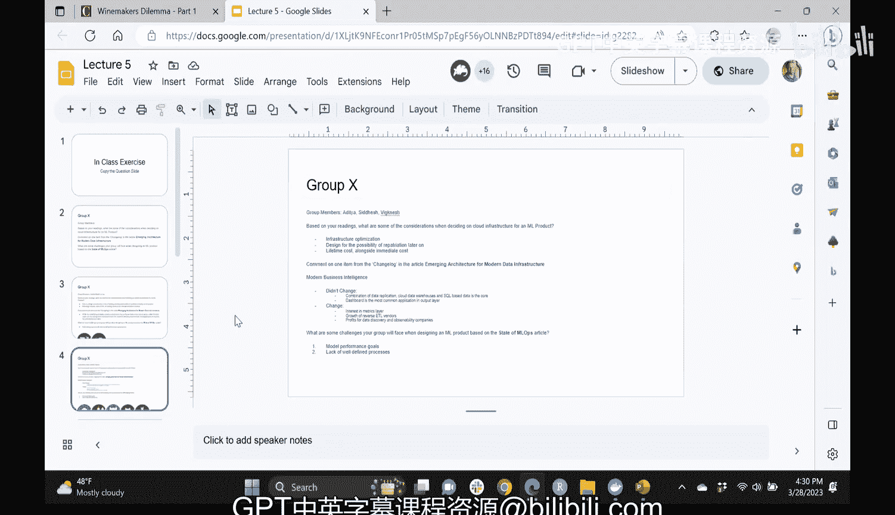