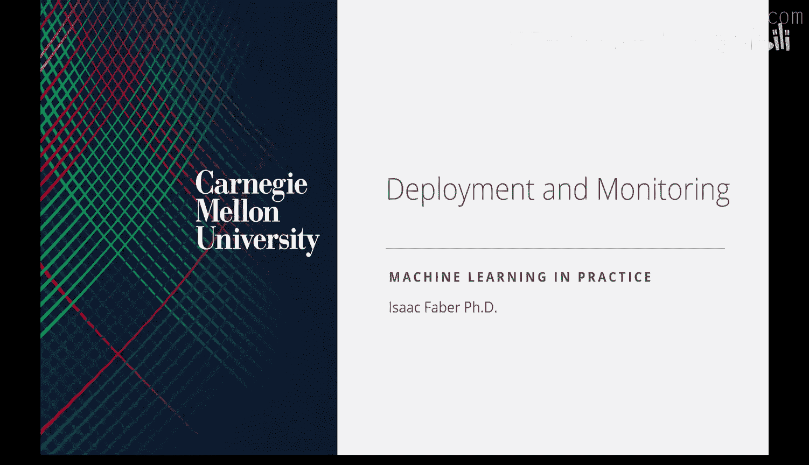
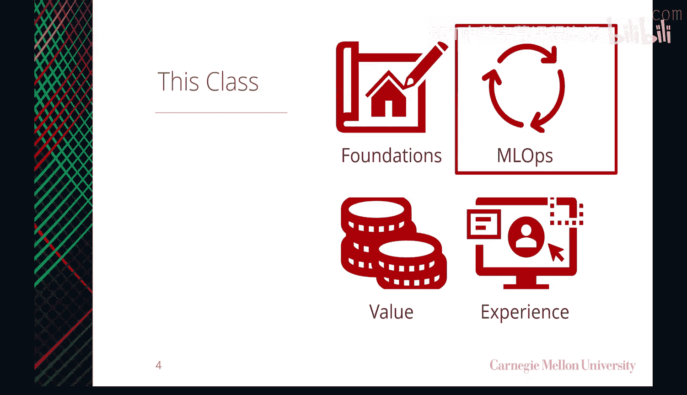
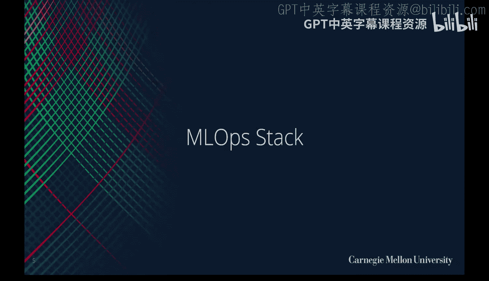
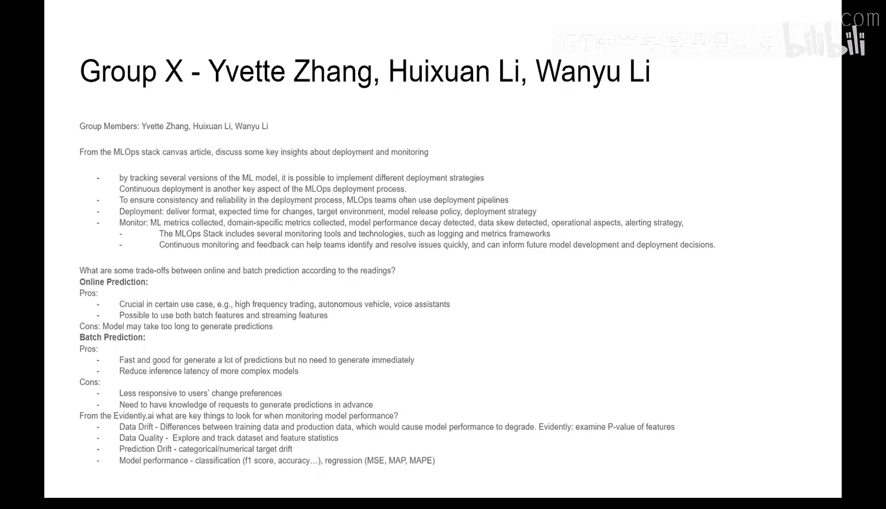

# CMU《机器学习实践｜17-691 Machine Learning in Practice 2023》中英字幕 p06 [P6]Lecture 6- Deployment and Monitoring.zh_en [BV18TUQBJEfH_p6]

Okay， all right， so we're going to talk about the MLO stack review that we covered on Tuesday and then the majority of the day we're going to talk about model deployment and monitoring。

 which is what we're going to do our in- class exercise on some of the readings there and considerations when you're making decisions about technologies you're going to use。

Yesterday we did a recitation a very strange time we ended up doing it one in the afternoon so and that was aid。

So some schedule changes for herer who put it together， but did a great job， he made。

 I think four or five different Docker containers that wrap up common APIs。

 a number of which you guys will find useful， it also had some resources for where you can get access to free cloud credits or very cheap cloud credits depending on what what your application is so if you're going to use an existing API there should be some great resources there everything from open AI the big cloud providers and a couple of smaller。

There was a couple of requests for a recitation on doing transfer learning or I'm saying transfer learning is my interpretation but wanting to train your own model with like TensorFlow or pytorch and a couple people maybe just want refreshers if you're not familiar with it so we're gonna fit one more recitation in probably next week Wednesday we'll talk about that so how to use Pytorch start with an existing model label your own data and train your own train your own model and deploy it which of course will be right in line with what we're talking about today but what that means is I'll probably try to fit in an asynchronous recitation because next week I going I was going to cover some of these concepts around experimentation that we'll talk about next week but so what I might do is just record a recitation sometime in the week and they just let you guys know when it's available still it should only be about 30 minutes but I just want to make sure you seeing handson how to use some of these tools as as you're picking it so。

It should be a good amount of contact coming your way in the next week or so。

All right so first individual assignment is due a week from Tuesday assignments are due by midnight of that day。

 we got all the proposals for the projects working through those and you should have feedback before your assignment is due next Tuesday and so in terms of expectation for your feedback for your project。

We're going to cover them it's not a difficult grading concept。

 we just want to make sure that you properly scoped your project based on the topics that we've covered so far in class right are you looking at how you're collecting data how a data Flywheel concept is integrated into your product are you asking questions about how you're going to provide value as a proxy for value asking the question who are your customers。

 who's going to pay for it， how are they going to pay for it so on and so forth so you'll get that feedback if something is way out of the spectrum or we think you could dig in a little bit more we'll give you that feedback to adjust your project along the way we will have one more project checkpoint for you actually present your final project that's not graded。

 but just the opportunity to answer a few more questions or give us feedback that you've or。

Let us know that you've addressed the feedback that we give you from your initial proposal。

Okay all right so in this class we're following on with ML Ops this will be our second and four classes on this topic and again we're covering deployment and monitoring today so as we get into deployment of monitoring ask the question where does this fit in this larger process right so now a number of your readings have covered this and we' continue to hit it right like as we go through the machine learning engineering process you decompose this into it's three constituent parts of data engineering data science and software development？

And if you look at the stack that boils down into。A minimum set of components that you need to address what in your ecosystem are you going to use to cover each one of the requirements for these architectural components and today we'll talk about certain architectural components that you haven't covered before so there are some things that we don't really go in depth in this class because there're a little out of scope like I don't talk about databases in not database class and don't talk about business intelligence we very briefly will cover。

Data labeling and data versioning actually those are within scope but we'll cover them quickly。

 but this idea of development and monitoring or probably sets of tools you haven't been exposed to before or thought about so it's worth spending an entire class just talking about that know we maybe get to the point to where we've even done some type of experimentation where we've iterated over a model to try to get it better but maybe not in a formal way but this idea of deployment and monitoring is unique to MLOs it's the idea of packaging up what you've created in your prediction and pushing it out into a product and a way that you can get feedback once you once you push it out and there's a number of different architectural considerations when you do this that can impact things like cost and performance。

Okay， so let's talk about model deployment。one of my favorite bes I don't know how to deploy a model at this point i'm too afraid to ask so there's like a period of time where like everybody was talking about yeah。

 you can do ML but can you deploy a model and the implication here is is that there's a step where。😊。

Training a machine learning model is a very different skill set than packaging it up as a product and pushing it out as a piece of software。

So if you think about your application structure， which is very generally speaking right you've got a data store or persistence in a database。

 you have the server that runs。Your application logic and then you've got the application itself out on quote unquote the edge right and so this manifests a little bit differently you could have a website right where in your server as a web server you could have a mobile app you could have an io device but generally speaking these base components are all the same right some persistent store that communicates you know as the model is a data model for your server that provides services for application that then presents those down to the to the edge so the question from a machine learning。

Product approach is where do we put the model Where does it make sense based on our use case So the first and most commonplace is is that you can do something called batch prediction so in the zillow use case for example that we saw early on it's very likely that zillow calculates all of their estimates at one time and then deploys those a as a table in their database so when you go to their website it's very performant because it's just looking up a static prediction where this idea of batch prediction is I bring my model to the point to where it's high enough quality I create all of the predictions that are。

Exhaustive of the things that I know users are going to ask for know Zil is a great example here because you know the houses right so you can calculate a finite number of predictions for the number of houses that people will be requesting so you can do those all at once so from a user's perspective they have no idea how sophisticated the model is and the prediction time as long as it doesn't take too long to get the that predictions updated which I would imagine probably maybe happen once a day maybe even once a week in some cases you can have an inference time or a time to generate prediction that's fairly long but it's completely divorced from the user's experience for the application and so most of the time first run MVP products will typically start here where you'll build a prediction you'll have a limited set of options that your user can do which are controlled by application design and your prediction will simply be the result of a database lookup。

Which is very fast。So your second option here is you don't have the ability to control a finite number of predictions in a reasonable amount right the number of predictions that you have to produce in batch are too large and if that's the case you need to do inferencing or prediction in real time。

The most common way to do that right now is to put your model on your server。

Or in your stack for your application as a service and if you do this then you package up your model as a component and your product architecture and the clients then call your application as a service So inferencing happens where you can control larger amounts of hardware that infferencing and passes the prediction down to the client and what I would say is is that definitely when you learn about quote unquote models and production。

 this is primarily what people talk about say okay package your model up as a Docker container even on the first recitation you saw me do that you took a psyit learn model would put in a Docker container。

 then that Docker container could be you know a piece of your microservices architecture then can be called as part of your application process so and you can control how many resources you also can segment it you can see the notes here right the idea here is is that a big model can be really resource intensive so like we see with chat GT is architect。

Like this they have a service that does the inference when the client typed something in real time and I mean just today I was trying to use it and I think it was down for like two hours this morning and what that meant is is that when they're inferencing harnesses down their whole application goes down right so there isn't say yeah there isn't a graceful way when this works to fail over to other alternatives sometimes and we're seeing that in real time with these large language model applications。

You also can。Do what's called model as a service。So a model as a service decouples your model from your application and it creates an independent or standalone service that manages a totally separate piece of infrastructure and oftentimes by a totally different team so when you see these arrows here these are APIs and APIs typically get developed based on what we call contracts and so your backend development team would have a contract with your MLOs team that says hey when I send this request here's what I'm expecting to get back in the application and so you wouldn't require you wouldn't require the team to be collaborating together on the the same architecture。

 the architectures should be independent as long as there's agreement between how they communicate。

This process this process is not as common in smaller teams but in really big teams if you go into large governments like I work in or you go into large tech companies this is a lot more common that a service will be exposed other applications can consumed from and that service isn't isn't dedicated to only do prediction for one application it's available for many applications and so then you have a responsibility to serve many other applications。

 this is how the open AI API works right so everything that we talked about and the recitation on yesterday on Wednesday operates just like this you have a service that's independent of your application your application wraps APIs that call that service and then you're not required to to keep it up it's easy to it's easy to scale but can be expensive right and so the tradeoff here is is that when you decouple these things。

You either are depending on a third party or you inherit the requirements to maintain a completely separate service and then there's some benefits for that at large scale。

 but sometimes those benefits aren't realized that at moderate and lower scales。

So this idea of model of a service， right， this is a process that。Moves you out of machine learning。

 This is where you're going from that like I've developed a model to the software part and so。

I think in this group， at least if you know your guyss background is to be believe this is probably something that's a little bit more comfortable for most of the folks in this group than typical。

 but I would say historically machine learning engineers and data scientists were not software developers so this was like a very uncomfortable point where we said okay now you need to like write actually good code instead of like this crazy spaghetti code that you write just to get your model to work models got to be packaged up in a way that it's predictable like a an application and early on what we saw was is that models is a service I would say I say early on so let's say 2016 2017。

What would typically happen is you would develop a model and then you would take it to your dev team and you say here's my model and they would say。

 okay， let's reimplement this in the language of our backend of choice right we're going to reimplement this in go or we're going to reim this in Java and there would be this process of reimpleation and then it would be a firstclass citizen with everything in in the application and with the popularity advent of microservices in the last five six years or so it's been a lot easier to take the same model that the data scientist creates and package it up and so this is by far the most common process I'll see today there's even a technology called MLflow which I think is resident as an experimentation engine for most moderate to large size teams that are doing MLOs right now Mflow has a process of packaging and deploying any type of。

machine learning model that has a generic framework more on that in a bit。

 just using these tools you can either use Fl fast API and then Docker to package it up as a container and then Kubernetes to manage your container orchestraquest as a microservice so this is super common so common like I mentioned I even covered it in the first recitation so when your goal in your architecture is to serve your own model very。

 very， very likely this will be the mechanism that you you choose to do it there are ways if you want to do it as a monolith like let's say you're working on maybe like a standalone Django application and you don't want to do any containerization if you're using a Python library you can integrate it as a native component the downside of course is that the attention that your machine learning process gets in your application could potentially affect the performance of the rest of the application so this is a great way to segment and make sure that。

So are applied effectively and efficiently， I would like to say， though， that to be clear。

 Doggcker and wrapping up in flask is not the most performant way right so if。

If performance is really， really， really important。

 there are some drawbacks to this type of architecture to microservices architecture。

 even though it's really popular and does great in terms of reliability。

 if you have high availability or requirements beyond high availability that include performance there are other mechanisms to package models up and deploy them。

 but they're not as common， this is like 95 to 99% of what you'll see out in the wild。

So the way that this is done typically， if it's automated is models get transferred into a common format and what I've seen is to be the most common format for models。

 especially models with neural architecture。Is that everybody agrees on this common API and framework and right now that common framework is Onyx and so Onyx was a framework that was championed I think by Microsoft and then now has just generally been adopted across communities so if you train a Tensorflowlow or Pytorch model it's easy to transition it to an onx format package at onyx format into a container and then deploy it and that gives you a lot of great benefits for portability ease of use for later on for transfer learning across different framework so pretty common as we see model of a service you can build it in whatever framework that you prefer and then from that framework transition it to something that's more universal and packaged it and deployed as a service。

And then。Your other options to deploy at the edge now from mobile application。

 this is super common so I。I think I have a slide， so I'll wait to show you that。You know。

 like everybody I think is carrying around your phone， especially Apple and。

Certain types of Android phones， you know， they come equipped with very nice processors that make it very capable to do lots of inference on your phone so my kids use this like。

Stable diffusion app。Call drawaw things。And so you can just type in this prompt and it selects a bunch of different stable diffusion models and you can see Thomas theTin was created last。

You guys know who Thomas a train is？You will at some point。

When they use this though like I get it back and I know they've used that application because my phone is crazy hot it's like there is no yeah my phone was clearly not designed for doing heavyweight inferencing on some of these deep learning models but nonetheless the model can be packaged and deployed optimized for edge device you're of course limited to those different hardware specifications and talk about a couple of your alternatives here。

😊，So in the popular machine learning libraries for Deep learning。

 TensorFlow and Pytorch will have optimizations for mobile or Edge so you can train a model and then you can use one of the edge frameworks and again when if your model is really large and you move to an edge framework like TensorFlow mobile and E TF light is what it's called you will lose some performance in the model by the way that the model is optimized and pruned。

 and you'll see in the readings today how that is done pretty straightforward but effectively some clever decisions are made by the way the model is optimized but again you tradeout performance but then you get a much more manageable package that can be deployed in lots of different settings。

Those settings include， like I showed you my phone。

 I think the most popular one for folks that are doing application would be QML is Apple's machine learning framework。

Which is actually pretty cool。 So I a lot of people have a Mac， right， to see。

 So coremel is actually pretty awesome。 So from a developer standpoint。

 Apple has like all of these like pre builtil models and frameworks that you can get right in。😊。

What's their developer？Coode X right or Xcode was close Xcode Yeah so right Xcode can you can do this plug and trade models and it's designed for software engineers so you don't even have to be a great machine learning engineer and you can get a coreml model and you can export to other formats so you could train here in Qml export to Onyx or integrate directly into your to your i application and there's many ways to go from i to Android and back and forth。

 But from like a traditional like consumer electronics view like optimizing something for the edge like Apple's put a lot of work into this platform。

 So if your project is an edge project and you have a Mac out encourage you to take a look at this option。

So if you want to go a little bit more low level though right you don't want to be beholden to the。

People at Apple， you can develop your own from scratch and the most popular。

Chip that if you're going to build your own IoT application are these jetson chips jettsson nano chipps from Nvidia now last year you could buy one。

I don't think。Yeah， I think you were still in a place where like GPU shortages have made it very difficult to get these。

 but a developer is I think about $100 and you get a  four gig GPU that performs about as well as as your phone would and so what I've seen from my work is there's a lot of people will buy these and then they' four factor are're so small they're easy to integrate on lots of different things whether it's you know a small vehicle or you a drone or similar and then you have something that you could do inference on for lots of different things or like a home security device or number of different settings so we have I have a team of work right now that。

Is is building a vision system with one of these and they have it on like a small mobile platform and it's pretty awesome how easy it is to build and deploy models onto these form factors they're designed specifically for it so I would say like a little bit more flexibility like in coreL you're going to have to be on the Apple's framework here on Nvidia because it's so open you know you have to be more intentional about how you build and deploy your models but。

Those options are available。Still。It's in。Things like Qml。

 Apple will make sure that your model can work on the iPhone。

NVIDI is not going to make sure that your model can work on the Jes and so it's up to you to optimize it to make sure it works well so you take on the burden of a lot of the testing。

Okay， all right， let's go ahead and jump to the in class exercise so in your group go ahead and take a look at the slides on campus and the readings and take about 20 minutes and we will talk about it。

All right， let's get started。Okay， under the MLL stack， what do you guys think？

What are some insights that you guys took from that？都。But this before deployment。

 we need to think about like how is the model supposed to be deployed and what are the target。

 who are the target audience for this particular party。

Like things like how it's supposed to be delete whether it's the entire one that has to be delete on certain parts of it。

Okay， what do you明白 that？Yeah， I mean， in deployment。

 these are the questions that were were coming to the one。はい。

So here like once we deploy the model into product， we to think of whether， first of all。

 whether there' is a need to monitor the model or not， and secondly。

 if there is a need on which criteria do we need to model the。Ass the performance of the model。

So in case once we deploy it， whether we look at like。

There is any change in the audience to which we initially they may think model for or except there is any drift in the data which is coming into the model and if there is。

 then there should be an alert that is created to be created by the monitoring system itself so that we take a look and decide whether there is a need for dec the water。

对。Yeah that's exactly right I think in terms of deployment a bunch of these questions around like is the model doing what you needed to or what risk are you accepting by deploying it the way that you've done it how finicky is your target customer do they need it right away can they wait like we saw the difference between Zillow and chat GBT when when is it okay to do the prediction and serve it back up all major consideration。

What about the trade offs？Specifically between online and batch processing so basically like we prefer bias prediction when there are a lot of predictions and results can be delayed like in case of recommendation systems of Netflix or something。

Where， you know， like whatever is to be given is already decided and it's just that when the user logs in us something。

 we can directly give the recommendation。Vas online prediction can be preferred when like there are too many requests。

 for example， millions of quicks which come and go and the response has to be fast so when is time and number of requestquest more than online prediction is preferable batch prediction because we don't need to worry about storing all the predictions beforehand。

Right。What you'll see is the online prediction is much more expensive。

 The infrastructure and the management associateds was a lot higher than the than the batchge system。

 So I last year made。A total fool of myself on Twitter when there was somebody who goes said something about Google coppit that had just come out and he was like this is like super expensive。

 something that affect like all of these online predict this whole thing does real time prediction I was like。

Coab probably does some mix they probably have a bunch of batch stuff and then only do online prediction when it's like out of context and the guy responded I'm the lead engineer for copilot。

 we do only online prediction I was like oh maybe I should have looked up before I responded to this guy but it was I think is impressive and that's the same architecture that we're seeing with like open AI is there's a tendency if you have the GPUus to do online prediction because it's more expensive but you can control a lot more right especially like it gives you one place in the application to update where this is a little bit more of like a longer latency or larger term so if you do this well it's a good experience for the user but expensive。

Okay， what about the last question about evidently AI but you think about this。

Dashboard seen by no bunch of metrics that they show performance1%。

 mostly they related to error matching the。呃，挽觉就高，但感觉数量高。で。

So there was at a percentage that I reviewed with similar Google things。And a distribution。

And that actually literally just shows you where you' Philip are。Yeah。

So and I think probably everybody else will have a similar experience as you look at it when we talk about monitoring。

 it's interesting because we go back from machine learning back from the data model back from the algorithm view to the data view and we're doing hypothesis testing you're doing a statistical hypothesis test on is your data different as it comes in and and what data are we looking at right like typically we're looking at the features coming in and monitoring those for quote unquote drift but drift is just a fancy name that the distribution has shifted right that you have a statistically significant？

Change in the parameters it comes in and that's all these tools do as they allow you to look for that now you have to define the devils and the details like what horizon you're looking for how do you chunk that up you know it's not like you'll be able identified drift。

In one data point， there's got to be some。Risk that you accept over a specific season where you compare those things like you're doing in any of typical statistical test。

 but yeah， good answers。Okay， Joe Elliot。You're not last this time。You are moving up。

So for deployment from the there linkss。Decisions about the plan you。

Format of the model that you're going to。input output。But your targeted environment。します。

What's your release policy。Yeah。It's interesting because the release。

 we typically think of it as like a product feature or not a product feature。

 but like a stability improvement like hey this model is better I'm going to go ahead and improve it what has been super interesting this year。

That I hadn't seen historically is model releases are like。

New iPhones like we're talking about like when's the next version of g coming out or when's the next version of Bar or thing coming out and this was like。

You know， it's being treated more like a。Yeah， like more like a full product release with like press release and stuff as opposed to what typically and it probably as you saw in the article is。

Usually meant more for stability of the application so anyway it was kind of interesting observation all right。

 would you guys think about some of the trade offs。Yeah。

 so that prediction is great if you know exactly what the user will be requesting。

 whereas online prediction might be better if。Something where the data generated time is。

The like translation。Everything of anybody。Fast prediction trade offs better for high throughput while online is more less。

对。So even though online gives you this like flexibility， the one truth is is that。

And batch prediction， you can manage risk a lot easier because you've already done the predictions you can check them to make sure there's nothing in the predictions that you wouldn't want to get out。

Whereas the online predictions and we've seen this of the GPT models。

 you accept some risk on what the models are going to do because you can't check exhaustively over the whole distribution。

 so you do set yourself up for some embarrassing things that happen and that has been the case I sometimes will talk about it in this class but I didn't bring it in this time but there's like a whole like failure of machine learning models like repo where all like these high profile affairs have happened and they almost all happen and these online systems where they get manipulated to do things that the people who deployed and didn't intend to happen。

Okay， anything to add， well， we just talked about hair testing from modeling and monitoring performance from the evidently documentation。

It mostly focused on like data drift model performance。Right， so you to sure that you're repeated。是。

对。Okay。The model still。So工。不。Yeah this is like an interesting thing because you we mentioned drift in the last group as well all models drift and it's almost like a characteristic of the universe you don't like I really know why you know that like the world changes but you would think that things would be more stable than they are so there is always a process of improving like just to stay at the same level of performance of when you initially deploy and conditions change what you're predicting changes the data as it comes in changes and drift is a major part of managing in the MLOs process。

对。喂。算。我太子。Like no weather the way and the time for。我。诶我。第八钟。就3给代借款。第一个。Right。好的。不要。Ts of library。不是。

但其实我看下。And also how to detect。Yeah。I need flash in the train。啊。大都就。对是。我大到佢。伤害。Or。好。Yeah。Yeah。

 that's a great set of points， I think。Some of these things tied in together right like your release policy is going be tied into your metric threshold for retraining monitoring decay or model performance or drifts right and so at some point that's going to trigger like a revisit like。

Are we。Are we retraining at the at the right cadence according to the policy to make sure that we're delivering the services and consistent with the way that we want to that's that's a great set of points Okay what do you guys think about。

Tradeouts between batch and online and anything。喂。Ex holiday on the floor fast。不道。今回。All wrist and。

Please some ads which think I could match of that prediction but it is ideal to use that prediction。

P or the lunch Monday。It like depends depends on the class real and like want more。The state。好。Yeah。

 it's interesting。It is the case that if you have a more reasonable distribution that accuracy is both easier to measure and is easier to achieve。

 this is a great point。Okay， what about model monitoring？So。I think。That对个不好的。做我想播。It also feature。

 but yeah articles。我操。So。Yeah。Yeah， good a great addition。

Did we did something happen in the data pipeline that broke and are we monitoring that I mean there's a chance that。

The script that holdss the data is still running， but what's coming through the script is subsequently different。

 Maybe somebody broke the contract in the API and we're not getting what we had anticipated。

 So this is a like you know， if you can think of like the data or the predictions you're getting from the APIs that we advocated last week are。

You know they are a form of data that's coming into your product you're going to want to monitor those and even run tests on them right if you're using Amazon's recognition API for computer vision to be running tests about you know what it's predicting and if at some point you start to see strange behavior and the way that it's doing that may push you to a different cloud service potentially。

Good insight there。Okay， you guys。但是把。你我开。No。我。嗯。啊。Yeah。不。Yes。Because they both allow。做日车。好什么。我。就是。

Yeah so this is a great point effectively what you're saying is this process is highly automated so that when we're ready to deploy or this deployment happens without too much intervention。

 you know what's interesting is the other thing is if you deploy a model that breaks things if you're using these automated systems it's easier to roll back like hey something happened with the model that we just deploy it's not behaving the way we expected it to let's go back to the previous version and if you have these system set up just like with your code it's easier to do that。

Anything that add be trade offs to online or batch？So， for trade。Similar。对。对啊。Thats pretty。

A responsive。Yeah，啊。Over。啊，对。On my prediction。好了。That for use case。Regarding to系。はい。好。

And the dash predictions for。没有。Yeah I think that's a great point and is that way right like so you need to ask this question about how how much does your customer care about the responsiveness of your of your prediction。

And。You know， if if。If the goal of your prediction is to produce something that's closer to real time or more specific to the user and the user doesn't get that。

 the idea that you will retain them as a user is probably not a great assumption。Okay。

 anything else to add for monitoring？去。哦。清。是。是。Yeah， like we mentioned， right。

 this is an opportunity to go back and use the statistical tools to identify those process。P关。Okay。

Is there。嗯。发。Fious aspects。S。think that's going not mention。It's a shadow between them say。えか。在说。

诶 regarding on。嗯。等下。To trigger model training。打。And face for。是。嗯。Yeah。So we put you on the spot。

 what sort of event might trigger a model retraining？And a product do you think？啊。Yeah， that's good。

Anything else？

What if you got a whole bunch of new data。Like you here's here's the corpus of data set that you had to train the model and your data labeler said hey。

 we got 40，000 new images labeled and then you merge that data you would want that to trigger this process right retrain the model and if you've got this set up and then do a shadow deployment right so it's not gonna to impact the performance but you'll see how it you'll see how it behaves when it's out in the wild so this is a good this is a good approach it's academic I don't see I'm sure many excellent teams do this I don't I haven't been on a team that does this well but if。

But if you're capable of doing it and have the resources to do it and your model's not super resource constrained。

 it's a good idea and yeah especially if you require high performance of your system。

 if your system goes down and it's got a big impact on your organization。

 you shadow deployments or great ideas to mitigate those risks。What about trade offs？有度。Encounter。

 at least in general， there are two drive off。 The first one is the timely and the complexity。

 one to just like， make a ton。It kind like。Cannot make the model to be very complex because it's a trick。

I also have to chart off it same cost is typically。

 if you want the model to be like online would just。it would cost a lot more。 but in the article。

 it's mentioned that maybe in the future， it's going to be cheaper to just。对。

So this is this is the hope it is it is true since the article was written that the models that were state of the art at the time the models were written are much cheaper to run the problem is the models have gotten bigger with the reduction in costs。

 so we now have like。You know， like I remember it was just like two years ago or three years ago we went from everybody had their local workstations with their。

1060s or theirre 1080 like NviDdia GPUs or they're running their laptops and now we're like up to like these 4090s that are like huge and if you don't like plug the power cable all the way in it will like melt your cable and and and people were talking about these efficient large language models that you can train on 14090 and like 4090 is like a $2000 graphics card like is it。

Like I don't know who these people are but。I can't afford a $2000 graphic card and that's like。

A small model so yeah it's been interesting watch this cost trade off is super important and in some sense like is the problem right like can you afford to run the product that you're building and if the answer is no then you got to make some adjustments and trade off。

Anything to add to？want sweater。This model creep towards some bias。Oh， interesting， yeah。

 it's the first time we've heard that word， right？So there's drifts right where it's not behaving like it had been when you trained it and then there' there's bias and they're not exactly the same thing and bias is a statistical word right so it does fit in this statistical testing but a lot of times you don't know especially when you maybe do your initial training on open source data what some of those biases are so like you do with your software code building and tests to identify this and your data is important or else you potentially run into those that was embarrassing。

Mistakes that they make out in the public when。They do things you don't intend them to do。Okay。

 and I think we got one more group， right？W and Ash。It pal。

Let's see check this year process the key insights I got from it was think of what it would be。

That speaking how playing force and auto。So we'll talk about this in one of the recitations in a little bit in class next week。

So we have the idea of versioning code that everybody I imagine here understands right that you have this text-based approach and there's dis and merges right and the codebase comes together and that's what you used to deploy the reason why we have the same concept for model and data is that you need to be able to have some traceability for what data the model was trained on because the quality of the model is determined on the quality of the data。

So your performance in your model is best improved by adjusting the quality of your data and if you don't know what data you used in specifics when you train your model it's very difficult to turn this into something scientific as opposed to very ad hoc there's a number of tools that do this but you'll see when we go through it I was just I was building the tutorial this morning on this and it's awkward so you still have to like version your code but then you also have to version your data and they're very similar command and you can combine them but they're two very different systems and they're asynchronous too right your data will be updating at a different pace than your models do so you can retrain0 models before you necessarily update your data and vice versa and then same thing with your code as well so。

This is interesting it's going to depend on your your preference and the tools that you use。

 but there's a bunch of stuff that we'll see here that willll wrap us up in class that people are building products to try to help with this workflow because there's a lot going on right like I'm comfortable with conversioning code and now i'm telling you you have to do the same thing for。

You know， other artifacts。Okay， anything on the trade offs that's。对。喂，好。对。这个圈。啊，没有。好。好。Well，嗯。嗯，这。

That's interesting。So in practice that doesn't it doesn't typically manifest like that。

 but I can absolutely see that。That point of view。If your batch prediction is everything， right。

 so if we look at Zillow if。They're predicting a estimate on every house in the entire United States that probably is wasted and as I'm thinking about。

 you know I haven't seen their infrastructure but I bet you're probably right。

 I bet you they probably only batch like the 5% of houses that most people look at and then the rest of them they do online。

So yeah， that's a good point。Okay， anything to add under Bner？稳啲落一个俾睇就实伤。嗯。Thank you。开始。performing。

我的。Again， you are your validation metrics。Swatering。Yeah等下。Yeah。

 that's a good point or performance right kind of same as availability like how quickly are you returning this the answer when it gets asked of you so especially with these larger models these these questions of performance become very important because that's going to determine how much you need to scale。

Cool all right I think you guys kind of got the gist of it right like what are the considerations of your stack trade offs with bats and online and then you can see that it's not one or the other right that there's some balance between this potentially depending on your architecture and then the important considerations for monitoring so let's let's talk about a couple of the nuances here in model monitoring for the last 10 minutes or so and。

These considerations are how you're going to set up those statistical tests and the stuff that you might run into。

Okay， so after you've seen the reading， this is hopefully a pretty obvious statement right why monitor after deployment primary issue is that model performance after deployment does not meet expectations that what happens in your notebook with your test data set isn't the way it performs when your model gets deployed out into the wild。

Drift is the term that is common for this phenomenon so there's different types of drift and we've covered a number of them up here actually I think of them except for domain data drift。

 model concept drift， data drift is pretty straightforward right the distribution in your data changes over time and we're talking about the data pipeline when we say data drift the data coming in as your feature and then model concept drift。

 fundamental change in the system the model was trained in so let's say that you trained self-driving cars here in Pittsburgh and you only used images from Pittsburgh in the wintertime and then you took your algorithms and you went to California and it was California in the summertime and then all of a sudden your card didn perform as well and you can see that you moved significant context from where you had collected your data and trained where the model then was attempted to be used later on which means that there's some process where you got to go through to collect new data and update。

はい。And then domain shift as well misalignment from training set to deployment setting consistent with the story that I just told there Okay。

 so the idea of monitoring is that we also want to look at drift but also the quality of the data which we talked about right is the data that's coming in high quality is something broken and if it's broken。

 how is it broken and how can you fix it。So let's talk about different types of drifts that you'll run into and so these are just general categories of things that different folks have noticed over time so the way that drift manifest will give you an idea about how to debug and adjust so instantaneous drift is you train it you deploy it and then all of a sudden it's completely different right so there's clearly some different context setting that needs to be adjusted so you need to collect a new data or you need to tweak your training to be more consistent with the with the deployment state。

There's gradual drifts， you deploy it and it works as well in training。

 and then over time it degrades。Which means that the system that it's being deployed in is in constant change and if that systems in constant change。

 we need to be asking questions about。How are we setting the threshold for retraining what's our policy are we doing continuous development where we continue to update so if you see this gradual drift it means you need to increase the pace of retraining collecting and retraining your model。

There's periodic drift and what this means is typically there's some fundamental characteristic of the system that you didn't account for in your data so you're consistent during certain periods and then episodically the performance changes so finding out why that is will typically give you an indication about what data you need to collect to improve the improve the system and so usually again this is contextual but episodically contextual like hey I do really well during the day but not very well during the night with。

Thoma vehicleh or。If it's a medical setting right I seem to be doing really well on predictions with men。

 but then when I do the same thing with with females then my prediction isn't as good so why is that gives you opportunity to。

Make those changes about why you may perform well in one setting another。

There's also temporary drift like if there's a big shock in the system， so for example。

 let's say you were monitoring traffic on Tuesday and you saw all of a sudden like normal traffic just went。

Crazy and there were tons of police cars on the street and there was a big change in the system that was like watching what was happening with the traffic like right up the street next to central cat this would be an indication of a number of things like clearly something is happening but you wouldn't expect your model to perform well in a setting like that if you hadn't prepared it to so usually that means there's been a big shock to the system like like we saw in real life on Tuesday here。

Okay so the question early on we had should you monitor right and in when you do your deployment what are the considerations for monitoring how do you do it these are the things that you want to collect more information on or less information and then you can see。

This is my little scale， how hard it is to measure versus how easy it is to measure so model metrics over time。

You have to collect a lot of metrics meaning that every time that your model runs an online or a batch prediction you collect that information and log it somewhere。

 so if you have an application that's got a lot of activity this can turn into a lot of data potentially expensive to store and move around so it can be more difficult to measure those things in real time so you may have to。

You know strategically do some type of sampling to get those those metrics as opposed to know exactly what they are business metrics。

 you know， not quite as much information again， you could do a little bit more sampling usually business metrics or aggregates of your your logging function so you know a customer does a lot of activity on your site。

So when a customer churn that don't only happens like once a month or once a day。

 so a lot less logging distributions of model inputs and inference so this is the detecting of drift doesn't require as much information because again you can do statistical sampling there and then system performance how faster you returning inferences when you're calling them to your API and those things are usually pretty easy to measure and this is I think a pretty good wrap up of the type of things that you can expect to monitor when you deploy a system and then thinking through like what is the purpose right like for your target customer。

And the purpose of your model， what do you need to measure， how much of this do you need to measure。

 how much effort do you need to put in to measure it the more that you can measure。

 the more responsive you can be， but it also means that there's a requirement to put the effort in to be able to measure it。

Okay， a couple of feature distribution shift considerations I mentioned this before。

A classic statistical hypothesis test it's a T test that's a comparison of means over a given period of time you collect two samples and you compare them and that's what the tools do if you looked at evidently AI the application which you all just did you can see here that the whole purpose of it。

Is just to give you。Differences in these statistical distributions like that's it it's doing a statistical calculation from your undergraduate statistics class which doesn't mean it's not useful。

 it's actually very useful but it's pretty straightforward in what it's what it's attempting to do and here's what you see how you see people identify it the first way is visual inspection look at the chart does it look like it's different the second most effective way is a paired T test this is my recommendation paired T test very simple to run got everything baked into it from managing smaller sets of data so you can do sampling a KS test is a test for difference of distributions those are baked into the tools as well if you're comfortable with doing a little bit more advanced and then you can also do things like distance calculations or P norms right measuring the distances between data that's collected similar to the way that we do a cost function again I would recommend doing drift detection in this order visual paired T if you're doing it。

Automated KS test if you want something a little bit more robust。

 and then if things are really tricky， you can build your own using different sorts of。Metrics， okay。

What you need to do I mentioned about packaging up your model as a service into a Docker container so it's not as easy as just saying hey here's my side kitt learn or my pipe torch model and I put it in a Docker container and deploy it it's almost that easy but part of your model or part of the packaging of that container should be the logging of metrics right you should wrap。

And have classes and methods associated with logging that record information as your model being interrogated as a service。

 so having a way to pull that information stored as part of the service is an important architectural component I mentioned with MLflow you can package up the model as a Docker container deploy automatically it's a great mechanism because it will package it with all of those monitoring and logging features that you need so you don't have to build them yourself。

In this class， it will be good enough to build them yourself or have a mechanism to collect them however you see fit。

 but it's important to note that you are responsible for creating the logging mechanisms when you create these machine learning services。

嗯。Okay and then let's wrap up with this we talk about lots of options for model deployment out to the edge to batch processing and everything in between from online model as a service constructs。

 make sure you choose the best option based on your product requirements and the feedback that we'll give you from the assignment that you just submitted make sure that you're collecting and saving model metrics monitor the metrics for drift and remember the drift has many root causes and it's like debugging a program but requires a little bit more forensic insight and that's all I've got for you today and think we'll right on time so。

Have a great weekend you guys have a homework assignment it's going to be awesome it's the greatest homework assignment ever given in a class you're going to enjoy it if you have any questions about or reach out over the weekend and hope you guys have a great weekend we'll see you on Tuesday。

