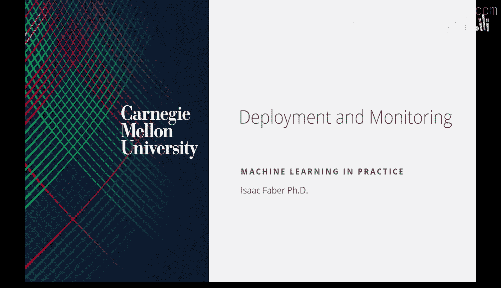
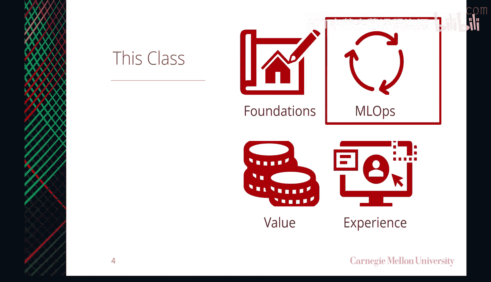
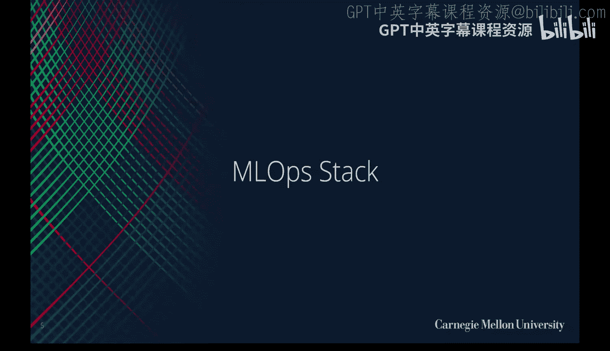
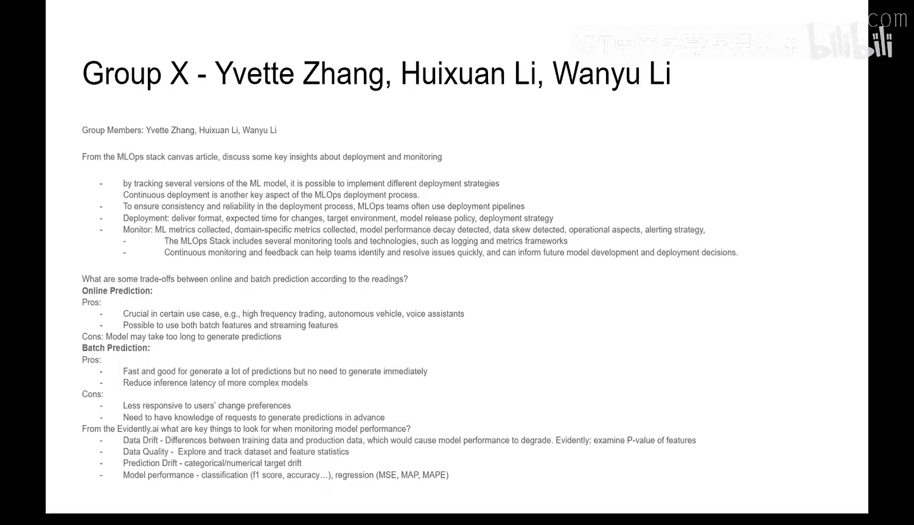

# CMU《机器学习实践｜17-691 Machine Learning in Practice 2023》中英字幕 p06 [P6]Lecture 6- Deployment and Monitoring.zh_en [BV18TUQBJEfH_p6]



## 概述

在本节课中，我们将学习机器学习模型的部署和监控。我们将探讨如何将模型部署到产品中，并讨论监控模型性能和确保其稳定性的方法。





## 模型部署

### 部署方法

* **批量预测**：适用于可以一次性生成所有预测的场景，例如Zillow的房价预测。
* **实时预测**：适用于需要快速响应的场景，例如聊天机器人或推荐系统。
* **模型即服务**：将模型作为独立服务部署，可以由多个应用程序使用。

### 部署工具

* **Docker**：用于将模型打包成容器。
* **Kubernetes**：用于管理容器集群。
* **MLflow**：用于模型版本控制和部署。

### 部署到边缘设备

* **移动应用**：适用于需要在移动设备上运行的应用程序。
* **边缘框架**：例如TensorFlow Lite和PyTorch Mobile，用于优化模型以在边缘设备上运行。
* **Core ML**：适用于iOS设备。
* **Jetson芯片**：适用于嵌入式设备。

## 模型监控

### 监控目标

* **模型性能**：例如准确率、召回率和F1分数。
* **数据质量**：例如特征分布和异常值。
* **模型漂移**：数据分布或模型概念的变化。

### 监控方法

* **模型指标**：例如预测时间和错误率。
* **业务指标**：例如用户流失率和收入。
* **特征分布**：例如使用T检验或K-S检验进行统计测试。


### 监控工具


* **Evidently**：用于监控模型性能和数据质量。
* **MLflow**：用于记录模型指标和日志。

## 总结

在本节课中，我们学习了机器学习模型的部署和监控。我们讨论了不同的部署方法、工具和监控目标，并介绍了如何使用各种工具来监控模型性能和数据质量。

## 代码示例

```python
# 使用MLflow记录模型指标
import mlflow

with mlflow.start_run():
    mlflow.log_metric("accuracy", 0.95)
    mlflow.log_metric("precision", 0.96)
    mlflow.log_metric("recall", 0.94)
```

```python
# 使用Evidently监控模型性能
from evidently import classification_report



report = classification_report(y_true, y_pred)
print(report)
```