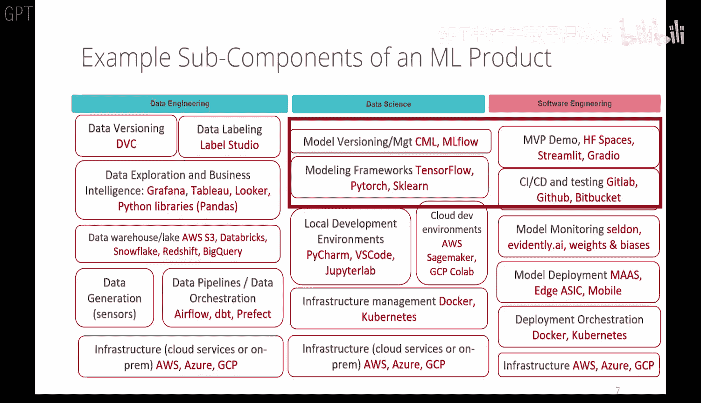
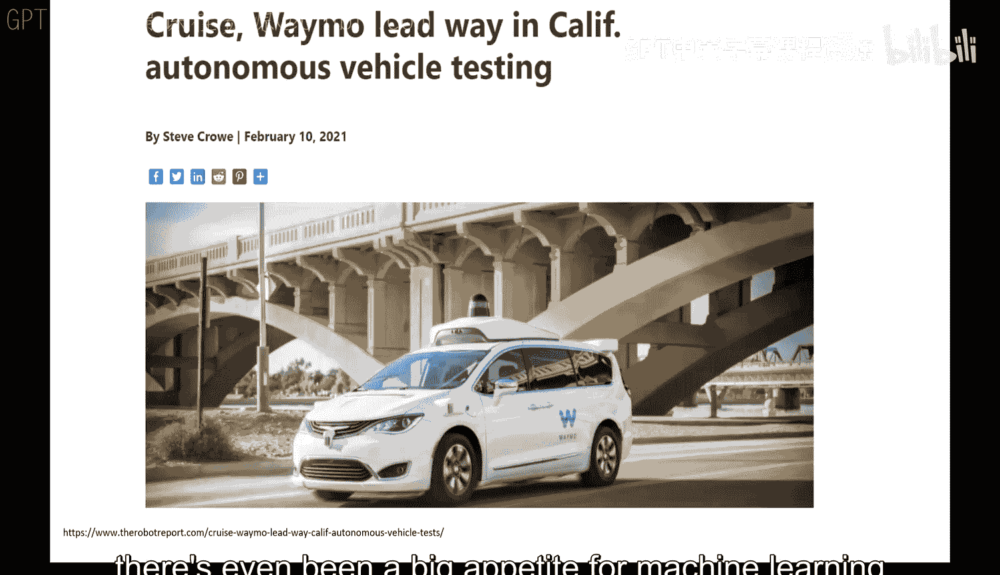
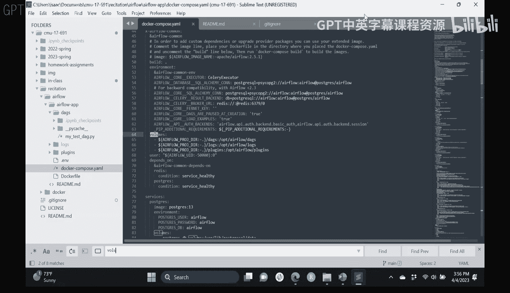

# CMU《机器学习实践｜17-691 Machine Learning in Practice 2023》中英字幕 p07 [P7]Lecture 7- Testing and Explain-ability_2.zh_en [BV18TUQBJEfH_p7]

All right let's go ahead and get started。Today's topic we're going to cover testing and explainability as part of the ML Op stackack。

We will get there in a minute as usual let's cover some house cleaning a little bit of review discussion from last time and then we're going to cover interpretability or explainability and then testing to wrap up Okay a little bit of house cleaning so I think everybody's tracking this first individual assignment is due my midnight tonight classscribe is going well I think i'm still waiting on Thursdays but you have today to turn that in just make sure that you're taking a look on on canvas for when you' when you're up but the notes that have been getting published have been pretty great so use those as a reference especially as we get into the group project for。

Key things that we'll be looking for。It's one of the announcements on canvas yeah so look at the announcements on canvas Arnora put the list up there。

So I got a question before we started about the assignment。

 so I'm sure if one person has this question a number of people will part of the assignment is you have to write to a SQLite database。

 SQLite database is a file and we've given you the file。

Where to put the file though right so when you create the airflow dag there are three directories that are created as part of the container creation and they get mounted as local volumes。

 you can use any one of those three folders， I know they're not specifically intended for that but use the Dg folder as like general guidance but just make it clear where you put the database so that when we run your code we are writing to the same place you put the file makes sense。

If it doesn't and you haven't started the assignment yet， it will make sense。

In a couple of hours when you start hopefully that's not the case the next assignment will be due a week from today and it will be following on from the winemakert I'm still finishing writing notes for the project feedback so I was hoping to have that done before class today but I should have it done certainly before we meet on Thursday but hopefully today as well so you'll get get some feedback there so far most of the proposals have been great I think the projects are going to be super interesting and hopefully as you're learning stuff from the homeworks itll it'll inform how you develop your。

2钱。对。H。Okay。What did you added on the YaAL file？So yes， yeah。

If you want to keep it there or if you want to move the SQL database into one of the other directories。

So hopefully I wouldn't be too big of an issue。我少钱。但是。没事。Make that change。Okay， that's fine， yeah。

 just submit the Yammal as well because you I think you're going to submit like two or three things anyways。

 just submit that alongside of your Python script。Well， when you run a bag， where can we expect data？

对。Well， that's why that's what i'm saying it's up to you where you put it I would recommend putting it into one of the。

Already mounted folders just to make it easier or you can do what he didn't create your own。

That would make it ephemeral， so when the container stopped。The database would go away。

So you want to make it so that the database doesn't。

Remove so what would happen what you just described is it would it would write to the database and then when the container stopped that database would be gone。

So it's got to be， it only persists if it's in a volume that persists。I tested it， too。Okay， yeah。

 I don't know， maybe you're bouncing at the root。It's a root folder as well。Yeah。

 because I think and I'm thinking through the Yal because I think it mounts each volume。哎。

It doesn't mount at the root directory。Yeah。I thought it just。嗯。Yeah。

 I thought it mapped the working director。知。不。对啊。Youll might be right I don't remember exactly off the top of my head if that's the case then then you're okay。

 but go back and take a look and see it， I don't know that might solve your problem as well。

I don't remember off the top of my head， I thought that it mounted each of the directories that we created individually。

But either way， just make sure it persists and that we can run it。Okay。All right。

 any other questions about homework？Okay， all right， today we are。

Doing our third of four classes discussing some of the topics in machine learning operations， again。

 talking about testing and explainability。And this will be the second to last on Thursday we'll cover some discussions around ethics and compliance when you're building your applications。

 but today's discussion is a little bit more philosophical on the tools side。

 like how are we going to integrate the right tools that allow us to make these determinations。

 when do we need things to be explainable， when do we not we and how do we test things？Okay。

 so back to this discussion around the MLO stack， again。

 this framework that we've been using up to this point where your product is separated into these three high levelvel components and in these three high levelvel components we've said you need to think about architecture decisions about what components that you want。

Today we're talking about down here at the end， how do we make sure that after everything is deployed that we can make sure that it's behaving properly and that we've tested it on the way out and that。

The information that we're getting back is in fact what we want to be seeing so if we go to our architectural components today's class sits right here it bridges between our data science and our software engineering components specifically around model versioning some to do with frameworks and then specifically CICD and deployment considerations right so when we have these components how are we making sure that they're being deployed and when they're deployed we're maintaining a good idea of the behavior of those components。

So a little bit on this， so this week we're going to do two recitations Herno is going to do one on Thursday where he will go over some transfer learning components using some popular deep learning frameworks so if you haven't been exposed to that it'll give you some examples there in some resources so if you have if you want to label your own data or not use a model off the shelf。

And then I will cover probably tomorrow， I will cover data versioning and model versioning together。

 like how in a typical machine learning。Application how do you do experimentation and experimentation is tied in really closely with this idea of testing and explainability and versioning so those components will see them practically in the recitation and today we'll talk a little bit more philosophically about why we use them。

诶。Okay all right let's start with interpretability so there was this idea and this is about a year ago actually closer to two years ago so Cruise and Waymo lead the way in California autonomy autonomous testing the reference to this article is in the is in the course notes on the slides but the discussion route was pretty interesting in that if you wanted to have a fully autonomous taxi in California which several of these companies have now you can go to San Francisco and you can drive in a fully autonomous taxi now and。

California had a determination about。What were the metrics associated with allowing somebody to actually be safe inside of an autonomous vehicle Does anybody know what primary metric is used by。

The state and in general for。Determining the quality。Of an autonomous vehicle。

Does anybody want to guess Miles？So miles is one it's the base rate but miles is what without a way that's exactly right so they call it disengagement so the metric is how many miles you drive before a human has to intervene and depending on how many miles that is determines the。

The general safe safetyness of the system so another big portion is is that the regulatory systems required this the autonomous vehicles to be to have some amount of explainability。

 why were they behaving this the way that they were behaving。

And there was an interesting component and I think it's still this way now is that the self driving vehicle companies would do would kind of game this metric right and so in California we have these like。

Interectctions that are these big clover leavess if you' ever driven in these clover leavess they're like it requires you to like do these big loops when you're getting on and off the freeway and so viewed from the air they look like Cloverles and I think it was Waymo but early early on Waymo was able to get really good statistics on this disengagement criteria by basically making the vehicles at least the news reports at the time they would make the vehicles very risk averse so。

When you're on a Cloverle， if you've been in California， this is like high adventure。

 it's a very scary thing when you go around this loop and then you have to merge onto a California freeway where everybody's super aggressive。

 So what the self-driving car would do is it would have no problem taking the cloverle several times before it felt comfortable actually merg with traffic to get on the freeway so if you' were a rider in this vehicle I don't know depending on your risk tolerance this may not be acceptable because when you missed the turn in a Cloverle it's not as simple like hey。

 I'm going to go back through one time you have to like circumnavigate a good big portion of the Cloverle to get back on the freeway So in order to make the statistics look better you would effectively like narrow you know narrow where your your vehicle is driving and when it's driving and so and I think that still is the case this past year we saw tenla launch their latest full self-driving software release and then I think it was 10 they may know what happened after they launched it。

那你。Yes， they recalled it like shortly after so when you saw like at least the videos online and some of the stuff that Tesla was publishing it was very impressive。

 but clearly like and we'll talk about this here in a bit。

 these AI systems and these machine learning systems it's impossible to know every scenario right this is what we talked about when we were talking about the tradeoff between online and batch processing。

In online processing which clearly is the case in an autonomous vehicle like this。

 you are always going to have what we call edge cases where things happen that you're maybe not anticipating them。

 but you want it to be explainable why did it behave the way that it did and can I make some adjustments like in the case of these autonomous taxis can I make some adjustments to maybe make the vehicle much less risk tolerant that results in a slower ride but ultimately a safer one so and you can only make those determinations if you know why the vehicle is making the decisions that it is？

So。This gets us into this interesting scenario where there really is like a big。

Split there's a dichotomy between the type of models that you can use when you're doing machine learning and it really depends on the setting where you're doing machine learning and even now i've seen。

This last， I don't know， maybe 24 months or so， there's even been a big appetite for machine learning models to replace classical statistical studies in scientific research and when that's the case。

 yes the models are more flexible and can be better for prediction but the more sophisticated models don't lend themselves well to interpretation so we have this issue right where some of the classic statistical models are designed specifically to be interpreted。

 that's why we use them for scientific inquiry and many of the more modern approaches with the complex neural networks are not designed to be interpretable so we have to do something retroactively to try to interpret it after after the fact we know they perform well but don't necessarily know why they perform well。

So here's the questions right like why not just trust the model that is if a black box model performs well。

 if I have lots dis lots of miles driven without disengagement。

 why not just trust the autonomous vehicle。H and。If something negative happens with the model and like let's say that you use a sophisticated model for determining the amount of bail or whether or not somebody should be granted bail at all in a criminal justice system and you can' explain why the model made that determination about that person you know there's obviously significant issues there and then the last point is in many settings there's regulatory requirements so if you're going to have a machine learning new model that does something and that thing has the potential to have externalities where it could negatively or even positively influence people you've got to be able to describe why it's doing that specifically around data privacy you know。

The behavior or the generation of information like we're seeing now in these generative AI systems。

 if you can't in many cases， if you can't describe why your model's behaving the way it is。

 you could potentially be liable for any of the negative consequences associated with that model。

This like clearly is the case in the medical community。

 so I know there's one group looking at a medical product。

 so there are now fairly new but reasonably clear regulatory requirements。

 so why did you detect cancer or。How do you want to make these predictions or present them in a way that the system doesn't？

Appear to be more confident than it actually is。Okay。

 so what are interpret interpretable models when we talk about this， there's a couple of。

Characteristics and。That make these models consistently interpretable。 so the ideas is that。

They're designed specifically with explanatory features and they's specific types of interpretable features the most common is linearity。

 so model coefficients are proportional to output so early on someone mentioned you know using linear regression for machine learning which is great。

 linear regression has fantastic explainability characteristics if the assumption of linearity in the proportion of outputs to inputs is reasonable and so that's where we see most of the interpretable models are usually some some type of linearity relationship even if that linearity is like adjusted or。

You know， we use like a kernel method to。Adjust and focus on the inputs to the outputs the other thing is monotone so what we mean by that is model coefficients go in the same direction。

 so mono monotonistic that you have similar paths of the two but they're not necessarily linear proportion right they could have some complicated relationship that's not linear。

And then interactions feature interactions can be easily included the idea here is is that you have inputs and those inputs as they combine together give you explanatory factors for for your output and those are generally the three categories that you run into by far the most common is linear and even the other two monotonin interactions are often also just modifications that you make to give a linear coefficient to。

 which is also the reason why when you're learning machine learning for the first time the first two techniques that you learn usually is for regression you learn linear regression and for classification you learn logistic regression。

 both of which model coefficients is linear to the outputs one directly and the other is as a proportion of log odds。

唉。So getting ahead of myself a little bit， these are the typical most interpretable models。

 linear logistic regression these are actually。People will call these different types of regression。

 linear and logistic regression are the same。Regression they're both general what we call gllm or generalized linear models there's a whole family of them they both have mechanics the mechanical setup of both of the regressors is very similar the cost function is very different obviously but。

In the creation of the regression， you get similar interpretability decision trees are also interpretable。

嗯。They're rule sets so ultimately very interpretable。

 you know exactly why and what threshold it's making decisions and then rule fits another example。

 much less used but similar to the heuristic modeling that we looked at a couple of weeks ago。

 Sprse linear model that's still linear that allows us to have that interpretation。

Examples of black models black box models， ensembles where we start stacking or boosting or bagging models neural networks which are really just ensemble models complicated ensemble models and then kind of my snarky point in anything that we that works well that's called quote unquote AI is usually a black box model we know it works well but we don't necessarily know why as。

A component of the model itself。There was so this was a significant recognizeds a significant problem early on in the big deep learning boom and so in my world we even saw DARPA launch a I think it was a $200 million project called XAI explainable AI with the goal to do exactly this that come up with different models or different mechanisms to explain these complicated models that don't have explainability baked into to the model structure and what we saw generally speaking is is that it was I don't think that DARPA was。

Specifically responsible for it， but with all the funding that went into it a lot of the universities that participated。

 we did see a big。A big。Tidal wave surgeonence， I was a resurgence。

 but it wasn't resurgent it was new right like a big set of activity that got created in this area and a bunch of interesting techniques come out of it that now are commonly used。

 they don't work as well as an interpretable model。

 but they do allow you to probe and find some reasonable insight for different types of model modeling。

Okay， a little bit about taxonomy in this context， so taxonomy for explainable machine learning when you have a black box model。

What are some considerations that you should think about in terms of generating explainability so the first is intrinsic versus post hoc intrinsic means that the model is designed like linear regression so that when you create the model the explainability is part of the results of the model creation you don't have to do any extra work to explain the model almost all the black box system to require post hoc analysis so you train the model the only thing you really know after your' finished training is how well it performed on your cost function unless your cost functions is got some explainability baked into it so mostly what we see now are these post hoc methods where you interrogate the model after it's created to attempt to see how it behaves。

So the result from these different postdoc methods。

 summary statistics feature summary visualizations are common now。

 the idea that you look at how the weights or different behaviors so for example。

 feature importance inside of a random forest data points and intrinsic intrinsically interpretable。

 the idea there is that you pass through certain types of data and see how the model performs on data that are of interest and then on the fourth point though there some of the explainability techniques are model specific。

 meaning that they only work for， say a random forest and others are model agnostic where they work generally with any black box model and at the last point they're probably the most important is is that when you're looking at explainability techniques。

 it's really separated into two camps， you have local explainability and global。

Explainability local methods， popular method called Lyme that you've seen in your in your reading does local interpretation that is to say why did it predict this particular image to be classified this way as opposed to global explainability which looks at how the model behaves more broadly right and so limeme is interesting in that if you have specific edge cases that you want to get after you can see why the model behaves the way it does at those edge cases whereas global explainability seeks to say things like you know hey it looks like it did really well on this category of。

On this category of images and here's what happens to the weights when。

When it performs its inference against this type of images。Okay。

 so let's go ahead and dig into some of the reading。 So in your group， take a look at the。

The slides and the questions and you'll see a couple things there on interpretability and a little bit on testing and specifically from the。

Interpretability standpoint， I want you to。Dig in and answer some questions on some of these model considerations for explainable black box models。

 okay take。Let's take 15 minutes。Yeah， and then let's chat 10 after this is you， you ready？

So for things啊。1， but if you。我トly about some itsま。What the water to be explained by。

The other words predict cluster users that if you know how something works。

 you are more able to class with predictions， even if sometimes they're wrong if you understand how it works。

awesomesome， so it would make sense right， though， that。

Theres sometimes when you need the user to trust it beyond it just performing well。

 it has been interesting to see like with these NLP models in the last six months or so like everybody's kind of comfortable that they don't work all the time。

 but they work well enough because the output is so interpretable that the mechanisms for how that the output was created so there is some trade here right where like depending on the suggestion。

Yeah， if it's simply a prediction， the user needs to know why。You know why that was the case？Okay。

 what about trade off？So coming to the model likegno methods。

 so it gives us the flexibility to use any other machine learning model like we can compare in between models the performance and whichever is better for our use case so that is one benefit。

And what features we built on the underlying model like you know some graphical user interface。

 so it as well becomes independent of the underlying model so we can just anytime change the underlying machine learning model as the use case changes。

 but in case of interpretgraable model it restricts us to one specific model。

And so it does lead to a loss of predictive performance as we can't compare anything and then we just have to stick to one machine learning model。

But then it's completely on the use case of the application that we need to decide if we are using the model diagnosticgnotic method or that。

Yeah， I think that's that's a great summary of the high points for sure lots of flexibility you can switch out the model underneath and keep the same interpretability techniques。

 but you are going to give some some trade off right like there you won't have the。

Ability to make definitive statements so the and sometimes this really matters right so if you have to be able to make and walk back specific things for your users it will restrict the types of models that you'll be able to use on your project。

Okay， what about global versus local techniques？So the greatest is in terms of how we try to understand the model。

So when it comes to global， it focuses more on the entire input input space。

 whereas when it comes to locals， it focuses on one particular instance to understand how the model is predicting and why it is predicting so。

So each of these approaches can be taken depending on the application that we're using it in。

So in case we want to have an overall understanding of which feature and which parameter of the model is most reported in predicting something。

 then we can go for a global approach whereas in certain applications where in certain critical applications like healthcare。

 we want to understand one specific case where in why the model is predicting what it is predicting in that particular case we can go for a local。

So use case dependent。够。All right， what about testing would you guys take from them？Sure。

Behavioral testing things seem to be really similar to how we do accept testing for typical software。

哦。Develop cycle。You know， where you just assume that the system is a black box and you give a bunch of reportss and then you see if the output match right。

 that's exactly the same as。啊十。The influence testing thing， however， seems to be。对。不。

I thought that those were the two major ways to test it。

And the testing thing was completely different we don't do that sort thing so and I don't think there's any compliment to it。

So how would you set up an infferencing test harness？INo。

 so are there some predictions that you would want to know？😊，Like。

If it went outside of a specific bound。要冇仔。So let's say。对。Yeah。

 so let's say that I don't know go to a self driving car example， you would want to know。

In your testing environment。If it predicted pedestrians is anything other than a pedestrian。

Right so this would be something you would set up in your testing harness where you knew hey these are pedestrians going in and if it says anything other than that I would want to know and and you're right this is dissimilar from code because you don't know what it's going to say so we would call that and again we would call that an edge case I'll mention this term again a number of times before we get out of class for today but the goal with these inferraning systems is to say。

And where are the boundaries where this thing stop stops behaving like I'm expecting it to behave and what are those circumstances where the inference。

Being wrong is a big deal。And that's where I want to set up my tests。And so way it was interesting。

 I saw you got to see this live when Open AI launched GP4， what was that two weeks ago。

 three weeks ago？And they did like the simultaneous or the live cast and they the guy who was talking through it walked specifically through how they did this at open AI they said we all have our favorite like tests so they all are writing their own tests about what the models is going to come out with and they all are kind of along those those lines like。

If I give it this prompt， what's it going to say in return and so they would have a series of things to try to trick it if that makes sense like like where's the edge of the knowledge of it and so that's the way I've seen the majority of the time the inferencing test set up and then if it behaves normally then your edge kind of moves out further and further the better your model gets and those tests would tweak so。

But it's not quite。And when you look at code， people talk about how much of your code base is covered with tests。

 those'll say like code coverage and and infantaging testing。

 you're never going to get complete coverage because then why even build the model you can just do the rules so you want to know where those。

You know， pieces of risk are coming to play。嗯。All right， very。

So there are two reasons that we can think in terms of the。有天。Thes are first for。对。

Tack bias using models。まパ。Typically， pick up biases from the channel。啊。Interpret ability can be8。

Or detecting bias。And also， I。I think it could help you like debug in Ali models。

 I think only if you who can interpret， understand your the working mechanisms。Model can。

Yeah I think that's great those are so bias is hugely important like what we'll see I think these these things are pretty similar sometimes your machine learning model will cheat right especially if your' data sets imbalanced and you'll want to know like why or when or if it's doing that and so setting up these interpretability components and exploring a model to say like okay yeah you've got 90% accurate but that's because you。

Are way over predicting a certain class that。Appears a lot more often and this is the mechanism where you would be able to service that Okay what about trade offs so。

First time is。So Im on。It can be like dark what smoke because like pushing developers can choose whatever。

诶地。Spriation。ToBefore there， the Shi model。Because like the methods is independent of the。

if you use the interable model， it could be less flexible you just click point due to only one model type。

S。And。In terms womens within model diagnosticgnotic methods can be good。

The performance is lost compared to other machine learning models。 if you use the interfiable model。

好。Thats all that's why I just make it。Yeah。The for interable model。啊。So in terms of performance。

 there is a computational cost with these model agnostic methods as well。

 depending on how sophisticated your your model is you're going to have to run。

You're going to have to run your model through。These tests。

And so when I saw high performance is this is like another interesting view and I'm not sure it's touched really well in the reading。

 but if you have too many of these like interpretation methods like on the local。

The way that the local mechanisms work is they basically do a simulation where they take that local point and then they run inferencing like with small changes to the feature input around that point and that's where how it gathers information about why why it did what it did if you do too many points at once it will。

Take a long long time and potentially could be very expensive to do。 So it's another。

Another take on that answer。Okay， anything to add for global versus local？Oh，Yeah。Average behavior。

Yeah， like little methodss。Providing proper understanding。同我购麦。Explain。time。啊，这前谁这个。好。YeahCool， yeah。

 I think that's good。Yeah and this is I think a good way to think about it as well I mean the idea is like how is it typically behaving and that sometimes is useful。

 sometimes not。Okay， what about some insight on testing？不だし。啊。Yeah。

 I can talk about very the typically just the exception because it isnt running but the model would be more than that for example。

啊，Okay啊。对。No。That's why it may quite which my own inspection。

Maybe some kind of like the things that we want to catch us not going to be taught by the exception itself。

So not as automated as your typical code testing。That is absolutely true。

And even when you go into production， there are going to be things that you'll want to know if they happen or at least to be able to fence。

Look around it。Okay， you。Yeah。嗯。So in the interviews， I always ask a question and what。就。

It have a scenario to the case， whether it's focusing on scalability or。Right。

more important the case wants。People as to。Like understand why certain decisions。In an easier way。

 for example， in some hybrid。喂。Lowan default model。 the lenderers1， we want to know what features。

What what characteristics of the absent hands that significantly affect。Deult rates。

So that they can set a threshold， whether to lend money or not。So， thats one of the key。

H interpretable， which。Yeah know。Well a Christmas。这个你。Has a natural curiosity。no好翻。こ。

And when we think about how to solve a problem。By using some models。

 we want to always want to come up with some specific strategies， which also require the。

which feature。I also bias， as I as mentioned before， as to try。好了。spring。'。对。

A critical performance may comes interpret a model。嗯。

So the difference between the flow and local method。

So the way I understand this to change is that when I saw global Me。

Wehich describe how features impacted prediction average。

 I would think about the feature employment score。When I do the future center。For example。

 probably some。Bandfor is model will need for prototype fortunes to， you know， random reshuffle。

Sure the time we see how the。来是这个后果。And while， local methods。

That explain individual predictions on we think about the error。That the model would produce。

 which can be further decomposed into bias and variation of so on。And for the last question。

 I really don't know if I got it right， but I feel like a different one of the differences would be the cold tasks are usually prepared。

Well， the model tests are incorporated in the train。

That's my personal takeaway is that how you typically have done it， is that what you're saying？

And also the motor test。It's。Requires don knowledge， like commission learning。有系咗啊。

Similarities are also answered in。Iplementation level that they both use a lot of assertion methods for function to check the type。

She catch。And also， a little good statement holding the word as very must which are true in order to proceed。

Yeah。Which is pretty similar to what the the last couple of groups said right so I don't know about the i've seen it I typically the machine learning machine learning pipelines are usually set up with different workloads with different files as well it depends on how you do it like or where you're at but like。

Yeah， so if you look at。If you look at ML flow， for example。

 right now and when I do the recitation this week， I'll show you。

How DAGsub works similar like for doing reproducible machine learning experimentation。Usually the。

The files are set up differently that you'll have one that does your data preparation one that does your model training and then something that does your exploration so because you're going to have to decide how you want to implement these things and so one of the things that someone said that I think was right is is that your interpretability mechanisms can be independent of your model so if you switch out your model in a different。

Part of your pipeline， then you don't have to make changes to， you。

 you're not making changes to the same file。TheThe file that's doing the。Testing and interpretation。

Is just separate or independent and I do want to return back to something you said that was pretty interesting。

This human need for explainability。Are you familiar with the concept or with the idea of a narrative fallacy？

You heard of this before？You've heard of it when can you explain what it is Yeah so try hit a story to what you see。

That's exactly yeah that's exactly right so people want a reason why something happened and they if you don't give them one they'll make it up。

And this has happened 100% of the time。Present a predictive model without interpretability。

The people who consume it will tell themselves a story。

They'll be like oh yeah that makes sense there was a famous book that was written about this called Everything is obvious that I would recommend it's not part of this class。

 but it's super closely related to this and it's written by a。

I think he's economist but does econometrics and he was like my entire career every time he'd present like an outcome someone would go oh yeah that's obvious and then they would like invent a story as to why it was true regardless as to which side and it would happen like even if he would like switch up his interpretation of the exact same data so this is yeah this is a significant portion of importance right if you're not ready to provide an answer for why or even that that you don't know how to answer why people will fill in the blanks themselves that's a great that's a great point。

Okay， win上。I feel like you guys as pump gets smaller every day。Yes。all you wanted。I mean。

 it's not even like the sa font either。Nine different font sizes。All right， go ahead。

 what you got for。The importance。啊对吗。等去确人四啲。Yeah， yeah， yeah。Oh。I they it' not bad。诶一实嗰就。你查询地。

Compliance， right， yeah。はいと。但佢讲十点啊，但佢讲。对对。交。对吗？不想回度。佢讲你站多吧就佢佢。对，我到。啊。If the person know that。

诶 having one more than one credit card。嗯。对。我ome。嗯。もですか。好。Oh。没有。No this is a great point。

 so historically before you build a model or typically not historically before you build a model you'll typically go through a process called exploratory data analysis or EDA which is a topic I would assume that you're familiar with from the machine learning class you take but this is absolutely the case if you want to improve your model these explainability metrics and these interpretability metrics or what tells you where you should focus your energies for model improvement it's a great point what about tradeoff。

嗯。我看。哦嗯，找知道好。好。哎，对。喂你好。は。用ごした。Other model。系想知道。嗯。你使过佢。诶 it may be to。The model itself is to。

It's too simple， right？啊。Yeah。I think we kind of say that with。是。啊。Oh。

Model specific interpretability reduces model flexibility that the we have to pick a model that can't。

Patter match all of the patterns and the data that we selected。Okay， in the interest of time。

 I'm going to。Balance to the next couple of groups so can you start here for me talk me through some of your differences on global and local methods。

呃。Kind of So all explain how。kindind of in aggregate。Yeah。Ex what。Yep。Okay。

 anything to add for testing？Yes， so testing code， the code portion of like the head is very similar to typical software testing。

Whereas for testing the model， you want to it addatively and catch like errors as they show up like。

Its like throw an exceptional a lot of times， but you actually have to look at it and see。你我想话 test好。

And。Everything。What does that mean and both the inputs into the outputs？Fctionality。Yeah。

 so we were talking last week about。When you do monitoring。

The like what are you doing in terms of like identifying things so when I hear and and I usually think like all three of those。

Components you got your data component， your machine learning component。

 your code component and the model is treated differently you want to make sure that there's no drift in your data coming in that the model is behaving how you want and then when you deploy it in the code that it's behaving appropriate as a component inside of the code and those are all a little bit different so I think that's that's great。

That's great insight Okay， and then I think。Ray， or Isabella。You guys are the second last group。

 all right。Anything to add here。I't think really， I think almost everything has been said up。

 I want to add something about the social。So。So I think a very good example is tragic with more currently。

 it is not there。We can do many of the parts people。Heets。you。So， it is kind of coursear。Can or。

The industrytry I live now， so。So。That is why。嗯。没得挺搜多的。没有。similar with a trust with users， right？

Yeah， has caused like a lot of。I feel like it's died down this week。

 this week like nobody launched an AI product。Maybe that means they're all going to launch more next week。

But it has like created this consideration where like it doesn't have to be perfect and people are willing to like use those adjustments but。

If it didn't work at all or it was dangerous in some way， it would immediately be。

Called out by competitors， which is what I think we'll see what happens with Google。Okay。

 anything add here？Thank。好。你事。Right。嗯。Would people like some the。对他。A pacifier。

 like it's easier to represent Use actions。She大。Okay。So it's a little bit easier for you to。

Do what we would call feature engineering。Like。See how these things。Impact during different models。

 like if I wanted to potentially have a model that relied more on a particular feature。

 I could represent。In testing。Is that what you're saying？Okay。All right， and then Li and and Shoul。

Anything out here？No， all right， got it all one thing we didn' talk about for interpretabilitys risk mitigation。

Okay。safetyfe critical system to understand something about your system。

 either like global or local degreg。You can make provision。

Especially with say systems example this are like self driving cars Tela I don't know they still did this but a long time ago。

 if they detected that the road was too wet， then it would just shut off the self drivinging system so that kind of in actionction could be taken through a lot of tests I like stress testing or like model interpretability even stress testing course example of。

Yeah， know that's a great point and those thresholds for risk yeah I think that was。嗯。你 know the。

The local interpretation that somebody mentioned about setting thresholds。Yeah。

 if the ground is too wet， the reliability of the model overall is degraded。

 you can only know that if you had done some sort of like local interpret interpretability testing。

Okay， anything to add for。Testing section。啊。mean code testing is very similar you still have when QAT is unit tariffs。

 integration testss。YesPmid it was all standard。I think the addition is the emphasis on testing your data and law behavior and that seems to be done today traditionally like primarily with a lot of assertions。

I'm not sure if that's exactly that causes your system to exit immediately It doesn't tell you a lot about。

Wherere the location of the bug， So maybe there's somewhere work to be done。Yeah。啊。没。喂。对的。

Assertionions may be too ambiguous I think that's true。 you know。

 this is like one of those areas where again， if you were to。

runun tests across the whole inference space and be exhaustive you would run out of resources so being clever about the way that you come up with the set of assertions that you're going to test is important。

Okay， cool， all right， as always， I think you guys got all of the important lessons。

Let's cover a little bit more about testing。This last part and I think we're going to reiterate a lot of the stuff that you guys have pointed out here。

 so I'll move further quickly through this。Okay， so why test？The model should work as intended。

 so when you deploy a model you've got an idea for how it should be operating when it gets out in the wild you get what you test for not what you expect for so if you deploy a model and you don't test for scenarios that are important for you it's going to behave in crazy ways because that's what happens with these really flexible models。

Like folks said， they encode bias in the data and that you may not be aware of or even intended。

 especially if you don't collect your own data right if you pull something off the internet or it's something from historical data。

 oftentimes those biases get encoded and can be pretty dangerous。

It's pretty common in software to do test drivenven development actually I think a lot of people say they do it and then a lot of people actually do it but some people do you should have a similar ethos for when you're doing your model development so we would call this like testing in your model setting before you deploy experimentation that is you're iterating through trying to design the best model before you go out into production and then what goes out into production you're monitoring it so you continue to improve it using that data flyweld concept so treat it like a scientific experiment you don't know what you need to do in order to get the best model and you start probing it and exploring why you're not or how you could do better or not better doesn't mean you add new features more data different types of models。

And you can think of this like as a CICD process， but that CICD process instead of the outcome being deployed software。

 it's experimentation in machinery model I sell someone。

Post on Twitter last week it super interesting relevant to this point they had gotten。

 I think top three on a recent Cago competition and they ran something like 10000 experiments on different variations of the model and the only way you could do that right is if you had an automated system that。

Retrain the model and then ran it through this process consistently now i'm not advocating that you always do 10000 experiments。

 but you could right so especially if you look at you know every one of these black box models is going to have。

Hyperparameters that you tune and if you make tweaks those hyperparameter to see if you can improve the model performance。

 you want to keep track of that at what point did you perform the best。

More than one time in my life have I done this without any like CICD or declarative process where I just change the parameters in the notebook and almost always you get to a point where you're like okay this works good let me change a few things and then you totally forget like what worked best when it worked best so keeping track of this in a process that's a little bit more set up to track and control experiments is important and that's tied into your testing right if your testing has its own process。

Okay we had mentioned this the end to end component right so if you're going to be doing testing what are you testing first is your data does your data come in the right format does it have the quality that you're after all of the things that we talked about last week are you seeing drift is the distribution consistent for your model what are you testing in your model typical operations those are your acceptability test does it behave as you expected in common areas specific settings behavioral testing so you know it is it behave the way you expected to behave you know perhaps at the extremes and then the last point that I mentioned a number of times are edge cases right are you able to test near the boundary of your model so that you can see how it behaves in strange situations。

There's even a startup here in Pittsburgh called EC Research that does computer vision testing。

 that's their entire startups approach and they're like I think the primary tester for most autonomous vehicle manufacturers right now。

 so very interesting especially in computer vision is definitely not a solved problem。

 but it is something that needs to be incorporated into your testing harness。

And then you test when you deploy right so part of this end to end AB tests right are you performing consistently for how your user wants to see your product potentially right can you compare user behavior canary tests that's where you you have a test that goes out and test something in a challenging environment but in a single place and then we talked a little bit about shadow deployments last week with shadow tests are similar where you'll deploy a model but it won't necessarily be your production model but it'll be deployed in parallel with your production system。

Okay， and then to wrap up， many systems require interpretation as part of their operation。

 so when you look at your product that you're going be that you're going to be developing you've got to ask this question how much interpretation do you need。

 you're going to obviously need some of it in order to improve thedy the model quality performance。

 but do you need to communicate that interpretation part of as part of the product does the user need to know it。

You need to know when you need an explanation for model behavior and if it's required for different settings right whether it's required for risk mitigation。

 social acceptance safety， compliance trust right answer all of those questions from an architect standpoint about when and how you should collect that information and then last thing like we just talk about testing models can be an aid to interpretability and managing expectations so if you test your models you won't be surprised when they perform。

The way that they do towards expectations， Okay， and that's all I've got for today。

And I will see you guys on Thursday， good luck finishing up your homework assignment and you'll hear from me on your project submission here shortly。

