# CMU《机器学习实践｜17-691 Machine Learning in Practice 2023》中英字幕 p08 [P8]Recitation 01_2.zh_en [BV18TUQBJEfH_p8]

All right， let's go ahead and get started。 Can I get just a quick sound check you guys hear me okay。

All right， thanks。I'm going to go ahead and share my screen。

So welcome to the first recitation sorry about the hiccup with the timing today we will。

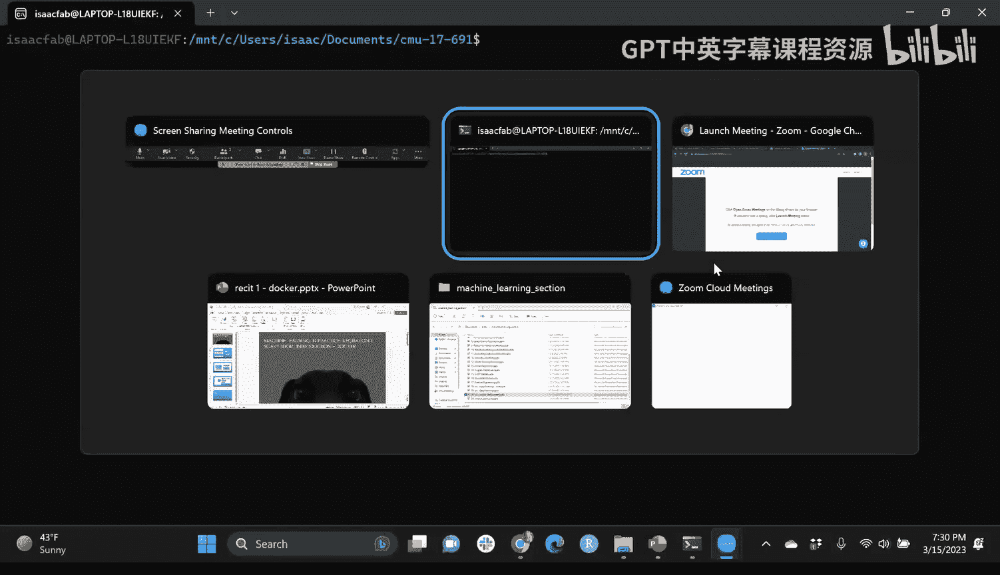

We will be covering Docker so my plan right now， at least with the presentations is going to be to spend about 30 minutes or so walking through a technology or an approach that I think will be useful as you build your product out or that you'll run into in this space and so。

Pretty low threat asynchronous also so obviously you know if you're here in class ask questions it is a great opportunity to ask about how you might use this step that we cover in the recitation of the projects it should also be pretty interesting topics that you that you'll see along the way and then those who are seeing the as synchronously you'll also see that there'll be things in here that you'll find useful both in your product and and I should mention also on the homework so the homeworks will have some requirements that we'll cover in these sessions so you'll be able to return to them as recordings on on CA that go back so first one here is a course prerequisite was to say was to have some familiarity with Docker not a requirement but to be a little bit familiar with it and so I wanted to start out the first recitation just talking about what is Docker and how it's useful for what we're looking towards in this class and so we should like I mentioned pretty。

ef and we'll cover this topic in about 30 minutes or so okay so this is a scary short introduction to Docker I'm not going to do a deep dive on the technology and how it's related to C groups and Linux we're not going to go into that depth we're just going to talk about how as a technology Docker is a great way to package applications and specifically applications that have multiple components sometimes in a containerized application multiple components are referred to as microservices and it's a useful construct even if you don't end up using a microservices framework it's a useful concept to think about how you might modularize your code to treat a machine learning component different than the rest of your application。

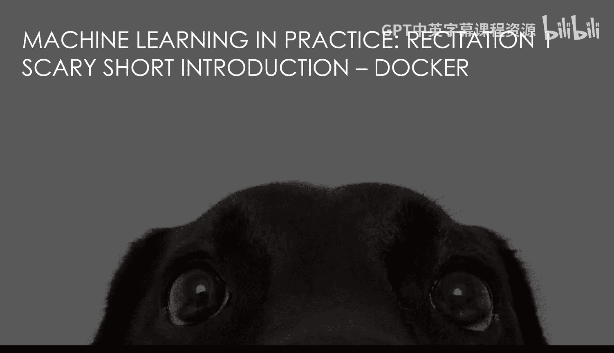

Okay， so。😊，I like to talk about containers in the context of the cloud so for those of you that are familiar with cloud technology it is basically an efficient way to distribute compute on a single or consolidated physical infrastructure into multiple virtual instances right so a virtual machine is a virtual construct on top of a shared infrastructure the thing about a virtual machine is that a virtual machine is greedy in the way that it works so there's a mechanism called a hypervisor that sits between the infrastructure and the virtual machines and that hypervisor like keeps resources and what I mean by that is when you create a virtual machine that virtual machine dominates a certain set of resources at the time that it's created so necessarily what that means is that instead of being flexible after it's stood up it becomes inflexible once it's created so。

miliar with creating an EC2 instance， for example， on AWS or an Azure instance on on Microsoft Azure。

 those virtual machines have resource limits that are hard and fast。

 they don't adjust right you pay for a certain amount of compute。

Storage and memory and that's what you get and so this lack of flexibility is great if you want to make sure that those resources are dedicated to the machine。

 but not very flexible when the demand on the applications that are being run the machines is variable。

So this is the main drawback， the main drawback is is that through the way that the resources are allocated to the virtual machine。

 it creates this really lack of dynamic allocation when resources are required by applications。

Containerized applications work a little bit differently。

Oftentimes compared to virtual machines in the Docker construct and Docker is just one containerized runtime。

 there's a number of them， it just happens to be。By far the most popular the Docker runtime replaces the hypervisor。

 so you have you know a compute a node a computer a server with an operating system that runs the Docker runtime and then your applications run as containers on top of the Docker runtime and so those containers look a lot like a virtual machine they typically have a host OS kernel。

They package up everything that you need for your application into one process or a couple of processes。

But when you launch a container and specifically a Docker container or a container in general。

 the container behaves like an application on your computer and so you could think about that that you know when you have like100 tabs open in Chrome you're only using memory and resources on your laptop in Chrome when you're using the active tab right so you can you can have many applications are running at once but the applications are much more efficiently sharing the resources of the underlying infrastructure and so that's kind of the nature between the container the container allows for both what we would say horizontal and vertical scaling so lots of flexibility in the way that the resources are consumed and from a machine learning standpoint。

You're going to have one of these containers or you a number of these containers that run your machine learning services and those services can be you know can require very different types of infrastructure requirements at very different times so you don't want you know the front end of your application to be weighed down by the resources that are being consumed by your machine learning application and you don't want to be overalocating resources to your machine learning application when it's not being used so these containerization frameworks are a great way to do that and Docker and awesome tool that kind of gives you that out of the box again this isn't a class on you know on software architecture but you will see that for machine learning and practice and in most applications that I see in web that are cloud hosted they're typically built this way where they make heavy use of containerization or containerized applications and in later recitations will show you some examples where we do multiple。

Containers， what we call orchestration compared to maybe a monolithic application where your machine learning component is built into the application itself。

Okay， so the way the way this works is that when you build containers those containers then make up different services inside of your app right so a client will access your app through a gateway and then that gateway will direct the traffic to the appropriate service right whether it's an API call to your machinery model or whether you know it's doing a get request to your front end the you know the。

Gateway wall。Roout that traffic appropriately and then return the appropriate appropriate response The goal here is is that in this class。

 we want to talk and in this particular rest， we want to talk a little bit about this machine learning service so how do we create a component。

That fits into an architecture like this easily and the answer is is we use Docker right so when we create a machinery model which most folks should know how to do coming into this class we can take that model package it up as a service and then it becomes a component in a larger application and so that's what we'll cover here next。

I do want to mention a couple things before I jump into the actual example。

Significant benefits of using containerized applications， their standard。

 meaning that when I create a Docker container， that Docker runtime allows me to build it in a way that it's very consistent with other runtimes。

They can be built lightweight， you only have to put in the container what you need at runtime so you don't have to have this like bigblloated machine where you've installed all these dependencies and it isn't clear what you want similar to standardization they're portable so I can create a container here on my laptop and it's easy to like push up to the cloud and as long as there's a Docker runtime I know that it's going to work this portability is I think the most powerful thing like one of the primary goodnesses behind containerizing applications is it gets rid of that it works on my machine issue right so I know if I package something up as a container it will run exactly the same because it's packaged up with all the dependencies that you need at runtime it will work exactly the same on my machine as it does on the cloud as someone else's machine as long as we've got the same runtime。

And the great thing about it too is is that this framework is reproducible so everything that we build is declarative so we say in code what the container should be and then we build it it builds according to these declarative statements and we'll see a simple example of that。

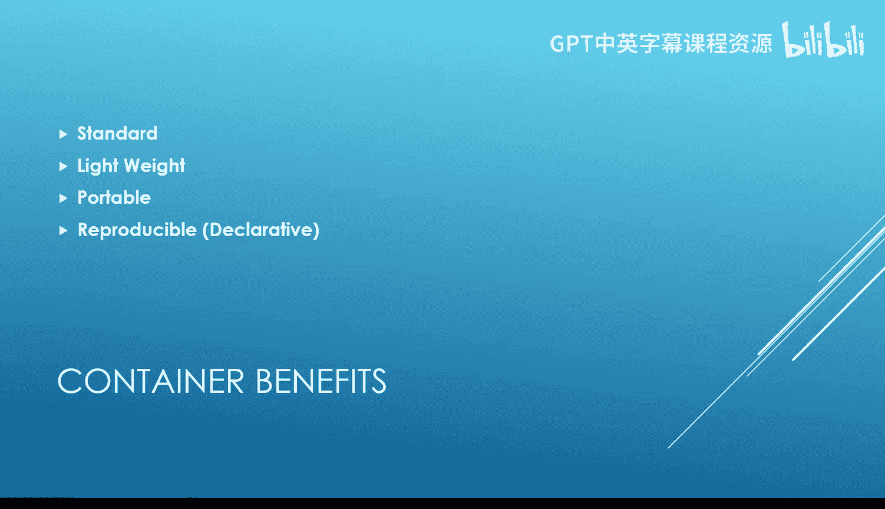

Okay， so。I'm going to bounce over here to。

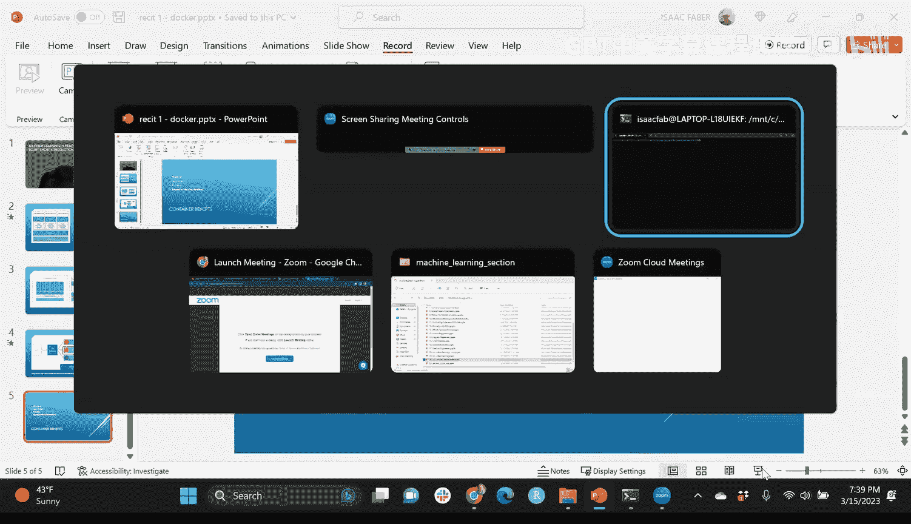

。Example， so here on the course repo。I put the first folder up here a little bit ago where I'm going to use these files。

 you can see that I've got a Jupyter notebook here and then a Docker file that we're going to use and then a couple other things。

But let's go ahead and jump in and make our first container and we're going to do that I want to introduce you to。

DA is an organization first。

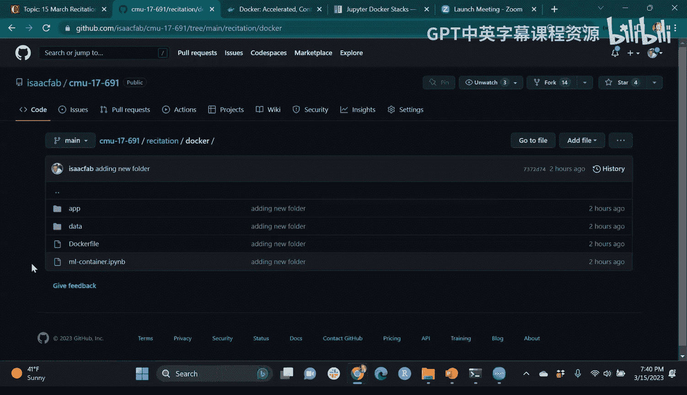

Okay so this is the Docker website you can see here that there's tons of resources， but I want to。

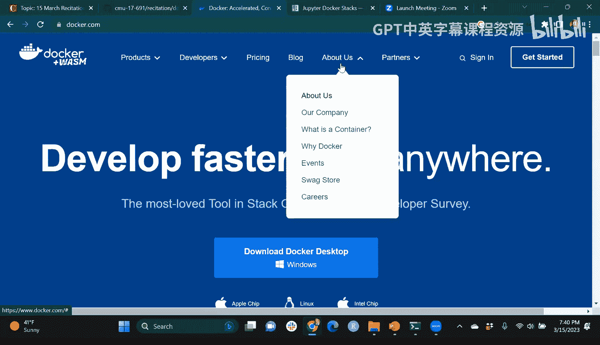

Just point out if you're curious to get into any of the documentation。

 it's actually pretty standard and you can see these are the where I got the images from the slides。

And tons of resources for developers。And if I want to。the docs real quick， there's getting started。

So if you don't have Docker。You just come here to getting started and it will it'll walk you through how to get Docker right so you can either do Windows Linux or Mac just go here to Linux so actually let's go。

Here there's a bunch of， you know， there's a bunch of extensions depending on what resource you want to install it on if you wanted to be included in a let's say's in abuuntu release and you got maybe in a bountu server up on AWS。

 you can come in here and it it will walk you through。stepep by step， how you actually install it。

 give you all the code to install it。So if you haven't done this before。

 you know I would encourage you to do it on your local machine。

 I run Docker desktop for Windows that connects to WSL and that's what I'll be using today is can of show you what this looks like if you haven't seen it before there's a a goI almost nobody uses the goUI Windows has a what's called WSL or Windows subsystem for Linux that runs Docker for me so I can run these Docker commands on my subsystem。

 which is what I've got live here so you know Docker。

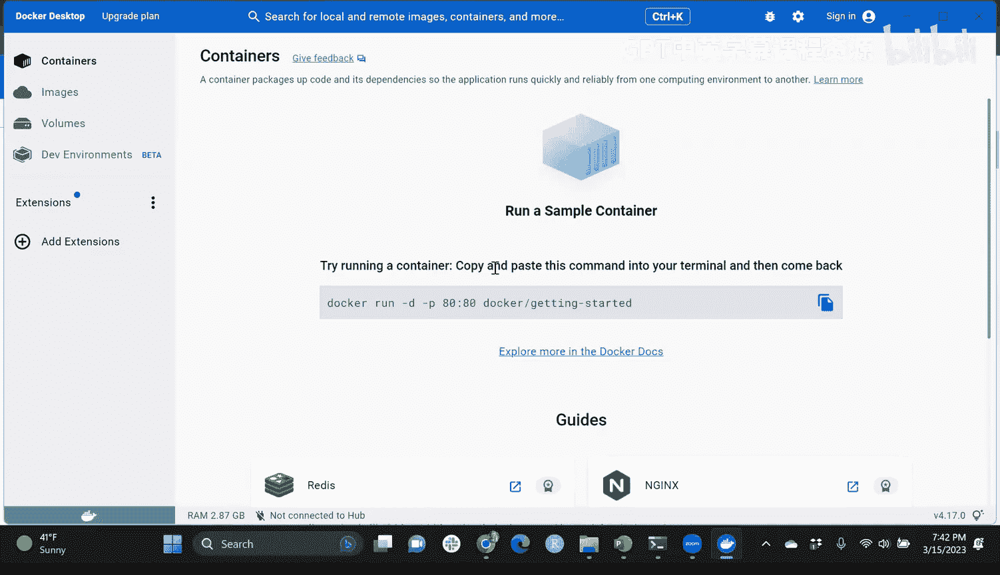

。Right， and these are all the I've already got it installed here so I just went through the same process that was on the。

嗯。That was on the website there。

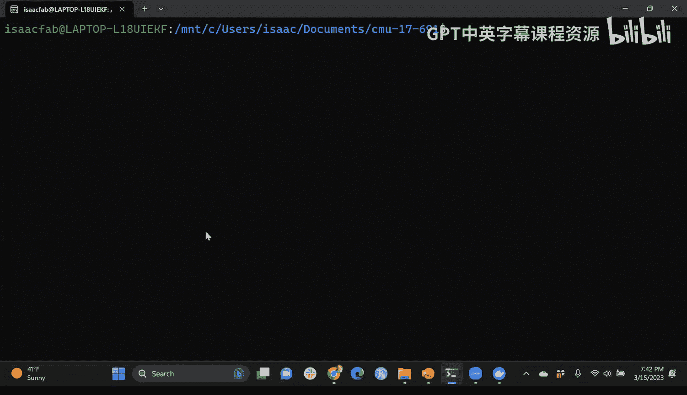

And then it gave me this desktop but you can do the same thing from the command line whether you're SSching into a machine up on the cloud or whatnot。

 but as long as you have this Docker runtime and a Docker engine so what they call it you'll be able to run these Docker containers and the Docker containers can do almost anything so the first thing I would like to show you is is that we can do development in Docker containers so。

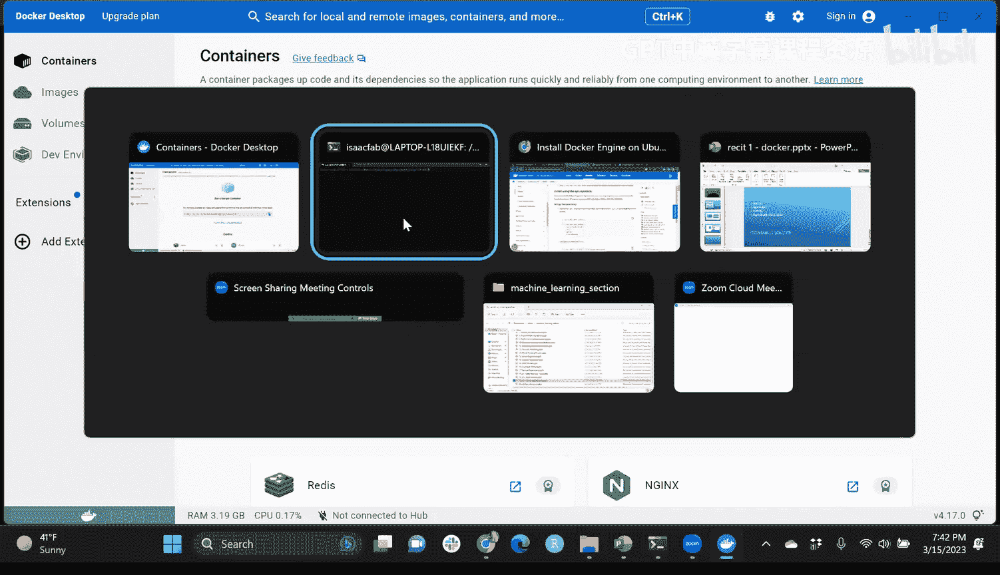

One of the more popular data science resources for Docker is these Jupiter Docker stacks that are run as part of project Jupiter if you're not familiar with Jupiter。

Jupiter is a IDE for doing machine learning or machine learning engineering it basically allows you to have dynamic access to these notebook type environments for iterative development and these stacks are pretty cool they're prebuilt Docker images that you can see here are built on top of each other that have different there's a list over here that have different dependencies so minimal notebook if you're using our scipi we'll actually use sP today show you're here in a second so let's go ahead and click on Scipi I come down to sippi and it says you know here's all the dependencies that are installed in this image when I pull it。

And I can go to Github to see where the source is， if I want to see what the。

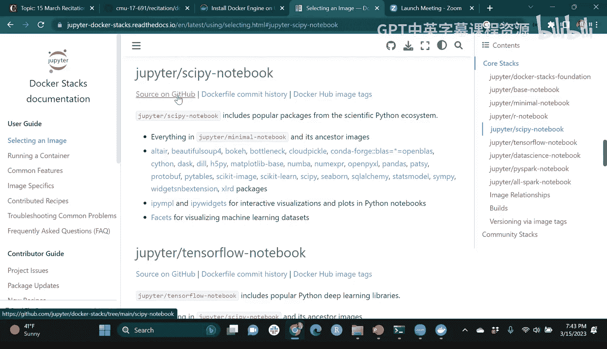

What the Docker file actually looks like to build this image。

You can see here a Docker file is just a series of commands a lot like abaash script where the commands are executed sequentially to build this container there's a lot in here so I won't go over it but just so you can see that the Docker file Docker uses the Docker file to build to build an image and then when you run the image that's when you've created a container so sort of a distinction in vernacular bounce back when I have an image and image is something that packages up all those dependencies and is then ready to be run as an instance so。

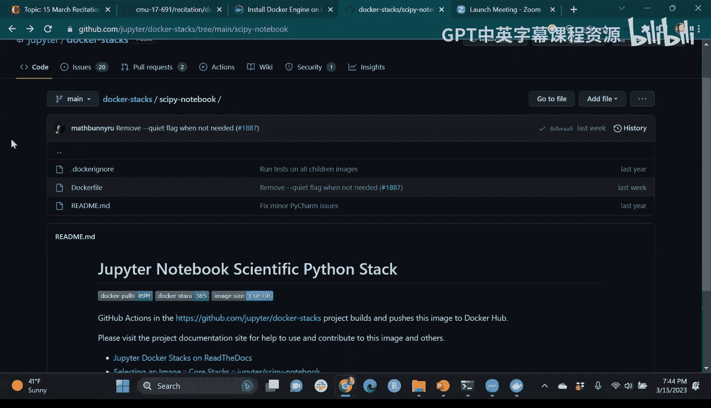

Images are artifacts that need to be stored and just like with GiHub。

 Docker has a public repository where you can store images and in this case you know the SipP notebook is up on Docker hubub and it's available for anybody to pull into their local docker environment with this simple command here this will just pull whatever the latest the latest version of this container is and you can see super popular this SipP notebook has been pulled 50 million times and I can see all the tags the tags here latest 2023 313 so it looks like it builds this is 309 a little bit different format。

 but it looks like it builds。Every couple of days， so three days ago， three days ago。

 scroll down here to the same formula that hair。嗯。Yeah。

 so there's likely an automated process that goes through and build this and you can see you get lots of information about what what the container is in terms of size。

 you know， some information that's useful when you when you actually deploy okay， now that you know。

We build a Docker container that container gets hosted on a registry。

 the most common registry people use is DockerHub which is public like GitHub and we have a cool opportunity to use other people's images that already do everything that we wanted to so let's look at this sideP notebook and Co were here to running a container。

And who says use the command line interface， I'm actually going to bounce down here。Actually。

 let's do this， let's go。Back to this specific container。Actually knows。Uses the examples here。

This is。诶呀。An example。Run command， and this is the our notebook。

Container Im going to make some adjustments here and you can see this is the one that they published in。

February 28th。A coupleuple of things in this command that are important for you to know so this is going to run a container and this is actually going to expose you this dash I is going to expose you to the terminal inside the container when you run it。

This dash。P this is a port mapping so 8888 is what the Jupiter lab environment runs on and then it maps it to 10。

000 locally so when I run this i'll be able to access it on local host 10000 and this dashB is a volume mount so whatever your current working directory is going to be it will map it to the directory and the container home Joyvan work。

And。So when I run this command， whatever container I'm at or whatever。

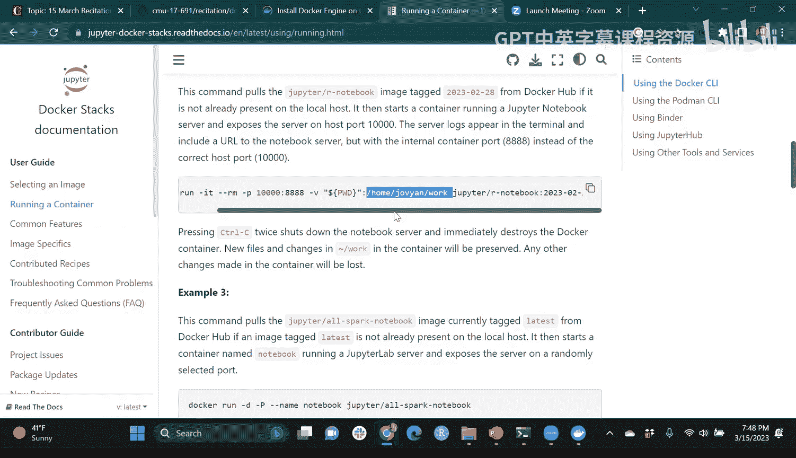

My current directory is on you know in the environment that I'm running this container。

 that's where it will mount that that。Volume on the container， so let me just。

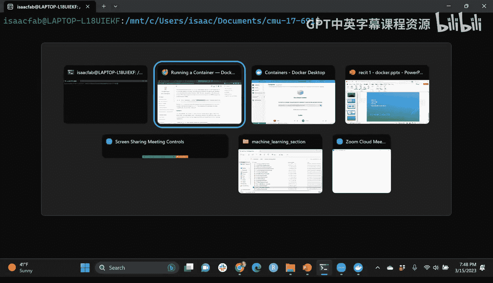

Jump in here。对。I to make sure I got covering everything here。Okay。

 yeah and I think that all about cover it so we're going to go ahead and run。I'm going to copy this。

Command here。

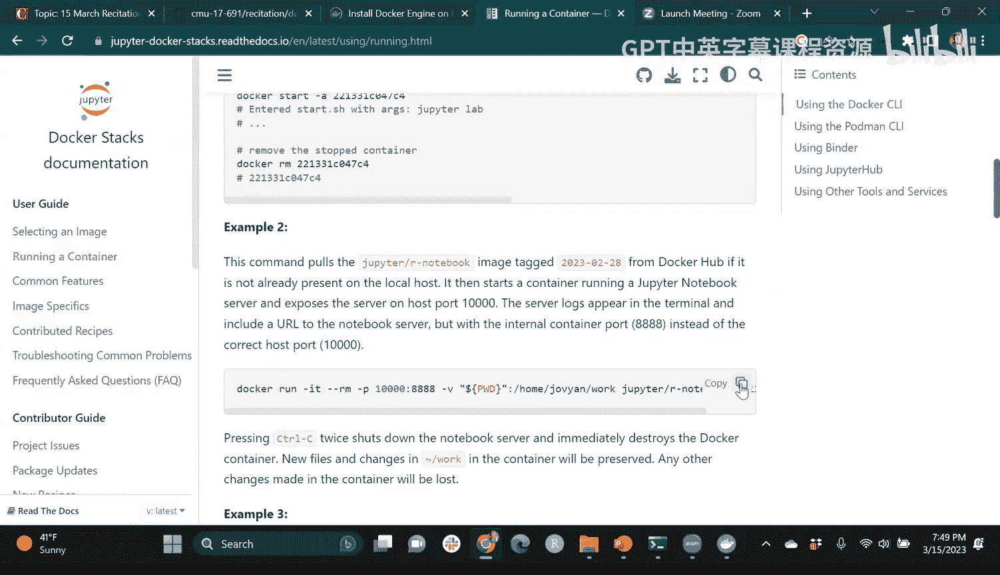

Just going to jump over here。And。あ。So you can see in here that I've got some files。

 I'm in the repo and then I've got this。I've got this saved。

This is going to go ahead and run is going to go ahead and run this image。It's going to map it to 10。

000 and it's going to mount this directory that I'm currently in my current working directory to this director directory on the container when I run it。

 so let me go ahead and run it。好。

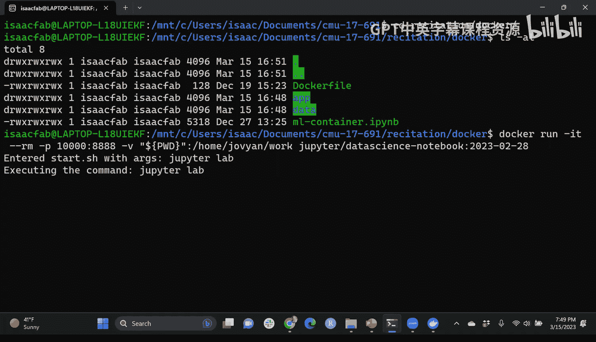

First thing that it's going to do bounce' back up here because now it's running the first thing that it did is it went out and said。

Do I have this container locally and right now I do if you don't you would see a download process where it would go out to Docker Hub and it would pull down this container right the data science notebook with this given with this particular tag right here。

And。Because I already have it here locally， I can then just go to I can just go to this URL so let me。

Click on this， This will actually， I think。Not take me to the right place。

Because we didn't pour forward。😔，So it actually40 to 10，000。So it's running on 88， 88 locally。

 but we port fored to the host here at 10，000。And you can see here now that I'm running it。

I have opened my browser。And you can see here that I've got all these dependencies like ready to go so I can come in here to the terminal。

 for example and。Here's all the python dependencies that are already installed which are going be super useful for what i'm trying to do and I mentioned that the volumes were mounted to the container so containers are intended to be ephemeral if you don't mount a volume you'll get you know you'll get access to this interface but anything that you save in here will be gone when you turn the container off when you mount a volume this gives you some persistence right and so this should look familiar these are the files that were inside of that that repo and。

Just get out of here and and here's this notebook so open this notebook environment so you can。

See what this looks like。Okay， so。I'm going to go ahead and run this code we won't go into it because I'm assuming folks be familiar with this pretty standard Python libraries。

This particular application uses a data set that is from the Titanic。

 so if you're not familiar this is a data set that's used actually let's just go check it out。

So this is a classic machine learning competition data set。

And then I pulled that just for this example， you can go to CAle access it yourself and this is kind of fun if you've never done a competition before this is typically the the first practice competition that people usually do but the idea is that you have a data set a train and test data set that's got。

YouInformation about people who did or did not survive on the Titanic so our goal is to our goal is to make this prediction so。

Come back over here to my environment， here's the data I've got。

Train and test in here so I'll just go ahead and。Pull one of these up so you can see this is what the data looks like i'm trying to predict this column here and survived so i'm going to train on train and then test on test and this particular this particular application i'm reducing the number of columns i'm doing passenger ID name ticket cabin embarked and then survived and then i'm going to split my data which I've already done you can see here I do one third two thirds I'm going to train a random forest classifier and then check its accuracy。

And does pretty good I'm almost 100% on train and then I get about 82% on my test so which hopefully you don' know what that is Okay so this is where things get a little interesting now I have a model right that model is。

Is a young。Called a random forest right it's a random forest object and I fit to the data and so this is now just a piece of data that I can save like any other file so i'm going to go ahead and save it using pickle。

And I come up here to。My app folder here。You can see now that I have this object model pickle that's going to allow me to pull it into a different environment here in a bit。

And I'm going to。Come down here。And show you that once I get this Docker container built。

 I'll be able to。Qury this this model as though it's an API so what is that going to look like this is a very simple application。

 a flask application that reads in this model。Gets a post request as an API and then returns the prediction of the model based on that post request so we're going take the model and we're going to turn it from a machine learning object into a service and in this case the service is going to be a web service again using flask which is pretty basic you know pretty straightforward we have just a couple of routes that are run here a hello world route and predict route and then this is this code is available to you on the course website and go back and take a look at if it is a little bit confusing but if I just run this if I just run this file if I just do Python app dot P and a Python on a machine that's got Python it will run but the goal is is that I want to package this application as a service so turning it into a Docker container。

And the way that I do that。Is through a Docker file so I showed you one before the one that we'll look at now is really simple。

 so we have from Docker hubub we're going to pull down a minimize version of Python called Python 38 s。

I'm going to change my working directory to app。Which is this directory here。

I'm going to copy everything that's in this directory onto the container。

 then I'm going to install a requirements do text， so requirements do text right I've got four dependencies that I'm going to install。

And then I'm going to expose it as 88。So when I run this container， this command。

 this application will be run at port 8080， similar to the way that the Jupiter live environment was run at 10。

000。

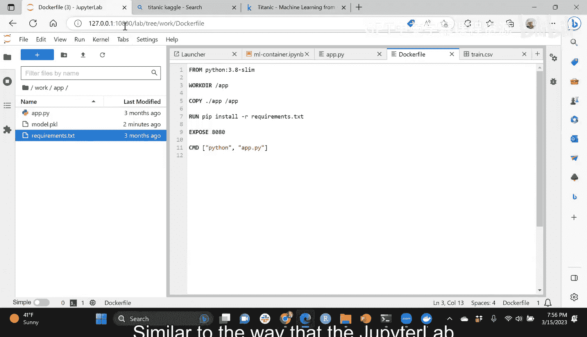

Okay， so let's go ahead and do that。I'm going to。

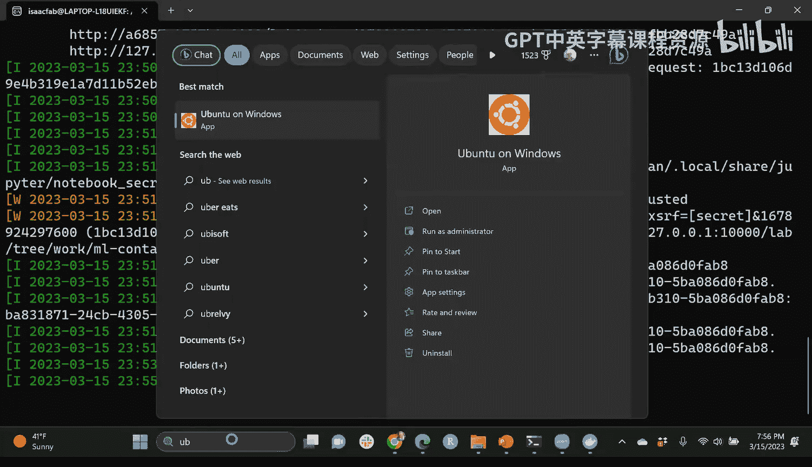

Hope up another environment here。Yeah。One of the。Weird things about。Thank。我去。

Bear with me for just a moment while we get this。And as you。It。Okay。

 now we're in the same directory as the Docker file。

 so let's go ahead and build it we build it with command Docker build。Here。

 and then I'm going to tag it API。So this gives a name to the name to the container。

 so let's go ahead and run that。

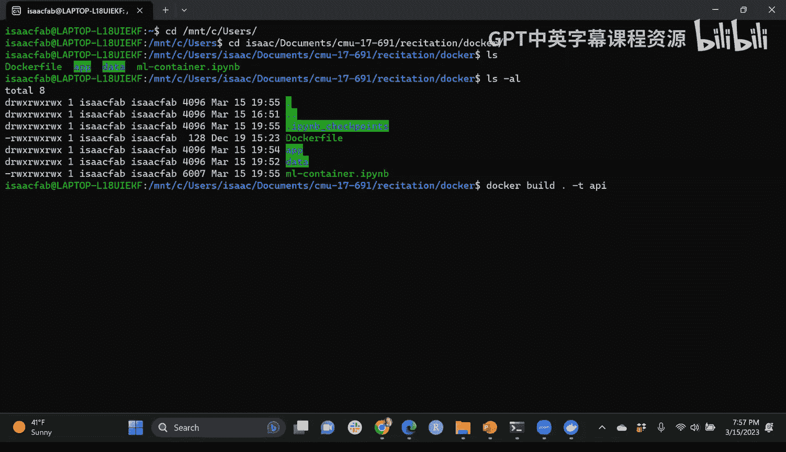

And what this does is it's going to go out and say hey。

 you don't have everything that you need for this 38 slam I'm going to go download it。

 once I download it then I'm going to work my way through each line in the Docker file and so you can see here that it changed the working directory to copy those things over and now it's running the PIP install requirements text inside of this container。

Okay。All right， and this will takes just a second， it's got to go download these things。Install。

All right， well， let's tune that I'm going to bounce over here to get。系啊。Courl request。

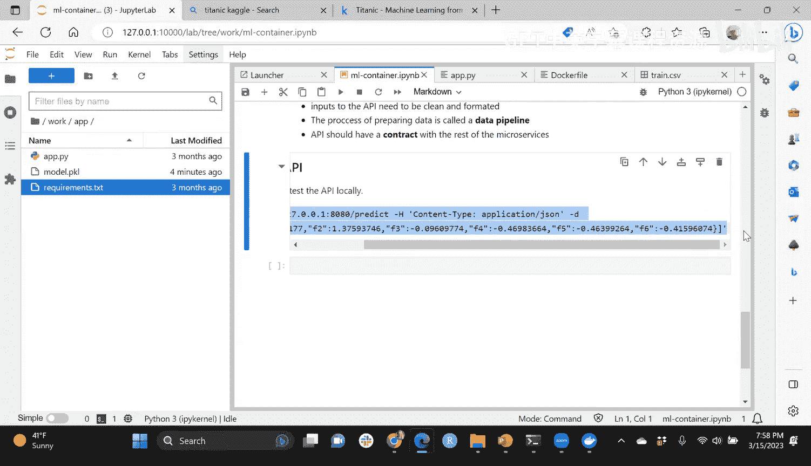

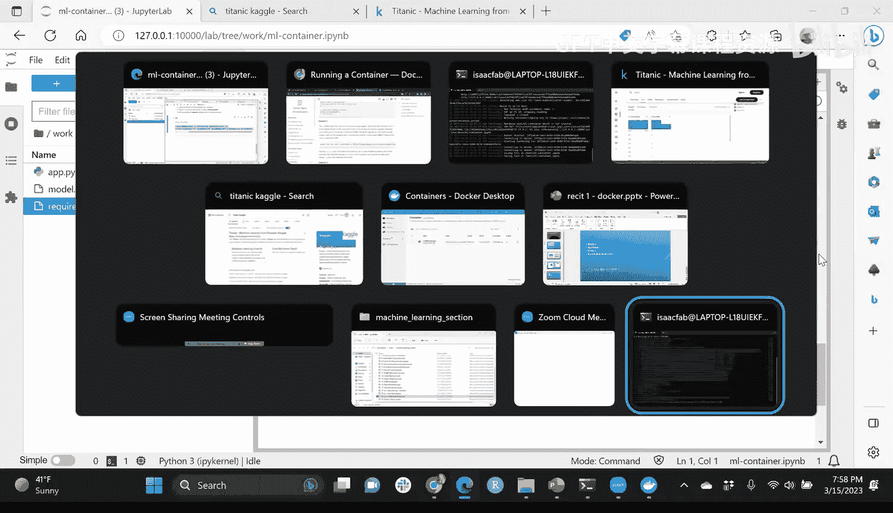

Okay， all right， it looks like it got created successfully in about a minute。

And now I can run this image so I can do Docker run。Ct。8080 maps to 8080。嗯。嗯。Oh silly。

God to tell it which image we're going to run。

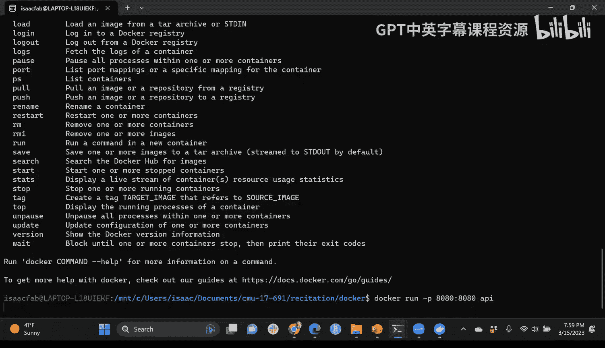

Okay， all right so there it is it's running the flask server we're currently running the container that now is serving that flask app。

Whose endpoint is the machine learning API。 And then let me just open one more。Terminal hearing。

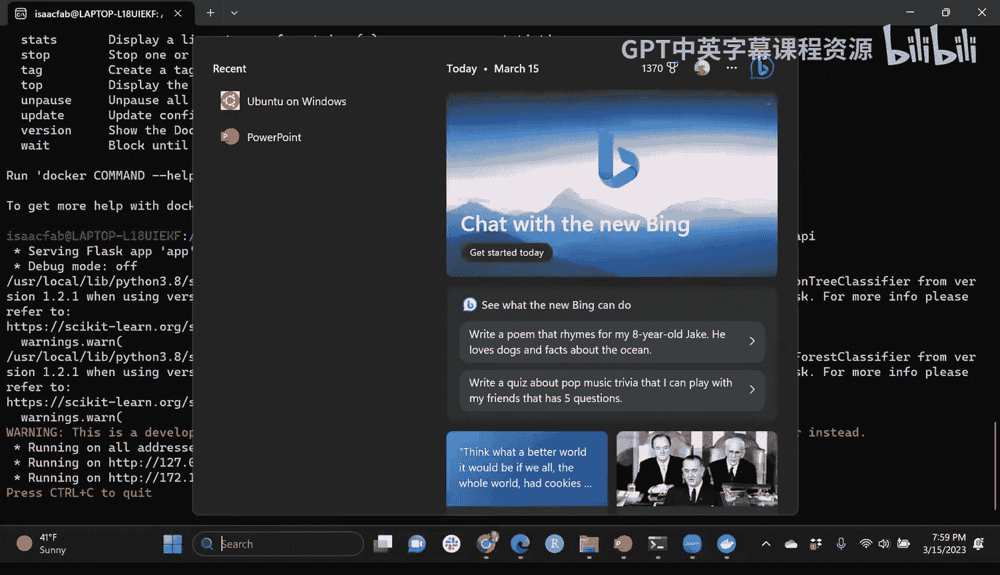

All right， and so this is just going to go ahead and do a post request on the local host port here and in this case my model takes normalized inputs。

 which is there's six inputs and then it's going to return。

Whatever the prediction is for this particular input so in this case， the prediction is is zero。

 which means this person will survive。Or i'm sorry will not survive so this particular prediction on the Titanic with these inputs the machine learning model is coming back and saying he this person won't survive Obviously the model could could pass back a lot more things but this was the gist of what I wanted to get across today so it pretty easy and just a couple of a couple of components to take a machine learning model in this case it wass learn but it could have been a large deep learning model and it was easy for us to package it up using some of these lightweight web frameworks again walk back through what we did here right so we had a model we saved the model as a file we wrapped that model up into a web service in this case flask we took that web service and we turned it into a container and that container then becomes our microservice and now you can interface with this container and you can get those predictions as a component of your of your software and so we'll continue to explore the use of。

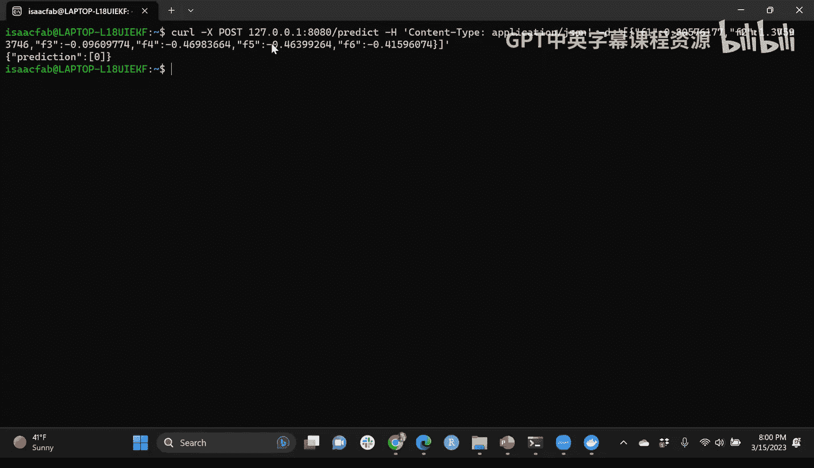

of Docker in this context， but you can hopefully see how powerful this is that it's pretty straightforward to package these things up and in my runtime now。

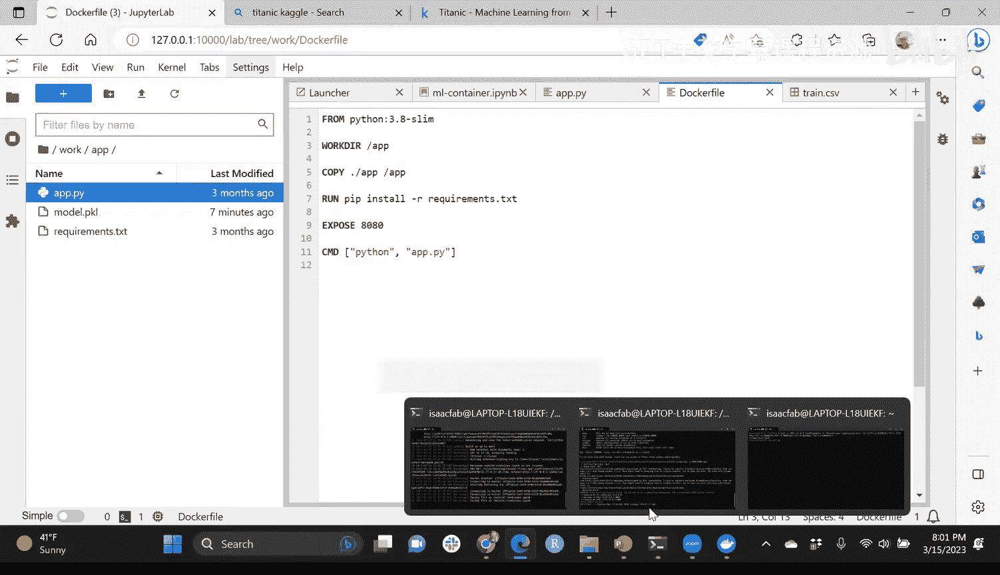

This flashask app is super easy for me to give to anybody I can just move this image the image of this container anywhere and I am confident it will work the exact same the container contains all of the dependencies to run my machine learning model and my machine learning model so everything's all packaged up nice and neat ready to go and to plug into a bigger application。

Now that said we did cut a number of corners on security and a couple of other things that you may want to consider while you're building this。

 but the basic components remain right you have a machine learningry model that can be treated as a file that's easy to serve through through this context so okay that's all I've got for the recitation for today and bounce back over here to。

Zoom and just open it up and see if there's any questions from folks on the channel that you want me to clarify or though it was confusing at all。

Go ahead， Elliot。Yeah， I was just wondering so these containers like this one was all run locally。

 is there any sort of like easy resource to host these for other people to use without having to give them the entire container like you just mentioned or is it。

Always like a paid for service no no so there's two ways to do it so you can either give somebody the image。

You know， you know， as an object or you can just give them the Docker file。

And they and they can build it on their own as long as you're pointing to the same base registry。

 you know， if I hand you， you know， and I would encourage you to go do it。

 run run the Docker file because it's up on actually let me to share my screen again。

Yeah。So up on the course repo。You can run exactly what I just did。

 you could run this Docker file and unless you explicitly have this point somewhere else。

 it's going to go get the base container from Docker hubub and you will build a container that's effectively the exact same as what I just built。

So you can either know pass the declarative statements or the image itself。

Now sometimes there's security reasons to not connect directly to DockerHub or there's reasons that you'd want to be disconnected or control your own images in that case you would have to pass the image。

 but generally speaking people usually share the Docker files。asome， thank you。

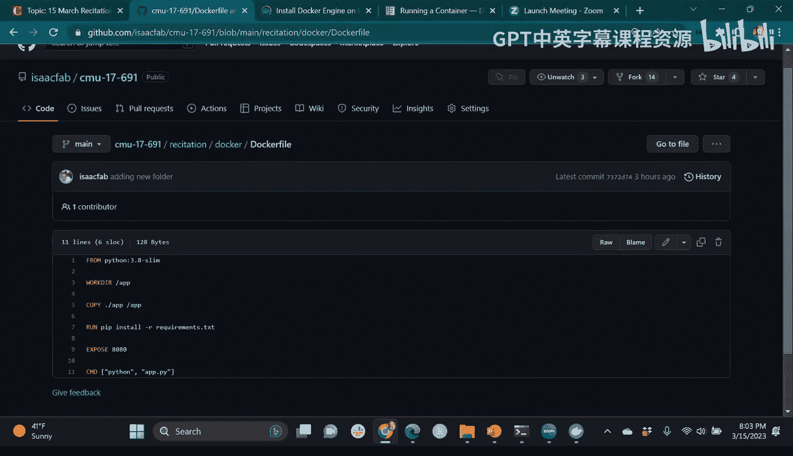

Yeah。All right， any other questions？Okay cool hopefully that was review for most folks I am happy to continue to answer any questions like you've got them over email or on Canva just shoot me a note and you'll see a little bit of requirements to use some of these technologies in the first homework assignment but that's a couple weeks away so hopefully that all made sense and you're excited about some of these architectural considerations next week we'll be looking at how you use Docker to build data pipelines and we will see you guys tomorrow。

Unless there's no other questions， I'm going to go ahead and wrap things up。All right。

 thanks everybody。

