# CMU《机器学习实践｜17-691 Machine Learning in Practice 2023》中英字幕 p09 [P9]Recitation 02_2.zh_en [BV18TUQBJEfH_p9]

All right， I'm going to go ahead and get started and other folks can join as they come。

All right。

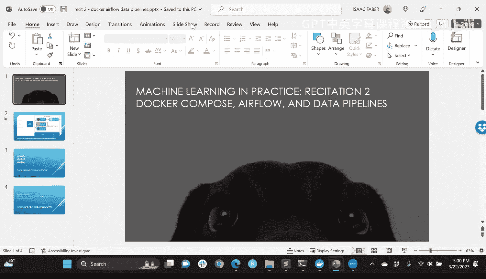

Settings will get you okay all right welcome to the second recitation today we're going to be talking about an extension from Docker that we talked about last week。

Using something called Docker composeose and we'll get into that into some detail here in a bit。

 most specifically we're expanding the idea of Docker as its usefulness in machine learning product applications specifically for this idea of container orchestration and I'm going to show you an example application here called airflow and the idea here is is that in the lecture on Tuesday I made the case that data is the most important thing in your machine learning product so you're going need something at your fingertips that allows you to control your data pipelines that is as you collect information and store it that you can make sure that those pipelines are healthy and that you're able to monitor effectively so that's what we're going to get after today give you an example about how this is done typically in practice。

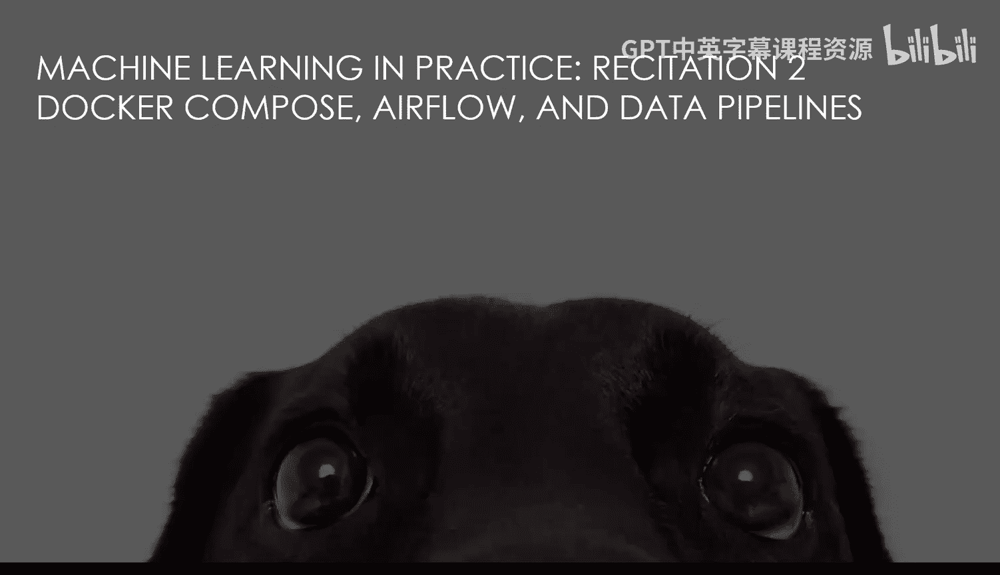

Okay， so。Back to this idea of microservices， so Docker containers represent these。

Individual components inside of an application， but you can see that there's multiple components。

 so as those components operate together we call that container orchestration and there's a management layer that allows you to make sure that these services can communicate with each other as though they're just one application so you get this like interface down into the application through the API gateway and then underneath the services are all communicating with each other like a not like。

In a network sometimes that network is called a service mesh。

 but effectively it's like a TCPI controlled type environment right where there's IP addresses and ports and containers communicate with each other in those same protocols so today we're going to look at services that are data pipelines and specifically how do we put together in application it's got a bunch of services that allows us to get after this if you look and see what's available out in industry right now the most common applications。

That you'll see people run right now there's two that have become more popular recently and they are like quasi open source products。

 but also have like a commercial side to them and that's Dgster and prefect。

Both really popular in industry I think because they're pretty simple to use and because they're maintained by companies that simplicity is kind of guaranteed and then there's a bunch of hosting services associated with it but by and far the most popular tool that you'll see is airflow and airflow is completely open source it's an Apache Commons product and it is a little bit temperamental getting it stood up but we will do it here but if you go out and you work on a machine learning team somewhere very。

 very likely that your data engineering tasks are run in the background using an airflow instance and pretty powerful I'll get to it here in a second on what it is。

Now why would we want to do that， why would we want to host airflow as a microservices framework。

 the idea is that first it's modular so because there's going to be a lot going on when you have a lot of data pipelines you're going to want to be able to separate concerns and separate pipelines and monitor them independently so when something breaks you can identify what broke why it broke and get to the root cause quickly。

So when you do this in these architectures， it's really great for monitoring and identifying those bugs and breaks really quickly and the last thing there is it's reproducible。

😊，So when you make a statement about a pipeline you're going to do it in code right it's not going to be something you type directly into the command line and so when you make a change that change is trackable by Git and in this case of airflow it's provision and then deployed into productionion in a way that's easy to monitor so you can make updates updates very quickly okay so let's bounce out of slides here because that's what we got there and let's run over here to our course GitHub site and in the recitation folder I've got the files I'm going to use today in this airflow folder and I won't go through all of these but this will just in the interest of time today there are a number of things that I've already run so I've already downloaded this file but more on that in a second and I've set some of these permissions and I've already initialize the database and I'm working locally here on my own computer using using Docker but a little bit more an airflow in the airflow website an open source platforms for deploying scheduling and monitoring。

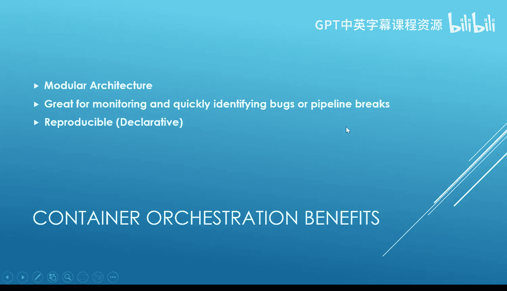

Btch oriented workflows so you see this term workflow I've been saying data pipeline I would say the majority of use cases that I've seen out in the wild for airflow or around data pipelines but it doesn't have to be aing workflow using this python framework that we'll see here in a bit it's got a pretty straightforward user interface little quirky but getting used to it know has a very short learning curve it's easy to get up and around quickly and then sort of the scene set here is is that last week we looked at building Docker containers and then this week we're going to look at creating multiple Docker containers so over here in the documentation for airflow which is linked on the repo it's actually linked at the bottom here。

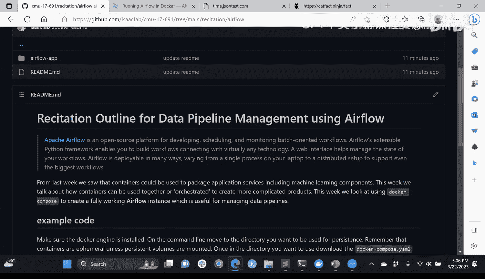

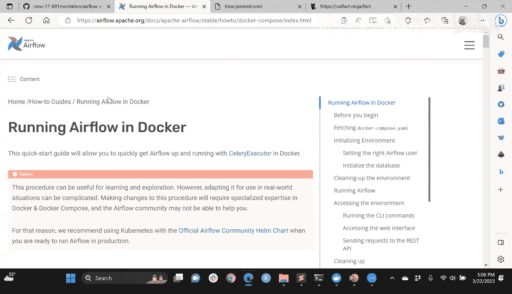

诶。We'll show you step by step and there's a number of additional things to what we'll cover here today that are covered in the documentation。

 but just to say a couple of things。

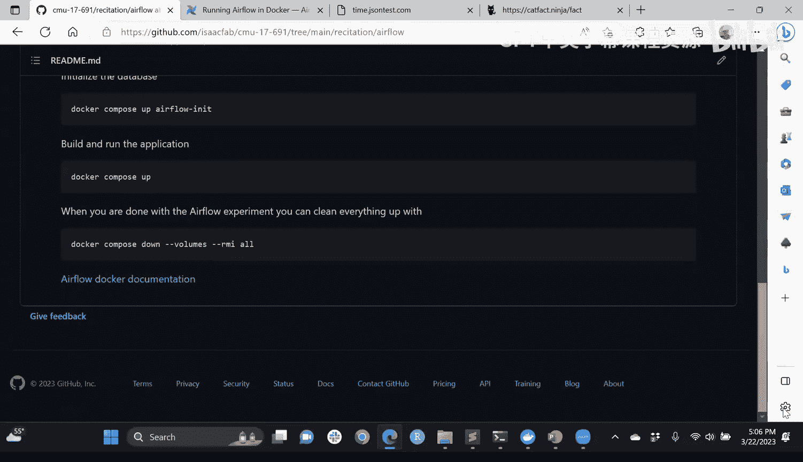

We're going to be using Docker composeose Docker composeose spins up multiple Docker containers and then composes them together so that they operate in the Docker runtime engine Docker compose is not intended to be super complicated that is you don't typically see people use Docker compose in production environments you typically use them see folks using something called Kubernetes so Kubernetes is beyond the scope of this course but as your machine learning project grows likely is is that your Docker containers would use a Kubernetes cluster that is a network of machines to deploy these workloads onto and you can see even though we're using Docker compose here there is an equivalent what's called helm charts that deploys the same application with the same microservices onto a larger production grade system like Kubernetes okay so with that。

You just got to make sure that you've got Docker installed， you've got to download this YaAl。

 so let me show you this real quick。You're not familiar with what a yal is。嗯。Hope。All right。

 so a Yam will yet another market language。Is basically a data structure。

Disguised as a configuration file so that makes sense you have variables it's a key value store so keys and then values for those keys and what you're just declaring here are preferences for how you want your compose to take place so you can see here this is just up here on Apache's site i've already got this downloaded into into my directors let me pull up what i've got here。

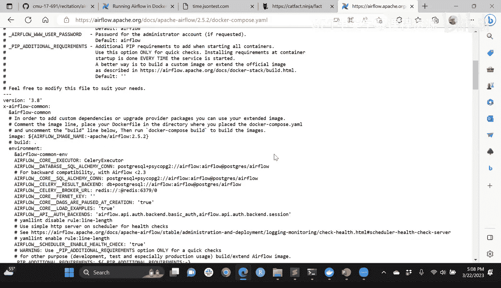

In sublime locally， so here's the Drcker composeo yal。

You can see I won't read through all of this stuff。

 but there's a bunch of configuration stuff and then down here a little bit more syntax highlighting that's helpful。

We have some definitions this is what we're calling airflow common and then this X here will。

Direct specific types of containers to be built and so we'll have a single common airflow image that will then create multiple containers that have different work roles and that's what this file does you can see that the file is pretty large but we'll go through all the details but just to kind of show you you know some things that may look familiar from last week you've got volumes you know you have。

User IDs down here you can see you're exposing different ports or your mapping ports like we see here。

The only thing different about this YamL file than the one that I just showed you is that I've added a few things。

 so I've added this JLb container here， so this is going to spin up the same data science environment that we saw last week。

 but it will do it when we compose all of these other services。

 but you can see that we're going to get a database container and Postgres。

 we're going to get a Redis container， a Jupyter lab container a web server， a scheduler， a worker。

A triggerer and an initialization container and then all of these configurations are already done for you with you know sort of the nuances here。

 you also get it looks like a CI container we won't use that today and then flour。Okay。

 so when I run to Ucker composeose。Docker is going to go out and it's going to fetch all of these containers so if I don't have them locally here for example。

It will go out and it will。Go to Docker Hub and it will pull down the Postgres 13 container or the Redest latest container or in our case it will pull back pull down the Jupiter data science notebook latest container and。

All of these configurations will then allow all of these containers to communicate with each other on the back end Okay so without much further ado。

 let's go ahead and show you what that looks like。

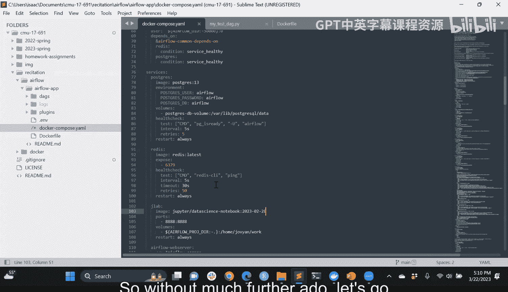

So I'm here in the。In the working directory where I want to actually run this and I've created a couple of folders already。

 a Dgs folder， a logs folder and a plugins folder， and then I've downloaded the Docker compose yam like I had talked about。

The creation of these folders is part of the setup and initialization that you'll find in the on the GitHub side so just make sure you do that beforehand then once I've got all this set up。

 I could just run Docker composeose up and it's going to go and say Docker is going to， okay。

 you want to compose so I'm going to look for a Docker compose Yal file and then up means I'm going to start the application。

If I didn't have these containers， what would happen is is they would have to go out and download them and then start them。

 but you can see here that。

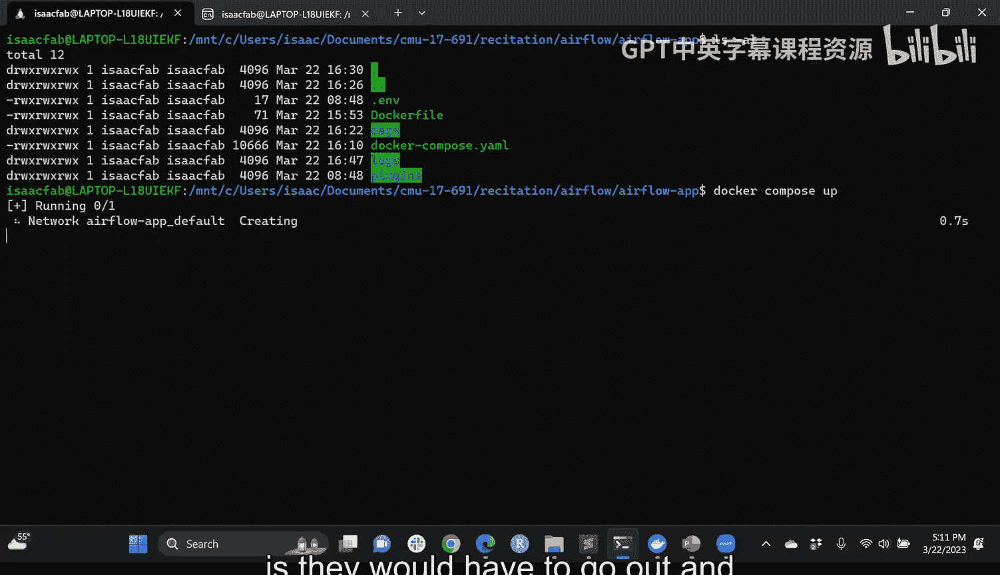

Go up here， all of these containers have been created from the images that have already downloaded and it's going ahead and starting we'll need some of the data here in the logs here in just a second but。

See， it'll take just a moment to get going。嗯。Number of different services that have to start。Yeah。

Okay， all right， and it looks like it got started for us here exit with code zero which is a good thing and。

We can go ahead and start out。Start working oh， this is actually the initialization container so。

A couple more seconds here。Actually， while we're wait and do this。

 let me go to the Docker desktop so for those of you running Docker desktop you can see here that。

As I'm here on the containers view so I have this user interface again on the desktop that's saying like hey here's the containers that are being created from the images you can see that the initialization container isn't being run right now because it is run when you first start and it looks like everything else is up and running。

So yeahep， and so and then I have two。Tools that have ports exposed so Jupiter lab at 8888 and then the airflow web server at 8080 so let's bounce over to the airflow web server so you can see what that looks like。

Okay so there I am， I'm up and running， I have a containerized application that's being orchestrated with eight different microservices。

Using in the password or airflow。Just occurs to me that I need make sure to put that on the read。

Okay， and you can see it comes with like。sorryrry about that it comes with like these existing DAG examples you can get rid of these it's pretty easy to do I just left them in here a as an example。

You know， top end。You know， descriptions here， I do want to like let's click on one of these examples to show you what this looks like。

So you can view these。You could view these different applications in different ways actually that's not a great one let's go back to。

嗯。Itn't a great one either， How about。Go to datas。All right and then what we have over here in the datas column for all of those DAGs a DAG stands for a directed acyclic graph and so you can see here that the way that airflow works is on this sequential execution right so some things are run in parallel and then when those things are run it triggers other things to run downstream。

And I'm looking here in data sets and so data sets are like a mechanism of setting up a trigger so you can have data sets。

 you know you whether it's in an S3 bucket or you know a local file system。

 an airflow will look for changes in that data that then will trigger other events to happen other dags to happen so you can have all of these different steps and processes and they can get fairly complicated。

Okay， so we have one that I've put in the folder already just called my sample D。

Show you a couple things on this if we look at the graph it's pretty simple I have two steps run this first and then run this last those are defined in a file so here is the code maybe wondering where this code came from so let me actually。

Pull back up。

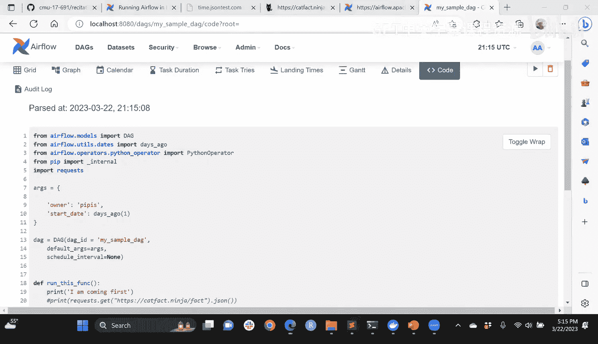

I said well i'm here you can see that in the DAGs folder that's at the same level as the airflow app as where I put this example file first of all notice it's a python file right so if you can write native python you can build daAgs pretty easily here in airflow this is just the base example of like very simple right like i'm defining functions and then those functions are going to get executed so。

Let me go ahead and。I want to you know I want to go ahead and run this dag but I want to do something interesting so show you this as a really basic example right so this is going to be an opportunity to pull data from the web so I have two APIs you know just really basic APIs so here's an API that just returns the current time。

And then kind of a more fun API that returns a fact about cats。

Although cats are terrible I will be the first to admit they are nowhere near as good as dogs the fact that there's just this easy to use free API is cool for for testing but anyway so anytime you fresh it get a random different fact about cats okay so that's interesting but what I want to do is I want to execute this code and I want to pull down。

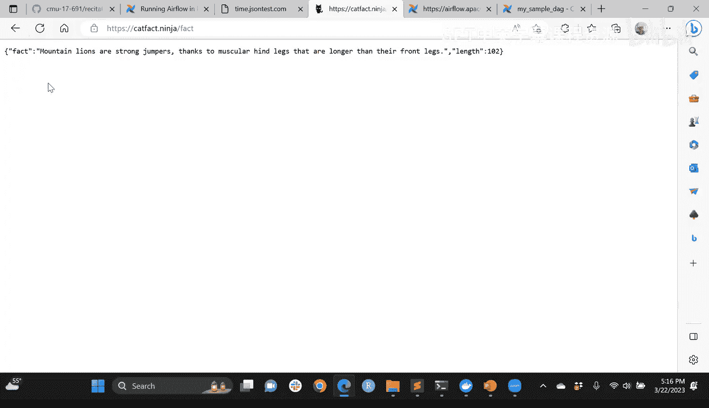

You know this data， so I'm going to go ahead and uncomment。This request。

 this get request that will go down pull the data and then print it out so collect this Json and then just do something with it so i'm going to save it here。

Let me bounce back up here to airflow。

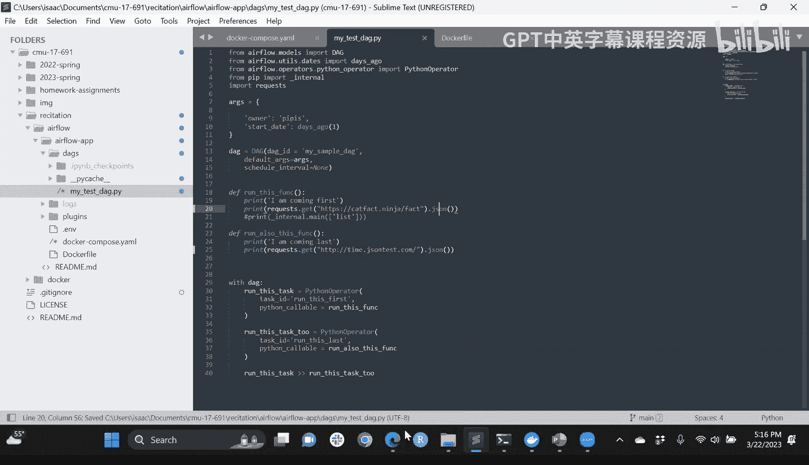

Right so here it is， and I just turned the dagg on and then just hit play。

And that tells to trigger the da。And it goes out and come back here to the graph you can see that it started running first and then it run last and you can see both of them completed so this dark green means success success success success success I want to know a little bit more details about that but I can come over here to success。

And I can look at the logs right it a little quick can look at the logs right here or I can go back here。

And。You know scrollcro down there's a whole bunch of information about it so let's let's actually look at。

Let's actually look at。Some of the information here and the。

In the log so if I want to click on this run， this first run。

 I can scroll down and you can see up here that I can access the logs just from clicking on this this front area here。

And you can see。It went ahead and collected。Unlike dogs， cats do not have a sweet tooth。

 which is another。Clear reason why cats are terrible okay I can do the same thing with this other task the last task that should have collected the time look at the logs and you can see here that it went out and collected the time now of course i'm just printing this data to a console but because it's a python script you could do anything with it right you can you can push us into one of the data sets you can save it into you know a database that's local for this machine I could have put in the Postgre instance that's part of this deployment。

You know there's anything that I you know want to do to my heart's content that that's part of this that's part of this script will take place so you can see that's pretty powerful I have a visualization for what took place I also can monitor it monitor it overall so let's say you have a lot of things going on you know in this case there's 47 examples here but if I go down to my Dg you can see that I get notified of when something is successful so when you have a Dg that takes a long time to run maybe there's a whole bunch of things that are strung together you'll be able to monitor them here。

The other thing that's interesting is that。DAags typically get run on schedules。

 so you can determine how often you want it to run using the standard Chrome approach as well as triggering things to run from changes to data sets so there's a couple of different ways that you can go about that you can go about triggering these actions。

So I want to go over a couple other nuances， so I showed you how you could go out and hit these APIs。

But let's go back and。Ask a couple deeper questions。

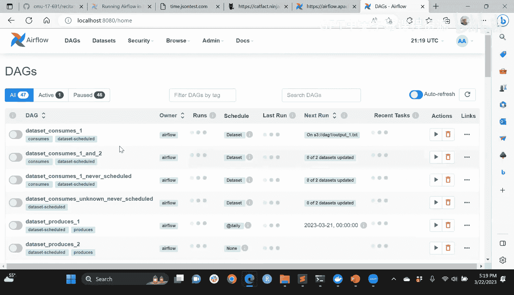

What if？You may go ahead， add。Uncomment this what if I wanted to know？

If the Python container that common Python container for airflow has all of the library' and dependencies that I need。

 you know， let's say I want to do you know， deploy my or update my machine learning model and maybe I need pandas and pstL or Pytorrch or Tensorflowlow or something as part of this process or you have specialized dependencies that are required to do some some of your data manipulation。

We don't necessarily know if these are available in the current container， so let's go ahead and。

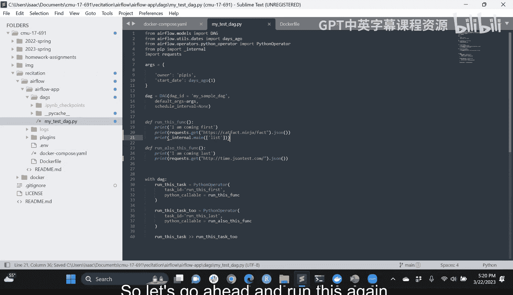

Let's go ahead and run this again。With that。Comment unlocked there。And you can see here that。

We can actually watch it run the duration， first task it succeeded， second test succeeded。

 so let's click on this first task and go to the logs。

And you can see here this time I'll get a printout of all the packages that's that's all that extra line of code did。

 So here's all the packages that are available installed in this container。

 and if I go down let's say I have a。A piece of code that requires SKt learn I can go in and see all right what is actually installed bunch of stuff from Flask that's good Google Cloud API maybe don't need that right now you can see lots of dependencies here。

There's nu pie that's great maybe I'll need that there's pandas that's great but if I go down a little bit further you'll see。

syitL is not included in this in this container， so what to do what if I have a DAg that requires an additional dependency that's not part of this base image that comes with the YamL file。

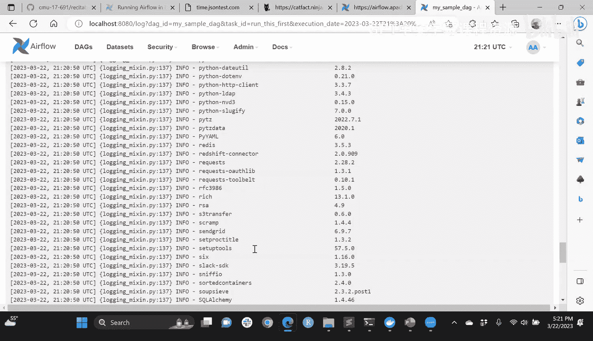

So let's go back over here。Inside the airflow app。File。

 I have a Docker file and Docker file takes the base airflow image。

And it creates a new Docker file by installing。This sidecart learn module by extending the airflow image that we're currently using and to be clear。

 where did this image come from。In the documentation here。

 you can see that it says here's the default airflow image that we're using。

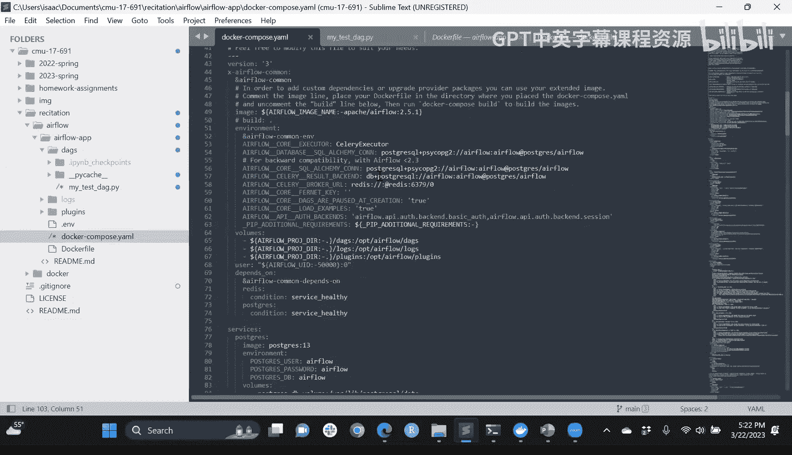

And I also have a reference down here and there's a little piece of direction here that says in order to have custom dependencies or upgrade the provider package。

 you can extend your image， uncomment the build line。And then comment the image line。

And then we're going to run Docker Compos build。Okay， so。First， we need to。嗯。对。

So let's go ahead and stop the application， so Docker compose down there's the opposite of Docker compose up。

 it stops the application。And so it'll be stopped over here now let's do Docker composeose build and again when I do this what it's going to do is go into the Yaml file。

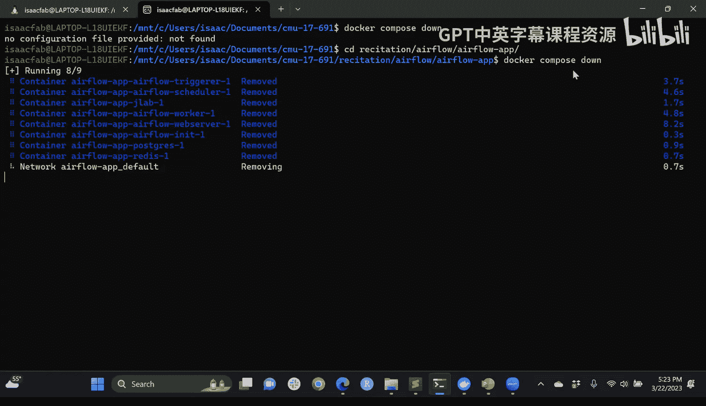

And say okay， you said build and it said build in this directory which means it's going to look for a Docker file。

 it's going to go to this Docker file and it's going to say okay from this image I want to create a new image that's got this additional dependency which means we're going to install PsyCt learn。

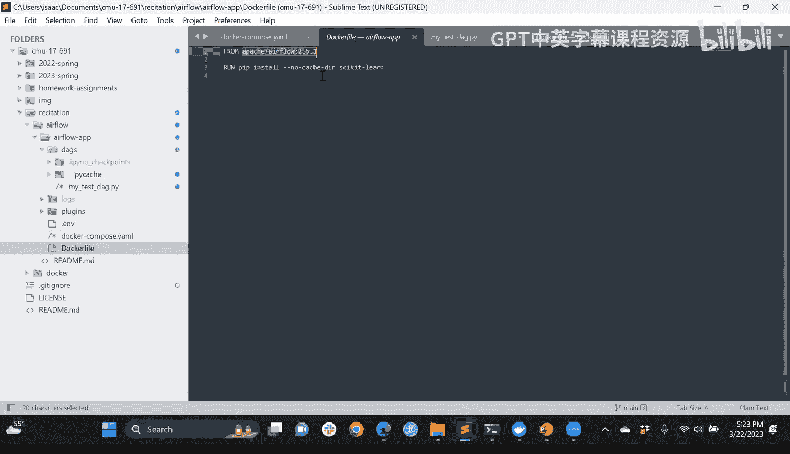

Okay， so let's go ahead and do that。我你 second should to build。actually I have to save the aml file。

Yeah。Okay， all right， so you can see the different stuff is going on now it's going out from the Docker file it it's running this line。

And this will build the images according to the Yaml file and it will extend。

All of the airflow images that we had already built and ensure that this dependency is then available in all of those images。

 so this should just take a minute or two。好。Okay， so there you have it。

 then I can do Docker composeose。Up again。

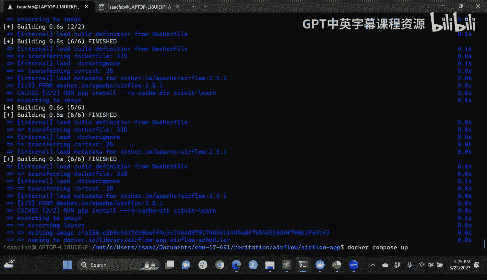

And this should go out and create all the services it did last time。Yes。

I want to show you one thing while we're letting this finish start up。

You can see that it created this Jupiter lab instance。And。It requires this token to authenticate。

So if I go over here and you can see the Jupyter La notebook is running and I just click on the local host。

 I'll get this thing where it askeds for the password or token。

 I actually need to like give it the URL with the token there's ways to disable this or to have the token saved somewhere else but。

With the URL that we got from the the console output I can get right into Jupiter lab and I've got the volume mount set up so that I can have access to the same。

To the same files that I was just working in so when you deploy this again。

 this is on the same Docker composed file totally different image。

 but using the same file system so I can make those changes here。

 which i'm going to do just to demonstrate。That I can。So we won't hit the。The APIs。

 but we will print the installed dependencies。Okay， so。Let's see， I think everything's up。😔，그。诶。

All rightAll right， so let's go ahead and run it again。

We just made changes to the DAg file so we should see success here and then here。All right。

 then complete。And click on the logs here， take me down the dependencies。

And there will be a number of more dependencies that Sykt learn brought in。

 but you can see that now this image。Gives us access tosyit learn so now I can importsyit learn and use it inside of the Dgs。

Okay， so that is all I wanted to cover for today， so you can see here that。Using a Python。

Function to define data manipulation and data pipelines is pretty straightforward we're just going to extract data from in this case an API but it could have been a web scrap it could have been you know something that we got。

Internally， like we had queried our own database。And we're just manipulating and changing it。

 but you can go here from a python script to a nice organized visualization of these directed acyclic graphs or these dags so pretty powerful hopefully you found that useful again things we covered today we talked about Docker compose how different containers can be used to orchestrate together to make more complicated application in this case airflow and that airflow is a great tool to help manage data pipelines and data pipelines are simply just scripts right there' scripts that get triggered to be able to move data around collected and manipulate it make it available for your machine learning down the road okay hopefully you found today useful and going to go ahead and。

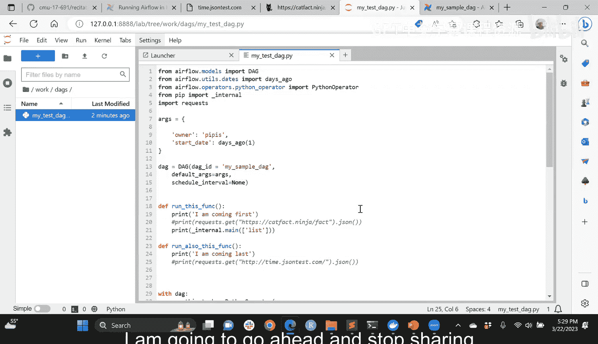

Stop sharing my screen and open it up for questions。Go ahead， you。嗯。

Why did it remember the like previous runs actually shut down the container and then reimmented it？

The the logs persist so it's good Okay yes let me share my screen again so you can see this so here in the directory one you can see that this is。

This is mounted to the container as the container's volume but it's also persisting to my local computer here so there's a logs folder here and all of this data is being read by airflow so it will remember this you can blow away the logs if you want to there's a way that you'll see in the Docker composed down in the in the repo where it basically deletes everything the containers and whatnot just so you can have a clean environment but yeah that's the reason why you saw it is because it's reading these logs and there's so it's caching some of that information。

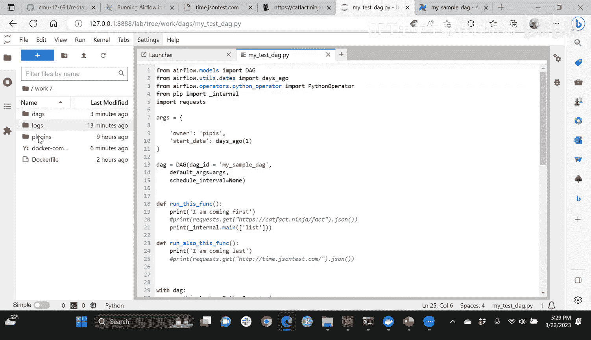

Yeah。Okay， any other questions？Cool， all right， thanks for your time， everybody。

 we will see you tomorrow afternoon。

