# 1：What are we doing here

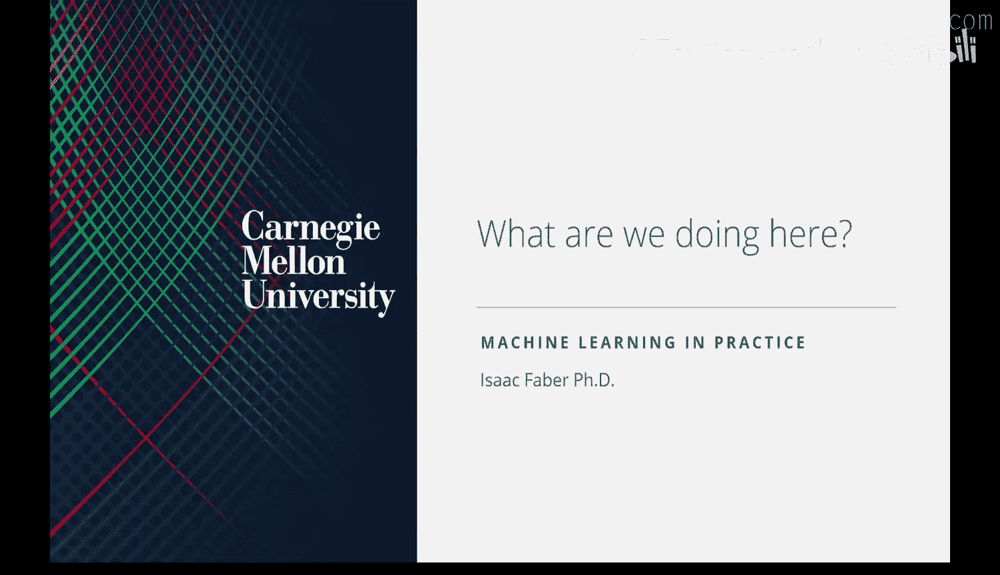

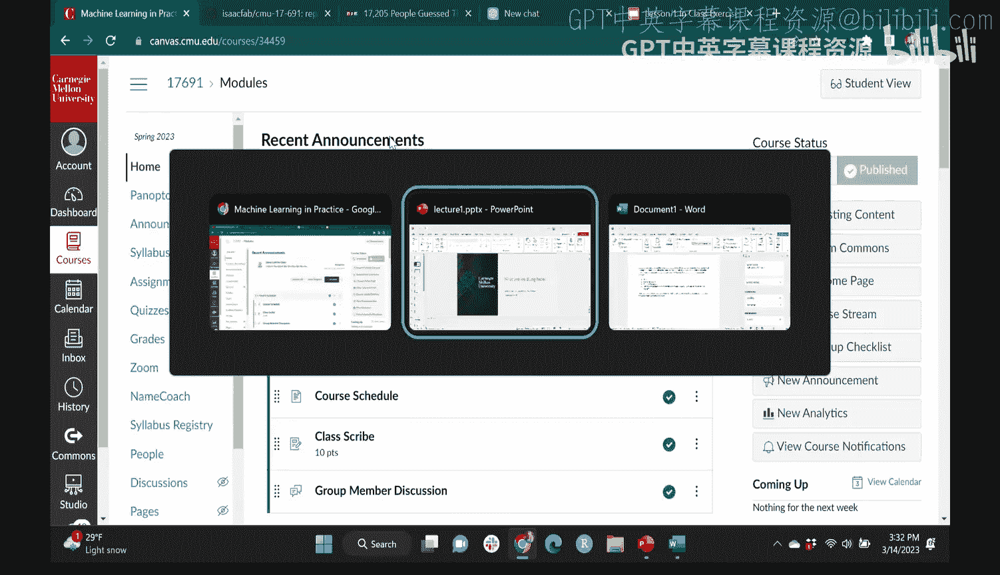

## 课程概述

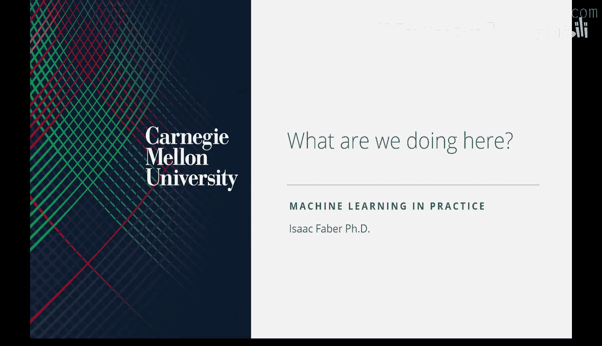

在本节课中，我们将介绍课程目标、背景和动机，并简要介绍作业和机器学习产品的现状。

## 关于我

*   **姓名**：Isaac
*   **职位**：首席数据科学家和人工智能发展总监
*   **背景**：斯坦福大学管理科学与工程系博士，研究方向为网络安全中的人工智能，曾在斯坦福大学创立数据科学和人工智能开发平台。

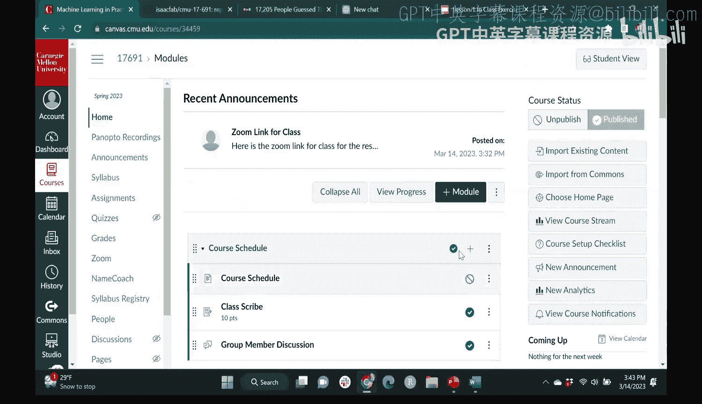

## 课程目标

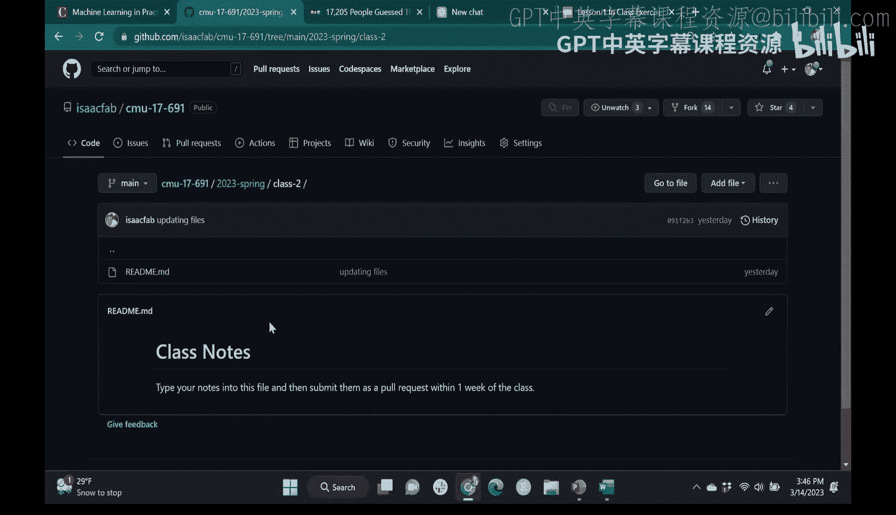

*   **理解构建机器学习产品的意义**
*   **掌握机器学习产品的构建方法**
*   **了解机器学习产品的评估方法**
*   **能够将机器学习应用于实际业务场景**

## 课程内容

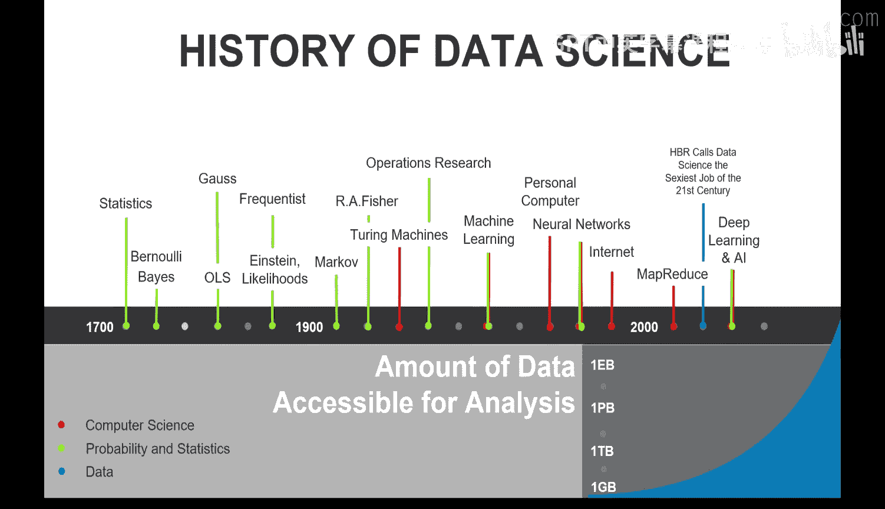

*   **基础知识**：机器学习原理、模型选择、数据管理、产品架构
*   **价值评估**：如何评估机器学习产品的价值
*   **实践经验**：通过案例学习，将理论知识应用于实际项目

## 课程结构

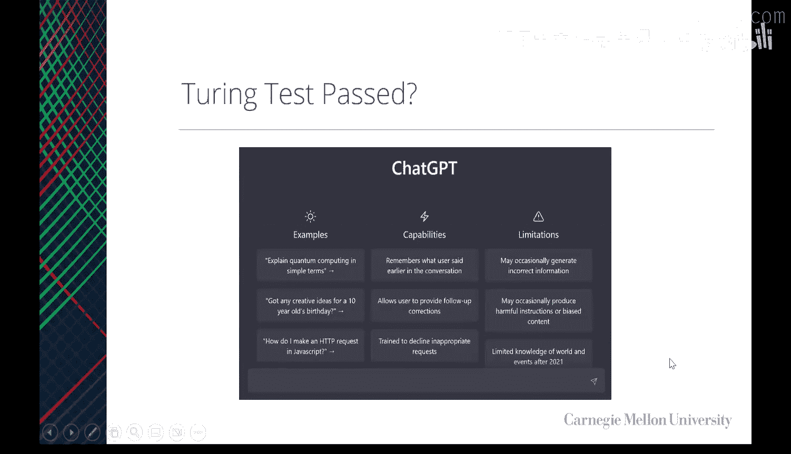

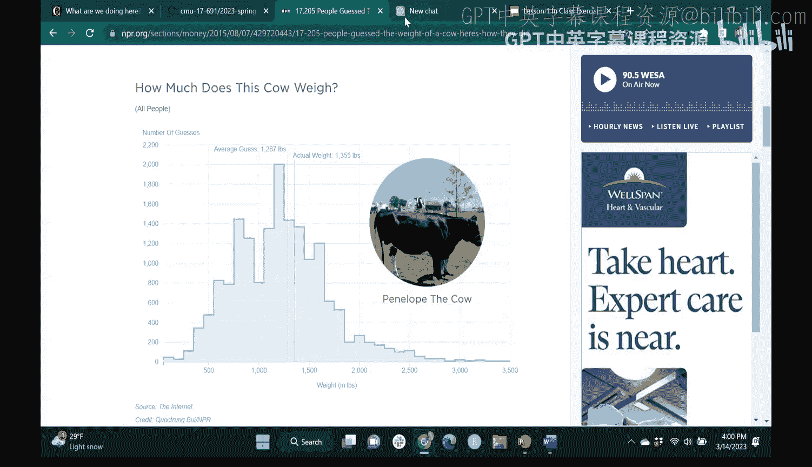

*   **基础知识**：机器学习原理、模型选择、数据管理、产品架构
*   **价值评估**：如何评估机器学习产品的价值
*   **实践经验**：通过案例学习，将理论知识应用于实际项目

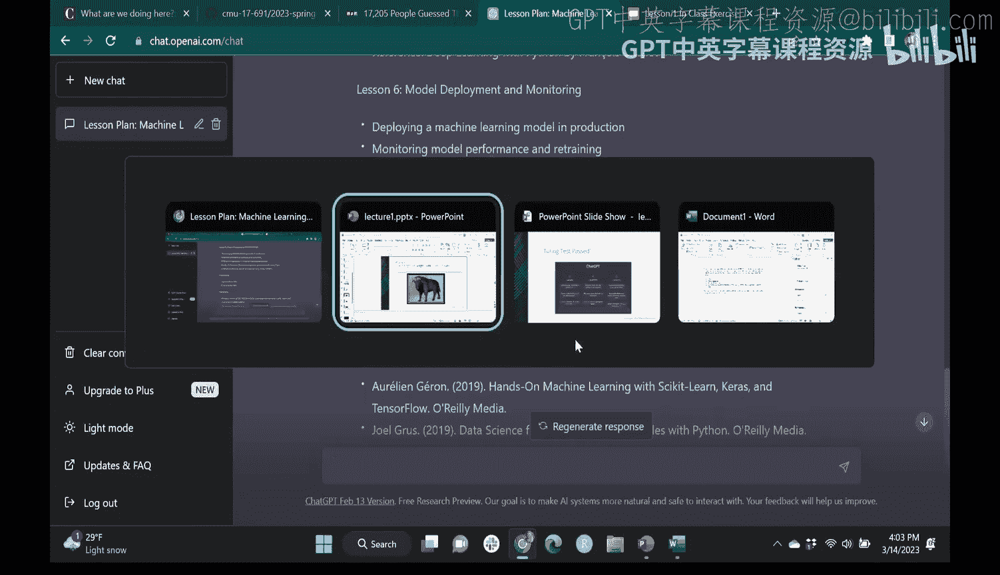

## 作业

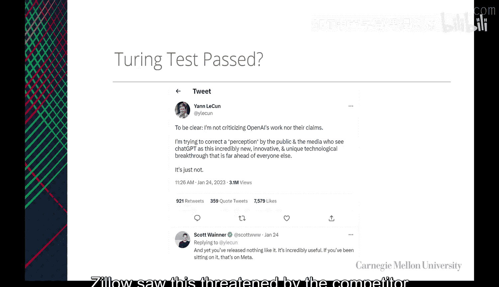

*   **小组项目**：构建一个机器学习产品
*   **作业**：完成与课程相关的案例研究
*   **课堂笔记**：记录课堂内容并上传至GitHub

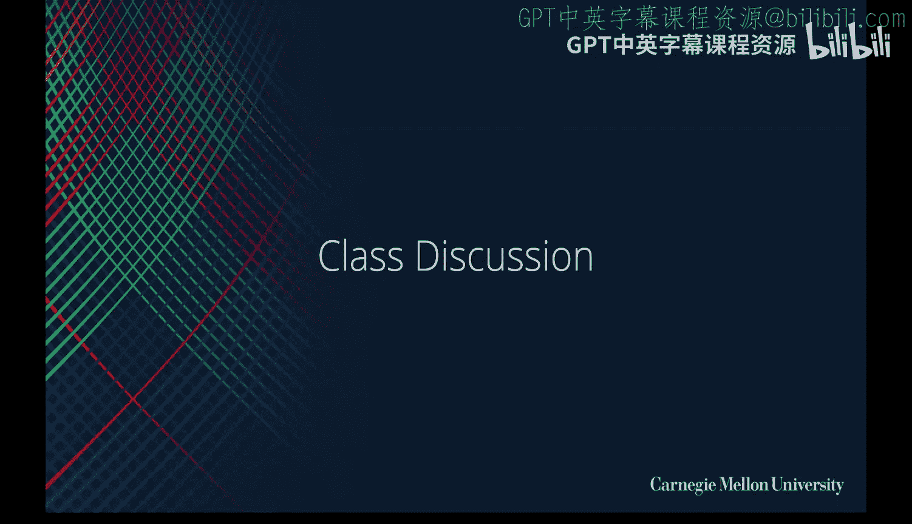

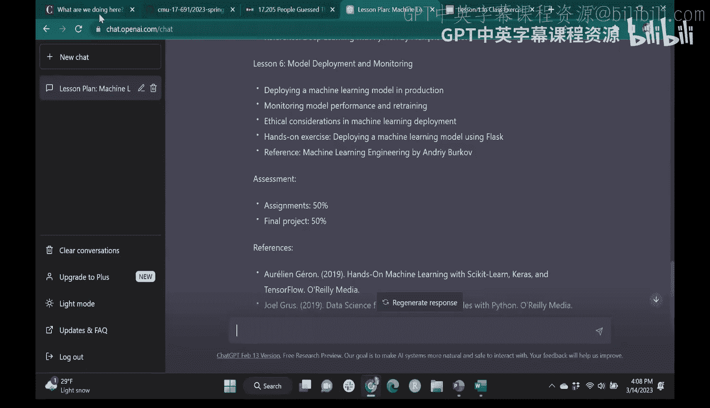

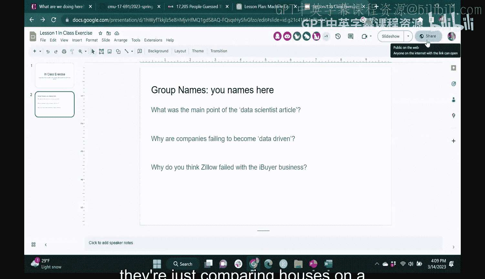

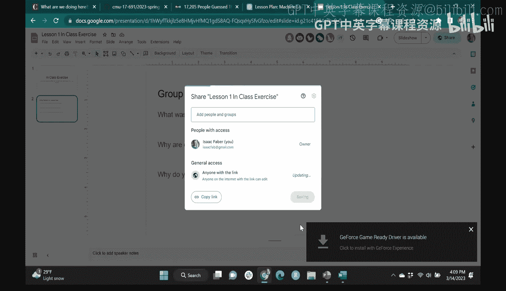

## 课程安排

*   **上课时间**：每周二和周四下午3:30-4:50
*   **辅导时间**：每周三下午5:00
*   **课程网站**：Canvas

## 总结

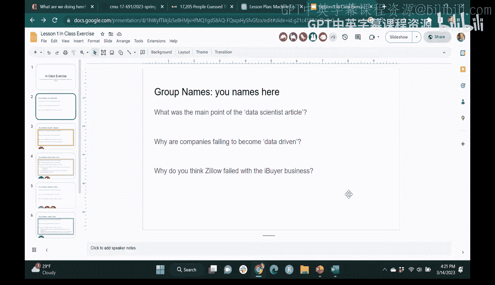

本节课介绍了课程目标、背景和动机，并简要介绍了课程内容、作业和课程安排。希望同学们能够积极参与课程，并从中获得知识和技能。