# 5： (Teams) Tools and Infrastructure

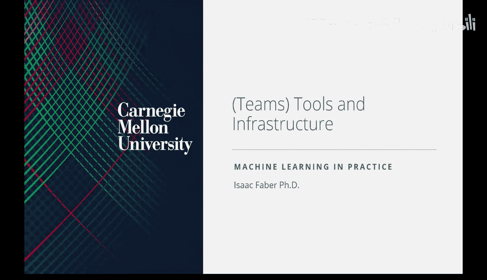

## 概述

在本节课中，我们将探讨机器学习实践中的工具和基础设施。我们将了解MLOps（机器学习运维）的高级组件，并有机会在作业中构建基本的MLOps系统。

## 工具和基础设施

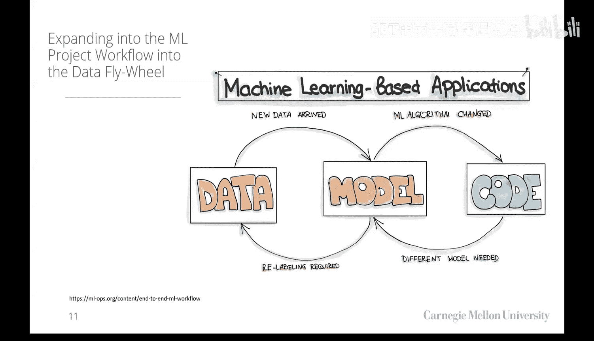

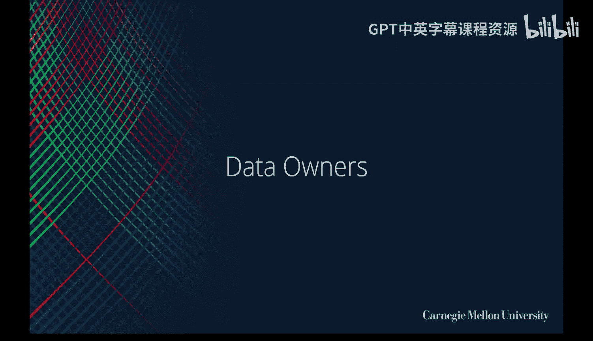

### MLOps概述

以下是MLOps的一些基本概念：

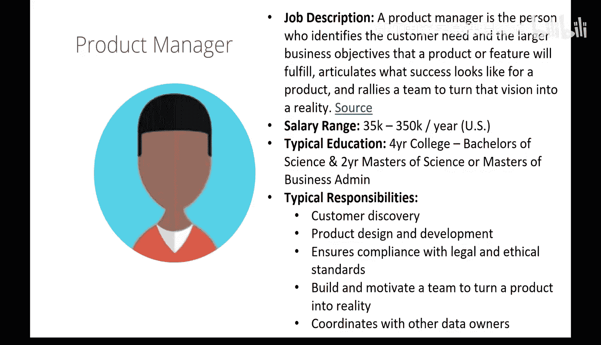

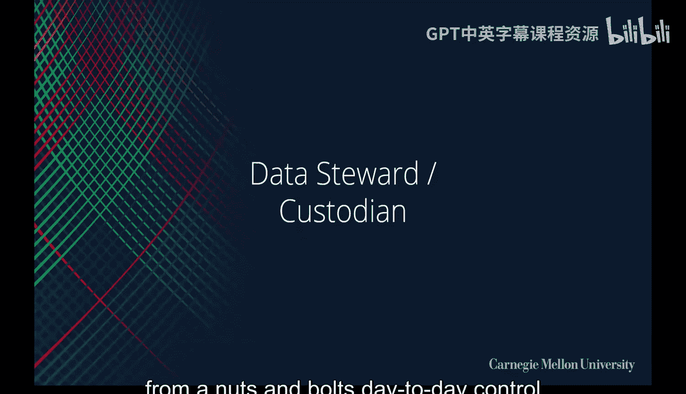

* **MLOps**：将DevOps方法扩展到包括机器学习和数据科学资产，将其作为DevOps生态系统中的一等公民。
* **DevOps**：结合软件开发和IT运维的实践，旨在缩短系统部署周期，提供持续交付，并确保软件质量。
* **MLOps**：类似于DevOps，但专注于机器学习和数据科学资产，包括模型质量、模型重新训练、验证和部署。

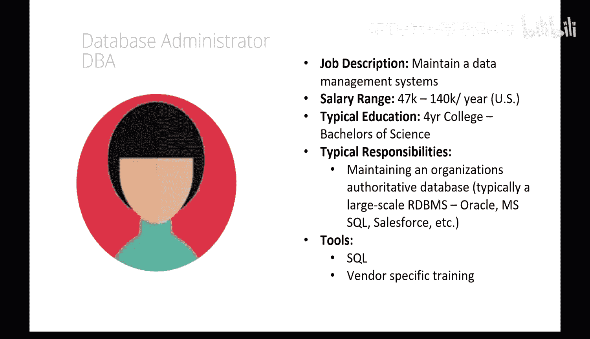

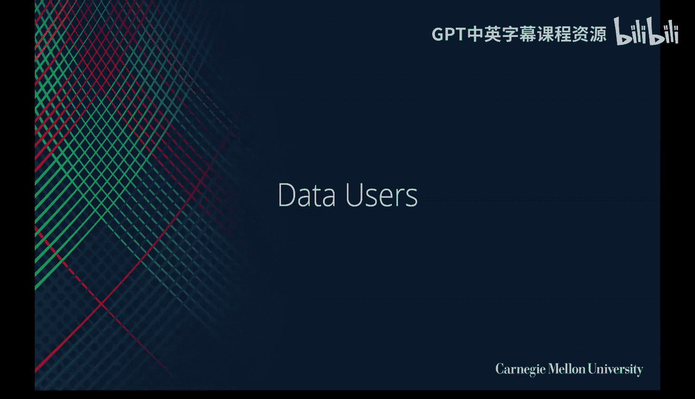

### 工作人员角色

以下是MLOps项目中可能遇到的一些工作人员角色：

* **数据所有者**：负责数据策略和合规性，例如CIO和CDO。
* **系统所有者**：负责特定系统，例如销售force实例的所有者。
* **产品经理**：负责MLOps项目，确保项目满足业务需求。
* **数据工程师**：负责构建和维护数据管理系统，例如数据管道和数据库。
* **数据科学家/机器学习工程师**：负责开发、训练和部署机器学习模型。
* **软件工程师**：负责开发应用程序和软件产品。

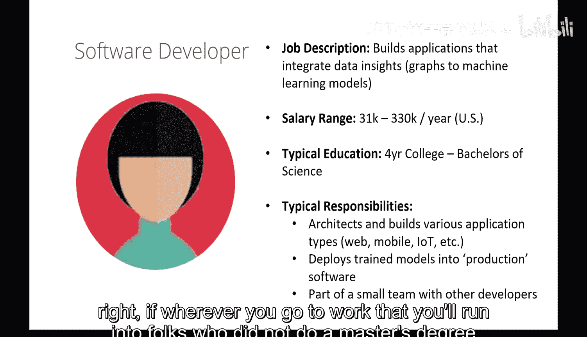

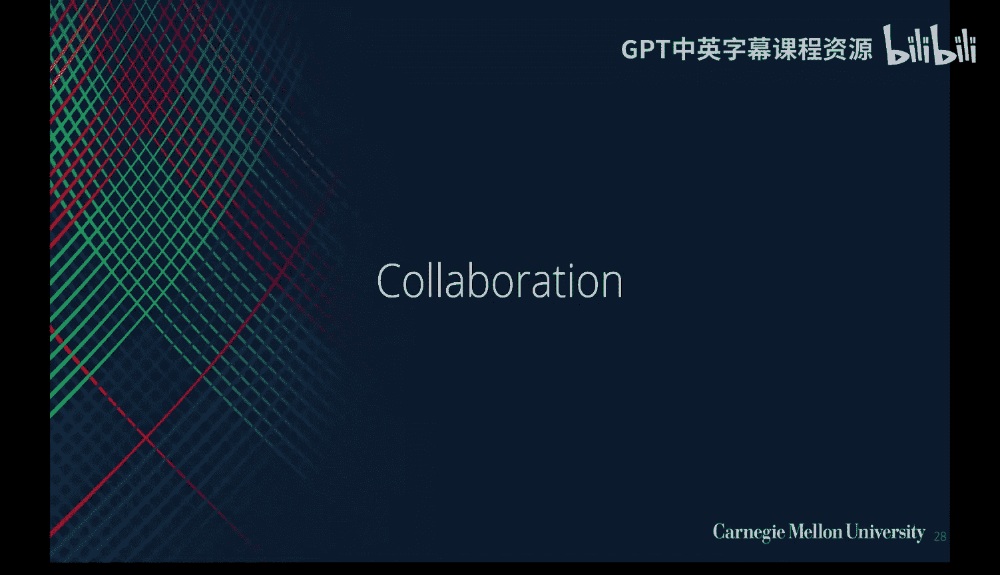

### 协作

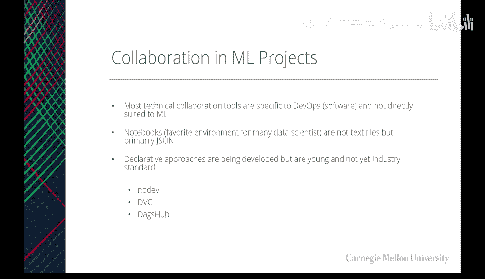

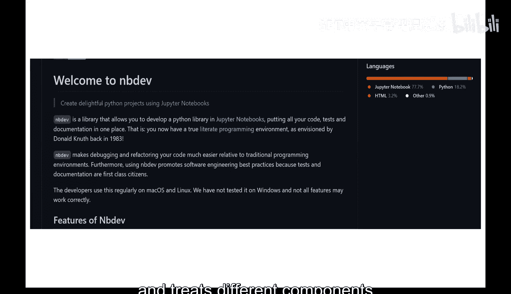

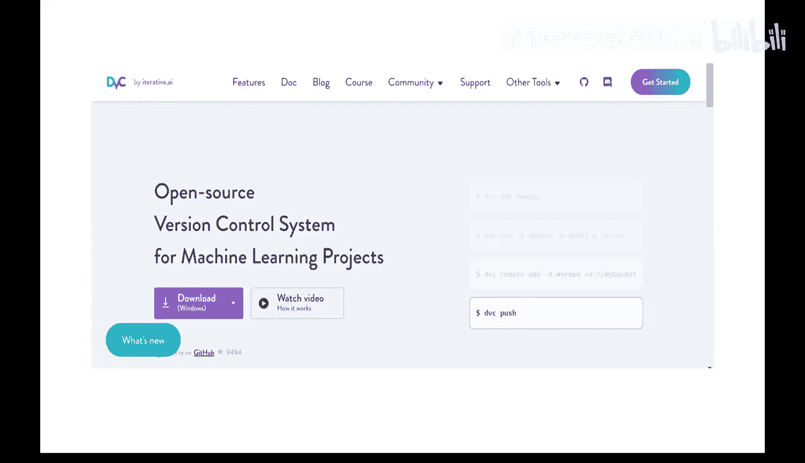

以下是MLOps项目中常用的协作工具：

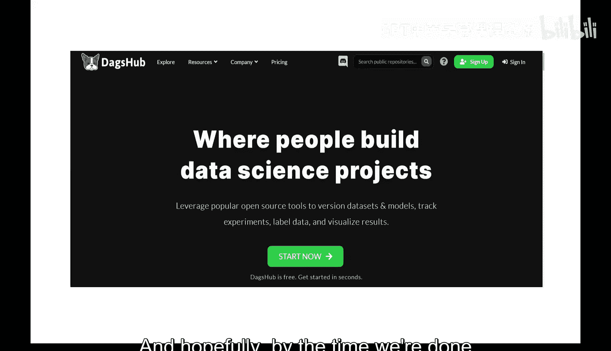

* **Jupyter Notebook**：用于数据分析和模型开发。
* **MB Dev**：用于版本控制Jupyter Notebook。
* **DVC**：用于版本控制数据集。
* **DAGsHub**：用于机器学习项目协作。

### 基础设施堆栈

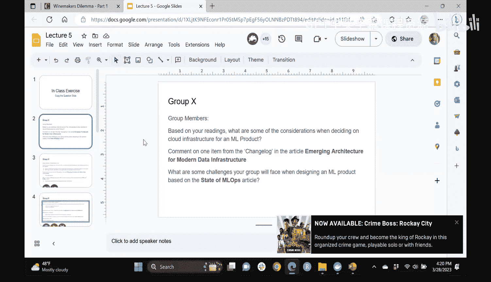

以下是MLOps基础设施堆栈的基本组件：

* **基础设施**：服务器、网络和存储。
* **平台**：数据库、数据湖和云服务。
* **应用程序**：数据工程、数据科学和机器学习工具。

## 总结

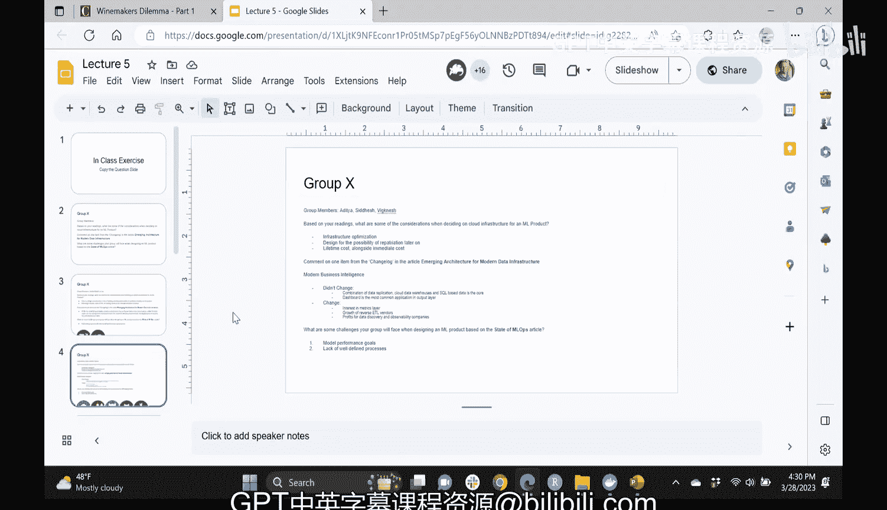

在本节课中，我们学习了MLOps的基本概念、工作人员角色、协作工具和基础设施堆栈。这些知识将有助于您在MLOps项目中取得成功。