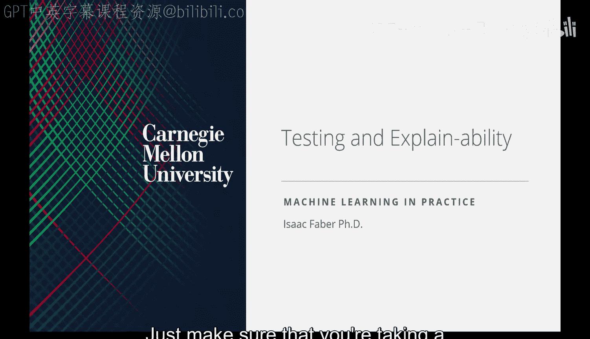
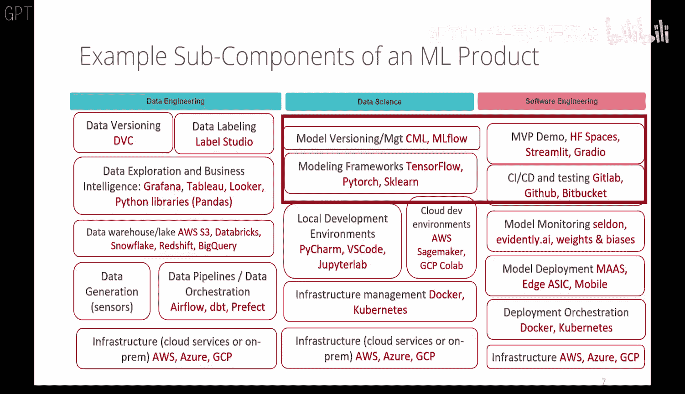
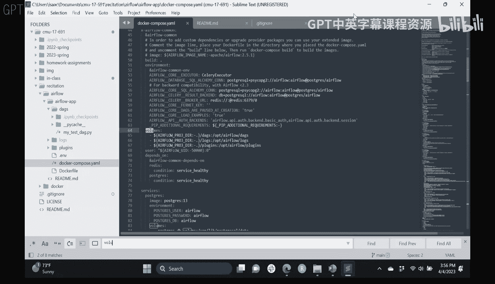
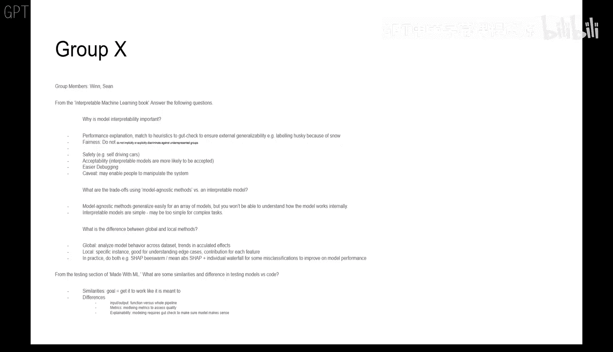

# 7：测试和可解释性

## 概述

在本节课中，我们将探讨机器学习操作（ML Op）堆栈中的测试和可解释性。我们将讨论如何确保模型在部署后表现良好，以及如何测试模型以确保其行为符合预期。

## 可解释性

### 可解释性模型

可解释性模型具有以下特征：

* **设计目的**：专门设计用于解释性，例如线性回归和逻辑回归。
* **线性**：模型系数与输出成比例。
* **单调性**：模型系数方向一致。
* **交互作用**：可以轻松包含输入之间的交互作用。

### 黑盒模型

黑盒模型包括：

* **集成模型**：例如随机森林、提升和袋装。
* **神经网络**：复杂的集成模型。
* **AI系统**：通常称为“黑盒模型”，因为它们工作良好，但无法解释原因。

### 可解释性技术

可解释性技术分为以下类别：

* **内省性**：模型设计时即具有可解释性，例如线性回归。
* **后验分析**：在模型创建后对模型进行分析，例如特征重要性分析。
* **模型特定**：仅适用于特定类型的模型，例如随机森林。
* **模型无关**：适用于任何黑盒模型。
* **局部可解释性**：解释单个实例的预测，例如LIME。
* **全局可解释性**：解释模型的整体行为。

## 测试

### 测试目的

* 确保模型按预期工作。
* 检测偏差。
* 调试模型。
* 确保模型符合法规要求。

### 测试类型

* **数据测试**：确保数据格式正确、质量良好且没有漂移。
* **模型测试**：确保模型在常见场景和边缘情况下表现良好。
* **部署测试**：确保模型在生产环境中表现良好。

### 测试方法

* **行为测试**：类似于软件测试，测试模型是否按预期工作。
* **影响测试**：测试模型对特定输入的响应。
* **推断测试**：测试模型在特定场景下的预测能力。

## 总结

在本节课中，我们讨论了机器学习操作堆栈中的测试和可解释性。我们讨论了可解释性模型、黑盒模型、可解释性技术和测试方法。我们还强调了测试和可解释性在确保模型质量和合规性方面的重要性。