# 002：康奈尔大学《智能系统的机器学习｜CS4780 Machine Learning for Intelligent Systems 2017》中英字幕 p02 -02-Lecture 2 ＂Supervised Learning Setup Continued＂ -Cornell CS4780 SP17.zh_en -BV1Lo6gBxEKE_p2-

All right， quick word about the exam。That was just to get you quiet。 Alright， please， please。

 those who haven't dropped off the placement exam， job it over the end of class。😊。

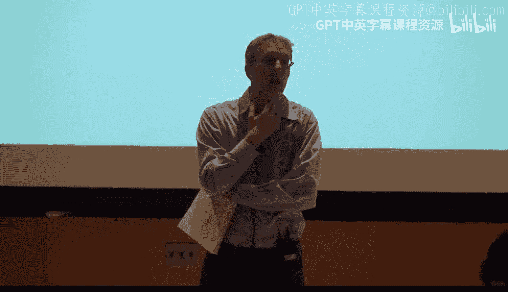

And now we have a three minute advertisement to the Cornell data science class。😊。

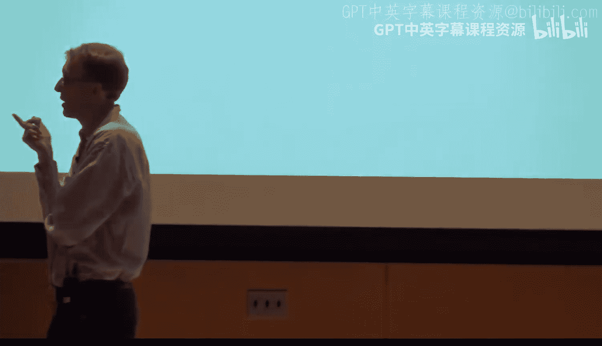

Hi guys， so I'm from Paro Science， where our project came on working on machine learning and data science and predictive modeling。

 we have a information session on Wednesday，8001 byC。

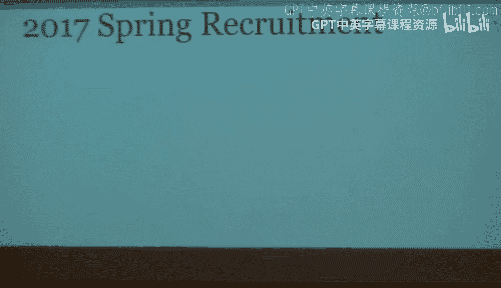

W will be provided likely most we also have a new training program take as a member of the project team。

 we will be doing some intertro data science using R I know you guys are learning machine learning here that doesn't necessarily apply but if you want some supplementary materials。

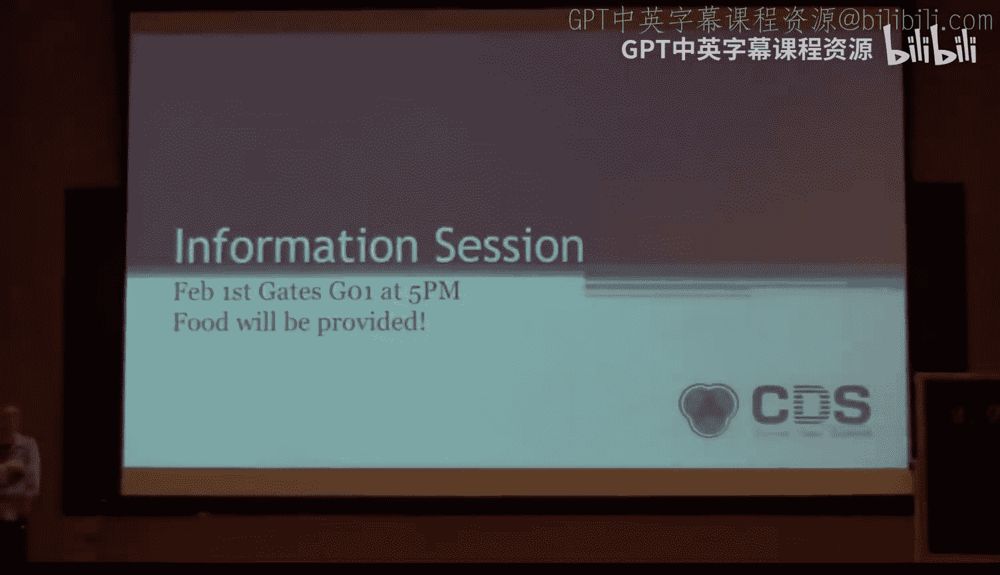

啊 fight。

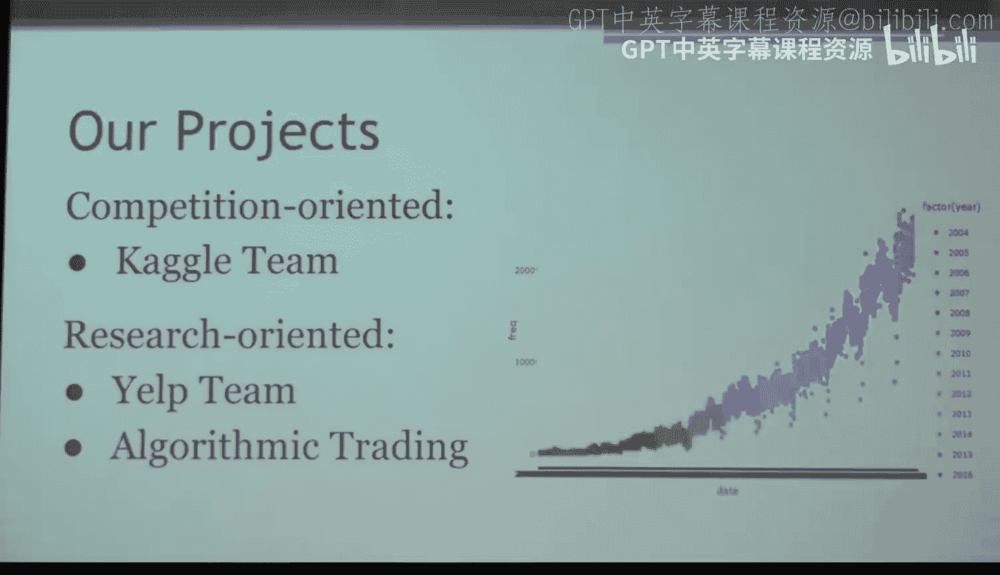

Our projects， we have one competitive core of the competition raised team， which is their faculty。

And we have two research oriented， one is Yelp， we're on group reviews。

 and the other is on algorithm maturity。

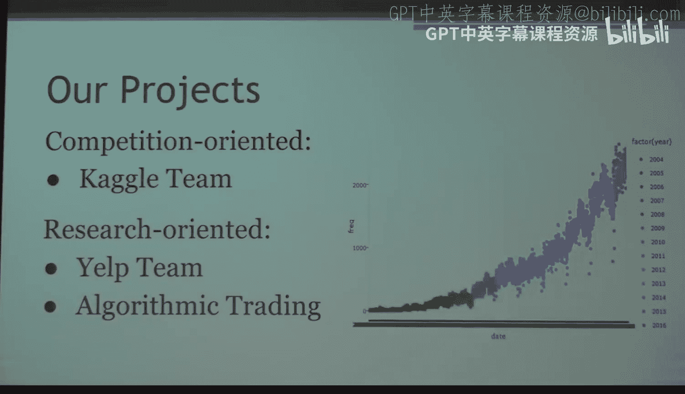

We have some new computational resources this semester。

 we have a formal I cluster with about 100 C course， 400 particular memory。

 and I wanted to do a little。家冇。So we had a 2。7 gigabyte text file that basically crashed most of our team's laptop cluster。

We got a poy spark one。

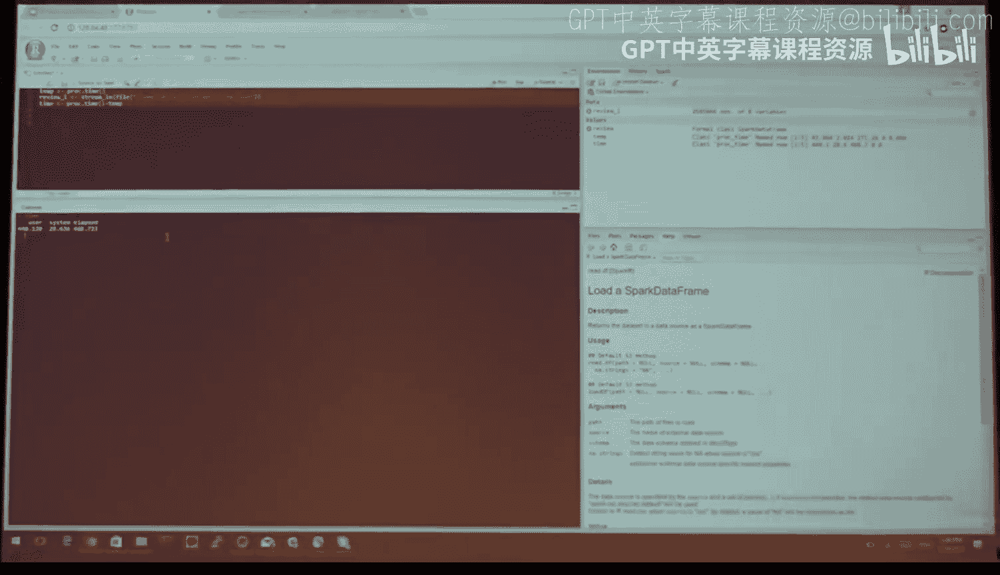

As you can see， the file that I uploaded takes about 400 seconds to load。But using S。

It takes exactly two seconds。And you can use it these kinds of。Really fun data science stuff。

 if you come to our project team， learn more about it on Wednesday and if you have any questions。

 email cornnell datacience@gmail。com and RUP for event。

Thank you。Thank you。

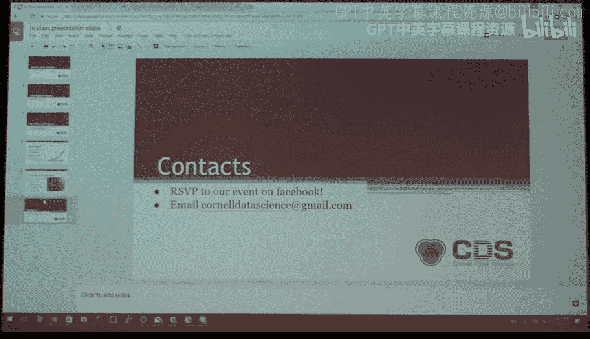

Thanks。没法。Alright， terrific。

嗯。Alright， and who has， who still needs a handout from last week from or last time， okay。Alright。

 it's a little tricky。

It's a random order， Why don't we， how do we do this？

Let's pass them around。

Okay， some for here， Hey hey。Oh wow， you guys camping here。Pas some backwards。

 I don't know who I doesn't have any。 Alright， Oh， sorry， there's some extra here。Yeah。All right。

Everybody， L you。Alright， some people still need handouts。How is that possible， It 370。I gave up 370。

the new people arrive。Sorry， I don't。Have anymore。I have a lot of placement exam。诶。

Maybe I don't know。 Like who， who doesn't sit next。 Okay， please raise your hand one more time。

 Who needs one。Now， look around you。 who your neighbors also raise your hand。 Oh， yeah。

So I'm clustering。Okay， could you maybe just ask the people in front of you or behind you if they could be very nice and maybe give you one of those。

嗯。At least every other person should have one。Yeah。

O嗯。So placement an example if we waited tonight。 So hopefully tonight or tomorrow。

 you will get an email。😊。

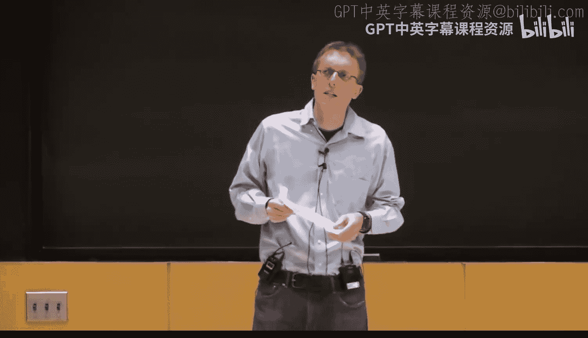

With from Voularium， that will invite you to be on the。

On the Webpage or you get an email ofma saying that maybe you should take it again。

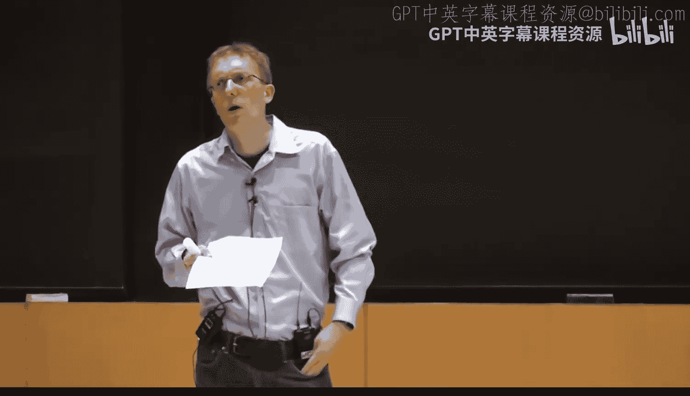

Son by the way， this class is likely to be offered again next semester。

All right。 By the way， I got a new talk talk。 I got the big talk。

Okay， last time we talked about the machine learning setup。 So if you remember， we had。

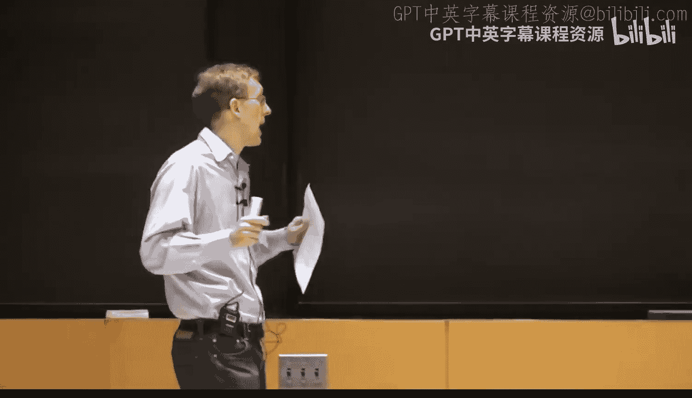

We said， we have a data set D。That。Contains n data points。😡。

Or and pairs of feature vector and of label。And that was in。From the space。Curly X， curly Y。

 but cur X is the space of all features， and curly Y is the space of labels。😊。

And these are drawn from a degree， which is elusive to us。

So these are drawn from some distribution P。 And someone asked me at the end。

 what is that distribution P， right， It seems odd， Like usually you have a Gaussian distribution or something。

 right， And there is really， there a distribution that you can't write down。

 There's some distribution of basically of mother Nature or something， right， So if I would。

 for example。Go outside in on you know， Cornell campus， right， and take pictures of。Students face it。

 right， So， you know， let's say they want to make a face classifier。And， you know。

 go outside and the first person I meet， I just asked them could I take a picture of your face。

 right， Sosll be it but okay， thatll be a distribution， right。

 So it's a random distribution of who I run into And if I would do the same thing somewhere else in another country that say I would do this in Beijing。

 I would get different people， right， So it's a different distribution P， Okay。

 obviously as a distribution， we don't know， It's something that's， you know， we don't control。

 if we knew this distribution would be really， really easy， right。

 because then we could actually just take P of y given X。

 And then we just stick in our X and we predict the label Y， but we don't know P。😊，so therefore。

 we have to do this whole of machine learning。嗯。And by the way。

 there is the important thing that when you， when you collect your data。

 you have to collect it from the right distribution。 Actually， the one in another I just said。

 the face example。 That was actually a great example of Nokia。

 So I don't know if people remember Nokia used to be a。😊，Company that makes phones。 and。

 and they had one thing they want to do is they want to put in a face recognition system。

 So when people take a picture， a camera， a picture with a camera。 automatically takes the face。

 And so usually when you have a face in the camera。

 that's the person what you want to zoom into and what you want to make， you know， sharp etctera。

 And so they train their face recognition system。😊。

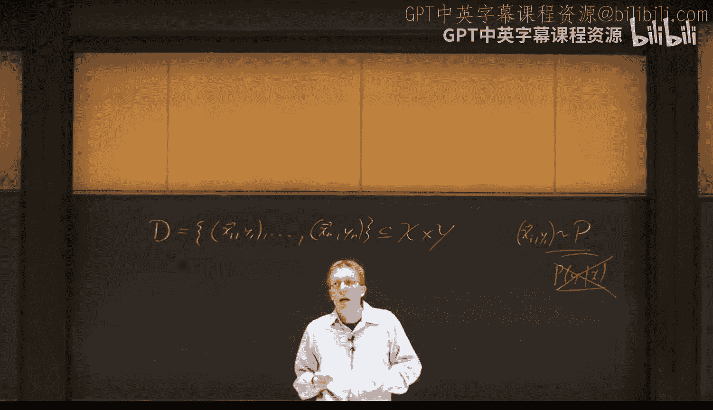

呃。

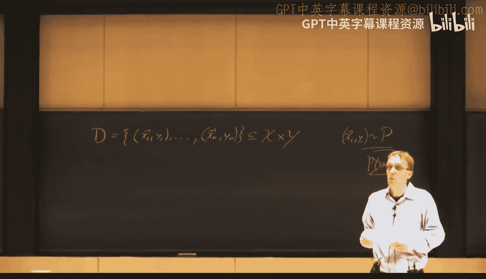

You know， with random people， they took random people from the streets of Helsinki。

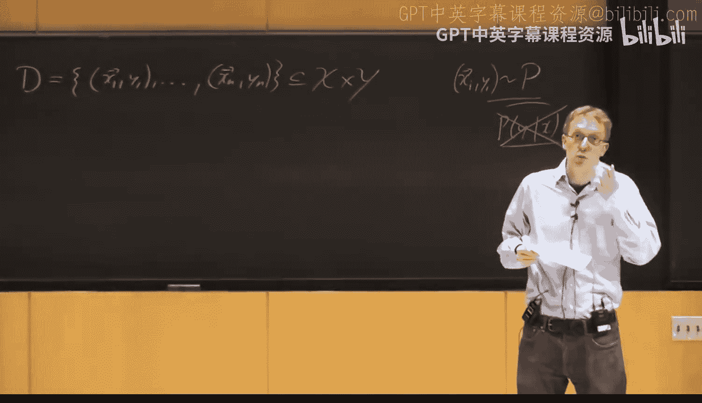

The problem is， of course， you know， Nokia phones are sold everywhere in the world。

 And so one thing they， they， you know， they forgot is that basically they didn't have any people they were not Caucasian。

 So then actually， when you ran it in the United States， Africanam American， you。

 which stand in front of the camera。 doesn't see me， doesn't see me And there's YouTube videos。

 they were really funny。😊。

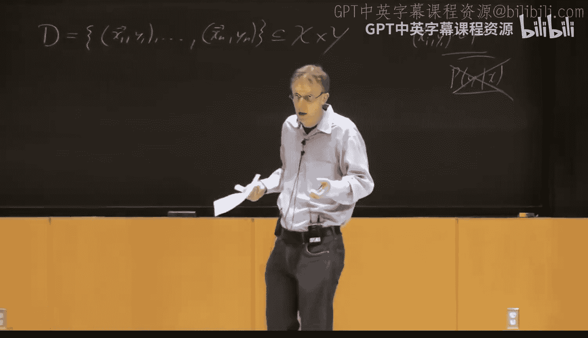

Because basically， the problem was it was trained in a different distribution than actually it was applied to。

 And that's very， very important that when you take your training data。

 it should be the same distribution that you in that you actually intend to deploy it on afterwards。

 in this case， actually， it was quite embarrassing for the company and。😊。

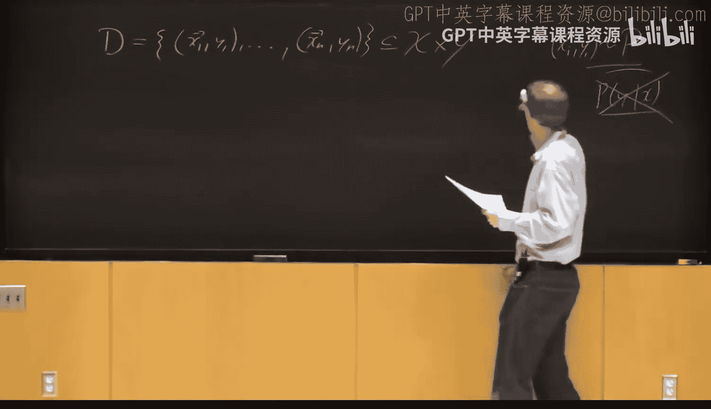

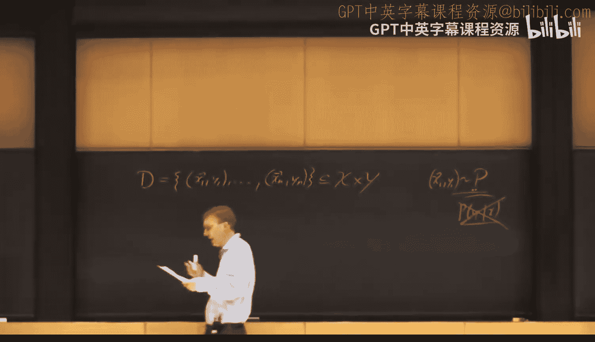

They had to update the software Tele。Okay， so。We basically have this data。

 We assume the data is given to us。 And we， you know， a big。You know。

 getting this data is not always easy。 But in this course， we won't get， you know。

 I won't get in too much detail how to actually collect this data。

 We just assume somehow you can sample that data。And。So， you know。last time I had a few examples， I。

 you know， went from hospitals where you have。You know， patient data。 And I said， you know。

 for example， this could be a vector that describes a patient。 And why could， for example。

 be the question， will this patient return， if I would release that patient now。

 would he or she return to the hospital within six weeks， That's a typical question。

 Another one is text documents。 This could be an email， And why could be the question。

 is that email spam or is it not spam。😊，And finally， wait， how far did we get。

 Is that how far we got。Yeah， okay， good。Let me do one more。 I just want to say an image。

 So X could be an image。This is exactly。For example， the face problem。 right， So face detection。

For example， so。One image actually is a bunch of pixels。So if I zoom in， kind of looks like this。

And these pixels have certain colors。 So now we have my， my my face here。 This has my face。

Something like this。And so if you have a 6 megapixel camera， for example。

 I think the latest iPhone has 6 megapixels。😊，Well， really。

 what hip is so that means you have 6 million pixels。 Each pixel actually has three different colors。

 So it con consists of three numbers， the red value， the green value and the blue value。

 Usually you have around 255 values for each one of them。😊。

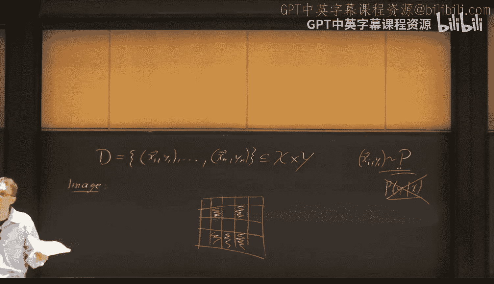

And that's 24 B in total。 So then you can write your vector X I as。😊，Basically。

 a vector that takes all these different pixels and says， okay， the red value， the green value。

 the blue value of this pixel， the red value， the green value。

 the blue value of this pixel and so on。 right， So this is， for example，0。30。2， you know。😊，O。8。

 that's these numbers describe this pixel here in the top left。So， you know， if you have 6 million。

6 megapixs， and this leads6 megapixs would lead to a representation that's。In 18 million。Dimenssions。

脑袋正拿。😡，Of not a very good representation of images。But， so for a long time， actually。

 people had much， much better representations in the last couple of years， actually。

 people went back to actually just representing。Pixels literally as pixels images literally as pixels。

 And we will get to this at the very end of this class。

 when we talk about convolutional neural networks。😊，Okay。

 any questions about the feature space X and representation of data as vectors。

So the key is basically， you know， whatever your data is。

 we assume at this point that you can just take your data and take each data instance and represent as an vector or X。

 And we assume that every vector has the same dimensionality。And so。Text document be a pair of words。

 and。And so on。Alright。Oh yeah，1， So one distinction that I still want to make is there is dense and sparse vectors。

😊，So let me just， I actually annotated my notes。 I just realized this。 So we have dense。

 versus's sparse。😊。

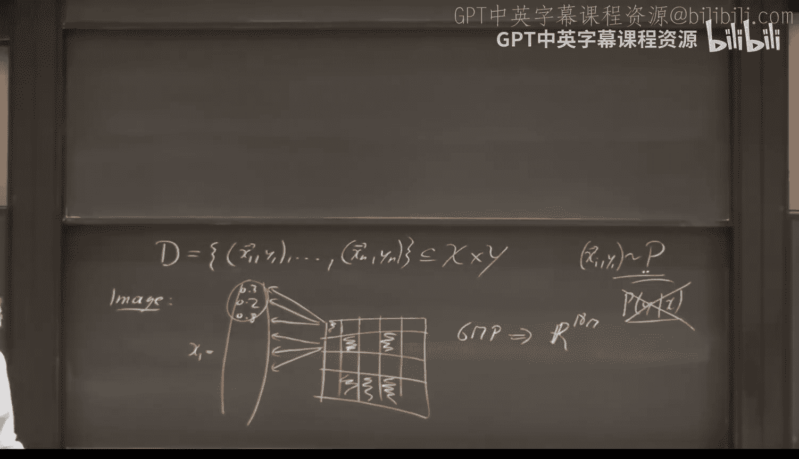

And。A denser representation means that we use。You know， for almost every example。

 if you use every single one of these dimensions。 So there's always some value here。

 A sparse representation means that the majority of these dimensions will be 0。

 and only a few of them are filled in。So， for example， you have this in text documents。

 So if you have a text documents， and last time I said the way we do this is we just take， you know。

 a huge vector of it。

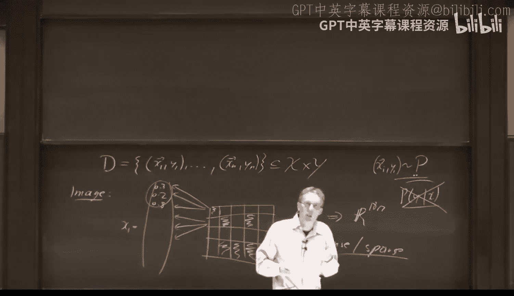

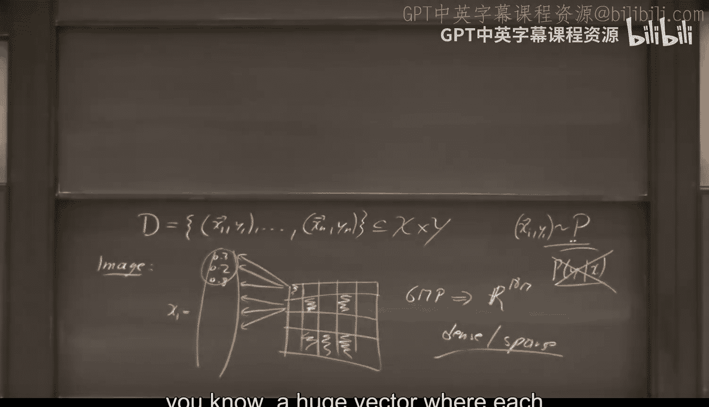

Each dimension corresponds to one word in the dictionary， so。You know。

 we have 20 million sorry sorry a million e words that say in the English dictionary then。

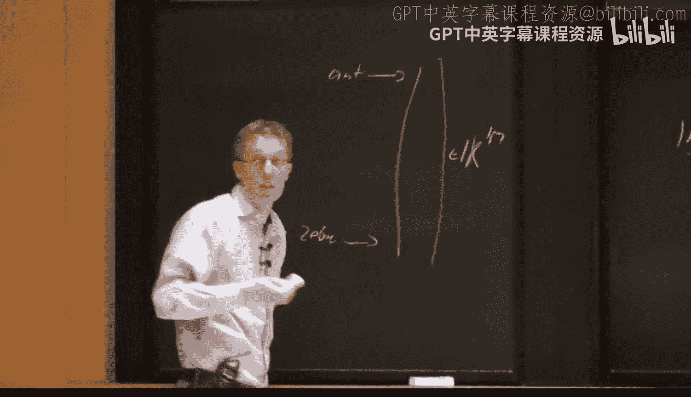

If you have a little email， well almost every word in the English vocabulary will not be in your email。

 Okay， so if you will pick a word randomly， you almost certainly will not be in your email。 right。

 In fact， most of our language， we just use the same thousand words over and over again。

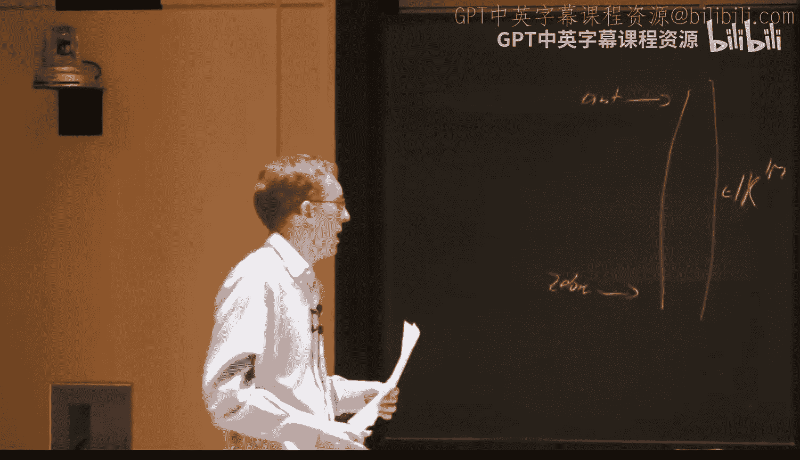

So almost all of these will be 0。 And there's a few counters。 Basically。

 we say the word the actually is quite common。 right， So that's actually in the email。

 So that's a sparse representation。That's important because the nice thing here is with these。

 if you actually would store this， you wouldn't actually store all the zeros。

 You would just store only the entries that are nonze。And so sometimes it allows you to。

Do machine learning on very high dimensional data because it's smart。

 So you can still feed it in memory。😊，So the important thing is to understand what's ten and whats sparse。

 So sparse means you have many， many zeroes。In， in your feature vector and dance means creativity typically down。

All right。

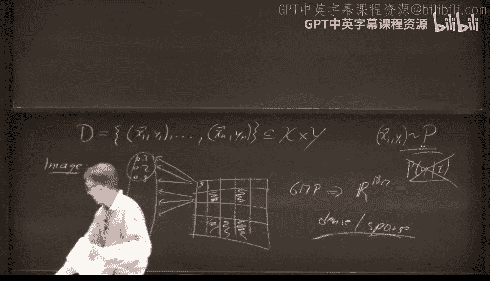

So in the first lecture， I had this cute little picture of the computer and you write a program and so on。

 So let me just go back to that picture and use the notation that I introduced to just make that a little bit more。

😊，For， it's still a cartoon， but。So this here is my computer。I stick in the data。

And I think in the output， that's what I had。And hope do people remember this。

 Raise your hand of you remember what I'm talking about。 Allright， good。

So my data here is basically the x1 to X N。These are， for example， emails。😡。

And then for each one of them， this are my training data。 So I know what the answer is， right。

 I know this one was a spam email。 This one is not in spam and so on。

 So then Ive stick in my Y 1 to Y N。 Okay， be easy correspond to each other。 And basically。

 what I would like to have an algorithm that if this is the input， this should be the output。😊。

And so my machine learning algorithm， the M L algorithm。

 is then going to crunch these numbers and I'll put you a program， which we call H。

So age is really mathematically。 It's just a function。And so hopefully， if you take any H of Xi。

You hopefully get Y I back in almost all cases。 right So that means you did a good job。

If you learning。And so now that's what's what we call training。And then after we are done， we take。

 you know， we move to testing。And testing is now we take a new instance X for which we don't know the label。

We take this program H， we put it in the computer。😡，And the computer computes as H of x。

Which is our prediction。 And hopefully， that is actually the y that corresponds to that x。Al right。

Any questions。Raise your hand， if you understood it。All right， awesome。Good， I like some people like。

 yeah， all right， move on。 Okay， good， good。 I'm moving on。 I'm moving on。😊。

I don't want to lose anyone the first week。Okay。嗯。One thing， yeah， one thing is important is this。

 this will only work ands a。你 know嗯。Saing的是呃。Until you can't hear it anymore。

 But it will only work if this X is drawn from the same distribution as this。Right so these here。

 these X are drawn from the distribution P。 This here also has to be drawn from the same distribution。

 Otherwise， it will not work。Okay， good， so。Where are we now， We are trying to do machine learning。

 and。

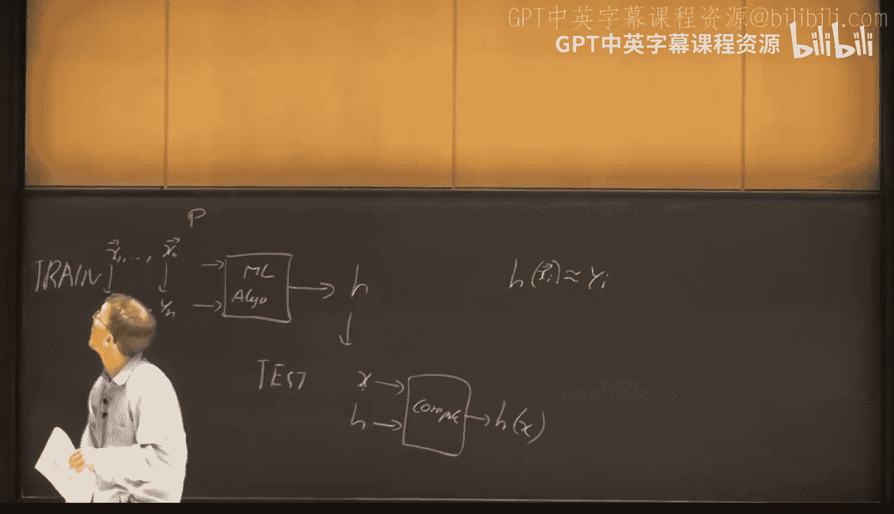

Right， what's gonna。All right， good them。

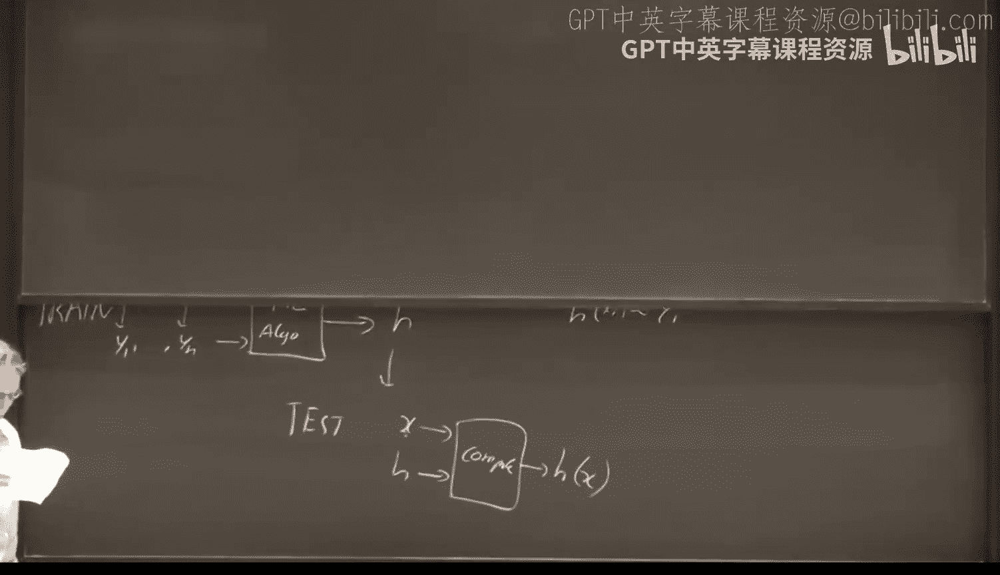

二周。When you want to do machine learning， the first thing you have to decide is what is my label space and what is my data space。

 Okay， so you take this data， you generate these vectors。 We just give you a bunch of examples。

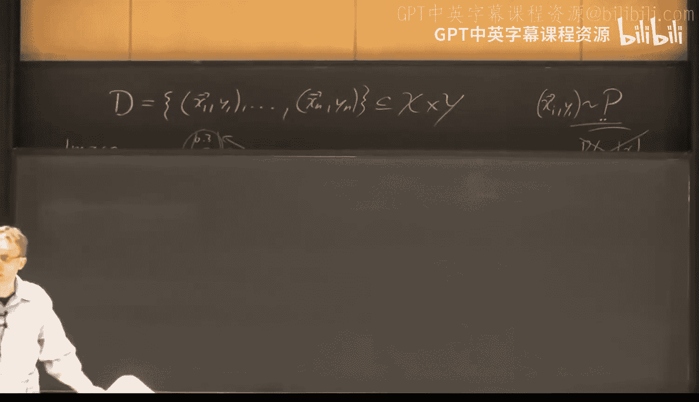

You also generate your labels。 you have to understand what problem are you in。

 This is a regression problem。

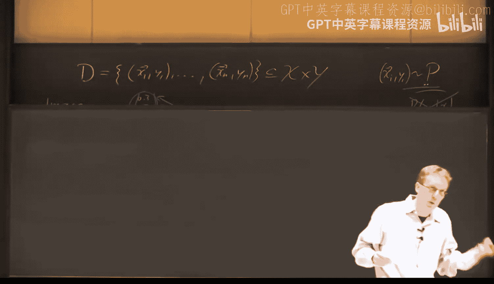

Does anyone remember what a regression promise is。What defines a regression problem， yeah。Well。

 you do have labels， but they are real numbers。that's right。 You don't have discrete labels。 Yeah。

 so regression， you have real numbers， you know， by the way， you just have one or 0。

 You just have two do options。 A multiclass classification。

 you have K options that you want to predict。😊。

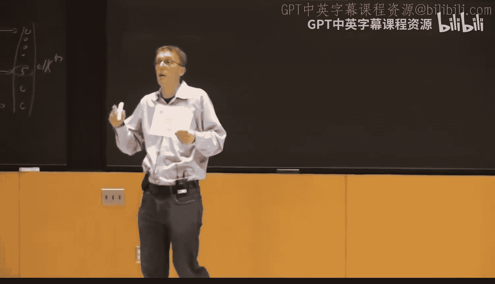

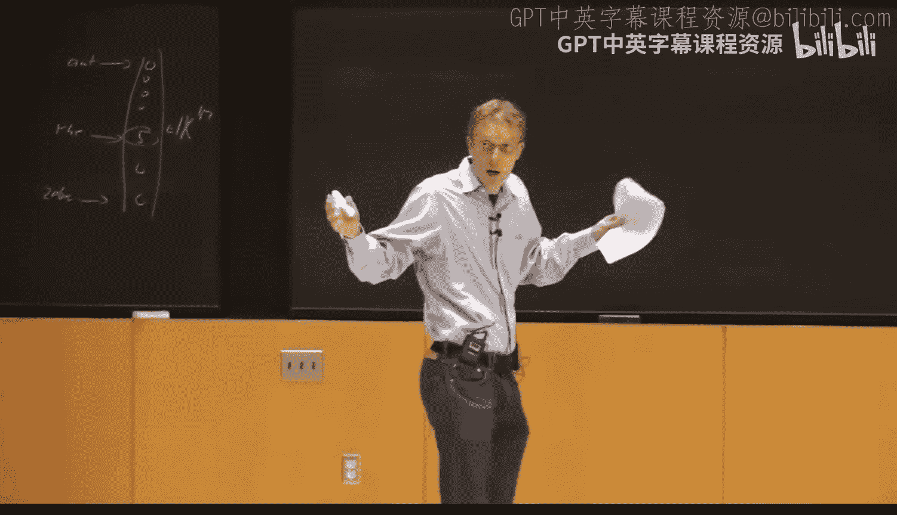

And you also have to write a feature representation。

 So you have to somehow come up with a good way of capturing your data and make sure you include everything。

 And there's one more thing。😊。

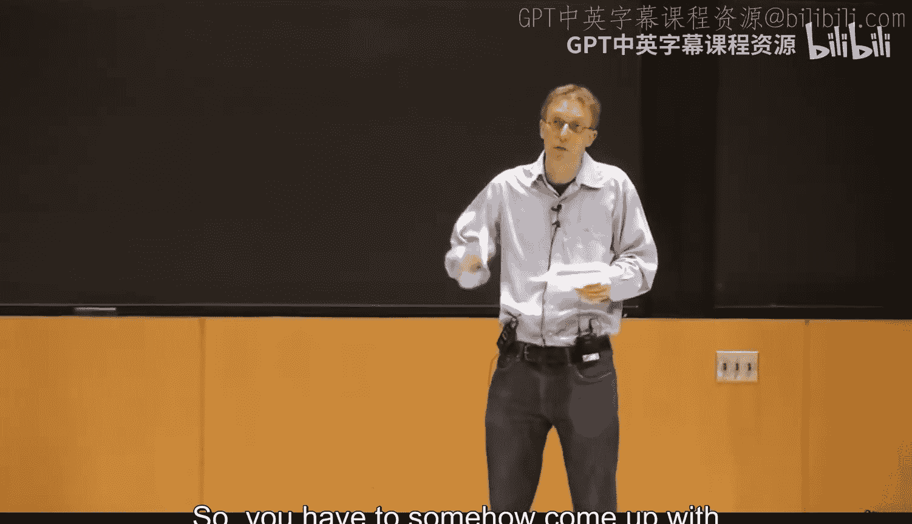

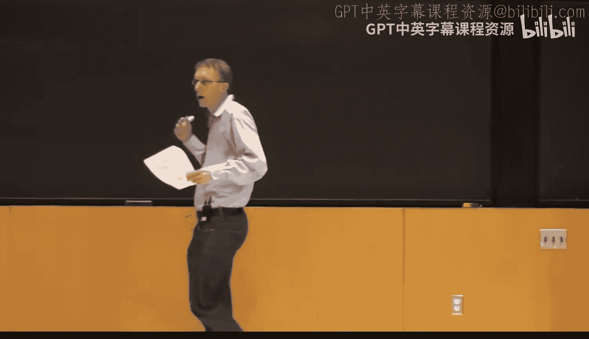

You have to actually decide， what do your function H is。And so。ItLike so far， I just said， oh。

 we learned some program you know， age， but that， you know， it's not going to be magic， right。

 So there's like different kinds of programs that we could learn。😊。

And most of this class is actually about， you know， what kind of。

 what kind of options are there and when is， you know， algorithm A， the right thing。

 When is algorithm B， the right thing， etcter。So we define a set K H that is the hypothesis class。

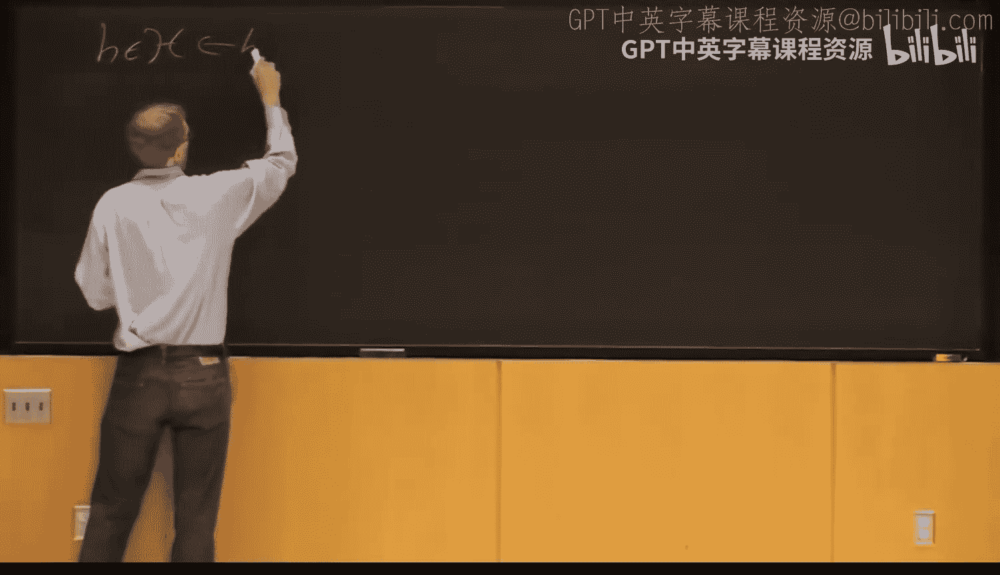

And that's actually， this years called hypothesis。 That's why it's H。 So be busy， say， well， leave。

 we have some set of possible programmed， possible functions that we could learn。😊。

And we try to find the best one out of that。 Choosing age is usually something that's not automated。

 Some people are trying to auto it。 But that's usually not， that's something that's your job。

It's you job as a data scientist is given a problem making the right choice of what your cur ages。

 right， What kind of functions should we try to learn， given that particular data。

 that particular problem。 And then the machine learning algorithms stop is out of all these possibly infinitely many functions that I could learn take the best one that fits your data。

😊，That's what we call learning。 So let me give you a few examples， examples of。

And we will go through all of these in the next couple of lectures is， for example， decision trees。

Just to give you a little sneak preview of what a decision tree is。 This tree is one that actually。

 it's a tree。 Well， let's say， for example， the hospital data。

 you want to predict that someone coming back within the next six weeks。

 So what you do is you repeatedly splitit on some features。 for example， say， you know。

 is the age greater than you know65 And yes， then go to the right， no。

 go to the left say well you know， then we have， for example， is blood pressure very high， then yes。

 go to the right no， and then you say here， probability of returning is very high。

 maybe is 90% probability of the person returning。 the person here can maybe say， is the age。

 you know， greater than 30， if that's no， then， maybe you know。

 let's say's unlikely that the person returns and so on。

 So you build a tree that basically you put your data through， and ultimately。

 what you're doing is you petitioning your space into different instances' and say if you fall into these down here and the sleeve down here。

 you're likely to return。😊，To the hospital， if you want to this leave。

 you are unlikely to return to hospital。 And maybe heres in tree or something。

 That's a decision tree。 The question is， how do you learn these decision trees that they actually have provable guarantees。

 etc cetera。 And we will do this in a couple of。like this。 Another one is。Linea classifiers。😡，嗯。

And some of you may have heard of these。 The perceptron， for example。

 that I mentioned last time is exactly a linear classifier， Then with artificial neural networks。

Neo networks， whatever。Also called deep learning these days。And to vector machines。

So these are probably the most common， I don't know。Are the most famous ones。那 sense。

And so one thing I really want to hammer into you is that there's no best algorithm。 right。

 There's no， like that that's a very common mistake that， especially like a few years ago。

 super vector machines was super fashionable。 Everyone want to do everything with super vector machines。

 Now it's the same thing with deep learning。 right if people come to my office and say， like。

 you have this data。 And I want to use deep learning for it。 right That's not how it works。

 It really depends on the problem depends on your data。 Which one is the right algorithm。😊。

And so hopefully， by the end of this class， you will have a good understanding。

 It's actually a very principled way of deciding what the right algorithms are。 It's not just a。😊。

You know， trying the one that you like the most is something。Allright。

 let's come up with our own algorithm。With a really terrible algorithm。So this is the， you know。

 this is only the third lecture， so。All right， it's a terrible algorithm， number one。So。

The danger is were to write this down。 Someone's going take a screenshot and put it on Twitter or something。

 This is what Professor Rmberger is teaching us。 So here we go。 Take any age of out of age randomly。

😊，Finally。And hope it works well， right？Can always evaluate it， right。

 You can basically see on the different data sets。 like， you know， Does't seem good predictions。

 right， So youve just built a random decision tree， for example。😊，And just evaluate。系。W。😮。

That's clearly not going to work away， well。嗯。And what's the problem， right， The problem is。

 well you know， the space age can be very， very large。 It can be many。

 many possible functions you could learn。 And it's very。

 very unlikely that the one you're picking is going to be the one that's。😊，YouNow。

 write for the data。So you probably I don't expect me， what would I see if I deploy this。

 what would happen？😡，There's an obvious answer。 It's not very hard。 It's not a trick question。

Anyone brave enough to see the obvious。Or it would be terrible， but you would get a very high error。

 right， because maybes like running a random program on your data， right。

 It would not spit out the right answer。Can anyone think of a scenario that's actually where it could still work。

Yeah， with all possible algorithms are pretty much comparable。 That's right。 So if。

 if your age is restricted enough， right， But basically， what you pick。

 it doesn't really matter all that much。 right， That's， that's very rare。 right。

 But in some settings， that could actually be the case。So if that's the case， then it's actually。

 you have a huge advantage。 It's very， very fast。 right。

 So picking one age randomly is reasonably fast。😊，Okay， give me give you another example。

 Here's another terrible algorithm。 that's going to do much， much better。

So yes terrible algorithm number two。Here's what we do。Be child every single age。In this。

 in my my hypothesis class。And pick the one that works best on the data。So I go through my， my。

 my set of functions that I could learn and try every single one。😊，And assume for now， it's finites。

Because with the program， you know， number of programs is actually。

Effectively finite because we only have so much decision。 You know， if you minimize how。

 how complex they can be。And then we use the one that's best。 What's the problem with that one。

 Why is that a terrible algorithm。Yeah。Thank you and we'll take you forever。 Right。

 there's maybe more programs in that set than than there's， you know， elements， you know， whatever。

 like electrons in the universe or something。 right， So you know， we'll take you away so。😊，嗯。

So that's not a good job I。So we have to have some way of taking this function out of the set of possible functions。

 O， and。😊，That's exactly where the last function is coming。 So let me just explain this。

So you have lost functions。And here what last functions do。嗯嗯。L functions evaluate。For any age。

 out of my hypothesis class。How well does that age work on my data。So let me give you a very。

 very simple， like the most common example is the01 loss。And the 01 loss is called 0。

1 because it's either 0 or it's  one。And so here's how it works。So we run this over a function H。

 which we have want to test and then some。data said D。Let me， do the following。

You go over every single data points。😡，I can those X， I， Y， I， in D。And。You take the Delta function。

We say age of X I equals to Y A。 Who knows the delta function， Laise your hand。Not many。 Okay。

 data function， what it does， This is one form continuous of one for discrete variables It's basically the same thing。

 It says， if this here is true。Then output a 1。Otherwise， output is 0。So this function is either。One。

 if h of X I equals y I in 0 otherwise。😡，And actually， sorry I doesn't mistake take my notes。

 It should be not equal。That's the accuracy。 because I， I claim it's error。嗯。Okay。

 can anyone describe in English words what this function。Measures。对二。😡，对呀。Accuracy and not anymore。

 right， because I just， just made the cross up。 But yeah， it used to be accuracy。 right， So if I。

 if I say if it's not the same and I count those， and it's actually the number of times I'm wrong。

But you're right， like originally was the accuracy。Right， so because if X I。

 H of X I does not equal by I。Then I， I have a counter one， otherwise I have 0。

I divide that by the total。 Let's say you have 100 examples。Three of them， I get wrong。

 So three of them， I have， you know， I have a one here， or the other 97 have 0。So3 divided of 100。

 So 3%。Of my training samples are wrong。Okay， does that make sense？🤧嗯。

And so once you can see already lower is better， right， We want to drive the loss to 0。

 That's why it's called loss。 right， It's a negative thing。s， it's a bad thing。

 And the loss functions are always non negative。😊，So if you have a loss if you drive it down to 0。

 that means you're making no more mistakes， as that's universal，'s across all loss functions。

 It's a convention。Okay， so lower is always better。 And if you are 0， then basically。

 you've made no more mistakes。Any questions about this？嗯。All right， let me give you another one。😡。

The square us。A squared less。So， the square loss。It's again， at some of all my data points。

And to the following， I say H of X I。Minus y I squared。Thenhan average。

Can anyone tell me an example where that maybe be that you know， we want to use that one。Yeahて。

linear regression， that's right。 right， So for， any regression problem， really， right。

 So if I try to estimate a house price is something。😊，And then I basically say， well。

 here how much I predict that house is worth and the image is really worth， right？ And so if I'm off。

And I square this。 and say， well， the more I'm off， right， the more I have to pay with my， right。

And if it's 0， I I exactly hitting it， then have a0 loss。 then I'm doing really， really well。OK。😊。

Any questions？All right， let me do one more。The absolute loss。Its。

1 over n and some of all my data points。 now I just have the same thing。

But I take the absolute value。So you again， same thing。You know， I'm trying to say， basically。

 how close is my prediction to the true value。And if it's a little higher or a little lower。

 I have to pay for it。Can anyone think of an example。

Where I may prefer the square loss over the absolute loss where I want to。

Prefer this absolute laws of the square lot。Why don't we actually。

 I give you a few minutes to suggest this。 I give you one minute。

 discuss it with your neighbor and see if you can come up with an example。嗯。

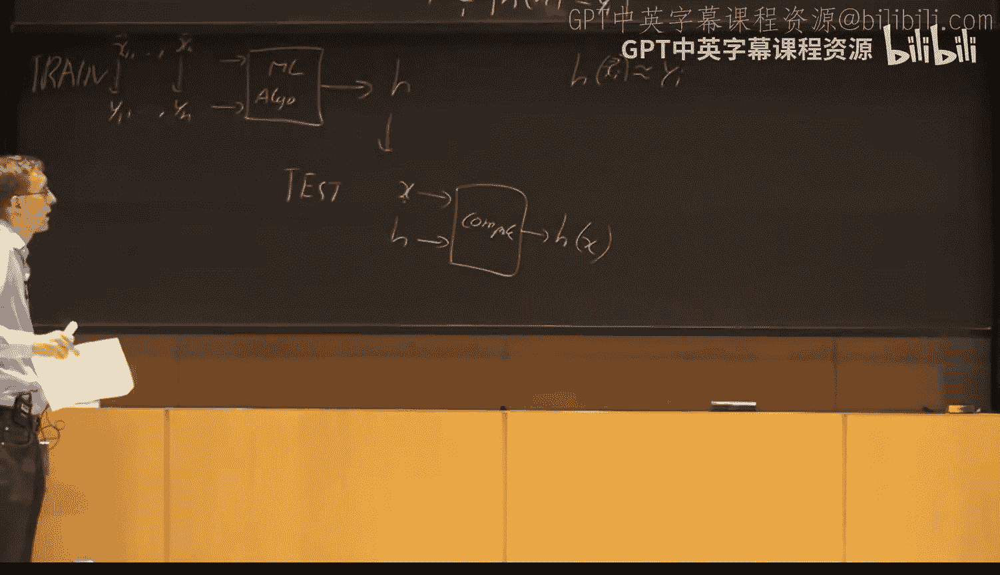

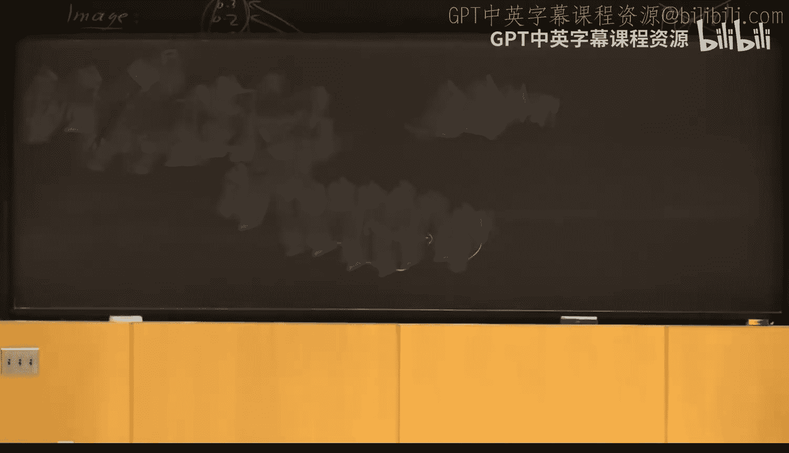

Yeah。Okay。Yeah。All right。Any suggestions。F， would you yeah prefer one over the other。

you want to use squared。好。Because you say if you get one wrong， like really， really wrong。

 it would actually mess up the whole neighborhood。could be， could be。嗯。Typically。

 outlier problems go the other way。 So， I mean， you were saying it's basically。

What you're saying the right thing， saying that， you know， if basically getting one really。

 really wrong， right， basically the square law starts if youre off by a lot， right。You rather want。

 one point is off by a lot。 That's a lot worse than having a lot of little points off by a little。

Okay， if you have 10 points off by one。They if give me a penalty of one。

 If you have 1 point of by 10 or 10 squared is 100， right， So that's much， much， much worse。 right。

 So itll always make sure that everything is basically， you know， roughly， you know。

 there's no none one really， really wrong。That's good。Except for。

 can anyone think of in a scenario when that's really， really bad。Any ideas？So one， yeah。啊我大で。

That's right。 So one thing is， for example， like you have all these houses here。 right。

 And Bill Gates decides to move here to Ithaica， right， If I was mention for， you know。

 $500 million right， And so all you will try to do with your function is get his price exactly right。

 right， And if the student housing is off by a couple hundred thousand doesn't matter， right。

 It's not a big deal， But that may not be， know who cares about Bill Gates house in that case。

 right you basically what you're doing is many， many people will have larger loss， right。

 whatever inaccurate prediction just for the sake of one guy who basically gets it right。

 So in that case， you may want to actually go to the absolute loss， right。😊，Another setting is if。

 if some things could be wrong， So let's say some， some houses may you know occasionally someone sells their house to their brotherin lawaw。

 right， And they sell a big mansion for $1， right because it's like some tax benefit or something。

 they know， people are selling it， you know， in case they go bankrupt。

 they don't want to own it anymore， but they really selling it to their spouse or something。

 So now you have this on the tax record， you actually have a mansion that's worth $1 And so the squared laws would try to you know。

 try to do everything to get this prediction right now。 I'm really， really far off。 I square this。

 I'm off even more and would screw up everything。😊，Whereas the absolute loss would say， well。

 you know， it wouldn't amplify that too much， okay。So it， it's a trade off， actually， and。

We will get to this more in a few lectures。But yeah， this， these were great examples。Okay， good， so。

Let me come up with。So， okay， so learning is basically the process of。You know。

 you give the learning algorithm a function H， and I choose， choose。An age。

 a little age in my hypothesis。 so that's basically the idea。

 So you have the machine learning algorithm。 You say， I， you know。

 I want to learn your networks or something And which one is the best neural network。

 That's basically the learning process。😊，And。These loss functions are basically there that we can evaluate how well different functions are and they will guide us。

 right， You basically， we to have find some clever ways of cutting through this very。

 very large set of possible programs， and possible functions that we couldnt learn。

 such that the little age that we find has a small loss in our data。😊，Now。

So might come along and say， wait a second。 if what we really want， right。

 is find a function that a small loss on our data。😊，Maybe could come up with a really terrible idea。

 There's terrible algorithm number three。Here's how we could find our， could define our function。

 We just defined the following way。 say H of x。You do the following， you say。If there's X。Actually。

 equals。X I， oh sorry， X I。For some X I element of。In our data。

 So if there exists a data data point in our data。That matches exactly the input。

Then we output my eye。And other one， otherwise， we just output y1。

Can anyone tell me what the loss of that algorithm is on the training dataset set。by now computer。

 if I take this H and take any of these last functions on my data set。

 I my train data set and assume all my data points are unique。 So I have only X， only X I。

 only once in my train data set。😊，What would the last be of this algorithm。0， yeah。

 I guess you you did right。 So we wouldn't make any。Any mistakes， right？

 So for every single data point in my data。I would look at what the label is。

 I would basically find it in my data and would output exactly that label。

 right So the loss will be exactly 0。😊，哎。So that seems like a great algorithm， right。Are we done。

 This is the end of this class。You can go home， write yourself machine learning。

If find an algorithm that always gives us U a loss， no matter what we do。What's the problem。

Now you have not created an algorithm。Ha any predictive power。 That's， That's right。

 It's a terrible algorithm， right， Because if you stick in anything that was not in your data set。😊。

It doesn't know Jack， right， always is outputs by1， right。It basically just memorizes。

 the difference between people， you know， before an exam， right， They're just memorizing everything。

 And then they write it on the exam， not everybody， but some people， then。

 but then some new problems come along。 They don't know what the answers， right。

 So that's exactly what you're trying to avoid。It's memorization， yeah。あの全然決。H of X。

 you say the act has to come from。把。And so what you' are saying is train data comes from some distribution。

And our test data would come from the same distribution。 And how do we know that's actually the case。

And so that's trust that we have in the data scientist。 That's right。It's a。Which is， by the way。

 is Z。 U are the attack。 So right。 Yes， that is a problem。 There's a very big problem， actually。😊。

I can give you a famous example， again， of someone who made such a mistake。 actually， it was the。😊。

The US Army， actually， they trained a classifier that classifies between civilian vehicles and military vehicles。

😊，And so what they did is they。They took pictures。 They sent someone out。

 Take pictures of military vehicles。 So the guy just drove around base and took pictures of tanks and jepps and stuff。

 And they drove down， you know， downtown and took pictures of normal people's cars of civilians cars。

😊，They train the classifier， and they realized it got 0% error。 so they failed really good。

 They was like， awesome。 you can use this， right， But we know， targeting and all this stuff'。

 awesome， right。😊，And。So then they actually， you know felt really good for them about themselves for a couple days。

😊，And then they deployed it。 until now， didn't work at all。 That's 50% error。 It's like Po coin tos。

 right， didn't work at all。The question was， what was wrong。

Well what they did is the guy first actually drove around base and took pictures of military vehicles。

And then basically a few hours， he took pictures of civilians of the civilian cars。 So at this point。

 the sun had t a little bit。 It got a little darker。So all the。

 all the classified data like bright images were military vehicles and dark images were civilian cars。

 And it worked really， really well。😊，哎。That basic example of the distribution not being the same。

 right That's just， you know， that was sample from a very different distribution。所以这样去。😊，Okay， good。

 So this， this problem。 But， you know， we still have this guy here。

 So this terrible algorithm number 3， this memorization。😊，Would do would give us0 loss。

 So if we only use these loss functions to basically measure how well we are doing on our train dataset set。

This would still seem like a really good idea。 right， It gives us you a loss。

So we have to make sure that we don't arrive at something like this。 And actually。

 one thing you will see later on is that most machine learning algorithms are very much capable of memorizing the train data set。

😊，And that's okay。 as long as they still generalize。 So in this case， this doesn't generalize at all。

 And so let me tell you what generalization is。😊，Any questions， by the way， Any questions about this。

All right， generalization。And he is what just went wrong。All you would like to have is a function H。

In our such that。For any。X and y drawn from the distribution P。

 So in case you don't have that notation， that's this inver upside down A means for all。

 So for all X and y drawn from distribution P， we want that H of x is roughly y。's very often Y。

 And I'm not gonna formalize。😊，So what we did is that this memorization algorithm only worked for data data points in the in the data set D。

 but did not work in the general case。 If you have any X and any Y， drawn from P， it would not work。

RightAnd this is what we call generalization。就。What do we really want。

 What we have here up here is we measured the loss on the training data set。

 So we took the sum of all the data points in the training data set。 for each one of them， we said。

 theres our x， Theres our y。 Thiss our prediction on x， Theres our prediction is our true label Y。

 Are they the same， right， So either in the absolute loss and the squared loss。

 or are they literally the same。 That was the 01 loss。😊。

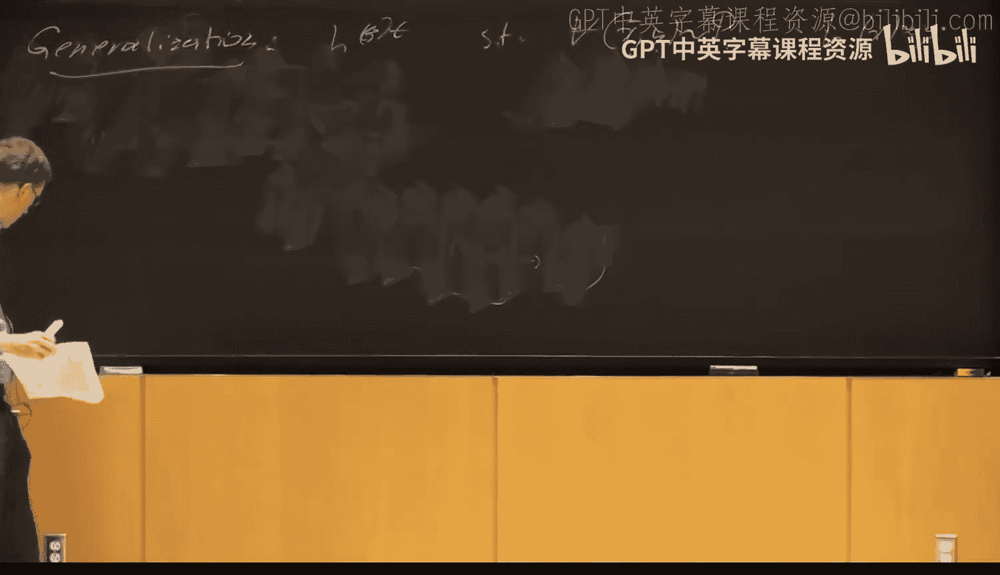

All right。😊，嗯。Now， what we would really want is something else you would want for any X and y drawn from this distribution P。

 which is elusive distribution P， which we don't have access to for those。

 we would like to have that H of x matches y。So what we would like to have is the following that。

If we draw。If we take out function H and we compute the loss。On any x and y that is drawn。

From this distribution P。The expected loss should be very small。

And this is called the generalization loss。let me go through this normal more time。

The basically is saying， what's the expected loss， what's the expected value。Of this last function。

 if it's applied to a。To any X and Y drawn from this distribution piece。

 So if you would go out there and take a new data point， X and Y， right。

Stick that in your function S compute the loss。What would be the air？So what would be the value。

 What's the value that you would expect， And the probability here is over these x and y drawn。Okay。

 any questions about this。Sorry。Okay， one time。What we computed up here is basically the average loss。

Right。If you。So this is basically the， Well， let me just。

This is the average loss of all data points in our train data set。

 we sample of all our data points in the train data set。 And we say。

 what is the loss for this particular training point and we just average them， okay。嗯。

Could also view this as， you know， essentially， you know。

 if you would pick a point randomly from your train data， what's the expected loss， right。

So here's something else。 herere basically saying， So that's good， right。

 But that here we can run to the memorization problem that we basically only do well on the train data。

 but we don't do well on data points that are not in the train set。

 So what we would really want is if you draw any X and Y doesn't have to be from your training data。

😊，But it has to be the same type of data that is in your train data。

 It has to be drawn from the same distribution as the data of which your data is made off。

 I take any one of these X and Y， stick them in my loss function。 Then this H should have a low loss。

 right And this here basically computes the loss that you would get in expectation。

Raisezy hand if that makes sense。O。嗯。So this is great。 Why don't we just minimize that。

And the answer is we cannot， because we don't have this P。And so we can't possibly。

 This is what we would like to minimize， but we can't do it because we don't have access to P。

All we have is these needsly n data points drawn from P。 That's all we have。So what do we do。

 And here's the。The good thing。If only one minute。You want to hear the good thing。 All right。

 Ill give you the good thing in one minute。The good thing is， we can estimate。

AndSo we can't compute it， we can approximate it。How to be approximated。 Here's how wed。

When we get the data set。😡，This is my data set。😡，Like you cant imagine like these are x1 by one。X 2。

 Y 2， etc cetera。I take my data。And I split it into two portions， training。😡，And test。

So the moment I collect the data， I split off some part。That I call a test set。

And the rainy part of the training set。And this data set。I put on some de secrett disk。

 that I put on a safe， you know vault somewhere in the basement。 right， No one has access to it。

And in this part here， I gives to data data scientists。

And the data scientist now learns an algorithm。And as far as the data science concerned。

 he doesn know He or she， she or she doesn't know about this test set， right。

 So he or she just knows this training set。And he or she now trains the the algorithm to do well on this data。

And then maybe you get really low loss here。 that's very encouraging。

The moment the data scientists come back。😡，With some function H， we can test how well it really does。

How we do this， we apply it on this data。O， does that make sense。

 And because data scientist has never seen this data set。This is a fair estimate。

 right This is sampled from the distribution P。 We know this because the data sampled from distribution P。

So then basically， we have an estimate of how well we would do if you go in the real lot。

And I do this literally。 right So Ita said， I don't give my grad student everything。

 right So I keep something。And then you can always evaluate later on。

 so that's this year is to estimate what we really want。 And this year is to guide our algorithm。

And if you do this， then you would actually realize that the memorization algorithm。

 this terrible algorithm number 3， wouldn't work， right， It would give you  zero error loss here。

 but it could you a really high loss here。😊， so now， you know， it doesn't work。Okay， do you。

If fire you data scientist， you get a new data scientist。Okay， good。

 And we pick up on that on Wednesday。