# 机器学习：002：监督学习设置（续）🎯

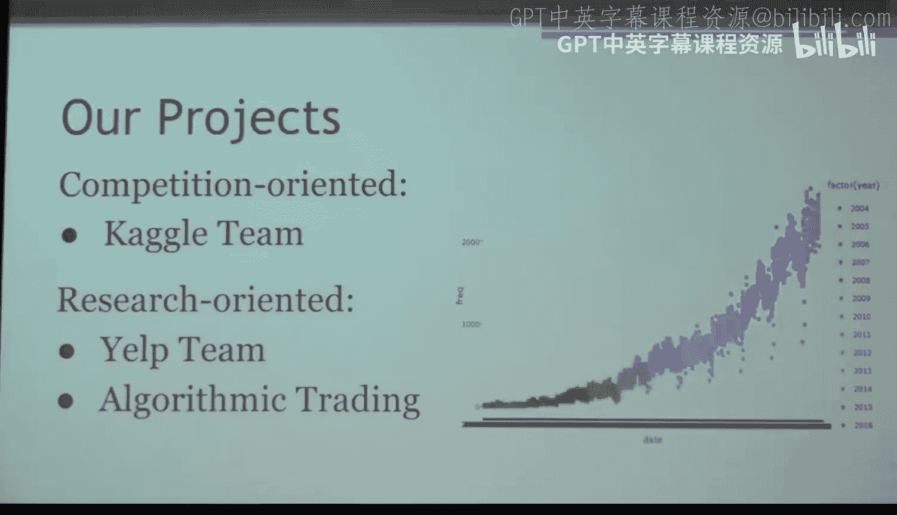

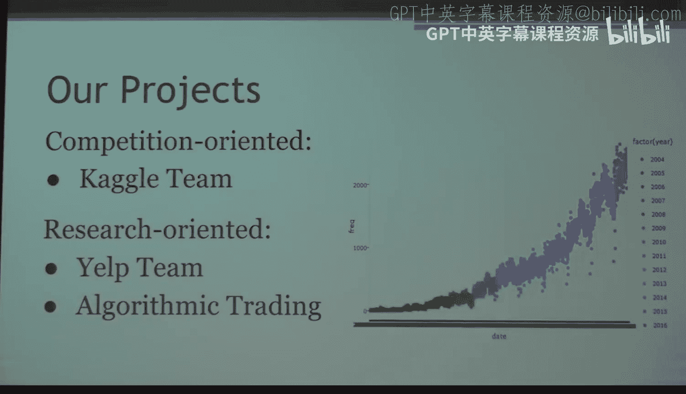

在本节课中，我们将继续学习监督学习的基本设置。我们将深入探讨数据表示、假设空间、损失函数以及机器学习中至关重要的“泛化”概念。理解这些基础是构建有效机器学习模型的关键。

---

## 数据与分布 📊

上一节我们介绍了机器学习的基本框架。本节中，我们来看看数据的具体表示及其背后的分布。

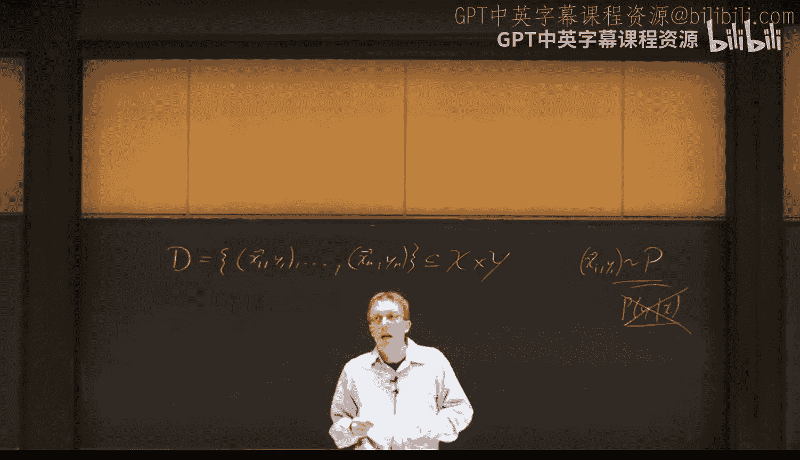

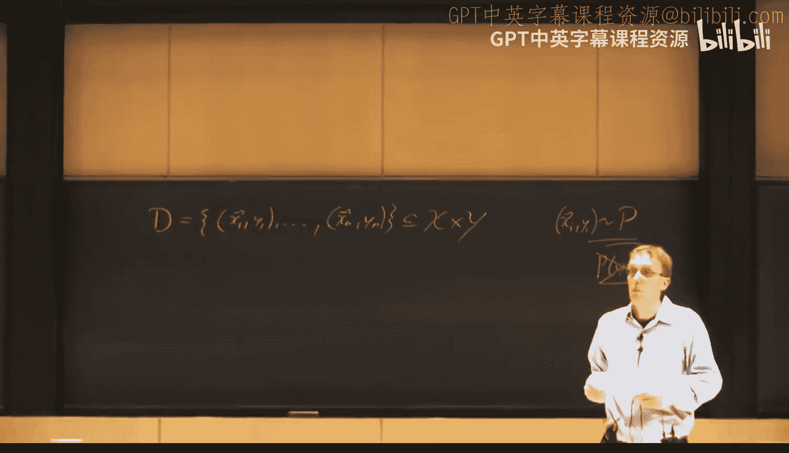

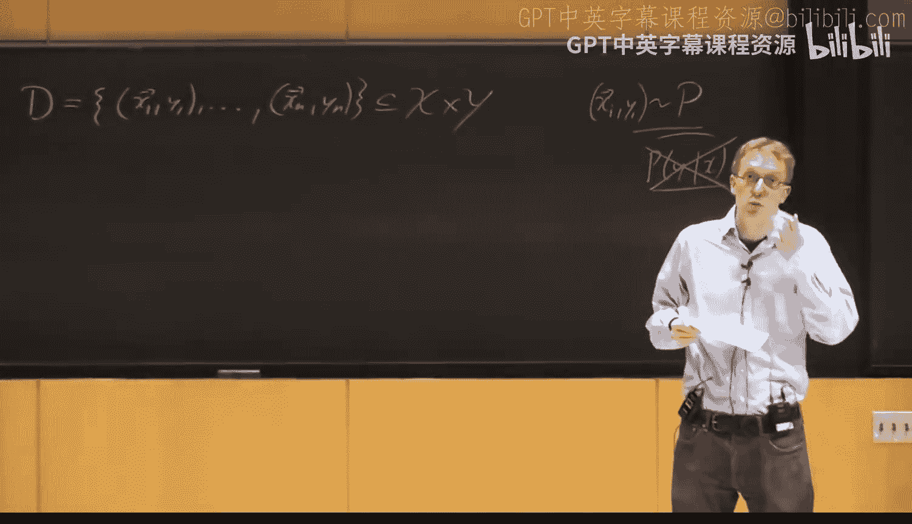

我们有一个数据集 **D**，它包含 **n** 个数据点。每个数据点是一个特征向量 **x** 和标签 **y** 的配对：
`(x_i, y_i) for i = 1, ..., n`
这些数据点来自一个我们无法直接获知的分布 **P**。特征向量 **x** 来自特征空间 **𝒳**，标签 **y** 来自标签空间 **𝒴**。

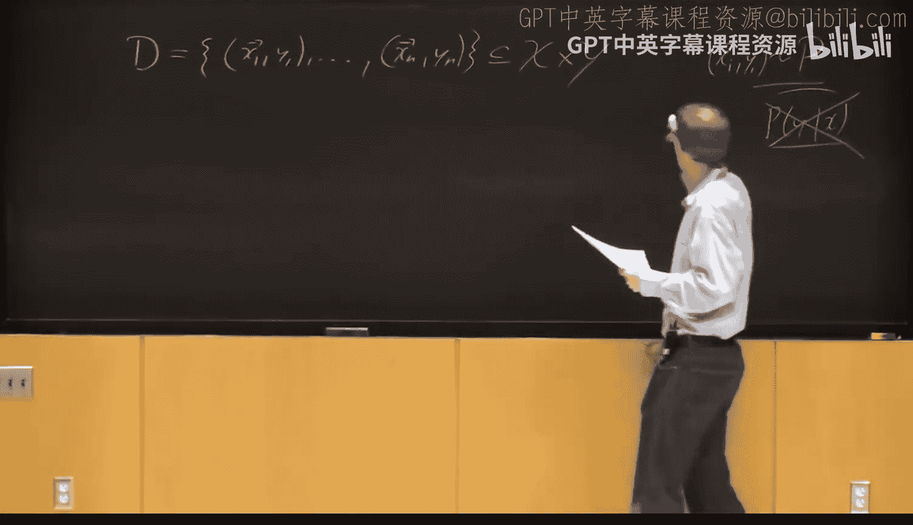

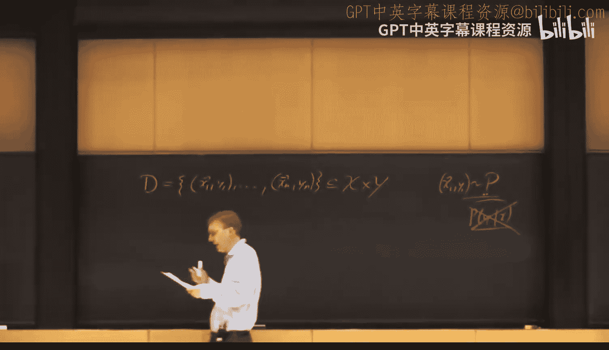

这个分布 **P** 是现实世界数据生成过程的抽象。例如，如果你想构建一个人脸分类器，**P** 就代表了你在校园里随机遇到并拍照的学生人脸的分布。如果你在北京做同样的事，**P** 就会不同。我们不知道 **P** 的具体形式，如果知道，预测就会变得非常简单。

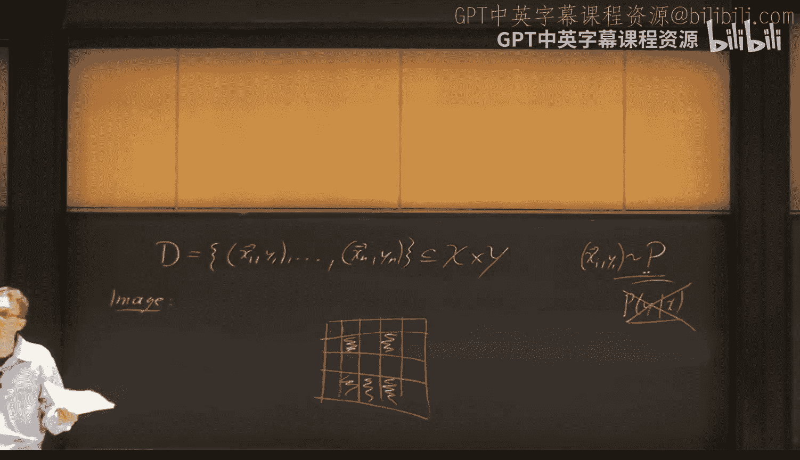

一个关键点是，训练数据必须来自与你打算部署模型时相同的分布。一个著名的反面案例是诺基亚早期的面部识别系统。该系统在芬兰赫尔辛基（主要是白种人）的数据上训练，当销售到世界其他地区时，无法正确识别非白种人的面孔，导致了严重的泛化失败。

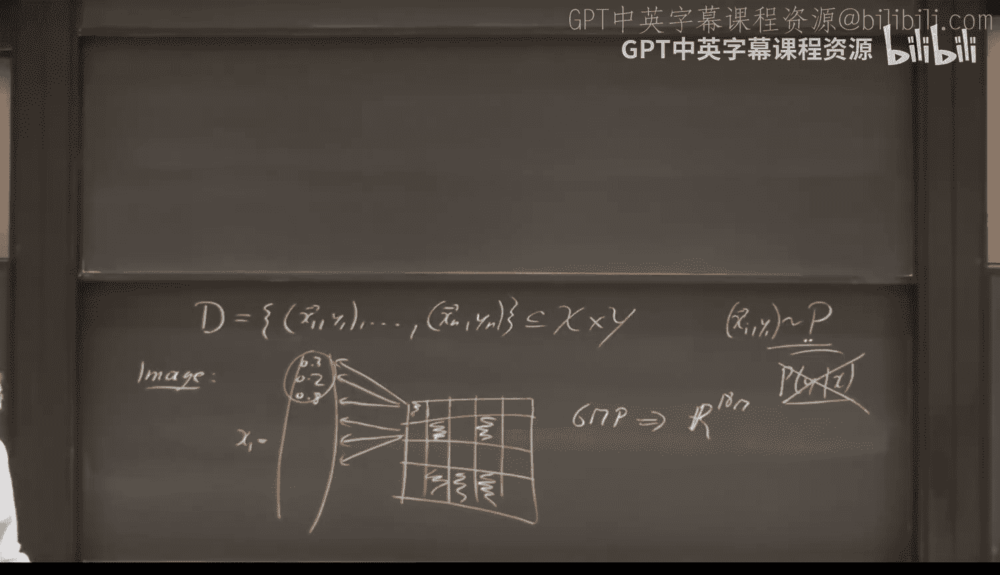

---

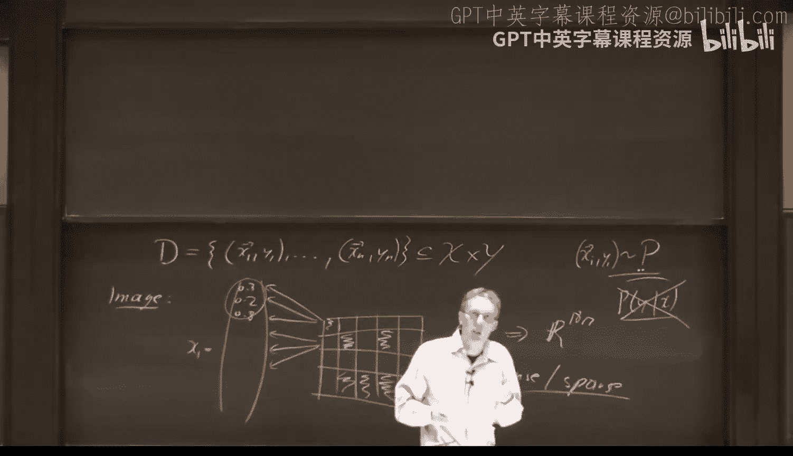

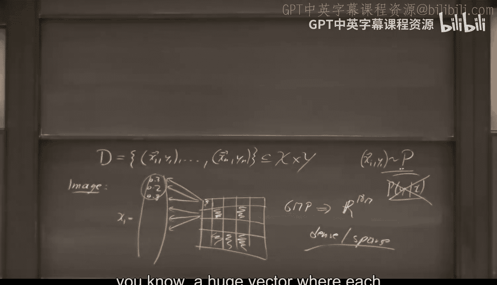

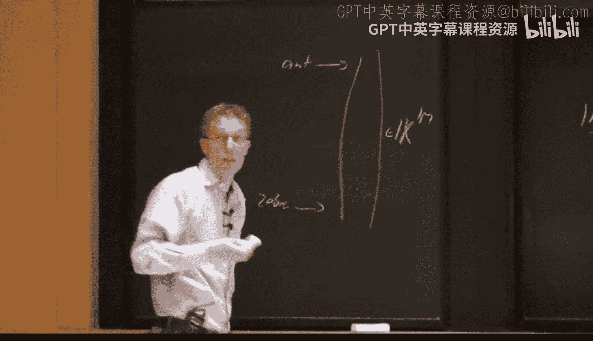

## 特征表示：稠密与稀疏 🔢

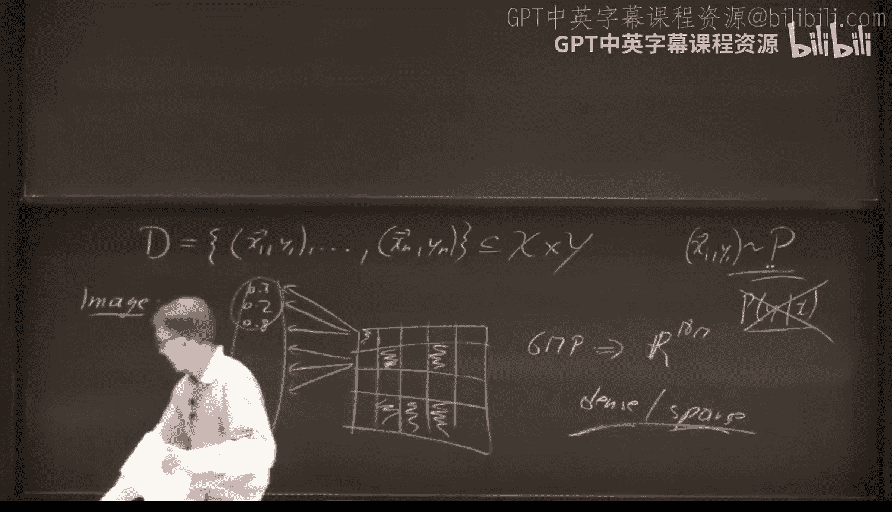

无论原始数据是什么（如患者记录、文本文档、图像），我们都需要将其表示为固定维度的向量 **x**。

以下是几种常见的数据类型及其向量化思路：
*   **患者数据**：向量可能包含年龄、血压、病史等数值。
*   **文本文档（如邮件）**：常用“词袋”表示法，向量的每个维度对应词典中的一个词，值表示该词是否出现或出现的次数。
*   **图像**：一个6兆像素的图像，每个像素有红、绿、蓝三个通道值，可以展开成一个约1800万维的向量。虽然这种原始像素表示很高维，但现代方法（如卷积神经网络）能有效处理。

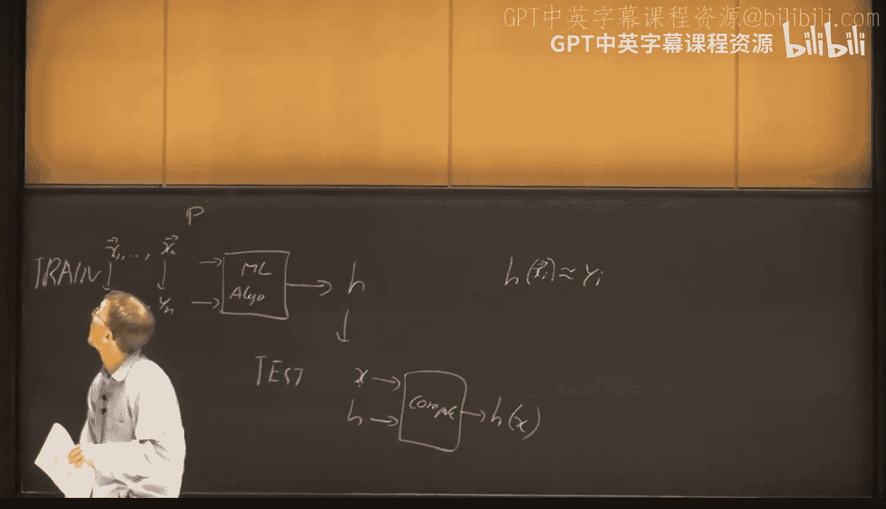

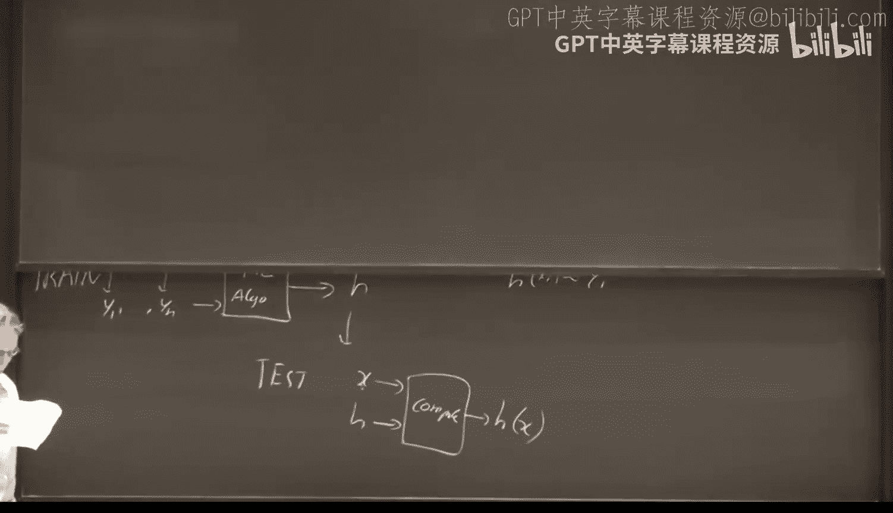

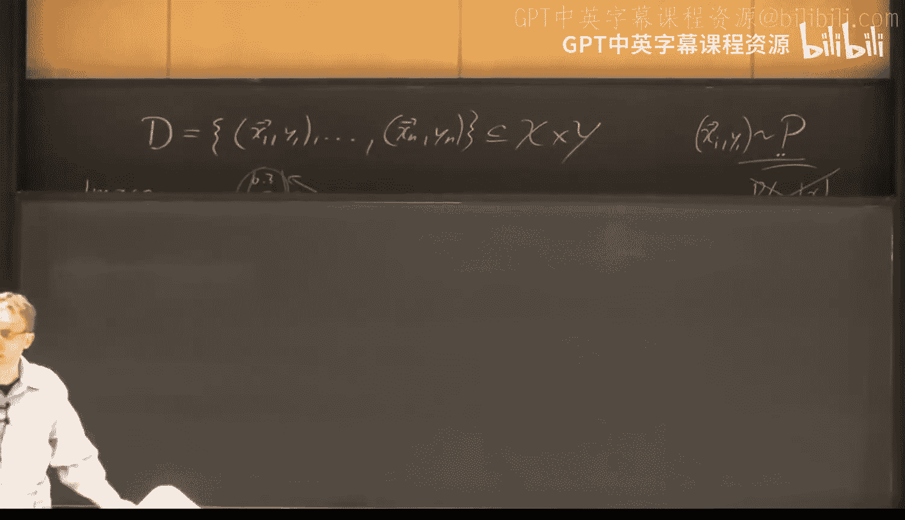

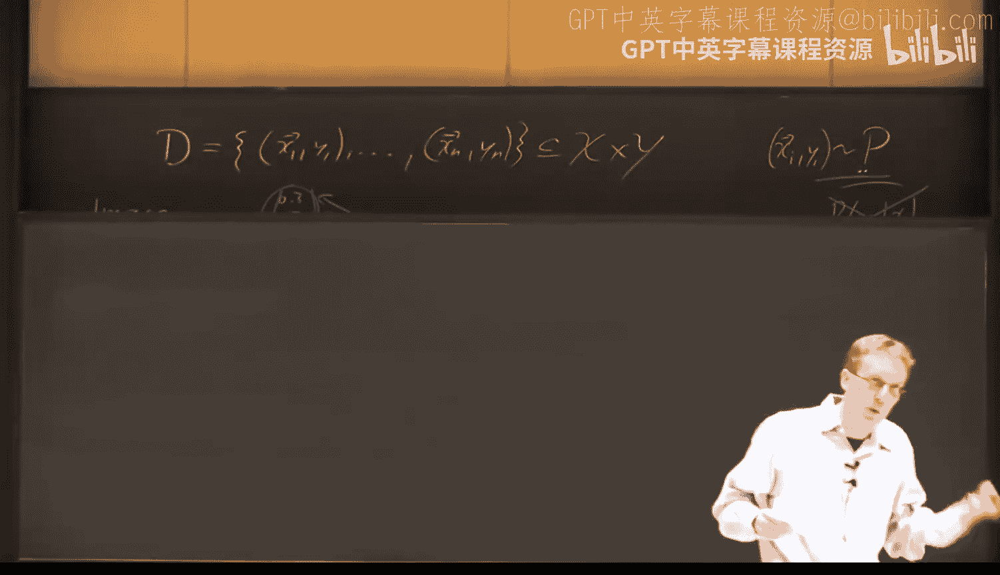

关于向量表示，一个重要区别是**稠密向量**和**稀疏向量**：
*   **稠密向量**：向量中大多数维度都有非零值。
*   **稀疏向量**：向量中绝大多数维度都是零，只有少数维度有值。文本文档的“词袋”表示就是典型的稀疏向量。稀疏表示可以节省大量存储和计算资源。

---

## 学习过程：假设空间与损失函数 🧠

现在，我们形式化机器学习的过程。目标是找到一个程序（函数）**h**，它能根据输入 **x** 预测输出 **y**。

**训练阶段**：我们将数据集 **D**（包含 **x_i** 和对应的真实 **y_i**）输入机器学习算法。算法输出一个函数 **h**，理想情况下，对于训练数据有 `h(x_i) ≈ y_i`。
**测试阶段**：对于一个未见过的、来自相同分布 **P** 的新实例 **x**，我们使用学到的函数 **h** 进行预测 `h(x)`，希望它接近真实的 **y**。

我们并非学习任意函数，而是从一个预先定义的**假设空间 ℋ** 中选择。ℋ 是我们认为可能适用于当前问题的函数集合（例如，所有可能的决策树，或所有线性分类器）。选择 ℋ 是数据科学家的关键职责之一。

为了评估 ℋ 中哪个函数 **h** 更好，我们需要**损失函数 L**。损失函数衡量函数 **h** 在数据集 **D** 上的表现，损失值越低越好。

以下是几个常见的损失函数示例：

*   **0-1损失**：用于分类问题，计算错误预测的比例。
    `L_0-1(h, D) = (1/n) * Σ_i [h(x_i) ≠ y_i]`
    其中 `[ ]` 是指示函数，条件为真时值为1，否则为0。

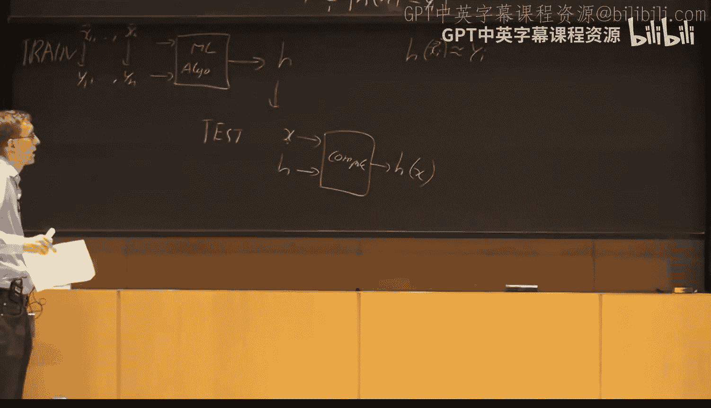

*   **平方损失**：用于回归问题，惩罚预测值与真实值之间的较大差距。
    `L_square(h, D) = (1/n) * Σ_i (h(x_i) - y_i)^2`

*   **绝对损失**：同样用于回归问题，对误差的惩罚是线性的。
    `L_absolute(h, D) = (1/n) * Σ_i |h(x_i) - y_i|`

平方损失对大误差惩罚更重，有助于避免极端错误，但对异常值敏感。绝对损失对大误差的惩罚相对温和，对异常值更具鲁棒性。选择哪种损失取决于具体问题。

因此，**学习**就是寻找假设空间 ℋ 中那个在训练数据 **D** 上损失最小的函数 **h** 的过程。

---

## 泛化：机器学习的核心目标 🎯

仅仅在训练数据上表现好是不够的。考虑一个极端算法：它纯粹记忆训练数据。对于训练集中出现过的 **x_i**，它输出对应的 **y_i**；对于未出现过的 **x**，它总是输出 **y_1**。这个算法在训练集上的0-1损失为0，但它没有任何预测新数据的能力。这就是**过拟合**或**缺乏泛化能力**。

我们真正追求的是**泛化**能力。即，对于从真实分布 **P** 中抽取的**任何**（而不仅仅是训练集中的）样本 **(x, y)**，我们都希望 `h(x) ≈ y`。与之对应的**泛化损失**是期望损失：
`Generalization Loss = E_(x,y)~P [ L(h, (x,y)) ]`
然而，我们无法直接计算它，因为我们不知道分布 **P**。

解决方案是使用**训练-测试集分割**。在收集数据后，立即将其随机分为两部分：
*   **训练集**：用于让机器学习算法寻找函数 **h**。
*   **测试集**：被严格保留，不参与训练过程。

当算法得到函数 **h** 后，我们在从未见过的测试集上计算损失。这个**测试损失**是对泛化损失的一个无偏估计。如果模型只在训练集上表现好（如记忆算法），在测试集上表现很差，我们就知道它泛化能力差。

---

本节课中我们一起学习了监督学习的关键概念：数据与分布的关系、特征表示方法、通过假设空间和损失函数形式化的学习过程，以及评估模型性能的核心——泛化能力与训练-测试集分割。理解这些基础是避免常见陷阱和构建实用机器学习系统的第一步。