# 003：康奈尔大学《智能系统的机器学习｜CS4780 Machine Learning for Intelligent Systems 2017》中英字幕 p03 -03-Lecture 3 ＂k-nearest neighbors＂ -Cornell CS4780 SP17.zh_en -BV1Lo6gBxEKE_p3-

嗯。One thing I want to warn you。 So once we post the video recordings。

 there's a temptation of students to say， oh， you know what， I'm just gonna stay in bed。

 and I'm gonna watch them at home。😊，It's pretty boring to watch lectures at home。

 So most students who want to watch them ultimately， then don't get around to doing so。

 So it's better to go to lectures。 But you're welcome to watch them online。

 Someone had a question in the front。 So， O， it's resolved so。😊，All right， good。Another thing is。

 so at this point， everybody should have received an email， either an invitation that you're。

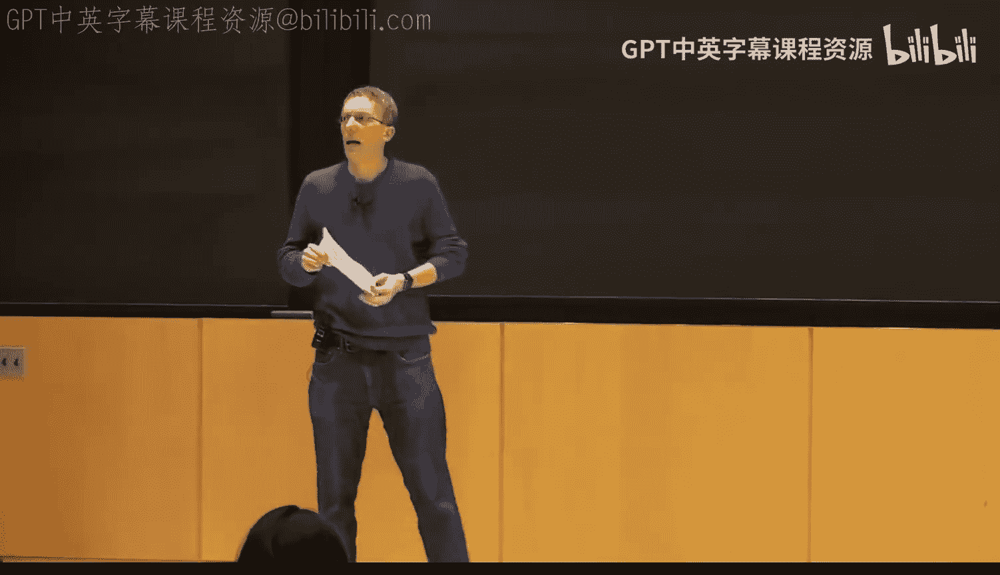

To Vcarium or an email that maybe the exam didn't go so well。

 And their recommendation is that you should drop the class。 If you have not yet received an email。

 please。

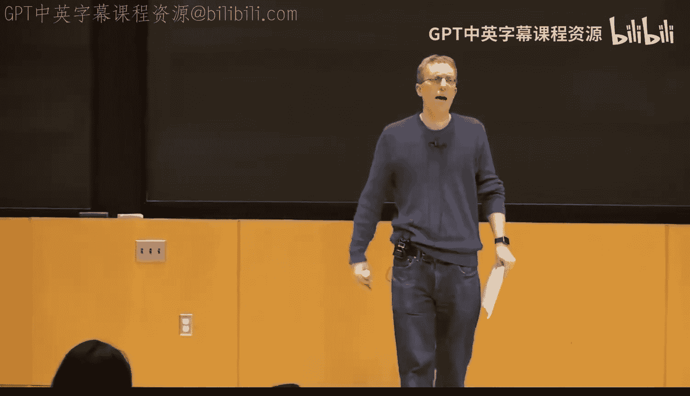

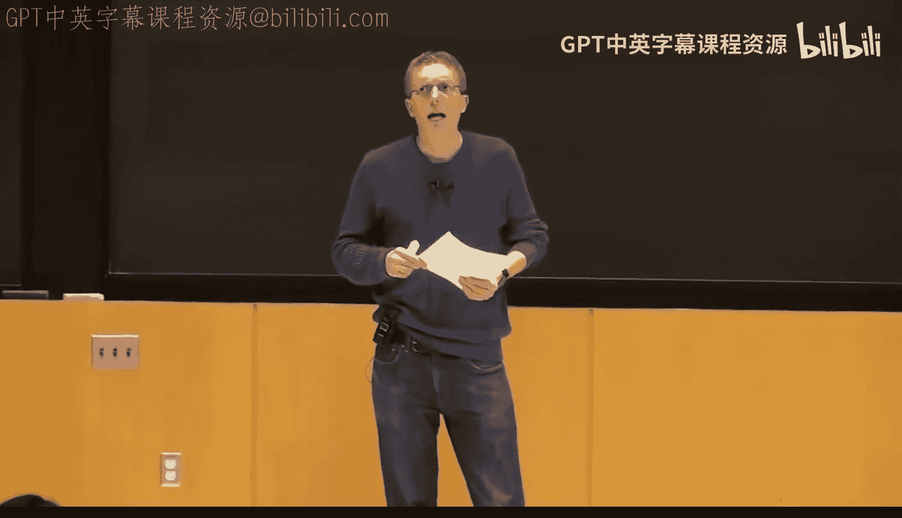

Conact， you know， my I contact the T。 So that means either， please also check your spam folder。

 The Vquaium invite send automatically to vquaium。 So it looks like spanm。

 So please make sure you find that。 By the way， please all close your laptops。 Come on， guys。😊。

It's the one ruler half， no laptops。All right， no iPads either。All right。

 any more questions about vularium， placement exam or anything else？Yeah。

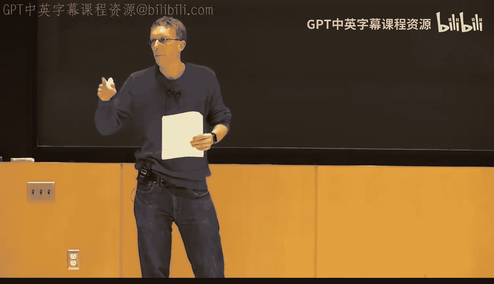

Right， unfortunately， the way it works is you have to first choose a partner。

And then you decide on the project。as always。 then you start with the project。

 You cannot rese it on then the reason is because we have had problems in the past。

 But people put people on as partners the day before or something noise a favor or something。

 You know， it just gets complicated。 The best a clean solution。

the have at the title， and you have a short description of the project that you can look at。

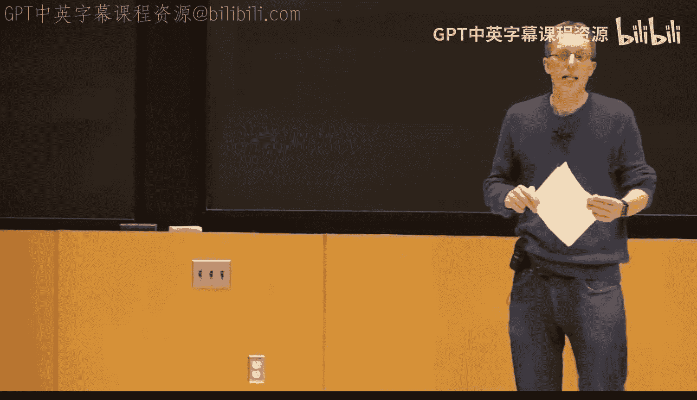

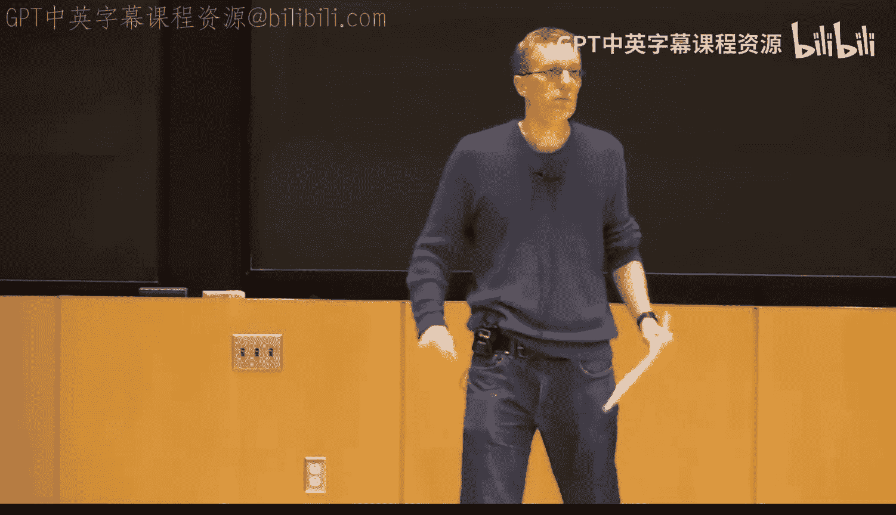

Okay， any more questions？Okay， good。 So last time we talked about the general setup of machine learning。

 we have data， the data set D that consists of。

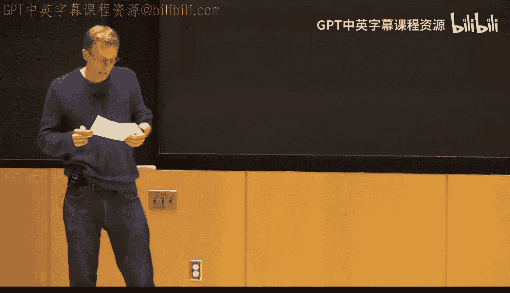

Pairs of basically vectors， feature vectors and labels。And。Our goal is to find a function。

You know that from vector X predicts y， right， So we have X I and and outputs y ideally。

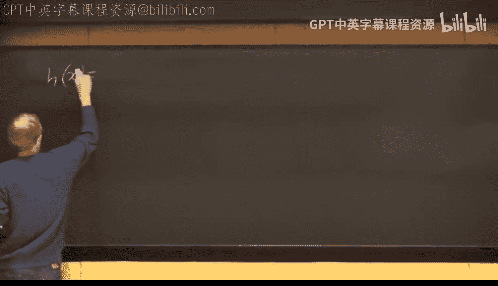

Let's see the vector。And this function H is chosen from a hypothesis class。

 So the hypothesis class is the set of all possible functions that we consider。

 So someone at the end asked me， what is this curly age seems very abstract。 What is it。

 And So let me give you an example。 So I showed you a little teeny little example of a decision tree。

 decision tree is one algorithm， but you basically split on a feature。 for example， say。

 is the person male or female， is how old is that person you know， age is the person you know。

 over 21， Yes or no， right， And at the end， you basically you can make a large tree like this。

 And at the end， you make a prediction saying， yes。

 the patient will return within 60 days or no somewhere， you know。

 here you could have a no or something that's this。 So。😊。

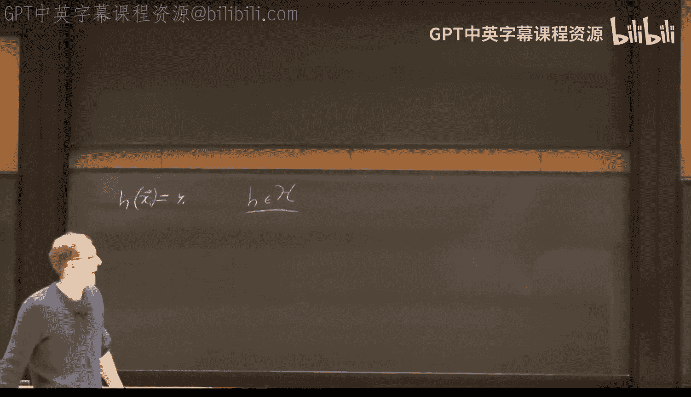

In this case， the capitalist curly age would be the set of all possible trees you could imagine。

Right， so it's actually an infinite set， right， because you could， I guess， you know， well， actually。

 the finite feature says actually this finite。 It's very， very large。 larger than you think。

 even larger。 right， It's very large。 So， but， you know， that doesn't matter。

 You just have to find some algorithm that finds the right H out of that。 Okay。

 that right right little H。😊，Okay， so basically， what we're doing is we saying by choosing cur age。

 all we're doing is we saying， oh， are we using decision trees。

 right That's basically that's what that means。 And then we try to find the best one that is learned on that data。

😊，So the learning is basically choosing this one particular instance of all possible functions out of the set of functions。

Any questions about this。Raise your hand if that made sense。😡，Okay。

 raise your hand if I'm speaking too fast。Really。😮，All right。I've watched my own videos and like。

 wow， I'm talking fast， but。I I'm trying to slow down。Okay， good。 So then we said， right， great。

 right， We have this data set。 and we try to find the age that has minimum loss on this data set。

 So loss， what was the loss function。 Again， loss function was some function L that we stick in an H and we stick in our data。

 And it tells us how well we are doing。 So basically says this particular function H has the following error makes so know makes that fraction。

 that percentage of examples And D， it gets wrong right or that's the average error we are making and predicting house prices or something。

 And we would like to have this function L be small。 So ideally。

 the idea of machine learning is we try to find an H that minimizes this function。😊。

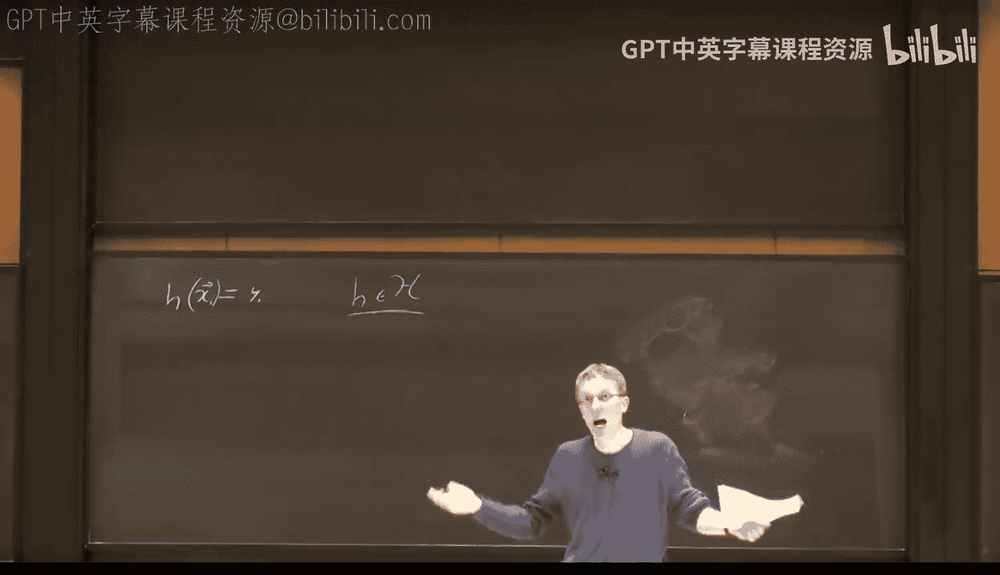

All right， do you remember this？😊，Risie how did you remember it？😡，All right， good， good， good。

So then he said， okay， well， that's great。 right， We come up with this really cool algorithm that gets 0 off。

 right， And that was the terrible algorithm 3。 And what it did is just memorize the data。

 And when you stick in an X， it just looks up the X in the data and then outputs that y。😊。

And that gives you zero loss because for every X， in the data set， you output exactly the right Y。

 Sos great， right We are done。So what's the problem with this。

 the problem is it only works on data that is from this data。 So it doesn't doesn't generalize。

And so that LED us， you know， to the next notion that what we really want is actually not a function。

 a function H that minimizes the loss in this data。

 What we really want is a function that minimizes a loss on mu data。 And how do we write this。

 You write this what we really want to minimize is the expected loss。

 If we were to apply our function H on a used pair of points。😊。

That are drawn from the distribution P。From which our data set was drawn。 So basically。

 if we take two new data， if we take a new data point X with label Y， which we usually don't know。

 right， But what would the error， What would the loss be。And that's great。

 That's exactly what we want。 right， This time， you're right。 This is exactly what we want。

That basically means if this is 0。 That means if you get a new point， you always get it right。

 It's awesome。The problem with this is we can't possibly compute it because we don't know the distribution P。

 The distribution P is this elusive distribution from which our data is sampled。

 And we don't know where the data comes from。Or at least we don't know what the distribution is。

And so we said， well， it's in if we can't actually compute this， but theres good news。

 and the good news is we can approximate it。 And this is exactly what we left off last time。

 we take our data set D and we cut it into two parts。😊。

And we call this part here de training and this part here de testing。那sD。

And what we do is the moment we get this data set， we chop off this detesting part and be copied onto some disk and be buried somewhere underground。

 We don't tell anyone else where it is。 So no one's allowed to ever look at this。

And now we train our algorithm primary， you know， only on this， this data， on the training data。

And then ultimately， if you want to know how well it really works。

 you compute the loss on the test set。 So that's the key。 And because that's basically， you know。

 it's an unbiased estimator of how well you know， of the actual real loss that we trying to。😊，Okay。

There's a few pitfalls。 And that's very important is。We can't just split it any way we want。

 And actually， a lot of grave mistakes of machine learning have been made by people splitting between training and testing the wrong way。

嗯。So can tell you one example。 So I used to work in industry。 And one thing。

Our research team did is we built a spam filter， email spam filter。 And so it was one day where one。

 one of us。😊。

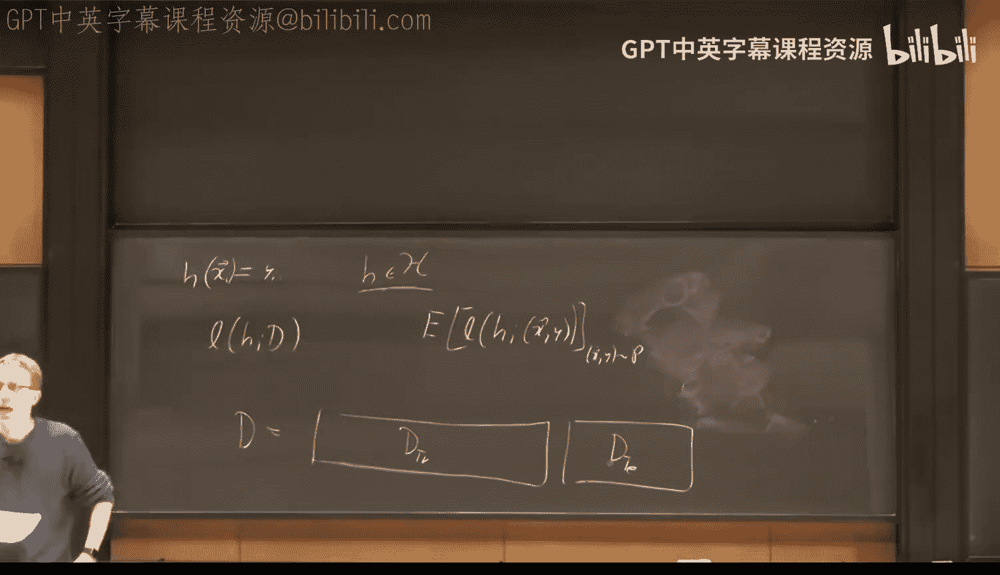

May have been me。 I'm not saying was really， really excited， right， because， you know。

 the new algorithm got 0% training here A 0% testing here。 So we evaluate an algorithm here。

 We tested here。 they get every single one， right。 right， like spam is solved， right。😊，Awesome。

 take this spanmmers。 But what was the problem， The problem is I split split the training set randomly in testing and training。

😊，But turns out that spam is very， very similar。 So people send out a spam message not just to one person。

 but to 100000 people。 So you have the same email many， many times。 So if you split randomly。

 every single email that was in a test set was also actually in the training set in one form or another。

 So our algorithm basically learned to do the right answer of all of these。

 Then its saw the same emails again， essentially， And got zero。

 So the right case in this because there's a temporal aspect to your data is to split by time。

 say like when was the data collected。 and you have your time axis here， theres time。

 And you say all the you know， data collected up to Thursday comes into training and Thursday to Sunday goes into test not something like。

😊，Right，And then it's an accurate setting because you can no longer。

 you get no information from the future。Okay， that's actually essentially what you want。

 But you want to spend train Sp filter that's trained today to work tomorrow。 That's the idea。

So if you have a temporal component， you always have to spend on time。

If you don't have a temporal component and the data is really sampled IID。

 then the right thing to do is shuffle them randomly。😡，Right。

 and it's a good exercise to always do this。 We've seen， I've certainly seen cases one， you know。

 a case where this was not me this time， but it was someone else where。😊。

The problem was that basically， the data was just stored in a way that first we had all the points with label 1。

 and then we had all the points with label 2。 And someone just split it。

 And so all the tests there was all the same label。So that， of course。

 doesn't give you an accurate estimation of the test error。 So if you。

 if it's II D data split you know， uniformly at random。If it's temporal data， split at some。

testest point， as always done on time point and everything in the future goes into test。

So other cases in medical care， one mistake that I've often seen is that people take data like multiple data samples from each patient。

 and they sample those uniform at random。 Of course， you can't do that either。

 You have to move the entire patients， some patients into test and some patients into training。

 The idea always is， you know， you train on a set of patients， and you test on a set of patients。😊。

So the important thing is be really， really careful when you do this。 But if you do it right。

 it is it's a great estimation of your test error。😊，Any questions。

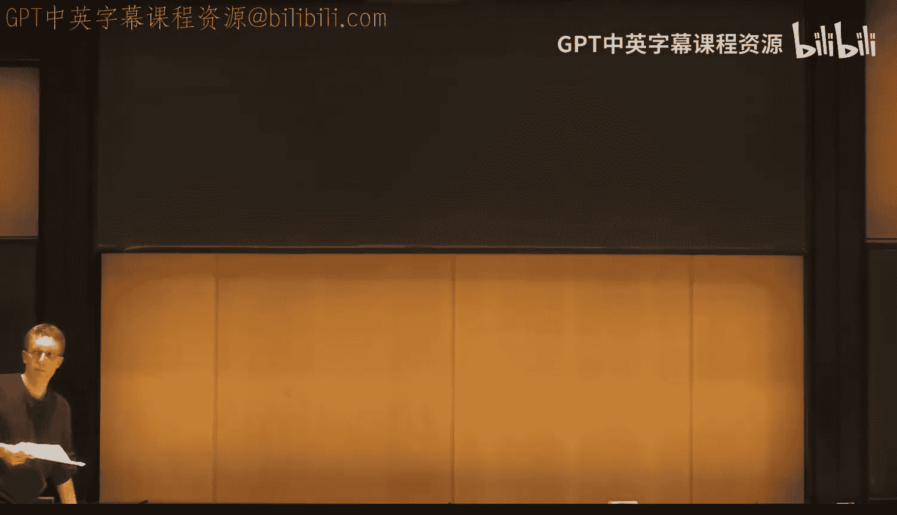

None， all right， so。I guess let me just， I guess you have it right in front of you。 Right。

 So the two points， you know， that I really want to make is uniformly random if data as II D。

And by time。It is a temporal component。Very often。Okay， well， let me just make this。Very often。

 people do one additional thing in practice， they don't just fit into training and tests。

They make a second test。 They actually split into three sets。We call this validation。

Does anyone have an idea why you may want to do that。对二。That's right。 That's right。

 So if you actually have many， many models， right and。You train them， and you only have one test set。

 So here's one thing that's really， really important。If you evaluate a model on the test set。

 that is an estimation of how well your test。And so how about what your generalization area is。

 But only the first time you do it。If you then train another model and you get a different test error。

And now you pick the better one of the two。 actually。

 now you made a decision that depends on these particular data points。系。

And that actually may no longer be reflective of the true error。 Let me give you an example。

 So let's say we have face recognition data set。 And we have a pretty good classifier。

 We get 99% correct。 So maybe on this test set， we only make two mistakes。😊。

So now I can tweak my algorithm， retrain it。 And now I only make one mistake on this test set。

 So I got， I half my error， right， That's amazing。😊。

Should I really pick the second algorithm of the first？Maybe it's truly better。

 but there's also a good chance that it just made some some tweak that just got that particular person right。

 right， And it may not actually， you know， be be true in general。 right And so let's say。

 I try 100 algorithm，100 algorithms， right， They're all a little different。 They're all around。

 you know， making one or two mistakes， right， I try many， many algorithms。

 It's gonna be one of them that coincidentally makes no mistakes。😊，And if I pick that one。

 it seems like Im， I'm doing really， really well。 But actually。

 what I really did is I just overfit it。 I overfit it to the test set。

 So I made a choice that really probably only applies to this one。 Does that make sense。 So。

 in some sense， if I look at this data set too often。

 then I'm also actually training my algorithm on the test set and I'm losing the fact that actually。

 it's unbiased。😊，Any questions？Yeah。So here here comes the point。 So if you have the validation set。

 what you really do is take you take your multiple algorithms。

 you evaluate them on the validation set， you pick the best one on the validation set。😡。

And then when you finally find a champion， you value on the test set。

 and that's the error you tell your boss， because that's the true error that you can expect in area life。

 right。And usually， what you see is that the training error is much lower than the validation error。

 and the validation error is lower than the test error。Right， a little bit。

 because you made some choices based on the validation。诶。It's not just actually different models。

 You know， often people also have parameters。 right， So， for example， if you have a decision tree。

 how deep should the decision tree be， there's some trade offs you will learn about this。

 that's the kind of stuff you decision you make on the validation set。

 But then the key is on the test set， only you can only evaluate once。If you write a paper。

 be really， really strict about this。 So people are very annoyed about， you know。

 when when you publish an algorithm， for example， And then it turns out actually， you know。

 you evaluate it many times the test set and you actually pick the algorithm the best because then you know。

 people notice that immediately because you take the algorithm applied to a different data set and you get a clearly high error。

 So it's easy and it's problematic。😊，Any questions？一二。啊。結果？You might go have。And have over。Right。

 and it will happen on the validation set。 right， But then you still take the best algorithm。

 or you still take whatever algorithm you think is the best and apply it on the test set。

 And now you get， you get a true answer of what you a true estimate of what you what your generalization errors。

😊，Now， possibly。I。Oh that is true。 That is absolutely true。 And so one thing people do actually。

 you know， we will talk about this later on， you can actually train it once， but this is training。

 and this is validation。 and then you train it again but this is training。

 and this is validation or something。 So you make different splits。 right。

 to get different validation errors。 And people talk about this in more detail。 But yes。

 that is a problem。 And actually， one thing that that lately has become a fashion is。😊。

To compute the error and validation and then actually add a little bit of noise to it。

 I perturb it a little bit。 And basically say， well， there's a little bit of overfitting。

 So I can overcome this by adding noise。 We will talk about this in a few lectures， yeah。😊，我原。

Justs like I don't know about。Let's say rolling。这个。で。他。And then， making。でたただきました。走。

So you can reuse it。 So here's what you do。You train your data algorithm on on training。

 then you evaluate it here， and then you。Try a few different models， right， and you evaluate it here。

 Okay， once you pick the best model。Do retrain it one more time on the entire data。

And now you test it here。But now you stop。 Now you throw away your computer， right。

 You're not allowed to touch do anything more。 because if you start the test set。嗯。Any gear。The Bay。

れ。The test set， yes， the test that is one only。 right I mean。

 one thing you can do is what we did when I was in industry， we had a test set on spam data。

 we evaluated here。 And the moment we used it， we already collected the next one。

 So we always had a new test set that we could actually use for evaluation， yeah。😊，第二。Or。

With it recorded。So to the court for observation。So if you have a temporal component in your data。

 then you have to split it by time。D。Oh， if you actually have time series， actually。

 then it gets a little， but usually it depends on the case on the， on the setting。

The one thing you have to be careful of is that your algorithm cannot get a glimpse of the future。

Because in the actual test setting， you would not be able to do this。And that's。

 that's often a pitfall that you actually realize， oh。

 the algorithm used some information that it got from the future。Yeah。

 is there no way to wipe the memory of the algorithm？W the memory you roll it back。 So say like。

 oh I wanted to tweak it， assuming that it hadn't been the training anymore and then make my adjustment。

Oh， oh， I see。 So you basically saying once I glimpse at the test that。

 couldn' you just you run it again。 So the problem is not actually the algorithm。 The problem is you。

Right， so because you glimpsed at the test set， that informs you， right， It's gonna be really。

 really hard to say， oh， I totally ignored this。 And afterwards， I made， you know。

 like the the fact that you know this， right， you learned something from this。

 You learned that one set of algorithm works， But new networks were better than than decision trees。

😊，And that actually will change your decisions in the future。And at this point。

 you're cheating in quotes right， So because you actually， you make decisions， you know。

 based on this test set。 So now if you evaluate again， right， you're basically using it twice。

 But you first look lookeded at it and said， what's going to work well。 And then you say， oh。

 look here， this worked well。Does that make sense。Yeah。晚上。Oh yeah。 that's right。

 So so you can make many more divisions。 but that's actually， we will get into that。

 And we we better discuss this formally。 and then we get into the how you。You know。

 all the the little details， yes。Thank for。That's a good question， so。The validation data。

 the test data should be not too large and not too small。And that。Can I leave it。

 So it's usually people do 80，20 splits。It depends how much data you have。Right。

 so and it also depends how noisy your data。So usually。

 then you want to look at the variance and so on。 And you want to see if it is tested that it's very。

 very large。 and you get a very good estimate of the gization error。 But also。

 you burned a lot of your data for training。 right， So that's basically your trade off。😊。

There's other tricks you can do。And that can well talk about in a couple。Thank yeah。啊。Right。

 the test set， you basically， you know， you look at it and then you。Pooke your eyes out。 Don't do it。

 But you know， then you're no longer allowed to look at it。So unless you basically say。

 here's my my outcome is the following。 basically， you know，I'm comparing these algorithms。

 And these old， you know， what I'm trying my point is that here are the errors that they make on the test set。

 Then that's fine， right。On the test set and then actually conclude， that's right。

 then keep keep iterating over this， right， So that that's basically the point， right。

 Does that make sense。そあ。That's okay。So as long as you as you lay open everything you did， right。

 basically said I I， I looked at the following five algorithms。 here the of the test said here。

 the five algorithm， that's fine， right， because ultimately， you didn't make any decisions。

 You didn't change any behavior afterwards， right。Does that make sense。

 But if you try the first algorithm。 And then based on that。

 you decide a second algorithm and a third algorithm。 now， actually， you're adapting to it。

 And the moment you adapt to it， you， you actually overfitting to the test。第。啊，And then， the average。

中こい。Right， right。 So so we will get to this。 So one thing you can do is， for example。

 let's say you have， you know， I worked on one problem once where we had 11 data points。

this was a medical try。 wasn't a try。 But what was， you know， experiment was very， very expensive。

 Each data point cost a lot of money and involved taking MRI scans of people and so on。

 And so what we did is basically， you know， we can only leave one person out as testing， right？

 Now that's， that's weird， right， because either we get that person right or wrong。 So you get 0，00%。

😊，But what you do is you basically always train on 10 and leave one out。 and you do that 11 times。

And then you average， and basically， the average error is the following。 And that's fine。

 That's totally kosher。 You just have to describe what you did。Does that make sense。Okay。

 one last question on this， because theres more to machine learning。😊，So。Oh， this is an art。

 This art。 This is German art。 They look a little different， alright。sorryrry I said again。

 give give you a function。 That's right。め。Like the。我意思吧。So here's what you do You Try some some age。

 And you get a function here， right？ And they say， well， that's not good enough， right。

 your boss tells you， you want to deploy Spford and you better have no more than 05% error。

 right You run your thing。 and youre doing you're doing okay，7% error， but it's not good enough。

 You lying dar right let me try something else。 you try some other function。

 Try more complicated networks， etc cetera。 run again， now you get。6。

 say okay let me speak it a little more， right until you get 04。 and they say， okay。

 now I think I've got it。 You test it here。 You get 。5 awesome。Does that make sense？Okay， good。

Let me move on。嗯。And one quick quiz。Okay， let me just， let me just say this。 So if we have。

Let me just say it。 And then you can， because I don't have the answer on the sheet。

 So if you have the loss on the test set。What is this。

 the sum of all the data points in the test set。Well yeah，1 to n。Loss of。8s。Com on X， I， comea， Y I。

The question is， why does this。As N becomes infinity， becomes exactly this。

Can anyone tell me why that is？So， I claim that this year。Becomes this。

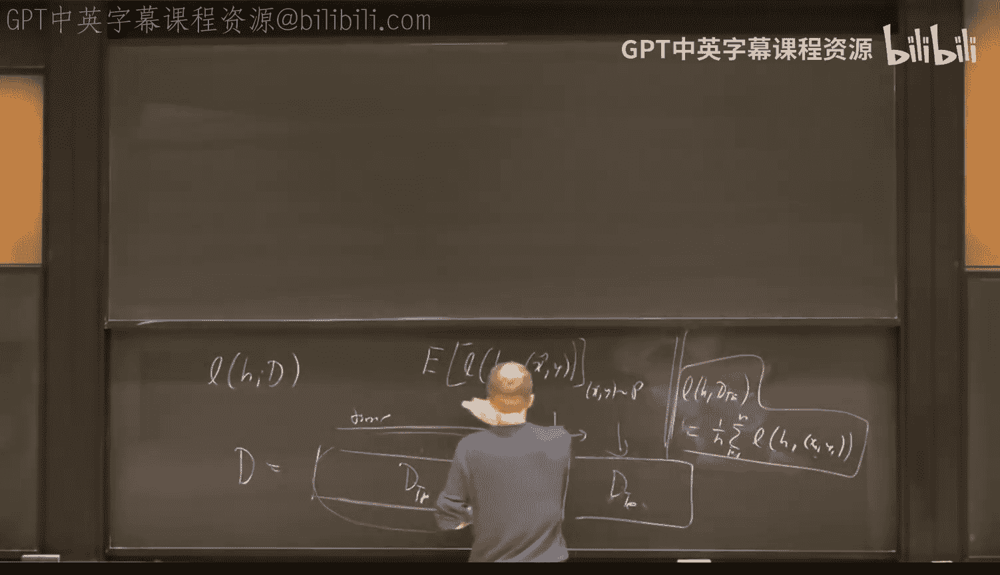

As N goes to infinity。So basically， that's， that's really what we want。 right。

 I the test that is really， really large， then your computer is exactly。

Maybe give you a minute to discuss it with your neighbor。嗯。Why is this converging to that。Yeah。Yeah。

Yeah。Yeah。All right。Who can tell me why and what is the statistical law。啊。

That's a weak law of large numbers。 So weak law of large numbers。 Bsy says that exactly this， right。

 The average of random variable becomes the expected value in the limit。 right。

 So remember that's the weak law of large numbers says exactly， you know， Ba。

 reassures us that what we are doing is right。😊，O。Any questions？Okay， good。So。

But if fact I don't see you， you're raising head there's too many people here。

 So please say something， right， I just can just say anything you want。As she said this last time。

 I said。Last time I thought this class that you can say anything you want。

 one student said like Vigrara。We talked about Spford rings。 So It made sense， but。All right。So。

What have we talked about now that we have talked about the data set D， the feature representations。

 So you take your data represent as features。 You have labels。

 You' got a function H that goes from X to Y。We know we have to split the data。

So that's already really good。 So one thing you haven't talked about is how to find this。

Hypothesis class H， right， And here's a great idea。Why don't we just， you know。

 during this course figure out what's the best algorithm。 And then we just only use that one。

But even better， why don't I just figure out what's the best algorithm。

 Then I only teach you that one， right， and then be call it quits。Why does that not work？😡，And。

 let me give you。Example。 So this example is actually is a party game。Are you ready for a party game？

Oh， come on。 What kind of party is this。Okay。So here's my party game。😡。

I give you a bunch of data points。 And instead of training machine learning algorithm。

 I now want you guys to be the algorithm。 Okay， so I， I， I I give you a bunch of points。

 This is my training data set。 This gives my X。😊，And this is my y。 So I tell you for this x value。

 for this value， the answer is this y， O for this value， the answer。

And I gave you a bunch of these points。Okay， and that's our training data。😡。

And now becoming a test data。 we look at test data。 I'm say， I look at this point here。

Right that's here。Let me， let me quote make a more concrete 1，2。34。

So where do you think is the value at exactly this point of X， Who wants to volunteer。Anybody people。

 yeah。Around 2， sorry， totally opposite at4。How about this point here？For， oh come on。什么哎。

Anybody else？Yeah， tie are close。 actually negative。😊，So I know what you're thinking， right。

Your partys suck。He。は。办了。So what's the problem， right， What's the problem， Like， well。

 why can't you learn this， right？ You guys are terrible at this。 I'm sorry， but clearly。

 the function looks like this， right。Actually sorry here went down to negative。So what's the problem。

 right？ So you made an assumption。 when you saw these points。 You made assumption。

 You made an assumption that the function is smooth。

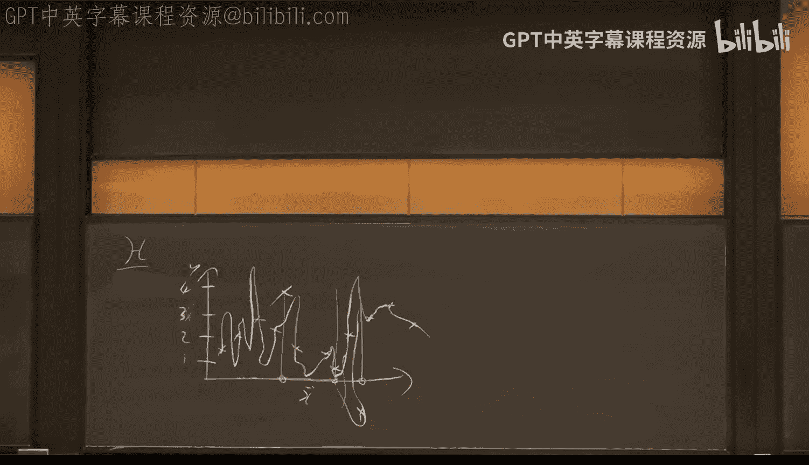

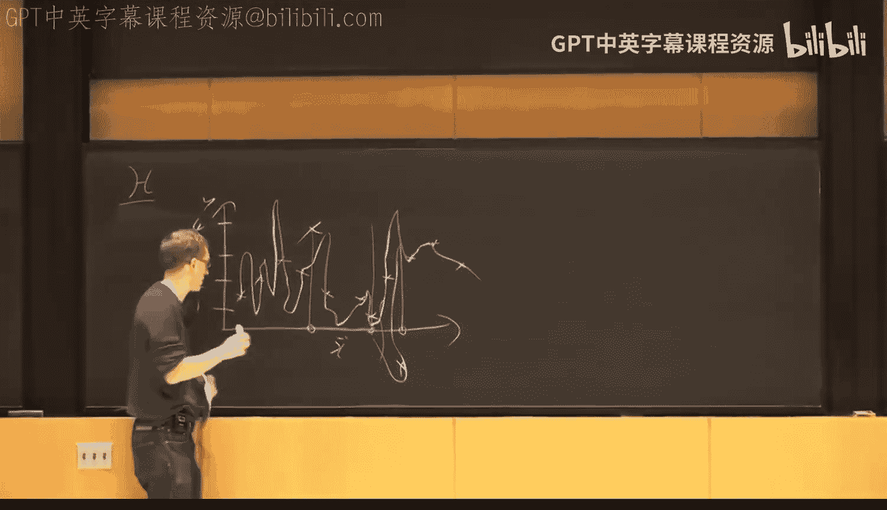

Okay， so I claim most of you did this。

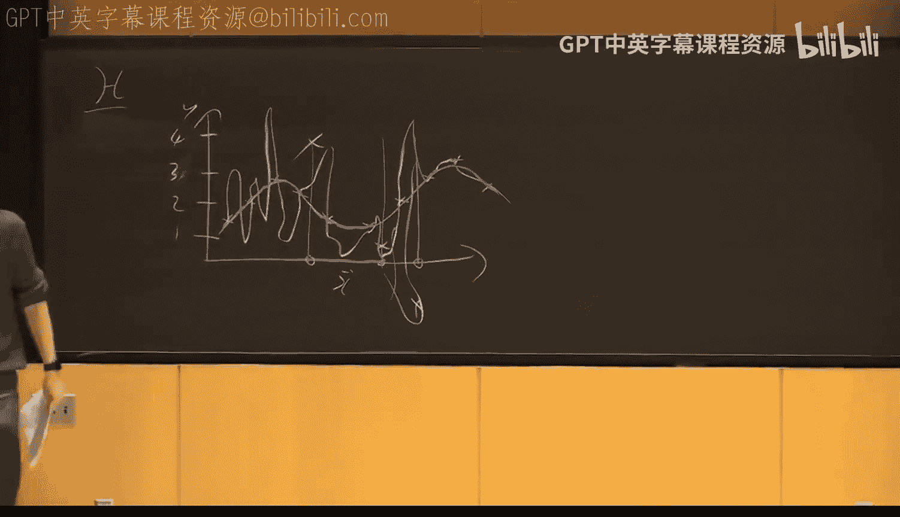

And。That's the key to machine learning。 So if you have an adversarial setting， right。

 if you actually had some setting where basically try to predict something。

 but you have some adversary。 that was me in this case。

 And I could always come up with some other answer。 Maine learning is not possible， right or。

Not in old settings。 I mean， you have to assume that the world is nuts。

 or you have to make some assumptions about the data set。 Otherwise， we cannot make predictions。

The whole， whole process of prediction is， you know。

 the whole point of prediction is that we assume that basically things keep， you know。

 behaving the way they did behave。And different functions and different algorithms make very different assumptions。

And。The no free lunch theorem as we call it machine learning。Basically， states。

 and you can actually formalize this。 that， there cannot be any function。

That's the best for everything。 because you have to make some assumptions。Otherwise。

 you can't do well in prediction。 And then I can generate a data set that violates exactly these assumptions。

Does that make sense？ And therefore， my algorithm will do arbitrarily badly。Okay。

 so there is no one algorithm that as well as everything。 It cannot exist。 I'm just。

 I'm not formalizing this here。 Next， I'm just giving you the intuition。

And a big part of this class is to understand what assumption each algorithm is making。

And think a big mistake that I see when people apply machine learning in practice is that they basically have one favorite algorithm that they like。

 right， For example， it's deep learning， or it's random or something。

 And they just love to use that algorithm。 They use it for everything。

 right irrespective of what assumptions that makes these assumptions actually hold in that data set。

😊，So what Im， what I want you to get out of this class is to， you know。

 sharpen your vision in that respect and look at data sets and first analyze， you know。

 what are the properties of this data， what， what this particular data， What assumptions can I make。

 Are these assumptions， do these assumptions hold， Which algorithm。ELeverages these assumptions。

 and make good predictions。And that is the most important。

Most important aspect about machine learning。But most people do not do right。He。

So any questions about this？Yeah。す場？没有。So people， though there is algorithms that do。

 It's called meta learning。 And basically what you do。 But essentially。

 what you're doing is just what a data scientist would do if you。

If you don't know what assumptions you can make， then basically what they do is the sp of a training in a validation set。

And a test set。 So they， they take their training and the validation set。

 They try out a whole bunch of different functions。

And just see which one gives the best error on validation。 And then they train the a on test。 So。

It's just a purely empirical in our way of doing it。 But if you think a little bit about it。

 then typically it helps a lot to kind of rule out algorithms to begin with。 if you say， well。

 they make this assumption。 that assumption just does not hold in this data。 right。

 so don't waste your time。Good question。Any more questions？All right， awesome。 So that means。😊。

We can actually move to the next topic， and I can talk about the first algorithm。嗯。😀And she let me。

 let me give some to the middle thing yeah。That like。哇， o。

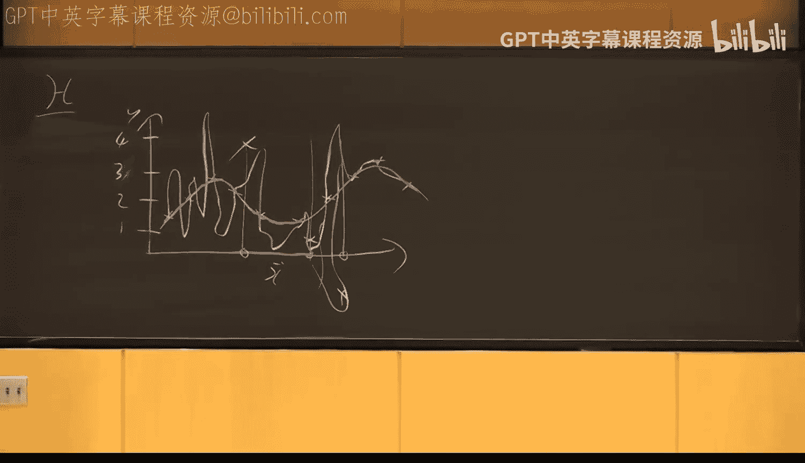

。Andll give you some more， yeah。This to you， this to you。Right。O。Yeah。Who does not have a handout？

Oh wow， can it somehow make a cross， you know， to the upper half of the classroom。Also， yeah， maybe。

All right， well， I can already get started。O， the first algorithm is also one of the oldest algorithms in machine learning by the perceptron。

😊，It's called Caneier neighbors。And it comes from 1967， is that correct， Yeah，1967。诶。

Like Co and heart。Alright， so let's say we have data points。This has my data， by the way。

 can you see this in the back？😡，Raise your hand if we can see this。O。

So let's say we have data points and we have crosses。 And so these are。

 I just have a binary classification problem。 So I have crosses and I have circles。嗯。

And have a new data point。😡，Let's say， this is my new data point。 I would like to know。

 is this a cross or is this a circle。What would you predict？Anybody， it's a crossor is a circle。

It's across。 It's right。 And why do you think it's a across。It's very close to crosses。 That's right。

 And that is the assumption that nearest neighbors is making。 So now。😊，Given that you。

 we just played this awesome party game。You now know that the first thing you have to do is when you look at the algorithm is think about what assumptions is that algorithm making。

 And Can his neighbors make the assumption that data points that are similar。Have similar内。

It doesn't have to be the case。 You can easily think of a data set， but that's not the case at all。

 But if that， you know， that's the assumption we are making。

We say data points that are very close together。Unlike like to have the same name。

And so here is how the algorithm works in a nutshell。😡，You look at this data point that you don't。

 you know， this is your test point。 You don't know what the label is。

And now you look at the K nearest neighbors。 The K could be1， there could be3。

 Z usually you want to have some odd number。 So let's say we have three。This one， that' one。

 And this one。 So you pick these three years neighbors New Year neighbors。 In this case。

 all three of them acrosses。So you let them vote。 This guy votes cross。 This guy votes cross。

 This guy votes cross。 So you unanimously decide it's a cross。If the test point was here？😡。

Then you would actually have these three as nearest neighbors。 Then you would say， okay。

 I have two votes that it's crossed and I have one vote that it's a circle。

 So I'm still saying it's cross。Maybe less confident， but I'm still saying。Okay。

 does that make sense， Raise your hand。 if that make sense。Alright， so it's a super。

 super simple algorithm。 that's surprisingly effective。Let me formalize。This algorithm。

So we have a test point。X。And they have a data set T。So we look at the set of Caners neighbors。😡。

So how do we define this， We say we have this data set S of x， which is a subset of D。嗯。And。S of x。

Such that the cardinality equals k。 So we have to have exactly K data points in there。

K plus1 is too many。And now， we say， for every。Other points， x， Y prime。That are， indeed。

But not an Essex。So every point。That's not in the set of Ne's neighbors。What do we have to have。

You have to have。That。The distance。Between x and that prime x prime。Must be greater equal。

The distance。The maximum distance。For any point， in Sx。To our test。One more time。

So what are we saying here we saying if you take any point in our data set SX。

And compute the distance to our test point。Take the maximum moment。

 So the point that throw this away。Every point that is not an Ex has to have a distance that is larger than that。

 So in in colloquial English， what we are saying is if you're not one of the keen neighbors。

 then you should be further away， than the case's nearest neighbor。Raisezy hand if that makes sense。

Awesome， okay， good stuff。Yeah question why is this greater than or？Well。

 you could have points that exactly the same， right， But you can only have can nearest neighbors。

 So you have to tooth like。It's like choosing between mama and papa or something。

 And what are you gonna to do。Like them both。

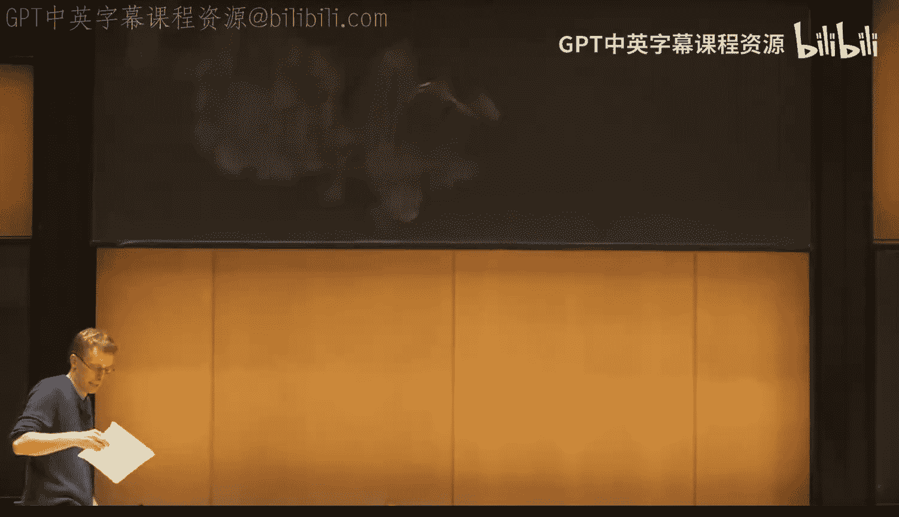

All right， so we have。A few more minutes， okay。So the key about nearest neighbors， acha neighbors。

 the key behind me keyous neighbors is that it's only as good as its distance metric。Okay。

 so if the distance metric。Reflect similarity in labels。Then it's a perfect classifier， right。

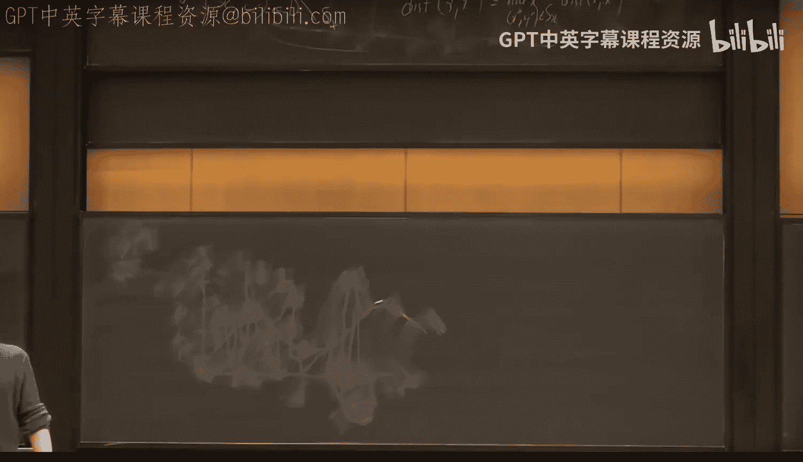

So if the distance， you basically say you have a zero distance of the label is the same and the distance of one of the label is different。

 well。Then it's perfect because the nearest neighbor always have the same label as you。😊。

nearest neighbor will always have the same label as you。

So the key behind nearest neighbors is to use a good distance metric。

And there's a whole field of metric learning that actually says， well。

 we can actually learn these metrics。 So we are not going into this。😊。

But the most common metric that people use is the Min it Minkovsky。kski，kski。So， it's defined as。

Actually，'s a reallymankowski。 where's he from， Russia。So we go on all the dimensions。MB。

Take the this here is now the art dimension。 Maybe I should write it like this。The R dimension of x。

Minus。R dimension of Z。To the power of P。1 over。There's the Minkowski display。

 This is most commonly used。Now， very quick。Quz for you guys。3 special cases， P equals1， P equals 2。

P becomes really， very large。😡，I claim these are distances that you're well aware of。

Discuss it with your neighbors。With your favorite neighbor， maybe you two and。

What are these three metrics。Yeah。

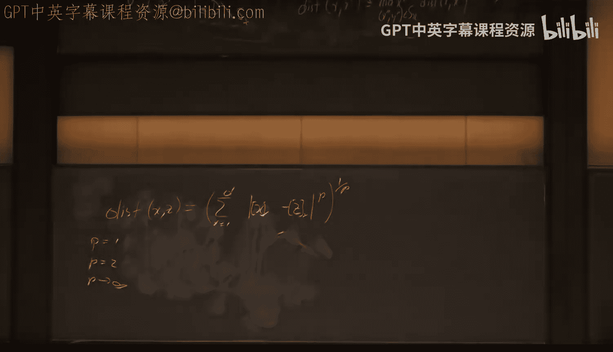

Yeah。Okay。

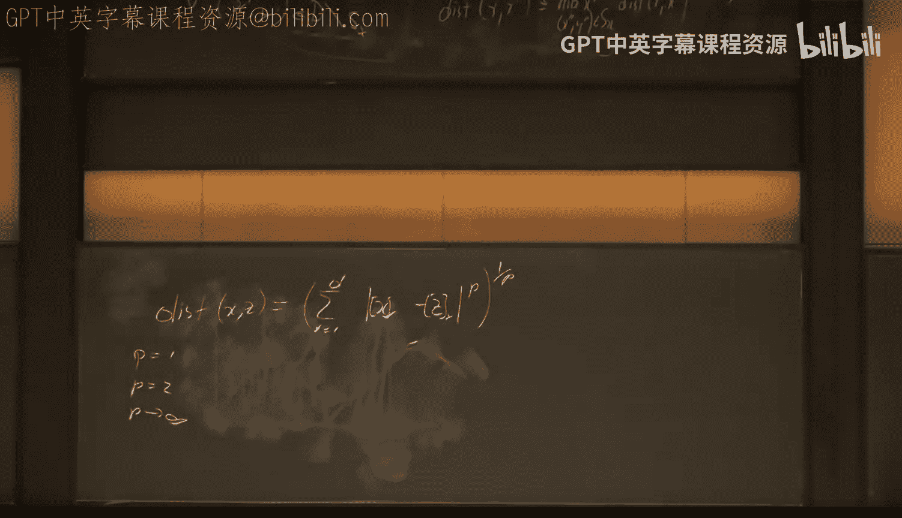

All right。Who knows the answer？First one， p equals1。 What is this。Who's brave y？Manhattan iss， right？

Ps2。Or someone else yeah。You're kidding。P goes to infinity。也生争。That。Sorry。say one more time， loud。I。

 I don't understand it， unfortunately。Yeah。You name that I know。Maybe， maybe。😊，Could be。Yeah。

It's the max。 That's right。 It's the max。So。The maxax。The max of what？It's a maximum difference。

of two dimensions。Right and why is that。Well， think about it， right。P is now very， very large， right。

Very light。So now we， we take all these， these differences and raise them to the power of P。Now。

 to imagine one of them is a little larger than the other。

 So we take the difference in these different features， right。

 So one is the difference in age difference in weight or something you write。

Let's say the difference in age is large and the difference in weight。😡。

You raise it to the factor of thousands。Right。So that's that you have。You know。

 the difference in age maybe be 32 to 1000。Plus'， the difference in， you know， weight。

 maybe 616 or 15 to 1000。Well， this is so， so， so much larger than that， right？

That doesn't matter at all。 right This all it's completely dominated by this。Right。

Does that make sense。So if I un takeake the the whole thing to one of1 thousands。Well。

 that's basically just 32 of 1000。 I mean， this is， this is apsilon。

 This is so tiny compared to that thing。 It doesn't do anything。Does that。Make sense。

 So as P gets larger and larger， This effect goes becomes more and more pronounced。 And essentially。

 you just have， you know， we basically just have the maximum difference， yeah。😊，Whatever say by。大丈の。

Why does it become。same I don't understand it， sorry。喂亚V。How buy be comparative my a P， oh。

 because basically， okay。😡，So he's like， why are you doing this？And the answer is。

 there's the Mkowski distance。And the nice thing is， if you have an algorithm that implements this。

 right， just for different values of P， you get a whole family of different distances。😊，Right。

 and that includes the common distances that basically people think of。 right， So the， you know。

 the Euclidean distance and Manhattan distance， right， are just taking the feature that， you know。

 if they vary a lot in one feature， then that actually is most important。Does that make sense。

 And you can， You can't take any value of of P， any non negative value of P。O。嗯。So that's， that's。

 that's one reason why it's so popular is because it's actually very fairly general。嗯。Al right。

 I have a short demo， but you know what， I'm already1 minute it over。 So why don't we start。

Next time the demo。 But can you someone please remind me that I haven't shown you yet the demo。

