# 004：康奈尔大学《智能系统的机器学习｜CS4780 Machine Learning for Intelligent Systems 2017》中英字幕 p04 -04-Lecture 4 ＂Curse of Dimensionality _ Perceptron＂ -Cornell CS4780 SP17.zh_en -BV1Lo6gBxEKE_p4-

All right。Okay， good。 So we， I hope you enjoyed the last two lectures。

 I actually do this every year that I have a little bit of a math background。

 This time I was out of town so my。😊。

Jake and Tan was a nice and sub for me。I know some people knew all this stuff。

 but for every person who knows everything， that's probably five people who， you know。

 forgot something and。It's certainly valuable because we will dive into statistics very soon。嗯。

Project1 and Project  zero are both still out。😊，Project two will be out very soon。So please。

 if you haven't started with Project 1 yet， don't fall behind， right。

 So the projects are overlapping。 so don't let it all accumulate。诶。Any questions about logistics。

 varrium or something？I know some people just joined today today's this last day of adding。

If you don't yet have v account， please let the Ts know on piazza and hand your placement exam。

All right， so we were talking about the k nearest neighbor classifier。 and if you remember correctly。

The assumption that we made was， although the assumption that the Kenius Ne classifier makes is that similar points。

Have similar labels。 Right the idea is very， very simple。 You have a test point。

 And what you do is you just look for the nearest training point and you just steal the label from the nearest training point。

 you assume， well if it's really， really similar， then you know。

 it likely has the same label as the test point。 It's a fair enough assumption。And then I was like。

 well， that's great。 And I mean actually made a little proof and we showed that actually if you have enough data。

 if your data goes to infinity and goes to infinity。

 then this classifier only can at most have twice the error rate of the base optimal classifier。

 which is the best you can possibly do so that's a great science， that's all very promising。😊。

However， then that's the upside。 then comes the downside。 and that's the curse of dimensionality。

 And let me just。Go through over this one more time， maybe the course of dimensionality。😊。

What we said is that basically looked at data that was drawn from a。呃。帮。嗯。Unit square here。

 you know what？A hyper cubebe。So this is all distance  one and。This is， of course。

 only three dimensions because it's hard to draw D dimensions， but D is really large。

 but we basically assume okay we draw data uniformly at random from you know within this cube。

 within this hyper cube where every length， you know edge has length one。😊。

And so then the question was， well， imagine you have any point in here， I would like to know。

 what's the smallest little cube that encapsulates。This is length L。

And itcapsulate the canies neighbors of this point。 Okay， so this is， in some sense， you know。

 you find the keyies neighbors。 You draw a tiny box around it。😊，And。One question we looked into is。

 how big does this little box have to be。Right right， and。Well， the math was quite simple。

 Well we can compute the volume of this little box， which is as L to the D。 All right。

 it's D dimensional space。 And we have a cube with length L。

 And we know that this this little box contains K points out of n。 Well。

 these are uniformly distributed。 we can say， well， roughly you know。

 this is K over n So roughly the volume overall has to be the same as the ratio of the points because of the uniform distribution。

😊。

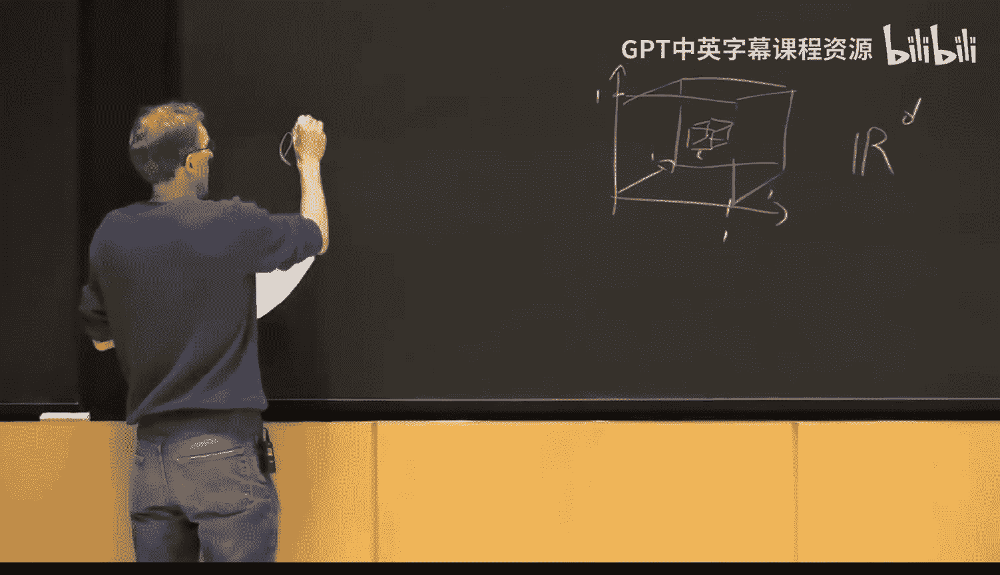

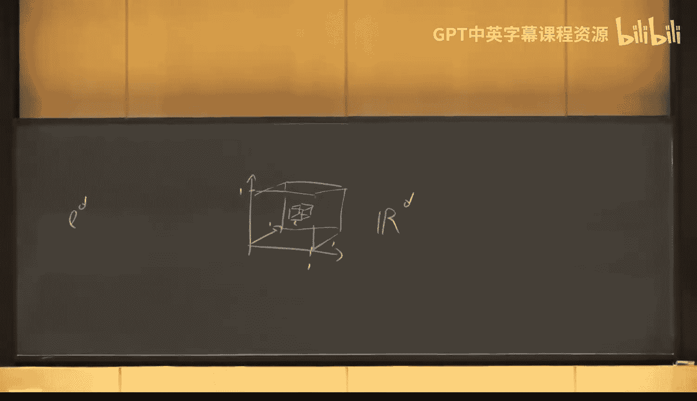

And。So far， do you remember this raise your hand if that's clear。Okay， awesome。

 and so then the question was， all right， you know， if we have this relation。

 we can now solve for the size of L and we get L is roughly K over n to the 1 over D。😡。

And Mkey now all for this， let's say K is 10 and N， I think we said to 1000， so this is 100。😊。

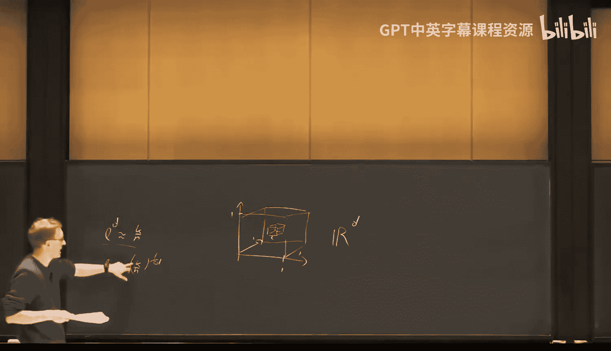

To the power of one over D。 And we can solve this for several values of D。

 And here comes the shocker。哎。🤢，For different values of D， when we have D equals 2。

 this is not a big deal。 This is0。1。 So roughly this is our square， right， you know。

 the box is about that big。😡，嗯。😊，For d equals 10 is is 0。63。

 So this means the box is now already that large。And for。Now， ds， let's say， you know。

 go 100 or it's 0。955 and thousand。It becomes 0。9954。 So basically， when the00 dimensional space。

 we have this box from which the data is sampled。And for any given point。

 if you just look at the canies neighbors and you say how much space does this box contain that contains only myaneest neighbors。

 it's essentially in the same size。😡，は。So what does that mean， So think about this。 Why。

 why is this so troubling， right， Why am I， Why am I making such a big fat。Well， think about。

 So the ba means that this entire space must be empt。 right， So we have  thousand0 points well。

10 points are you know， in this whole entire interior， there's only 10 points。 right。

 All the other 990 points are， you know， just， you know， here at the edge， right。

 squeezed between these two boxes。All right， right？Why is that so problematic？

It's so problematic because。Think about it。 the fact that this little box is so big can only mean that basically these key nearest neighbors。

 where are they， but they are also here the edges， right， Otherwise， you could draw a smaller box。

And。The points that are not the canier neighbors， where are they， where are they。

 They are between these two boxes。 So let's say here's my point。Well。

 the canius neighbors here and the points that are not the canous neighbors are right next to them。

 right？So the Ken' neighbors are not close at all。 There's no notion of closeness。

And they can't be close。They're really far away at the edges。

 All the points are really far away at the edges。 all points have roughly the same distance from each other。

 They're all at some crazy， you know， at crazy distance。 you know。

 they're all at the edges and really far away from each other。😊。

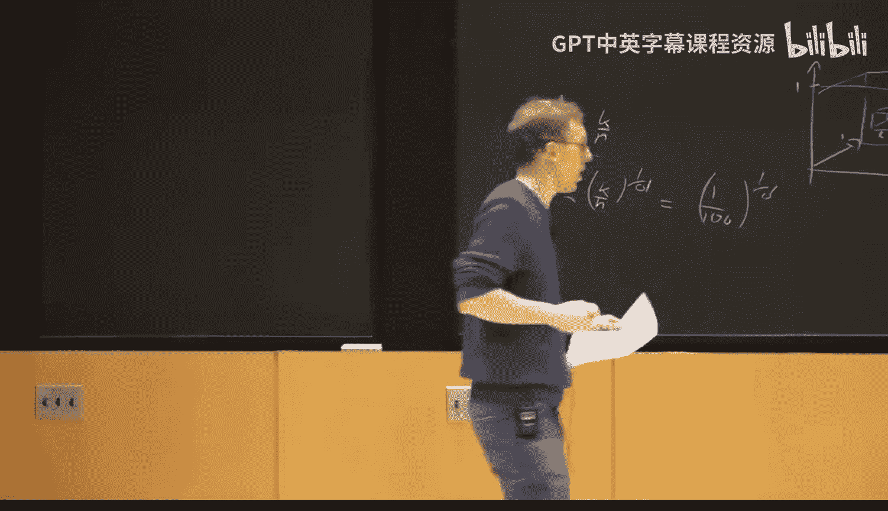

It's somewhat counterintuitive， right， Our brain is just so made for three dimensional spaces。

In three dimensional spaces， things behave very differently。 In three dimensional spaces， you know。

 if you draw draw points randomly， they would be in the interior in high dimensional spaces。

 That's never the case。 that the interior is empty。😊，There's never anything there。

Everything is far away from each other。And that means that our assumption of Kenier's neighbors。

 that nearby points have the same label。It's nonsense， right because there is nothing nearby。

 Everything is far away from each other。And everything is about the same distance far away from each other。

 So the Can nearest neighbors are here， But some other many。

 many other points are right next to it And the difference in distance is nothing。

So it seems unreasonable to say， he is a can nearest， he is the nearest neighbor。

 and here's another point。😡，And clearly， this point should have the same label as this guy。

 but not this guy。 despite that， they actually have no real， you know。

 they're not significantly further far apart。Let me give you one more intuition。 why that's the case。

 So why is everything。So， you know， at the edges。Think about the following way。😡，Think about it。

If if I draw a point randomly in this cube。😡，RightIf I draw uniform at random， what am I doing。

 I could just draw every single edge， every single coordinate independently。

 So I first draw this coordinate。 like， what do I random end up here。

 Then this coordinate end up here。 This coordinate end up here。 then I kind of。

Take these three directions。 And now I have， you know， I'll have a point。 Okay， does that make sense。

 Raise your hand Does that make sense。Okay， allright。 so now I'm saying。

I'm doing this over and over again。 we have a length of one。😡。

And I'm drawing drawing a ch because I take one coordinate of the other。

 and I basically draw you know some number here uniform at random between 0 and one。😡。

In order to be in the interior， I can't be at the edge。

So what's a probability that I'm not at the edge。 Well。

 let's define the edge as saying it's epsilon apart。From， from， you know， from the 0 from the one。

 Okay， so this is my interior， which is 1-2 epsilon。And the edges is this epsilon and this epson。

 These are my two edges。And if you look at this， if Eppsil is small， it's very。

 very likely that I end up in the interior。So that's what your intuition is in low dimensional spaces。

 If you draw some points randomly in a cube， you end up in the interior。But now comes。You know。

 the change is that if you actually do this in D dimensions and D becomes large。

So what's the probability that I'm ending up in the interior， Well， it's exactly 1-2 epsilon。 Okay。

 that's the probability that I end up in the interior。That's in one dimension。

 What's the probability that I end up in interior in every single dimension。

It's 1 minus-2 epsilon to the power of D。Because in every single dimension。

 I cannot be at the edge because if there's a single dimension in which I'm at the edge。

 well now I'm an edge point。😡，Okay， does that make sense， Raise your hand if that makes sense。阿审。😡。

Well， what is this， This is less than one。😡，And any number less than one to some large power goes to zero damn quickly。

😡，はい。So this is very， very quickly to zero， that means you can never the probability of hitting the interior is basically0。

😊，嗯。Any questions？第。K nearest neighbors to analyze pictures with each pixel of a different dimension。

Thank you。Why didn it？So I'm just telling you， this doesn't work， right。

 how dimension mention this doesn't work。But then I run tenuous names on pictures and pictures have like thousands of dimensions。

😡，Right。So what's going on and how can this be possible？😡，What's happening哇。The key is that。

Pictures are not uniformly distributed。So they actually have very， very different distributors。

And so here comes the key。In general， if you make no assumptions about the space and you have high dimensional data。

 Kenius' neighbors will not work。😡，But。😡，It could be。That you have high dimensional data。

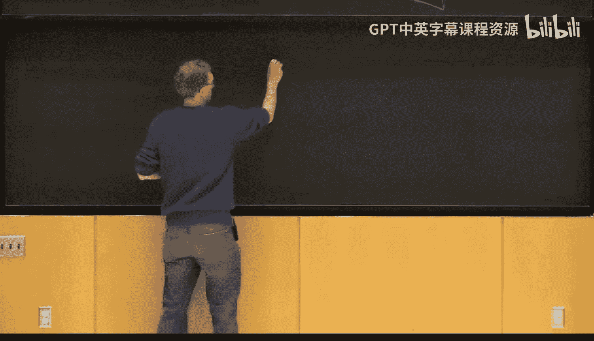

So you get high dimensional space。R is high， right。But actually。

 in this high dimensional space lies a subspace。It is much smaller。

And your data only lies in that subspace。😡，you never actually draw any points that are off that plan。

😡，You could， for example， imagine you have a two dimensional plane that's embedded in 100 dimensional space。

 Well then came years's neighbor still works because your data is essentially just two dimensional。

 You just have a very high dimensional ambient space。 doesn't matter who cares。😡，嗯。

If that's the case， you're fine。So the assumption of Kenya's neighbors is you have a low。

 intrinsic dimensionality。 That's what it's called。😡。

And so you have that either if your data lies in a subspace and a low dimensional subspace。

 or it lies in a low dimensional submanifold。😡，So what is that。

 You could have in a high dimensional space， but your data could be。Okay。

 there's a surface up here that's curled or something。Let me draw it。

I said here you have the surface like this。And the surface may be，10 dimensional。

But you actually in1000 dimensional space， and the surface can be curld up in anything。

 So you really need the 4000 dimensional space to represent your data。 In this case， you wouldn't。

 You could just project this on two dimensions。 You're fine。

 right So it seems silly to have this in 100 dimensional space。 But in this case。

 you may need the whole dimensionality， because the surface itself explores the thousand00 dimensions。

 But the data never leaves the underlying manifold， which is actually low dimension。😊。

And that's the key。😡，And because the manifoldt is low dimensional。Well， let me just explain my money。

 Have' you even heard of Manifors before， raise your hand if you've heard of Man。

So the manifold is basically viewed there's a surface。😊。

That is low dimensional and has is a remanium。 There has many different definitions， but。

The one we use is basically that you it has two properties。😡，Number one， it's locally Euclidean。

 so if you wear a little little ant， right you live here， congratulations。😡，And now you move around。

 right？You would have no idea that that this is actually a curse place。 right。

 So if you just look at this， it looks completely flat。whichch is actually， by the way。

 you're laughing， but actually， that is exactly what we do， right， So we humans live on a big sphere。

 which is actually a manifold。😊，And so this is why for centuries or millennia people were convinced that the earth is flat。

 right， because you you're a little tiny human on this gigantic earth， it looks。

 it looks flat locally。 So locally， Euclidean space is totally appropriate。 despite globally。

 actually， it's not Euclidean， such fear。😊，So that's what you have on a manifold， a manifold locally。

 you have Euclidean theses are valid， globalbally， they are not valid。 So if you， for example。

 take the distance between this point and this point and this point and this point。

 you could let me actually draw a better example。😊。

So you could have the manifold actually curl up like this。So then actually this point and this point。

 these are actually closer in Euclidean space and this and this point。 But actually on the manifold。

 if you would want to go from this to this point， you would actually have to traverse all the way around here So the true distance between these two points actually much。

 much， much larger So globally Euclidean distances don't work on manifold data。

 but that's okay because forcan nearest neighbors， we just do local distances。

 you only look at the can neighbors and that works right So what you would basically have here that all the points in this region may have one label。

 all the points in this region have one label all the points in this region have one And if you have a point here。

 you find the nearest neighbors and they are close。😊，Any questions about this， yeah。And you should。

 That's exactly right。 So， So you can for this is， you know， there's all sorts of tricks。

 how to actually estimate if you are in a subspace on a sub Manifold。 Subspace， for example， is just。

 you know， I don't know if have people heard of principal component analysis or a singular value decomposition。

 Raise your hand if you've heard of those。 Yeah， okay。

 so that's essentially what these algorithms are doing is they find a new coordinate system。😊，Thats。

Ctures in a the most most of the variance of the data。 in this case， for example。

 you would find a coordinate system actually be centered here that actually would only have two dimensions。

 And you would see that in the remaining dimensions， you have no data anymore。

 So you can just drop else。Mifold is a little trickier。 So you have to。

 what people do is you draw little spheres around， and keep doubling the spheres and you see how much bigger it does your data get。

 So so you have a point here。 you can draw a little little sphere around and you measure how many points。

😊，Points to a half inside the sphere。And now I double the sphere and make it twice as large。😡。

And I count how many points do I have now。 Well， if it's a two dimensional surface。

 if I double the sphere， then I should get four times as many points。

 if I have a three dimensional surface， I get eight times as many points and so on。

 So you can actually use this to estimate the intrinsic dimensionality of your data。

 It's exactly right。 And so if you can use Ne algorithms doesn't work。 that's a good test to do this。

😊，Any other questions？One thing that also helps is to think about what is the true dimensionality of your data。

 So， for example， in faces， you think about faces。And。You know。

 images of faces may have 10000 pixels， but clearly you don't need 10000 attributes to describe a fist。

 right So if you describe someone， let's say， you know， new boyfriend or girlfriend to your mom。

 right， you wouldn't say like， okay， well， the top left pixel is green。

 right And then but you would say let's say someone steals steals your wallet。

 you go to the police right， and they have someone who sketches， sketch artist right。

He or she could probably with maybe， you know，20 or 30 questions。

 make a pretty good picture of the person that you have in mind， right。

 That means that maybe faces lying at 30，40 dimensional space。

 but not in the 10000 that you you know that the pixel representation has。😊，Any more questions？

All right， let me show you a little demo。😡。

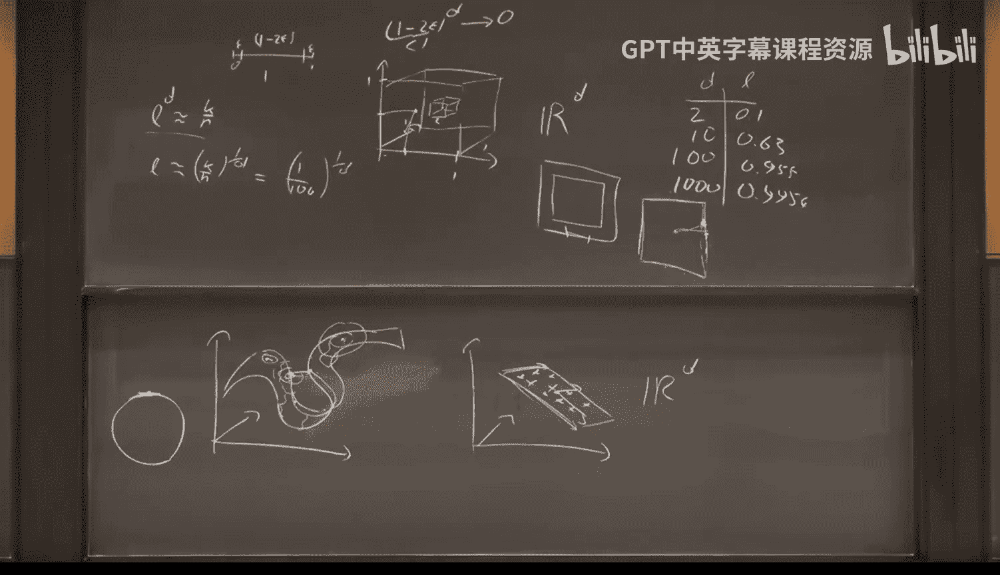

And by the way， it's a good prepro step in general。 right whenever you work with data。

 it's a good preprosing step to first try to reduce the dimensionality。 right。

 A lot of algorithms scale pretty badly or behave badly。 Even your data is very high dimensional。

 but a lot of data sets don't need the high dimensions that they come in。😊。

So first doing PCA or doing some other dimensionality reduction algorithms is typically So should be they one of your first tools in your tool sets。

😊，Okay， second does this work？即。Oh， I see。Oh yeah， awesome。Okay。

 the first thing I want to show you is actually a demo that I owe you in some sense that I wanted to do last time。

 and I didn't get around to。 It's， it's actually a canest neighbor。

 So I just want to show you visualize the canest neighbor classifier for those who， you know。

 you essentially， that's the same as what you have to do in the homework。

But let's say we just generate a data。 I don't know what。 I， let's try to do something here。Maybe。

I know。 A banana。嗯。Another banana。 al right。And there's umbrella。 All right， good then。

That's say you have some， I don't know。See， that's why I'm not an artist。Allright。

 so this is my data set。 I I have circles and I have crosses。

 And if I now run the Canius neighbor classifier。😊。

So what you see here is the Kenius Ne classifier with different distances。

 So I use different distance metrics。😊，And this is the one nearest neighbor classifier。

This is large enough。So and what I draw here is basically red is the region。

 any point in the red region would be classified as a cross。

 and any point inside the blue region would be classified as a circle and the wide region is right when you're at the edge so it can go either way。

😡，And you can see that， you know what the difference actually makes here in terms of distance is in this data set actually it's not so drastic。

 but for example， here with a city block distance， you know， for example。

 you get this weird stripe here that's actually still blue。😊，And someone asked back in the last week。

 what happens when you increase K， right， And so we can do this now， we can actually increase K to 3。

嗯。And to five and so on。And so what you see actually， in this case is that I drew more circles than。

Crosses。So what happens actually， the circles become more dominant around where they are。

But actually， eventually， the the decision boundary should smooth out。 So maybe may I do a slightly。

Soptimal data set。And eventually， he just becomes the mean label。😡。

AndSo you see that here all the top is everything is blue because the average here is actually blue。

😡，And as we keep doing this， then eventually。It basically just overrs and that's advantageous if some of these these points may be errors。

 right if they basically maybe be mislabeled， and you don't want to overreact to them and say， well。

 globally still that seems like a blue region because there's a lot of circles here。And。

 and eventually， I don't know。Any questions about this demo？😊。

Any of the data set you want to see that I will attempt to draw。All right。Let me show another demo。

 This is the cursive dimensionality。And this is also on your sheet。

 But let me just explain what I do here。第二。So。What I do here is I draw data points。Within the cube。

 like， I did exactly what we just talked about。 right。

 I take this hyper cube and I draw end points randomly。

And then what I do is I compute the distance between any two points。😡。

And what you see here is a histogram that basically says how many points have that distance from each other right So the maximum distance you can have from each other is exactly square root of two that's exactly if you're on the opposite end to each other corners right and the distance is exactly square root of two So that's of course。

 only two points is like the one you know the ones very few points that are right in the edge。😡。

And the bulk of the points in two dimensions， most of them。

 this is like the bio axis here is how many points have the distance。

 how many pairaz of points have the distance， most of them have a distance of 0。5。😡，And now。

 as we increase distance the dimensionality， what happens is this。😊，You know。

 the shape can of get squorched together。 And so in 10 dimensions already。

 you have hardly any points that have less than， you know，05 distance。That's amazing。

 right So basically， that means that's no neighbors anymore， right， No points are within 0。

5 distance of each other。 Everybody gets far away from each other。

 right And this this is the fascinating party here。

 So Ken years's neighbors works great in this regime。 I they basically say， he is my point。

 And my neighbors really close。 And therefore we have the same label。

What happens in 10 dimensions is that disappears， you have no neighbors anymore。

 it's like the suburbs， you know everyone is spread out，😡。

And so in 100 dimensions this gets even more extreme than 10，000 dimensions。

 you have this ridiculous distribution but basically has no neighbors at all。

 thiss like farms in Kansas or something right they're really far away from each other right。😡。

And there's really nobody has any neighbors at all。 And so now you can see that it。

 it's just ridiculous to say， you know， oh， one point is slightly closer to the other point。

 right they all have the same distance from each other。

 every point has the same distance from each other。 There is no such thing as nearest neighbors。

 We can't run nearest neighbors in this data。Any questions？第二。Yes， yes， yes。 Itll be saying， yeah。然。

Yeah， use L2 here。 Yeah， but it's the same effect with elementmetrics。 Yeah。

 And so sometimes you can make it work with other with with specialist， lets， For example。

 for images， you could have certain metrics that work better。

 But usually what they do is actually they take advantage of the fact that your data truly lies in a low dimensional space。

 So maybe you first have to do a transformation to bring that out or something。😊。

But it's really a matter of the space， yes。Sorry， geez， you asked questions。 al right。

Let me think about this。 So the element， you one basically would say， you look at maximum distance。

And oh， no， it's still the same though， right， Because the maximum distance would still be very。

 very large， right， because it would be very unlikely that for every single dimension， you know。

 there isn't one dimension for which you have very large distance， right。

 So by the same it's the same with the probability， you know。

 understood the argument with the probability distribution that I made earlier， right。

 It's the same thing， right。嗯。So in some sense， you're drawing， Yeah， you can talk about offline。

 but you're basically drawing two points。😡，You see that over and over again， at some point。

 they will be far away from each other。Okay， any more questions？

Is that a question are you raising are you beaving， oh no， okay？Like。他的个。If， if sorry more time。对爱。来。

来。

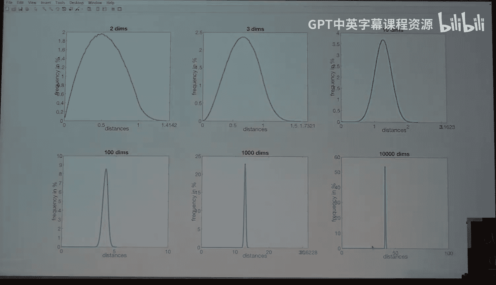

If you I guess I don't understand the accuracy of what is perfect。

That's no。 maybe its because。

In everywhere。Oh， no， no， no， I see I see Oh I see whatre saying。 Okay， I see， I see what you saying。

 So what he's saying is the following。 So like， okay， here， all the points are really， really。

 you know， all the points have the same distance， right。

 but they don't have exactly the same distance， right。😊，They just vary， very， very little。

 But let's say I have a super precise computer。 right， I， you know， get the latest。

 super awesome computer has like， you know，1000 B precision floating point numbers。

 So I can tell the difference between that point and that point， right。

 Then I can still use nearest neighbor。😊，No， the answer is because these two。

 like these are two points they have this distance。 They're just not close。😡。

RightThat that's basically the problem。 And the assumption is that similar points have same labels。

 they're actually really far away from each other。 So who knows if they share the same label or not。

哎，第二。Sorry， what？Yeah， that always depends。 I mean， really， it really。

 it's always about the intrinsic data。 so， so。😊，Let me put another way。

If your data does not have a load intrinsic dimensionality。

Then you shouldn't analyze it because it's probably not interesting。

 right data that's uniformly sampled is just not very interesting。 There's nothing。 know。

 what pattern you're trying to find there。 There's no patterns。 that's uniform。

 right So in some sense， all the data you're trying to you actually try to make something reasonable you know。

 try to find something reasonable has some low dimensional structure。😡，By the way。

 it can have load dimension ion on low dimension subspace。 It can be on a low dimension Manifold。

 The other thing is actually， you could have clusters。 that's another thing。😊，Yeah， okay。

 maybe last question， yeah。😊，On a basis。tail where。How你。

It had no it has something to do with that of drawing it from the。Oh。

 I see because I have this tail here。 Well， no， it's just because they are confined to a。

 to a hyper hyper。😊，Box， what it call hyper cube， sorry。 And so in the hyper cube。

 you always have a maximum distance you can have and just charts off of。😊。

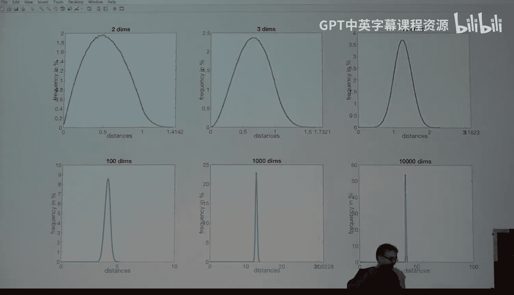

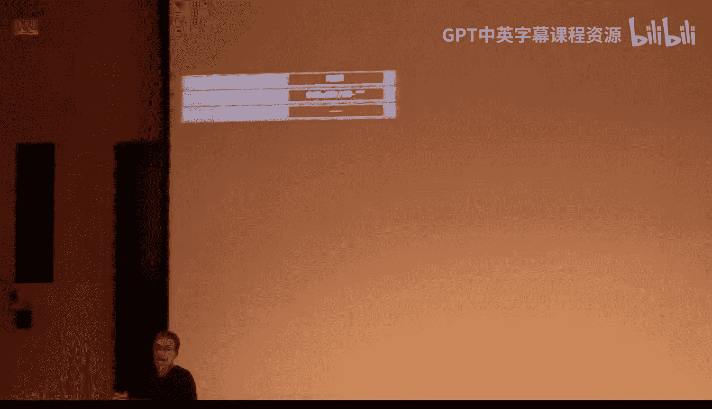

Oh， oh， oh， then it goes up。Yeah对。OhI see呃。No， I think that that's more a function of that yeah。

That the mean distance approaches。The maximum distance。 Well。

 but no no is actually it is a factor of a property of the cursive dimensionality right。

 because basically all the points are at the edges。 So if you're all at the edges。

 then you have maximum distance from each other， right So in this very first case， I said。

 very few points would have exactly squared of two distance。

 It's only if you' at the exact opposite corners of this two dimensional square， right， Well。

 that's very unlikely， right， but in the high dimensional space。

 you're always the opposite opposite corner of some edges。

 right So it is a property of cursive dimensionality。 And in this particular setup yeah。😊，Okay。

 very last question， all right。😊，But。然后开始。If you're able to get。啊。啊。The average。这个。多。Yes that。也费。No。

 no， until I give you an example。 So imagine I I the following classifier， right。

 I want to know I pick a random American。And I want to know what baseball team they're cheering for。

 right？

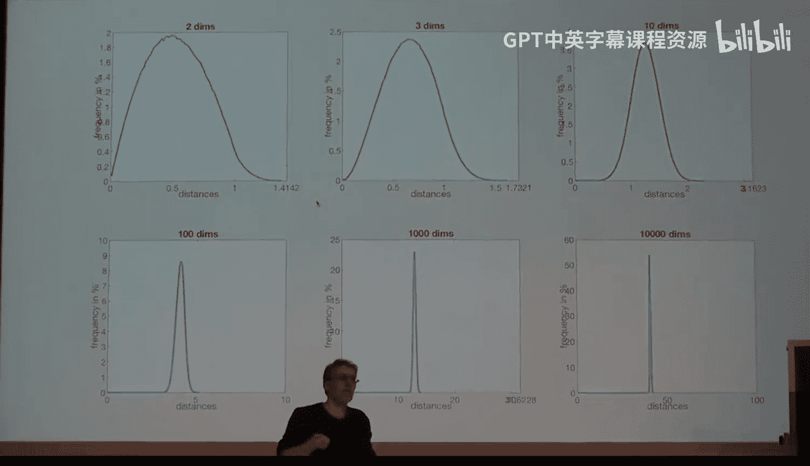

Well， if I pick a guy and he or she lives in Chicago。

 well I don't know what baseball team they cheer for in Chicago。

 but I look at his neighbor and his neighbor is a huge cubs fan I say， well。

 he's probably also a cubs fan。😡。

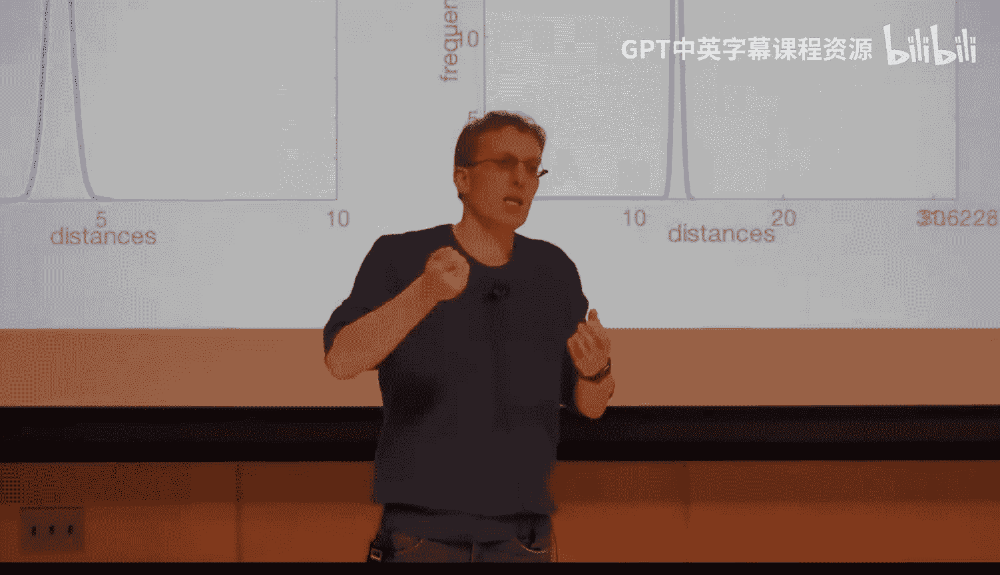

Okay。But now in this case。your distribution is actually I pick two neighbors。

 and one is in Cleveland and the other one is San Francisco。😡，they're all really far away。

So just don't tell me anything about this person in Chicago anymore。😡，And that's the problem。 Yes。

 the one in Cleveland is a little closer than the one in San Francisco， arguably。😊。

But it's still wrong。Because basically the labels change quicker than actually your sample density。😡。

O。y more questions？I'm very proud of myself。 This is my very first baseball reference。 Actually。

 I know nothing about baseball。 Thank， Thank you。 Thank you。😊，My wife will be very proud of myself。

Yeah。All right。😊，He。Yeah。回家。All right。😊，Okay， so Kenier's neighbors make this assumption that。

Nearby points。Are have similar labels。 Can anyone tell me some advantages and some disadvantages of Ken neighbors when you think about it。

 Like what， what could be a problem with Ken years neighbors。

 I showed you that besides the curse dimensionality that we just talked about if in practical。

 you know， we showed that if n becomes really， really large。

 this truly becomes a very good classifier。 Asum you have a reasonably intrinsically low dimensional data and collect a lot of data。

 you know， because you know， as N gets large， the Can neighbor classifier becomes really accurate。😊。

What could be a problem？You know， yeah， I'm going skip you because you always said something already。

 but Im yeah。I you have a large number of。Clas。This is a point。对。So if you have many， many classes。

 is that what you're saying。 So if you have many， many classes， you need even more data， right。

 it's right， absolutely。 But let's say， okay， well， you know， we go all out， right， We just say。

 okay， let's collect more data， right， Like we have， you know。😊。

Triip all the data sets and let's collect as much data as we can to make it really accurate。😡。

I we can't even do this。 I's say collect data until we get 0。99% accuracy。

Why could Kenya's neighbors be a bad algorithm in practice？😡，Yeah。哦仔一诶。

It may not do very well on bound boundaries。 Well， you just have to collect even more data。

 Let's collect even more data。 Alright， good。Sorry。Assums the label are discrete， Fair enough。

 Let's assume the labels are discrete。 that shows if it's not discretey after the week question。

 You can still do that， though， yeah。Let's assume the assumptions is right。

I want to hear practical think about it。 you have to code it up like those people the project on already。

 Why could't be now are you upset five times if you collect even more data so you maybe collect more and more data right so now we've collected a ton of data1 kion data points yeah。

😡，Sp a lot。All right。Just finding your King years neighbors and a giant list of points is already going to be a universe。

All。That's right。 So you have to sift to all your data points。

 right so you have this 1 kion data points and you have to compute the distance to every single one of them。

😊，I was going to take a really long time。 watched for those computer scientists of you。

 the complexity during test time is order n times D so every I go through every single data point of my training data set and compute distance and D dimensions。

😊，Okay， so people know bignotation， raiseise your hand if that makes sense。Okay， awesome。

 basically means like my algorithm， if I。My algorithm scales linearly with n。

 So the how long it takes me to run my algorithm is a linear function of n。

 So if I would double my data set， my algorithm takes twice as long。So that is prohibitive， right。

 because， you know， think about Google or something they have classification problems on billions of data points。

 right， you can't every time you make a prediction， goes with every single one， right。

 And you know if you， for example， log on to Google news， etctera。😊，So。And。

That's a real limitation of kius。 Can nearest neighbor becomes really。

 really good if n becomes large， but it becomes also damn slow， right， N becomes really。

 really large。And so in most applications， you know， the time that you take during inference。

 the inference is the time when you actually make a test prediction。You know， actually matters， Yeah。

 someone has to pay for this computation。Let me show you another algorithm that doesn't have that downside。

 It's actually an algorithm that was invented before King nearest neighbors。

 and it was invented here at Cornell University。 And it was actually the first machine learning algorithm。

 It was the perception。😊，ItsBy Frank Rosenblt，1957。The perception makes a very different。

 but equally。Easy to understand yourself。It that is okay， well， assume you have some data。😡。

And we have basically axis。NB。You know， nods and crosses here。

My assumption is that there must be a hyperplane。So， the line。

That separates the one class from the other。 So in this case， we assume we only have。 for now。

 we just assume we just have two classes。So the true dining reclassification problem。

 we say they exist a hyperplane such that all the points of one class lie on one side of the hyperplane。

😊，And all the points of the other class lay on the other side of the hyper name。Now。

I know what you're thinking， that seems like a crazy coincidence， right？Like， you know。

 what if B circle was over here while the whole thing goes out the window。 It doesn't work anymore。

But turns out， actually。😊，But think about what the curseive dimensionality told us right So in high dimensional space。

 data points tend to be far away from each other。 So in low dimensional spaces。

 this doesn't hold very often in high dimensional spaces， it almost always holds。In fact， actually。

One thing we will do later on in the， course， we will actually take our data and map it in infinite dimensional space。

 and infinite dimensional spaces you can show that this actually always holds。

 and you can always find such a hyper plane。😊，It just curs。

 this is hard to visualize that infinite dimensional spaces。But， the。It becomes very powerful。

 So in some sense， the perceptionceptron is kind of the opposite of Ken neighbors。 right。

 So K nearest neighbors， what you want to do is you want to use it in low dimensional spaces for two reasons。

 A， because the cursive dimension not doesn't kick kick you and B。

 it's also a lot faster than low dimensional spaces because computing all these distances is is slow。

 right， Like scales linear to the number of dimensions。😊，Perception。

 you want to do in high dimensional spaces。Because that's where that assumption is satisfied。 right。

 so it'， it's important to remember these things because as a data scientist。You know。

 you should get an intuition of which algorithm works for our data sets。Okay， good， so。

Assuming that such a hyperplane exists。 what the perception algorithm does it tries to find it。

 And so the assumption is just there， there's a such hyperplane。

 And our goal is to find a hyperplane， not the same one， any of them。mathematicalthematically。

 how do we define a hyperplane。A hyperplane is。Defined by vector W。And offset B。

 And since the following set， you define a hyperplane as a set H。

Its a set of all x such that W transpose x plus B equals 0。So that always defines a。

hyperplane has one less dimension than the ambient space。 So in this two dimensional space。

 the hyperplane is one dimension。嗯嗯。Any questions at this point？Raise your hand if that makes sense。

😡，Okay， good。 So we try to find a hyperplane。And so all the points of one side。

 one label on one side， points of the other side on the other class on the other side。😊。

And now what do we do during test time， during test time， let's say you get a new point。😡。

This is my mystery point。I don't know what it is。What do I do？

I just look which side of the Hyplane I lie on。😡，And the nice thing about this is。It。

It's always the same speed， no matter how many training points I have。

Computing which side of the Hyplane am I on。Its just， you know， actually computing this， right。

 So you just compute W transpose X plus B。 And you look at the sign。

If this expression is greater than0， then you lie on one side。 If it's less than 0。

 you lie on the other side， then if it's exactly  zero， you lie on the pipelinee plane。😊。

Any questions？So不 yeah。关点。So this this， this particular algorithm does not work for continuous data。

 So we make two assumptions of the data as binary。And there's a linear hyperplane that separates。

 So it's linearly separable。Yes， you can extend it to。Moai class， we will get to this later。

 And there is， of course， other algorithms that are also linear for regression that they are different algorithms。

😊，Any more questions？Good question。いや。It reside dies exactly on the hyper planee， then you get out。

A $1 coin。 You flip it。If it's hats you say it here， it tells you。Any more questions。

So it could be that a test point lies in the hyper plane， right。So during training。

 it will always find a hyperplane that separates them exactly if it exists。

But a test point could very well lie on it， right， then you just， well， you just returns something。

Okay， yeah。でか。Thank you。So if the data doesn't consent， do you say X are here？😡，And cis are here。

Well， in this case your assumption doesn't hold。And you basically your。

There is no hyperplan that separates these two。Not intuitive2ity。

As a very simple trick to make it linear acceptable。And we will get to this a in a few lectures。

 So if you map this into a high dimensional space and it's immediately inable。😊。

And that's what we will do。So you can still run the perception。

 You just have to do a little trick before。And it's not。And it's not unique。If， you know。

 it would be a crazy Yeah， there are always many， there' always many。Infinitely Maniac。All right。

Okay。Let me go。

Let me tell you how to find this type of plane。By more time we assume our labels are binary。

 So let me just formalize this。 We say our label set y is -1 and plus 1。So these might be our x's。

 and these might be my circles。 All right， so we have two different classes。

And I would like to find a hyperplane such that all the xs are on one side。

 or the positive points are on one side or the negative points on the other side。

 and for now let is assume someone told me that such a hyperplane exists。😡，嗯。Alright。

 so the first thing is you have to learn two things。 You have to learn W。And we have to learn B。😡。

That's a pain。And you have to learn two things。 It's just， you know。

 it would be much nice if you could only learn one thing。😊，So we can easily do this。

And it's a very simple trick。 how to get rid of the B。So let's just do this。

 Let's just assume there is no offset。And that's very simple trick。 We just say all our data， X I。😊。

It's map2。X I and M to a little one below it。So we have a vector with all the previous dimensions of x。

And then a little one below it。😡，And。Whatever vector the W we are learning。😡，Becomes。

The O book to W and the little B。Right， and I claim that the inner product between this vector and this vector。

It's exactly the old W transpo x plus B。はい。Does that make sense， raise your hand if that makes sense。

Okay， awesome， right So this little transformation。 So basically。

 what we do is the first thing we do is just take all our data。

 which is at01 at one what dimension with all one。😊。

And now we just find a vector with one more dimension， and the last dimension is actually RB。😡，Okay。

So now we define the hyper planee as something else。 We just define the hyper planee as。W X。

 suchlash that。W transpose x equals 0。O， so we be basically assume that the B doesn't exist anymore。

 You just absorb that in the data。 Okay， so if we just make that little transformation， you can just。

 you know， learn this one W instead。Geometrically， what's going on。 Gemetrically。

 what we are doing is they basically say that our hyperplane now has to go through zero。

 our hyperplane always goes through the origin。😡，There's no offset anymore。

 So what W do is shows you the angle of the hyperplane or the orientation of the hyperplane and B is the offset。

 So now we have no more offset， but we added one dimension to our data set。Right， so in some sense。

 what we did is we moved all our data。In this additional dimension， we moved a lot of data one off。

 right， because in this one dimension， we said it all to one。😡，So， if beforehand。

We had a data like this。 We have x's here and zeros here。😊。

Now we just take this whole plane and move it one over here so that we have x。😡，He and O's here。

 right， This is entire data is basically in this space here。Okay。And beforehand。

 we could find a hyperplane like this。 Now， we're in a three dimensional space。

 So we find a two dimensional hyperplane。😊，And it basically looks like this， right。

 It basically goes through here。so this here is my two dimensional hyperplan。And if you project。

 if you look at this， this。The plane that the data lies on is exactly the same to me。Okay。

 does that make sense？Raise your hand that makes sense。Awesome， good stuff。All right。

It's two more minutes。Let me， maybe。Let me stop here， and on Monday we continue with the perception。

