# 机器学习：004：维度灾难与感知机

在本节课中，我们将要学习K近邻分类器的一个核心局限性——维度灾难，并介绍一种克服此问题的新算法：感知机。我们将探讨高维空间对距离计算的影响，以及感知机如何通过寻找一个分离超平面来进行分类。

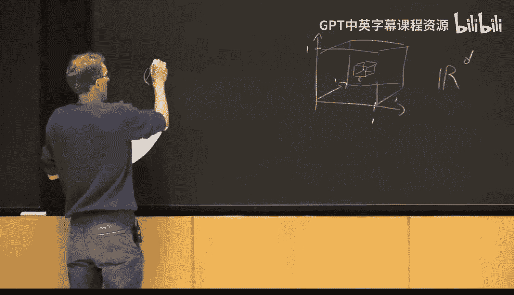

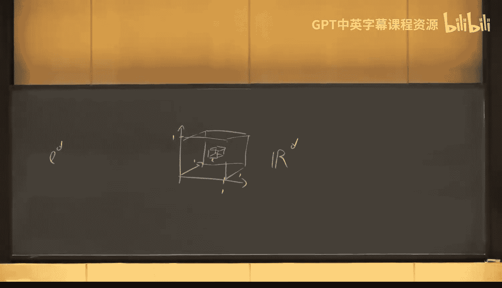

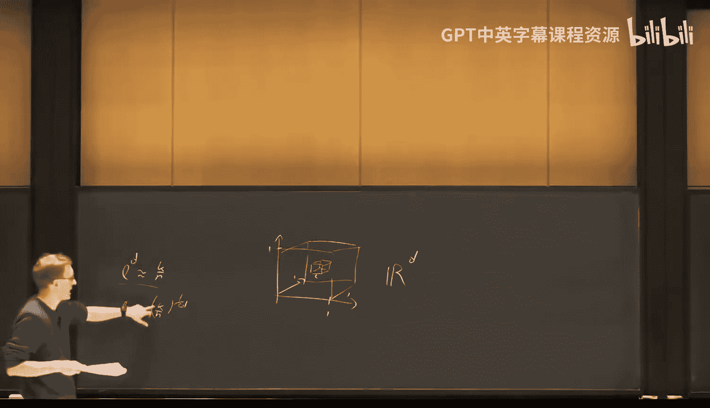

## 维度灾难的回顾

上一节我们介绍了K近邻分类器及其理论基础。本节中我们来看看它在高维空间中面临的核心挑战。

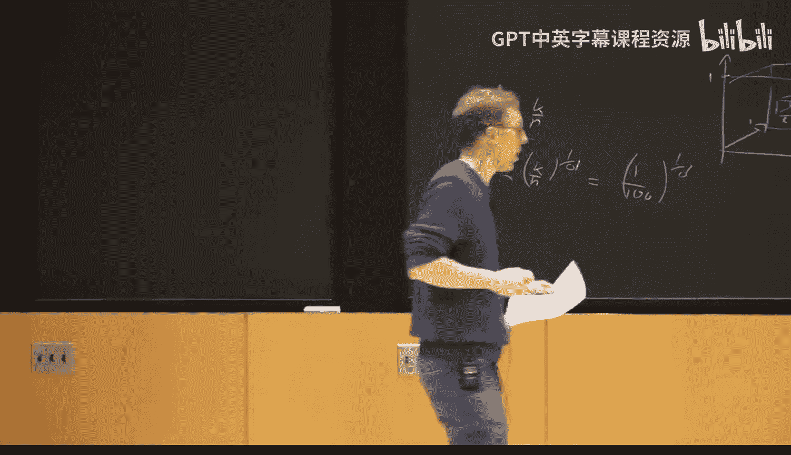

K近邻分类器的基本假设是：相似的数据点具有相似的标签。对于一个测试点，算法会寻找训练集中与其最接近的K个点，并采用这些邻居的标签作为预测结果。理论上，当数据量趋于无穷时，K近邻分类器的错误率最多只是最优贝叶斯分类器的两倍。

然而，这个乐观结论有一个重要的前提，那就是“维度灾难”。让我们通过一个思想实验来理解它。

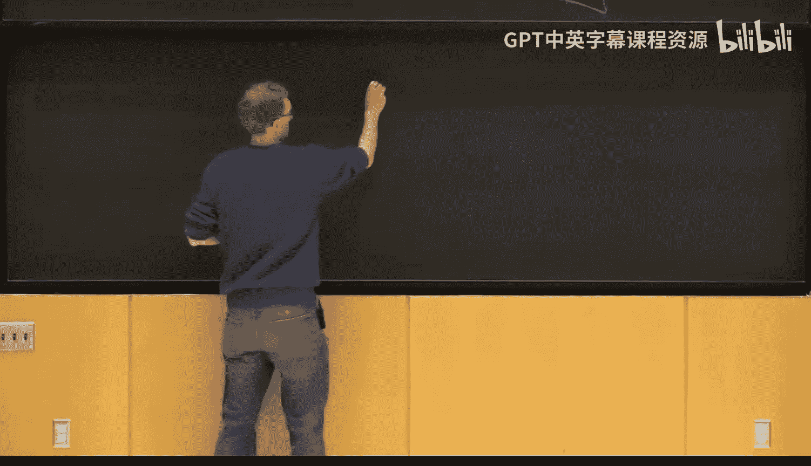

假设数据点均匀分布在一个D维的单位超立方体（每条边长度为1）中。对于其中任意一点，我们想找到一个能包含其K个最近邻的最小立方体，设其边长为L。

以下是推导过程：
1.  该小立方体的体积是 \( L^D \)。
2.  由于数据均匀分布，小立方体包含的点数比例应大致等于其体积占整个超立方体体积的比例。整个超立方体体积为1，因此有：
    \[
    L^D \approx \frac{K}{N}
    \]
3.  由此可以解出边长L：
    \[
    L \approx \left( \frac{K}{N} \right)^{\frac{1}{D}}
    \]

现在，让我们代入具体数值看看。假设K=10，N=1000，那么 \( K/N = 0.01 \)。我们计算不同维度D下的L值：
*   当 D=2 时，\( L \approx 0.1 \)。小立方体边长约为整体的十分之一。
*   当 D=10 时，\( L \approx 0.63 \)。小立方体已经覆盖了大部分空间。
*   当 D=100 时，\( L \approx 0.955 \)。
*   当 D=1000 时，\( L \approx 0.995 \)。

这意味着，在高维空间中，为了找到最近的10个邻居，我们需要的“邻域”几乎和整个数据空间一样大。这导致了两个严重问题：
1.  **“最近”的邻居实际上并不近**。所有数据点都大致均匀地分布在空间的边缘区域，彼此距离都很远，不存在真正意义上的“近邻”。
2.  **K近邻的基本假设失效**。既然没有数据点是真正“相近”的，那么“相近的点标签相似”这个前提就失去了意义。

为什么高维空间中的数据点会聚集在边缘？考虑一个简单的概率解释：在每一维上，一个点落在“内部”（比如距离边界ε以上）的概率是 \( 1 - 2\epsilon \)。在D维空间中，一个点在所有维度上都落在内部的概率是 \( (1 - 2\epsilon)^D \)。当D很大时，这个概率会迅速趋近于0。因此，几乎所有点都至少在某几个维度上靠近边界，从而成为“边缘点”。

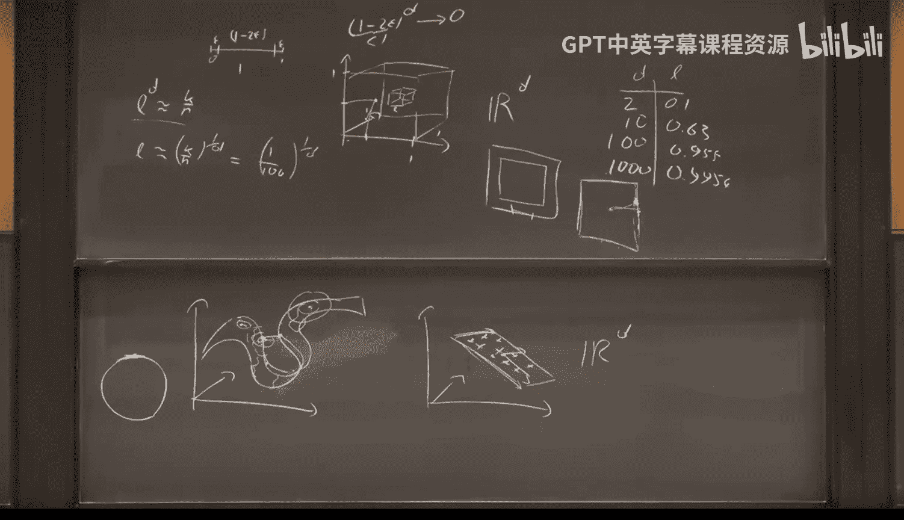

## 应对维度灾难：低维内在结构

既然K近邻在高维均匀分布数据上失效，为什么它在处理像图片（像素维度很高）这样的数据时又能工作呢？

关键在于，真实数据（如图片）的分布**不是均匀**的。它们通常具有**低维内在结构**。具体表现为以下两种形式：

1.  **子空间**：数据实际上分布在一个维度低得多的线性子空间中。例如，虽然图片有成千上万个像素（维度），但描述一张人脸可能只需要几十个特征（如脸型、五官位置等）。算法如主成分分析（PCA）可以帮助我们发现并投影到这样的子空间。
2.  **流形**：数据分布在一个低维的非线性流形上。流形在局部类似于欧几里得空间（例如，地球表面局部看起来是平的），但全局结构复杂。在这种情况下，局部距离仍然有意义，因此K近邻在局部区域内可以工作。

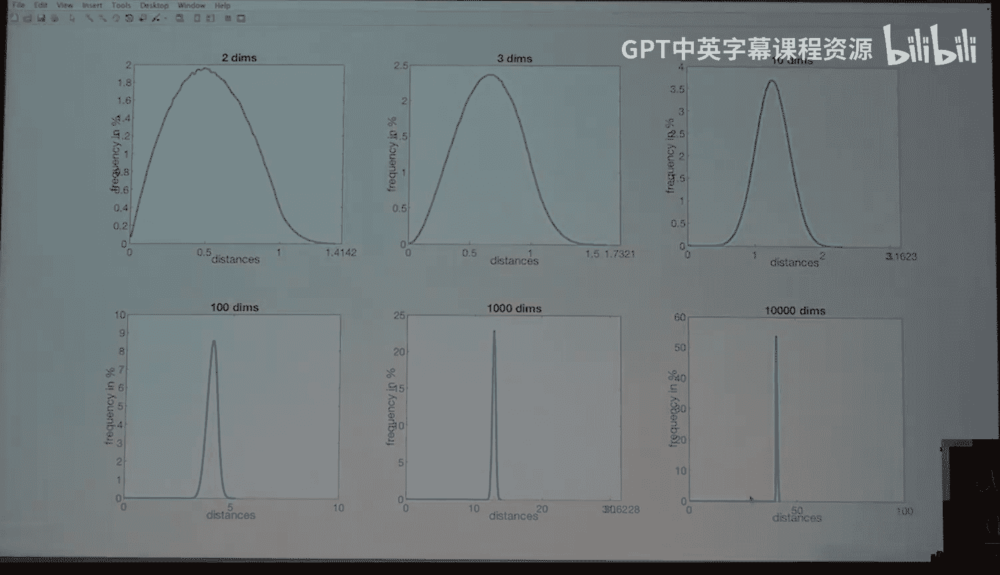

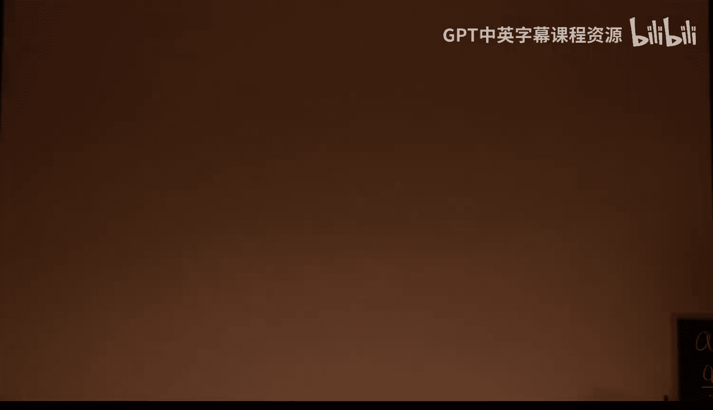

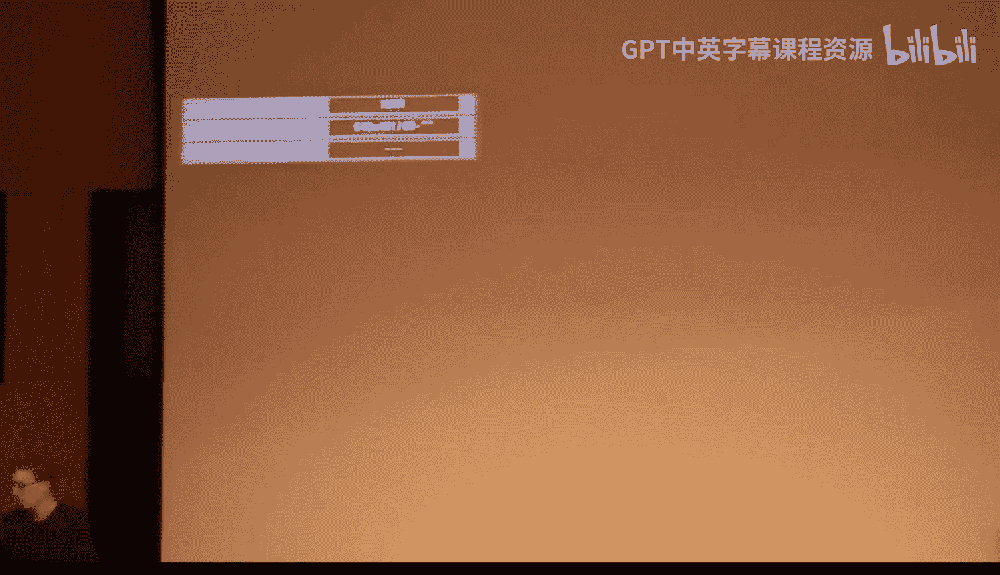

因此，K近邻有效的关键前提是数据具有**低的内在维度**。在处理高维数据时，一个常用的预处理步骤就是使用PCA等降维方法，以揭示其内在的低维结构。

## 从K近邻到感知机

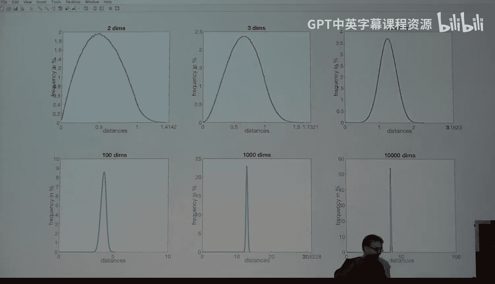

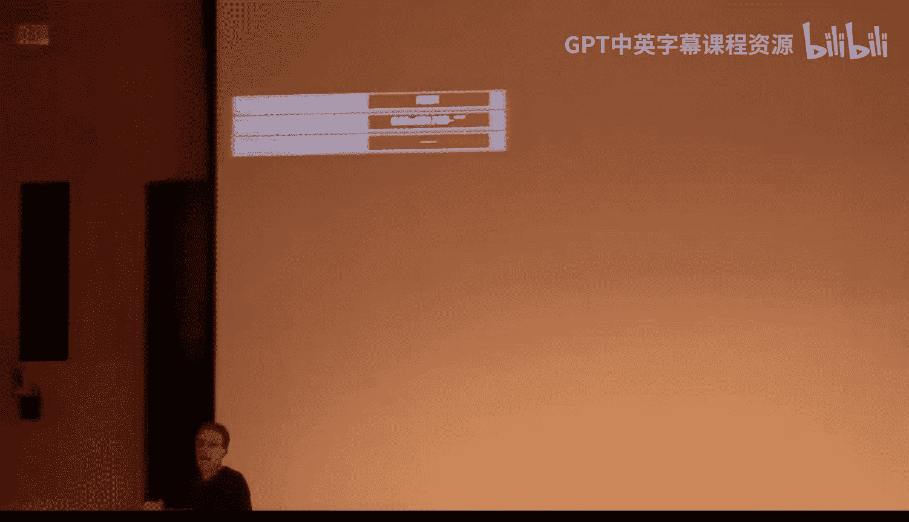

除了维度灾难，K近邻还有另一个实际缺点：**测试阶段计算成本高**。要对一个测试点进行分类，需要计算它与训练集中所有N个点的距离，时间复杂度为 \( O(N \cdot D) \)。当数据量N极大时，这变得难以承受。

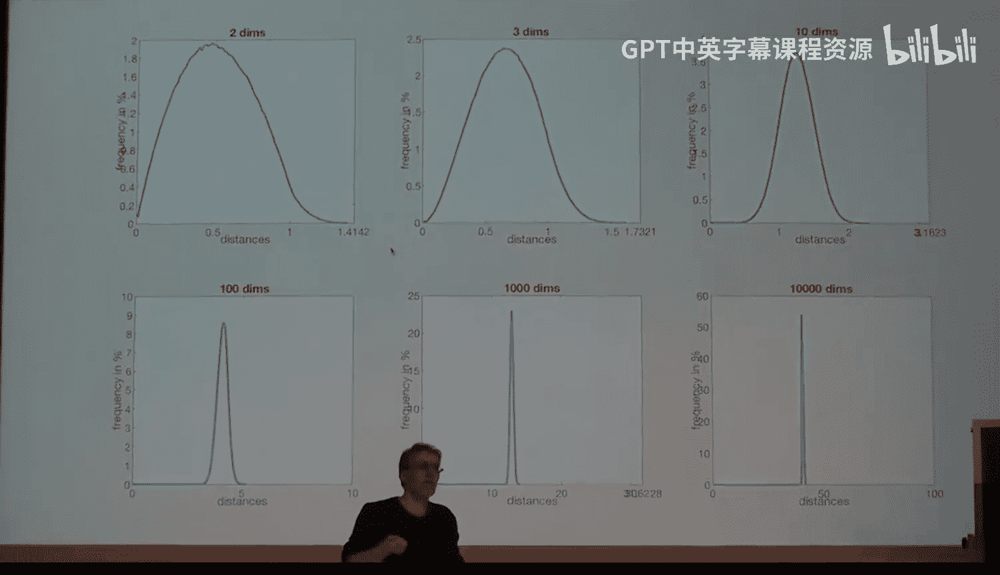

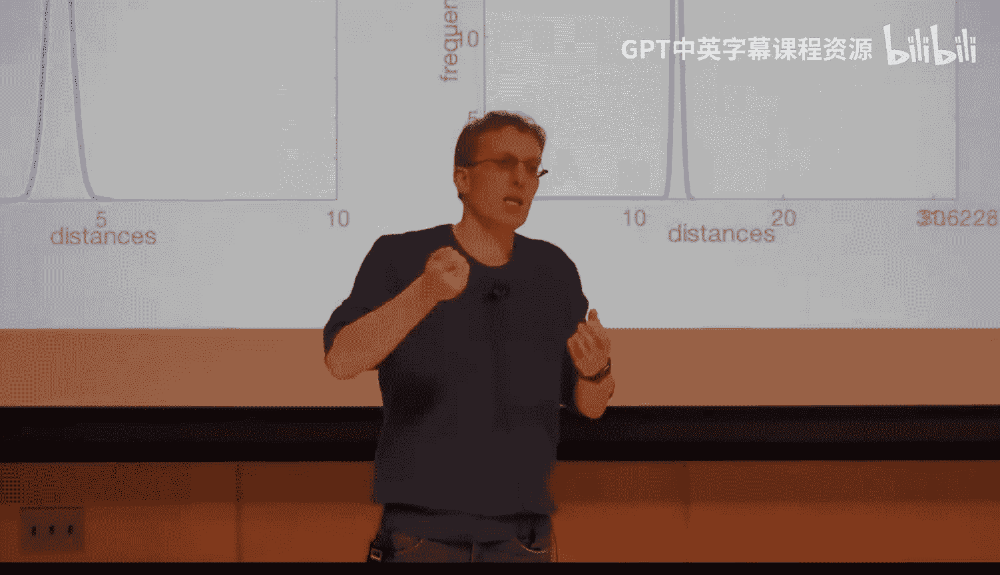

现在，我们介绍一种不同的算法——**感知机**。它由Frank Rosenblatt于1957年在康奈尔大学提出，被认为是第一个机器学习算法。感知机做出了一个与K近邻截然不同的、但同样直观的假设。

感知机假设：存在一个**超平面**，能够将不同类别的数据点完全分开。也就是说，所有正类点位于超平面的一侧，所有负类点位于另一侧。

在二维空间中，超平面就是一条直线；在三维空间中，它是一个平面；以此类推。数学上，一个超平面由权重向量 \( \mathbf{w} \) 和偏置 \( b \) 定义，是所有满足以下方程的点 \( \mathbf{x} \) 的集合：
\[
\mathbf{w}^T \mathbf{x} + b = 0
\]

分类时，对于一个新测试点 \( \mathbf{x}_{test} \)，我们只需计算：
\[
\text{sign}(\mathbf{w}^T \mathbf{x}_{test} + b)
\]
如果结果为正，则预测为一类；为负，则预测为另一类。这个计算非常快，与训练集大小N无关。

一个自然的疑问是：这个“数据线性可分”的假设是否太强？有趣的是，维度灾难从另一个角度提供了启示：在高维空间中，点与点之间距离很远，使得找到一个分离超平面反而更容易。事实上，我们后续会学到，通过将数据映射到更高维甚至无限维的空间，几乎总是可以找到一个分离超平面。

为了简化模型，我们可以通过一个技巧消除偏置项 \( b \)。具体做法是：
1.  给每个数据点 \( \mathbf{x}_i \) 增加一个值为1的维度，得到新的数据点 \( \mathbf{x}_i' = [\mathbf{x}_i; 1] \)。
2.  将权重向量也扩展一维，新权重为 \( \mathbf{w}' = [\mathbf{w}; b] \)。
此时，决策函数变为：
\[
\mathbf{w}'^T \mathbf{x}' = \mathbf{w}^T \mathbf{x} + b
\]
这样，我们只需要学习一个扩展后的权重向量 \( \mathbf{w}' \)，对应的超平面形式变为 \( \mathbf{w}'^T \mathbf{x}' = 0 \)，这是一个必须穿过原点的超平面。从几何上看，这相当于将原始数据平面整体“抬升”到了高一维的空间中。

## 总结

本节课中我们一起学习了：
1.  **维度灾难**：在高维空间中，数据点趋于分布在边缘，导致彼此距离都很远，这使得基于“邻近性”的K近邻算法基本假设失效。
2.  **低维内在结构**：真实数据往往具有低维的子空间或流形结构，这是K近邻等算法在实践中仍能工作的关键。降维是处理高维数据的重要预处理步骤。
3.  **感知机算法**：作为一种线性分类器，感知机假设数据是线性可分的，并通过寻找一个分离超平面来分类。它的测试阶段计算效率远高于K近邻，尤其适合处理高维数据。我们还学习了通过数据增广来简化模型表示的方法。

下一节课，我们将深入探讨感知机算法的具体训练过程，即如何从数据中自动找到那个分离超平面。