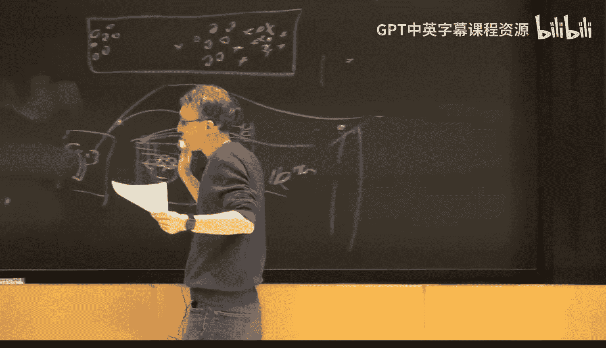

# 005：康奈尔大学《智能系统的机器学习｜CS4780 Machine Learning for Intelligent Systems 2017》中英字幕 p05 -05-Lecture 5 ＂Perceptron＂ -Cornell CS4780 SP17.zh_en -BV1Lo6gBxEKE_p5-

Allright。Hello， everybody。And。Hello， good， hi。😊，Alright， so。Last time we talked about。

 we finished off the curse of dimensionality。And then we went to the perceptionaneous neighbors。

 actually， cross thealityaneous neighbors。And the perception on。

 a few questions that I asked afterwards。 I may quickly relay。 So one person asked。You know。

 why is that so bad if you have。You know， everything is far away from everything else。

And so for once， actually。Well someone asked the question， well， how many points would you need？

If you actually want to have a small neighborhood， right， So we had that little box。 and we said。

 you know， this year is my little box size L。 And when we showed is that if the dimensionality becomes very large。

 then this box becomes larger and larger and basically be takes up the entire volume。

 One question that you may ask is， well， if I want to L to be 0。1， right， if I want L to be small。

 how many points would I need。😊，Right。And it turns out it's very easy to show that this， you know。

 the number of points you need actually grows exponentially， right， It's actually on your nodes。

 So it， in fact， it scales with 10 to the D， right， So D is a dimensionality。

 So that's how many points you need， right。😊，Let's order。As a constant， but。So in the mat， you know。

 if you have 1000 dimensions。 So why 10 to 1000， right， iss absolutely gigantic， right。

 that's more than theres electrons in the universe， right。

 And the moment you have anything that's more than electrons in the universe。

 it's useless right it's basically infinite。😊，So that's another way of of looking at it。

Another question that someone asked me was。If you have two。2 points。

AndSo with the curse of dimensionality， what we see is heres my my my test point。 and， you know。

 the nearest neighbor maybe here。 But the second to the nearest neighbor maybe over here。

 and they're about the same distance， But I can actually find out that this year is the nearest neighbor。

 I have a really， really precise computer， I may be able to find out that this year my nearest neighbor。

 And I know that this year is an X and this year is an O。

 So why couldn't I then assign an X to this point， because I realize this year is the nearest neighbor。

 This year is a little bit closer than that point。 Okay， does that make sense。 So the question was。

 well， if you can still figure out which point is closer， even if they are far away from you。

 why couldn't you still do nearest neighbor。😊，And the reason is that。

It it really doesn't tell you much about the data。 right。 So all you know about the data。

 you have the assumption that nearby points have similar labels。 So you know， this is an X。

 So you know， around here is all X。And this is an O。 you know， around here is all O's。 And you know。

 another thing。 at some point， it switches from o's to Xs， but you have no idea where it switches。

 It could be that it switches here， right that at some point here basically goes over to O's。

 right and you allow squarely in the O territory， right。

 or it could be that x is all the way up to here and， you know， here's where it switches。

 then you squarely in the X territory， right， The problem you really cannot infer anything about the label of this point。

 if you know， all you know is over there are X's over there are O's and you have no idea what's in the middle。

😊，Does that make sense， Ra the hand of that makes sense。Awesome， okay， good。

 Those are two little thoughts。 I just want to convey about the cursive dimensionality。😊。

Quick thing about the project。 So some people report they have problems with the prevoarrium。

It it seems to be that the most common problem is that people click commit。

Without clicking save first。So that's， I guess it's not really explicit to use interface。

 So you have to first save， and then you have to commit。 Otherwise you get the previous version。

ESub it to the leader boy。 So please be conscious of of that。Also， today， project 0 is 2。

And Project 2， Project 1 is still running， and Project 2 is being shipped out either tonight or tomorrow morning。

That would be on the perceptionceptron。Any questions about the projects or logistics。No。Okay， good。

After we。I scared you with a curse of dimensionality。Oh， Jesus still on my handwriting。 It's amazing。

It's prettyfil。Actually， that's， that's exactly what I want to talk about。

So we talked about the perceptron。 The idea of the perceptionceptron is you have data points either x's or O's。

😊，嗯。And the assumption that you're making is that you can have， you know。

 there's actually a hyperplane that you can squeeze between the different classes。 So in this case。

 we assume there's only two classes。 It's called these a -1 and these plus 1。😊，There is a plus one。

So this is the binary case。And amazing restrictive that you can， you know。

 find a hyperplane between these cats， but actually in high dimensional spaces。

 that's not very restrictive。 And high dimensional space is actually that's very， very。

 very likely right， And has， in some sense space， you're taking an advantage of the cur of dimensionality。

😊，嗯。Okay， and this is actually， yeah。 It's okay。 Let me this part。

So last time we defined the perceptionceptron。 basically， I showed you that it's just a hyperplane。

 So when we have a point X， what we compute is does W transpo x plus B。😊，That tells you how。

 how the point X stands in relation to the hyperplane， which is defined by W and the offset B。

And if this is negative， then you're on the on one side， if it's positive， you're on the other side。

 So actually， in this case， this should be this way。嗯。Alright， raise your hand。

 that still makes sense。Okay， alright。 so the perceptron algorithm assumes that such a hyperplane exists and provides basically a very efficient algorithm to find such a hyperplane。

😊，Or a such hyperplane。 One trick we did is we said， we do the following transformation。

 We take our x and we just， we just add a dimension of one of constant one。😊。

And if you define a new W， It's called this W bar or something， an X bar。

X bar is our original x with a one as one additional dimension。

 And W bar is our original W with just one more constant。 one more dimension that we are learning。😊。

And the nice thing about this is if you take the inner Now。

 we just have to take the inner product between W bar and X bar。 And that's the same thing as here。

 So if you learn our W bar， then we can just look at the last dimension that gives us our B。

 So then we can basically decompose our W bar into W and B， And why is it advantage。 Someone ask me。

 why are we doing this， right like it's the same thing。 And that's exactly the point。

 It's exactly the same thing。 But the derivation is a lot easier because you don't have to fus around with that B。

 right， So well prove something in a few minutes。 And it's just annoying to always carry that B around with you。

 the same in the code。 It's just annoying to update B。 So you just there's a very。

 very simple trick Just get rid of all the updates to B， etc。😊，O yeah。😊，So。In the homework 1。

 we had to find the boundary between the two different types of data。

 And that was the line between the two different kinds of data。 Isn't this theceptron。

 basically that only。So。宝。I guess it's linear receptable。 I that what do you mean。Basically。

 what I mean。What I mean is since the craneous data， you can find a boundary between the data。

 which would cause a point don' cause either side one of the data point。

 So ist the step basically doing that。Anyway。I'm not to understand the question。

 How is this any different from different neighbors Only we fighting the boundary instead of calculating it Oh。

 oh， oh， oh， it's very different than Ken' neighbors。 I see。Well。

 Kenius neighbors can go around curves and stuff。 right。

 like did So Canius' neighbors also has a decision boundary。 Let let me， let me， okay。

 thiss a good point。 Let me， let me explain this。嗯。So。Vnito came here's neighbors。

 And this actually something， I guess I showed you this example with， with the pink and blue。😊。

The data set， right， So one thing you can basically say is。For every single point。

 you could say if there was a test point， would you classifiedify as a circular。

 Would you classify as as a。There's an X。 right。 And so Canier's neighbors therefore also defines a decision boundary。

 It's like something size decision boundary probably goes like like this， right。

 between all the O's and all the Xs， right， And so you could actually have something。 You know。

 we have another thing carved out an island or something， right。😊，The perception on makes a very。

 very restrictive assumption on the decision boundary。

 It says this decision boundary has to be a hyperplane。So that that's， that's very restrictive。

I but it turns out actually sufficient high dimensional spaces。

 But the advantage is that now you just have， you just have to store the one vector and the and the bias of that hyperplane。

 Where for Caners neighbors， in order to encode that decision boundary。

 you actually have to store every single training point。😊。

Right and you have to compute a distance to it， which is a very slow and and memory inefficient algorithm。

So it's would be easy simplify the hyperplane， get a lot of memory savings， you know。

 a lot of savings for it。 But there's a tradeoff because we couldn't model something like this，😊。

Okay， you a good question。 Any other questions。Okay。And the same thing， by the way， like。

 you know that the canous neighbors， we made had this nice theorem saying that if N goes to infinity。

You know， we will have most have as twice as many errors as the bay optimal classifier。

 Well that's impossible to prove for the perceptron。 Why can anyone tell me why that's impossible。

Why couldn't you possibly ever prove something like this for the perceptron。All right。

 I'll give you a minute to think about it。 discuss it with your neighbor。Okay。Let's go。Okay。

 any suggestions。So I would like to show that basically the training set becomes infinitely large。

 My perception will make very few， few errors。 Why can't I possibly prove this。

When is it going to break down？啊。入れても。That's exactly right。 So if you have a data set。

you could have a data set that basically with distribution is such that you have positive。

 point here， negative point here， positive point here， negative point here and so on， right。

Imagine data sample from some kind of sine wave。儿子。

What there iss absolutely no hyperplane that separates the os from the crosses， right。

 And the more data you get。You know， you won't do any better。 Your error will not improve。

 if I tell you， no， here has really a lot of crosses， right， Like he has a lot of os， right。

 It won't help you because there's no hyperplane that separates the os from the crosses。

 right the moment you put your hyperplane here， but you're gonna get all these guys wrong。

 you say everything is Os， you're gonna get all these guys wrong。

 And the more data you have like you know， it's all proportional。

 you just sample more points So you're not actually changing the air。😊。

So the nicely thing what Kenya' neighbor， it works for all data sets。

 what Kenous neighbors would work here。😊，But perception would not。Does that make sense。

 Raise your hand， Does that make sense。啊，给二审。So here is the perceptionceptual algorithm。

It's very simple。So you start out with。W equals 0。So you say initially。

 my weight vector test is all 0。You know， that will always predict 0。

 That's neither positive nor negative。 And in just a reminder， I assume that my Y eyes。😊。

Are either plus 1 or -1。So every data point has a label plus 1 or -1。And then， I say。You know。

 I can either say， well， let me be right it the way。 I have it here。Why true？So loop forever。

 That's not not great coding。But。嗯。So we said， you know， and could0。

 basically what were doing is we just repeatedly go over the entire data set。

And they counts how many points we misclassify。So M here is the counter of how many points I'm misclassified。

 If I make a pass on my data。 So initially， I say， okay， so far。

 I haven't misclassified a single point yet。😊，Now， let's go over my data。

 Let's try every single data point and see if it rise lies on the right side of the hyper play。

 right， So I have my data like this。😊，Yeah， my X is。Yeah， my oaths。But initially。

 I have a0 hyper pain。 I will get every single coin wrong。

But so the algorithm is basically every time I get a point wrong， I adjust my hyperplane。

And then I basically， you know， loop over the data。

 And the moment I don't make a single mistake anymore。That means， you know。

 if every basically all the crosses lie on this side of the hyperplane or the o sound this side of the hyperplane。

 then I know I've actually found a hyperplane that separates the two， and then I can stop。

So that's the high level of intuition。 So this here is the counter how many mistakes I've made。

 And now we say for every x comma Y element of D。 So we loop， as a for loop。😊，Or for you now。

 you can buy this notation that you're familiar with。嗯。Then you basically say， okay。

 now I classify this point。And so here's what I'm doing。 I now say， okay。

 does this point lie on the right side of the hyperplane。If it does， I don't do anything。😡。

And if it does not， then I increase my counter because now I made a mistake。

And I adjust my hyperplane， such at this point is not hopefully correct。😡，that's the idea。

 That's the idea behind it。So how do I do this， I say if。Y times W transpose x is less than 0。

Let's equal 0。Y times W transpose x is less equals 0。 I claim that that's the case。

 If and only if I get the point wrong。Can anyone explain this？Only one person。Why does this mean？

Y W transpose x。 So I have a point x with label y。I call him John。And I want to know。

 that's this point line on the right side on the wrong side of the Hyplane。

Now but I'm computing is y times W transpose x。And say if that's less equals 0。

 then I must have gotten the point wrong。 Otherwise must have gotten right。Who can explain it。M。

 okay， give it the first。然后。嗯。S的。That's exactly right。 So we say these guys。

 you have a positive label。 These guys have a negative label。😊，If I'm on this side。

 then I have a positive sign。 So W transpose x here。 W transpose x is greater 0 here。

 W transpose x is less than 0。😊，And what I want here， I want this to be greater 0。 here。

 I want to be less than 0。so I want these signs to align， right， So here I wanted to be negative。

 and here I want to be positive。Here， the label is positive。 here， the label is negative。

 So what I do is I multiply it right So if I get it right here， this is negative。

 times  -1 is positive。 If I get it right here， this is positive Time plus1 is positive。😊，Okay。

So if it's less equal than 0， then I know I got it wrong。And then what I say is very simple。

 I say my w becomes w plus y times x。 So what does that mean， Y is either plus 1 or -1。

 So if it's a positive point， I'm adding it to W。 And if it's a negative point。

 I'm subtracting it from W。😊，嗯。You can think about it in the following way。 If it's a positive point。

 then I'm adding it to W。 That means the next time the inner product is gonna to be a little larger。

 so hopefully， it will make it positive。😊，And if it's， if it's a negative point。

 then as's attractivetract from W， that means next time the inner product is gonna be a little smaller。

 So hopefully then it's gonna be negative times the negative-1， is's going be positive。

And the other thing I'm doing I'm increasing my counter。 M is M plus1。

So this counts how many mistakes I have。 And I say at the end。 So I do this。

 I look over the entire set， if M equals 0。😊，Then break。And then， it can end。

So basically what we're doing one more time， we initialize our w to be 0。

 That' that's gonna to get everything wrong， Everything wrong， then。😊，We just loop forever。

 And here's what we do every single loop。 We set our account initially to 0。

 And now we go through every single data point in our sample。 We say which side of the。

 which side of the hyper planee do you lie on。😊，The positive points should lie on the positive side。

 the negative points on the negative side。 if that's not the case。Then we update our W vector。

We try to reinforce the positive points to become get larger in in the product。

 the negative points have small in the product， and we increase the count of how many points we got wrong this time around。

😊，And we keep doing this until we make a full pass over the data set without a single point run。

 And what does that mean， Well， if you went through every single data point and every single one was on the right side of the hyperplane。

😊，We didn't make any updates。 That means it must now be a separating hyperplane。Any questions？第二。呃。

Let me。Let me get to this in a few minutes。 But， in some sense。

 what you can think about is the following， right， if now。嗯。W plus x。

So W transpose x becomes w plus transpose x plus x。All right。😊。

Well that equals the O W transpose x plus x transpose x。Right。

 so you basically increase the inner product。By that amount。Okay。Any more questions， one second。

 let me just bring the projector down。Yeah。MF。Now， this is inside the loop。 This is inside this loop。

So this equals with the whole data set。😡，If you had made a mistake。

 then you go again over the dataset。 You reset n equals 0 and you go again over the data。开。

But the moment you make a mistake， you update it。Right。So you could actually。

 theoretical go to the data set every single time you update it， right。

 The only thing you stop it if you haven't made an update for endpoints。Does that make sense？

How do tell what act provide money having advice。被吧。Why。So we will give， we proof in。

 in a few minutes， we will prove that that actually will converge very quickly。 So this is actually。

😊，He didn't just make this up。 and， you know， it actually has a very well， you know。

 motivated derivation。😊，Yeah。Sorry。嗯。So depends， depends on on how many data points you have。I mean。

 come on， this was 1957。You know， we are glad that you're getting something right。😊，嗯。I mean。

 you will eventually， I mean， that that's ultimately what all of machine learning does。

 Like your training。 you try to minimize the error on the train the。

There's other mechanisms you do against that were fitting。

This was not actually a concept yet at the time， yeah。We will get to this。嗯。Any more questions？

Alright， good。 So here's a little demo。So what I can now do is I can draw a bunch of data points。

 and I can then train the perceptionor to classify them。 Let's first draw on positive points。😊。

So yeah， my， I think positive comes first。 I'm not sure。And that's draws them negative。 Oh。

 these are negative。 okay， whatever。嗯。按照。That's hope that's linearly re sparable， okay。

If it loop forever， it's not linear example。 Allright， let's see。

And so here is the first thing he does。 It initially had a zero vector。 You can't see anything。

And then it it encounters this vector here。 right， So these are the positive points in negative points。

 So it picks 1，1 arbitrary vector first。 It's this one。 It realize it gets it wrong。 So what is。

 what does it do with ads。😊，X to that vector。 And what you see here， the blue line。

 the blue arrow is actually the error after I had made that update。So it points exactly to x。

 Why is that？Because my initial vector was 0。0 plus x is exactly that vector。 Okay。

 Does that make sense。 So this is my origin。😊，And x is basically the vector from here to here。

 So I'm adding it to it's this number。 Now I actually have a hyperplane。 Great， right。

 So everything here is， you know， is classified positive。 Everything here is classified negative。😊。

So now Im this is my current hyperplane， my vector to W， this red thing。Now， I have another point。

 This one down here。 I get it wrong。 right， This guy' is positive。 It should be on the red side。

 but it's on the blue side。So what do I do， I add this point to my vector， right？ now。

 this vector plus this vector becomes this vector。 Okay， does that make sense。

So that's my new hyperplan。Now I have a new hyperplane。😡，I look at this guy。 Oh。

 I get this guy wrong， too， right， So this is on the wrong side。 So I again， add this。

 this is my original vector。 red is my original hyperplane vector。 I add X st。 Now I end up here。😊。

Now I get this guy wrong again。 I already had this one， But， you know， now I get it wrong again。

 right， So I keep adding to it。And。那次。Can someone please pray this is Yeah， okay， good， good。

 This is linear。😊，And so now actually end up with with hyperplane that actually， you know。

 here all the positive points on one side or the negative points on the other side。

 And we will proven a little bit that whenever there is such a hyperplane。

 the algorithm will converge to such a。😊，嗯。Any questions about the demo？Any data set you want to see。

 yeah。still。There's， there's infinitely many。And wars have been fought over which ones are the best。

We will， I will expose you a little bit to this later on。

 But that was the first algorithm I found any。 So at the time it was amazing that you could find any。

 And the moment that that happened， people were like， well， mine is better than yours，😊，So there。

 there's，'s a lot of turns out there are actually better ones in ones。

So one you can see let me just make a really easy example。 you know， here， for example， I've just。

 you know， three points on this side and have a really large margin between these， right。😊。

And one thing you're gonna to see is it's going do it very quickly。呃。

So the algorithm takes a lot longer when there's very little wiggle room because it can of overshoot it over and over again。

 That will make sense once we look at the proof。 So in this case。

 it immediately found it with one update。Any more questions？嗯。I can show you another example。😡。

Before we do this， I just want everybody to have a moment of silence that we think about the time it took me to make this demo。

Alright， so here。Here's what we have。So here have handwritten digits of zeros and7s。

 So I only take zeros and 7s。 turns out that's linear receptable because they don't really look very much alike。

😊，And so that's in the space。 These are 16 by 16 pixel images。 Sorry，28 by 28。 So 7， whatever。

Or 160 or 16。 It's256 dimensions。 anyway。 So it's based in a 256 dimensional space。😊。

And this is my training dataset set。 These digits here。 right， So this。

 this is my entire training data。 It's a small training dataset set。😊。

And what I'm showing you now here is this box。Is the weight vector， right。

 So the weight vector is also in the same space。 So I can visualize it as an image。

 It's a 60 space 256 dimensional vector。 I can plot it as an image。😊，Okay， why not？ So right now。

 it's all zeros， right， So that's gray。W this positive， you know， that it's kind of negative。

 So right now， all zeros means gray。 Okay， so now I go through my first image， this 7。

 and I misclassify。 I classified as a 0 because 0 times whatever those pixels are is 0。

 So I get this point wrong。😊，So what do I do， I add this point to the data to the to the weight vector。

 And this is my new weight vector。😊，Okay， actually it's subtract sorry because it's a negative sample。

Does that make sense。 Ra your hand of that demo make sense。 Okay， now I reclassify。Al。

 so these are now the reclassifications。 So currently， what I'm classifying， everything is negative。

😊，Okay， that makes sense， right， because so far， I've only seen one example and it was negative。

 So if I take the inner product of this vector with on my entire data set， every example is negative。

So now you give to the next example before when everything was classified as 0。

 That's why they were all here。 So the y axis here is basically for every single image。

 how I classified it。 But's up here， it's positive。 If it's down here， it's negative。😊。

So now I'm classifying this guy here。 Well， I'm classifying as negative as a 7。

 but it's actually a 0。 So I got it wrong。 So what I have to do。

 I have to add this to my weight vector。 So this is what happens。 right。

 So now I actually have this kind of， it's half the 7， half the 0， right， if I now reclassify things。

 you can see now this guy is classified positively。😊， so now go to the next。Oh。

 it's already everything is correct。 Well， that was pretty easy。Well。

 let me do it one more time because I speaking now， you've got to make it worth it， yeah。Okay。

 so here one more time。 I have the first  one。 I get it wrong， I get it， get it wrong。

 So I make it positive。😊，Second one。 So here's actually my。Here' is my weight vector。

 So now I get the7 wrong。 So I subtract the 7。Now， things have mis reclassified。

Now I go to the 0 that gets classified correctly。 Next 0 gets classified correctly。

7 gets classified correctly。 Everything is correct。 Awesome， feeling pretty good。😊，And now this guy。

 oh， what's going on is still correct。 I think the top left corner。 No。

 maybe it's I think it's wrong。 Okay， maybe it's the center。 Okay， so I have to update my vector。

 yep， and I move the guy up。 Oh， that was too much， right， So now I have to， get the seven wrongs。

 So I have to， you know， subtract it again。😊，And do we have it， I think we got。 Alright， good。

 Does it make sense。我来看点。Yeah。😊，Yeah， question。第三步就就是M新翻。Yeah， so the negative。

 the points that have negative label， these points have -1。 So these aren subtracting。

And these here the once the zeros， they have a positive label。 So I'm adding them。😊。

So what I do is w becomes w plus y times x。 So y is either plus 1 or -1。 right。

 So that's why I'm adding these guys。 and I'm subtracting these guys。 Yeah， good question。😊。

Any other question？Yeah。Program worked for like  Eddie numbers because I'd like to see like a1 in of things that are slightly close together。

 Well， if it's not linear receptable， it's just gonna loop forever。

that that's the problem with there's no， there's no check of， is that even possible。

 But just assume it's possible。い。The white。Oh， that's right。 Yeah。

 So y is actually the y of that particular data point。 Absolutely right。い。8。

's we've evolved a great deal in 957。 So that's much much more efficient base。 that was basically。

 you know， this was the first algorithm that to do this。 Yeah， yeah， So later on in the course。

 you basically take this intuition， and that will show you much。

 much more efficient way of doing this。 That's a good question。 though。 It is extremely inefficient。

😊，Yeah。Any more questions。Alright， let me诶。Close this。

Okay， good。 So now I thought it's been a few minutes。

 I just want to hammer home the geometric intuition。啊。On a little quiz。

So there there's two parts to it。So if you turn you actually have this print， it's the same thing。嗯。

I don't have it。There we go。So the question number one is。嗯。You have a  point X。😡。

You have to draw it， likea。Here's my origin。And here's my way back to W。

So remember that the hyperplane always goes to 0， right。Why does it always goes to00， Who knows。

Why does the hyperplane always have to go to 0，That's right。

 So we added the one and we we forced it to be that way。

 We got better incorporate the offset as the additional dimension。So this year is my picture。

 I have X and F W。 I want you to draw。So this guy is misclass Qui。 It should be positive。

I want you to draw the new W after an update。 That's the first first quiz I want to do is just to visualize this。

 And the second thing I want you to do is think about how many times。

 Imagine I would encounter the same point over and over again in a row。

 How many times could I get it wrong。ItDoes that make sense。

 So please spend three minutes with your neighbor。And figure these two things out。Yeah。Okay。Okay。

Yeah。Okay。Yeah。Yeah。Yeah。Yeah。But。Yeah。Okay。Yeah。Yeah。Okay。Okay。Yeah。かじな。快。Okay。Yeah。Okay。Okay。Okay。

All rightPlease raise your hand if you've got both answers。keep thinking。Al right。

 well the first questions。 So first question is my first。😊，Initially。

 my hyperplane is defined by this W。And so the hyper brain goes to 0， right。

 So it's basically the vector that goes to 0 and it the plane。 Sorry。

 it's orthogonal to the vector W。 So this here is my hyperplane。😊，Now。

 I I going come to this point X， and I get this point X wrong。 So this point should be positive。

 but it's negative。What do I do， What does the hyper planee look like after the update。

 Can anyone show me what what got I have to draw。I see people drawing the I think okay good。

 So here's what I do。 right I basically， look， this vector， actually， you know。

 this is actually a vector X， right， now becomes W becomes W plus one times x is a positive points So one time。

😊，So， I， I。Back to audit Ma works that way。 right， So you add W plus x。 This here is my X。

It's translated。And this is my newW。And so I have to draw on orthothgonal hyperplane。

 So this is my W T plus 1。This is W。Okay， is that clear to everyone。 Raise your hand。

 That's what you got。😊，Hi， good。So the second question is， well。

 what if this point doesn't actually have to be correct now， It could be， It could still be wrong。

And there's no guarantee that after one update， you actually get the point correct。

So imagine now we visit the point again。 How many times could we possibly get the same point wrong。

 It could it be that we just keep updating there's one darn point。 We never get that right， right。嗯。

第二。That's exactly right。 So let me just derive this。So you basically say my。You know， W transpose X。

 What does that become， That becomes W plus x。Transpose x。 Okay， now we know this is less equal 0。

 right， So we make a mistake。And so we make an update。Mr。 Wang。

you make another update what would that be， but that would just be adding x one more time， okay？😡。

So let's say， after K updates， we've。Added X， K times to W。Okay。And we are still getting it wrong。

So what does that tell us about K？😡，But if we solve this。

 what we get is W transpose x plus K times x transpose x is less equals 0。And what does that mean。

 Well we can solve that for K， That means K is less equal minus w transpose x divided by x transpose x。

So that is， so this is negative， right， So that's a positive value。

 So that basically shows there's an upper bound。 But how many times you can get K wrong， right。

 So that is some positive number。😊，And after that， we have to get X right， right。

So there's only a finite number of times that we can get this particular point wrong。

That's very encouraging。 That means we're doing something right， right。So anyway。

 this is just if you just look at this one data point。 I agree。 So if there's gonna。

 this is just to simplify the argument right now， right。

 the proof that we will do in a few minutes will be over entire data。But you exactly right。 So well。

 at least we showed something。 right， So if I give you one data point and I show it to you repeatedly。

 eventually， it will get it right， right。😊，I mean to， you know， it's a minimal requirement。

 but it means it's learning something。Yeah。这来的。He what。我的地。T X。啊。Here。W。That。で。

If you' exactly the opposite， right， what would happen， here' is my， my 0。This is my W。

 And then my x is actually exactly。 Let's say X is minus W。Right， so my x is here。 Well。

 what happens if you add that， right， You actually get the zero back。

 And then the next time you would actually get exactly the vector。Oh， if it's 0， if it's 0。

 it's actually still， then you get exactly the equality here， right？ So when it's 0。

 you say it's still wrong。It has to be on the right side。 If something lies on the hyper planee。

 you still consider that wrong。And in part， you need that because you initialize with 0。So initially。

 you classify everything as0， right。So it's actually a common mistake when people implement them It perceptron So you must have less equal。

 otherwise it immediately converged。I mean， it's easy to detect here。All right， Any more questions。

Yeah。re。So it moved now no way took long time。No， no， you don't update the origin。

 originig is over 0。那那呢。That's just one more dimension。 So youre just in a high dimensional space。

 right， So that's just。There's some dimension in which the vector actually actually lies in that。

 you know， one of。I there some dimension kind of in the hyp the into the blackboard。

 whether the vector to x lies lies1 removed。でる。你得。No， you could have two two dimensions。

 You could have one dimensional data。第二个。But in this case， yeah。 So this， I mean， in this case。

 you would always have a third dimension。If you did a two dimension， you add。Yeah。

 this basically he can give one dimensional data and add a second dimension。O。All right。

Who is ready for the proof。Yeah。脏乱。😊，At least one person。 good。😊，哎哎哎。Allright， convergence proof。

 So this was what what made Rosenbl famous。 And you guys are here in Cornell half a century later。

 It has changed the world we live in。😊，Alright， so the question is， why does W。

 Why does the perception algorithm always give us a separating hyper planee if it exists， right？

 And so we won't get through the entire proof today。😊。

What I really want you to do is you now we we'll get started with a setup。

 What I really want you to do is read through it。Before Wednesday。You just now one evening。

Maybe not Valentine's Day， you know， but， you know， maybe do it night。 read。

 read through the proof and just make sure you understand the different steps， right So cave。

 you don't understand everything。 That's what the lecture is for。 But it really helps a lot。

 if you've looked at it beforehand。😊，Okay， so here's what we assume。 right。

 The assumption of the perceptionceptron is that they exist to W。That can separate it。

Because the stuff you start。The exist W star， such that。Every X and Y。Element of our data set。

We have。Why。W transpose x is greater than 0。好 that's在 I上。Now。

 we are not saying we will learn that job you start。And we learn a separating hyperplane。

But what we will show in the proof is that we will get closer and closer to the W star。

And eventually， it will be so close that we will classify everything correctly。

That's kind of the idea。嗯。Allright， so。So far， that's just the assumption。 That's just what we know。

EThe foundation of of the perception algorithm。And now we say， okay， well， we know the W star exists。

😊，So one thing we don't want to deal with is a scale of W。

 If actually W star is separating hyperplane。Well， then next five times stop you stars also separating hyperplane。

 right， You just rescale the hyperplane。Right， if we just rescale by any positive constant。

 it still separate hyperplan。 So clearly， there's infinitely many separating hyperplanes， right。

 if they exist one。So that's not very interesting， right， So in the picture that basically see。

 it says the following， if we have our X' here and our O's here。😊，Here's our hyperplane。

 where there's one that has this， you know error like this。

 Another one has an error that's twice as long， right， That's exactly the same hyperplane。

So we just fix one scale。 So we say we rescale W star such that W star。The norm equals one。Okay。

 that's not a limitation。 We can always just take any W star divided by its own norm。

 and then we get exactly this。 Okay， this is。We just assumed W star equals one。

 And we know that exists because they exist。A hyper plane。And now we can do something else。

 We can say， well， let's rescale our data。 So that's。Somewhat a trick。So basically。

 this is just to simplify the proof later on。 right， So basicallys， what we can say is， well。

 we can always just take our data and multiply by a constant。Right the same view。

 you multi as W star by constant。So what we assume is that for every X。The norm is less equal1。

4 all x。For all our X I and Y， I and our data set。 So all our data points。

 right all our these are feature vectors， we assume that the norm is less equal one。😊。

Can we always do this。 That seems kind of fish。 right， So this was still。

 I think people bought this one。 Do you buy this one， Raise your hand if you buy it。Alright， good。

 Some people have concerns。 You should have concerns。 Actually， it is， is， it is totally kosher， but。

哎。So here has basically what we can do。 We can say basically， save all。 So once in some sense。

 basically， what you could think about is you can just take the entire data set。

Resscale it to make shrinkrinket。Find a separating hyperperplane And at the end。

Expand everything again， right， So you basically have some magical device。

 You just take this data set。 You make it really small。😊，You just multily by a small constant。

 We find a hyperprint here。 Now we take all of this。😊。

All the points and all the hyp brainum multi back。 right， So we busy。M。

 we multiply by alpha and then we multiply by one over alpha。

 So you can always go back between these two。 right， One is just the rescaled version of the other。

It doesn't change anything。Does that make sense。Raise the hand of you' buy now。Another way of of。

 of looking at it is if we have。 So in order to。I have all my x。 right Now basically。

 what I'm doing is I take my largest X。 Let's take some X has the largest。😊，You know，来这这阿米伽一共是。Max。

Over x。I just that Oomega is the largest norm of any of my data points。

And I say every single data point becomes。XI。times1 over omega。So I， I rescale it。

Now this is satisfied， right， because the largest X now has exactly the normm1。

 and everybody else has a smaller norm。😊，But this is a non negative constant。

So I have this one hyperplane here that says everything， you know， this is my my。

 my separating hyperplane。 Every point lies on the right side。

 If I just multiply this with one over omega。😊，This still holds， right， because that's non negative。

So I'm actually not changing anything。 the same way I can rescale W， I can also rescale my axis。

 And just to make things simpler， I now basically take my data and I rescale it。

 such that everything is。😊，Within， within norm one。

 another way of of of thinking about this is that basically have my X's and my， my o's。

And I basically resscale and in a circle with， with the size  one。I didn'。That that's the idea。

And theyd be only doing this because it's convenient doing the proof， right。

 And this does not infringe on the generality of the， of the result。Let's leave it here。

 Please read over your over the proof。 You can。 Maybe you can make out of it a Valalentine's poem。

 right， Think about it。 It can be very romantic if it's read the right way。😊。

