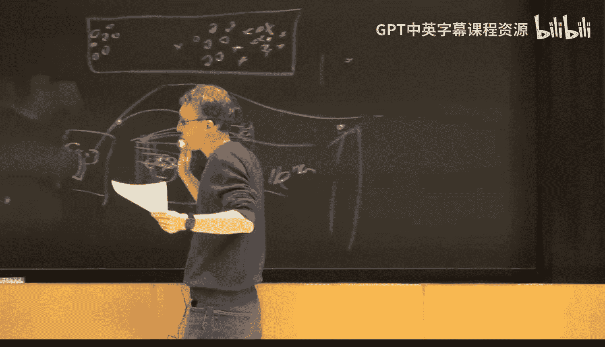
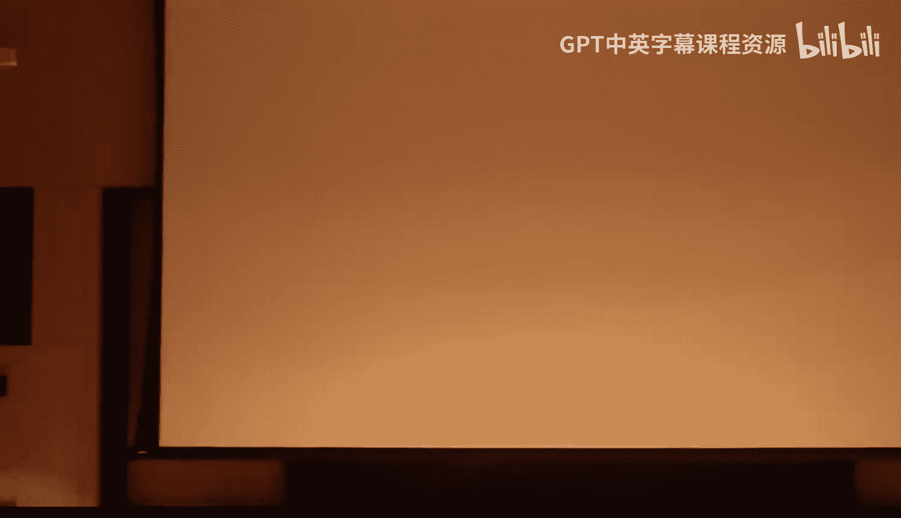

# 机器学习：005：感知机算法

在本节课中，我们将要学习感知机算法。这是一种用于二分类问题的线性分类器，其核心思想是找到一个能够将不同类别的数据点分开的超平面。我们将从算法原理、几何直观、具体步骤以及其局限性等方面进行探讨。

---



## 感知机算法原理

上一节我们介绍了K近邻算法及其面临的“维度灾难”问题。本节中，我们来看看感知机算法，它通过寻找一个线性决策边界来简化模型。

感知机算法基于一个核心假设：存在一个超平面能够完美地将两类数据分开。对于二维数据，这个超平面就是一条直线；对于更高维度的数据，则是一个平面或超平面。

**核心公式**：感知机的决策函数为：
`f(x) = sign(w^T x + b)`
其中，`w` 是权重向量，`b` 是偏置项，`sign` 是符号函数。如果结果为正，则预测为正类（+1）；如果为负，则预测为负类（-1）。

为了简化推导和实现，我们通常进行一个技巧性变换：将偏置 `b` 并入权重向量。我们定义新的增广特征向量 `x̄ = [x; 1]` 和增广权重向量 `w̄ = [w; b]`。这样，决策函数就简化为：
`f(x) = sign(w̄^T x̄)`

---

## 感知机学习算法

感知机学习算法是一种在线错误驱动算法。其目标是通过迭代调整权重向量 `w`，使得所有训练样本都被正确分类。

以下是感知机算法的具体步骤：

1.  **初始化**：将权重向量 `w` 初始化为零向量（或小的随机值）。
2.  **迭代**：遍历整个训练数据集。
3.  **预测与更新**：对于每个样本 `(x_i, y_i)`（其中 `y_i ∈ {+1, -1}`）：
    *   计算当前预测：`ŷ = sign(w^T x_i)`。
    *   如果预测错误，即 `y_i * (w^T x_i) ≤ 0`，则更新权重向量：
        `w ← w + y_i * x_i`
        这个更新规则直观易懂：如果将一个正类样本误判为负类，就将该样本向量加到权重上，使权重向量更“靠近”正类方向；反之，则减去该样本向量。
4.  **终止条件**：重复步骤2-3，直到在一次完整的遍历中，没有发生任何分类错误（即算法收敛）。

**代码描述**：
```python
def perceptron_train(X, y):
    w = np.zeros(X.shape[1]) # 初始化权重
    while True:
        mistakes = 0
        for i in range(len(X)):
            if y[i] * np.dot(w, X[i]) <= 0: # 分类错误
                w = w + y[i] * X[i] # 更新权重
                mistakes += 1
        if mistakes == 0: # 没有错误，收敛
            break
    return w
```

---

## 算法演示与几何直观

为了帮助理解，我们可以可视化感知机的学习过程。想象在二维平面上，权重向量 `w` 定义了决策边界（一条垂直于 `w` 的直线）。

*   **初始状态**：`w` 为零向量，没有明确的决策边界。
*   **遇到错误**：当遇到一个被错误分类的正样本 `x` 时，我们执行更新 `w = w + x`。这相当于将 `w` 向 `x` 的方向旋转，使得新的决策边界更有可能将该样本划到正侧。
*   **反复修正**：算法会持续遍历数据，每次遇到错误分类的样本就微调 `w`，直到所有样本都被正确分类。

一个关键问题是：算法会永远循环下去吗？答案是否定的。只要数据是**线性可分**的（即存在一个完美的超平面），感知机算法保证在有限步内收敛。这个结论由著名的**感知机收敛定理**保证。

---

## 收敛定理简述

感知机收敛定理是算法有效性的理论基石。其核心思想是：如果存在一个完美的分隔超平面（记其权重为 `w*`），那么感知机算法学到的权重 `w` 会随着更新越来越“接近”这个理想的 `w*`。



定理的简化论证基于以下观察：每次权重更新，`w` 与 `w*` 的内积都会增加，而 `w` 的范数增长是有限的。这共同意味着错误更新的次数存在一个上界。因此，算法不可能无限地更新下去，必然会在有限步后停止（即找到分隔超平面）。

> **注意**：收敛定理的前提是数据必须线性可分。如果数据不是线性可分的（例如异或问题），感知机算法将永远不会停止（陷入无限循环）。

---

## 感知机的特点与局限性

感知机是神经网络和支持向量机等现代算法的重要先驱。理解其特点与局限至关重要。

**优点**：
*   **简单高效**：算法思想简单，易于实现。
*   **理论保证**：对于线性可分数据，保证收敛。
*   **在线学习**：可以逐个样本进行更新，适合流式数据。

**局限性**：
*   **线性可分假设**：仅适用于线性可分数据，现实问题中这一假设往往不成立。
*   **找到任意解**：收敛定理只保证找到一个分隔超平面，但不保证是最优的（如间隔最大化的那个）。后来的支持向量机算法解决了这个问题。
*   **对噪声敏感**：如果数据中存在噪声或异常点，算法可能无法收敛或找到的边界不理想。

与K近邻算法相比，感知机一旦训练完成，只需存储权重向量 `w`，预测速度极快（只需计算一次内积），而K近邻需要存储全部数据并计算与所有样本的距离。这是模型复杂度与计算效率之间的典型权衡。

---

本节课中我们一起学习了感知机算法的基本原理、更新规则、几何解释以及其收敛性。感知机是理解线性分类和后续更复杂模型（如神经网络）的基础。其核心思想——通过错误来驱动学习并调整模型参数——在机器学习中影响深远。请务必通过课后练习和阅读收敛定理的完整证明来加深理解。