# 机器学习：006：感知机收敛性证明 🧠

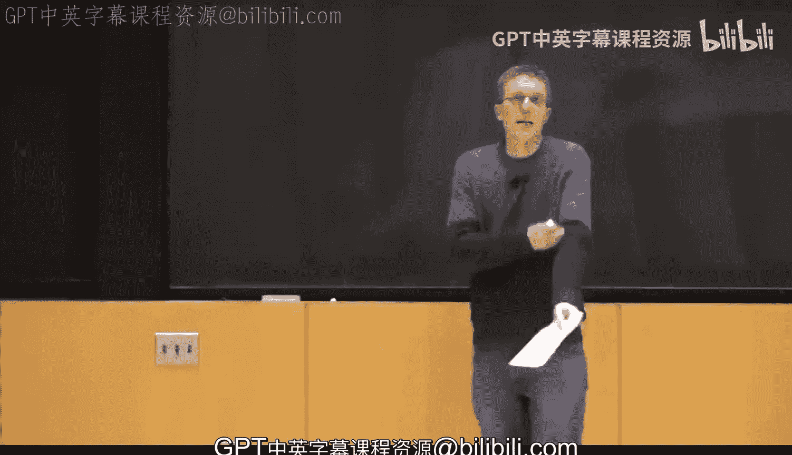

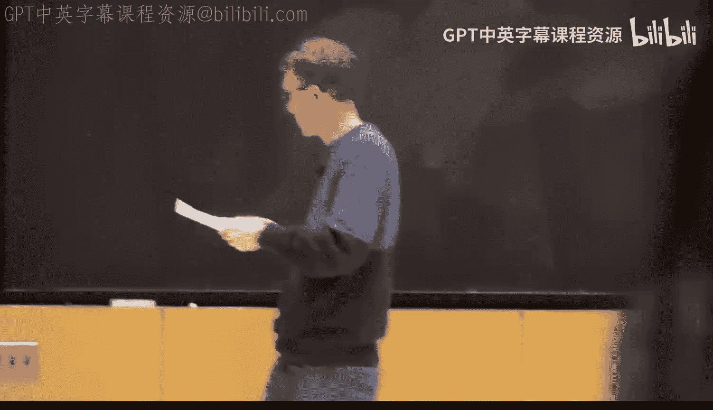

在本节课中，我们将学习感知机算法的收敛性证明。感知机是一个简单而强大的线性分类器，但它的有效性依赖于一个关键假设：数据必须是线性可分的。我们将一步步证明，如果存在一个能将数据完美分开的超平面，那么感知机算法一定能在有限步内找到这样一个超平面。

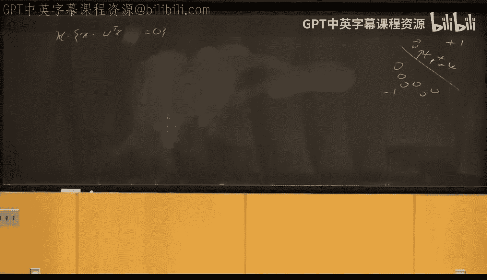

---

上一节我们介绍了感知机算法的基本流程。本节中，我们来看看如何从数学上证明它的收敛性。

## 问题设定与假设

感知机算法假设存在一个超平面能将所有数据点正确分类。形式化地说，我们假设存在一个权重向量 **W***，使得对于数据集 **D** 中的每一个样本 **(x, y)**（其中标签 **y ∈ {+1, -1}**），都满足：

**y (W*ᵀ x) > 0**

这意味着所有正类样本都落在超平面的一侧，所有负类样本都落在另一侧。

为了简化证明，我们可以对数据和权重向量进行归一化，而不改变问题的本质。

以下是两个关键的归一化步骤：

1.  **归一化权重向量**：由于如果 **W*** 是一个解，那么任何正数乘以 **W*** 也是一个解。因此，我们可以选择那个范数为1的 **W***，即 **||W*|| = 1**。
2.  **归一化数据点**：我们可以将所有数据点 **x** 除以数据集中最大的范数，从而保证所有数据点的范数不超过1，即 **||x|| ≤ 1**。

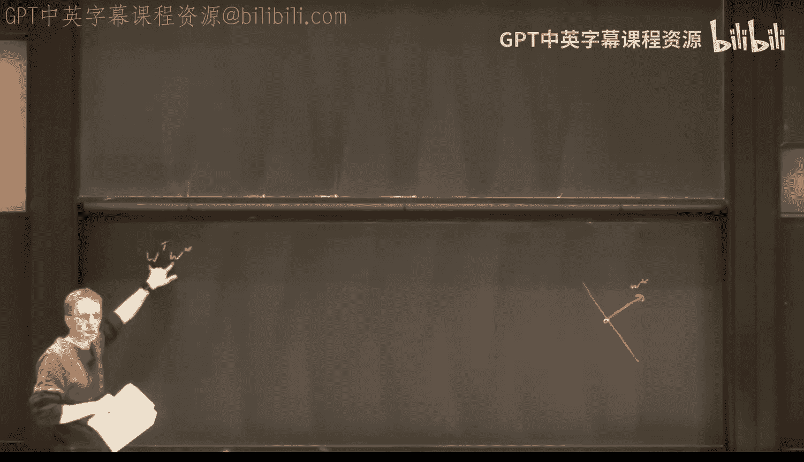

经过这些处理，我们的数据点都落在一个单位球内，而我们要寻找的解向量 **W*** 位于单位球面上。

## 证明的核心思路

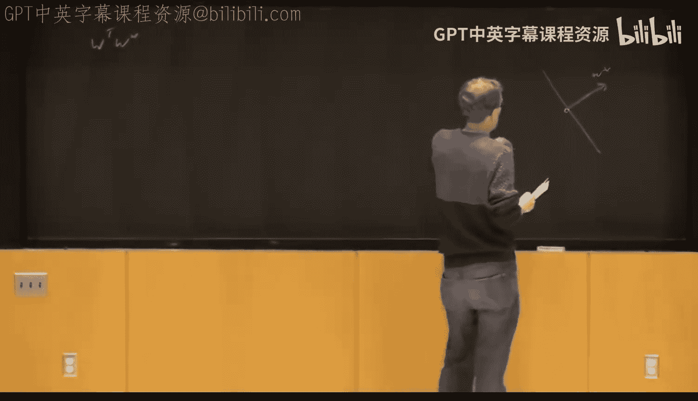

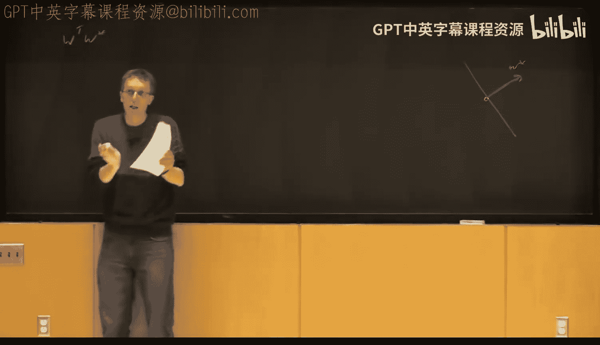

证明的核心在于追踪两个量在每次权重更新后的变化：
1.  当前权重 **W** 与理想权重 **W*** 的内积 **WᵀW***。
2.  当前权重 **W** 自身的范数平方 **WᵀW**。

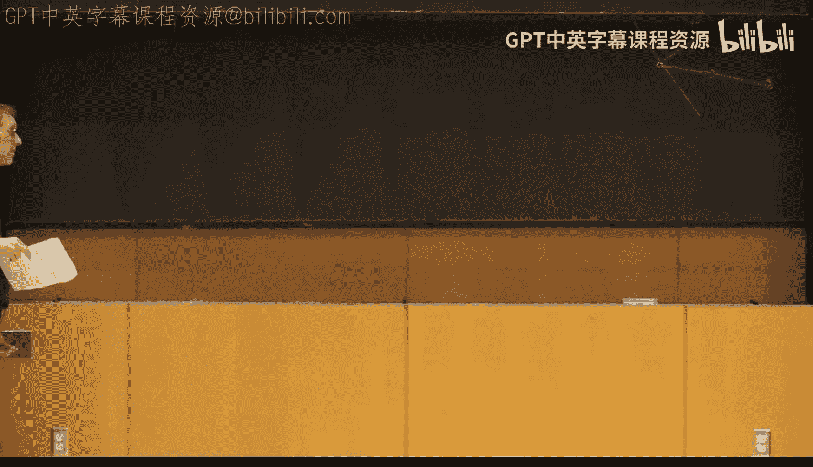

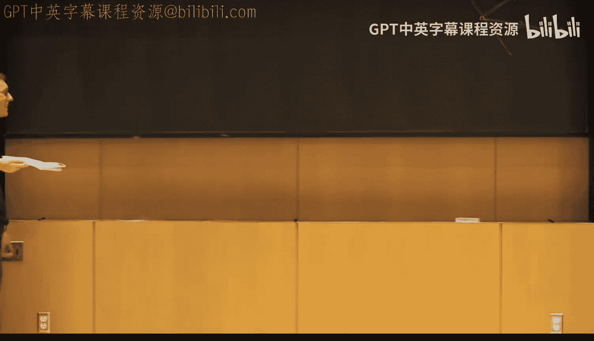

直观上，如果 **WᵀW*** 增长得很快，而 **WᵀW** 增长得很慢，那就意味着 **W** 不仅在变长，更是在方向上朝着 **W*** 靠近。我们将证明，在每次错误分类并更新后：
*   **WᵀW*** 至少增加一个固定值 **γ**（间隔）。
*   **WᵀW** 至多增加 1。

这两个不等式将共同迫使更新次数 **M** 存在一个上界。

## 证明推导

### 1. 内积 **WᵀW*** 的下界

感知机在发现一个分类错误的样本 **(x, y)** 时会进行更新，更新规则为：
**W ← W + y x**

此时，我们知道该样本被错误分类，因此有：
**y (Wᵀ x) ≤ 0**

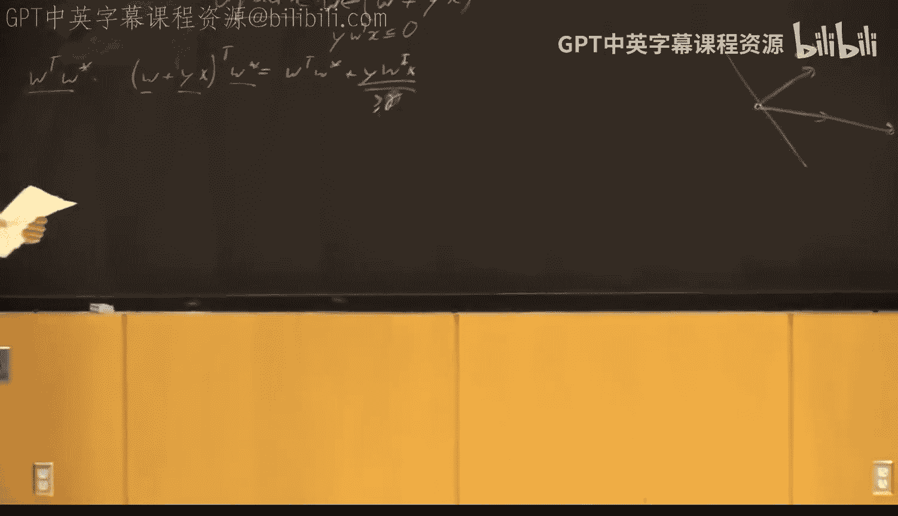

现在考虑更新后内积的变化：
**新 WᵀW* = (W + y x)ᵀ W* = WᵀW* + y (xᵀ W*)**

根据我们的假设，理想权重 **W*** 能正确分类所有样本。我们定义 **间隔 (margin) γ** 为所有样本中到超平面 **W*** 的最小“距离”：
**γ = min_(x,y)∈D y (xᵀ W*) > 0**

因此，对于任何样本，都有 **y (xᵀ W*) ≥ γ**。将其代入上式，我们得到：
**新 WᵀW* ≥ WᵀW* + γ**

**结论**：每次更新，**W** 与 **W*** 的内积至少增加 **γ**。

### 2. 范数平方 **WᵀW** 的上界

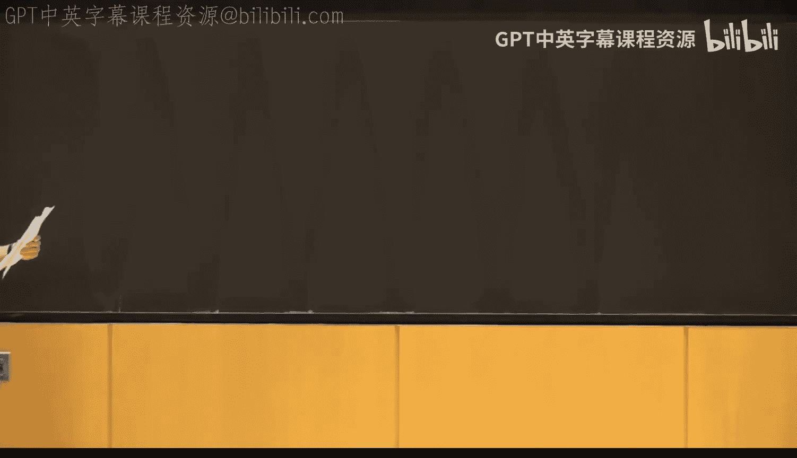

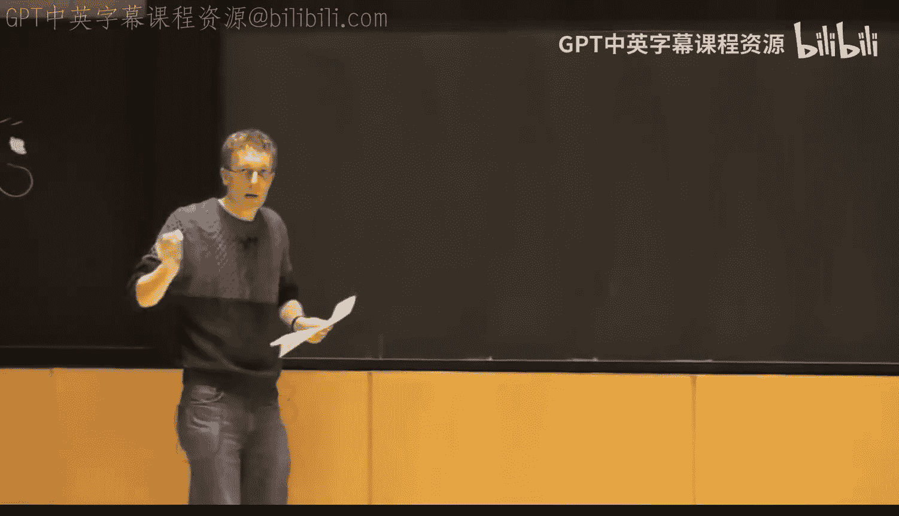

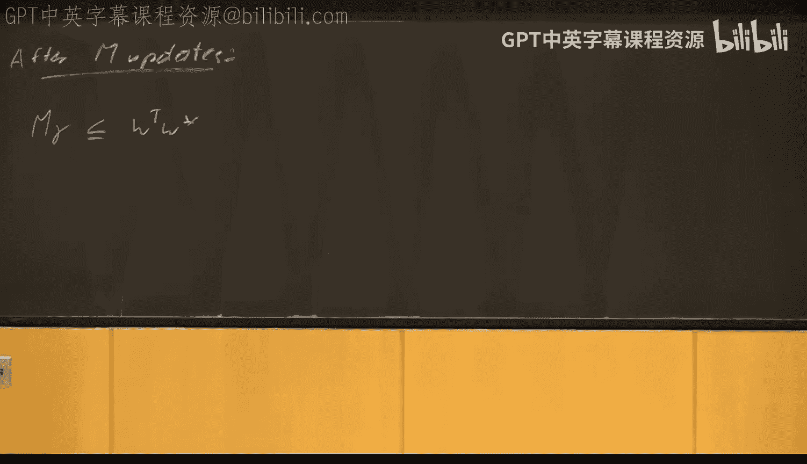

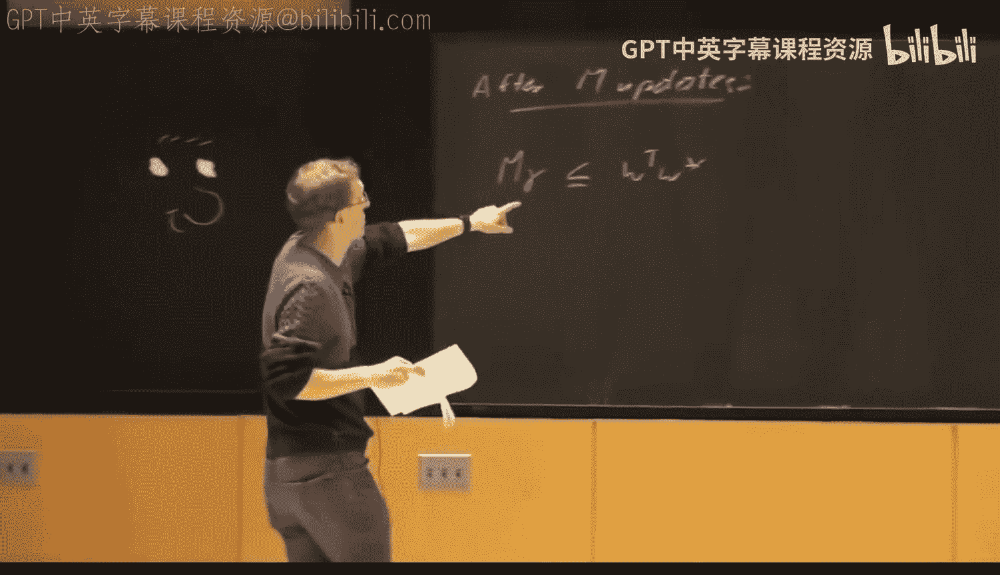

现在考虑权重向量自身长度的变化：
**新 WᵀW = (W + y x)ᵀ (W + y x) = WᵀW + 2y (Wᵀ x) + y² (xᵀ x)**

我们来分析每一项：
*   **WᵀW**：更新前的范数平方。
*   **2y (Wᵀ x)**：由于这是导致更新的错误样本，所以 **y (Wᵀ x) ≤ 0**，因此这一项 **≤ 0**。
*   **y² (xᵀ x)**：因为 **y ∈ {+1, -1}**，所以 **y² = 1**。又因为数据已归一化，**||x|| ≤ 1**，所以 **xᵀ x ≤ 1**。

综合以上，我们可以得到：
**新 WᵀW ≤ WᵀW + 1**

**结论**：每次更新，**W** 的范数平方至多增加 1。

### 3. 推导更新次数的上界

假设算法运行中总共进行了 **M** 次更新。

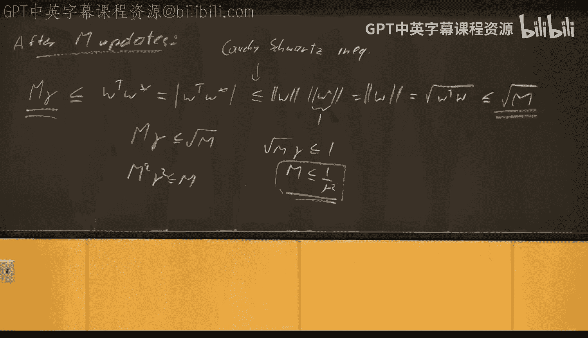

根据内积下界的结论，经过 **M** 次更新后（初始 **W=0**，所以 **WᵀW* = 0**）：
**WᵀW* ≥ Mγ**          ... (1)

根据范数上界的结论，经过 **M** 次更新后（初始 **W=0**，所以 **WᵀW = 0**）：
**WᵀW ≤ M**             ... (2)

现在，我们利用柯西-施瓦茨不等式将 (1) 和 (2) 联系起来。该不等式指出：
**|WᵀW*| ≤ ||W|| ||W*||**

因为 **WᵀW* ≥ 0**，且 **||W*|| = 1**，所以有：
**WᵀW* ≤ ||W||**

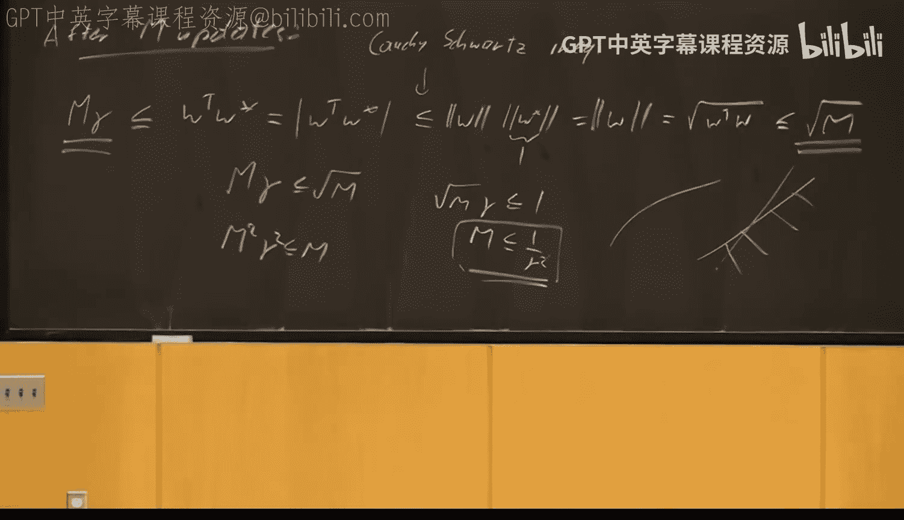

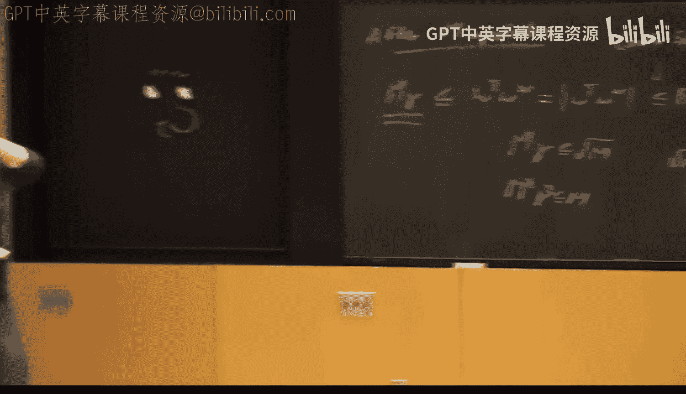

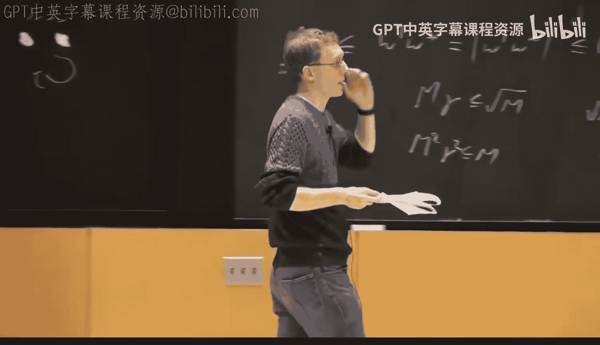

而 **||W|| = √(WᵀW)**。结合 (1) 和 (2)，我们得到：
**Mγ ≤ WᵀW* ≤ ||W|| = √(WᵀW) ≤ √M**

于是我们得到了关于 **M** 的关键不等式：
**Mγ ≤ √M**

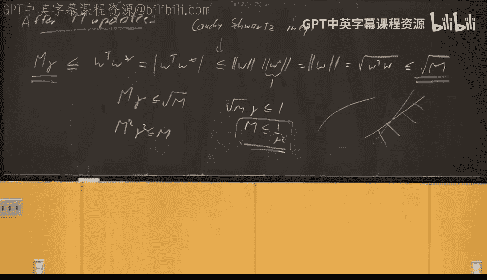

两边平方并整理：
**M²γ² ≤ M => M ≤ 1/γ²**

## 结论与意义

**最终结论**：感知机算法的权重更新次数 **M** 不会超过 **1/γ²**。其中 **γ** 是数据相对于某个（可能不是最优的）分隔超平面的最小间隔。

这意味着：
*   **有限步收敛**：只要数据是线性可分的（**γ > 0**），感知机算法必然在有限步内停止，并找到一个能正确分类所有训练样本的超平面。
*   **收敛速度**：收敛所需的步数上界与间隔 **γ** 的平方成反比。数据越容易分开（间隔越大），算法收敛得越快；数据点靠得越近（间隔越小），收敛可能需要更多步数。

本节课中我们一起学习了感知机收敛定理的完整证明。我们看到了如何通过分析权重向量与理想解的内积及其自身范数的变化，来严格地论证算法在有限步内必然收敛。这个简洁而优美的证明是机器学习理论中的一个经典结果。