# 007：康奈尔大学《智能系统的机器学习｜CS4780 Machine Learning for Intelligent Systems 2017》中英字幕 p07 -07-Lecture 7 ＂Estimating Probabilities from Data_ Maximum Likelihood Estimation -BV1Lo6gBxEKE_p7-

Alright， welcome to another lecture of machine learning。 Please put your laptops away。😊。

Also， right before fall break。I'm the only thing between you and fall break。 Here's our spring break。

Please， what is it There's February break， whatever you guys call。It's all the same thing。

All right。Project 1 is due today。There is， however two slip days， so。

I will not actually focus on the leaderboard yet。 I guess you have two more days to improve your position there。

One thing is we did find。 Some people were complaining that they ran out of memory on Julia that actually turned out that was we could reproduce this。

 So we now app the memory。😊，So now there should no longer be be quadruple the amount of memory you have during waitinging。

 So this should no longer be an issue。And also， there was another issue that Vcarium。

 every time they， they graded on Julia， they used a totally new fresh Julia installation。

And what happened was the moment you started， actually installed all the packages。 So for 10 minutes。

 it was just installing packages， and then it was starting to grade。

 So spend 10 minutes installing packages， and then 10 seconds grading。😊，That's now fixed。

 So we contacted Bokium。 by the way， we had the first course to use Julian Bocarrium。

 So there's a few of these little hiccups。 but that's also solved now。

Alright， any questions about the projects and logistics， yeah。So about the leaderboard。

How will。Do to see。Its Roman。Oh， you actually get points for it， right。

 So the way we set it up now is you actually do get， you know。

 it's basically accuracy times 5 is the points you're getting。So we be originally。

 what we used to have is that whenever you beat me， you get extra points。

 which is also what we want to do。 Vquaium is still working on implementing that。So right now。Yeah。

 that's， that's right。 So currently we， we can't do that yeah。なかお？Sorry never the。That's right。

There's， there's also fame and glory， if you're number one。😊，All right， so last time。

We talked about the perceptron。😡。

Just a quick reminder perception was we made the assumption that the data is linearly sparable。

And every time， basically， what we do is we go to the data set every time we make a mistake。

 we make an update。And then we showed， we made this cute little proof where we showed the following。

That。And we can't take the norm of our W。Which is， you know， I guess this is our W。

The norm of our W can be。the easiest number of updates。

Then we know that the norm of W grows larger than gamma times M。

But must be bounded above by square root of M。Okay， so that's。

 and we show this with in Ksh Schwartzs inequality。So。

That means that if the number of updates increase， the norm of W has to be within this shaded region。

So they're kind of moving around here。 But because they intersect。We， at this point。

 there's nothing to go anymore。 So this year the possible largest number of updates we could possibly make。

Before getting a contradiction。And that was basically the， the proof that we made。 right。

 So the first part of the proof was we showed that none of W is always larger than M gamma M。

 The second one was that we basically showed that it's less equal than square of M。

 So it must be inside the shaded region。And because with every update， we move further to the right。

 At some point， there's no place to go anymore so that we must have converged。

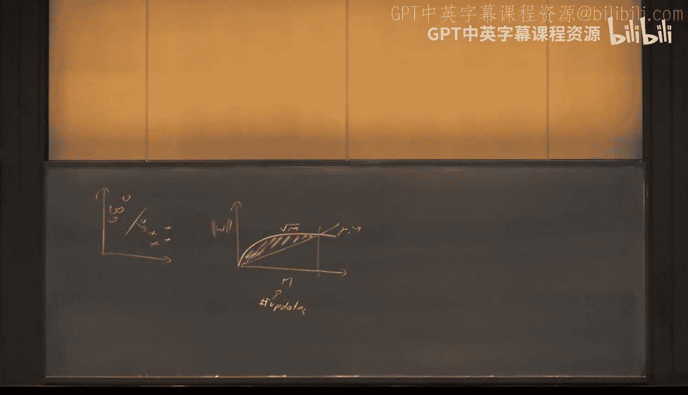

All right， That was the perceptioncept on。 Today， you will talk about something completely different。

But basically， you've done the Kenous Ne algorithm。 as was the first intuition。

How to learn here the assumption was points at a close。Have similar label。

The perception made the assumption that。

You can find a separating hyperplane。And today， we go back to the roots and say， well， what。

 you know。

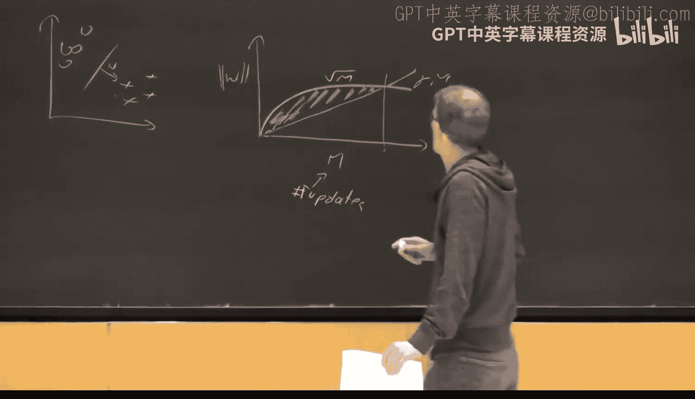

Where does our data come from， Our data comes from some distribution P。

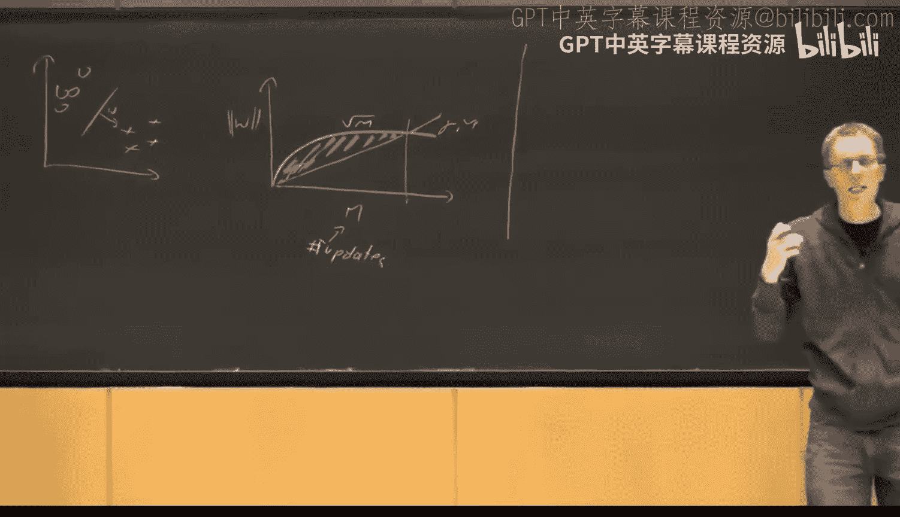

Of x come a y。Alright， so that was the very， very first lecture。 where we said。

 we draw our data from this distribution。😊，And one thing we talked about。

 this was very brief during the proof of the Canius neighbor algorithm was that， well。

 if you had that distribution， if you had access to this distribution。Then you could do really。

 really well， right？ So then you could use the base optimal classifier and。

So if you have the distribution， you could base it。 then so for P of Y given x。

And then you just thick in your x that you have for any given feature vector any test point。

 And you get the distribution of a y。 you pick the most likely y。Alright。

 so that that was what we call the base optimal classifier。Back then。

 we use it in the context that we show。 But that's as good as you can possibly do。

And the Can of neighbors is not much worse as and goes to infinity。So today。

 I want to revisit this from a different perspective and。😊，There is。 Well， if we have。

Access to the distribution， then we would have an optimal classifier。 right。

 So the moment we have the distribution， we have an optimal classifier。

So a logical thing to say as well， we don't have access to the distribution。

 but maybe we we can approximate the distribution from the data。

And if you get an empirical estimate of our distribution。

Then maybe that's still good enough to then actually use the base optimal classifier。

 So basically just say， okay， we don't have this， but we can estimate it from data。 And then we just。

 you know， go along from there。😊，嗯。In some sense。Someone could say that's actually what all of machine learning is about。

 In some sense， what we are doing is， you know， all machine learning algorithms in one way or another try to estimate the probability of y given x。

Ha a little bit of a subtlety or sorry estimate P of x comm y one by another。

 And there's two different types of family of distributions。

 One is the opt estimate P of y given x directly。😊，That's called discriminative learning。

 And one is you try to estimate P off。呃，X comma Y。Or you decomposes the P of y given x and P P of x。

And sorry， so you can either decompose it this way or you can decompose it this way。

 P you have X given y。PFI。Pants。This up is called discriminative learning。

 and this appear is called generative learning。 So these are two different approaches of to machine learning。

15 years ago， it was a big question。 Which one is the right approach。

 And people felt really strong about it。 actually， Like I remember one persons like， well。

 I would never trust someone who does discriminative learning， right nowadays。

This has kind of gone away， I would say， like。Actually。

 turns out that I think discriminative learning won。

 most like most approaches nowadays are discrimminative。So most of what we're doing in this class is。

 is the script。 So you basically just at the end， Basically。

 you learn some function given at predicts why。But it's。

 it's good to keep in mind that you could also go the other around。 You could also say。

 given a label try to predict what my feature vector would look like。😊。

And then you can basically see well which label， you know， would。Is is what give me the most。

 you know， the the feature that looks most like what I actually observed。嗯。Okay， anyway。

 so the bottom line of what I'm trying to tell you is， let's just。

Try to estimate the distribution from data。 So let's just take our data to just， one purpose。

 just estimate the distribution。 And then once we have the distribution， well。

 then prediction is trivial。嗯。Any questions at this point。嗯。嗯OK第二。

If you algorithm is now outputting a probability if things end up giving as your answer like it could be。

 Well， the moment you have a probability， you can immediately convert this to just a label。

 right you just take for each label， you have a probability。 You go to all the labels。

 and you pick the one that has largest probability， and you output that one。😊。

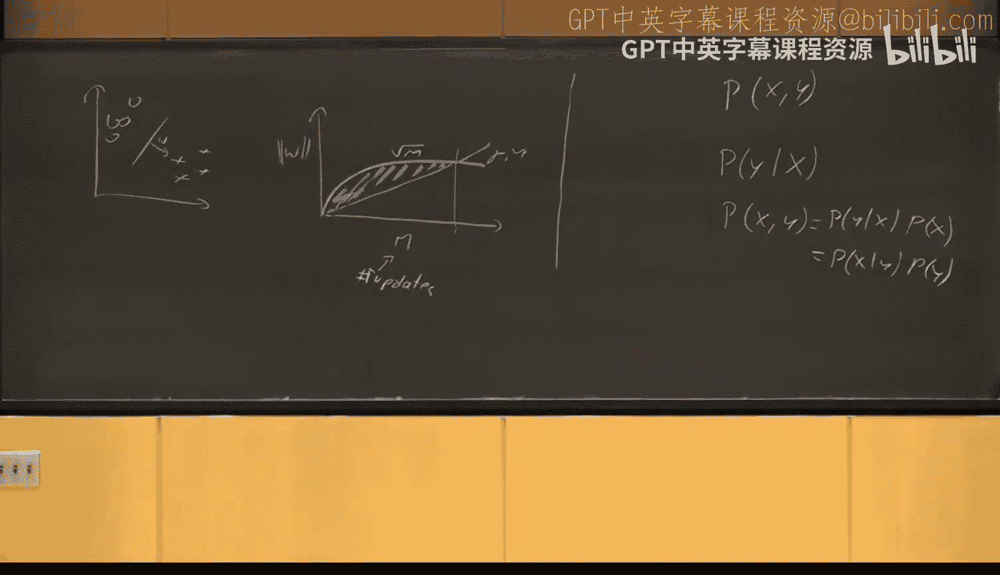

In some applications， the probability is essential。AndSo， for example。A self driving car， right。

 So if a self driving car， you have to see some object in front of you。

 you want to know is it a squirrel as a pedestrian， right， If it's a squirrel， you want to run over。

If it's a pedestrian， you do not， right， It's， it's very。

 very important to integrate this probability with everything。 all the other senses you have。

 So let's say the vision apparatus sees something， right。

 but you also have a radar that sees something。 And so on I'm how to integrate all this information。

 right If the vision apparatus says it's definitely a a person。

 the radar says is definitely a squirrel， you don't know what to do， right。

 But if they both give you probabilities， then you can actually make some， you know，😊。

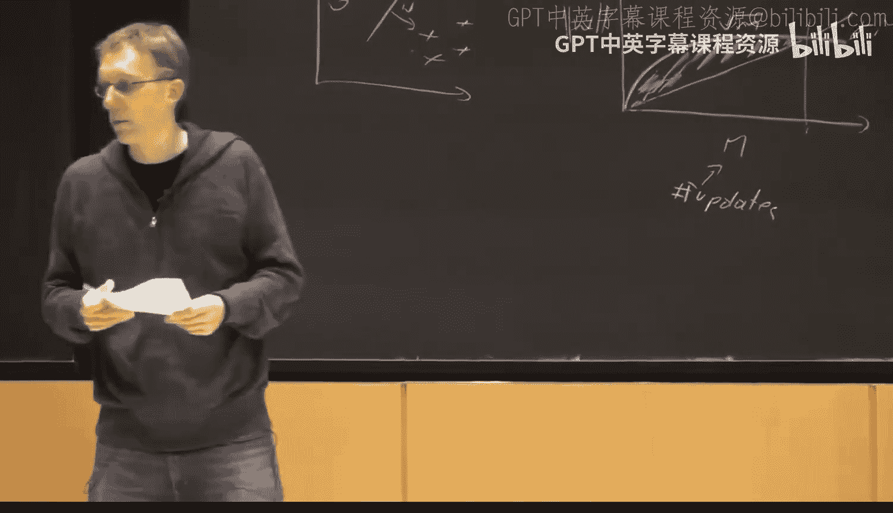

well informed decision。 You also have to take into account how bad would it be if I run over a squirrel or how bad would it be if I run over pedestrian。

 right， So you probably rather break， actually， in this case， but。

All right， any more questions？Another one， actually， just just because you guys know Siri and so on。

 one setting where probabilitybil is very important is actually speech recognition， right。

 where you basically， you have two machine learning algorithms。 So one basically says。嗯。Just。

 you know， X is what I hear is the sound I hear。 And y is the phoneme。That， you know。

 is currently being set。 So it's like， you know， basically。Like a letter， you know。The other one is。

You know， take into account what I said previously。And predicts， you know， what word is likely。

 given what I just said， right。 So if I say， you know， I like ice cream， right， it's very。

 ice cream could also be ice cream as in screaming， right。

 but it's very unlikely that I say I like ice cream。 That doesn't really make any sense。

 in that context， it would probably be ice cream， right。

 So you want to integrate these two basically， you know。

 one thing is basically saying what is how likely is it that I say a word given the past that I've said。

 The other one is。😊，How likely is a word given what I just heard。

 And you integrate these two together。

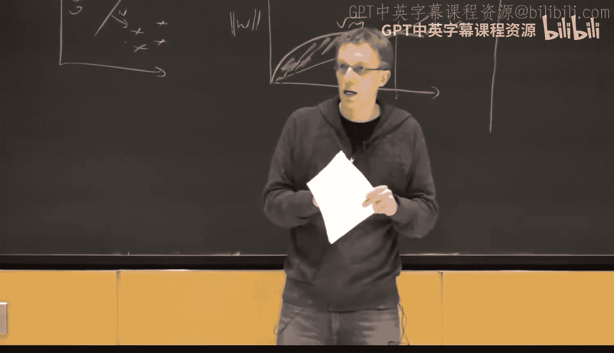

Alright， anyway， that's its psycho order。 It's just a little thing you should know。 Allright。

 Any more questions。Okay， so what I want to talk about today is how to actually estimate probabilities from data。

 And some of you may be well familiar with this。 Who's heard of maximum likelihood estimation。

W sort of maximum a post， a post theriary。Estation。Okay， it's very few。 Okay， right。

Yeah。Alright， so here's， let me just come back， start with the simplest possible distribution。

 And we will later on connect this to the setting we have。

 The simplest possible combination is just we just have P of X。😊。

We don't know what P is。

But we observed some access。Alright， so there's no why right now。

 It's just a one dimensional problem。

And。So assume， you know， here's a setting。 Oh， by the way。

 I realized after I print print that I accidentally didn't print the right notes。

 I printed the draft。So there's typos in there。 So one sneaknicker is for the person who finds the most typos。

I already found five or something。 just now looking at。So。😊，Okay， so here's here's heading。

 So imagine you kind of go through your granddads， you know， whatever attic， right。

 and you find an old。

You know， very valuable coin from ancient Rome。

And because you're curious， you want to know if I flip this， right。

 What's the probability that I get heads or tails。

Alright， so that's basically the distribution。 The distribution is the probability of getting heads。

If I toss a coin。

I don't know the distribution， but I can't sample data from it。 right。

 I can basically flip the coin and record how many times I get heads and how many times I get tails。

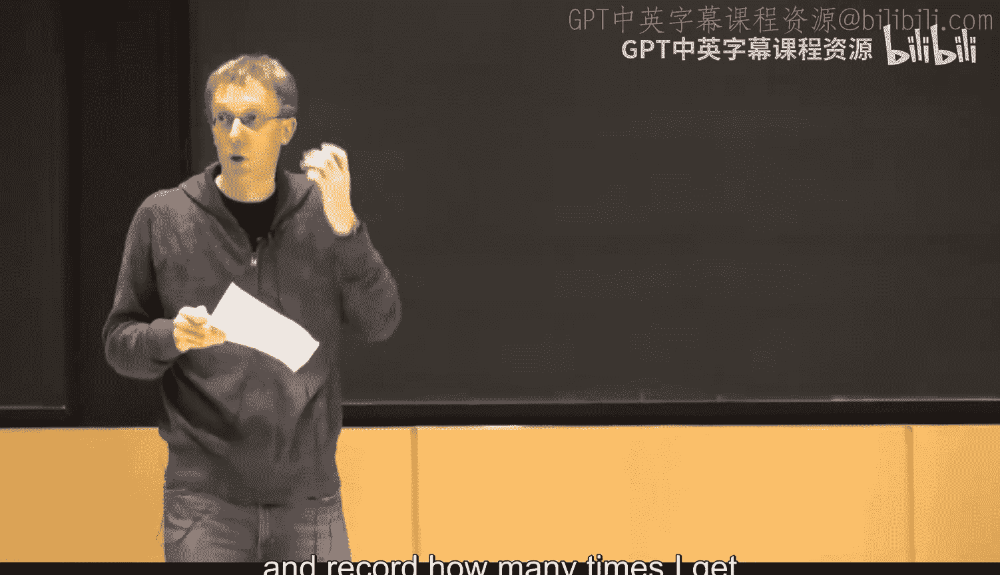

So let's say you do this。 And you know， I observe the following thing is like， you know， say heads。

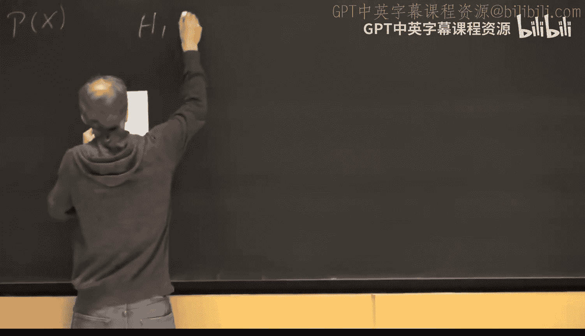

Ts， tails。Heads， heads， tails， tails， tails。2，4，6。That's one more head somewhere。

Whatever another heads。 Okay， so I four time heads and six times tails。All。The question is。

 what do you think is the probability that I get heads or tails。Any estimates。对。嗯。YeahYeah。

 based on these these four out of 10。😊，EThrows being heads。 You could say it's a 。4。

Probity that I get heads， right， And so how do I estimate this well。What he did was the following。

 he said， well， the number of times I got heads divided by the total number。

Which is basically what we call N。 right， So that's that's my approximation of。But。You know。

 maybe a reasonable thing， but it may also be that you just unlucky， right， Like who knows， you know。

 could also be 50，50， right， we don't know。 But， but let's just stick with this。 So the question is。

 this， this seems to make a lot of sense intuitively。Can we somehow derive this formula， So that。

 you know。That certainly seems reasonable， but there some principled way of of deriving this and。

While this is where M L E comes in。 a maximum likelihood estimation。And。At ME。

 you basically say the following you say， okay， I have a distribution。

And this distribution has some parameters。And。And I apologize。 It should be a semi column。

Not a condition on。That's， actually。A terrible mistake。Okay， so you have some parameters。😊。

And Ill fix it when I put it on the Web。And you have some data。And what I。

 I don't know what these parameters are。 So these parameters in this case are。

 what's the probability of observing heads。 The data is， in this case， the data that I collected。

 You could call this here， X 1。😊，AndThis here my X， N。And the question is。

For every single theta that I plug in here， I would get a different probability that I observe the data that I actually observe。

😊，And the principle behind the maximum likelihood estimation is that I say， well。

 given that I observed this data。Which which parameters would make it most likely that I observe what I observe。

Al right， that's the idea。And so in other words， what we are saying is we say theta equals arg max。😊。

P of D。Theta， That's a basic essay。 I want to find my data and my theta such that the probability。

 if this really is the case that if I were die， then actually draw data from my this distribution。😊。

The probability that I observe exactly what I observe is maximize。

And it seems like a reasonable thing to do， yeah。Perfect， find the Jackson。No， no， no， Now。

 Max finds the actual value。 The max will give you the probability。

That is maximized on the most like of theta。 And R max， actually。

 which theta gives you the highest probability。😊，Good。You guys keep me on my toes， good。

Any more questions。Allright， so we can now do this。You can say， all right。

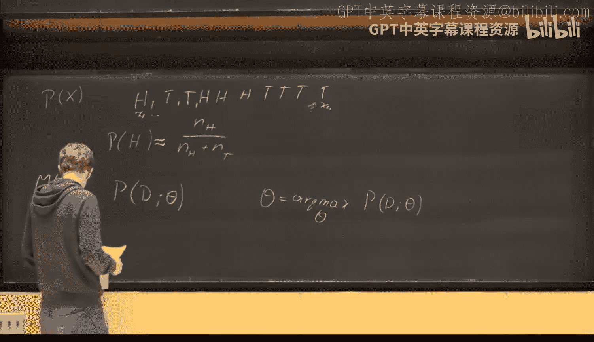

嗯。What is the distribution that we have， Well， we actually either have we have。

And independent events。 And they can either be heads or tails。 So we have a binary problem here。

 we have two different values for our features。Well， that's a binomial distribution， right。

 So you can basically say， well， what's the polynomial distribution is the following P of。

D semicoant theta is the following， its。Nh plus N T choose Nh。Times theta to the power of NH。

Becauseuse1 minus theta of n。Any questions。Raise your hand， if that's clear。All right， awesome。

Raise your hand if you fall asleep。Some people are lying。 I see people sleep。All right， good so。哎。

You want to find the theta that that maximize the distribution。Well。

 one thing we can do is we can now say， well， actually， you know。

 maximizing this is the same thing as maximizing log of this。 Why， Well， because log is a。😊。

A function that' actually。Increasing。嗯。So。Whatever maximizes the log also maximizes the inside the log。

It' a monotonically increasing function。And。So we want to find this。Oh of。

And so why do we take the log Well A， there's two reasons A math becomes easier。 And B。

 as a computer scientist， you always take the logs anyway。

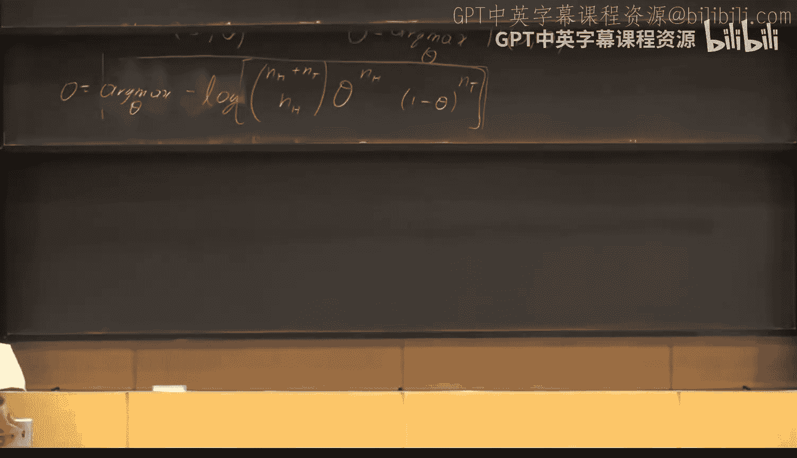

And the reason we take the logs is because if you multiply many numbers。

 computers cannot represent small numbers。 right like very small probabilities。

Are very hard to represent a floatingy point numbers。 So what you do is you always take the log。

 instead of multiplying small numbers， you take the log and you add them up。

 and computers are very precise with precision。😊，That's like the one on one of an America stability。

Okay， so we always take a log just because A are computer scientists and B we also want to make the math easy。

 So if you do this， then we get。😊，The log of this。This thing up here， N， H plus N T。Choose N H。

 That's just the constant doesn't make any difference。 And then you get N H times log of theta。Plus。

 N T times log of one'。嗯。Okay， so far， so good。Any questions？Raise hand if you're with me。Alright。

 awesome。 Okay， good。呃。All right。I making now。Let me just make sure I follow the steps that I have in my。

嗯。Okay， good。I see。 Okay， good。 So we can now set this。We don't want to solve this。

 So we want to say， we actually find the maximum。How do we do this。

So you remember from from high school， how you maximize a function。

Take the derivative and that it is 0。 right， So what we get here is N H over theta。😊，minus。

Because we have this guy here and T over1 minus theta。And if we create that with 0， we get this。

So take the derivative。And if you solve this， you get theta equals N， H。Over N H plus N。Okay。

 any questions？It's gonna be a quiz in a minute。 So this is your chance to give anything up。Yeah。😊，て。

So。It could be a minimum， but。You can check， and it turns out to be a max。Yeah。

 that's a good question， though， you're right。Okay， any other questions？All right。So this。

 this is actually mostly review。 Most of you have probably seen this before， so。嗯。

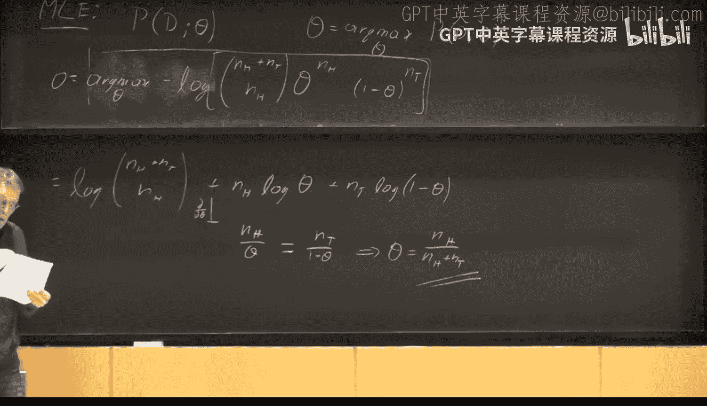

Okay， I claim you can actually use this。2。嗯。Let me just see you I have time for the quiz。

Let let me first to the patient approach。 Okay， who's heard of patient statistics versus frequent statistics。

Raise your hands。ian Bayesian statistics versus secretative statistics。

Rraisezy hand if you've heard about it。Okay， good， raiseise your hand。 if you think you understand。

What the war is about。😡，Very scared man。 Anybody read the XKCD comic on it。😊，Yes。

 there's the next case of youcom on it， yes。As。All right， so。I， I will explain it in a minute。

 So the。So this is good， right， Next to black Live estimations is a reasonable thing to do。

 Can anyone tell me when this may fall down， Like when may this break apart。

 This seems like a reasonable thing to do， right。😊。

Can anyone tell me when could this be unreasonable， When could we run into a serious problem， yeah。

Let's say we only， that's right。 So that's say we toss the coin， right， We toss it 10 times。

 We only have heads， right， Well， or we only have tails， right， That's right。 So in this case。

 we only have tails。 Well， and we have zero probability of。😊，You know， actually， you know。

And being had。 So that seems pretty unreasonable， right。And why did that happen？

RightSo maybe put too much trust in the data。 but we have very， very little data。

 So if you have very， very little data， then you may get some totally extreme solutions。

 but you basically know are' not true， right， You know， it's not。

 there's not a zero probability that you get heads， But you could easily get it， right。

 or think of the extreme case。 You say， oh， my sample size is one， right， You flip it once。

 You say heads。 Oh， it's always heads， right。😊，So clearly， it does not work for small numbers of M。

And。So。One trick around this is to say， all right， here's what we do。We basically， we assume。That's。

Before we started， we've already seen。M tosses of heads and M tosses of tails。So， for example。

 you say， oh， I believe my initial probability is 50，50。Then I just say， okay， well。

 I just add M choices of heads to it and。And choices of of， well， let me do this。 M M had M had plus。

AndT。So what my M here is actually hallucinated tosses that I never ever made。Okay。嗯。And the idea is。

 well， I can basically say， well， I assume that I initially have a bunch of of tosses that are heads。

 like have five toss that heads，5 tosses that are tails， right， So then this is。

 this is originally close to 。5， right So now if I have to I just toss it a single time。

 and turns out heads， Well， then I actually have 5 over 11， right， which seems pretty。

 pretty close to 。5 still。😊，O， does that make sense， So I'm basically un cheating。 right。

 I basically say， well， I don't trust when I have very， very little data。I don't trust this estimate。

And I， I'd rather trust my prior beliefs， what I actually think。You know。It is， right。

 And so basically what I'm doing is I'm hallucinating a few samples from my prior beliefs where I say。

 well， my prior belief is 5050s。 So I have equal probability of getting heads and tails。

 So I just make up a few more coin tosses from that distribution。😊，And then I start。

 then I start starting an estimate。And the nice thing is now， actually， these problems go away。 Okay。

 this is called smoothing。😊，It is something that frequents have used for a long time。

Any questions about this？The most common one is but you just plus one smoothing。

 So this really just gets rid of the of the problem that you have zeros， right。

 because the problem with zeros is that you， you know， if you multi the probability of 0。

 everything blows out， right， So you always does do this。 That's plus one smooth。😊，So。It flips。你我看下没。

So that really depends on you。And the more you do， the more you're biasing it towards your your priorities beliefs。

It's a good question。 Yeah， typicallyy in most applications， and actually， in the homework。

 which will come out very soon。 is project number 3。You actually， you know。

 typically you should do plus one smooth。Any more questions。

This makes a lot of sense and was something that Laplace himself actually invented hundreds of years ago。

But turns out there's a very nice way of deiving it， yeah。I I can't understand you， sorry。は。

The acoustic of this room is really bad。 So you can give me， but I can can never hear you。Quire。

So you're already Bayes， you have five minutes ahead， I will get to this in five minutes。😡，Right now。

 I'm just saying you basically just have some probability of of。You know。

 just a loose name samples of heads of tails。That ends up being actually。

 a prior distribution over the parameter。废了。70%， yeah。What if you don't know on the possible。

 what does that mean。Yeah。So I see。 Well， you usually。

 you always have to specify all possible outcomes。哎。嗯。那这是第二。But。

 but it could be that some are much less like than others。 And so you could never observe that one。

 So with the plus one smoothing， you say， well， I pretend that in my data。

 I saw everything at these once。😊，And so that's extremely helpful with， with words。

 So people use this for spam filtering。And you basically， we will do this in the next lecture。

 You basically look at how often what's the probability of seeing a certain word。

 given that an email is spam or not spam。 Well， most words。

 you will is a huge tale of words that are rarely ever used in the English language， right。

 English language has millions of words。Most people only use 10000， right。

 And so what you see is you basically just say， all these words are observed once in spam and once and not spam。

So just to avoid divisions by zero。Okay， any more questions？O。

 does everybody understand that that fix， right， That's basically a very simple fix to avoid these degenerate cases。

Okay， so that's no gay。It turns out that's actually a that's not just a fix。

 That's actually turns out that's a。That's the solution。Of that's the map solution。

 And that's the Bayesian approach of， of doing this estimate。

 So maximum maximum likelihood estimation is frequentist。😊。

Statistics and maximum a posterior approximation is Asianian statistics。

 And so frequentness and Ba statistics is basically two schools of thoughts within statistics。😊，And。

It's a little like a religion， right， like religious wars， right， So they basically。

 they agree on almost everything except a very， like there's a small change definition。But actually。

 statisticians for statisticians， that's a really， really important difference。 And， I mean。

 there are certainly many people， you know， who are patient would never talk to a frequentist right or would never trust their children to be。

 you know， in the same room as the frequent， you know， on the vice versa， right， And， in fact。

 actually， the。We had actually， here at Cornell。 We actually had a fist fight breakout in the sta department between Bas andfiquitists。

 like only a couple years ago， right， So， so it， it's still， it's still very alive， right。

 And people like just at some point， they couldn't take it anymore。

 I had to punch someone in the face， right。😊，Over the difference of the the definition of a random variable。

And， let me。Let me tell you what's behind。收。Here's what we do。So Bayesian Bay says。

 so as a frequency density basis estimate。The probability of the data。Given theta。Okay， that's。

That's all we want to maximize。 You say which data， which parameter makes our data most likely。Now。

That's all fine。 And Bayesians agree with this。 Now， here's a difference that Bayesians make。

 And now be careful。Right， it's a small but crucial difference。Patients write it this way。Al。

 just Im gonna to give a moment of silence to App the difference。

Wars have been fought over semico races。

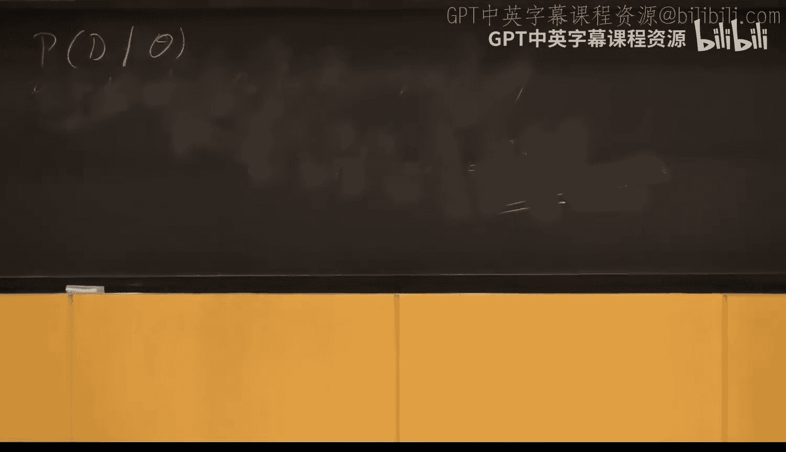

tra vertical。 now， what does this mean。This means that theta is no longer a parameter。

It's a random variable。And conditioning and basis， What's the probability of D given theta。

Theta is suddenly a random variable that I can condition on。Right， so Bayesians。

 if you do Bayesian statistics， you allow something like theta to be a random variable。😊，Frequs。

Strongly object to this。And the reason is。Theta， there's really no， no event， right。

 no probabilistic event， no sample space where theta is associated with any outcome。

So the question is like， what is the definition of a random variable。哎。And this is just a parameter。

 So frequently says there is no event that this is just not a random variable。

 This doesn't fit the description of a random variable。And basically， I was like， well。

 it doesn't matter， right？And。That that's really all there is to it。 But you know， if you， you know。

You can't fight with people with this。But has interesting implications。

 So if you're now Bayesian and you say， well， this is a random variable， Then you can actually say。

 well， that's a distribution that。Over theta。哎。Buthi to figure this makes no sense， right。

 Because why does that distribution It doesn't exist， as is the parameter。There's no event。

 but you can draw theta from。But， well， let's just go with it， so。What Bayesians basically say。

 this distribution encodes your belief over what theta should be。The mind is important。

Its important that if you， if you have very， very little data。

 One thing we just saw was just pointed out to us is that if you do a maximum likelihood estimation。

 you could end up with a very bad estimate of theta。哎。And。Because the frequent would say， well。

 you just， you know， tough luck。 you don't have much data。 So what else can you do， right。

 A Bayian would say， no， no， no， no， I have。 I have some belief of what theta should be。So basically。

 there's some probability distribution from which I draw theta。

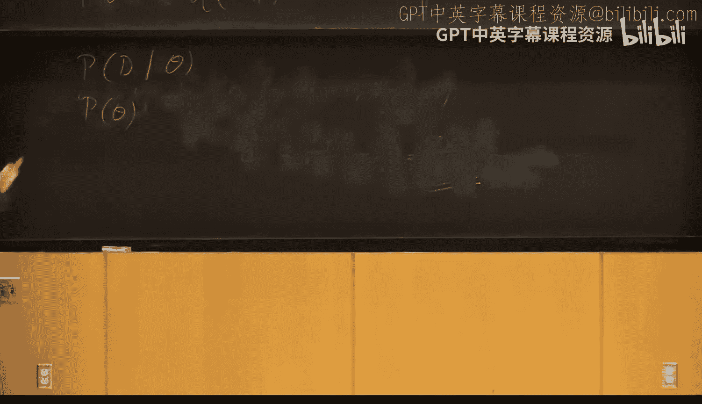

And the。Basically， the fact that I get this really。

 really extreme theaterta is extremely unlikely under this distribution。So I have to discount it。

Right even if my data says the probability of heads is 0， right。

 my prior belief tells me that that's really unlikely the event。😊，so I just don't believe it。

And so I incorporate this into my distribution。At into my estimate of data。Does that make sense？So。

The nice thing about Bayesian statistics is it allows you to incorporate prior beliefs。

 right you basically your gut feeling， right or something you experience。😊，Into。

Into your estimation process。Now。Ultimately， frequencies do this， too， right。

 because they do this plus one smooth thing。 I just removed it， right， And ultimately。

 that actually turns out to be very similar。Right， because why can you do just add one to it。

Essential， it actually turns out that's exactly the same thing。But that's basically different。

 So if people talk with you about Bayesian business frequently statistics， it， it's very。

 very subtle。 One thing that's really， really important。

 Bayesian statistics has nothing to do with Bayes rule， right， That's just the guy was， you know。

 had a long life and， you know， remembered many things。😊。

The Bayes rule is named after him and also Bayesian statistics。

 But Frists totally believe in Bayes rule。 I once actually heard someone give a talk。 And he said。

 like， oh， yeah。 But， you know， the advantage of Bayesians is that we can use Bayes rule。 No， no， no。

 no， Everybody can use Bayes rule。 It's， it's a true rule。Fundamentally accepted。嗯。

Any more questions。All right， so。嗯。收诶诶。One second me just。Okay， so if you have P ofD give the theta。

 that's the likelihood of the data。😡，That's what we mini maximize with N LE。This here is my prior。

Over my parameters。 So that's where the Bayesian comes in。 we say， now theta is right variableable。

 And if you can do this， then we can also flip it around。 you can say。

 what's the probability of data given the data， And that's the posterior。😊。

And that is what we estimate with map。 So we basically say。Given that we have data。

 what is the most likely parameter。Alright， so it's， it's just we flipping things around earlier。

 we said which parameter makes our data most likely。Another way of doing it is to say。

 given that we have the data， which parameter most likely。哎。It's not the same thing。嗯。It's related。

 It's not something。Any questions？So this is M LE maximizes this。 A map maximizes this。

And these are related。😊，And。I mean， they are basically related to base。 Right So you P of data。

Given D equals P of D given theta times。P datata。For probability of the data。Okay。

 so that posterior is the likelihoodli times the prior over normalmalize。Okay， this is base rule。

 but everybody is allowed to use base rule。😊，Any more questions？Okay， good。So the question is。

 what should we use for this distribution， Right， So this was pretty clear。

 This was a binomial distribution， right， because we have an independent tosses。

 They can either be heads or tails。 That's exactly head on， you know， this is like there's no。

 no doubt about this a binomial distribution。 What about this one， right？

 What's our belief over theta， What could theta be And so well， if you actually had had a coin。

 right？ Well， what would you believe that the probability of heads to be， right。

 You probably think it's around 5050。 Maybe it's 55，45， because it's an old coin。

 It could be a little bias in one direction。 It's very unlikely to be you know，09 that it's heads。

 right， And this you know，😊，You some bizarre coin or something。 So you basically say， well， you know。

 my theta here， maybe you have some distribution that looks like this right or something。

It looks Gaussian， but actually Gaussian is not a good distribution because they would go into negative。

 But you don't actually think it cannot be negative。So one distribution。

 actually that people usually use， in these cases， is Duly distribution。 or specifically。

 if you have two， two events， that's actually a beta distribution。Please tell them I'm busy， thanks。

All right。Let me， let me formalize this。No， I'm never gonna take it this。

Okay， here's the。So let me just formalize this。 So the probability of theta。This see is。

 the beta distribution。嗯。It's the following， iss。Theta to the alphapha -1。Time 1 minus theta。To the。

贝ta max1。Over normalizing。啊。嗯。In general， what the jersey distribution gives you is the probability。

嗯。嗯啊。I don know I have to get let me actually not get into this， because otherwise。

You won't need it later on。So beta is just a special case of British institution。Okay。So the。

 the nice thing about the beta distribution basically is gives us a value between 0 and 1。Right。

 so so the theta will be a well defined distribution。 That's the important point。

 So the theta will be a well defined probability distribution， right。

 and depends on the parameters alpha and beta， the distribution can look like this。Between 0 and 1。

 this would， for example， mean that it's very likely to be low or large。

 or it can easily look like this。Right，But basically say it's somewhere around the center。

 And this is usually what we want in our case。 And the alpha and beta actually here correspond to how many hallucinated。

 Well， we will get to this。 How many hallucinated to causes we would。😊，呃没。But let's just。

 lets assume we take this distribution and we say， okay。周。One more time， right。

 We're trying to estimate theta from the data。 But we say， well， we。

 we have some prior belief over theta。 We say theta is drawn from a beta distribution。

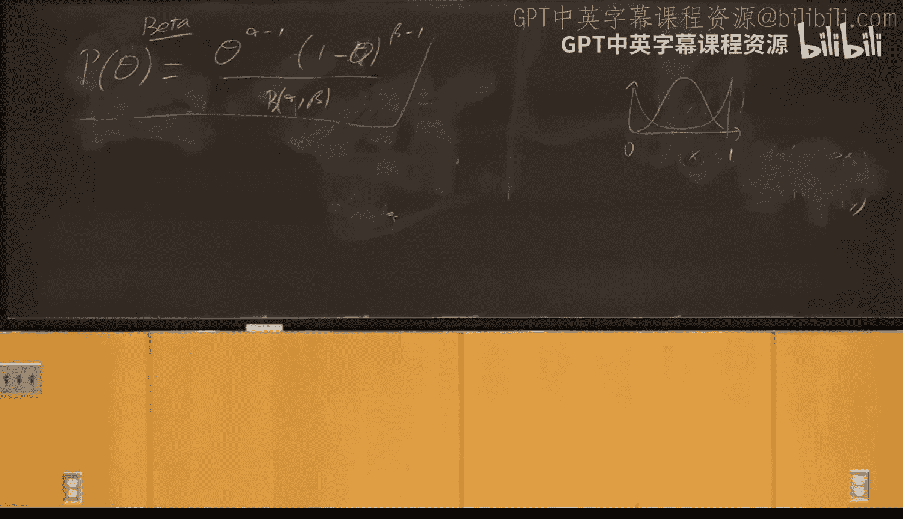

So this kind of it's going look like this year。😊，嗯。Then。Once we have this， we can immediately say。

 okay， well， now， actually， we would like to have the theta that is most likely given our data。

And that is because of face rule， right， that's actually proportional to the probability of the data given data。

Times the probability of data。So this is， if if you divide by the data， then actually， this is exact。

 This is exactly the base rule。 right So base rule relates this term with these two terms。

That doesn't make sense。 Raise your hand if that make sense。Okay， awesome， alright。Now。

 you want to maximize this thing。Wait a second。 What's going on here， right？ This year basically is。

You know， N H plus N T over choose N H theta to N H。Theta to n T times this thing here。 right。

 forget about the normalization constant。This is alpha minus1。Y minus theta to the beta -1。

They can now take these terms and put them together。And what do we get？This equals。Theta to the NH。

Plus， alphapha -1。Rmin的 state。And T plus beta1。So all I'm doing here is I'm now collecting all the terms。

 So if we have theta to the N H。Fta to the alpha minus1。 I just collect these two， add them up。

Add of the exponents。 You do the same thing。And sorry， this is a 1 minus。

And this is what I'm getting。And has anyone realize what we are doing here？

What does that correspond to？If we now solve this for theta， what do we get。

If I now solve this and maximizes for theta， what do I get。

 There's almost the same thing that we had just a few minutes ago。So all these alpha these betas。

 What do we get。That's right。 N H is replaced by N H plus alpha -1。 So what do we get。

 We get theta equals N H plus alphapha -1 over N H plus n。😊，And T of plus alpha plus beta -2。O。😊。

So what does that mean。That's exactly the same thing as， as smoothing。Right。

 so basis means we take alphapha -1， hallucinated。tosses that give us heads like alpha minus beta -1 hallucininated tosses that are tails。

😊，So it turns out， actually， frequent and patients have been doing the same thing over and over again。

 you know， for years it's just the。Like with their different approaches。

 they actually ended up at the same， same solution。Raise your hand， if that makes sense。OK。哎。So。

What I really want you to take home here is and we will use this throughout this class is that we will have proper distributions that we estimate from data。

 and we either do Emily or we will use map。 The map basically we try to maximize theta given D。

 Emily， we try to estimate maximize D given theta。😊，1 is Beijing。 the other one is is frequent is。

 It really doesn't matter for us， but it's， it's important to kind of know what people are talking about when they。

Talk about， you know。This， this disagreement within statistics about what the right approach is。

Let me end with one last thought。That the Bayesian。Approach to cult。

Make theta a random variable allows the enormous amount of flexibility。

 And that's why Bayesians views so strong about it。 right， Like， you know， you， why do they care。

 right， Like， you know， ultimately， they're doing the same thing， Well， if you're Bayesian。

 you don't actually have to maximize， You don't have to There's multiple ways of find theta， right。

 What we did is what's the theta that maximizes theta given the data， right。

 So given the data that we observe， what's the most likely theta。

 But that's just one way of doing it， right， here's another way of doing it。

 that actually is' kind of the true Bayesian approach。😊，If you would basically say， well， actually。

 if I really want to。Estimate a new label or something， right？ Then I would like to say。

 what's a probabilityability。That's something is heads。Given the data， right。

I don't care about the model。So what I then say is I say， well， actually， that depends on my model。

 So for every possible theta。I can say， what's the probability enough that I get heads。

And theta given give the data。And let let me， let me go through this in a few seconds。

 I can say that's probability of heads。Given theta come D， times probability of theta。Givenive地。

So this here is the important equation。So if you're truly Bayesian。

That actually allows you the fact that theta isn' that your model parameters are now a random bearable allows you to integrate out your model。

 right， And that is why people are so obsessed about it， right。😊。

This got be the most beautiful thing you've seen all day。😊，what you're saying is my prediction。

 right， no longer depends on any model。 What I'm saying is I take all possible models in the universe。

And I say， if I had that model， what's the probability of this prediction。

 timess the probability of actually seeing that model， given that the data that I had。I care up。

 It's so beautiful。哎。And you know what I let you go on your February vacation。

With this equation in mind。See you next week。