# 008：康奈尔大学《智能系统的机器学习｜CS4780 Machine Learning for Intelligent Systems 2017》中英字幕 p08 -08-Machine Learning Lecture 8 ＂Estimating Probabilities from Data_ Naive Bayes＂ -BV1Lo6gBxEKE_p8-

I hope you had a nice February break。Good， one person did。Please open knows your laptops。😊，嗯。Okay。

 so last time we talked about。

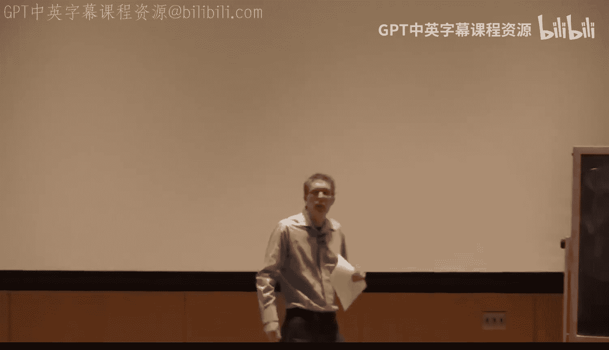

The following thing， he said， well we have in machine learning we used， we have data set D。

That is drawn from some distribution， P。X comma y， right？ We have n data points。

 this is the power of n。嗯。So there's this， this distribution that we don't know about。

 And from this distribution， we have I I D draws that are basically making our training。

 We have end end draws that are our training data。And this distribution will forever remain elusive to us。

 right， This is something we don't know。 So， for example， if you have images of， you know。

 faces or something， this would be the distribution of saying。

 if I go outside and I take a picture of someone， right， the probability of getting a certain face。

 We know with a certain label that's maybe the identity or something or student or professor or whatever。

 So that's some random distribution， But it's not a distribution that you can think of。😊，You know。

 typically。Now， one thing you could do is you could think， well if that's not too much， you know。

 too complicated distribution。 we could approximate it， right。

 we could define some distribution that we understand that has parameters theta and we say， well。

 we try to fit this distribution here to match the distribution that you know， we don't know。

 And once we have this distribution then we could you know， use the base optimal classifier。

 right So all our problems would go away。 if we had access to this distribution。

 Then we could just use the base optimal classifier and we would get perfect prediction。

 perfectness sense we couldn't do any better。 we minimum possible error。

 So what we are saying is okay， well let'ss you know we can't can't have this。

 but we could estimate P that's call this P theta。 thats some distribution that we understand and has the following parameters theta and we try to match this。

 try to find this datata， such that this distribution matches。

 this elusive distribution as much as possible。😊，And， well。

 we don't have access to this distribution， but we have access to end samples。

 This is our training data。 So the question is， can we somehow find the parameters data such that this distribution here。

 which we understand， you know， would give rise to our training data with high probability。

And so we talked about two different methods to do this。

 The first one is maximum likelihood estimation。And maximize likelihood estimation we said theta。

 we find theta such that it maximizes。😊，The probability of the data。That be observed， right。

 So you basically say。Now， I want to find the parameters data such that if I plug these into my model。

 right， the distribution is very likely to give me the data that I observed， And that's the case。

 and for all means of purposes， this these distributions are probably pretty similar， right。

 Because if I sample data from them， I get， you know， pretty much you know， very similar results。

 Okay， so that's the idea behind maximum likelihood estimation。

 So you want to maximize the likelihood that you observe the data that you did observe。😊。

second thing is maximum a posterior， like a posterior estimation。 Let we say theta。😊，Is。

We flip things around， we say， given that we observe the data， what's the most likely theta。

 So we say you want to maximize the probability of theta， given that we observe the data。Now。

The crucial difference here is that here the has a random variable。Whereas here it's not。

 Here's a parameter。 And I made this clear by actually putting it kind of as a sub indexex here。

So this here is the frequentist approach。 We say parameters the parameters。 we fit them。

 Where here we go into Bayesian territory。 We say， well， this could also be a random variable。

 It's not associated with any random event。 There's no sample space。 We could sample theta。

 but let us， you know， let's not let us stop let us stop us。

 You can still treat as a random variable。 and then we can have a distribution。 You know， over theta。

 that's the prior distributions。 We basically say in order to do this。

 we have to have some prior distribution P theta that we define。

 and then we can actually do this fitting here。😊，Then finally。

 the last thing is that's the truly patient approach that saying， well， actually， these are。

 you know， these is just napping， you know， these are estimating theta for a purpose， right， Why。

 why are we interested in estimating theta because ultimately， we would like to make predictions。

 Ultimately， once we've done this， then we actually。

 what we want to do is we stick our theta into our distribution， We say for a certain。😊。

Certain test points。You know， X， what's the probability of y。

 that's the only reason we are doing this。 So why don't we just do this all along。

 And that's the fully， you know， let we call this fully patientesian approach。 It's basically we say。

 well， if we just want to make predictions， then what you could actually do is the following。

 we could say the probability of y given X。😊，Equals the integral of all possible models。P of。

Y given theta times P of theta given the data。And so here basically。

 we get rid of the machine learning model。 And that was what I was so excited about last time when I said this is the most beautiful thing。

 In something this is the holy grail。 Right a lot of machine learning。

 people have kind of spent an entire career trying to find， know， trying to solve this equation。

 We basically say， well， actually， machine learning， right。

 traditional approach of machine learning is you have some training data， you fit a model。

 that's my theta here， These are the parameters of my model。

 And then using this model and make predictions。 And the fully evas approach what you're saying is my prediction averages out all possible model。

 And in ways every possible model， you could conceivably think of。

 But the probability of obtaining that model given that the data that youve observed。😊。

We will get to this in a little bit， like in a couple of lectures。

 But this is just the prim and sometimes keep this in mind。 right， Almost always， this is impossible。

 right， This integral is impossible to solve right for very obvious reasons， because these are very。

 very hard terms in here to estimate。 But there' is actually at least one algorithm that you can solve this in closed form。

 It's a very beautiful algorithm。 and。😊，So occasionally， it works。What， what I really want you guys。

 you know， take home from last lecture is M maximum likelihood estimation and map。 Okay。

 Well you basically say， well there's two different ways of estimating。😊。

Esimating a parameters from data。Any questions about this？It's going to be a quiz in two seconds。第二。

一分钟。可了个。The distribution you choose stays constant。 So that， that's just a distribution。

 you get out at the end。 Yeah， a distribution。 You just get a distribution out。 That's right。 right。

 You marginalize out basically theta。That's right。Any more questions。Alright。

 so what we then did is my hope was to put this。 Can I flip this around。No。上。嗯。To have space。

 I don't have space。 Okay， do you mind if I raise this。

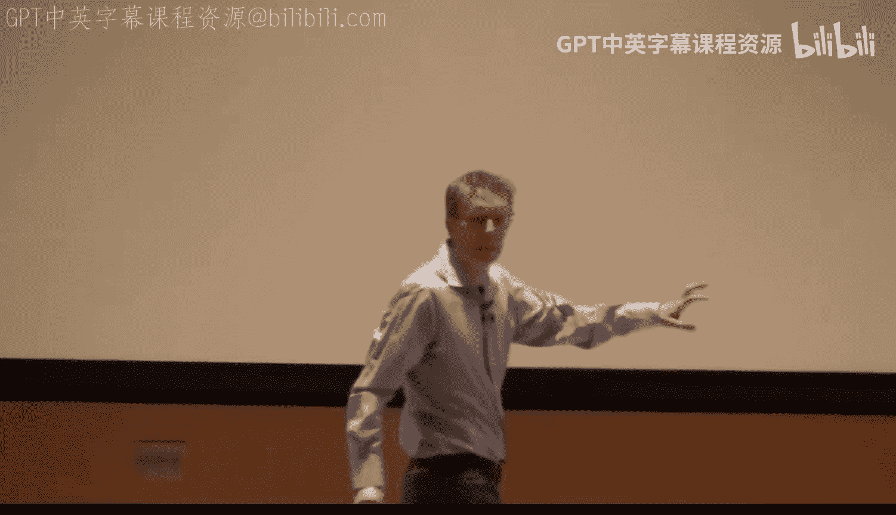

Any objections。I hope you remember this， right。Well， you know what。

 why nott I show you a demo right now？ So here we go， I have everything set up。 Why not？ Okay。

 so here's what we did。

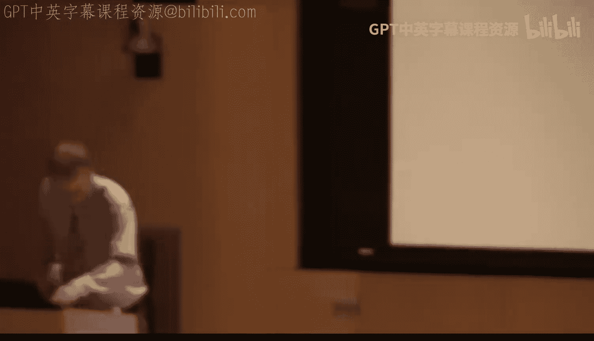

And， what's going on。Okay， perfect。 So then what we did is we look at the simplest possible case。

 right， The simplest possible case is we just have P of x。

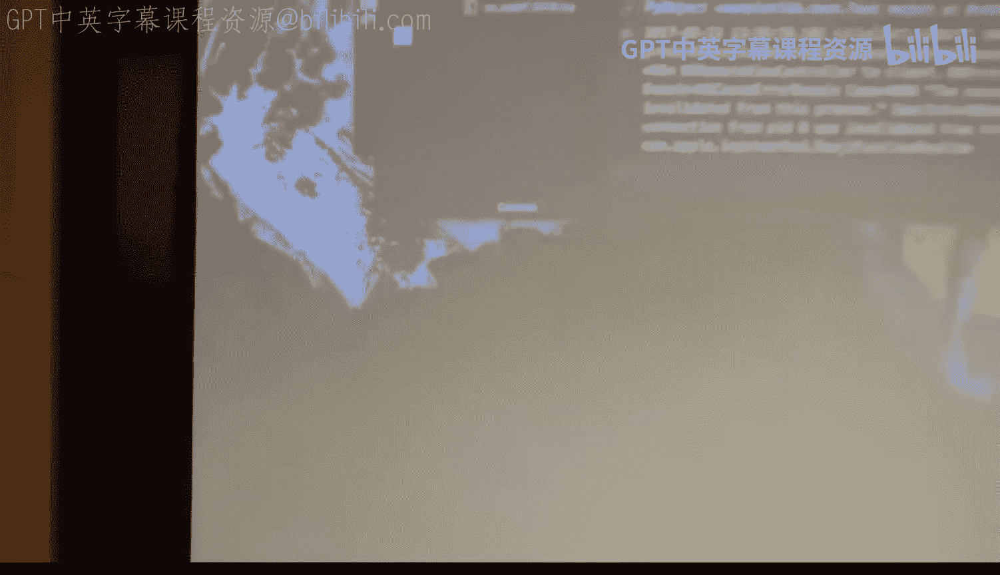

So we don't even have any y now。 And this is was just a to cost。 a coin toss。

 So you find some old ancient coin。 You don't know if it's exactly bias。

 And you want to know what's the probability that this particular coin gives you heads。

 So that's the distribution you don't know。 Now you sample some data You toss it 10 times。

 And three times you get heads and seven times you get tails。 And now you would like to know， well。

 based on that data， can I estimate what the probability of heads is。

 And so we derive this what we found out is that was a maximum unlikely estimation the answer of P of x equals heads。

 was the number of heads divided by the total number。 right， And if you do map。

 then actually what we get is P of x equals head equals the number of heads。😊。

dividediv by the total number。 let me tell you this number of heads plus the number of tails plus some terms here。

 So you actually have hallucinated heads and hallucinated tails。 sorry， hallucinated heads。😊。

So hallucinate the heads and hallucinate tails。 That was if you put a beta prior over the distribution。

 So here the distribution that we that we put over theta basically translate it into saying we hallucinate some tosses。

 So essentially what we are doing when we do map， we say。

 what we have a prior belief of a coin right So even if all our tosses our heads。

 I still don't believe that there's 100% chance of getting heads。

 right that's just my experience in life tells me this right that this may actually an unlikely event。

 right So what you do is you specify a distribution over your model beforehand。

 And you say that's what I prior to seeing any data。

 this is what I believe my distribution of a theta will look like。 And then as I get more data。

 I basically you know shape the distribution， basically update this distribution of a theta。

 So this is the distribution the given the data。 So basically in if the data is the empty set。

 you start up with some distribution that you believe our priority and。😊，So in。

 in terms of the coin to that just add that basically just means you just add a couple。

 a couple of imaginary results。 You basically say， well， I start out with saying， initially。

 I have a 5050 distributions。 I just say I have 10 heads and 10 tails。 And that's what I begin with。

 And then I， I start tossing them。 Let me I code it up a little demo。 and。😊，Let me just。On this。

 So here's what I'm doing now， as I say。I'm running。 here， it's my Julia， O。

So what you see here is maximum likelihood estimate and map。😡，And on the X axis years， how many。

Coin tosses， I observe。And what you see here is the estimate of my probability theta。

 That's the probability of getting hats。Okay， so basically after how many， after， you know。

 just this is just， you know，1，1。😊，just you know， this like a couple of coin classes， basically。

 you get very extreme values， right， But then as you this logarithmic， by the way。

 after seeing 10000 classes， it， they all kind of approach 07， which is the true distribution。 right。

 So I， I rig the system saying this coin in reality has a 70%% chance of resulting in heads and a 30% chance of resulting in in tails。

😊，So after I toss it 10000 times， you know， my estimate is basically right around very much around 。

7。 So after 10000， you know， coin tosses， I'm pretty sure it's， you know， it's a 70，30 ratio。

 And the same thing with map。 in this case， Basically。

 what I did is I said I not my map parameters was 0 and 0。

 So I actually map was basically the same thing as Emily， right。

 So I said I'm not hallucinating any coin tosses in either direction。😊。

What you see here on the left is my prior belief。 So when I'm saying I'm not hallucinating anything。

 What does that mean， that means I have absolute uninformed prior。

 That basically means a probability is just， it's just a constant， you know here。

 So it's basically just saying， I don't know what there's1。0。 But basically is a look at the shape。

 So the shape basically says any this here is basically the probability of。😊。

So the particular value of theta。 And this is basically how likely I believe it is。 And up front。

 I'm saying。Everything is equally likely。 I have no prior belief。I can now run this again and say。

 okay， but I'm hallucinating one heads and one tails to begin with。I'm running this again。

 And this is what I get。 So what you see here on the left。 This is my belief now， right。

 This is now ching into beta distribution with parameter  alpha 2 and beta 2。

 That means I really believe it's a 50，50 chance， right。😊，That basically means that you know。

 I'm hallucinating an equal number of heads as tails。

And what you can see here is Emily is unchanged because it doesn't affect anything。

 But map here in this case， basically because I hallucinated one coin to as heads and1 coin as his tails。

 I start out with 05。 And basically， you know， here we have much fewer extreme values。

 Any questions about this， this demo。 Any questions about what， what I'm showing here。

 The different graphs， yeah。😊，や。For the left row， this is actually the P DF。

 So this is the probability density function。Yeah。Yeah。And sorry you all the time。

No smoothing for ML， which is that would be exactly map， right， So smoothing for ML E is map yeah。

Any good， any questions there。画だ。Then actually， the the prior is uniform， right。

 So look at this prior here right now。 I'm saying the prior is basically。

 I have a strong belief it's， it's 50，50， right， There' are some chance， you know。

 it spes into either direction。 It's very unlikely that it's a one or 0， right。

 And the reason is that is because I hallucinated one heads and one tails already， right。

 So it can't be that it's all heads or all tails， right， It's not really possible， right。😊，If I。

 let me just show you this one more time。 If I make the 0，0， then basically。

 my prior belief just becomes a flat line。 right， I see everything is equally likely。 I have no。

 no idea what it could be。 Okay， does that make sense。 It's called an uninformed prior。

 I'm not biasing the system in any way。Any more questions。I can now， for example， go up and say。

 well， what if you do 10，10， right？ It's now I just hallucinate a lot more。

 And what do you see is that the prior becomes a lot sharper。😊，Right。

Because I had 1010 tossed already of heads，10 causes of of of tails。

 I a pretty strong believe it's 5050。 Now， it's much more unlikely that even in the 。9 range， right？

 And what you see here with map is that at the beginning。

 it's very much dominated by these hallucinated throws， right。

 So it believes basically it sticks to the  point5。

 until it's is more and more heads and eventually moves up to the  point7。 okay。😊。

One thing you should observe。 It's important is in the limit。 if I see it， know。

 a lot of coin tosses， it doesn't matter， right， They both always end up with the same solution。

 right， because at some point， the reality is going to dominate my， you know， my data， right。

 But if they have very little data， then actually the data is dominated by these hallucinated tosses。

And so one thing you can see now is because  point5 is actually not so good， right， at the beginning。

 it's a little bit off。 right， It could make this even more extreme if I do 1 hundred and hundred or something。

😊，哎。So now actually， you see， it's kind of like。It it's really， really confident， right， that it's0。

5， right， which is not true， right， So the distribution here is I'm。

 I'm dead iss like a the confident teenager or something， right。

 It's like it's really really confident。 now it's this one。 right you're wrong， right。

 It has to see a lot of data to actually then get convinced otherwise。😊，It right of reality。

I apologize any teenagers in the room Thank you。 And so you can see this is actually not a very good estimate。

 right， You need after 100 samples right， you're still way off， right， and actually 05， you know。

 you ways away here， right， because Emily is actually a lot better， right。

 So the important thing is that math estimate is good when you have little data。

 But if you actually have the wrong prior， right， then it's not good at all。

 right And then you basically， then it can take you longer to conge。😊，Another option is also。

 let me show you another example here， where I'm actually。😊，Running it。Sorry， where am I。

Now here we go。 I could also just do 3 and 7， right， But actually or 2 and 8。 Let's do this，2 and 8。

😊，Where I say I only hallucinate not many， but I hallucinate two heads and8 tails， right。So I。

 I'm not sure about it， but my primary belief is that actually。

 the probability of head is pretty low， right？ In this case， I'm way off。

 It's actually the other way around， right， And we can see there's a lot of data to move up here。😊。

Okay。😊，On the other hand， if Im actually right。Let's say I'm actually correct。And I do 7，3。

 for example， which is exactly correct， right？ Then actually， you see that map is really。

 really good， right， I'm starting out exactly where， where I'm supposed to end up。 And， you know。

 I just get a little bit of variance here。 And very soon， I'm Peter out。 right if I。

 I can make this even more extreme as I just 70，30。😊，70， well， let's to 700。 Come on。

 Let's go all in。 I'm really， really confident。😊，And right I'm really。

 really confident there's the solution and it ends up being the solution。 And in this case。

 of course， I'm data。😊，Right。Any more questions about this demo。Yeahや。Right。So， well， it depends。

 right。 So if you are right with your prior， if you're close， then it will converge much faster。

But if you're wrong， right， if you do the following， if you do。You know，800， 200。shoot。

 what did I do， Ju stopped。 and that's terrible。诶。那么 time。Yeah， so， so here I'm actually。wait。

 this is the one。in this case， I'm very confident that it's that it's down here， right。😊。

That it's basically a 20% chance of heads， but it's really a 70% chance of heads， right。

 And you can see it doesn't converge for a long， long， long， long time， right。

 even after 100 samples， it's still way off。 Look at this year。 This is 1000 samples， right。

 Here's where we are， right， We had 0。4。 The answer is 0。7， It's really pretty bad。

 right whereas Emily at 10 is actually pretty good， right， So you。

 the thousands is actually right around 。7， right So it really depends on on your prior。

 And you can bias as the the answer， basically。😊，So map is only good if your prior is makes sense。第二。

By the way， people， there's been these endless discussions and statistics and statistics， if people。

 you know， if you're allowed to have， you know， use Beijinges statistics are not。

 And if these pies are reasonable， right， And as part of this。

 people have actually done experiments where they want to figure out is the human brain is a frequent There is Beijing right And so people did these bizarre examples where they they went out to random people on the street and told them。

 you know， I have， I have a cake in the oven how much longer should I keep it in there。😊。

I don't it's impossible question。 You don't know what cake。 You don't know how what oven。

 You don't know how hot the oven is。 You don't know how long it has been in there， right。

 The question makes no sense。 And people say 20 minutes， right。

And so basically what they want to prove is that while we have some prior， but you't know it's not。

 you know， it's not a decade， right， So it must be， you know。

 it's probably 20 minutes songs about rice。 But you know， I don't know。 What is a banana cake。

 Well at' 20 minutes。So。And so those are kind of you know。

 psychologists have have have basically had a lot of fun like trying to find out， like， you know。😊。

Do we have Beijing or do we do frequent statistics and。It seems to be that occasionally， actually。

 we do have， we do show tenencies of Asianes statistics。 but we actually have， you know。

 we do have certain prior beliefs， you know， that we basically use that's， by the way。

 also related with our prejudices， right， and， and， and so on。

 But we basically have jump to conclusions because of our private beliefs。😊，嗯。Alright， chocolate。

 chocolate。All right。Any more questions。Okay， so let's connect this now to the。

More interesting parts of machine learning。 So last lecture， we said， okay。

 let's take the simplest case where P， we just have P of X。😊。

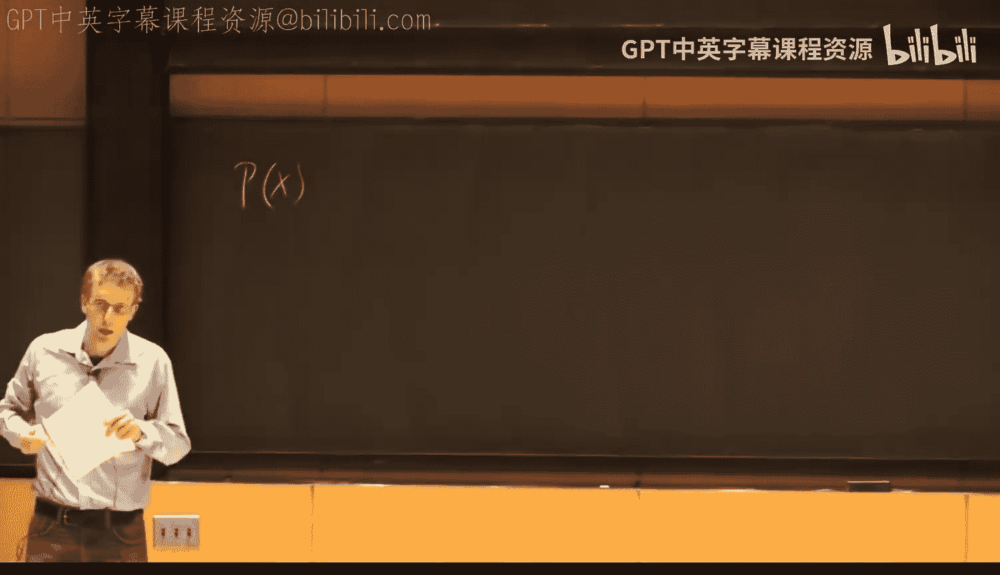

What I。Whatant you to figure out now is what if we go a little bit more interesting， right。

 So what if we actually don't have this setting， which is not very interesting。

 What if you have a following setting， If P of y comm X， right。

 And so x can take on a few discrete values and y can take on a few discrete values。

 And what I would like you to figure out now。 And together with your partner is the following is what is the probability of P of y given x That's say you have a data set now sampled from this。

😊。

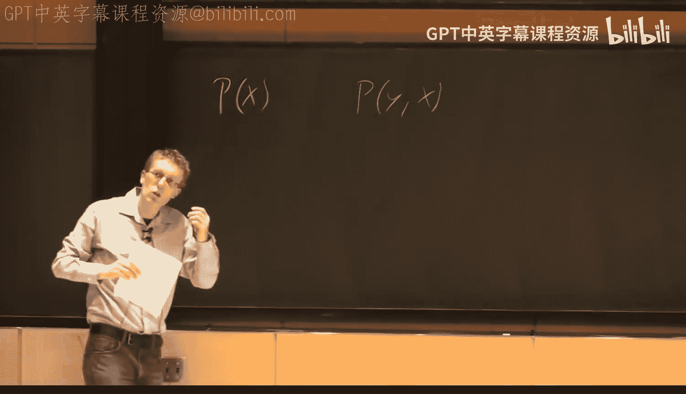

How do you would use Emily。To estimate the parameters， theta for this， this distribution。Okay。

 and just a reminder in P of X， what we did is we said the following P of x equals little x。

 We said the following。 The answer is with sum all the data set。

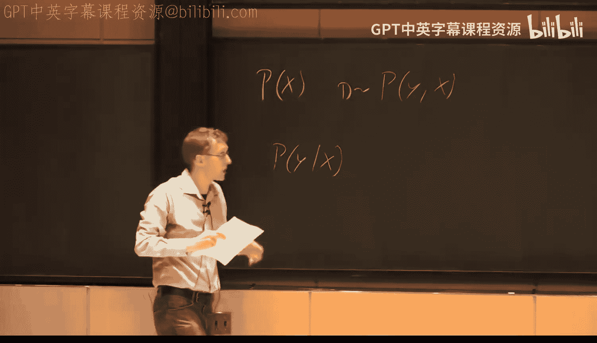

In our。You know， there is a we set， whenever it's。I equals x。Divided by n。 Okay。

 so this here is the function that I think gives one。If this is the case of 0， if not。 So this year。

 basically is the number of heads。 right， the number of heads。 If this year is heads。 Okay。

 so we said， we count how many times we find x in our data set divided by the total。

 That ratio is the probability that we actually see X。 Okay， does that make sense。

 Raise your hand Does that make sense。😊。

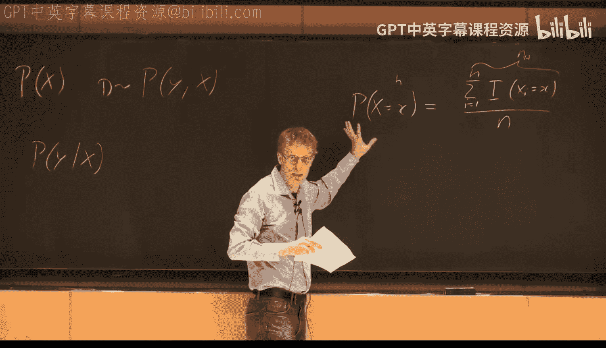

Okay， good。 What I would like you to find out is what is the probability of y given x in the setting where you now have a joint distribution of two variables。

 label Y and a single feature X。 Okay， I give you maybe3，4 minutes。

 Please discuss it with your neighbor and try to figure out what is the。😊。

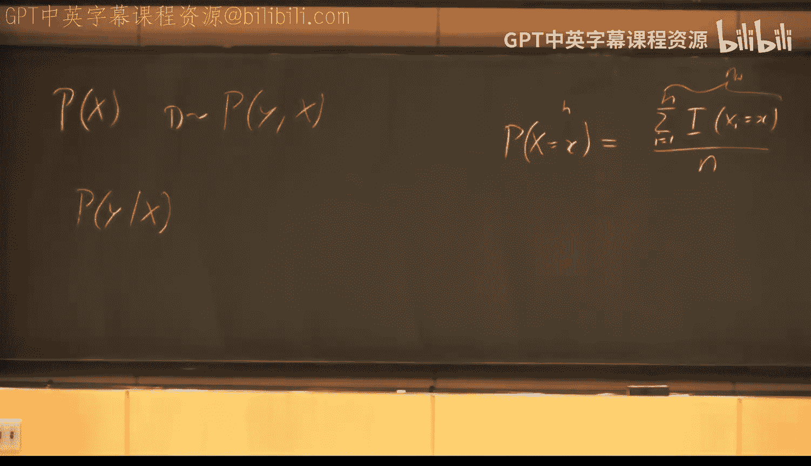

嗯。You know， what is the， the。M， L E estimate。W to volunteer the answer？Anybody。Yeah， good， you brave。

 So you look at all of the values where x。To be。 And then over that said。

 you buy the ones that I have。

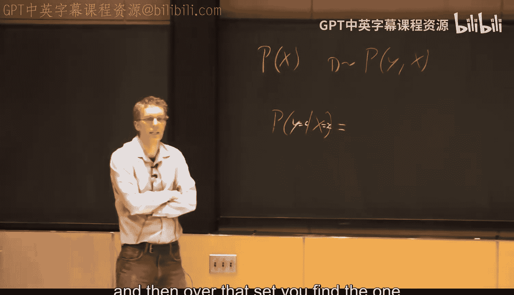

So why might you're looking for and you divide you sum up all of。在。Okay， good。Very nice。 So what。

 what he's saying is the following。We have a data。 have a data We have our data。

We want to condition why。On x equals x， right？ So in some sense， what's saying。

 is this is not very different than what we did before with the coin tossing。

 except that now we are only looking at the cases where x equals little X。

 So that's what we're conditioning on。So beforehand， basically， we had data where we said， you know。

 we have a bunch of data。 We want to know what's the fraction of of times we actually had heads。 Now。

 we do the same thing。 We said， what's the fraction that we have heads so that we have task label C。

😊，But only within the subset where x equals little x。

 Or let me put it another way so we can actually say， no， we have the following， right， This is the。

This here' is the set where。X equals x。This here is the set where y equals y。

And what we're interested in is。This here。Out of the circle where x equals x。Okay， so in some sense。

 we don't care about the case where x is not equal to x。🤧哎。I can also raise the hand。

 that makes sense。Okay， good。 Another way of looking at this is the following。 That is P of。

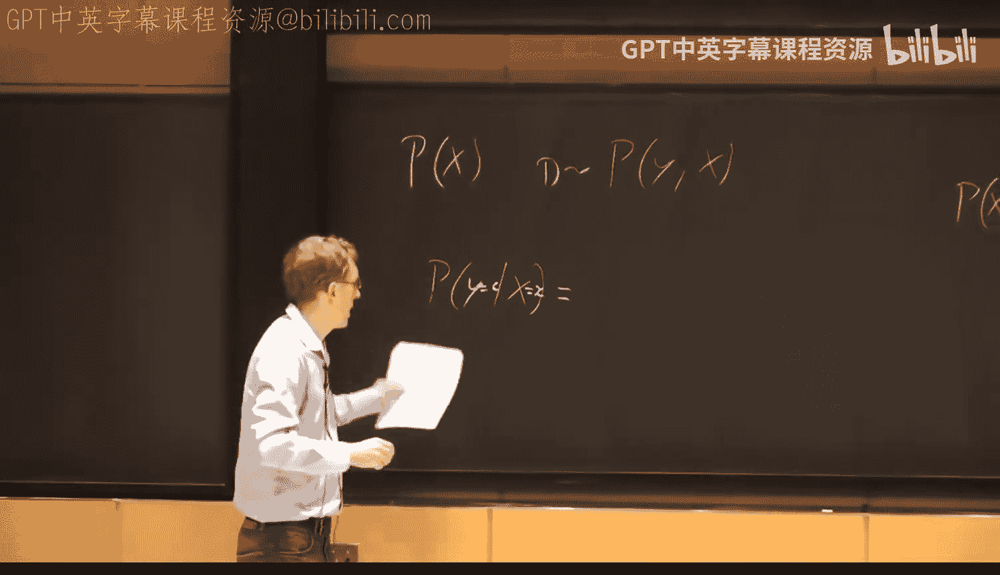

EY equals y， commmar x equals x。Divided by P of X equals X。 That's just the definition。哎。Now。

 these two， we can solve。 This is exactly what we did before， right， This is。Down here。

 this is sum over I equals one to n。I of X， I equals x divided by n。Right。

 that's exactly what we had before。And up here， we now have not just one condition。

 We have two conditions。 right， So well， no big deal， right， we say I is X， I equals X and Y。

 I equals y。😊，Orren。And the two ends cancel。And what we get is exactly this ratio with some of all the points is exactly what he said。

X equals X， I and y equals Y， I。 sorry， Y I equals y， sorry， X I equals x。

Divided by the total number of points。X， I equals x。All right，走。So one more time。

 we go through our data set and we say， how many times do we see X。And out of those times， how do we。

 How many times do we also see y equals y。Alright， and that ratio basically tells us。

 given that you see x， X equals x， what's the probability of y， right。

So one thing he could do is he can just say， well。Just one more way of looking at it。 You just say。

 well I take my data， I throw away all the， all the samples where x does not equal X。Right。

 and then I just estimate the probability of y equal C。Okay， does that make sense。All right， awesome。

Raise your hand if you've got that result。Alright， nice， nice， nice。Allright。If we do。

 if we try to estimate P of y equals y。

Given x equals x， right， what we said is we just take our data set and we throw away everything。

 You know， all the data points。You know， where x does not equal X， right。Well。

 in the one dimensional case， that may not be that bad， right。

 But imagine you have a high dimensional vector， you have 00 dimensional vector。 So then really。

 you know， what you're saying here is you're saying that。

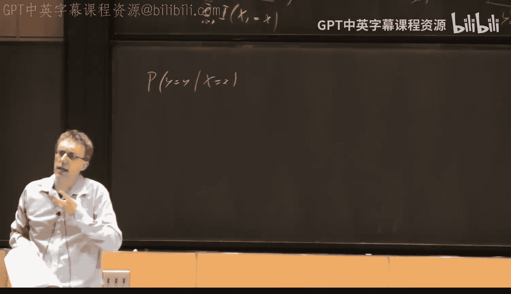

You know， x1 equals x1。X 2 equals x 2， and so on。 X00 or X T equals X D。哎。

So if you have 100 D dimensional vector。You're specifying exactly every single value of the data point。

And。He're throwing away all the data parents that are not exactly the same。

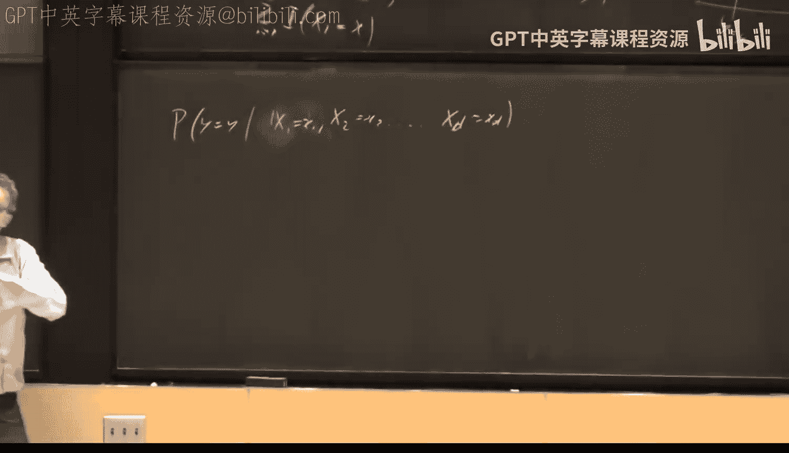

Okay， so essentially what you're saying is， well， for a test point， how many given a test point。

You know， if you want to know the label why， what you're doing is you just go through your training data and you say。

 how many times have I seen exactly that test point right and what what was the label when I saw it。

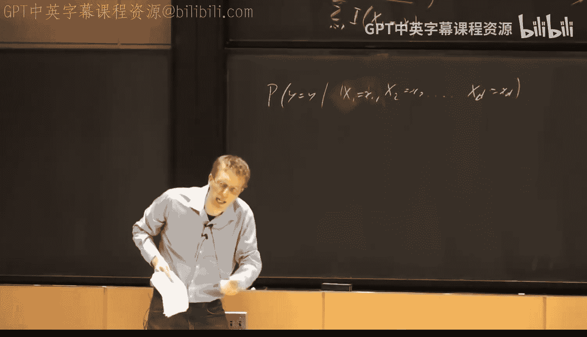

And you can see very clearly， that。

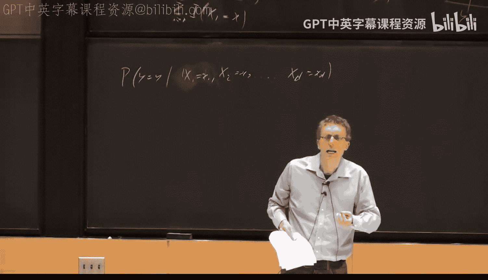

You know， if this is reasonably large， you will never ever have seen that data point again。

 right before， right？ So， I mean， if you have a face recognition system or something and you want to know。

 you know， let's say， you know， is's a picture of a person iss that a student or is that a professor。

 right， What you would do is you say every single pixel has to be exactly the same， right。

 Have seen that exact image before， right， And was it the professor or was a student right。

 And then you output that label。 So really there's not a very good algorithm。 right There's kind of。

 you know， you not actually。😊，You know， you basically always have this empty set。Okay。

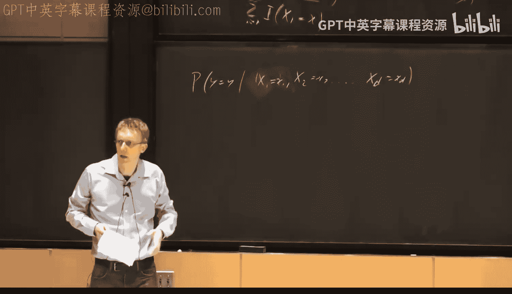

So that's why we can do this in practice。嗯。But there is a rescue。

 and the rescue is the naive based assumption。 Who's heard of naive B before。

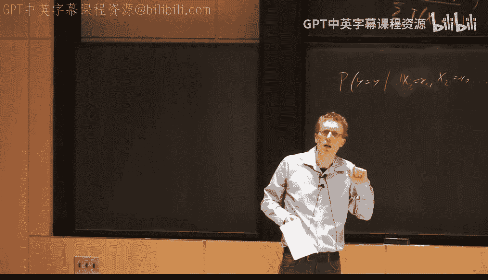

Okay， good。Alright， So the problem is that estimating P of x。

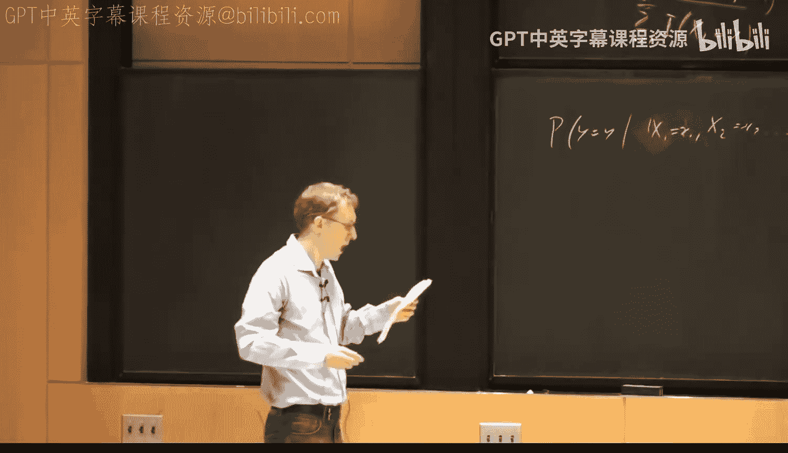

Y equals y， given x。It's really， really hard， right， And we can't really。We can't really do it。

 because。

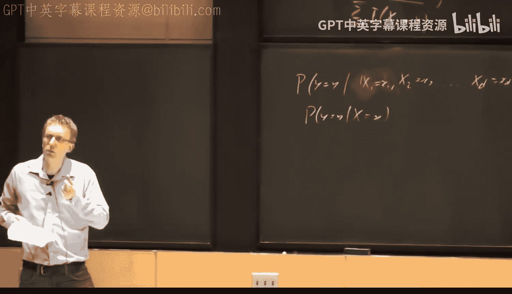

We basically tie together all these different features and say when we have have seen exactly this combination of features before。

 right， And the answer is almost always never， right， So we can't make any predictions。😊。

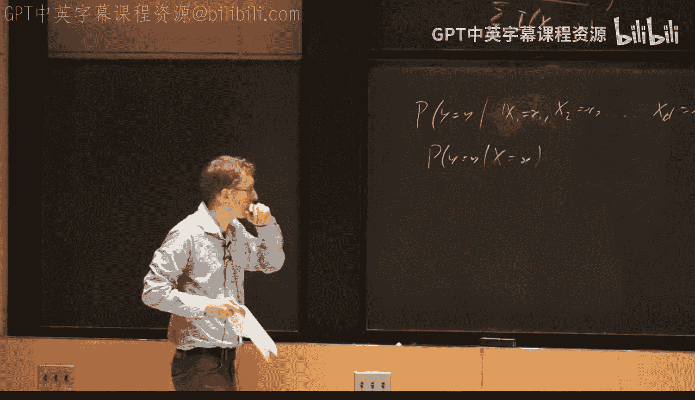

All right， so knife base turns things around。😊，So， in nice phase。You will， yeah， there's actually。

 by the way，9 phase is put in this way。In I face， you turn things around。So basically say， well。

 instead of estimated p of y given x， I just use base rule and flip things around。😡。

So I say P of y equals y given x equals x by Bay is just P of x equals x given。

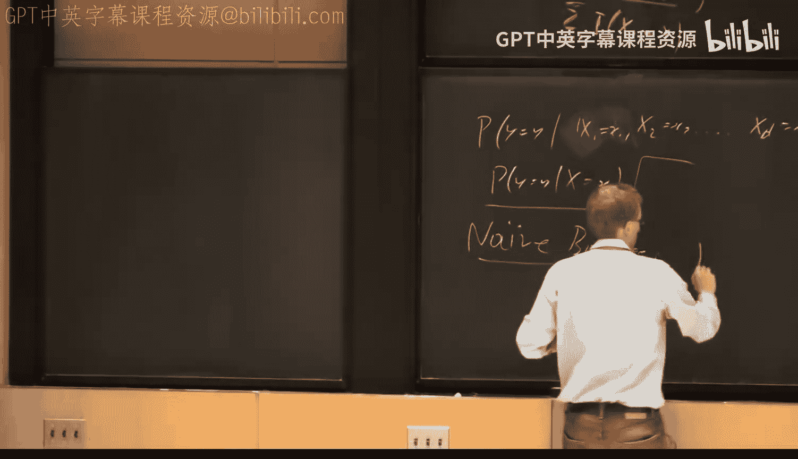

， way do it。 Yeah， given y equals y transfer of y equals y。Divided by probability of P of X。🤧2。So。

This is just a normalizer。 don't worry about it。😡，This is P of y equals y。😡。

That shouldn't be a problem。 Okay， because we usually only have a couple labels。 So if， for example。

 in the example of， you know， is person a student or teacher a student or a professor， right， Well。

 this's just the prior probability。 If I take anyone randomly， is it the professor as a student。

 That's just the ratio of students versus professors， That's not a big deal。 if that's a spam filter。

 right， that's basically the spam filter， this will be， is the probability。

 Is the email spam or not spam， right， So that's just， you can just estimate this on your own inbox。

 It's not a big deal。😊，This year is tricky， right， basically， given a specific email。

 And let's say X are all the words in the email， right。

's basically a long vector of words is that spam or not spam， right。

 You've never seen that email before， So we don't know。😊，So we have to， you know。

 this we cant solve This we don't worry about for now。 And the question is， what about this guy。

 right。Or doesn't seem any。Easier， right， given the label。

 what's the probability that we get exactly that email， right， So what's probably that we have。

 you know， given that it's spam， What's the probability that we exhibit exactly that email。

 It's really hard to estimate， right， You' have never seen that before。😊，So。

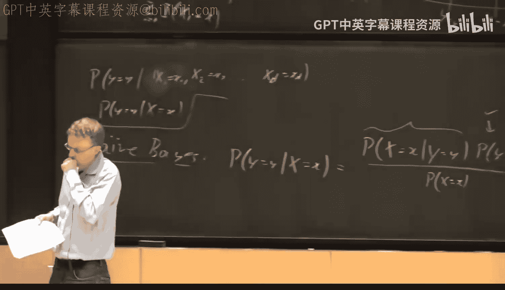

Knife base makes a crucial assumption。And you will see the minis called naive。

Nfe Bay says that the features are independent， given the label。So let me explain what that means。

 That means that says。Pf。X equals x。Given y equals y。Equals。Pleasezy。

 this is a vector with D dimensions。So what knife based assumption says is each feature。

It's independently distributed。 It's independent from each other。 given the label。 So this equals。

F equals 1 to D。Here of。X。Alpha equals X alpha。Given y equals y。So this is the alpha dimension。Right。

 that that takes on this particular value。Okay。And I'm multiplying all these， these different。

featureseatures， you know， multi all them together to get this institution。Let me。

 let me make this clear in an example。 So let's say you haven't。Email。

 and the email can either be spam or not spam。What knifebase assumes is that the way the email was written。

Is that all the different words in the email are completely independent of each other。Given that。

 you know， provided that I know the label。 So in some sense。

 you basically have a monkey who just presses certain words。But he has two different typewriters。

 right， So that' each button gives you a word。And you have one typewriter for spam and one typewriter for not spam。

And so the monkey takes， basically at the beginning， You make a decision。

 Do you want to write a spam email or not a spam email， And then。

Let's say you want to buy the spam email。 Then you just take that typewriter for spam emails。

 and you just add words randomly to the email。 according to some distribution。That's the probability。

Given that it's ba， bought's a probability that this particular world occurs。Okay。

 you just draw them rent。Any questions。第二。外で。So喂。Oh， why are' independent？ They're not independent。

 This assumption makes no sense， right， But if we make this assumption， then we can solve it。So。

 you know， sometimes you have to cut corners。 You're cutting a corner。 He has a huge corner。 right。

 So， yes， if you look at your email right， hopefully。

 the emails you're getting are not independent words， right。😊，But。

Turns out if you make this assumption， then actually it's computationally de tractable。

And it turns out empirically， that often actually， this works fairly well。So in many data scenarios。

 make this assumption。 you're trading off something， right， You're trading off， you know。

 basically you make an assumption that doesn't really hold。 On the other hand， now。

 you can solve it really efficiently。 And it turns out you not， It doesn't break things too。

 too badly。😊，But yeah，'s a very good point。 Any other questions。

Can anyone think of a scenario where it's actually， but it actually holds。第二。O。

Do people ever kind of partially make the assumptions， so they'll try it where they try a conditions。

Variables out of time instead of making。The太。多。和他问题就看。I see。 I see what you're saying。

 So hes saying there's a very extreme assumption， right。

 Why don you make everything independent from each other。 But you can't just make like partially。

 you know like some parts of it independent of each other。

 make the subject line independent on the main thing or something。😊，II've never seen this。 It。

 It probably is too much。 It's not worth it。There's probably other things you can do with your computation that that's more effective。

But it's it's a fair thing to ask。哎。can anyone think of any setting where actually。

Where they actually are independent of each other。Yeah。Probably in analysis。不れ。I see。

 So sentimentdi analysis， sentiment analysis is the case， for， for example， where you have a。

A text and you want to know is it positive as a negative。It's。

 it's actually a scenario where machine learning use a lot。嗯。while I'm at it， actually。

 it's actually a billion dollar industry。 So what people do is。

 let's say the new iPhone watch comes out。😊，What people do is they just quickly write programs that quickly go through blogs and check。

 you know， Are they about the iPhone watch and are they positive or negative。

 much faster than any human could read them。And they try to get in sense of do people like this or not。

 And if they do like it and they buy Apple stock and if they don't like it。

 they short sell Apple stock。 and people can make millions of dollars or billions of dollars。

 actually， using these algorithms。So， you know， think about this。If you make billions of dollars。

 let me know。 office hours，9 AM Monday。so the question is， are they actually independent。

 I would still say they are not independent， right， Because even if you say it a positive review。

 still， the fact that I say Apple means it's probably pretty likely that I say watch afterwards。

 right， So there is theyre not， you know， doesn't always， doesn't really work for language。😊，Yeah。

Pixel all are very correlated。 right， So if I have a green pixel somewhere， right。

 the likelihood that my next to it is is also green is。😊，Pretty high， right。

 Theyre highly coordinated， typically。嗯。一二。Sorry。Cards。呃 I don't know。😊，Okay。Itop。I。て。

II think you think So here's what I'm taking away from this。

 You're thinking in some sense in the right direction。 You think in terms of it。

 as a graphical model。So， if people。Who was head of graphical models before。Okay， you。

 So for those people with take models， he says what we have here is we have a vector a label Y and that label Y gives rise to the different。

Features。And。So。对。You may have this independence if you actually have that these the value of these features is truly cast。

By the label。Okay， so。嗯。You know。For example， let's say you have some some in medical。

 you have some disease， right， Why is do you have a disease or not。And these are symptoms， right。

But these symptoms are actually caused by the disease， right。

 So telling you that I symptom X 1 does not tell you anything else about epi X 2。

 If I already know if the person has the disease or not， right。

 because the the symptom is completely caused by the disease。Alright， so in some sense。

 like typically， they would not be independent。 So let's say you you have a disease that may make cause cough and may also give you a rash。

 right， the fact that you have a rash may tell you something that you're starting to cough because it may tell you that you have that disease。

 which causes both。 But if I already tell you， why is you have that disease or you don't have it。

 Then the two are truly independent of each other。Okay， does that make sense。

So if there's a causal relationship， right， then actually this is typically the case。嗯。Okay。

 any more questions。Alright， so let's just work through it how we do the。

 the estimation when we make that assumption。哦，十爷。Okay， yeah， you could。 You could。

 So the question is basically， he said， I'm not just assuming they're independent。

 I'm also assuming they are I idea D。 actually， right， They actually identically distributed。

 You don't have to go there。 You could actually make them。

 You could actually make it more complex by having different distributions。Yeah。

 and we will get to this actually， next lecture。 That's right。 It's a good point。 Good catch， yes。

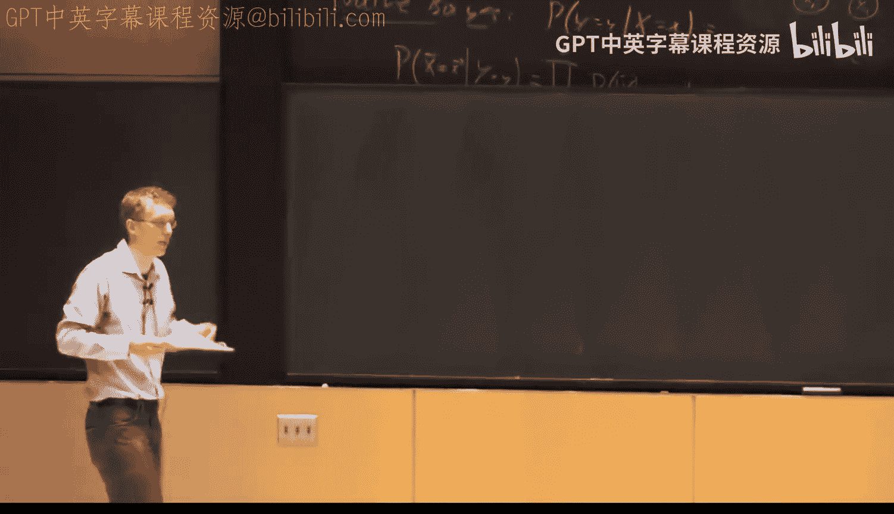

Alright， good， so。嗯。Well， if you make this assumption， this teeny little assumption。Then actually。

 it turns out everything works out very， very beautifully。😊。

So let me remind you of what the bay classifier is。 right， So the base classifier says for vector x。

 what I'm outputting is the most likely leap。 right？ So I say arc max。😊，Y， P of y。Give an x。Alright。

 so that's just the base classifier saying for a certain input X， I look at my distribution。

 which I now know， and I pick that label Y that is most likely。 And that's what I'm outputting。😊。

Well， I don't know the distribution， but I can use base rule because that that is ag max。呃。

P of X given y。P of y。Over。就诶。Normalizer， and you know， I said earlier on， don't worry about it。 Now。

 you can see why you don't worry about it because it doesn't contain why， right。

 So it's just a constant。O， this P of X。 you don't have to compute it。

 It doesn't matter because we're just looking at which y maximizes this， this term。 Okay。

 so we can just take it out。 Does that make sense。 Raise your hand and that make sense。Okay， awesome。

 good。And now you want to maximize this thing。 Here we make the naive phase assumption。

So they can know， well， that is the same thing as Arcmax。Oh why。The product over alpha， P of x。阿法。

Given why。Times PY。Alexy。😊，Maybe I should take this out。To avoid confusion。

That outside of the product。Okay， so here， all I'm saying is this P of x given y decomposes into a product over every single dimension。

This has an eye based assumption。😊，Now， this is still product of many， many small numbers。 So it'。

 it's ugly。 But what we can do is we can do the old trick。 We just take the log， right。

 So in computer science， you never multiply numbers， right， never ever multiply many numbers。

 especially probabilities。 because if you multily probabilities。

 you always get0 up to machine position。 So what you do is you just say， well。

 that's the same thing is taking the log。😊，And then you have log of Py。Plus。

 now you get a sum of alpha log of P of X alpha given y alpha given y。And this is easy to estimate。

And each one of these is also easy to estimate。Why is each one of these， these estimatesa。

Anyone tell me？张培忠。It's only one dimensional， right， So that's the key。 right。

 There's only one feature given why， right， so。That's no problem， right。

 So we just check how many times have we see that particular feature， right， when we solve why。 Okay。

 so that's， that's no problem at all。嗯。Allright， And， you know， we leave it at that and we see。

 I see you on Friday。