# 机器学习：008：从数据中估计概率：朴素贝叶斯 🎯

在本节课中，我们将要学习如何从观测数据中估计概率分布，并介绍朴素贝叶斯分类器。我们将从回顾最大似然估计和最大后验估计开始，然后探讨如何将这些方法应用于更复杂的、包含特征和标签的联合分布。最后，我们将引入朴素贝叶斯假设，它通过一个关键的简化，使得在高维数据上进行概率估计变得可行。

---

## 回顾：参数估计方法 📊

上一节我们介绍了从数据中估计概率分布的基本思想。我们有一个从某个未知分布 **P(X, y)** 中独立同分布抽取得到的数据集 **D**，包含 **n** 个数据点。我们的目标是找到一个带参数 **θ** 的已知分布 **P_θ**，使其尽可能接近这个未知的真实分布。

我们讨论了两种主要的参数估计方法：

以下是两种核心的估计方法：

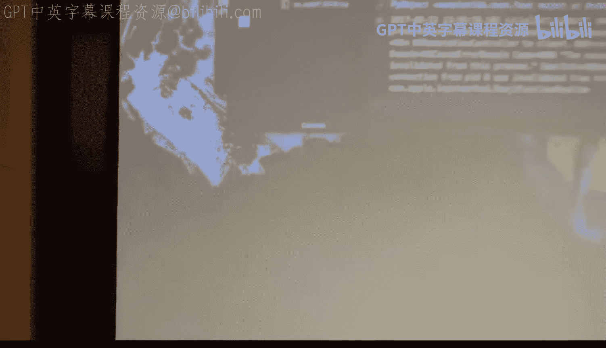

1.  **最大似然估计**：我们寻找参数 **θ**，使得观测到当前数据的概率最大。其目标是：
    `θ_MLE = argmax_θ P_θ(D)`
    这是一种频率学派的观点，将参数视为固定的未知量。

2.  **最大后验估计**：这是一种贝叶斯学派的观点，将参数 **θ** 本身视为随机变量。我们寻找在给定观测数据 **D** 的条件下，最可能的参数值。其目标是：
    `θ_MAP = argmax_θ P(θ | D) = argmax_θ P(D | θ) P(θ)`
    其中 **P(θ)** 是我们对参数先验知识的编码，称为先验分布。

这两种方法在数据量充足时通常会收敛到相似的结果，但在数据稀缺时，MAP估计会受到先验分布的显著影响。

---

## 从简单案例到复杂问题 🔄

我们从一个最简单的案例开始：估计一个硬币抛出正面的概率 **P(X=正面)**。通过MLE，我们得到估计值为数据中正面朝上的次数除以总抛掷次数。

现在，我们考虑一个更有趣且更贴近机器学习实际的问题：估计联合分布 **P(X, y)** 的条件概率 **P(y | X)**，其中 **X** 是特征，**y** 是标签。

根据MLE的思想和条件概率的定义，我们可以推导出 **P(y | X)** 的估计方法：

以下是估计步骤：

1.  在数据集中，找出所有满足 **X_i = x** 的数据点（即特征与给定值相同的点）。
2.  在这个子集中，计算标签 **y** 等于特定值 **y** 的数据点数量。
3.  **P(y | X=x)** 的MLE估计值就是这个数量除以第一步中找到的数据点总数。

用公式表示即为：
`P_MLE(y | X=x) = (Σ_i I[X_i = x 且 y_i = y]) / (Σ_i I[X_i = x])`
其中 **I[·]** 是指示函数，条件成立时值为1，否则为0。

然而，这种方法存在一个严重问题：当特征维度很高或特征取值空间很大时，我们几乎不可能在训练集中找到与测试点 **X** **完全一致** 的样本。这会导致我们用于估计的数据子集为空或非常小，从而无法做出可靠的预测。

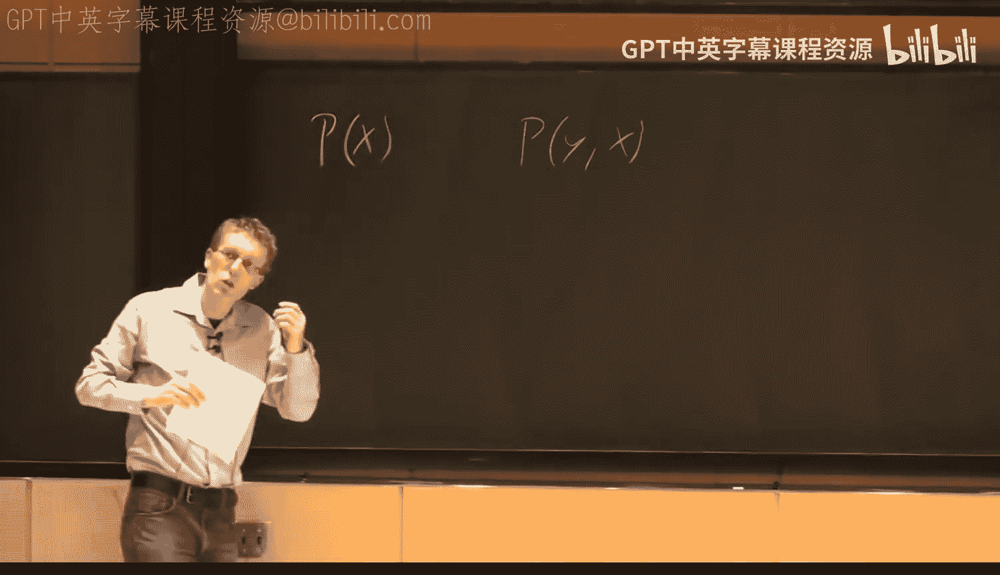

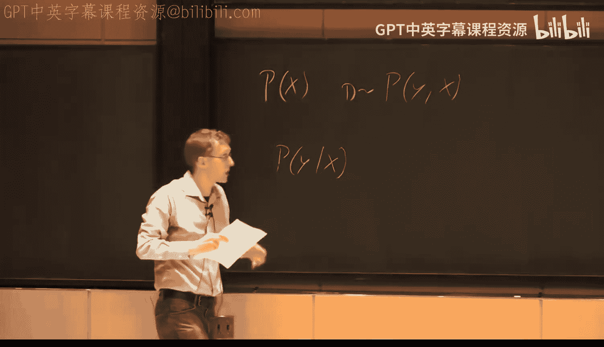

---

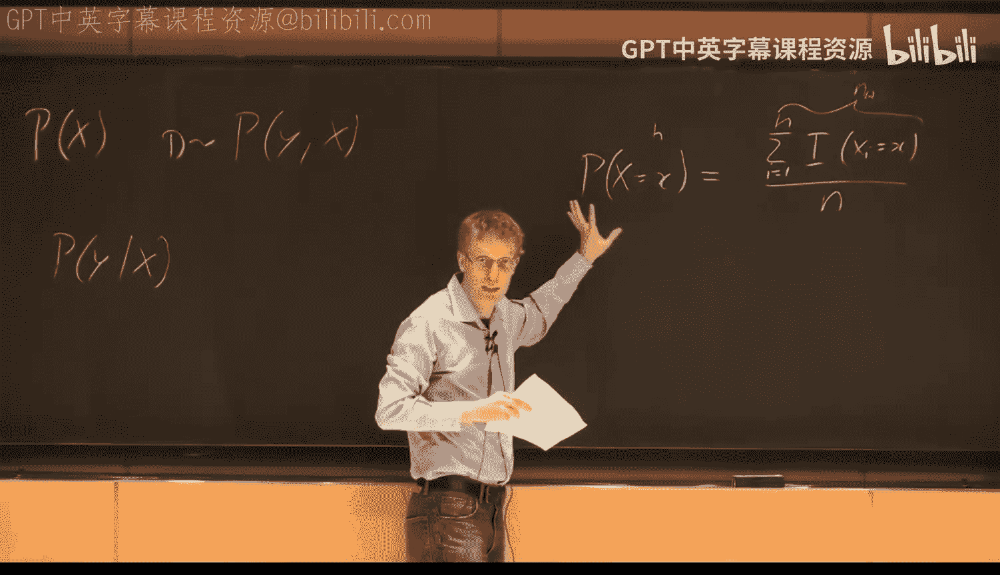

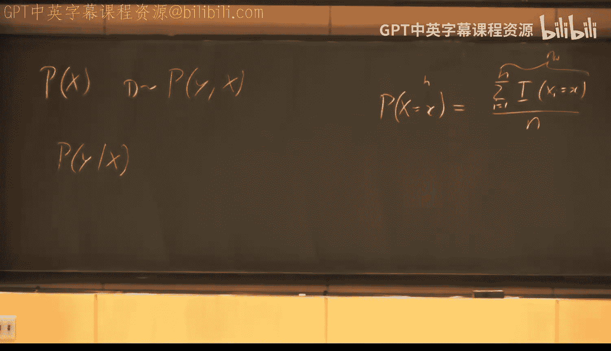

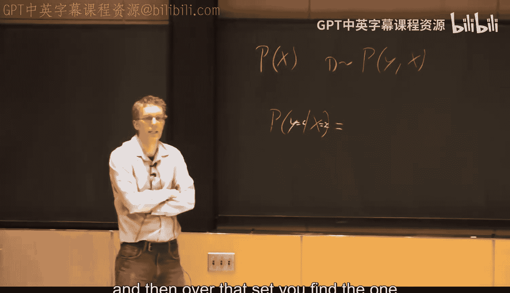

## 朴素贝叶斯假设：关键的简化 🛠️

为了解决上述“维度灾难”问题，朴素贝叶斯方法采用了一个关键的策略：利用贝叶斯定理转换问题，并做出一个强有力的简化假设。

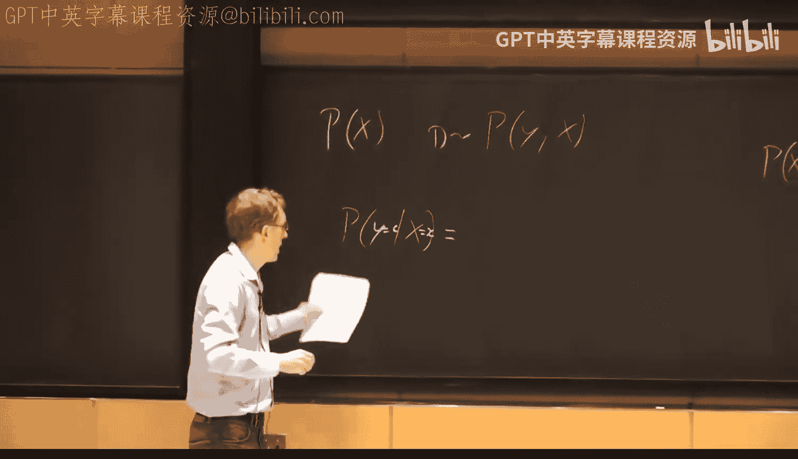

首先，根据贝叶斯定理，分类时我们关心的是：
`P(y | X) ∝ P(X | y) * P(y)`
其中 **P(y)** 是类先验概率，容易估计。难题在于估计似然 **P(X | y)**，即在给定标签的条件下，观察到整个特征向量 **X** 的概率。

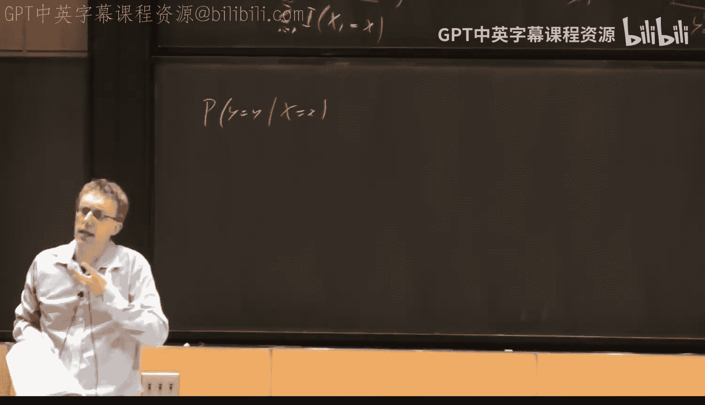

朴素贝叶斯做出了一个**“朴素”的假设**：在给定类别标签 **y** 的条件下，所有特征 **X_1, X_2, ..., X_d** 都是相互独立的。这意味着：
`P(X | y) = Π_{α=1}^{d} P(X_α | y)`

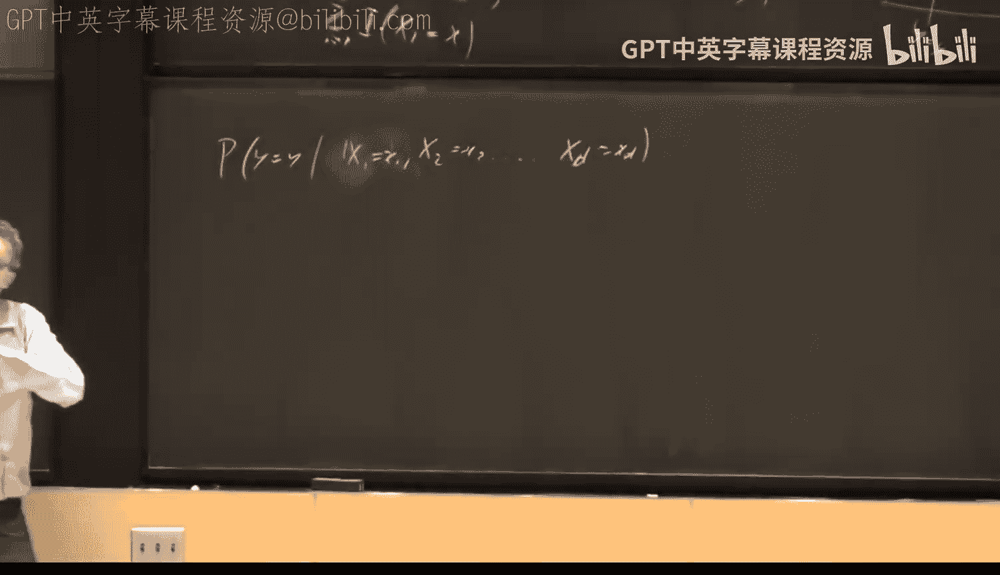

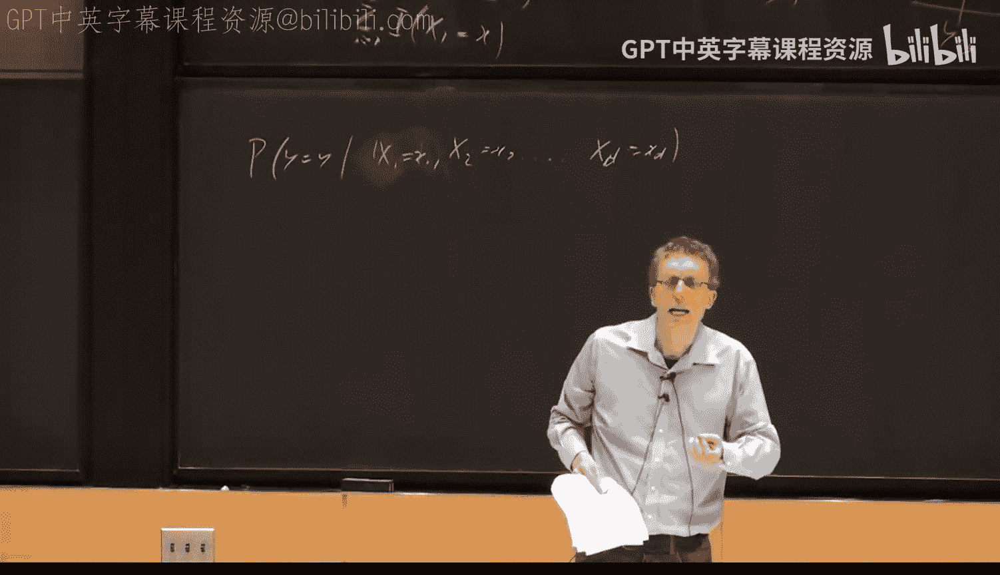

这个假设虽然在实际中很少严格成立（例如，一篇文章中的单词并非完全独立），但它带来了巨大的计算便利性。现在，我们只需要为每个特征 **X_α** 估计一维的条件分布 **P(X_α | y)**，这变得非常容易。尽管假设很强，但朴素贝叶斯在许多实际任务（如文本分类、垃圾邮件过滤）中表现出了惊人的效果。

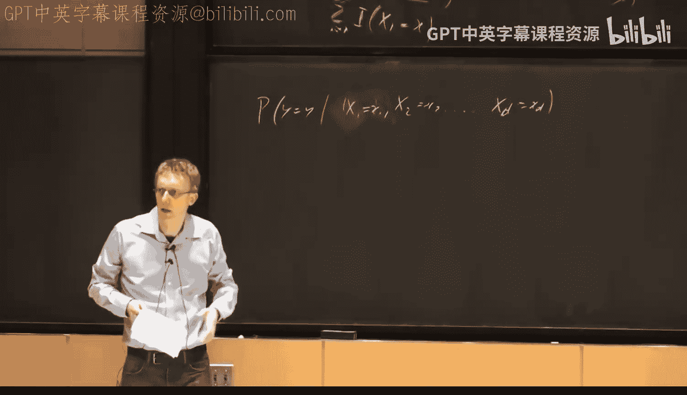

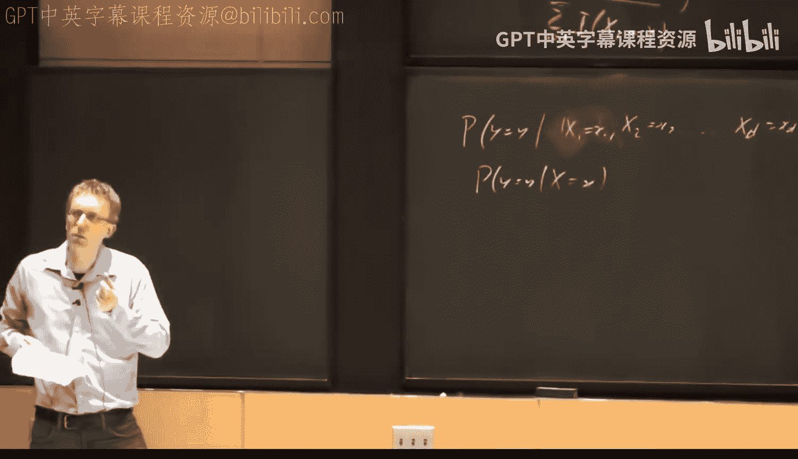

---

## 朴素贝叶斯分类器 🧠

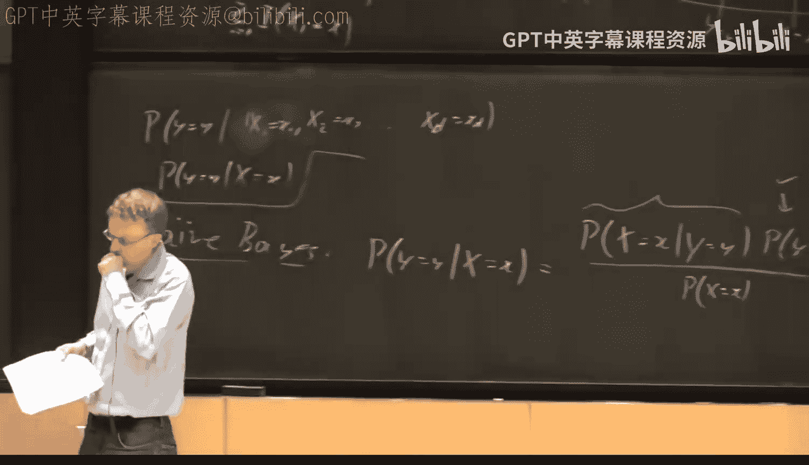

结合贝叶斯定理和朴素独立性假设，我们得到了朴素贝叶斯分类器的决策规则。对于一个输入特征向量 **X**，我们预测其标签 **ŷ** 为：

`ŷ = argmax_y P(y) * Π_{α=1}^{d} P(X_α | y)`

在实际计算中，我们通常对等式右边取对数，将连乘转化为连加，以避免数值下溢并简化计算：

`ŷ = argmax_y [ log P(y) + Σ_{α=1}^{d} log P(X_α | y) ]`

至此，构建一个朴素贝叶斯分类器就简化为以下步骤：

以下是模型训练步骤：

1.  从训练数据中估计每个类别的先验概率 **P(y)**。
2.  对于每个特征维度 **α** 和每个类别 **y**，估计条件概率 **P(X_α | y)**。对于离散特征，这通常是通过计算该特征值在属于类别 **y** 的样本中出现的频率来实现的。

---

## 总结 📝

本节课我们一起学习了从数据中估计概率的核心思想。我们从参数估计的两种基本方法（MLE和MAP）出发，揭示了直接估计高维条件概率 **P(y|X)** 的困难。朴素贝叶斯分类器通过结合贝叶斯定理和特征条件独立性假设，巧妙地规避了“维度灾难”问题，将复杂的联合概率估计分解为一系列简单的一维概率估计任务。尽管其“朴素”的假设在现实中往往不成立，但这种在计算可行性与模型准确性之间的折衷，使其成为机器学习中一个强大且广泛应用的基线模型。