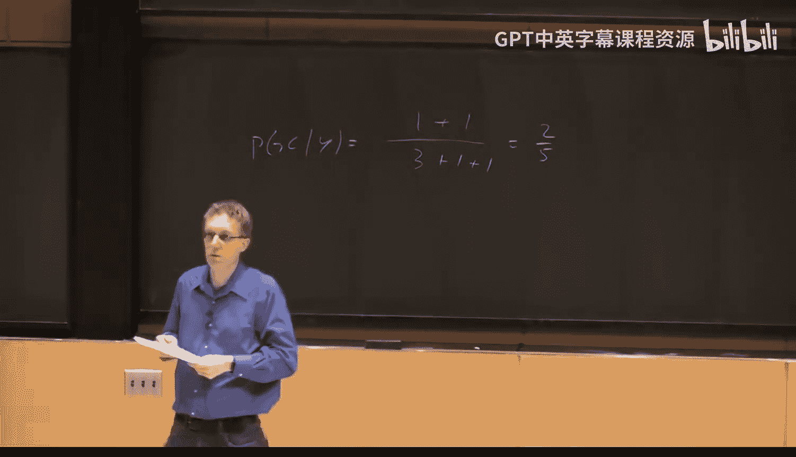
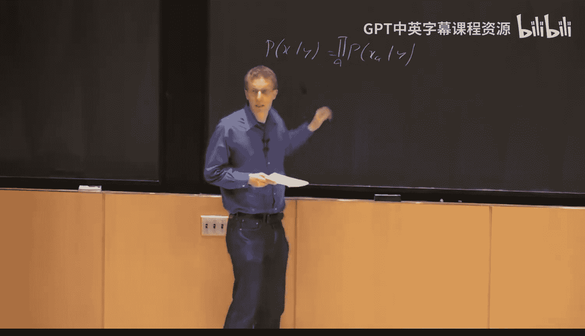
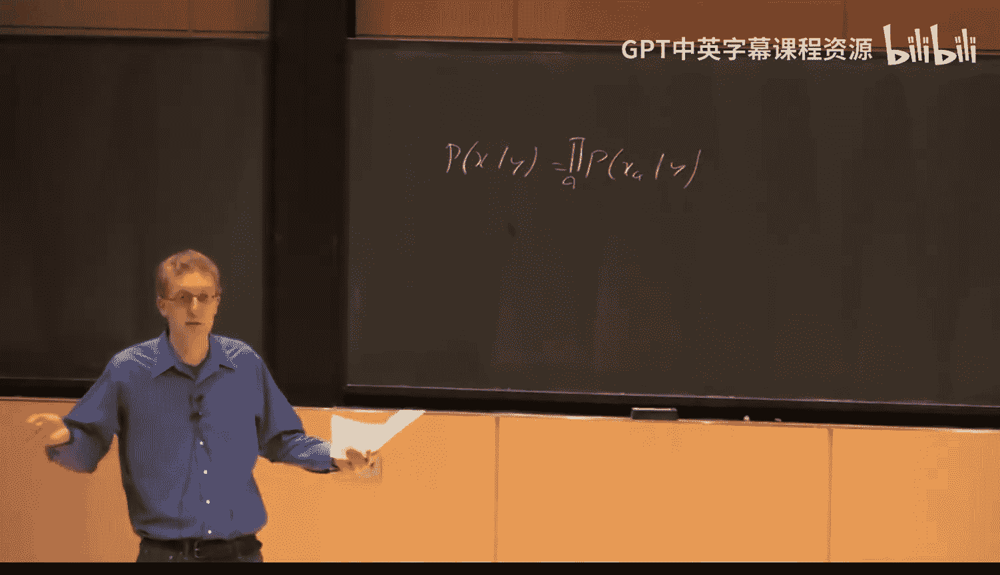

# 机器学习：009：朴素贝叶斯（续）🔍

在本节课中，我们将继续学习朴素贝叶斯分类器。我们将通过一个具体的例子来巩固对朴素贝叶斯公式和拉普拉斯平滑的理解，并探讨该算法的核心假设在何种情况下会失效。最后，我们将介绍朴素贝叶斯在处理不同类型数据（如分类数据和文本数据）时的具体应用形式。

---

## 课程公告与项目分享 📢

在深入课程内容之前，有几个公告。

项目1现已结束。观察排行榜上团队排名的变化非常有趣。以下是排名靠前团队分享的秘诀：

以下是排名前列团队采用的方法：

*   **特征加权**：团队“Steve Nash and Carl Sagan”为每个特征计算了不同的权重，并在计算距离时应用这些权重。他们尝试了不同的加权函数，例如高斯加权。这实质上是**度量学习**的第一步，即通过学习一个优化的距离度量来提升K近邻分类器的性能。
*   **数据增强**：团队“Ha Ha Ha Witty Kitty”采用了另一种完全不同的方法。他们通过轻微修改训练样本（例如，将数字图像稍微平移或旋转）来人工增加训练数据量，同时确保标签不变。这种方法被称为**数据增强**，在实践中被广泛使用以提升模型鲁棒性。

这些方法可以结合使用，并且都是对分类器合理且有效的改进。

此外，下周将有三场关于机器学习的精彩讲座，涉及机器人学、医疗保健和核心机器学习等领域，详细信息将发布在Piazza上。

---

## 朴素贝叶斯实例演练 🧮

现在，我们通过一个具体例子来演练朴素贝叶斯分类器的计算过程。假设苏西（Susie）根据历史约会数据训练一个朴素贝叶斯模型，来判断约会对象是“好人”还是“坏人”。数据特征包括是否穿披风（C）、是否戴面具（M）以及是否把内裤外穿（U）。

首先，我们根据提供的训练数据表进行计算。

**1. 先验概率 P(Y)**
在不考虑任何特征的情况下，一个人是“好人”的先验概率是多少？根据数据表，Y的分布是均匀的。因此：
`P(Y=好人) = 1/2`

**2. 条件概率估计（不使用平滑）**
接下来，我们估计条件概率表（CPT）。例如：
*   `P(C=无披风 | Y=好人)`：在好人群中，不穿披风的比例。从表中可知，3个好人中有1个不穿披风。
    `P(C=无披风 | Y=好人) = 1/3`
*   `P(M=无面具 | Y=好人)`：同理，3个好人中有1个不戴面具。
    `P(M=无面具 | Y=好人) = 1/3`

**3. 使用拉普拉斯平滑（+1平滑）估计条件概率**
拉普拉斯平滑通过在每个类别的计数上加1来避免零概率问题。对于二值特征，相当于添加了两次“抛硬币”实验（一次成功，一次失败）。
`P(C=无披风 | Y=好人) = (1 + 1) / (3 + 2) = 2/5`
这里，分子加1是因为观察到1次“无披风”，分母加2是因为为“披风”和“无披风”两个类别各加了1次虚拟计数。

**4. 进行预测推断**
现在，苏西遇到一个约会对象，他没有穿披风（C=无），也没有戴面具（M=无）。我们需要计算在此条件下，他是好人的后验概率 `P(Y=好人 | C=无， M=无)`。

根据贝叶斯定理：
`P(Y | C, M) = P(C, M | Y) * P(Y) / P(C, M)`

由于特征C和M在给定Y的条件下被假设为独立的（朴素贝叶斯核心假设），我们可以分解：
`P(C, M | Y) = P(C | Y) * P(M | Y)`

分母 `P(C, M)` 可以通过全概率公式计算：
`P(C, M) = P(C, M | Y=好人)P(Y=好人) + P(C, M | Y=坏人)P(Y=坏人)`

将具体数值（使用未平滑的1/3估计值）和先验概率1/2代入公式：
`P(Y=好人 | C=无， M=无) = ( (1/3)*(1/3)*(1/2) ) / ( (1/3)*(1/3)*(1/2) + (2/3)*(2/3)*(1/2) ) = (1/18) / (1/18 + 4/18) = 1/5`

因此，苏西的朴素贝叶斯分类器预测此人是好人的概率为 **1/5**。

**关于数据代表性的讨论**
一个关键点是，机器学习模型假设训练数据和测试数据来自同一分布。如果苏西的训练数据全是超级英雄，而她实际约会的是普通人，那么模型可能不适用。这是机器学习普遍存在的问题，而非朴素贝叶斯特有的缺陷。

---

## 深入理解朴素贝叶斯假设 🤔

上一节课末尾，有几个关于朴素贝叶斯核心假设的重要问题。

**1. 如果条件独立假设成立，朴素贝叶斯是最优分类器吗？**
是的。朴素贝叶斯所做的唯一“近似”就是条件独立假设。如果数据确实满足该假设，那么朴素贝叶斯等价于贝叶斯最优分类器，能够做出理论上最准确的预测。

**2. 条件独立假设何时会失效？能否举例说明？**
该假设经常不成立。分解联合概率 `P(X|Y)` 为 `∏ P(X_α|Y)` 可能导致对真实概率的高估或低估。

以下是几个例子：

*   **高估的例子（特征互斥）**：在垃圾邮件分类中，“伟哥”和“尼日利亚”这两个词单独出现在垃圾邮件中的概率都很高。但同一封垃圾邮件同时包含这两个词的概率极低（因为它们是不同类型的垃圾邮件）。朴素贝叶斯会将其概率计算为 `P(伟哥|垃圾邮件) * P(尼日利亚|垃圾邮件)`，从而**高估**了同时出现的概率。
*   **低估的例子（特征强相关）**：在扑克牌中，判断一手牌是否为“满堂红”。定义两个特征：“是否有三张K”和“是否有两张Q”。如果两个特征同时为真，则一定是满堂红，概率为1。但朴素贝叶斯会将其计算为两个独立概率的乘积，可能**低估**了这个概率。

这些例子表明，在实际应用中，需要警惕特征间存在强依赖关系的情况。

---

## 朴素贝叶斯的不同变体 📊

朴素贝叶斯的框架可以灵活地适配不同类型的数据分布 `P(X|Y)`。下面介绍两种常见变体。

**1. 类别分布（Categorical Features）**
当每个特征 `X_α` 是分类变量，可取K个离散值（如性别：男/女；婚姻状况：已婚/未婚/离异等）时，我们使用类别分布。

*   **模型**：对于每个特征维度α和每个类别c，我们估计一个参数 `θ_{α, j, c}`，它表示在类别c下，特征α取第j个值的概率。这就像一个具有K个面的骰子。
    `P(X_α = j | Y = c) = θ_{α, j, c}`
    并且对于固定的α和c，所有j的概率之和为1：`∑_j θ_{α, j, c} = 1`
*   **参数估计**：使用最大似然估计（MLE）或最大后验估计（MAP），与之前估计硬币参数的方法相同。例如，MLE估计为：
    `θ_{α, j, c} = (数据中特征α取值为j且类别为c的样本数) / (数据中类别为c的样本数)`
    可以加入拉普拉斯平滑以避免零概率。

**2. 多项分布（Text Data - 文本数据）**
这是文本分类（如垃圾邮件过滤）中最常用的变体。我们将一封有M个词的邮件，看作从某个“词袋”分布中重复抽样M次（每次独立）的结果。

*   **模型**：特征向量 `X` 的维度等于词汇表大小V。`X_α` 表示词汇表中第α个词在邮件中出现的**次数**。所有特征值之和等于邮件总词数M。
*   **概率计算**：给定邮件类别c，生成这封邮件的概率为：
    `P(X | Y=c) = [ M! / (∏_α X_α!) ] * ∏_α (θ_{α, c})^{X_α}`
    *   第一部分是**多项式系数**，计算在忽略单词顺序的情况下，能组成当前词频分布的排列数。
    *   第二部分是每个词按其出现次数出现的概率连乘，其中 `θ_{α, c}` 是类别c下生成第α个词的概率。
*   **核心**：不同类别（如垃圾邮件/非垃圾邮件）对应不同的词分布 `θ_c`。训练过程就是从数据中估计这些分布。

在实践中，由于特征向量极度稀疏（大部分词出现次数为0），会采用高效的数据结构存储非零特征。

---

## 总结 📝

本节课我们深入探讨了朴素贝叶斯分类器。

*   我们通过一个完整的例子，演练了从计算先验概率、条件概率，到应用贝叶斯定理和朴素假设进行预测的全过程，并复习了拉普拉斯平滑的重要性。
*   我们深入分析了朴素贝叶斯的**条件独立假设**，理解了当该假设成立时，模型是最优的；同时通过实例（如垃圾邮件过滤）看到了该假设失效时可能导致概率高估或低估的情况。
*   最后，我们介绍了朴素贝叶斯如何适配不同类型的数据，重点讲解了处理**分类特征**的类别分布变体和处理**文本数据**的多项分布变体，后者是当前许多垃圾邮件过滤系统的基础。

朴素贝叶斯因其简单、高效且易于实现的特点，在实践中仍有广泛的应用，尤其是在文本分类领域。理解其假设和局限性是正确使用该模型的关键。