# 010：康奈尔大学《智能系统的机器学习｜CS4780 Machine Learning for Intelligent Systems 2017》中英字幕 p10 -10-Machine Learning Lecture 10 ＂Naive Bayes continued＂ -Cornell CS4780 SP17.zh_ -BV1Lo6gBxEKE_p10-

All right， welcome。😊，Yet another lecture on machine learning， please put away your laptops。

 those your laptops， iPads， game stations， playsSts。😊。

Okay， good。

We've been talking about， oh， sorry， quick logistics。 Sorry， I promised you。

I promise to ruin you weekend with Homebook 3， a project that has not happened yet Im。😊。

We are actually， we， we are test driving it very， very carefully before we roll it out and we ran into some problems on the autograding thing so。

😊。

I think it's all resolved right now if you're testing it one more time。

And hopefully you can ship it out tonight。😊，Also， one good thing that happened is we put in contact with Vquaium and actually。

 Voquaium is now on Piazza。 So they actually have now one of the people from Vocarium from that company is now one of the piazza Ts。

 So if you actually post a problem with Vcarium， he's actually very responsive and they're very。

 very interested in， in making this work for us。😊。

Okay， good， any other questions about logistics？All right， so we've been talking about naive base。

 and naive base is a generative algorithm。 So what you do is， in some sense， you have your data。

 Let me draw a little example here。😊。

And let's say you have positive and negative points。 here my positive points。

And here， my negative points， in this case is very easily， not nicely separated。

 And what knife base does is actually estimates the distribution of this， this data。

 So what we're estimating is。😊，P of x given y， right， So basically what it says is， okay， well。

 only the points that have label 1。What is the distribution of these data points。And so， you know。

 you could basically imagine there's kind of a， you know some distribution。

 I hope people understand this painting here， there's kind of like a hill。

 of probability that you could estimate in this space。😊，But turns out that's really。

 really hard because the space is high dimensional。 So what naive days days does is it says， oh。

 we make a very simple model assumption。 We assume these different dimensions are independent。

 So in some sense， what are you doing， You just take this data， You project it onto each axis， right。

😊，We say here， now you have points like this。And now you model this year。 Okay。

 and this is easy to model because a one dimensional problem。

 Then you do the same thing with a second dimension， right， So you project the data onto here。

And now you model this stuff， right， And you say the distribution here is basically， you know。

 if you combine these two independent the product of these two independent distributions。 Okay。

 so that's the idea behind naive face。 And so when we do it， when we have data。

 there's basically two steps。 The first step is we take the data。

 If you look at each dimension individually and model this distribution。😊，And then once we have it。

 then we basically we have a term for this expression here。

 which is a product of all the individual distributions for each feature。😊。

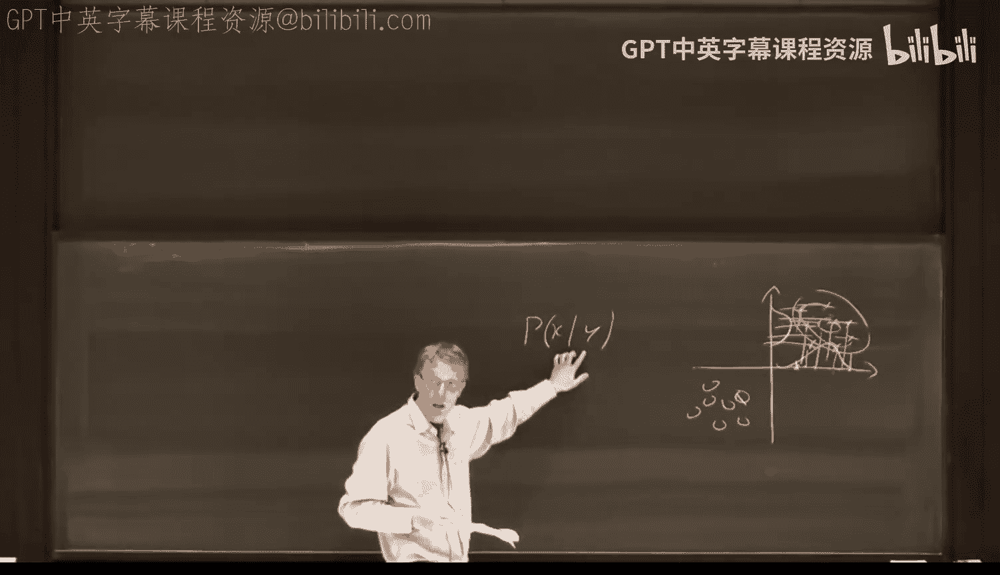

And then we can do prediction with the base formula。 Okay。

 so let me just fall back into the base optimal classifier。

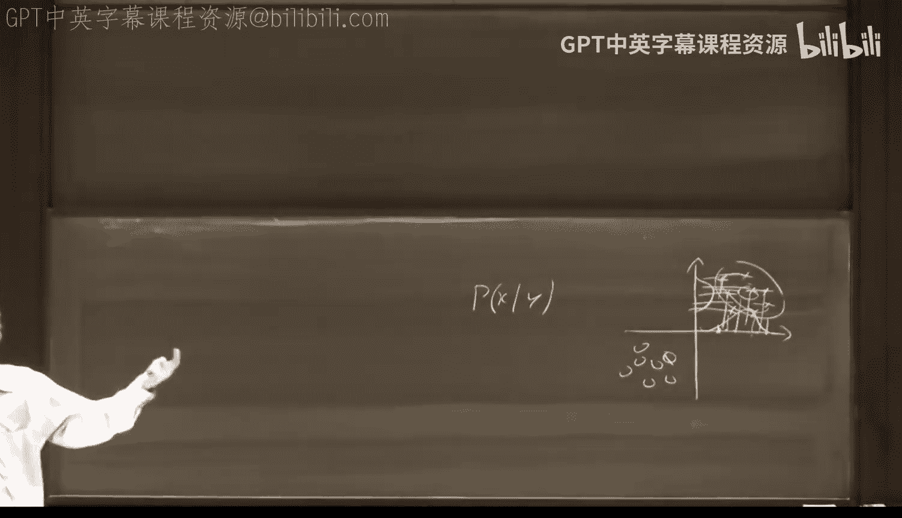

One thing that's important and I basis that。Basically。

 it this two step approach for you first model the distribution。 and then you make a prediction。

 right， So when you make a prediction， the data is no longer important。

 You just try to in the first you model the the data of the distribution。

 But then you only look at the distribution and predict P of y given x using the base formula。 Okay。

 so if your modeling is bad， then actually you classifier it's gonna be bad。

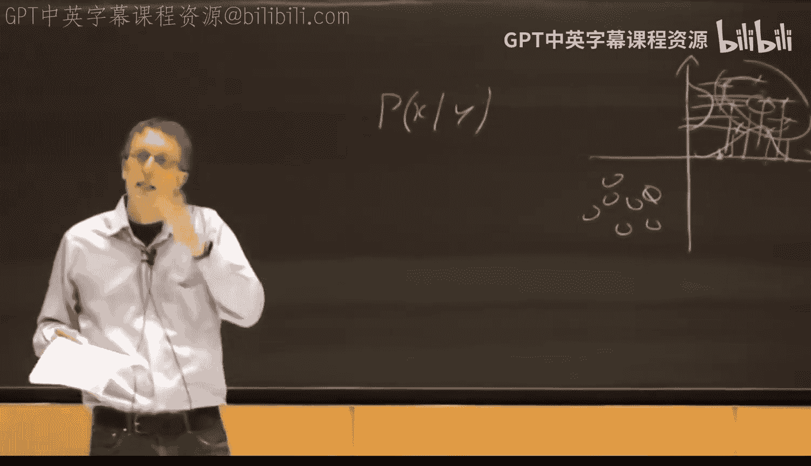

The nice thing is it's very， very fast， most of the cases。😊。

Especially， you know， last time we talked about how to， you know。

 we started going over some examples， how you do this。 So one when， when you have categorical data。

 your features are categorical， then we just have a binomial distribution。

 We basically just do counting。 We just count how many times have we see in this particular feature。

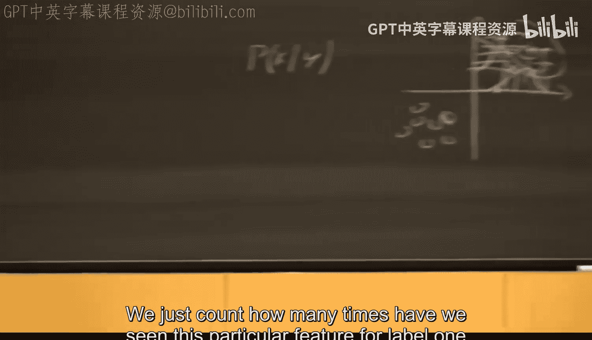

For label1 and how many times have we seen label1 overall and the ratio is basically the probability of a feature。

 given that label。 Okay， so that that was what we did last time very basically。

 how do we estimate P of X alpha given y right was basically just， you know， the ratio of how often。

 how many times do we see this particular feature out of all the samples that we have。😊。

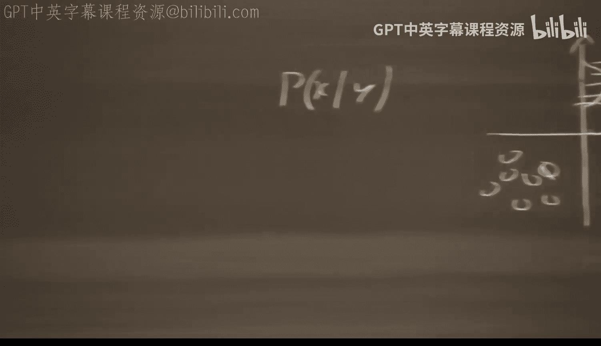

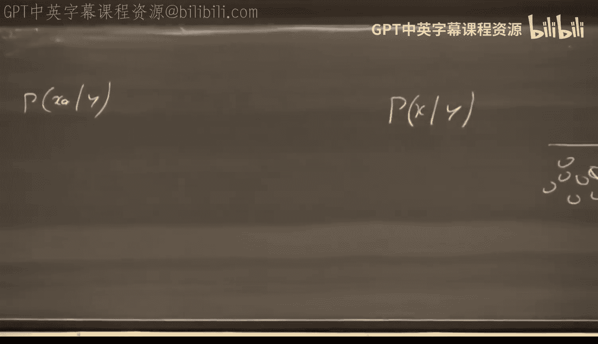

Any questions at this point， just， you know， there's just a high level overview one more time to make sure you。

You're reminded of the big picture of night。All right， so。

What I want to do today is I want to go through more examples。😊。

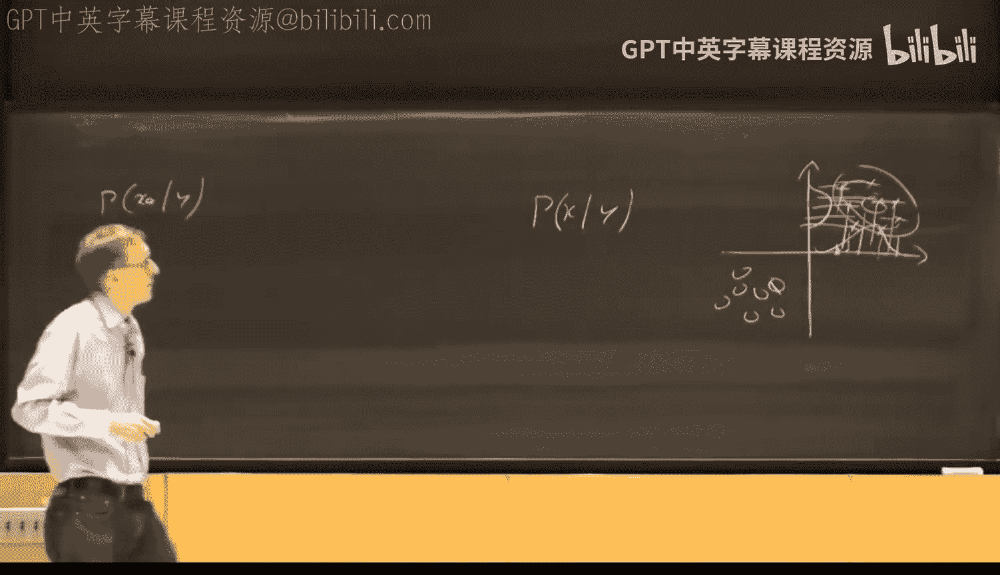

嗯。The modommial and then the continuous features。 And then I want to talk about， well， actually。

 once we have these two distributions， we then have a classifier based on these distributions。

 And the way it works is， we have a distribution here for the negative points of a distribution for the positive point。

 And then we take some test point。 And we say what's what's more likely。

 I it more likely this point was drawn from this distribution or more likely that it was drawn from this distribution。

 right， that's basically how the classifier works in somewhere in between is a decision boundary。😊。

Where you say， you know， at this point， it becomes more likely that it's drawn from this distribution。

 And here， it's more likely that it's drawn from this distribution。

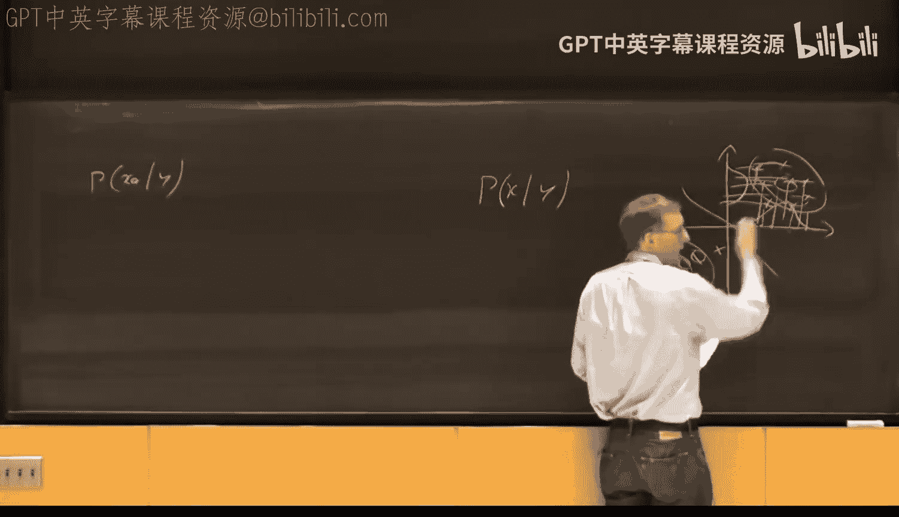

And what does that decision boundary really look like。 So the second part of the lecture。

 I will talk about this。

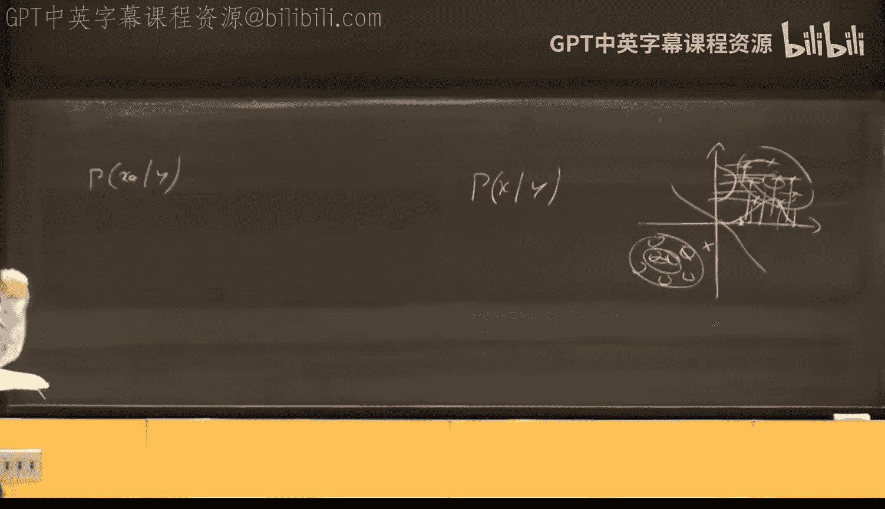

And。And actually， I can， you know， give you the punchline already。 It actually turns out it's a。😊。

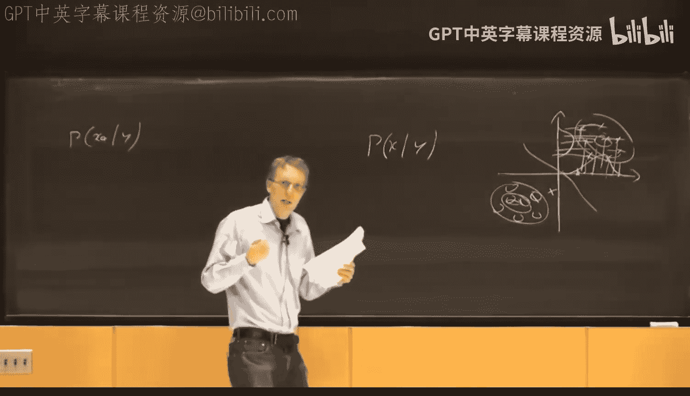

It's a linear classifier， yeah so。

What about。是。Okay， sure。😊，No question。Okay， no question。 Not right good。 So weestimating this。

 by the way one thing， you're also estimating P of Y， right。

 So P of P of P of Y is usually very easy to estimate。

 You just count how often do you see each label。 right。

 It's just a fraction of seeing that label across all data points。😊，All right， any more questions？いや。

とあしく。If you use the what there。Athhogonal components。

 So you mean the axes like the each dimension you mean， is that。I see。

 So what you're saying is the following。 What if I change the coordinate system。

 What if I actually now say my coordinate system looks like this。

 right now I do PCA so now I do9 base， right， And so you now change your assumption。

 right you're basically saying that after this transformation of this different coordinate system。

 now all the different dimensions are independent。😊，Tditionally independent。

That may or may not be true， usually it's not true。It may work。Right， typically， the。

 the scenarios about you'd use but knife based is with text documents。 for example。

 that doesn't really make sense of a transformation， right。

 because the data is very high dimensional， right， and it will be very expensive。

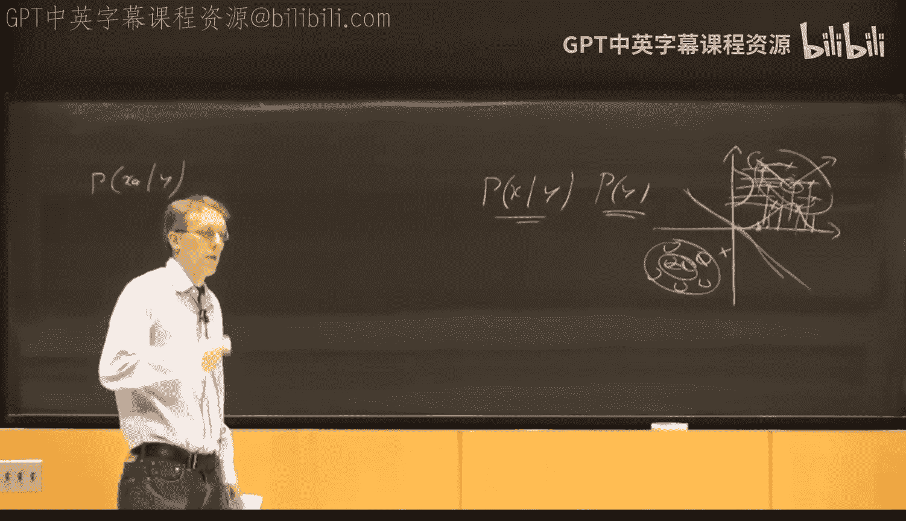

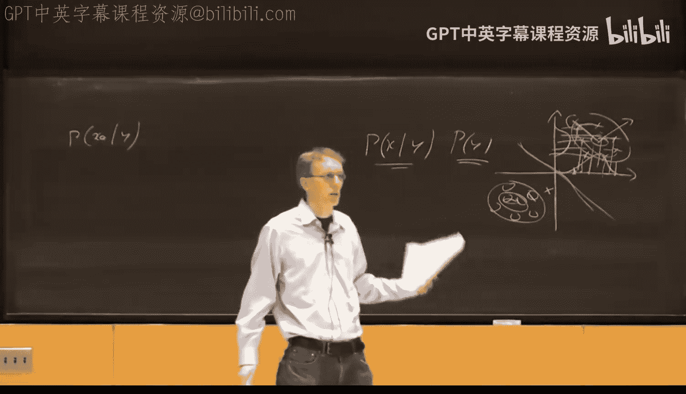

And in some sense， the features， you know， of each dimension corresponds to a word is a pretty good representation of your data。

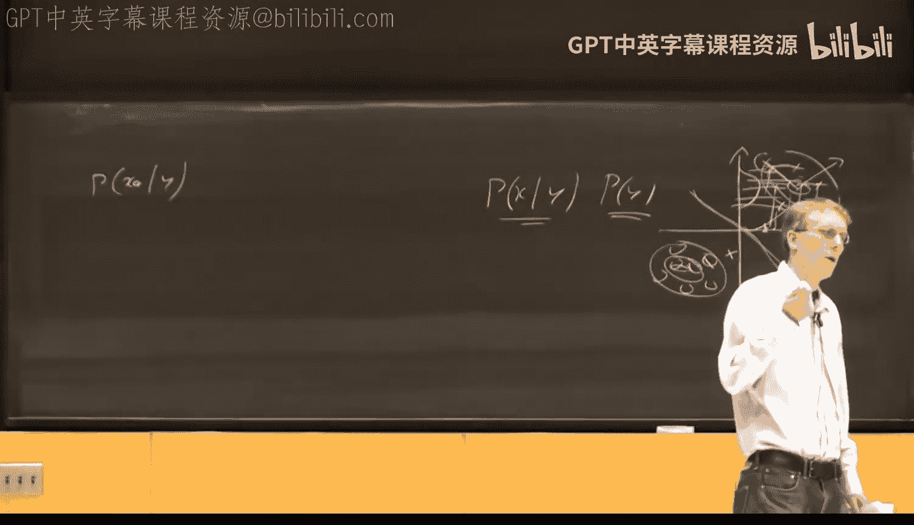

But， yes， you could do。

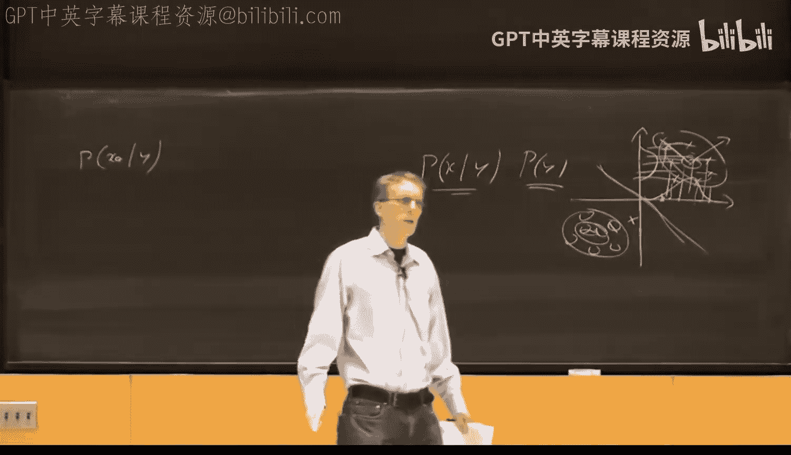

Yeah， remember that question。 what is Oh， forward regression， Does this also work。

 Nowive've base for regression that I I don't really know how to do that no。

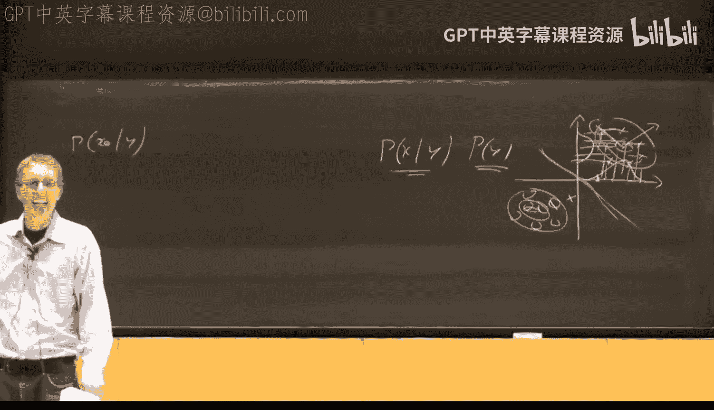

Yeah。Any more questions。 Yeah， over there。you ended up estimating some kind of crazy。啊。

All the different dimensions。 How would it still be a linear classifier Oh， as it doesn't Oh。

 well log。Be patient。 Be patient。 People will get to this in a little bit。 Yes。

 it doesn't always have to be a linear algebra。 you got it。 So it's， it's not always。

 it's in several common cases， it's the linear algebra。Okay， any moions？Alright， so what we went。

 I think what we left off last time was the multinoial distribution。

 I think I just started describing it， right， but I didn't get into the equations。 that correct。

 Yeah， okay， people are nodding。😊，So。It really， with these generative models。

 it really helps to have a model of that you have in mind how the data is generated， right。

 So that's in some why it's called generative model。 basically we're estimating this year。

 right So think of it as some kind of process that takes the label as input and then generates an X。

 right And so think of x as now as emails So then in the multiomial case。😊，Momial。Here。

 we basically say the way we， we write an email or the way we we populate an input vector is by adding on to the。

 to， to the different dimensions。 So we have。😊，So， so what does that mean， So each。X， basically。

There's a very large vector。😡，And each dimension here is a count of how many times we have observed that feature in our data instance。

 Okay， so， so。I explained this last time。 So in in words typically we have， you know。

 you have some some description of the English language。

 you basically have all the words in the English language。 This can be millions， right。

 So if you work for a spam filter company as， you know。

 like Google or Yahoo or something right you would actually use all the languages in the world。

 right， So you actually turns out actually what you un do is you hash them， but。😊。

But eventually we you have millions and millions of these buckets。And down here has mezebra。

 who knows？Right，And you count how many times do you have a certain word in the email。 So。

 for example， five times we saw the three times we saw A and we saw actually twice right because I'm writing a lot n by who knows。

 And once about zebra， I saw most of these words， however。

 I will have never seen because most emails do not contain most words。

And the process basically is way you have to think about it is you start with an empty email。

 which is which is really how you write your emails， you start with an empty document。

 and then you add one word after another， right So you increase one of these and what you do is you roll a die。

 right you roll a die and say all right， what word came up。 you know the word pumpkin came out。

 right and then you you increase your counter of pumpkin by one。 Okay， and that comes the next word。

 right And now you roll it again it's like， oh， uniyes， great right， So you know。

 you increase your counter， increase your counter of uniye， etc cea。

 right So and you do this until you have M words， and then you email is finished。

 So that's the process。 there's a generative process。

 how we assume our data is sampled right now again， there is obviously not how we write emails。

 But it's a process that gives you。😊，Something that looks like an email， right。

 And turns out if you make that assumption ultimately， classifiers work fairly well。 actually。

 right So it's an approximation， of course。😊，Okay， so the question， any questions at this point？

So what we want to estimate。😡，You know， in order to estimate this， we you have to estimate the style。

 right， that be are rolling that basically says， what's the probability that we're picking this particular word。

 Okay， that's basically says for， you know， given the label， why。

 what's the probability that I pick word J， Okay， and that obviously has to sum up to one。

 because it's a probability distribution。😊，And we call。So I think I wait。

 I think I already talked about this last time， right， so。嗯。

Okay let me just write this now one more time。 So we have the probability of a particular email X。

 Given that I have M words， and I'm from the class C。 So that's either spam or not spam。😊。

Is the following？ It's just the product of。Fs 1 to M， so I roll my die M times。😡，And。I。嗯。

So this is C here alpha goes over the dimensions。 This' is basically word alpha， right， This here。

 the theta basically is the probability of ending up with word alpha。

 There's some value between 0 and1。😊，And how many times did I roll that exact alpha X alpha times。

 So that's basically the。The probability。And。Then I have to make sure that actually。

 the ordering doesn't matter。 So in this case， actually。

 I'm just looking at the words I not looking at the sequence of the words。 So if you write you know。

 the and and the zebra or zebra and the whatever， is's the same thing， It's in our representation。

 That is why it's called bag of words。 because the word order is thrown out。

 It doesn't matter anymore。 And turns out to recognize spam from not spam。

 the word order usually is not important。So just words word frequency statistics is enough。

So let me also multiply by this whole thing by M factorial over x1 factorial。X D factor。

So this adjust gets rid of the order。 iss not very important。 It's just in our constant。Okay。

 any questions about this？😊，Rraise the end of this process， this makes sense。Okay。

 some people seem confused。嗯。Okay， let let me explain it one more time。So。

I've basically assumed that my data is drawn from a distribution。😡。

P of x out y that has a parameter vector theta。And。

That parameter vector theta have one for each class。😡，for each class I have， this is busy， my my。

 my die。 This basically says。You know， what's the probability。Theta alpha Cs says that if I have a。

 that's what this Theta alpha spanm。Right。哎。Is the probability that I draw if I want to write a spam email。

 that I'd randomly draw the word alpha。😡，And I roll that Di M times。

 And I always look which word comes up， and I。Populate this vector this day。 And at the end。

 I have a vector with bird counts。 And that's my email。And what we now want to do is say， okay， well。

 if you make this assumption now， given the emails that we have in our spam inbox and our your not spam inboxes。

 I can now estimate this die。 I can basically say what's the， you know。

 if you assume this is actually the process how emails are generated now。

 I can look at the data and say， what's the most likely die that would have generated the data that I'm seeing。

 and that's exactly maximum likelihood estimate。😊，哎哎。

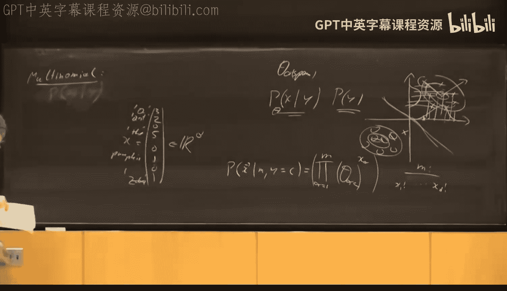

I can。Do this。 So I can basically say， okay， now we want to estimate。Theta alpha C。 So got more time。

 I want to know， what's my estimate of what's the probability that I would see word alpha。

 given that I have class C。 So this given that it's spam or not spam。😊，And how do I do this？ Well。

 it's actually quite intuitive。 I basically say， how many times did I see word alpha in my spam melts。

 right， So that that's basically the the fraction。 So I say I sum of all my， my， my data。😊。

And say the number of times。That sorry。First thing is I must have this class all let's say spam emails。

 some of all my spam emails， and I count how many times。

 this is how many times I see that word're alpha in those spam emails， and I divide it by the total。

对。Y equals C。 and this year。Can anyone tell me what this year is？All right， I' give you one minute。

 discuss it with your neighbor， figure out what does this mean。😡，And describe to me this fraction。嗯。

I。Okay。Okay。Yeah。あけ。Okay。啊。行。Yeah。Yeah。Yeah。Yeah。YeahYeah。Okay。Yeah。Yeah。Yeah。あ。诶。比较。Yeah。Okay。Okay。

Okay。All right， two things he or she has figured it out？Who can describe it？What does this mean。

Actually， I just realized。 this should be an eye。Maybe the two people off。 Okay should be an eye。

 right， I。😊，I beta。Okay。Now that I correct the notation， yes。

呃。Actually， that's not quite correct。This basically go over X I。 Yeah， how many words X I of I。

That's right。 That's right。 So basically， it's the。You有 you some of our old emails。From one to end。

He议C。This here has one， if it's spam， and if it's otherwise0。

 So you only look at the ones that are spam。 You could also just say some of all the spam emails。

This basically says， go over all the dimensions。And sum up the count of how many words there are。

So basically go through every single word and say， just， you know。

 have a cumulativeccumator that basically just says， just adds up how many words you have int total。

 You know， that's actually M。😊，Right。嗯。We assume that each Gmail has M for simplification， but。

There's also generalizers for， you know， emails have different length。 So then actually you just。

 you need this term here。 and so here what we do is we sum of our old emails。 And we say， again。

 we only some of our the emails that are spam。And then we say， how many times do we see word alpha。

 right。So basically， what we are saying is well say， well， in total， right。

 he goes through the entire spam box， right， And you say the word Nigeria， right。

 which is like a common word for spam。 I've seen that。😊。

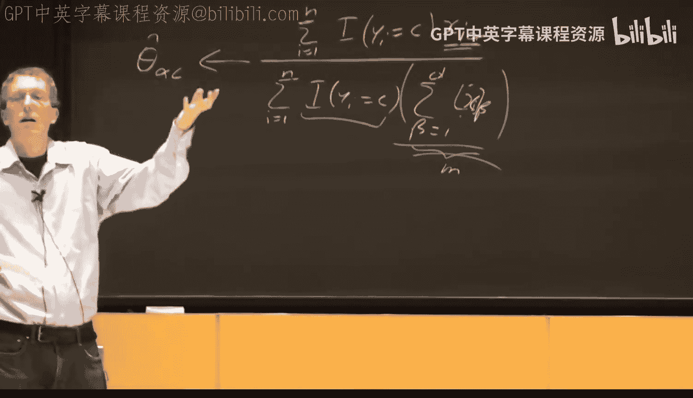

55 times that's up here。 I go through all my emails for each email account。

 How many times missing network word。 So 55 times。And then I go to all my spend， all my spam。

 all my spambox and say， how many words have I seen in total， right， maybe 10000， right。

 So then the probability of seeing Nigeria in in spamy mail is 55 over 10000。 Okay。

 so that's basically the estimate。

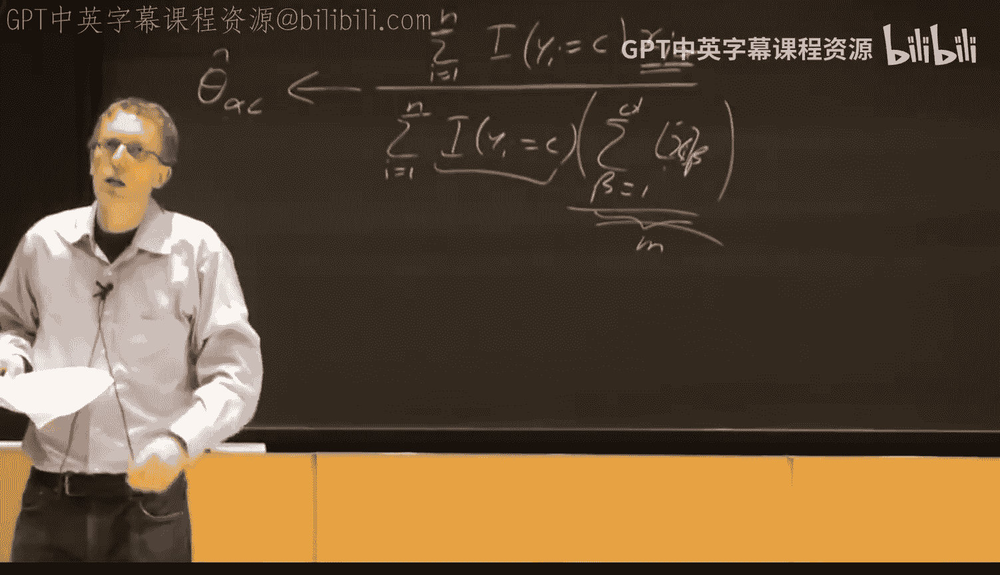

So in other words， if you would now go see your spam spam box and pick a word randomly from all your spam emails。

 right， that's exactly the probability that it's word alpha。😊，Okay， does that make sense。

 Can you raise your hand if that make sense。

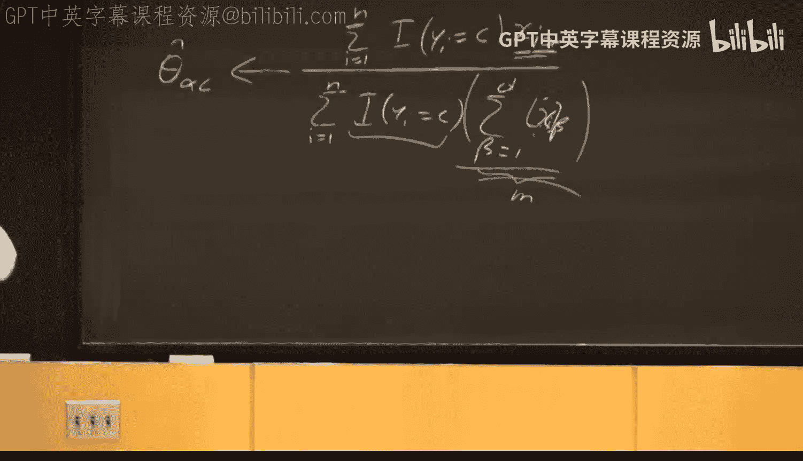

Ok。And so。If you want to do map smoothing。They basically have to hallucinate some words。

And the way it works in this case is that you actually have to sum up。You know。

If going to do plus one smoothing， for example， And you have plus one here。And then。嗯。

So here we actually have to some plus D。 Can anyone tell me why we have to。At D here。

Anyone except them。 What's your name。Arthur， okay， not Arthur， anyone else。ha。😊。

Next time I hear pick you again。That's right。 That's right。 Ex， right。 So early on。

 we had each feature。 we said we we assume that in this dimension， we see each value once， right。

 Now， actually， the dimensions are counters， right。

 So what we are doing is we are assuming were saying we assume we see each word at least once。😊。

RightSo we add a one here。 but down't really have to divide by， you know， add B。

 These the number of words in the dictionary。 Okay， that's typically what you use。

 because if you don't do this， someone puts in some really rare word or yout misspells a word that you've never seen before。

 And then suddenly you get a probability of 0 because you say。

 probably this word appears in spam is 0 because I've never seen it before， right。

 But that's actually not what you want， right， So these rare words， you know。

 usually one way of dealing with this is just you just assume that you've seen each one at least once in either spam or not spam。

😊，Any questions？

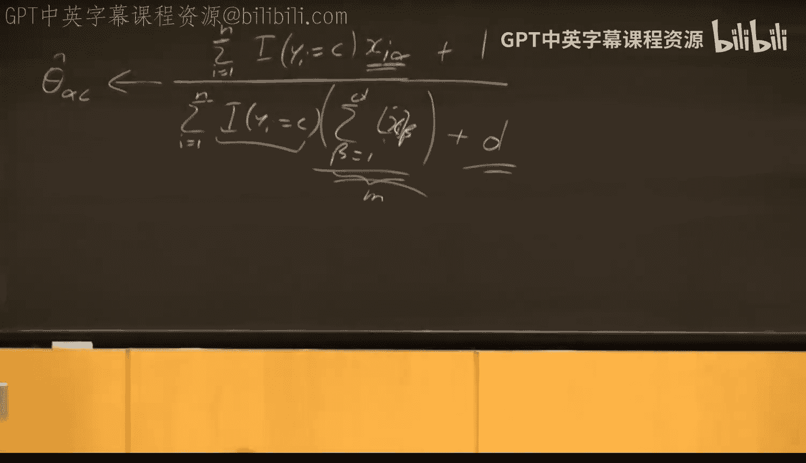

杭州。It's basically throwing out every single email that is not spam and not taking any。

Well this is just when you estimate， what's the probability that see word alpha like。

 given that I have spam， then you do the same thing for ham， which is not spam。

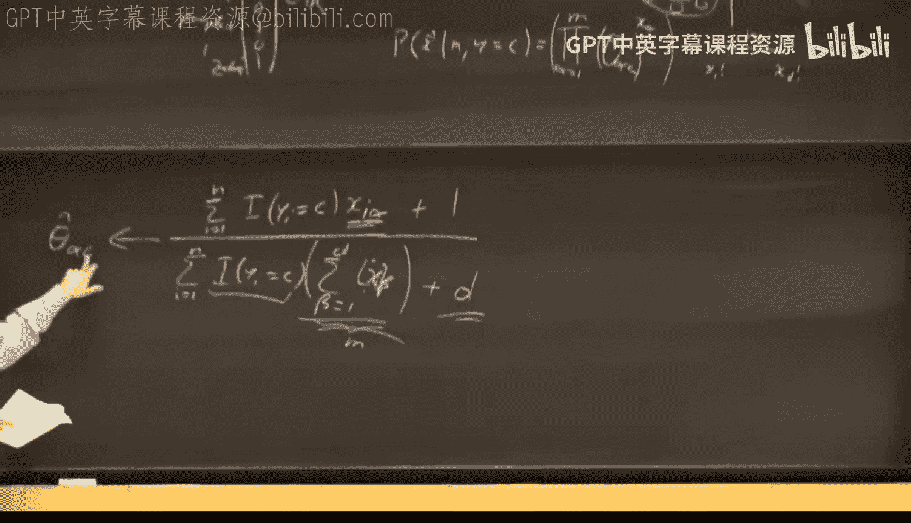

Yeah。Good question。 So you run this twice， right， so。You may now see why knife space。

 knifespace is so popular in Spm filtering。 Because what do you do when a new email comes in。

 all you do is you go through the different words of that email and increase the counters。

 right So for each word， basically， you， you store this counter and you score this counter。😊。

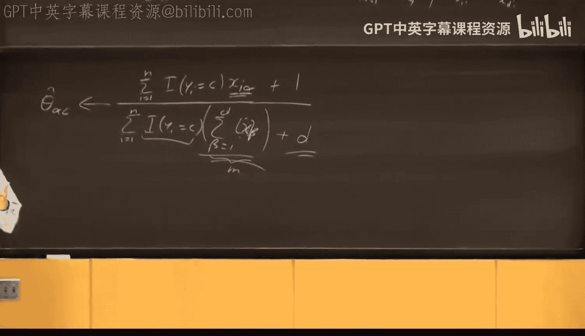

And you just increase both both of them， right， And then you're done。 So learning is really。

 really fast。 You have to retrain anything。 You have to run anything， etca。 right。

 So that's why most of your software probably uses nice based classifier， yeah。😊，再 okay here yeah。😊。

Okay， good question。 So he's saying， what if I misspell of word Right， So there's these people。

 I don't know if you remember this， there was a time in Viaggra spam was really， really big。

 And then people try misspelling it because exactly this reason， people use knife based classifiers。

 And so then the probability of Vigra， given that its spam was really high And it was really rare and not spam。

 So it was a very good feature， right， And the spam didn't get through anymore。

 Then what people did is they wrote just， you know， they wrote it like a one， right。😊。

They voted this way， right， I dont you want to write Vigra on the backboard exists。You。

And then so then actually， you know， humans still recognize what the word meant， but actually。

 you know， it didn't index anymore because it wasn't actually a known word。

 So people just threw it out。 right And so。

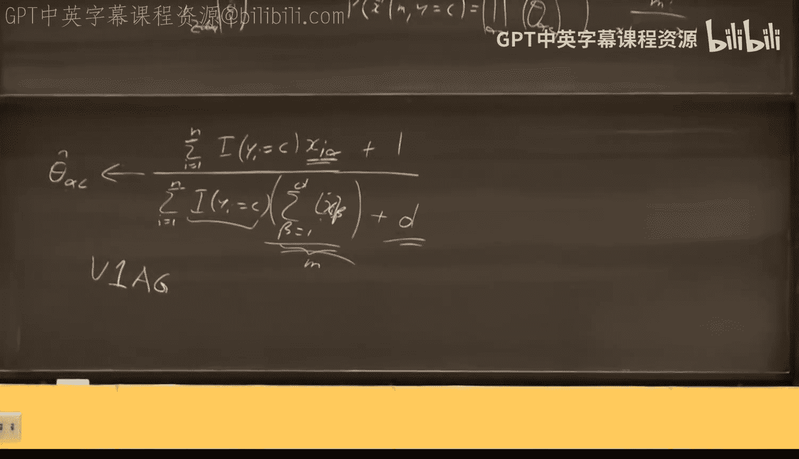

Well， one trick， actually， what we actually did。 So when I worked on this。

 we just write a hashing function。 So actually what we do is we actually don't have a mapping from words to dimensions。

 not a dictionary lookup。 What we do instead is we actually have a hashing function that takes us word。

 The word is input like you know y or whatever。 And that in that output some number between 0 and D。

😊，And if you any a hashing function， or anything you stick in there gets mapped to some dimension。

 So if you， if they make up new words， then basically next time you're retrained。

 you will actually have populated that word。So that's the trick。

 That's also how you get around many languages。 And it was people kind of suddenly write L O L or something that was a new thing that came out 10 years ago。

 And， you know， so you have to kind of these new abbreviations that kids come up with。

 You can can just track them this way。😊。

第二。Allright， okay， you answer me。 So in the case of Christians， you just say， well， come on。😊。

Doesn't matter all that much。So he's basically saying， what if I have two words， right。

 Like what if I have， you know， that's you have a really， really unfortunate coincide， right。

 like the name of your mother in law， right， matches Viaggra， right， Like， it goes in the same thing。

 right。😊，So now all these emails are going to spanm filter， right。So嗯。There's actually。

 there's actually two tricks around it。 So one thing is， what we actually really did。

Is we actually just hash it twice with two different hash functions。And so the approximately uniform。

 the probability of getting the same collision twice is basically 0。So then actually， if one collide。

 then actually， the other one doesn't。 And then you're still fine。But it's a very good question， yes。

Okay， any other questions， yeah。collected in software and market。There was scaling。

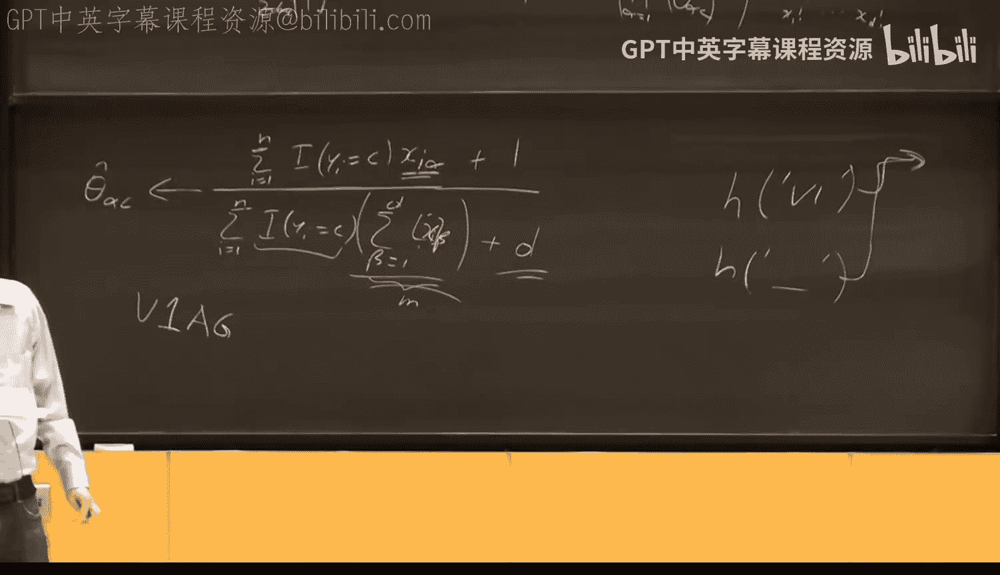

Overflow。All these counters。😊，So the question is like， if these counters get too large， you know。

 do you want to overflow problems。 So the question is like， if I just， you know。

 send you an email just with， you know， a million times of my agra in it， right。

 then I hope that the counter gets so large that it rolls over and goes to 0。 right。

 And then I've got you， right。And then you can try it my assumption would be that you use enough bits for these contents that you should be fine。

😊，AndYou have to really attack。 I mean， I don't know。 It's a pretty obnoxious attack。

It's a good question的's a good question。Okay， any other questions。All right。Let me。

 So this is the case。 This is actually the most common case for text classification。嗯。

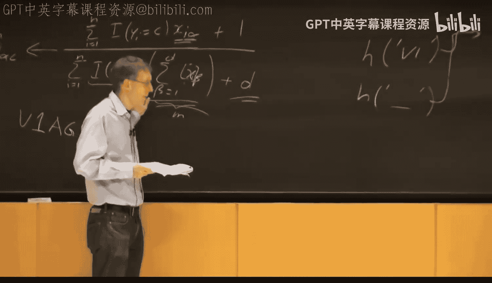

So Spmford has actually usually use my own multinomial classifiers also for project 3。

 which just coming out tonight， you actually have to implement an eye based classifier。

 And so that would be one option。 And I can show you in a minute what what it looks like， yeah。😊。

So what is the。Oh， here， that's this。

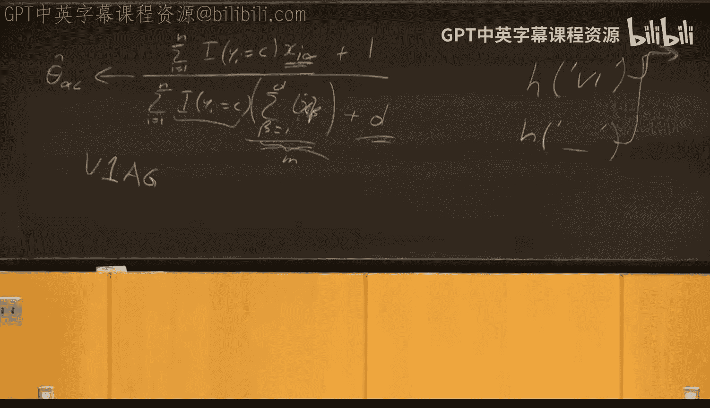

This， this constant here。

Just make sure that you don't incorporate the order of your email。Right， so this lady says。

 you go to every single word in order and say what's property that I got that order that many times。

 right？ But if you would now shuffle the if you write the email backwards， right。

 according to this as exact same representation。Right。

 so any order which you write the email actually has to be incorporated into the probability of this particular vector。

 So that's what this constant does。 Turn out in practice。

 you never have to compute this constant ever。 Can anyone tell me why。第二。あか。来。That's right。

 That's right。 So it doesn't actually matter。 right， So I just want to know， ultimately。

 I just want to know。I could just do the following。 What is y equals spam。

Given x divided by P of y equals not span and not equals span。Given X， right？

 So that's ultimately what I'm looking at。 If it's larger than one， then I'm going with spam。

 If it's less than 1， I go with not spam， right。These two have exactly the same constant。

 so you can just cancel the constant。 Okay， so， so you never actually ever compute this。

It has to be a little bit rigorous。All right， now I'm going to answer the burning question that you all have。

What if my ex'es are continuous， That was what you were thinking。嗯嗯。So so far， basically。

 we always had counts or categories。 So what if you actually say my X alpha。

Is element of some of R right， or X element of。So these actually can be real， real numbers。

And so you can make many， many different assumptions。

 So you can basically model this with any distribution that you want。

 But a very common one is just the Gaussian distribution。 Why the Gaussian， because it's so nice。😊。

And。So basically， what you're saying is。

Is saying the probability that I see a certain X alpha given y。

It's drawn from some Gaus distribution。You know， with mu。阿phay。呃，在。アフ cス square。Okay。

 so I basically say I take a Gausian distribution。

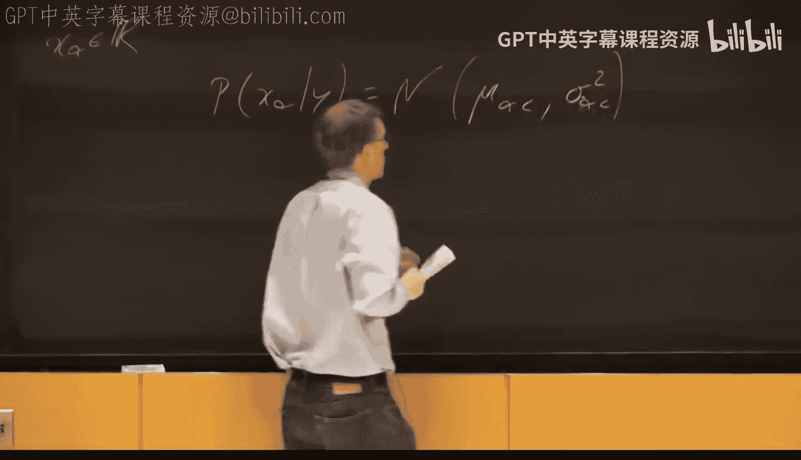

And it has some mean and some variance and have a different mean and variance for each feature and for each class。

Okay， so， typically， for example， if you had a classic， you know， patient data or something。

 a typical one would be height。 right， So height is something that's normally distributed。 So here。

 actually， the Scus distribution is a very good， you know， approximation。😊。

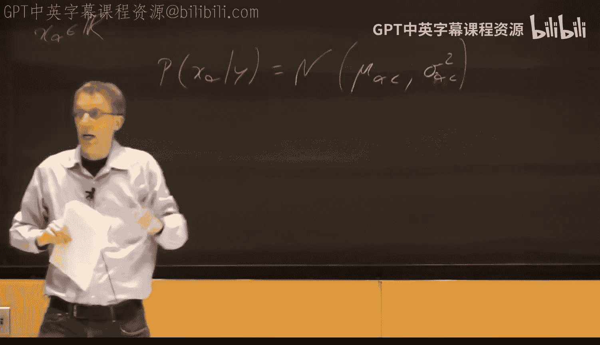

And you basically say， well， you know， let's say I want to classify if someone is a male a femalena。

 Well in this case， actually， we have exactly this， right。

 We have two different means and two different standard deviations， right， And ultimately。

 it's a Gaussian distribution， High is a Gausian distribution， given that， you know the gender。😊。

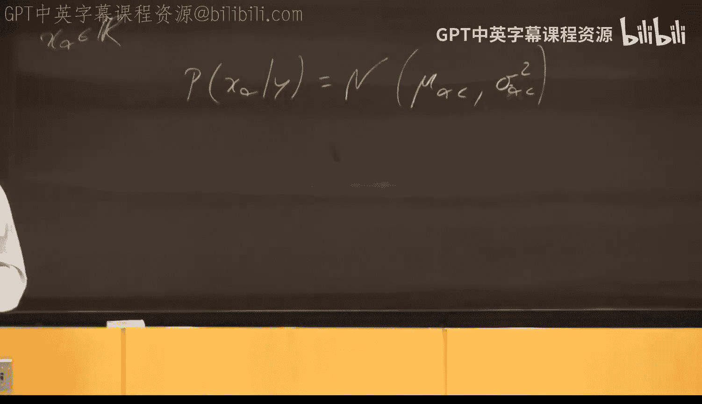

How do you estimate this？😊，So， so just you know， back to that picture sorry。Yeah。

 because you basically have your your。Your positive points and your negative points。

 right what you're basically doing is you're collapsing these onto the x's and you say this here has to be a Gaussian distribution。

 So that's the approximation that I in。 And I say this year has to be a Gausian distribution。

 Then I multi these two。 and I get a Gaussian distribution here， right。😊，Does that make sense。

 Raise your hand if that make sense。OK awesome审。So how do we estimate this？ Well。

 for a certain certain feature alpha and a certain class C。What I'm saying is I say， I s all。嗯。

A changement changement。Okay， well， let's just do this。So sum of all the points。That half that class。

And just average。嗯，呃。So all I'm saying is。Ignore this。 This This hurts your eyes。Just listen to me。

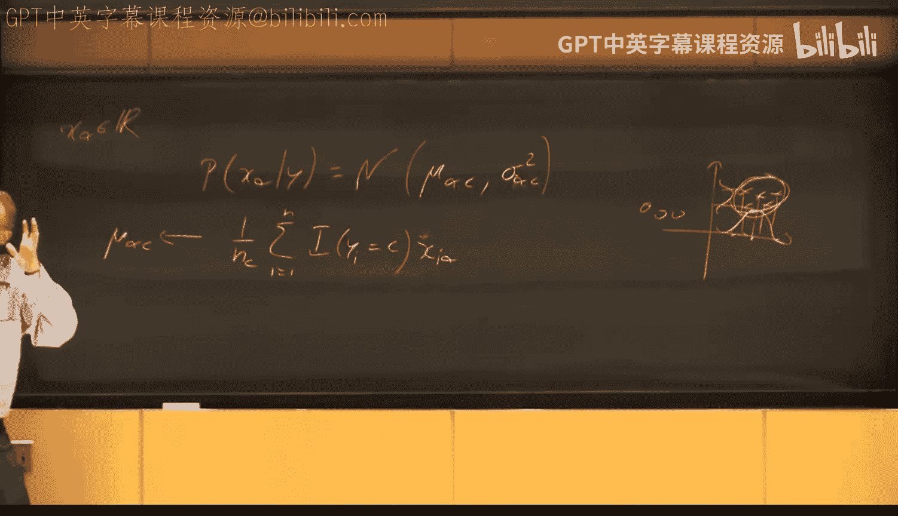

What you're doing is for each feature alpha。It just compute the average value。That's what that is。

 And you just compute the average value。For even within that class。So let's say， you know。

 take all the， the， the patient filess of。我们。And I compute the average height。That's new alpha。

 given that they're men。Mle of height given that I men。 And then I take all women。

 and I compute the average height。 And that's the mu of height given female。Okay， so that's。

 that's all there is to it。 It's really， really simple。

 where N C is the number of points in the class。And C equals。嗯。Y， I equals。Any questions？

So this is the likelihood maximum likelihood estimation of Gaussian distribution。Yeah。

That's exactly right。 So his question is， what if I have some discrete and some continuous features。

 right， That's perfectly fine。 You can say some I modeled with a Gausian distribution。 Actually。

 any feature could have a different model。 right， That's totally totally fine。😊。

You just got to uphold the the independence assumption， as he said。And。

Good so once you estimate the mean， now you the variance。 But what's the variance Theres again。

Not a big deal。So。it's just the definition of the variance。 right。

 So we just sum over all the data points that have that label。And the。

And I just compute the difference from the mean squared。 right。

 That's exactly what the definition of the variance。So hopefully that should make a lot of sense。咩。

Yeah。You need to adjust for it being like a sample versus a population。系咯。Oh。

 you mean minus put it -1 here or something。So nitpicking。I'm the only assuming independence， anyway。

I， I wouldn't think it makes a difference， maybe。I'm sure someone has written the book about it。Yeah。

But it's a good question。 It a very good question， yes。嗯。Okay， any more questions about this。

Then we are actually done with the estimation part， so。哎。So just one more time， basically。

 you get your data。 And what you do is you assume some distribution。

 you say either there's Gaussian or there's binomial， there's multiomial， right。

 This are some parameters。 And the Gaussian， you have the parameter me and sigma， right。

 The multiomial， you have the theta， right， and so on。

 And then you estimate that from the data using maximum likelihood map。😊。

And so these are basically the ways of estimating this。

 Please go through this and make sure you understand it。

 I also post a bunch of things on the homepage， pointers on the homep page in case there's any uncertainty。

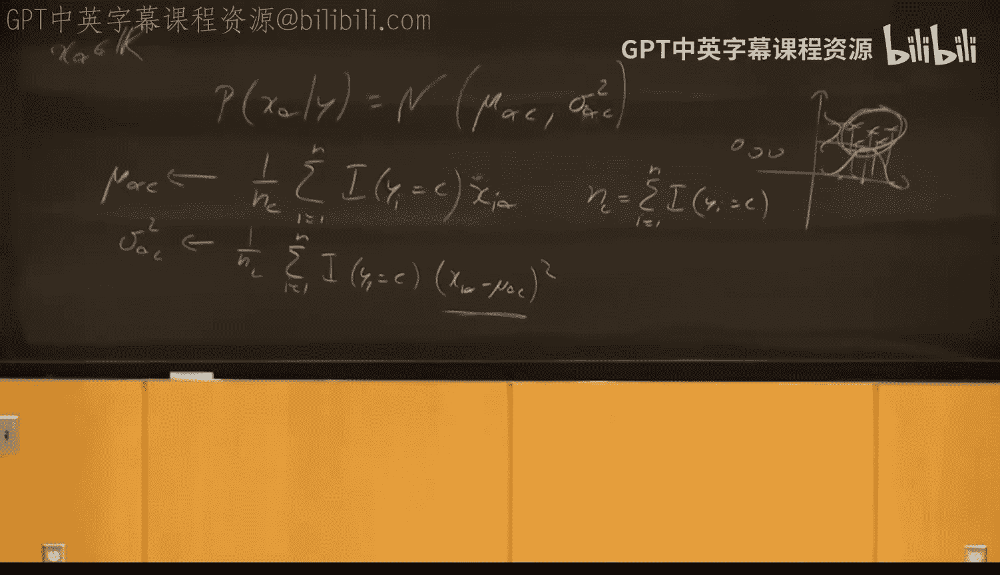

Okay， one thing I want to show you。Who wants to have a demo now versus at the end。Baaz hand。

 if you want to have it now。At the end。It's a tie。Alright。Okay。嗯。Alright， okay， good good。You know。

 I might run out of time。 That's that's the。

I guess youd drive that right dont enough time。Okay， so here's the。Actually see。

 maybe I can show you the。是。So what you need to do for the project。

 Maybe I first show you what you have to do for the project。

 So the project this time will be the following。 I give you a list of baby names。😊。

So can you read this。嗯。Okay。Boys train。So heres， here's a list of space。

 What I did is I went through some list of of baby names。

 and I randomly picked 500 names or 600 names that are boys that the United States registered as boys。

😊，And。Then you also have。600 names that tend to be good right to Sierra， Myra， Stepany， Annaella。

 et cea， right， and so。😊，The task is the following， given a name that's not in that list。

You to predict if it's a boy name or if it's a good name。Right， and so。

What I want to do in the project is to first extract features out of a name。

So think about what could be good features。 I give you some as an example。And so。

 and then train a knifeive base classifier。 But you basically then， you know。

 train a classifier the be just takes a name and then predicts， is it a boy is the girl。😊，And so。

I can now test this。 I can。嗯。Dmo， here we go。I don't know if you can see this， okay。

This is very small， right， This is very small。I don't know how to make it bigger。 One second。

They just about A。And one second。I don't know how to make it larger。 Sorry， this this this largerhu。

对。I guess better。 No， this is worse。

Okay， this better O， this better。Alright， so who are you， Let's type in。Stepeven， right。Steven。

 I'm sure you're a nice boy。 Okay， so it's got it right， right。So nothing can try Anna， right。Anna。

 I'm sure you're a nice girl。 Anna know， I can say Donald。😊，Don， I'm show you' a nice boy， Hillary。

 How about Hillary。It's nice girl。 Okay， got that， right。Arthur， you， I know you。

 I just you just reviewed your name。 So you， you're nice boy， goods。😊。

You can any names you want to try。Sorry， kill and all come on。😊，Yeah， I got it right。

 What about type with double L。yeah， okay， it's pretty robust。😊，De。

Someone in the department is called Lillian。 Let's Steve Lillian。Asd to go。 All right， perfect。

What is it。Pat。P A T， Pat， is it supposed to be a pointer guy know。Yeah。There， of course。

 sounded are tricky。 right So Robin。 Robin could be a boy or girl。Turns out， you know， things quiet。

 but it could tailor， okay， Taylor。I' the boy。Alex， think boy。😊，😀H。Alright。

 so you can see it it it actually works pretty well。 I think it's pretty I have'。Can see。天么。你ika。

I know。 actually， Z far has gotten everything right。 Any anyone。

 anyone wants with any adventurous names。😊，奥巴马。Yeah。Good，😀Yeah。😊，😀All right。

I'm sure Donald Trump would be very pleased to hear that he is a board。😊，Anyway。Al right， so。

Any any other ones otherwise can take the department chair。 Let's see yeah。

 that works Fred Schneider。😊，Okay， he's good。 Okay， we are safe。Al any any ask one。Barack。I。

 I see paraamas really and not。 Yeah， that's a boy。 Okay， guys， that's， that's actually more fair。

 isn't it。T， if we go。Yeah， he's pretty me， all right。So。

 so this is what you have to implement as the project。

 And then there's going to be a competition where you basically take some test data。

 and then you will see who can actually get the， the most accurate classifier。 Of course。

 there's an upper limit， right， because some。😊，Names can go either way。嗯。Alright。

 let me just take a demo before we actually derive it。嗯。We also。

 I I can also show you a demo G And B。 So this is actually now I'm running a Bayesian， sorry。

 a Gaussian。😊，Now you base classifier。So here's what I'm。 I just have two dimensions。 And I now。

 you know， draw some some points in two classes， circles and crosses。😊。

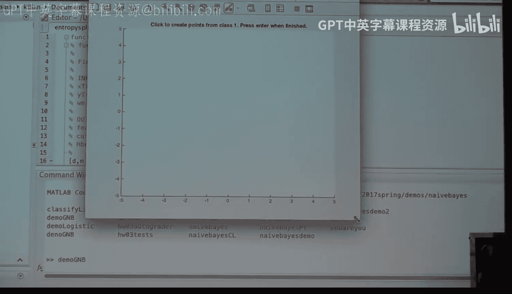

And then I look at the decision boundary after training。Okay we first take the positive points。

 and I take some positive points。嗯。And then I draw some negative points。And。You can now run it。

 and you can visualize the decision boundary。 here I'm assuming that the features are real numbered and assume a Gaussian distributions。

 is what we just did。 And so if I now run this， this is what we get， right。

 So this is actually turns out as we will prove actually。

 this is something we will prove of the and homework， actually。😊。

It it ends up being exactly a linear classified， so。Implicitly。

 by assuming that the features are independent and that they are Gaussian be made the assumption without realizing it that it must be a linear classifier。

 right That's actually it's relatively intuitive because actually。

 if you have two Gaussian distributions， Then actually the the line of where you say it's more likely to be classified from one Gaus drawn from one Gaussian than the other。

 turns out it must be a hyperplane。 it's relatively easy to show。😊。

So one thing you see here it actually got all the points correct， right。

 So all the crosses are on one side， all the circles are on the other side。😊，嗯。

That doesn't necessarily need to be the case。 So with the perception on， we showed that actually。

 they will always give us a separating hyperplane。If they excess one。Chor for the knife base。

A classifiedifier， that's not the case。And how， can anyone come up with data set that I could draw where we actually。

 that's linear separable。The perceptionceptron would get it right。

 but the knife bay is going to screw up。It not will misclasssify some point。

 So maybe think about it for a minute。How would I have to draw the points。

ESuch that knife base will not even get all the training points， right。So。

Maybe discuss it with your neighbor for a minute。Just think about it。

We're trying to trick the knife base classifier。 Think about what it does。Okay。系。Yeah。Yeah。Yeah。

And呀 yeah。Yeah。Yeah。Okay。Right。Alright。 I think you are the first person you're volunteering a data set。

😊，Where is the right。对不对。1 x， to the very right。Okay。Yeah。Okay， good， good， good， good， good。

 So he's basically saying， I know where you going with this。😊，Bam， right， They got it wrong。

 Why did it get it wrong， Can anyone explain it， or can you explain it。The you。道。On the left side。

That's exactly right。 right。 So this X here is misclassified。 In fact。

 even this one X here is misclassified， right， And what's happening is we made an assumption that these。

 these points here， if projected down here are going to be Gausian， right， But actually。

 theyre basically very heavily concentrated here， right， And then this guy over here， basically。

 you know， it is ultimately in outlinelier， right， It's so， so， so unlikely。

 given that you have this， this distribution， right， that。😊，Well， think about the other way。

 we're assuming this thing here is a Gaussian， right？ So basically it draws a Gaussian around here。

 right， And it has a Gaussian for the X is over here。

 So this point here actually is much more likely to be drawn from the os， right。

 It would make more you know， actually it would become even clearer if we have multiple os。

 So let me just draw this again。 let's say we have， we have a bunch of os here。😊。

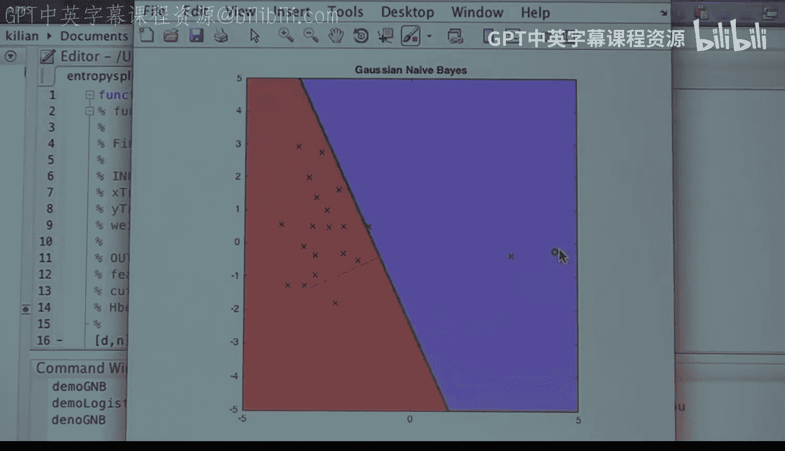

And then， you know， we just have a few x's here。 but the bulk of the X really is over here， right。

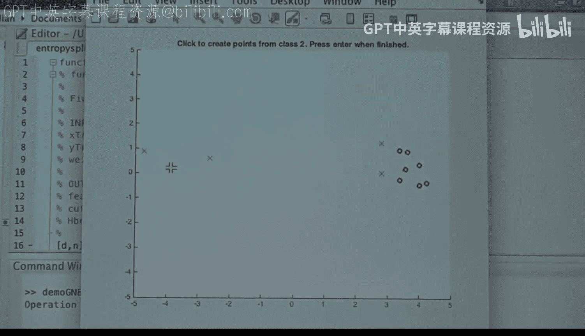

Then if you model this， right， it basically models these points here as a Gaussian and the O here as a Gaussian。

 And clearly， these points are more likely to be drawn from the o's than from the axis。 right。

 And these two points just don't carry enough way to move the mean of the Gaussian over So despite that is completely inresceptable by the perceptionception。

 if I had the same data that the perceptionion would actually find a classifier right here。

 right in between。😊，Does this make sense， Any， any questions about this， yeah。这表。That he's right。

 So this is exactly points on this line of 50，50。 That's exactly right， right。

 So yeah exactly the ratio is one。 So you could be either one or the other。いや。That's part of Ba。

Perception or knife is or knife is much fast。Because just counting the knife base， the perception。

 you keep going over the data set。 it actually can be really slow in terms of convergence。对。こニュス。搞先。

So if you have a water distribution。や。Right， right。

 So the problem here is that they made an assumption that the assumption was the data is Gaussians distributed and that just doesn't hold。

 right， So that's what breaks it。So if you had a different distribution that that's more accurate。

 then it would be better。Right， so you could have a， you know， you know。

 muji modelal Gaussian or something， right， like， you know， Gaussian mixture models。

 but it gets more hairy Then， right， it gets a lot trickier。😊。

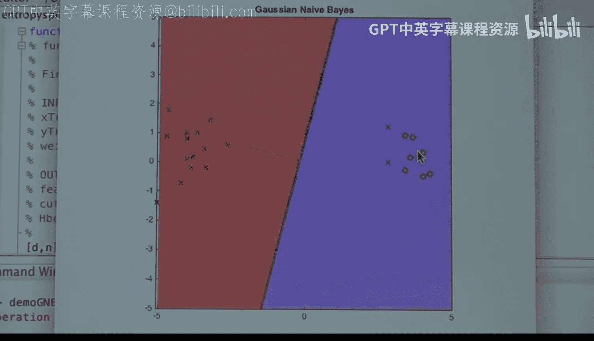

Yeah， just because it's easy。对。All right， see you all on Wednesday。

