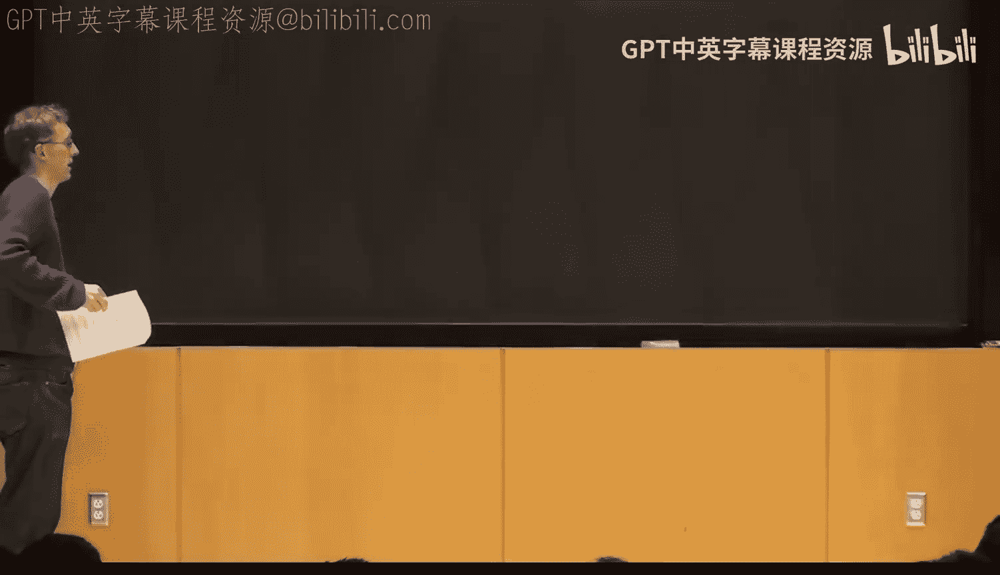
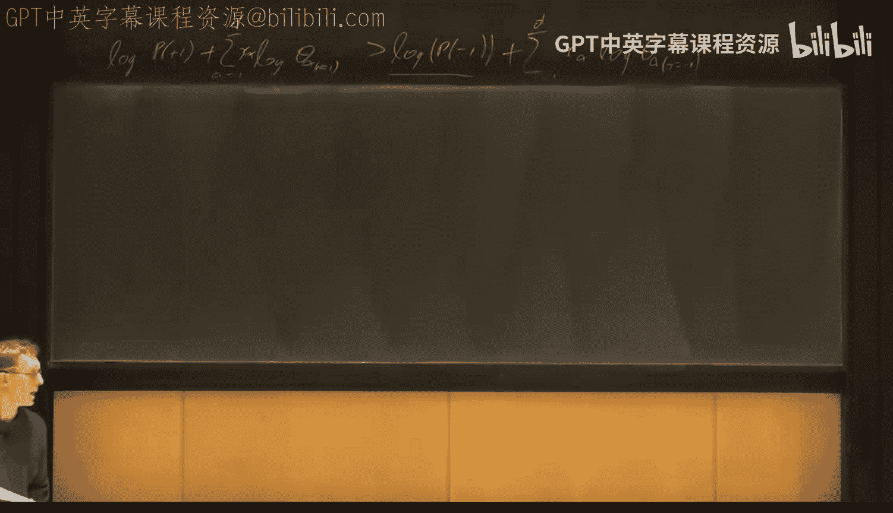
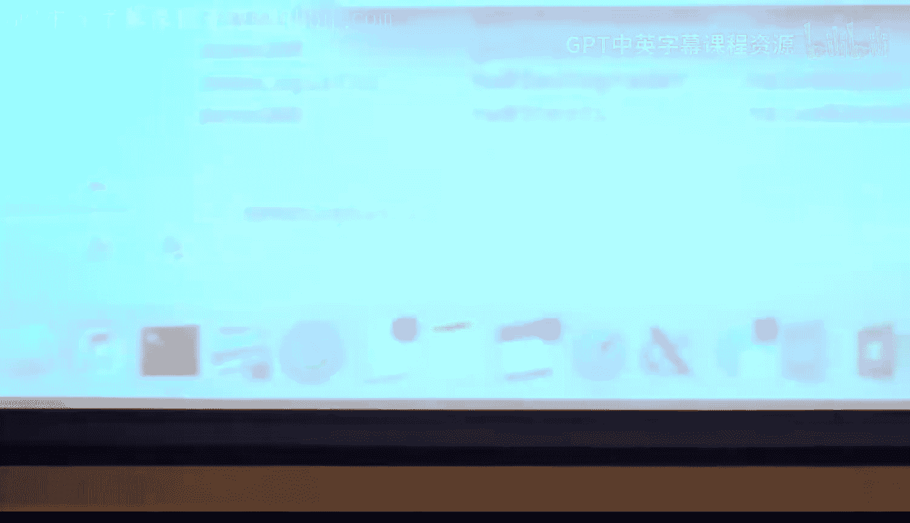

# 011：康奈尔大学《智能系统的机器学习｜CS4780 Machine Learning for Intelligent Systems 2017》中英字幕 p11 -11-Machine Learning Lecture 11 ＂Logistic Regression＂ -Cornell CS4780 SP17.zh_en -BV1Lo6gBxEKE_p11-

Okay。As you may have seen， the next project is out on Naive Base。😊，嗯。Today。

 we will transition from na base to logistic aggression and to empirical risk miniization。

 and then we will then the next project actually will be shipped out。

So there will be one more project before the midterm。So please get overlapping。

 so please get started with the knife face that you're on track。All right。

 so we've been talking about knife face。 and you know the general idea is you fit this。😊。

Distribution。You know， you want to know P of y given x and you say， well。

 that's proportional to P of x given y times P of y。Do people know what that proportional means。

 Raise your hand， if that makes sense。Okay， so it's basically up to normalization， essentially。

 right。So that you divide by something， then you have equality。

 divided by something doesn't matter in this case， because we're just interested in in the ratio of two classes。

嗯。All right， and so well， let's say we have two different classes， plus1 and -1。😊，And。You know。

 we basically estimate these two distributions individually。

 so what we do is we here we just estimate how often do we see that class plus one。

 how often do we see the class -1 and here we actually have the probability of x given y and here this is where we make the night base assumption and we went over several cases last time。

😊，You know， including monogenomial and Gaussian， basically in the Gaussian。

 we take each feature and for the Gaussian and multiomial。

 we assume that each features count how many times we've observed that feature。

So let us look at the multiomial setting。ForFor a second， so。Assume we， you know。

 we have a classifier and we say that the， you know， what it does it predicts a plus one。 Okay。

 so when does it predictor plus  one， Well， if and only if P of。Y given x， y equals best one。

It's greater than P of y equals -1。Give an X。 Okay， so in this case。

 you basically evaluate both of these and you say， what's the property that my label my data point access。

 This is a plus  one。😊，Y equals plus 1。Has a probability plus  one。

 What's the probability that it's sorry has a label plus 1。

 What's the probability that it has a label， -1。 If this one is larger then the base optimal classifier would say。

 go， you know， go with the more likely one。😊，So。Well， this decomposes。

 so we can actually plug in these following terms。 So we basically say， well。

 that's the case only if so y P of y 4 plus 1。 Let me just do a plus one here。 plus one。😊。

It's greater than the same term given minus1。Okay， so that's the same thing。 right。

 So I'm basically saying， I'm just taking， you know， exactly， this is just base rule。

 I's say this one， the probability that basically we get a label plus  one must be larger than we get a probability-1。

 Raise hand， if you're with me。😊，All right， awesome。 Good stuff。😊。

I assume we do a multinoial distribution。 So if you remember from last class。

 multinoial distribution， the doesn't affect this thing here， but affects the assumption。 you know。

 that we are making about the distribution of the features and。Let me just say these are vectors。

 So we start from last class。 This is the， the distribution here is basically， you know。

 we had this M factorial over。X1 factorial， X D factorial times。The product alpha equals 1 to D。Cta。

F C。X alpha， so what does is basically， we go through all our features from one to D。And we say。

 what's the probability that we rolled exactly that feature X alpha times where X alpha is basically the value of that particular feature。

 Okay， so that in the spam setting or something we have an email。

 we go through every single word in the dictionary。 we say。

 what's the probability that we observed exactly that word that many times， right。

 Given that it's a particular class or here the class is plus one。😊，Okay。

 raise hand if you're still with me。Okay， good。So then I do the same thing for the other one。

 as I times P of plus one。So the same thing for the other， for the case where I have。XD factorial。

 and now I say the product， I go over all my features。

And now I roll the different diet all the -1 die。 So that's now the spam。 or not this。

 This is the spam。 This is the not spam die。 And I say。Times the。Probity of mines。Okay。

 so all I did here is I plugged in this， the definition， you know。

 from maggenial distribution in for P of x， given the label， yes。😊，Larger。See。Oh， yes。

 I can write larger。 That's right。 Okay， good。 I guess you can't read these。😊。

Doesn't matter because they're actually the same on both sides。So we've removed these constants。😊。

And。So now we are left with this expression， right。

 we basically have a product of many of these probabilities on the left and on the right side。

 And so what do we do when we have a product of many probabilities。 Who knows it。

 Because we are computer scientists。😊，Good we take a lock right so that's exactly what we do。😊。

No，Alright， so now we can take the log of both sides。 It doesn't change anything。 right。

 It's a montonically increasing function。 So if the log of the left side。

 if the left side is larger than the right side， then the log of the left side must be larger than the log of the right side。

 we can take the log because both must be non- negative。 baggage must be positive。😊，And so。

Let's take the logs， then we get lag off。P of plus one。Times the sum over alpha equals 1 to D。呃。

Log off。Greatai， sorry。 This is x alpha times log of theta alpha of plus  one。This is not alpha plus。

 this label plus  one， y equals plus  one。Must be greater than log of P of -1。

Times the sum over alpha equals 1 to D。 And now x alpha times log of theta alpha and label is -1。

One more time， what I did is I just took the log on both of these sites。Okay。😊。

Any questions that I forget some term。 there's a plus， sorry。Was that your concern？ Okay， good。

Raise the hand if you're still with me。All right， good you're holding on， squ， good， good。All right。

 so。Well， here's what we can do。 right， We can now actually take。

Collect the terms respect to X alpha。 Like we always basically， what is this， right？ It's a sum。

Of many terms。I we have X alpha times some term， right。We have the same thing on this side。

So what can we do， we can pull these sides over here。Okay。

 so if that happens when we get the following， we say we get log of P of plus 1 minus log of P of -1。

He what I did， I took this term and just moved it over。All right， and then I said。

Alpha equals one to D。 And then I have， I take these two sums。 and I， you know。

 move the right sums on the sum on the right over to the left。 right。 So what do I get X alpha times。

Log of The alpha。Plus1。Minus log of。Theta alpha -1。And that must be greater than0。Okay。

 one more time。 So what I did， I just collected terms， right。

Subtracted the right side from the left side。 And so I put the two log probabilities together。

 and I put these two sums together。Raise your hand if you're still with me。All right， good， this was。

 you're almost there， you're almost there， so here's what we do。Because this year。W alpha。Okay。

And you call this here。B。Okay， so this year has one constant。 There's just a scar。And this year。

Is for every alpha is one value， Right， So we actually get alpha is from one to D。

 There's a D dimensional vector。So what does that mean？자的。W transpose x。B呃 plus B。

It's greater than zero。What if you just shown， Can anyone tell me。It's a linear classifier， exactly。

 right？It's nothing elseison an then you classifiedify。

And we just have a very specific way of finding the Ws。

So the perceptionception was one way of finding the Ws。You have the perception on update rule。

 And knife base is another way of finding the perception you know， the weights of W。

 And you just define them this way。 But you estimate the theta。😊，Using Emily。

And then you compute your ws and your B that way。Chrisestion。たど。

So it doesn't work for all distributions。 It depends on yeah。 That's right。 And so actually。

 that will be the homework。 The homework people actually look at other distributions。That's yeah。

 good question。So you can easily make distributions that doesn't work at all anymore。 But actually。

 the， the interesting thing is you typically， the most common case is actually multinoial。

Because it works really well for these kind of text document classifiers，Actually。

 it's also true for Gaussian knifespace yeah。Yeah， what if data isntpar that's right， good question。

Percept， John。Does anyone does anyone remember what happens if you run the perceptron algorithm on a data set that's not linearly reseparable。

Hes screwed。 good。 Hes screwed。 I like it。 All right， It just loops rap， right， Like it never。

 ever converges。😊，So what does knife face do， Can anyone tell me。Does it look forever。

The answer is no， because there's no loop。Yeah。It gets an answer that's like reasonably good。

They gets the answer that's reasonably good。And what does it do essentially？😊。

It just fits the two data sets， right， the two， two classes with the modnoial distribution and then says。

 if that was true， if the data really came from these multinoial distributions。

 then here would be the hyper planee， right， It doesn't。Right， but， you know。But if it was true。

 if the data actually was the way I modeled it， then actually I would have a really good time play。

 That's basically what it is。And。Even actually， if the data， if your modeling is correct。

 it doesn't need to be linearly sparable。 right， you could have two Gausians。

 Let me show you an example Yeah。 You could have two。You could have two Gausians， right。

 They' basically like。I have my Gaussian here from which I draw my X。

And then I have my second Gausian here where I draw my circles， and these are certainly overlapping。

 right that's okay。knife face Gatifier would model both of these as a Gaussian if you used the Gaussian knife face and would then basically find a hyperplane that best separates these two Gaussians。

😊，So would basically if find a have plan here。But that's a very important distinction to make。

 It does not find a hyperplane that best separates the positive from the negative points。

It finds the hyperplane that best separates one distribution from the other。

 and it fits these distributions from the data。So that's an important distinction to me。

Any questions？Yeah， does this mean the knife base is generally superior to the receptor？呃。

And so typically， so there's a few advantages of night base。

 So one thing is this year does not require any loops over the data of anything， right， So you just。

 this is really really fast to estimate。 and it's very fast to update。

 So that's that's very advantageous。 The second thing is you don't have this data。

 If you would have a spam footage that's a percept on that would be really terrible， right。

 Because occasionally you're gonna misclassify a spam email is not spam or something。

 Now your data set is no longer linear receptable and basically have a loop forever。

 So in that sense， that's true， right， the perception is not generally used anymore。

 but derivatives of it are used。And actually， that's exactly where we are going now。

The perceptron is a discriminative algorithm。 So what a descript perceptron is trying to do is try to model y given x。

 and knife face is a geneative。 algorithm models X given Y。

 But there is a formulation of this that actually flips it around。

 And I will get to this after this question， yeah。😊。

Because this is a generative model of work modeling the two distributions。

 like not only is it because does it create a hyperplane that is a linear classifier？😊，In principle。

 you should be able to pull out a probability。Every data point。Right， that's a very good point。

That's big。So no， no， so so he says one advantage of the knife based algorithm is that the end。

 actually， you get a probability， right So you can actually say， at the end， I get P of y give an x。

 get the probability that it's spam and the probability that it's not spanm right Sometimes it doesn't matter。

 I just want to know is should I move in the inbox or not。 But sometimes it's really crucial。

 So for example， if your doctor and you say， you know， I'd say。

 you know I want to do some brain surgery and you want to say is this brain surgery necessary， right。

 yes or no， well， you may be interested if the probability is just 51% versus 49 right。

 may want to do another cat scan I dont know who knows what。

 So these probabilities basically these probilities give you a measure of certainty And that comes for free in knife base。

 Actually， it's not that every that you have to have a generative model to do this。

 So discriminative model also have these probilities can have these probabilities。 And actually。

 the one people will talk about in a minute。 also has these actually。😊，But the perceptron does not。

 Someone just had a question， oh， yeah。You just repeat what you said about how。啊先翻系。Separate。ポい。Yeah。

 so， so what naiveb does， right， It takes your data。And you have points here。

And you have points here。喂。And then it models these， these data points with a distribution。

 That's the step when you estimate the theta。For your P of X given Y。 So you make。

 you make a decision here。 You say whats your distribution P of x given Y。

 You say that's multinomial， right， You do this as a data scientist who understands the data。 right。

 So that's where your knowledge comes in。 Once you've made that decision。Now this。

 your distribution has some parameters。 for example。

 the homoome is this particular theta and you fit that theta。 That's the maximum likelihood。 Okay。

 the first step is you decide which distribution you use。 Second one is you estimate the parameters。

 At this point， now you substitute the data with the distribution。 You now saying。

 if my model is correct， This was drawn from the following distribution。Here。

 these are kind of these。Surface plots kind of think of this as a mountain that comes out of the。

 out of the right， backwardboard and。😊，Then at this point， you don't look at the data ever again。

 right you're now separating just these two distribution。 This can go horribly wrong。

 And we saw these examples last time when I asked you guys， what data set would break it， right？

 If you， for example， have something that you have some points here。

 really close by and a lot of points far away。But in this case。

 and if you say it's a Gaussian distribution。 Well， what it's going do is's gonna， you know。

 basically you know， have a Gausian distribution here， maybe a little bit of an。Something like this。

 right。 And so what about to do if we have these points in this distribution and this distribution。

 you would find the hyper planee somewhere in the middle and basically sacrifice these points。

 The perception would never do this because it separates the data。

knifeive base first approximates the data models the data。

 and then basically using that model gives you the best decision boundary。 But if the model is wrong。

It gives you， you know， gives you a wrong result。Does that make distinction here。

 So the would like you would never sacrifice those That's right。

 It would keep updating until it finds a decision boundary。You know， that catches these， right。

 On the other hand， if there isn't such a decent boundary， it will just keep going forever。

 right there nice faces like whatever， you know。对嗯，是谁？You guys are clever。

 So his question is the following。 Let's say I take my data set and I， I make a prediction， you know。

 and I have a test data point。😊，And I'm pretty sure， right。

 the the knife base classifiers as this is。You know， 99。9% confident this is spam email。

The fact that I'm so sure， right？You know， means that you know， it's probably right。

 So kind of just take this data point。 now， put up my training data。 Now I have more training data。

 and now I retrain。 right It's called。What is it called self training。And。It can work。

The problem is typically that if you move at the ones that you're really confident about。

 you're actually not gaining much because you already knew about this point anyway。嗯。

So what you really would like to add is the ones that youre kind of right。

 But then youre right on the edge， right， of course， that's a risky business。

People have gotten a to work， though。 You can basically do this， but there's a little bit more to it。

 But yes， in principle， it's a good idea。Okay， any more questions？Yeah。Sorry to you。

If you don't have a closed form here。Oh see if this all。Yeah， yeah， yeah。 I mean。

 if you don't have that， then gets nasty， right？You don' you make no modeling assumption。

 You don't need a distribution。So that's that's that's certain advantage of the perception。

 That's right， right。 So the knife base， like the knife base base you know。

 has an advantage when you have a good estimate of what the distribution is， right， And ideally。

 if the knife base assumption holds， right， that'， that's where it really kicks in。😊。

Okay， so one thing that will be on the homework assignment。

 the next I think it's coming out this week， actually。

AndYou have to derive the following thing that if you actually use a Gaussian。

Like we just did this for whatjiomial。If you do the same exercise， right， we started out with saying。

 what's P of x given Y given x。 And then we went through it and we plugged in the knife based formula and we pluglged in the formula for mod distribution and so on。

 And the end， we basically， they came up with a linear classifier。😊。

If you do the same thing for a Gaussian knife base， then you get the following expression。

That's1 over1 plus e to the minus W transpose x times y where y is element of。Plus 1，-1。Okay。

 so so at this point， you just got to believe me。 And then if you don't believe me， wow， great。

 you know， you can actually verify it。😊，So maybe Ill give you a minute to digest this equation。

 I want you to become one with this equation。So discuss it with your neighbor and think about the following。

 Let's call this thing here Z， right？So this w transpose X。 So Z times y。 Think about the following。

 What does this function look like If z times y becomes really large， it becomes really low。

 like negative， right， really， really negative。And what does that tell us about this function。

 So think about this， discuss it with your neighbor and just get some intuition。

 you're going draw it in a minute。 So try to draw it， right， as a function of。Here is， you know。

 this here is Z times y。哎。大丈す。Okay。Yeah。Yeahで。Yeah。Okay。他在し。First。反个。Okay。

 who can tell me what this function looks like？😀Yeah。😊，Who is brave enough to when you can to just。

Describe it， yeah。whether is minusfin。That's right， right， so。Let's say heres  one， here's0。5。

 So plus infinity is one。That minusfin is 0， right？ So why is this if this becomes。Really。

 really large。 right？ Then we have one over something really， really large becomes zero。

 So what we actually have to。 So if this is negative。 you know， you might with a negative。

 So this becomes really， really large。 You if it's， it's inverse， right， so。😊。

At this at this point here， where c times y is really， really， really negative。

 you're multiplying that with a -1。 So this here becomes really， really， really large。

 One divided by something really， really large is 0。If Z is very positive。

 then E to the something negative positive is E to the-1 million as well as 0， right。

 Then you have 1 over  one is 1。 Okay， so the function。😊，Is here and is here。

 And what is it right in the middle at 0。 What is it here， what is it here。Someone said it。

It it's space1 half， right， So it kind of looks like this， right。Okay。

 so the nice thing is this makes a lot of sense， right？ So it means that if。If I'm really， you know。

 intuitively， right， I have my hyperplane W。And I have a positive point here。

Has a positive view was label one。What does w transpose x measure。

 W transpose x essentially measures how far away are you from the hyperplane， right。

 So says if you here are my positive points， here are my negative points。

 If you're really far away from the hyperplane on the positive side， right。

 then basically give you a probability of one right and if you're really， you know。

 on the wrong side， then gonna give you probability of1， Okay，😊，Sorry， I I moved the。So actually。

 I made。 So I made a mistake with the the fly here。 This is actually， there should be no wire here。

 You' not always magic time with。😊，呃。另外一个人。あったる。Sorry， this equals positive。 Yeah， that's right。

 sorry。Well， you got it ster right。 typicallyyp， you actually have a plus B here。

 which you can absorb as an additional dimension， just like the perceptioncept chart。 Okay。

 so basically， you can either basically say there is a plus B or， you know。😊，That's not， so。

Any questions？So one more time， if you take a Gaussian knifeive base。And you fit it。

What you get is the following expression here。😡，And you basically get some formula for W and some formula B just the same way that you just did it for the multinoial distribution。

 Okay， so you take your data， you estimate all these little Gausians。 And then basically， you know。

 this gives you a vector for W and gives you a B。And then what you do is for every single data point。

 you just stick this into this equation， and it gives you some value between 0 and 1。

 And it turns out that's exactly the probability that the class is positive okay。😊，嗯。All right。

 so this is great。😊，But we can do something even better。And。Here's what it is。 So basically。

 what we're doing here is， right， we get this we be modeling P of x given y。

RightWe're modeling the data given the label， and then we get our W and our B。

 and we get this formula。And that separates the two distributions from each other。

 And as we've seen earlier， that can be problematic， right。

 lot of the distributions are not actually exactly Gaussian， right。

 Then you're not separating the data。 You're just separating these two Gaussians。

Which actually do not really correspond to your data。

So here comes the brilliant that year number one。Why don't we。

 if we really interested in the P of y given x right and we know that the Gaussian knife base at the end gives us exactly this expression。

 right？😡，Can't we just say W And B， instead of estimating the， the parameters of the distribution。

Can't we just estimate W and B directly。AndSo。How do we basically have our data？

And we estimate this distribution。To get these， you know， get these two distributions here。

 we estimate the distribution of the positive points， negative points。

 That gives us a W and a B to separate these two distributions。 Well， wait a second， right。

 we have a close formula。 We have this beautiful formula。

 Can't we just instead of estimating the parameters of the distribution。

 Can't we just estimate W and B directly。😊，And that's exactly what the discriminative approach is。

 So that's what logistic regression is。😊，And there' is an algorithm that's really old。

Statisticians have known it for a long time。And it's the discriminative counterpart of naive base。

 right， So the naive base you estimate， estimate。P of x given y。In in logistic regression。

 the estimate P of y given x。你由 estimate PY。So this is parameters T theta。 And this here has。

 you know， I guess some some theta prime。 And this here has some parameter W and B。😊。

 and so nice phase basically， you estimate these two， and then you get this。

 But in logistic regression， you' estimating this directly。😊，And well， how do we do this， right。

 We want to know the best parameters of WB for this distribution。 So now。In some sense。

 what we're doing is saying， okay， well， let's just start with what not the knife base gives us。

 knife base gives us this formula at the end。 P of y given x equals the following expression。

That's now our assumption。 Our assumption is that the probability of the label given X has this form。

And now we fit it。 right， That's exactly the same thing as what we did with knife base。

 We made an assumption about the model， and then we fit it。 In this case。

 we just make an assumption about the probability Y given x and not x given y。

 That's the big difference。 right， last lecture， I give you several examples of how to estimate P of X given y。

 And what is homoudgenomial Gaussian and and categorical。 And in this case， we just split it around。

 We say we just estimate P of y given X as as parameter W and P。😊，Any questions？Raise your hand。

 if that makes sense。Okay， awesome。 So let's do this， right， that's。😊，Jeez， I never figured this out。

Okay， so what we want to do is we want to maximize damages to MLE。

So we want to find the parameters WM B that it best explain our data。 So here's what we do。😊，B一。

The P of。Y， given X， and now we actually have our W here。 So this is our data。 This is。😊，No。

 you can just say， let me just do this。 X1。X， M。NVFW， this here is our data。嗯嗯。I see I actually。

 this is a horrible not。 Let me let me just。嗯。Let me just do the following。

 So basically what we do is we want to maximize the probability of you can ignore the first one。

 the backnot。 I don't think is particularly necessary。 So here's what we do。

 We go over all our data points from one to N。😊，And we say。

 what's the probability that I get this particular label？Right given that I have my W and my X。

My X and my W。 And if you want to be really， really particular or you know， correct。

 then you have to make a semi colon here because were frequentist。嗯。So。

This here is this model here has parameters W and B。

 So one more time I go over every I assume I have this model。

 P of Y given x that has a parameters W and B。😊，And now what I do is I go over my entire data set and say for every single training point。

Right， what's the probability that I draw exactly the label that I observed。

Given that I had that vector X， right， So this， I go to all my emails to say this here is this particular email turns out of a spam。

 What's the probability that actually is spam under my modeling assumption。😊。

And I would like to find my W and B to maximize this。 right， So basically， I want to do Arc max。😊，Db。

 you come a be。To maximize this， I would like to find the W And B that best explain the labels of my data。

Any questions？All right， so here's what we do。 Oh， we have a product of many， many probabilities。😊。

What do we do？Take luck， right， good， good good if you learn one thing in this class。Take the log。

 All right。So we take the log of this whole thing。 That's the same thing as Arg Maxax。W come a B。

 you know， sum over I equals one to n log。YouNow， P of W come a B。Yhy， I given X， I sorry X comma W。

And well， we know exactly what this is， because we made that modeling assumption。

 So we can just plug that in。😊，So， that equals。Some I equals 1 to n。嗯。

Log of one over one plus E to the minus W transpose x plus B。And。There's an a max here here。Okay。

 so all I did is I just took this this， this P。 This is the probability of my label。

 given the email or something。 And I just plug in the definition， right。

 So this is is our modeling assumption。 We say our label behaves the following way。😊。

ARzy hand if you're still with me。Alright， good。 thank you。 I know there's is tire zone。

 but it gives me a lot of feedback。Alright。 And oh yeah， sorry， one thing I forgot。

 you actually have to have this particular label。 Y。 So you multiply with。😊，呃， with关 here。Actually。

 let's get rid of B。Okay， so we can always get a bit of B because it's just same as perceptionron。

 You can just absorb it in your data， right。哎。嗯。Okay， we are almost there。

If you now take the log of this expression on the right。W it呃。Log1 over something。 Well。

 that becomes， you know， the sum I equals 1 to n。 Then we have the log of one。A log of1。

 Does anyone know what that is。Well， I leave it as a mystery for now。

Log of one plus E to the minus Y W transpose。Okay， so longer one， I will let you know it's zero。

So what that means is we can just take the sum and move it in here。And I'll know this expression。

And we are stuck。 we have no idea how to find the best W。That， that maximizes the the equation。

And before in the naive face。 whenever we did this at the end。

 we just got some beautiful little formula。 It turns out it's just like， oh， it's the ratio。

 of some counts。 Well， in this case， actually， it's W is W that maximizes this function。😊，喂。So。

Any ideas。Yeah，s the gradient incentive。You a gradient that to 0。 That's right。 Good， good， good。

 You get the gradient edge to 0。 It turns out you can try this。

 I'm not gonna do it now because it will fail。 So turns out there isn't actually a closed form solution。

 So it's a very good idea。 right， So if you want to minimize， you know， maximize a function。😊。

Try to find the extreme point。嗯。It's a great exercise。

 but don't get too frustrated when it doesn't work out。 If you take take the gradient instead to 0。

 actually， there's no close form solution for this。So。

Well one thing we can do is you can just look there a minimization problem。

 If you remove the the minus。 So now it's a win of W so。

You can think about what this function looks like。Right。

 and it turns out it's a function that actually is is come back。

 So it's a function that looks something like this。😊，哎。And。He has my W。

 and this year is the function that I'm trying to minimize。And。

Turs out when as functions convex and try to find the， you know， try to try to find the minimum。

We can use things called tail climbing methods。 So basically what we do in a nutshell。

 we start with someW， and then we we basically estimate which direction goes downhill and we keep going downhill。

对。😊，はい。嗯。Okay， good， so we will get to this next lecture。😊，Let's try one more thing。 right。

 This was Emily。 What if we do map， right， Emily is not the only thing we have our in our tool chest。

 right， So Emily we are stuck， and we have to do something more complicated here， right？

 So we were really excited。 Maybe have this this better discriminative way of doing na space。

 But turns out， actually。😊，You know， it's actually not that， you know， it's more complicated。

 What if instead of ML use map。Does anyone remember what map does？What do we maximize here？

So we maximize the probability of P of W given the data， right。So that's the difference， right。

 So we try to find ag max。Of D given the data， right， And that is。

Proportal to P of the data given W times P of w。So that was exactly what map was。

 So this year is exactly the same thing as MLE。😊，And。P of W is something we have to make up。

 So we say， well， maybe we can this basically a prior belief。

 So basically what map does is be saying we said which。

 which W and B are most likely such that our data becomes most likely he be saying which W is most likely given all the x's and the ys that we observed。

😊，And so we don't know how to do this。 but we use base formula。 We flip it around and we say。

 you know， what's the which W maximize our likelihood？

 That's the same thing as Emily times the sp over a W。And。Raise the hand if you vague， remember this。

Thanks。😊，嗯。So。This is the thing that we the monkey difference is now W is a random error。

 That's okay。 You have to have come up with some random distribution。 What W is is like。

 And so this is weird。 right， There's a hyperplane， right， So what。

 what distribution should our hyperplane be from。 And so， but typically where people say is well。

 it would be good if it's not far from 0。😊，Why is this Because you can make really， really。Well。

 basically how how far you are from 0 is a measure of how complex the hyperplane is that you learned。

 That's basically the assumption。 So if you have to go really far away from it if make something with very large weights。

 then。That basically means you have to learn something more complicated。 Something really。

 really simple will be something that has very， very small numbers and is very close to 0。

 So that that's an idea。 And we will get to this a little bit in more detail， but。You know。

 a typical thing would be that you actually say， you know， the W is actually normally distributed。

 So you actually say P of W。Comes from some normal distribution， right， with 0 mean and some。

 some standard deviation。So this year is a back。は。嗯。There's also something that will me do homework。

 So I won't be ruining your fun， but。If you actually plug in this distribution and derive the map estimate。

 what you will get is actually exactly the same formula。😊。

With a small change here that you actually have plus lambda times W tras w。For some land。

So when you do map map， you get basically the same thing。

 It's just one completed additional additive term。 And what this does is you minimize this as well。

 you minimizing this term here， which says explain my data and you're minimizing this term here。

 which says， give me a simple solution。😊，It doesn't help us being stuck。

 We're just as stuck as before。Let me give you a little demo。So that is not too dry。对。Yeah。Yeah。Yeah。

嗯。当然。Oh， here you go。All right， good goods。Okay， so you only have。

A little time left。 So here's what I'm doing。Let me once again draw on points。And so here's。

 let's say it draw on positive points and some negative points。And let's do it maybe this way that。

 I'm kind of。Foling this is certainly not a Gaussian distribution right because I have these outliers here。

Now what I do is I fit a Gaus a knife base， Gaussian knife base。

And what you see here is basically it。😡，诶。It classifies most of these points correctly。

 It basically estimates this distribution and this distribution as two Gaussians and puts the decision boundary right between them。

 But you know， these are two points， right， these two x's are in the minority here and they basically didn't get modeled。

 right， The model doesn't explain them So because we're not separating the data。

 We just separating the model that we've learned naive base it doesn't really work here。

 But one thing we can do now is we can actually say， let's optimize the decision boundary。 you know。

 the way we just did。 let's maximize the likelihood of the decision boundary。

 and there's what happens。😊，Oh， it's magic， isn't it， Oh here we go。 Pam。 And now actually。

 the two points， you know， the two classes are perfectly separated from each other。😊，Okay。

 so what we're doing is we shifted from basically going for something that just estimates distribution to something that actually you know。

 estimates the likelihood on the data。😊，Any more data sets that people want to see。

Maybe time for one more。Who wants to turn logistic aggression？Yeah， overlapping Okay， good， good。

 good， That's it。 So you guys are mean， of course， yeah。

 trying to torturerch to this pure little unniive base。So let's do this。

 we have some positive points。😊，Something like this。 And now we have some negative points。

 Where should I draw them。So this's not linear receptable。

Is this fair or Do you want to be even meaner， I don't know， All right。Okay， here we go。Okay。

 this you want to email。 Okay， all right， here we go。So let's say what Na faces does， actually。

 it's not that bad， actually， because they are approximately Gaussian， right？😊，In this case。

 logisticer regressionion cannot separate them， but it will adjust the hypoclaim。

And I guess what it does， basically， there's more points here that actually crosses。

 So it corrects the hyperplane。 You have fewer misclassifications by moving it over here。 right。

 So the likelihood of your data actually is better if you move the hyper planee a little bit to the left。

😊，All right， I leave you with this to think about， I see you all。

On Friday。