# 012：康奈尔大学《智能系统的机器学习｜CS4780 Machine Learning for Intelligent Systems 2017》中英字幕 p12 -12-Machine Learning Lecture 12 ＂Gradient Descent _ Newtons Method＂ -Cornell CS4 -BV1Lo6gBxEKE_p12-

All right。He， welcome。Last time we talked about logistic regression。😊。

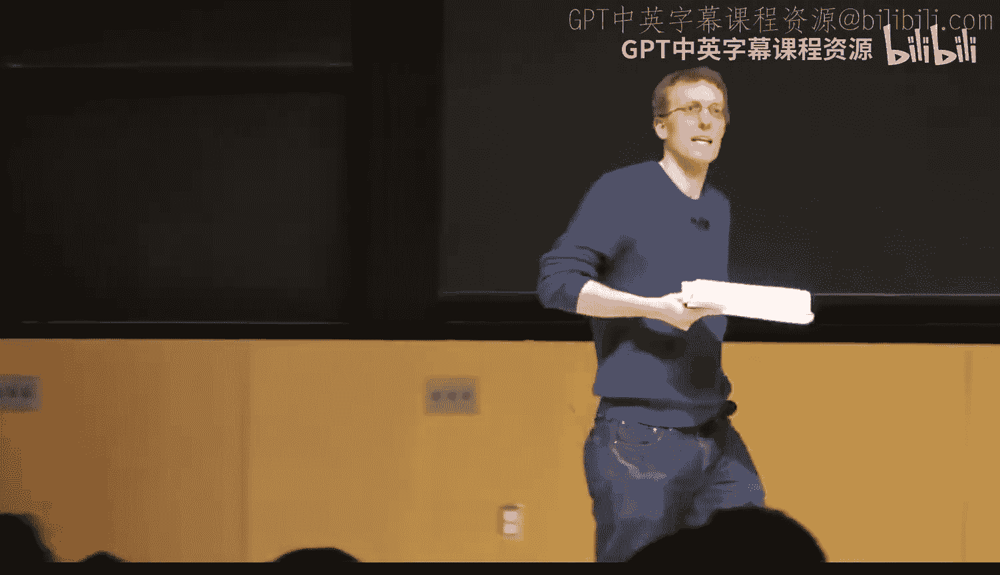

Thank you。 How I come。Oh， thanks， Josh， you。See。Yeah。Oh， okay， sorry about this。Yeah。Where。Yeah。Okay。

It's not good luck， I'm sorry。😊，Okay。Okay， so last time we talked about logistic aggression and that was basically the way we derived this was。

😊，By saying， well， what na face。You know， learns P of x given y。And P of y。

 and you put this together to get P of y given x。😡。

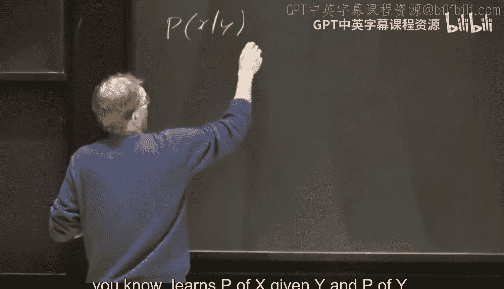

And。And in order to do this attractively， here we make the knife base assumption。😊。

Well it turns out in certain cases， this P of I given an x， actually if if you do knife base。

 you actually get a very interesting formulation， you actually get a linear caifier in particular in in the Gaussian case。

 which is something you will prove in the homework， this will have a very specific form。

 will have the form 1 over1 plus e to the minus w transpose x times y。😊。

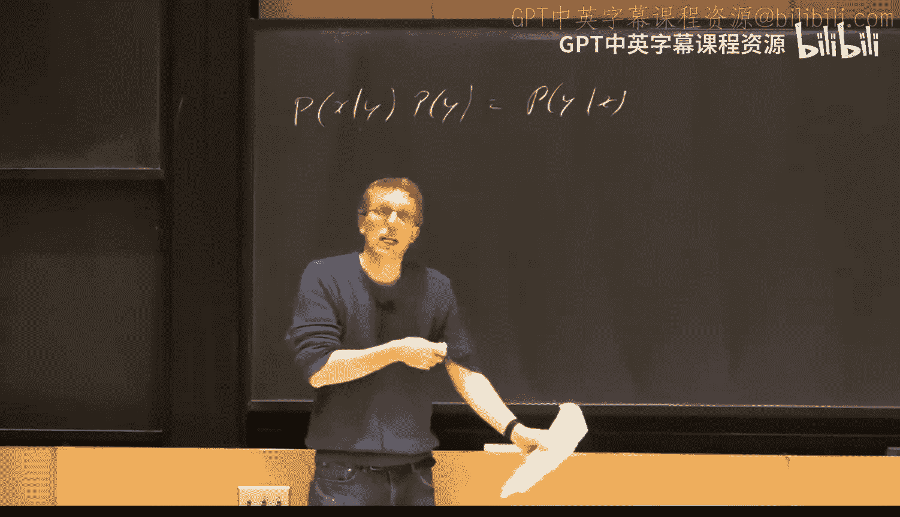

And this is called a sigmoid function。And so。我。😮，One thing we thought is， well if it has that form。

 you know， anyway， why do we fit this function by actually fitting P of x and y。

 Why don't we just instead assume this form and then actually optimize the likelihood for P of Y given X。

 So this is what we really care about。 Ultimately， what we really care about is making the prediction of Y given x。

 And so we looked into this。 So it's my my。 I feel like it's not on。 I it on。😊，Thumbs up。

 thumbs down， No， it's not on。One to test better。 All right， okay good。Yeah。

 believe that themic is off if I thought speaking German。 let me know。 So it happens occasionally。

So then we we said， okay， well， let's do this。 right。

 Let's go over our data set to do maximum maximum likely estimation。

 That's basically sum of all our data and try to maximize P of Y I given Xi。

 And so we maximized the following， maximized over a W the product over all points。

 P of Y I given Xi。 We took the log。 we did all the stuff。 And eventually。

 what we arrived at is a last function that。😊。

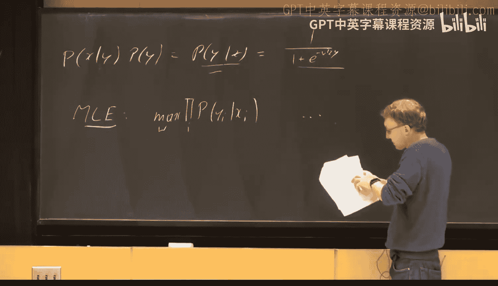

Well， I know it by heart。 actually， with sum of what went to n。

 you take log of one plus E to the minus w transpose X I， Y， I。😊。

And that is what we want to minimize。Okay， so beforehand， whenever we minimize something。

 we got a nice close form solution。 like， you know， when we did map and MLE， this time。

 we did map and MLE and we arrive with something like this。

 And we don't know how to continue at this point。😊，By the way， please close your laptops。 Thank you。

哎。嗯。Well， not all is lost。 So the nice thing about this that the problem is， you now this function。

 we don't really know what to do。 but the nice thing is this function is actually very well behaved。

And it turns out it's actually continuous and it's defiable。

And it actually turns out it's even convex， so。What we do。

 What we do is we call this seeing here a loss function， our loss of W。

 And so we can just view this as an abstract problem。 We have a function of W。

 and we would try to find its minimum。 Okay， this is something you've done ever since high school。

 I believe， right basically， this is just， you know， good old analysis。 given a function。

 where does it have its minimum point。😊，All right， any questions at this point？嗯。

Some people ask me some interesting questions last time that I just want to relay to everybody。

 So I make this point that P of Y given X actually， that's what we really want to minimize。

 And so it's actually logistic regressionggression seems to be the better thing to do you know。

 instead of naive base right So then the obvious question is。

 why did we spend three lectures and you're talking about naive base if you should just be doing logistic aggression And actually。

 it's not so clear cut。 It's not that logistic regressionggression is always better than naive base。

😊。

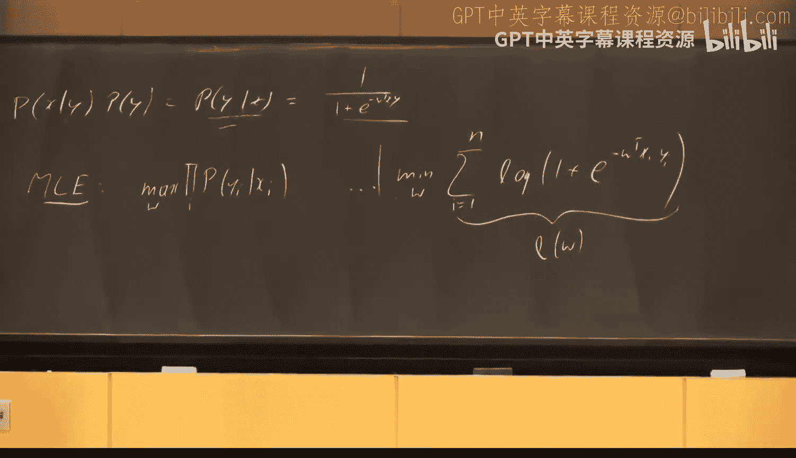

And the reason is quite simple。😊，When you don't have all that much data。

 let's say you're in a regime。 like， for example， you do Stanfer， right。

Well there's actually two reasons。 There's two reasons why you want to prefer a knife face for spanm pagess。

 For example， The first one is a knife face is really， really fast。

 You don't have to train anything here。 We still have to figure out how to find the minimum。

The second thing is， imagine you've only seen a couple of emails， right？😊。

The the problem with logistic regressionggress is you have a very， very high dimensional space。

 and you're trying to predict y given x。 And there there's infinitely many hyperplanes。

 And so essentially what it will do， it will be extremely biased towards by these few emails that you've seen right So if you have just a very few data points。

 It will actually not give a very good classifier， because it will essentially overfi。

 and we will talk about overfitting very soon。 naive base is not so prone to that。

 And the reason is because here you make a Gaussian assumption you actually you add additional knowledge。

 right， that you put in， you're saying this distribution has to be Gaussian。 And by doing this。

 you're reducing the number of hyperplanes you could possibly learn drastically that is there's a bad thing。

 if you have a lot of data。 If you have a lot of data。

 then why would you reduce the number of hyperplane that you can learn right。

 just learn the best one and separate two data。 But if you have very， very little data。

 if you only have a couple of data points， right， then there's just too much degree of freedom。

 and you're gonna learn something that。😊，It you know， it overfits too much to these few data points。

 Then actually knife base is actually much better。 Now， turns out for spam filtergers。

 most people are pretty lazy and they very rarely click on spam versus is not spam。

 And one thing you want to do is you want to give them a good spam filterr right at the beginning when they try out your product for the first time。

 right So actually knife base is actually typically what people use in this case。😊，So it's still。

 you know， it's still used very heavily。 It's just when you have a lot of data。

 then actually typically the dis is the way to go。 Any questions about this。Oh， all right。

So here today， I will post I will。look into this， this abstract problem of saying I have a function L of W。

 and I want to minimize。

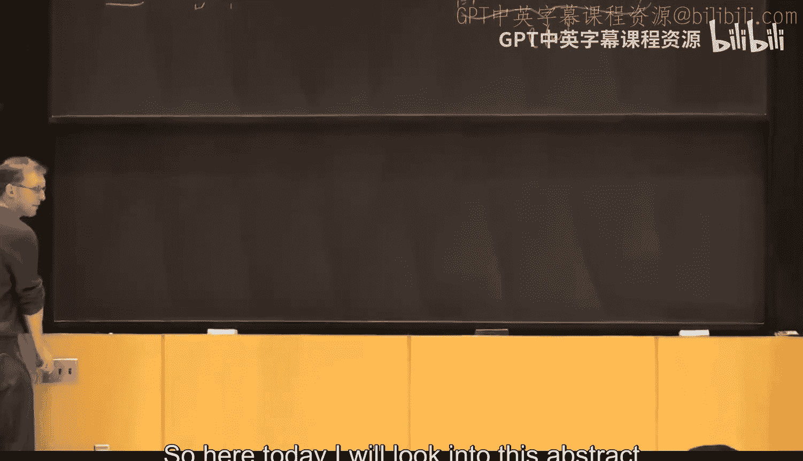

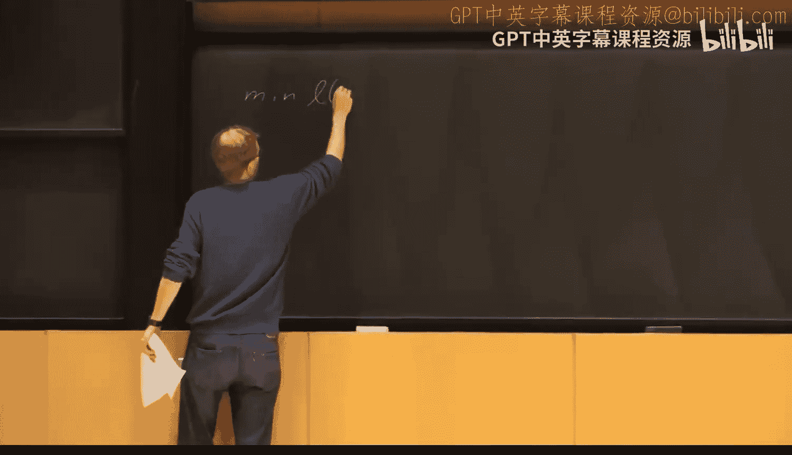

And this is a very general thing。 And turns out that many machine learning algorithms， not just。

 not just logistic regressionggress。 Many machine learning algorithms can be written as in exactly this form。

 right， And because this our last function。 So what this basically does， it。

 it measures how many points do you get wrong， right， That's essentially what this function does， so。

😊。

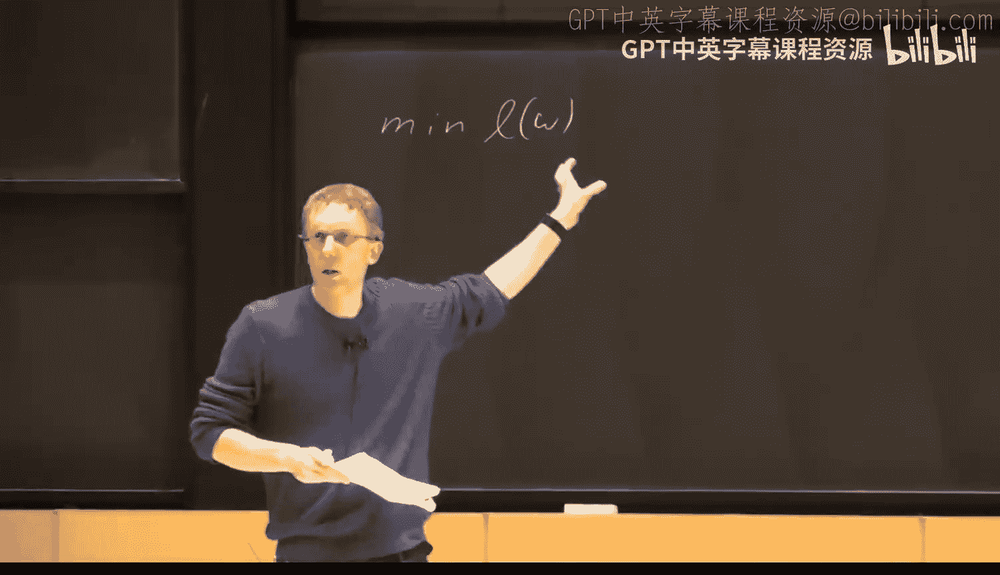

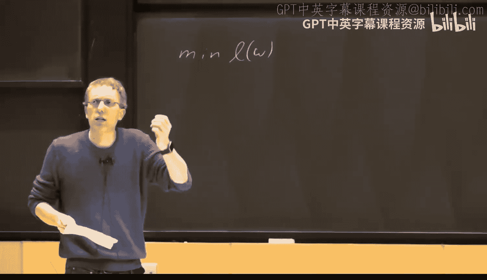

Allright， so what does this function look like， I told you it's continuous。

 differentiable and convex， So it kind of looks like this。 something like this。

 So it's kind of like like a bowl that means it's convex。 It doesn't have any jumps in it。

 that means it's continuous and we cant compute the derivative。 So it's differentiable。

 And we would like to find this point here。 That's our target。😊。

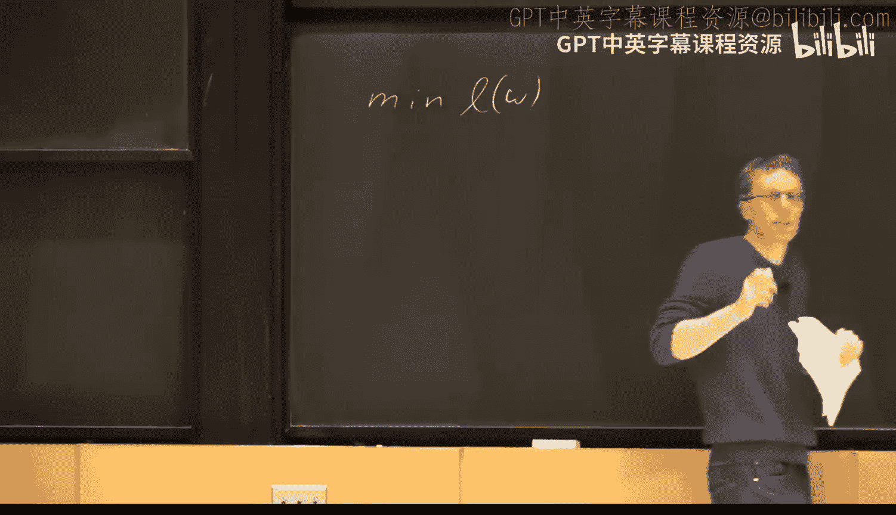

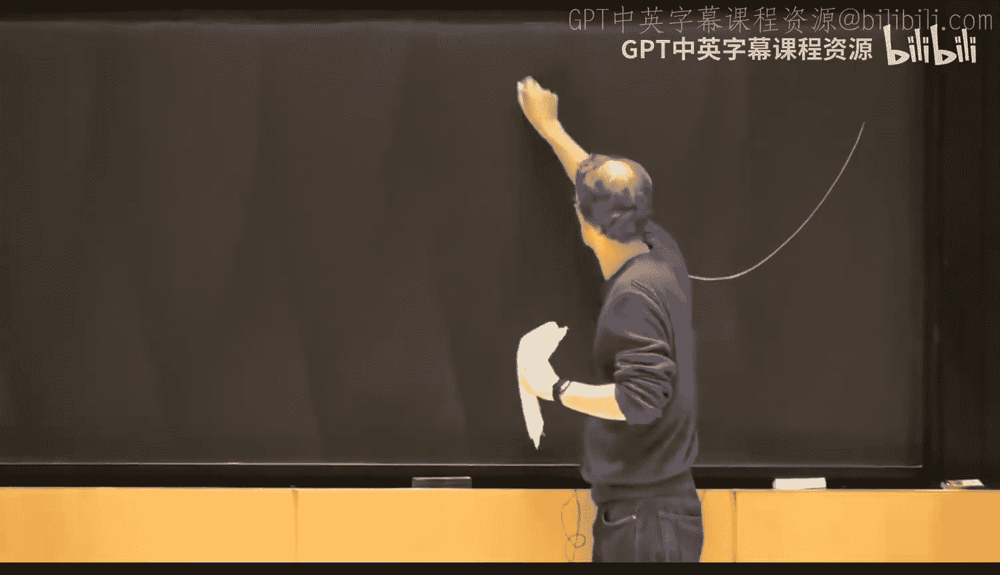

Okay。So the way this works is。😊，There's many， many， many different ways of doing this。

 And optimization theory is its whole own field of mathematics。嗯。But I will show you today the。

 the basic principle。 And essentially， most algorithms don't deviate too much from that。

So here's the idea。 Right， What we do is be saying， well， initially。

 we really don't know where this minimum is We have no idea which parameter setting is the minimum。

 right， If you knew whether we had a close form solution， we'd be done， We don't know。

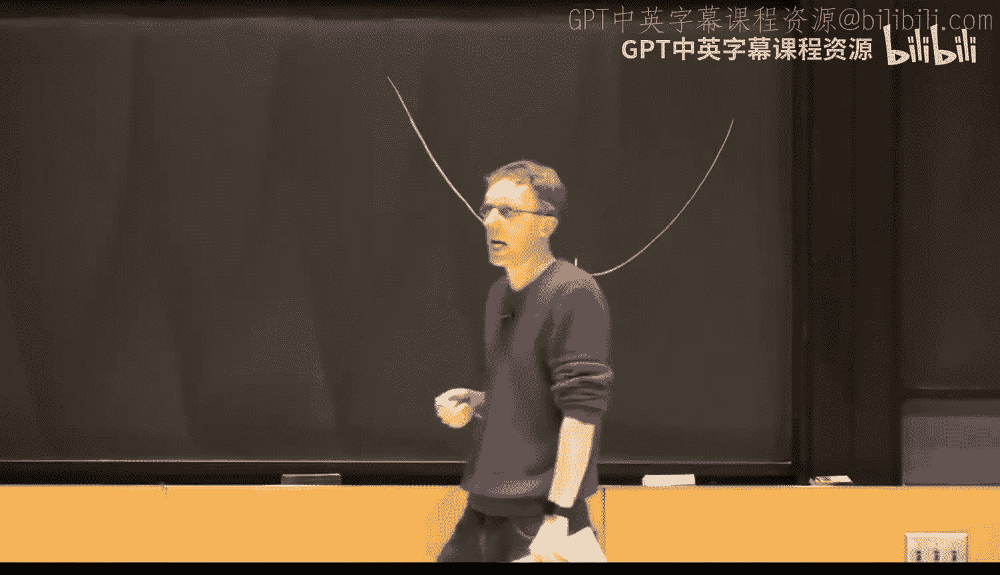

So what do we do if we just assign W to anything we want。 It doesn't matter， right。Whatever。

 just make it all zeros。 So all random values， right， you know。

 put in your own your birth date and code it in the in the rates of W。

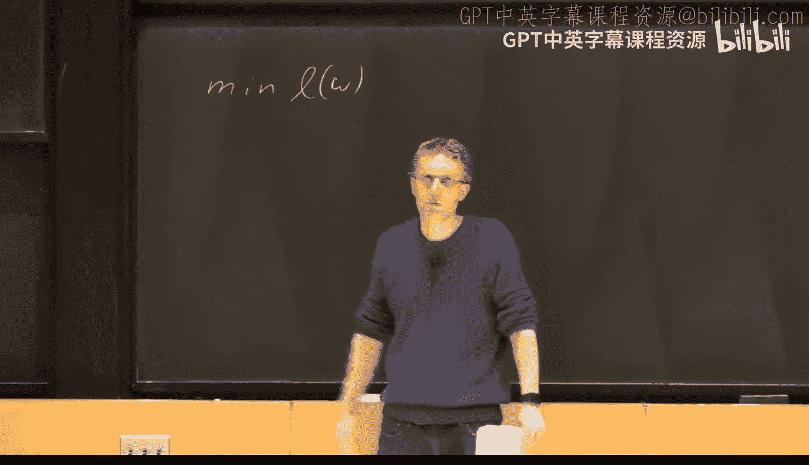

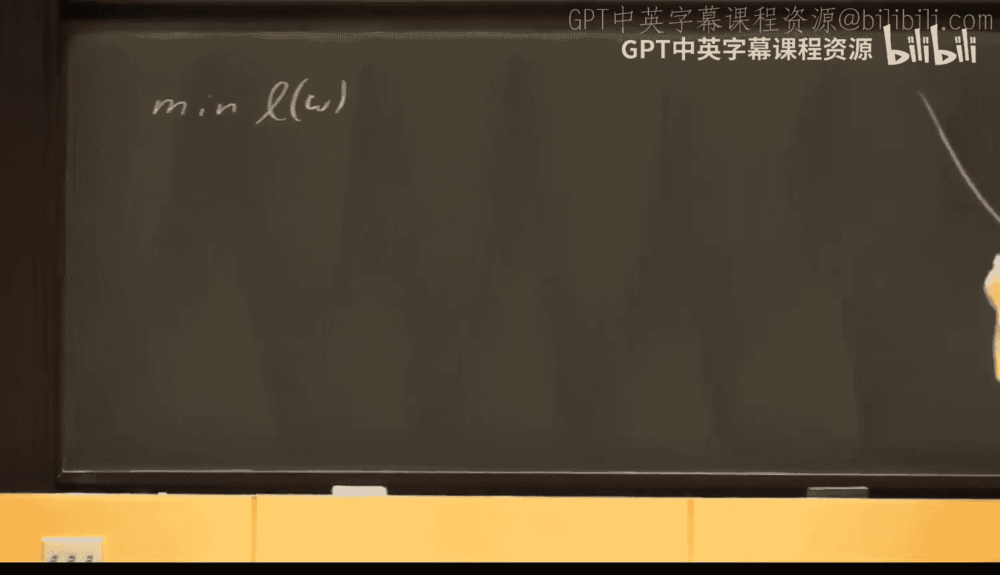

So you have now some point here， which is my initial W0。😡，Okay， so basically， this year is my axis。

 This year is W， and this years。The loss of value。Okay， so initially， I just said， you know。

 I loss to anything I want， it doesn't matter。 And so now the important thing is。😊。

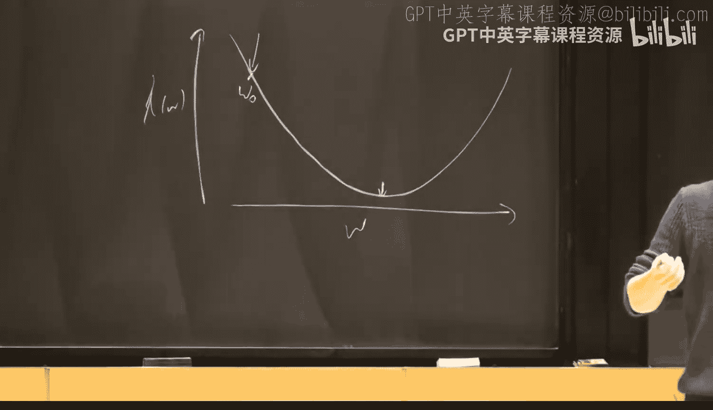

I would like to know which direction does this， The minimum lie， right？ And so basically。

 what I need to find is some some direction that I want to walk into is call this S， right。

 And I basically want to you know， identify which direction do I have to go。

 And then I take a small step in this direction。 And then I get a new point。 And then I look again。😊。

That's the basic idea behind hill climbing。 On this case， we're not climbing。

 we actually try to find the minimum。 So functional minimization。Okay， any questions at this point？😊。

Allright， yeah， question。Is there more handouts？There should be more handouts。 I I I printed enough。

 and there's a lot of empty seats。Who has two handouts？ Who has more than two。SoOh。

 this whole thing hasn't got any。Oh， I'm sorry。Wait， but but I don't。 I I'm confused。

 Are they somewhere。If you know someone who has the handouts， please point in that direction。

People are blaming if he was actually。😊，Oh， I'm sorry。 How is that， that's really bizarre。

I had 300 copies。 There's not 300 people in this room。Yeah。Now。

 someone leave with a big sack full of notes。诶。I'm sorry， I don't know how to resolve this。嗯。Yeah。

 that's nothing I can do。 I'm sorry。All right， I will guard them more carefully next time。嗯。嗯。

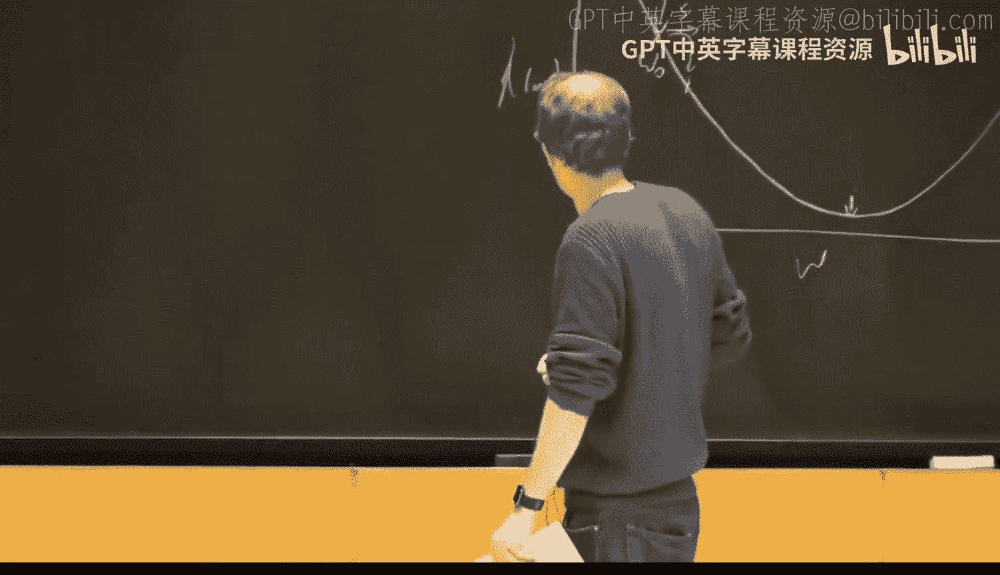

They will be online， so。Yeah，对。Oh， but then I have a mad Russia at the beginning。Okay， well， I could。

 O， I could put them in the entrance and find some algorithm。 Okay， I Okay。

 good good let do got any more suggestions， please post them on piazza。

 If you have some convergence rates， actually， I， you know， appreciate it。😊，Okay， good all right。

 So we have this function。 we want to minimize。 So the problem is we don't know what this function looks like。

 right So we know k looks like this， but it could be nasty， right。

 and we also don't know how much of a step we should take right if we take too much of a step and we may overcome it。

 right now， it looks like this。 But the function could also look like this。

 right So then if were here， we take a step that's too large， we end up over here。

 which is not what we want。 Or if we take a step a little bit too large， over here， which is really。

 really So how do we find this minimum。 And the assumption is know what we do is a very。

 very simple trick。' basically we say， well， this function is really。

 really complicated and we don't know how to minimize it。

 but let's just assume the function is was easy was really simple。 And for example。

 linear or quadratic。 And if the function was linear or quadratic。

 we could actually find the minimum very easily And so basically what we doing is we say， well。

 you know here， let's just fit a line and say， assume this here was a line， right。😊。

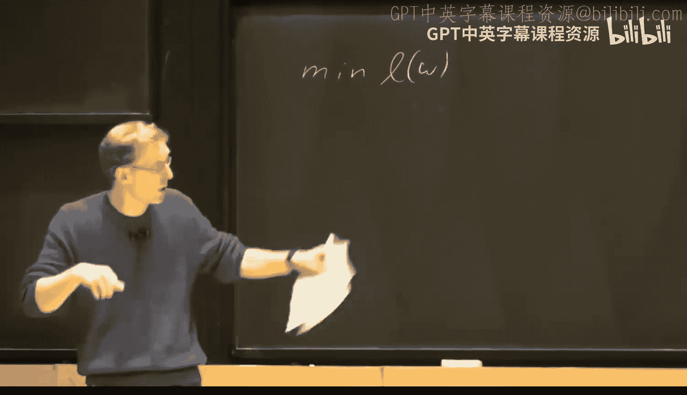

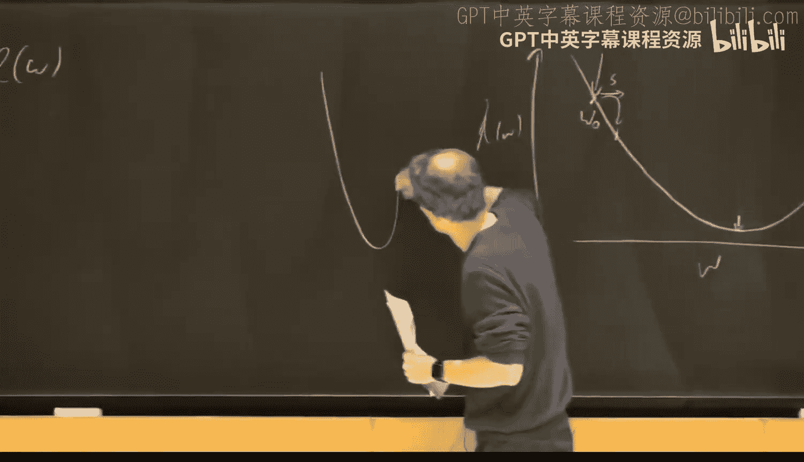

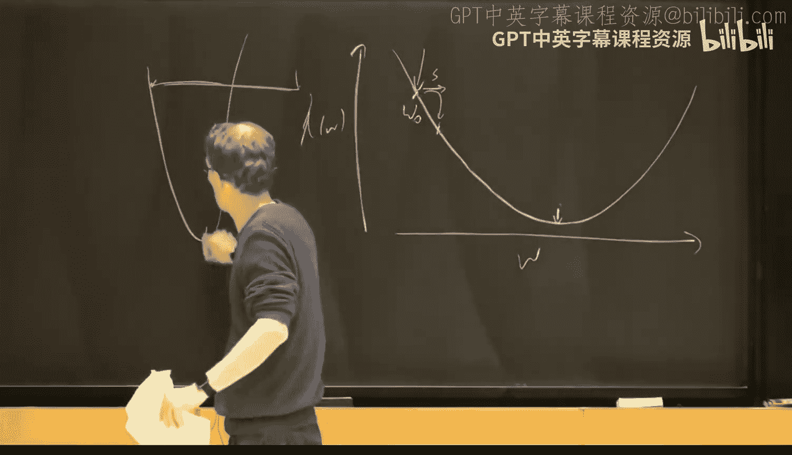

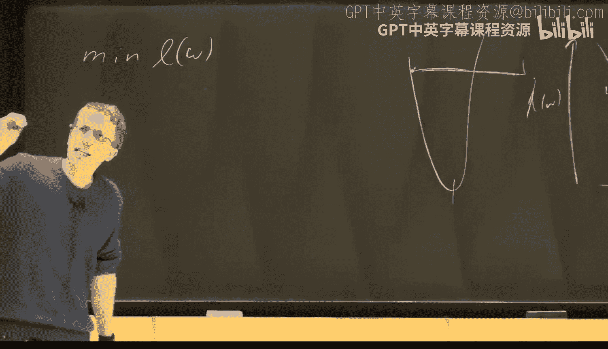

But if the function was just a line， then it's easy to figure out in which direction you should go。

 right， just go in the direction where it goes downhill。 Okay。

 and so you just take a step in that direction。 And then you， you here， you again。

 you fit a line and you basically look at this again。 So that's， that's the idea。😊，More formally。

 what we're going to do is we're going to use Taylor's expansions。 we've heard of Taylor's expansion。

 raise your hand。

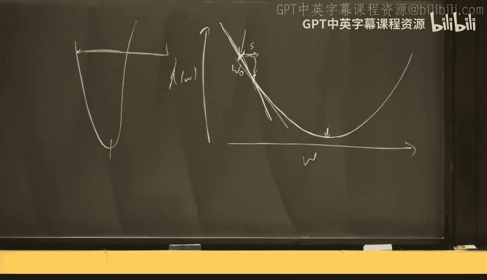

Oh， perfect， beautiful。All right， the ta expansion is quite simple。

 It says you can approximate this function L by saying L plus S。😊。

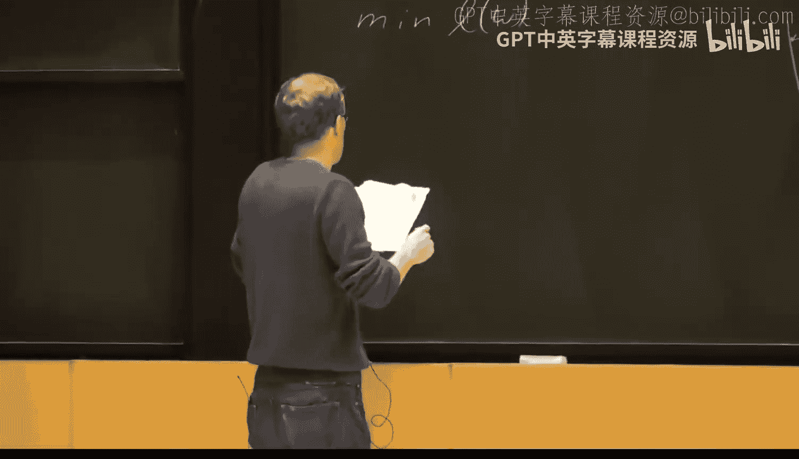

Is roughly。The function。EAt a W plus the gradient at W。Times X。

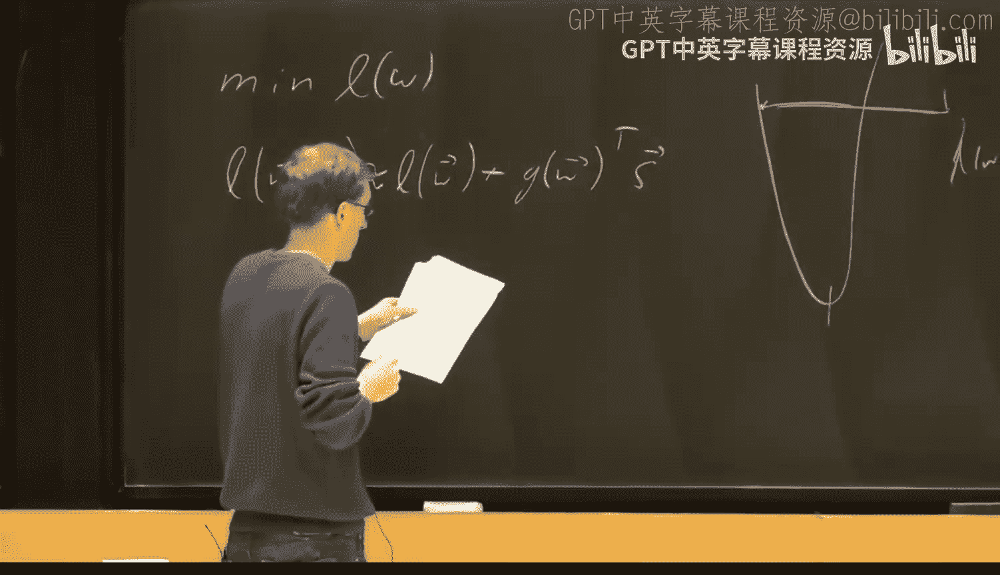

Right， so。哎。

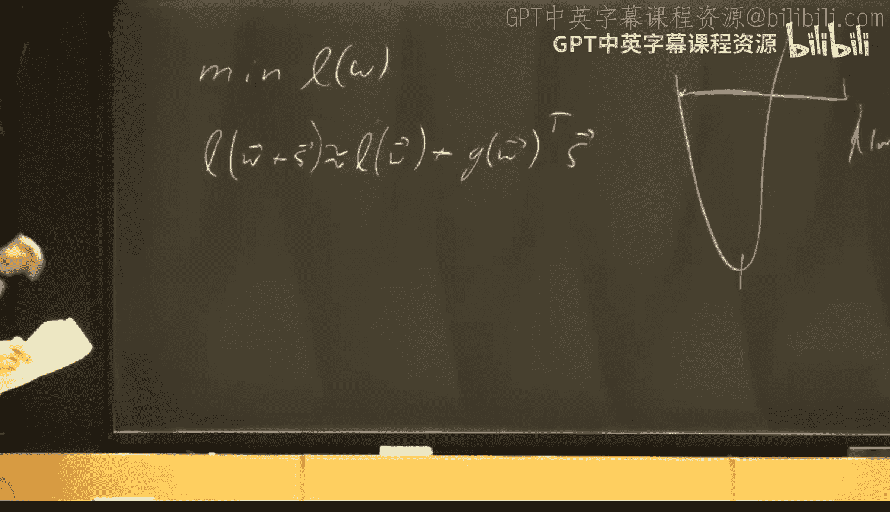

Sorry， this is just time。So what's going on？Yeah。Okay， good。 thank you。嗯。M。

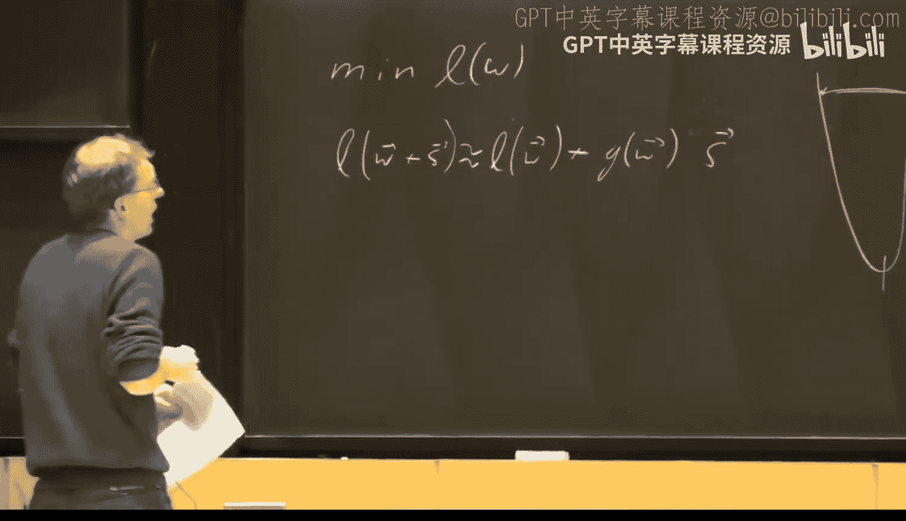

So basically what we're doing is we say at this point。

Like what tail expansion basically says is this function is continuous and it's differentiable。

 What does that mean that once again， if you're a teeny little ant and you're sitting right here。

 right， what you would think is that the function is actually a straight line。

 if you're just small enough， right， because the function is smooth， if if you just zoom in enough。

 right， at some point， you will actually not feel the curvature anymore， right。

 And this is exactly the effect of we have planet Earth， right， So globally has a huge curvature。

 but actually， if you just look here， actually look damn straight。

 So that's basically what we're doing here， we say locally， actually this function。

 the approximation that the function is linear is not a bad approximation。😊，哎。And。呃。In fact。

 this is not just the only thing you can do you can actually say， well。

 we can approximate even better。If they add a second derivative。And then we basically just say， well。

 this is plus。One half S transpose。HFW。Yes。So you basically say what's the function value at W。

 And then I go a little bit in the direction of S。 If S is just small enough， then it's linear。

And the S is a little larger than I guess， a better approximation， actually。

 if I take the second term into account as well， then what I'm doing essentially。

 I'm saying the function is not just a line。 It's actually a parabola locally。

 So it looks like a parabola。😊，Okay。Any questions？Do people know what the H of W is？It's the Hessian。

 who's heard of Hessians？Outside of history。Okay， so the Hestian Bay is a matrix。

 the baby just says the Ijath entry is the derivative with respect to well。

 let me let me write it down so。😊，HIJ is the derivative of L with respect to W I and WJ。Right。

That's actually the second derivative generalized to functions with multiple inputs。Okay， and。

So actually， you take the approximation says if we just， know。

 we take the first derivative second derivative and the third derivative and so on， you know。

 we could， eventually make it arbitrarily close if the function is， you know， differentiable enough。

 we will stop after first and second derivative， right。

 because the reason is the first and the second derivative。 these are actually。

 if we just look at the first derivative。 It's a line。 and we know how to minimize lines。

 And if you look at the second derivative， it's a parabola。 and paras are also very。

 very easy to minimize。 In fact， we can do it in closed form。 right So those are the two， these two。

 as this approximation basically is simple enough that we would know how to minimize that function。😊。

Now。The trick， however， is this approximation only holds。 when S is really really small。

 So they kind of say， oh， the function is roughly this。 Let's minimize this thing on the right。

 right， and then we're done。 That's not gonna work。 right， So， for example。

 if you have this you know， assumption what you would do is you would jump here。

 And then you would actually find the minimum here。 But that's obviously wrong。

 So the assumption only holds for small steps。 So basically the way it works is we approximate the function as the tail expansion。

 we minimize we take a step towards the minimization of the Taylor expansion and then we approximate it again。

 and we repeat that process。 And that's basically how these function minimization processes work。😊。

And。Okay， any question？Yeah。They get really small。Why， why don't you make S believe be small and we。

Why don't we just use the linear approximation。 Okay， good question。 So he says this Hessian。

 I don't like the Hesian， right。What have they done。

Why don't we just use the linear approximation If S is small enough。

 that's a sufficiently good approximation。 And that's actually what most people do。嗯。All right。

 there is a reason why you may occasionally want to use the H yet。😊，The the reason actually， is that。

You have to take many， many， many mini steps。 And so sometimes it's the case that you would have to take 10000 mini steps。

 or you take two steps for the hessian。

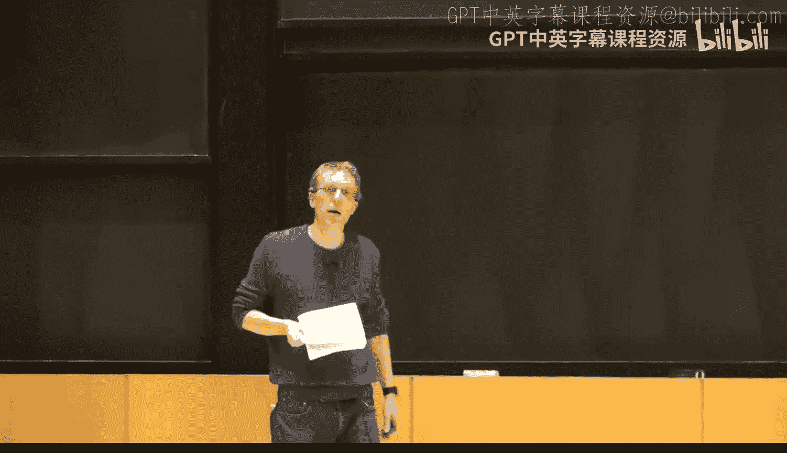

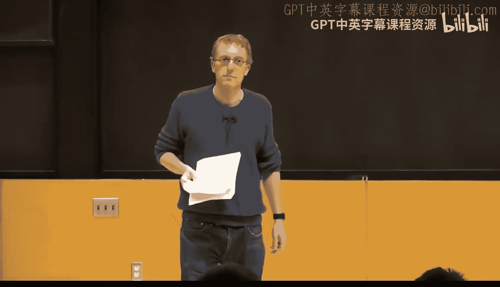

So it can be a lot faster。Right，But it's not always the case。

 And now we will'll get to this in a minute。

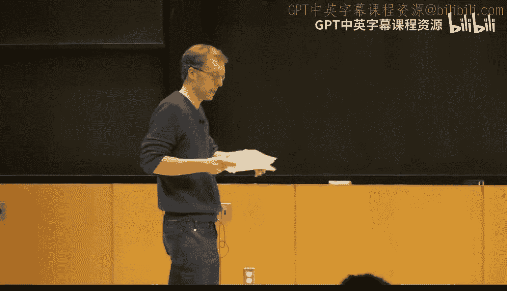

Okay， so the first gradient descent， the first step is gradient descent。 A lot of you。

 I'm sure have heard of it。

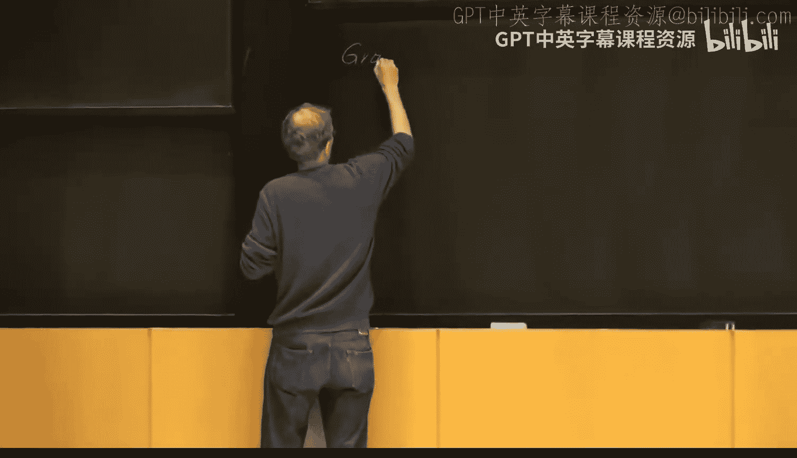

Is the most general framework of minimizing a function。

 That's essentially exactly what you just proposed gradient descent。

 Basically what we are saying is this， this vector S that we want to add to our function to go downhill is just the negative gradient。

 It's just the gradient the W。😊。

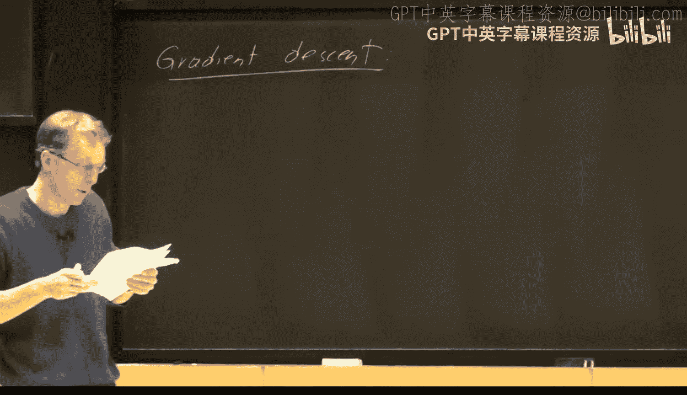

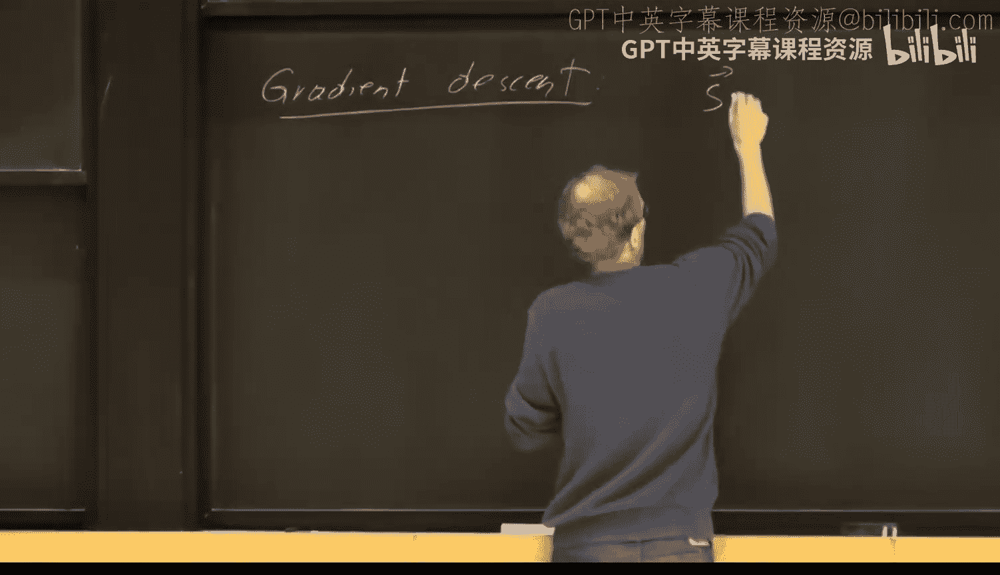

Times， times， times a small step size， times negative， sorry。So。

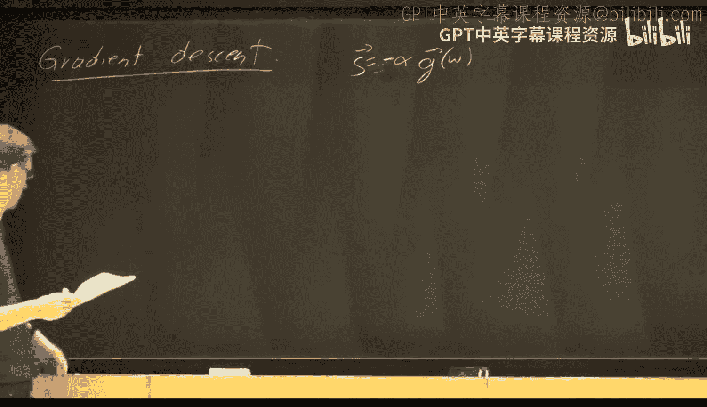

We had。Where is it， so everyone's like ah。

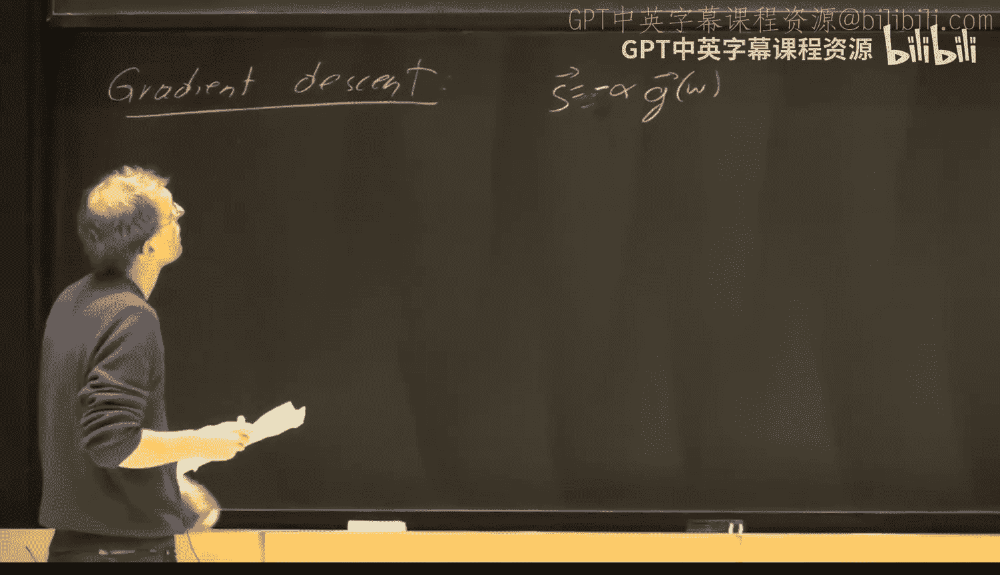

So here we have this little picture that we basically have our W0， and then we take a step S。

 and here I'm telling you gradient to， we just say S is the gradient a W times some small learning rate。

 and then we negate the whole thing。😊，And so。Why is that the right thing to do， right， Well。

 if you just look at this approximation， then it's very very easy to show that actually。

 if we take this step， it will always。Take a step down。 We will always reduce the function value。

Let's just test this for a second。A lost function L of w plus S， which is now this term here。

 so plus minus alpha G of w。😊，Yeah。Okay， so now we have our original W。I'm telling you。

 this year is the step。 This is basically this step in which we want to take from our original W。

 And I'm claiming this year should be less than just L of W。

 So it should be less than the value that we started from。 right'， if that's true。

 then I showed you that by taking this step， we went downhill。😊，嗯。

So we know that this is roughly if alpha is small and we can make this as small as we want。

 And this year S is small。 so we can make alpha small enough that the tail approximation holds。

 then that is L of W plus。😊，呃。This here， or I guess minus in this case， minus alpha times。

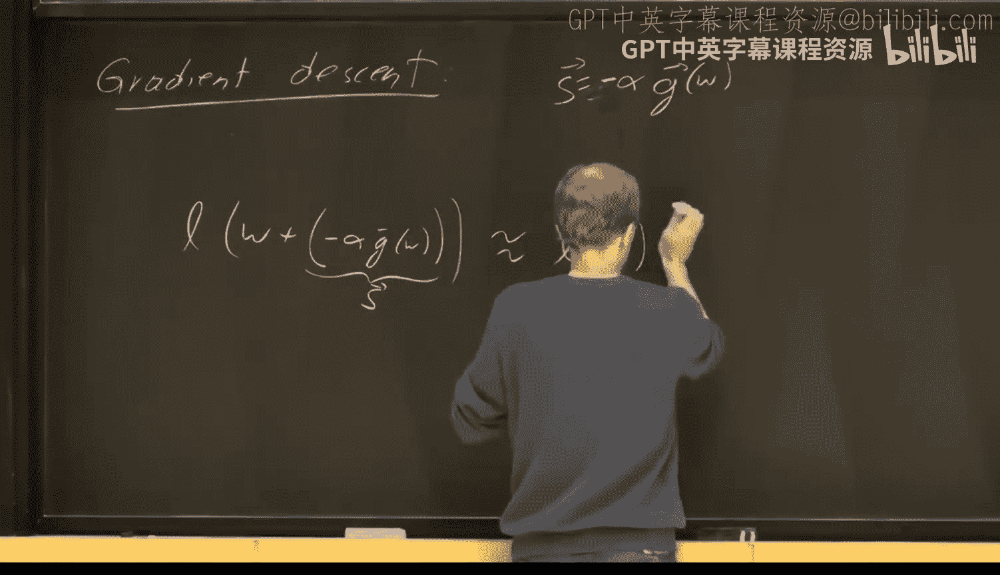

G of W， this is S。Times G ofW。Okay， so all I did here is I plugged in minus alpha M Ste Javau into the S up here。

 right， And then you get this term here。😊，Raise your hand if you're still with me。A三。And well。

 what is that， let's just look at the sign of this thing。 This is the square of a vector。

 So that's greater than 0， right。😊，Alpha， we just choose alpha to be small but positive。

 So let's do this。 Al is greater 0， right。😊，That's a scny parameter。

 So that whole thing is still positive。 and then you have a negative here。

 So this thing here is negative， right， less than 0。😊，So， we take。

We take the vector L of lost L of W， and we subtract something from it。

 So that's clearly less than L of w。Okay。嗯。So what I just showed you is that no matter where you start。

 right， no matter what you starting point W is。😡，You just compute the gradient。

 multiply with smaller numbers。😡，And if you subtract that from your W， you're taking a step downhill。

 And so if you do this often enough， you will eventually come to the minimum。

 So that's basically the idea。 right， Why will you eventually come to the minimum， Wait a second。

 Why is that guaranteed。Can anyone tell me。Yeah， the function is because the function is comex。

 right， So that's right。 So if it could be if the function was not comeve， it could look like this。

 right， Then if you start here， you go downhill， go downhill， go downhill。 here at this point。

 What happens here。 Here is the station。 here， the gradient is 0， right， So you stop。😊。

So you think you， you're done， But actually， you know， this can be average deep here， right。

 you can can actually be pretty bad。 But because the function is convex。

 And I think this was actually on the placement exam to show this。😊，You don't have to worry about it。

 So you keep going down， keep going down， keep going down。 And eventually you will stop。

 Why are you going to stop because at the minimum， the gradient is 0， right So at that point。

 you you know。You basically know that you found it， right， You're not moving anymore。Okay。

 any questions about this process？有 yeah。好水。How do you pick off goods。

 I was waiting for that question。 That's exactly right， right？😊，How do you find alpha。

 We said alpha has to be so small that Taylor approximation holds。 Well。

 how are you going to do that？哎。And。Well。One thing is you can just air on the side right alpha is too small。

 right if alpha is really， really small， then Taylor approximation will certainly hold。

The problem is that you're taking tiny， tiny， tiny， tiny steps， and it will take forever。 right。

 And it may take your whole lifetime to minimize the function。 right， So then actually。

 it's probably much better just to wait a little bit and buy faster computers in 10 years and then just start then so。

😊，The question is。How do you find this alpha， And， and this is actually something that the community has thought about for a long time。

And。I think when I， when I started my my PhD， it was still considered a dark art。 And people thought。

 well， you just use voooo。 right So everyone had their own kind of mechanism。 I love all， you know。

 eventually， I start out with 01 and then eventually I decrease it right And yet you secret sauce。😊。

Now， you know， fast forward a little bit， is's actually very well understood。 So for once。

 a really safe way of doing it is basically just saying alpha is。😊，Some constant divided by T。

 But T is the number of updates you've already taken。If you do this， then it will provably converge。

 And the reason is， no matter what your constant is at the beginning。

 but eventually this will become so small that tailors your results。

 And so you don't have to worry about it。 And you know， you make。

 you can make it constant large enough that it will converge eventually。

That's not very good because it's still very， very， very slow。 In the last two， three years。

 people have actually made some sufficient progress here。And。I could diamond， this is horrible。

And nowadays what people do is actually much more sophisticated。And I want to。

Want to quickly go into this。Yeah。It's called Agra。Undergrad was only invented a couple years ago。

 but it's basically really taken the community by storm。The idea is very， very simple。

The idea as well， here is how it works。 right， If you have a very， very。

It depends really on what your function looks like， right， If your function looks like this。

And you're here， right？If you want alpha to be very， very small because alpha is too large。

 you're going jump over， this stinging， right。If the function on the other hand looks like this。

 right。Then you want to have alpha pretty big， because you cant point point in this direction。

 you want take huge steps， right， it's not so steep。And so， essentially。The mechanism。

 I'm just going to explain to you as a heuristic。 I'm not gonna， but it turns out， actually。

 you can derive this very， very nicely， and it's very principled。 It is very simple。

 What you do is as you do your optimization， you keep track of the gradient that you've had in the past。

😊，And。对。E basically， what you're doing is you say the following， well。

Imagine you have different features， right， So you have some features that are basically track in。

 you know， you have medical records。 some are track in millimeters。 So you height in millimeters。

 There's are very large numbers。 I don't know why you want to do this。 But you know。

 and yeah let me give a better example。 Let's say have spam filter。 I have word counts。

 Some words will be very， very common， right， like the and a and so on。 these are stop words。

 But even you know， banana is gonna be much， much more common than maybe hippopotamus or something So words have different word frequencies。

😊，So what happens is that basically， the gradient will vary a lot across the different features。

 right And so really， there isn't really one good learning grade for every single feature。😊。

So ideally， for each feature， you'd have a different learning rate。

 But now we made the problem even worse， right before we just had one learning rate。

 How do you fix this one。 This was a dark Allright。

 now we have to fix 1000 or maybe a million learning weights， right。

 every single dimension should have its own learning rate。😊，And so here's what Agrad does。

 it basically says as we keep optimizing。嗯。So yeah， I put it on my notes。 That's right。

 As I keep optimizing what we do is we have this algorithm that we say， now we repeat。

 we evaluate you know， L of W。 sorry， the gradient of W。😊，G equals D， L， D W。 That's a vector， right？

 And then what we had before is we said， okay， G W becomes W minus alpha times G。 Okay。

 so that's the gradient decent algorithm。 And we don't know how to tune this alpha。

 So here's what we do。 We do the following。 We just we start with sum vector to S。

 which initially is 0。😊，Let me put our full loop。And then every time the computer gradient。

 we say S becomes S plus G。Squared。And can anyone explain what I mean by this？We're the Julia people。

I think every single entry in squared。 Okay， so you can either write this as this So， you know， so。

 or you can write it as this。😊，G。Right， so basically。

 you just take every single entry and square them， but you keep it a vector。 You don't sum over them。

 Okay， so's not G transpose G iss G dot star G。So what you're doing is you basically keep track of on average。

Like how large the gradient was in past steps。And then what you're doing is you take the green that you have。

And element wise， you divide it by the square root of the sum plus sum sum maximumpson。😊。

So essentially， what this means is。嗯。When in the past， I had a feature where the gradienty was very。

 very large， right？Then this is very， very large， right。

 because I square it Now sum over all the different changes。

 So that means if I divide the gradient by it， the steps is going to be really small。

 So if I have very steep and some feature them in some dimensions， I will have very steep surfaces。😊。

And for those that take small steps。In other dimensions， I have very shallow surfaces。😊。

I take large steps。Okay。And that has really become kind of the beauty of it is you still have some constant here that you can set。

 but it doesn't really matter。 You can just set it to one， and then you just get rid of it。

Ultimately， it sets itself So basically takes past gradientance and it learns how to set the learning rate。

😊，Any question， yet。This switch。Oh， oh， I'm sorry。 I that true？呃，OVC。Oh， see。 My notes are wrong。

 actually， right。Obviously， in the node， there should be S， S instead of G， S。And in the notes， I it。

 I call this S and this S， S。Whi。I blame on momentarily insanity。哎。Okay， any more questions？一。on。

 Epsilon。 Oh， it's just because in case something is 0。

 Imagine you have some feature which just have no gradient ever， right。

That also means that feature doesn't matter， right， but that means S squared would be 0。

 and would be divided by 0 and everything would blow up。 So you just add some constant to it。😊。

And then you get a very large learning rate that probably doesn't matter because the grade is 0。

 right。Yeah， good。 I mean， in some sense， because you just added this， right。

 the gradient must be0 here。 So it doesn't actually matter what you do in that case， right。

Good question， yes。Any more question。 So epsil is just 10 to the -5 or something。Oh yeah。

 the very back， just talked about you said that we will find the minimum。

 but this really converges to the minimum and so we need to like and so it's only atically converging on it。

はで。Bline right， so late。We have to talk about then。Based on how our。K what how。are going to be Oh。

 good， good， good， right。 So， so the question was， well， actually。

 we're just getting closer and closer and closer。 And as we get really， really close to the minimum。

 what's gonna happen， the gradient is gonna come， you know， become0， right here is 0。

 So here it's gonna become really， really， really small， So what will happen。

 you actually take really， really small steps， So when we actually ever really get there。

 right So when you stop this whole whole algorithm。 And so you do exactly this。

 you basically keep track。 You say this is my T plus one， this here is my t。

 and you say you stop if you know， if the norm between t plus1 minus w T is less than some。

 some small delta then you break， then you stop right So usually always have some cut。

 you say if my weights have not changed in the last round。😊，Then I'm stopping。

 The important thing is thiss really something that people didn't realize for a long time is people use these concepts on optimization theory or mathematics in optimization theory。

 they're really concerned of getting exactly to the minimum by accuracy。

 up to 10 to the -10 or something in machine learning。

 we don't care about this right because ultimately， what we want to minimize。

 essentially is just the 01 loss， right Like at the end， we just want to have good predictions。

 And if you get a little bit closer， probably doesn't make any difference， right， So， you know。

 this delta can be sufficiently large actually。😊，Okay， any more questions。Okay， good， so。

That was grading descent。Now come in the Hassians。So gradientcent is really nice。😊，The only thing is。

 and this is actually the step that you said。 it's really nice getting close to the minimum。

 But once， once you're in the vicinity， it slows down。 So most of its time， almost all its time。

 it will spend， you know， close to the minimum。😊，O， because that's when the gradient is small。

So the question is， can we somehow speed this up， like once we are close to the minimum。

 can we get right to the minimum， you know， up to some deellta that we can stop。

 And this is exactly where the second order approximation comes in。😊，All right， whatever so。

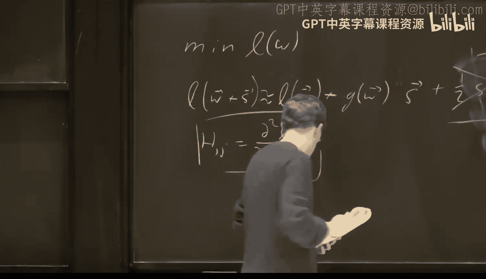

So far what we said is。You know， we just approximate this a line and basically said。

 we take a step and direction off this line， the slope， now we're basically going to take a parabola。

😊，And。So。Second。So the idea is quite simple。You can just say exactly this function here。

And just minimize it with respect to S。 me say， wait。

 Taylor's approximation tells us our function is approximately this。😊，Right now。

 don't cross this out anymore。Kind of just minimize this， there's a quadratic function。

And what's exactly the step size that I would have to take to minimize this function？

So what I'm saying is I have some W here。 I find this parabola。

 Now I pretend my function really is the parabola。😊，And paralas。

 you can minimize in closed form so I can just find the minimum of the parabola。

that's what I'm on sold for。 And this here is my S for the the difference from W that I have to add to get right to the minimum of the parameter。

😊，And once I'm here， that I again fit the parala。If find a minimum， again， I hit a parabola。

 and then I'm done。Newton's method converges super fast， blazingly fast。

 You just need a couple of steps。 Like， if you take 10 Newton' steps， you know。😊，You， you're。

 you know， you're gonna be there to， you know， numerical accuracy， usually when you have low。

 low accuracy numbers。 like in machine learning， a few newton steps typically get you there very。

 very quickly。So let's just quickly do this， you want to minimize this respect to S。

 so minimize this function with respect to S。😊，And what do we do。

 What do I do when I minimize a period function？It starts with gray。And ends with the end。

I think someone said a gradient， It's like a you're the gradient。😊，With's respect to S。

This here is 0， this is G of w。This here is。Now， I have to take matrix gradient。

If you're not familiar with Mag gradient， look at the Matrix cookbook。I think I link to it from my。

 from the homepage。that's H of W times S。And you want to set this to0。

So this here has the gradient of this function with respect to S。That's  zero。What do we do， Well。

 it's quite simple， right？ So we just put this on the other side。 So S equals。GFW。

Minus g of w and to get this function， this matrix over there， you just take the inverse， right？

H of W inverse。And so we divide by this。That's what you have to do。So。Newton's method。

 what you do is you just take your random back to W。You compute。The gradient。

 and you compute the hessian。And you multiply the gradient with the inverse Hessian。

And that's what you add to your function。And that basically gets you down really， really， really。

 really quickly。😡，咩。So Newton's math is awesome。There's one downside。

This down is most of the time it doesn't work at all。😡，Yeah。So most of the time。

 what happens is that when you have a function that's really， really flat， right。

 what you're now doing is you're approximating that with a parameter。

And that parabola could look like this or something like this。😊。

And now you're taking me a really large step。I'd say my function looks like this or something。

Now you take a really large step， right， this here is my S。And we take really large steps。

Tale approximation doesn't hold anymore， right。And so what you're doing is you're shooting off into noman's land。

 right， let me give you even better example。 Let's say you have a really skinny function like this。

 right， a function like this。 This is my， my Comx function。😊。

so it could very well be that my paraella that I''m using here looks like this。

 approximating this way。 So I start here。 I jump all the way here to that minimum。

 right now I end up。😊，Here， right， now approximated again with a parabola。 and I end up here。 right。

 And I'm spiraling out of control in no time。嗯。So Newton's method really only works if you're very。

 very close to the minimum already， and your function is not。Well， I show you some examples。

 Why I show you some examples。嗯。So the best， typically。

 what I recommend people to do is togra descent for a while。And then just before you end， take two。

 three newton steps， right， And then you basically， then you sort it， right。

 because then you are basically at the minimum。Any questions？What people。

 by the way also do is they sometimes just take the diagonal of the Hasian that also works reasonably well。

 those are called second order methods。Or there's conjugate gradient that approximate don a。呃。Well。

 in some sense， you're solving for the whole thing， right， So it's no longer。If you downscale it。

I think you still wouldn't get any conversiongence guarantees， actually。

 In some the benefit would be gone。What is this， does not mean。Oh yeah， okay， good。Alright。

 so here's how much time we have。Okay， so first， I just want to show you a little。So okay， so first。

 a little example of just good old gradientding descent。 So here's my function。😊。

And the red point is where I initialized it。And the the is actually cattic function。

 the minimum was actually here at 0， right？ And so now I can basically yeah put in the different different step sizes and see how long it takes me to converge。

 right？ And so the first thing I can do is I can just set the step size to 。1。 right？

 And now you can see the different steps。 I don't know if you can see these。 Can you see them。😊。

It basically takes all these these red lines here from here to here。 Basically is a step， right。

 So all these different things。 So it took over 83 steps， right。

 So it took 83 steps to go from here to here。 And then it basically converged up to some delta。😊。

I could do the whole thing again， with a smaller step size。😊，Then actually， it never converges。

 at some point， I just said maximum number of iterations has reached。 So I never get there， right。

If I make my step size larger， let's say I just do， you know，5， right， why not。Then what happens。

 this happens， right？So here' is my function， right， And this here I basically， you to see。

 this here is my function out here。 And this is kind of Jupiter。 And this is， you know。😊。

Like Neptune or something。 be way out there and out of space， right。Oh my gosh。Come on， where is it？

I see something。 I'm hopeful。Right， so I'm really， really out there。 Alright， So you。

 you get the point， right。😊，啊。你。Is it your thing of Google sorry。S at the top。

 It's 10 to the 1 Oh yeah，1 to 175 great。 Yeah， that's more than electrons in the universe， right。

 So we are really， really out there， right， So I didn't even take my step size that large， right。

 I was just a little bit light， right， And bangm， right， Did I shoot past the minimum， right。😊。

So setting the step size is important。I can also show you some Newton steps。 So here， GD。

Tmo 1 Newton。 So here's another example。 There's a beautiful function。 And now Newton。

 the beautiful thing about Newton's method， I don't have any step sizes to choose from， right。

 So I can just， you know， I just I run it and I converge。 So we can first say， okay， well。

 let me just start at0。3， right。😊，And at 0。3， I compared9 steps， right。

 Well I' been pretty accurate here very， very accurate。If I， you know， say， you know， let's say I I。

Oh， this is0。3。 I start up here。 Okay， this is pretty steep。So if I started， you know， whatever。

 it's2， right， then I would only take8 steps。 and I'm actually here， right。

 And the nice thing is that every single step， you actually usually get one digit of。

 of significance of accuracy。😊，嗯。What if I start at 9， right。So that means I'm starting over here。

 and I do my newton search， right， then。Bam， right， What happened while I'm actually， oh， I。

 I'm still fine， wait， I'm still fine。This is amazing。 Okay， let's do 7。😊，That's to 10。Okay。

 now I diverg。Right， so now actually， if you zoom out。嗯。And if I try to zoom out， which I can't。

So one thing you can see， where does the red line actually。O， I can't zoom out。 I'm sorry。

 I don't know what happened。Basically， I'm again an outer space。 right。

 So the difference is with Newton' step， the equivalentence in some sense， with gradient de。

 you have to set the step size， right， Newton's step only works at certain starting points， right。😊。

The good news is you can check very easily if you made a mistake， right。

 if your loss is suddenly a lot larger then， you know， oops， right。

 Newton step doesn't work here yet。 Just keep doing a few more gradient steps。😊，嗯。看没。

I can show you the same thing one more time。EIn 20。No。So问 out。A shoot。Allright， here we go。

 Here we go。 So what you can see here is actually a function that I'm trying to minimize。😊，All right。

So what you can see here is basically。😊，The black line is basically gradienting descent。

Here is my function based my function value。 This number of steps I'm taking。

 And what you see is that gradientcent very quickly gets close to the minimum。

 but then takes forever to do this little last little bit， to get from here to here。

 takes 100 steps right So that's exactly the problem with gradient descent right So you get close to the minimum relatively quickly。

 but then just takes forever to finally get there So Newton's steps actually is very。

 very good and just a couple steps actually， it's really at the minimum。😊。

If you look at the plot here on the right， you actually can see this is the function。

 Here's where I started。 So gradientding descent takes these sorry green descent is green1。

 So it actually takes one step here and then over and over and over again know。 then very quickly。

 it's actually close。 But then here it actually takes forever， right。

 whereas Newton steps actually very consistently gets towards the minimum。😊，At I' know， if you can。

So any further Yeah， So Newton's step basically just takes from here one more step。

 whereas gradient descent here probably takes 90 more steps。 So if you close to the minimum。

 you want to take Newton's method。Let me do one last one before you guys leave to the。

Here's basically， if I started at a bad point。 So here's the same function。 And again， you see here。

 I'm actually， the red line is newton steps。 So I my function is down here and very quickly in outer space。

 right， I basically completely blew it。😊，And what happens is I just started it as， you know。

So here's what Newton step does， right， So creating descent very nicely he goes to the minimum when Newton step is like。

 oh my gosh， right， Like it's like。😊，诶。哎。So what do you do in such cases？

 And the answer is you just take a few steps with gradient descent。And then you do Newton steps。

 right， So here's what I did。 I took a couple steps of gradientding descent。

 and then I switched over to Newton。 And then I'm O again。 right。 So please remember this。

 the main take on point， when you do gradientding descent。😊，To adaptive gradient to the other grad。

 And when you get close to the minimum。 So maybe after I know a couple hundred steps。10 to 100 steps。

 switch over a Newton's method and then you converge in no time。Yeah。

