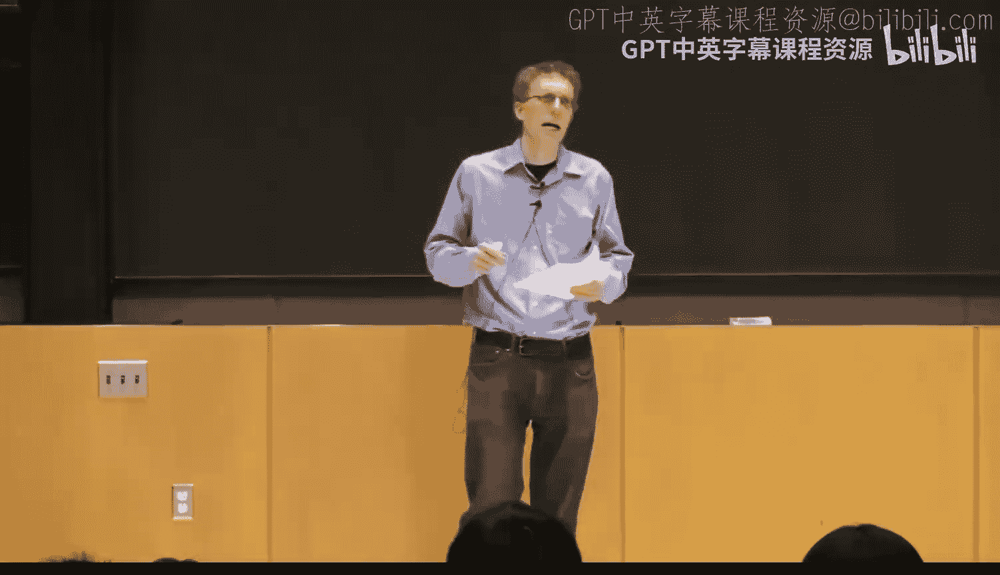
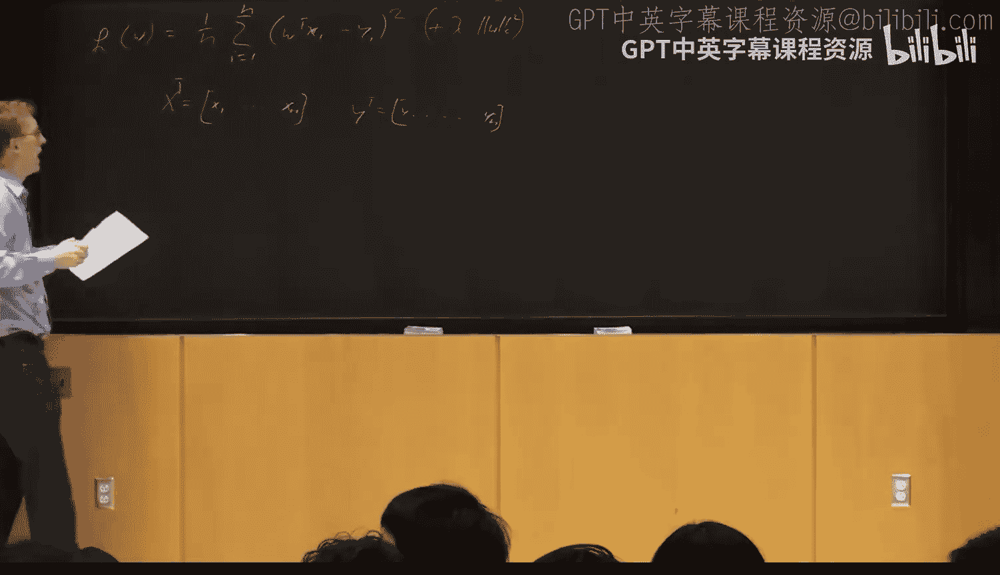
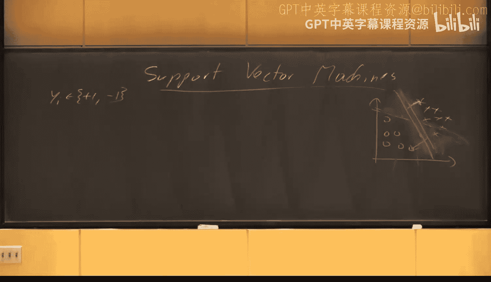
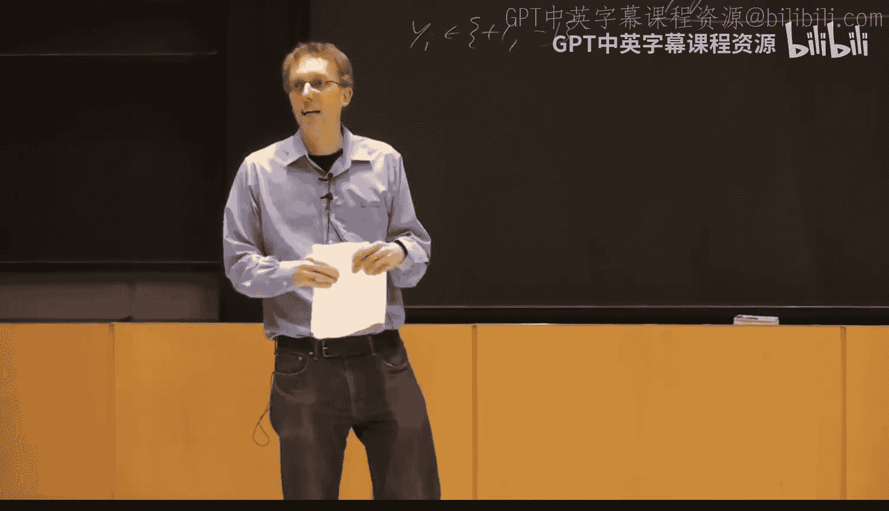
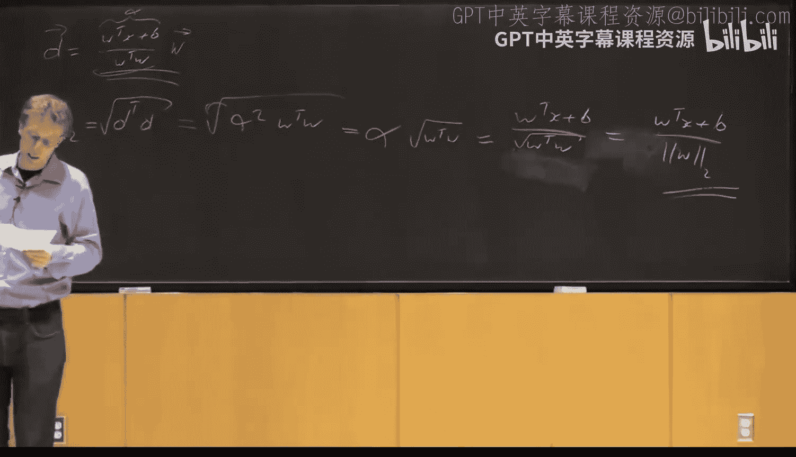

# 机器学习：014：线性支持向量机




在本节课中，我们将要学习一种非常强大且流行的机器学习算法——支持向量机。我们将从回顾线性回归的闭式解开始，然后深入探讨支持向量机的核心思想：寻找具有最大间隔的分类超平面。

## 回顾：线性回归的闭式解

上一节我们介绍了线性回归和平方损失。平方损失函数最终可以表示为：

**公式：** `L(w) = Σ_i (w^T x_i - y_i)^2`



在矩阵形式下，这可以写作 `L(w) = (Xw - y)^T (Xw - y)`。这是一个关于 `w` 的抛物线（二次函数），因此存在闭式解。通过求导并令导数为零，我们可以得到最优解：

**公式：** `w = (X^T X)^(-1) X^T y`

然而，这个闭式解需要计算矩阵 `X^T X` 的逆，其空间复杂度为 `O(d^2)`，计算复杂度为 `O(d^3)`。当特征维度 `d` 非常大时（例如在文本处理中可能有数百万维），这种计算会变得非常昂贵甚至不可行。因此，在实践中，我们更常使用梯度下降等迭代优化方法。

## 从分类到最大间隔

现在，让我们回到分类问题。在分类中，我们的标签 `y_i` 是 `+1` 或 `-1`。我们假设数据是线性可分的，即存在一个超平面能将正负样本分开。

感知机算法可以找到一个这样的超平面，但它无法保证找到的是哪一个，因为存在无数个可能的分离超平面。那么，哪一个才是最好的呢？

支持向量机的核心直觉是：**最好的超平面是那个具有最大“间隔”的超平面**。间隔定义为超平面到最近数据点的距离。一个具有较大间隔的超平面，对于训练数据中的小扰动或未见过的测试数据具有更好的鲁棒性。

## 定义间隔

首先，我们需要形式化地定义“点到超平面的距离”。

我们的超平面由方程 `w^T x + b = 0` 定义。给定一个数据点 `x`，我们想计算它到这个超平面的距离。我们可以将点 `x` 投影到超平面上得到点 `x_p`，那么距离就是向量 `d = x - x_p` 的长度。



通过几何推导（利用 `d` 平行于 `w` 且 `x_p` 在超平面上这两个条件），我们可以得到点 `x` 到超平面的距离公式：



**公式：** `distance = |w^T x + b| / ||w||`

其中 `||w||` 是向量 `w` 的范数。

那么，一个分类器（由 `w` 和 `b` 定义）的间隔 `γ`，就是所有数据点中距离超平面的最小距离：

**公式：** `γ = min_i ( |w^T x_i + b| / ||w|| )`

## 支持向量机的优化问题

支持向量机的目标是找到能使间隔 `γ` 最大化的参数 `w` 和 `b`。也就是说，我们希望：

**目标：** `max_{w,b} γ = max_{w,b} [ min_i ( |w^T x_i + b| / ||w|| ) ]`



但这带来了一个问题：如果我们不施加任何约束，简单地最大化距离，我们可以通过让 `w` 和 `b` 趋于无穷大来使间隔任意大，但这显然不是我们想要的分类超平面。

我们需要约束这个超平面必须正确分类所有数据。这个约束可以写为：对于所有数据点 `i`，有 `y_i (w^T x_i + b) > 0`。这确保了每个点都被分类到正确的一侧。

因此，我们的优化问题变成了一个带约束的最大化问题。

## 简化优化问题

上述问题（最大化一个最小值）看起来很复杂。我们可以通过一系列巧妙的变换来简化它。

1.  **尺度不变性**：超平面 `w^T x + b = 0` 与 `(αw)^T x + (αb) = 0` 定义的是同一个超平面（`α > 0`）。这意味着 `w` 和 `b` 的尺度可以自由缩放，而不改变超平面本身。我们可以利用这个自由度来简化问题。

2.  **固定尺度**：我们特意选择缩放 `w` 和 `b`，使得距离超平面最近的那些点满足 `|w^T x_i + b| = 1`。也就是说，我们令最小间隔的绝对值等于1。通过这种缩放，我们的间隔公式简化为 `γ = 1 / ||w||`。

3.  **转换目标**：最大化 `γ = 1 / ||w||` 等价于最小化 `||w||`。为了数学处理的方便，我们通常最小化 `(1/2) ||w||^2`（乘以1/2是为了后续求导时形式更整洁）。

4.  **重写约束**：在我们固定的尺度下（最近点距离为1），并且要求所有点都被正确分类，原来的约束 `y_i (w^T x_i + b) > 0` 可以加强为 `y_i (w^T x_i + b) >= 1`。可以证明，在最小化 `||w||` 的目标下，最优解一定会使这个等号对至少一些点成立（这些点就是“支持向量”）。

经过这些变换，我们得到了支持向量机标准形式的优化问题：

**优化问题：**
```
min_{w,b} (1/2) ||w||^2
subject to: y_i (w^T x_i + b) >= 1, for all i
```

这是一个**凸二次规划问题**。目标函数是 `w` 的二次函数（凸抛物线），约束是 `w` 和 `b` 的线性函数。这类问题在数学优化领域被研究得非常透彻，存在许多高效且可靠的求解算法（称为QP求解器）。

## 总结

本节课我们一起学习了线性支持向量机的核心思想与数学形式化过程。

1.  我们从寻找“最好”的分类超平面出发，引入了**最大间隔**的概念。
2.  我们推导了点**到超平面的距离公式**，并定义了分类器的间隔。
3.  我们通过利用超平面的**尺度不变性**，巧妙地缩放参数，将复杂的“最大化最小距离”问题，转化成了一个简洁的**凸二次规划问题**。
4.  最终的标准形式是：**最小化 `(1/2)||w||^2`，并满足所有 `y_i (w^T x_i + b) >= 1` 的约束**。

支持向量机的优雅之处在于，它将一个机器学习问题转化成了一个具有坚实理论基础的优化问题，并且可以通过现成的优化工具直接求解。在下一节课中，我们将探讨如何求解这个优化问题，并介绍“支持向量”这一关键概念。